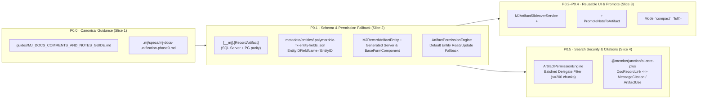

# MJ Docs Unification — Phase 0 Living Specification

> **Status:** Active (Slice 1 / P0.0 landed; Slices 2–4 pending)
> **Epic Task ID:** `4F2FB67B-5283-4E05-A435-0C1EF05A5A3C`
> **Approved FactoryPlan:** `B1404C16-5247-4AC3-A33B-E857008FF5C3` (v2, `CriteriaHash: 9536aa83511057af8b828a19fc4104fc6cecebcdbe5fc56dfa647339199dceca`)
> **Repository & Branches:** `MemberJunction/MJ` · Target: `next` · Epic Branch: `factory/4f2fb67b-mj-docs-unification-phase0`
> **Merge Governance:** `ProtectedHumanMergeRepos` — PR stays **OPEN** for human review once 100% green across CI and multi-vendor verification.

---

## 1. Objective & Architectural Scope

Phase 0 (`P0.0` through `P0.5`) establishes the canonical foundation for unifying **MJ Docs (`MJ: Artifacts`)**, **Anchored Record Comments (`MJ: Comments` / `MJ: Field Suggestions`)**, and **Quick Notes** across MemberJunction Core and all downstream Open Apps (`bizapps-*`):

### Slice Execution Plan

| Slice | Scope | Primary Targets | Parallelism |
| :--- | :--- | :--- | :--- |
| **Slice 1 (`P0.0`)** | Canonical Guide, `guides/README.md` index entry, living spec, CI workflow audit | `guides/MJ_DOCS_COMMENTS_AND_NOTES_GUIDE.md`, `guides/README.md`, `.mj/specs/mj-docs-unification-phase0.md` | Sequential (first) |
| **Slice 2 (`P0.1`)** | Additive `[__mj].[RecordArtifact]` SQL Server + deterministic PG migration, `spDeleteEntityWithCoreDependencies`, CodeGen (`MJRecordArtifactEntity` + server resolvers + core-entity-forms `BaseFormComponent`), `.polymorphic-fk-entity-fields.json`, default entity-level Read/Update fallback in `ArtifactPermissionEngine`, pre-declared barrel coordination | `migrations/v6/` (see §3.1 version note), `migrations-pg/v6/`, `metadata/entities/.polymorphic-fk-entity-fields.json`, `packages/MJCoreEntities/**`, `packages/Angular/Explorer/core-entity-forms/**`, `packages/MJServer/src/generated/**` | Sequential after Slice 1 |
| **Slice 3 (`P0.2`–`P0.4`)** | `MJArtifactSlideoverService` + `<mj-artifact-slideover>`, `<mj-record-docs-list>` + `PromoteNoteToArtifact`, `<mj-embedded-doc-panel Mode="compact" | "full">`, Vitest unit/DOM + token hygiene tests, headless Chromium Playwright verification | `packages/Angular/Generic/artifacts/**`, `packages/MJCoreEntities/src/custom/PromoteNoteToArtifact.ts` | Parallel with Slice 4 after Slice 2 |
| **Slice 4 (`P0.5`)** | Batched `DelegateEntityID` permission filter for vector/search retrieval, `DocRecordLink` (`[[...]]`) ↔ `MessageCitation` / `ArtifactUse` citation bridge, dual-DBMS seeded integration tests (`>= 20` domain records) | `packages/MJCoreEntities/src/custom/ArtifactPermissionDelegate.ts`, `packages/AI/CorePlus/src/doc-citation-bridge.ts`, `packages/IntegrationTests/**` | Parallel with Slice 3 after Slice 2 |

---

## 2. Acceptance Criteria & Verification Matrix

| ID | Layer | Acceptance Criterion | Verified By |
| :--- | :--- | :--- | :--- |
| **AC-1** | Task | `guides/MJ_DOCS_COMMENTS_AND_NOTES_GUIDE.md` and `.mj/specs/mj-docs-unification-phase0.md` document the complete 4-way decision rubric, `ArtifactID` FK vs. `__mj.RecordArtifact` rules, `DelegateEntityID` / `IArtifactPermissionDelegate` delegation model, `PUBLISH_NO_BREAK_POLICY.md` 4-step Expand-Bridge-Deprecate-EraBump playbook, explicit anti-goals, and copy-paste Angular + Server recipes synchronized with final implementation. | `ART-6` |
| **AC-2** | Global | Additive SQL Server migration creates `[${flyway:defaultSchema}].[RecordArtifact]` with required columns, FKs, `UQ_RecordArtifact_Record_Artifact_Role`, `IDX_RecordArtifact_Entity_Record`, and `spDeleteEntityWithCoreDependencies` handling; matching `.pg.sql` is generated strictly via `mj migrate convert --split --bake-codegen` (with bounded `.needs-hand` + `mj migrate rebake --file ... --capture-only` if needed), stamped at line 1 with `-- @mj-pg-provenance: split-bake v1`, passes 6-category SQL Server ↔ PostgreSQL schema-delta equivalence, clean Skyway `mj migrate` + `mj sync push --dir metadata --ci` (zero deploy-time `mj codegen`), and passes dual-DBMS rehearsal via `sf-workspace-db-broker.mjs rehearse-dual-db`. | `ART-4`, `ART-3` |
| **AC-3** | Task | `mj codegen` generates strongly typed `MJRecordArtifactEntity`; `metadata/entities/.polymorphic-fk-entity-fields.json` declares `EntityIDFieldName='EntityID'` on `RecordArtifact.RecordID`; dual form registration parity for `MJ: Record Artifacts` is verified via `MJGlobal.Instance.ClassFactory.GetRegistration(BaseFormComponent, 'MJ: Record Artifacts')`; and `ArtifactPermissionEngine` provides default entity-level Read/Update fallback when `DelegateEntityID` is set without a custom `IArtifactPermissionDelegate`. | `ART-1`, `ART-2`, `ART-7` |
| **AC-4** | Task | `@memberjunction/ng-artifacts` delivers `MJArtifactSlideoverService` + `<mj-artifact-slideover>`, `<mj-record-docs-list>` + `PromoteNoteToArtifact` helper, and `<mj-embedded-doc-panel Mode="compact" | "full">` adhering strictly to `OnPush`, `@if`/`@for`, `inject()`, `UserInfoEngine.Instance` (zero `localStorage`), batched `RunView` `ResultType: 'simple'`, zero `any`/`unknown`, zero `.Get()`/`.Set()`, zero cross-package re-exports, zero raw `#hex`/`rgb()`/`rgba()`/`hsl()` literals, and zero `window.print()` calls. | `ART-1`, `ART-2`, `ART-5`, `ART-7` |
| **AC-5** | Task | Batch `DelegateEntityID` permission filtering for vector/search retrieval and `DocRecordLink` (`[[...]]`) ↔ `@memberjunction/ai-core-plus` `MessageCitation` / `ArtifactUse` citation unification pass deterministic Vitest unit tests and multi-entity, multi-role real-world seeded cross-stack integration tests on both SQL Server and PostgreSQL with `>= 20` realistic domain records. | `ART-2`, `ART-3`, `ART-8` |
| **AC-6** | Global | All touched packages build cleanly, Vitest suites achieve 100% pass with zero `.skip` regressions, headless Chromium `PlaywrightScreenshot` renders all new Angular primitives with loaded icon fonts, zero raw Markdown leaks, `0 pageErrors`, `0 consoleErrors`, and verified CI workflows under `.github/workflows/` enforce build, unit tests, and static gates on PRs targeting `next`. | `ART-1`, `ART-2`, `ART-5` |

### Required Verification Artifacts (`ART-1`..`ART-8`)

- **`ART-1` (`BuildLog`)**: Clean TypeScript/Angular builds across `@memberjunction/core-entities`, `@memberjunction/ng-artifacts`, `@memberjunction/ai-core-plus`, and any CodeGen-updated packages (`@memberjunction/ng-core-entity-forms`, `@memberjunction/server`), plus CI workflow audit.
- **`ART-2` (`TestRun`)**: 100% passing Vitest unit and DOM suites (zero `.skip`) covering fallback delegation, batch filtering, `PromoteNoteToArtifact`, slideover service & component, record docs list, embedded doc panel, token/hygiene static assertions, and citation bridge.
- **`ART-3` (`IntegrationSuiteRun`)**: Dual-DBMS (SQL Server + PostgreSQL) real-world seeded integration checks (`record-artifact-permissions`, `promote-and-record-docs`, `delegated-search-and-citations`).
- **`ART-4` (`MigrationDryRun`)**: 4-part migration verification, `-- @mj-pg-provenance: split-bake v1` header check, 6-category SQL Server ↔ PostgreSQL schema-delta equivalence, and clean `mj migrate` + `mj sync push --dir metadata --ci`.
- **`ART-5` (`PlaywrightScreenshot`)**: Headless Chromium smoke renders across all new Angular primitives (including compact mode, slideover open/maximized/Escape-closed, and read-only delegated-permission state) with `pageErrors === 0`, `consoleErrors === 0`, loaded icon fonts, and zero raw Markdown leaks.
- **`ART-6` (`DocUpdate`)**: `guides/MJ_DOCS_COMMENTS_AND_NOTES_GUIDE.md`, `guides/README.md`, `.mj/specs/mj-docs-unification-phase0.md`, and synchronized package `README.md`s (`MJCoreEntities`, `ng-artifacts`, `AI/CorePlus`).
- **`ART-7` (`OpenAppReadinessReport`)**: 5-pillar readiness verification including `ClassFactory.GetRegistration(BaseFormComponent, 'MJ: Record Artifacts')`, `--mj-*` token compliance, zero `window.print()`, and zero `localStorage`.
- **`ART-8` (`SeedDensityReport`)**: Multi-entity, multi-role, multi-status seed audit (`>= 20` realistic domain records across organizations, people, roles, permissions, artifacts, versions, and record-artifact links).

### Active CI Workflows Verified on `next`

Inspected under `.github/workflows/`:

| Workflow | Trigger on `next` | Gate Coverage |
| :--- | :--- | :--- |
| `.github/workflows/ci-claude-md.yml` | `pull_request` + `push` on `next` | `npm run check:claude-md` (guide index in `guides/README.md`, link integrity, `CLAUDE.md`/`AGENTS.md` parity & byte budgets) |
| `.github/workflows/ci-standards.yml` | `pull_request` on `next` | `npm run check:standards` (adopted MJ standards across changed files) |
| `.github/workflows/ci-ui-tokens.yml` | `pull_request` on `next` (`packages/Angular/**`) | Hardcoded `#hex`/color token check + focus-ring check |
| `.github/workflows/ci-ui-button.yml` | `pull_request` on `next` (`packages/Angular/**`) | `mjButton` directive compliance |
| `.github/workflows/test.yml` | `pull_request` / `push` on `next` | Affected package builds, unit tests, and source guards (`check:guards`, `check:codegen-tail`) |
| `.github/workflows/build.yml` | `push` on `next` (`packages/**`, `pnpm-lock.yaml`) | Full monorepo Turbo build verification |
| `.github/workflows/migrations.yml` | `push` on `next` (`migrations/**`, `migrations-pg/**`) | Migration filename validation |
| `.github/workflows/pg-migrations.yml` | `pull_request` on `next` (`migrations-pg/**`, `packages/SQLConverter/**`) | Fresh PostgreSQL migration apply & non-stub verification |

---

## 3. Schema & Metadata Contract (`P0.1`)

### 3.1 Migration Folder & Major-Version Alignment Note

`AGENTS.md` requires the `migrations/v*/` directory to match the major version in the migration filename. On `next` at Slice 1 (`c1d4a4c4da`), the active release line is **`v6.3.x`** (`migrations/v6/V202611242026__v6.3.x__Metadata_Sync.sql` and `migrations-pg/v6/V202611242026__v6.3.x__Metadata_Sync.pg.sql`). Slice 2 MUST place the additive `v6.3.x` SQL Server migration in `migrations/v6/` and its deterministically converted PostgreSQL counterpart in `migrations-pg/v6/` (never misfiling a `v6.3.x` migration in `migrations/v5/`), keeping `migrations/v6` ↔ `migrations-pg/v6` paired.

### 3.2 `[__mj].[RecordArtifact]` Table Definition

- **Columns**:
  - `ID uniqueidentifier NOT NULL CONSTRAINT PK_RecordArtifact PRIMARY KEY DEFAULT newsequentialid()`
  - `EntityID uniqueidentifier NOT NULL CONSTRAINT FK_RecordArtifact_Entity REFERENCES [${flyway:defaultSchema}].[Entity] (ID)`
  - `RecordID nvarchar(700) NOT NULL`
  - `ArtifactID uniqueidentifier NOT NULL CONSTRAINT FK_RecordArtifact_Artifact REFERENCES [${flyway:defaultSchema}].[Artifact] (ID)`
  - `PinnedArtifactVersionID uniqueidentifier NULL CONSTRAINT FK_RecordArtifact_PinnedArtifactVersion REFERENCES [${flyway:defaultSchema}].[ArtifactVersion] (ID)`
  - `Role nvarchar(100) NOT NULL CONSTRAINT DF_RecordArtifact_Role DEFAULT N'General'`
  - `Sequence int NOT NULL CONSTRAINT DF_RecordArtifact_Sequence DEFAULT (0)`
  - `ContextDescription nvarchar(500) NULL`
  - `LinkedByUserID uniqueidentifier NULL CONSTRAINT FK_RecordArtifact_LinkedByUser REFERENCES [${flyway:defaultSchema}].[User] (ID)`
- **Constraints & Indexes**:
  - `CONSTRAINT UQ_RecordArtifact_Record_Artifact_Role UNIQUE (EntityID, RecordID, ArtifactID, Role)` — includes `EntityID` and keeps `Role NOT NULL DEFAULT 'General'` for identical SQL Server & PostgreSQL uniqueness semantics.
  - `CREATE INDEX IDX_RecordArtifact_Entity_Record ON [${flyway:defaultSchema}].[RecordArtifact] (EntityID, RecordID, Sequence)`
  - `CREATE INDEX IDX_RecordArtifact_ArtifactID ON [${flyway:defaultSchema}].[RecordArtifact] (ArtifactID)`
- **Extended Properties**: Table and every non-system column carry `sp_addextendedproperty` `MS_Description` metadata.
- **Core Entity Teardown**: Update `[${flyway:defaultSchema}].[spDeleteEntityWithCoreDependencies]` to delete `RecordArtifact` rows where `EntityID = @EntityID`.
- **4-Part Structure**: Hand-written DDL → 50+ blank lines → CodeGen banner comment → appended CodeGen output (`Entity`/`EntityField` with `MAX(Sequence)+1`, `vwRecordArtifacts`, `spCreateRecordArtifact`/`spUpdateRecordArtifact`/`spDeleteRecordArtifact`, triggers).
- **CodeGen Estate Outputs**: Slice 2 commits all synchronized CodeGen outputs produced for `MJ: Record Artifacts` (`packages/MJCoreEntities/src/generated/**`, `packages/Angular/Explorer/core-entity-forms/**`, `packages/MJServer/src/generated/**`) so `check:codegen-tail` (`subclasses === server === forms`) and `ClassFactory.GetRegistration(BaseFormComponent, 'MJ: Record Artifacts')` both pass.
- **Polymorphic FK Metadata**: `metadata/entities/.polymorphic-fk-entity-fields.json` adds `EntityIDFieldName: "EntityID"` on `MJ: Record Artifacts.RecordID` using `@lookup` `primaryKey` entries and no `sync` block.

---

## 4. Permission Delegation & Citation Alignment Contracts (`P0.1` & `P0.5`)

### 4.1 Default Entity-Level Read/Update Fallback (`ArtifactPermissionEngine`)

In `packages/MJCoreEntities/src/custom/ArtifactPermissionDelegate.ts`:

- When `artifact.DelegateEntityID` and `artifact.DelegateRecordID` are populated and `resolveDelegateInstance(...)` finds no registered custom delegate (and `DelegateEntityID` is not `'MJ: Artifacts'`):
  1. Resolve `EntityInfo` from `provider.EntityByID(artifact.DelegateEntityID)`. If missing → **fail closed (`Denied`)**.
  2. Evaluate `entityInfo.GetUserPermisions(user)`. If `!perms?.CanRead` → **fail closed (`Denied`)**.
  3. Execute a batched, primary-key-only `RunView` (`ResultType: 'simple'`, `Fields: pkNames`, `<= 200` keys per chunk) under `user` to verify the host record exists and passes row-level security. If absent → **fail closed (`Denied`)**.
  4. Resolve `{ CanRead: true, CanEdit: Boolean(perms.CanUpdate), CanDelete: Boolean(perms.CanDelete), CanShare: Boolean(perms.CanUpdate) || isOwner, Source: 'Delegate', Reason: ... }`.

### 4.2 Batched Vector/Search Permission Filter (`P0.5`)

- Accepts `(provider: IMetadataProvider, candidateArtifactIds: ReadonlyArray<string>, contextUser: UserInfo)` with explicit `contextUser` required on server paths.
- Chunks SQL `IN`-clauses strictly at `<= 200` IDs (`IN_CLAUSE_CHUNK_SIZE = 200`).
- Zero N+1 `GetEntityObject` loops; fails closed when `contextUser` is missing/anonymous/magic-link-scoped, `DelegateEntityID` is unknown, or the target record fails RLS.

### 4.3 `DocRecordLink` ↔ `MessageCitation` / `ArtifactUse` Unification (`P0.5`)

- Implemented in `packages/AI/CorePlus/src/doc-citation-bridge.ts` (exported from `packages/AI/CorePlus/src/index.ts`, zero cross-package re-exports).
- Deterministically maps both durable `@{"_mode":"mention","type":"record",...}` tokens and wiki `[[EntityName|RecordID|DisplayName]]` / `[[EntityName|RecordID]]` tokens outside fenced/inline Markdown code spans into deduplicated `MessageCitation` (`Kind: 'record' | 'artifact'`) records and structured `MJ: Artifact Uses` attribution payloads (`UsageType: MJArtifactUseEntity['UsageType']`).

---

## 5. Reusable `@memberjunction/ng-artifacts` & `PromoteNoteToArtifact` Contracts (`P0.2`–`P0.4`)

All new Angular components live in `@memberjunction/ng-artifacts` (L2 generic widgets: **zero `@angular/router` or Explorer imports**, `ChangeDetectionStrategy.OnPush`, `@if`/`@for`, `inject()`, semantic `--mj-*` tokens exclusively, `UserInfoEngine.Instance` for preferences, zero `localStorage`, zero `window.print()`).

### 5.1 `MJArtifactSlideoverService` & `<mj-artifact-slideover>` (`P0.2`)

- **Service Pattern (Goldfish-refined)**: Implemented as `@Injectable({ providedIn: 'root' })` so Angular DI provides one canonical root singleton across the app while allowing clean `TestBed` isolation in unit/DOM specs without conflicting dual instantiation paths.
- **Public API**:
  - `Open(request: ArtifactSlideoverOpenRequest): void` — `{ ArtifactID: string; VersionNumber?: number; CurrentUser?: UserInfo; CanEdit?: boolean; CanShare?: boolean; OnVersionSaved?: (event: ArtifactVersionSavedEvent) => void; }`
  - `Close(): void`
  - `ToggleMaximize(): void` — persists state via `UserInfoEngine.Instance.SetSettingDebounced('MJ.Artifacts.Slideover.Maximized', ...)` (never `localStorage`).
  - Observable/signal state exposing current open request, navigation history stack (for `NavigateToLink` chaining when clicking `[[...]]` links to another artifact), and maximized state.
- **`<mj-artifact-slideover>`**:
  - Wraps `<mj-artifact-viewer-panel>` with backdrop/drawer chrome, `Escape`-to-close `@HostListener`, maximize toggle, back navigation for chained artifact opens, and `@Output() OpenEntityRecord` for non-artifact record links.

### 5.2 `<mj-record-docs-list>` & `PromoteNoteToArtifact` (`P0.3`)

- **`<mj-record-docs-list>`**:
  - `@Input() EntityName!: string`
  - `@Input() RecordID!: string`
  - `@Input() CurrentUser!: UserInfo`
  - `@Input() AllowedRoles: readonly string[] = []`
  - `@Input() DefaultArtifactType = 'Markdown Document'`
  - `@Input() AllowCreate = true`
  - `@Input() AllowSynthesizeSlides = false`
  - `@Output() ArtifactOpened = new EventEmitter<RecordDocOpenedEvent>()`
  - Loads linked `MJ: Record Artifacts` and artifact headers in batched `RunView` (`ResultType: 'simple'`, `<= 200`-ID chunks) and resolves viewer permissions via `ArtifactPermissionEngine.Instance.ResolvePermissionsBatch` so read-only users see read-only cards with create/promote/synthesize actions hidden or disabled.
  - Automated tests for `AllowSynthesizeSlides` use deterministic mocks with zero live LLM token spend.
- **`PromoteNoteToArtifact`** (`packages/MJCoreEntities/src/custom/PromoteNoteToArtifact.ts`):
  - Accepts `(params: PromoteNoteToArtifactParams, contextUser?: UserInfo, provider?: IMetadataProvider)` and forwards `contextUser` to every `GetEntityObject` / `RunView` call.
  - Creates `MJ: Artifacts` (with `DelegateEntityID` + `DelegateRecordID`), v1 `MJ: Artifact Versions`, and optional `MJ: Record Artifacts` link.
  - Handles idempotent `UQ_RecordArtifact_Record_Artifact_Role` conflicts cleanly and performs compensating rollback/cleanup if a downstream save fails after creating the artifact header.

### 5.3 `<mj-embedded-doc-panel Mode="compact" | "full">` (`P0.4`)

- Wraps `MarkdownArtifactViewerComponent` with:
  - `@Input() ArtifactID!: string`
  - `@Input() CurrentUser!: UserInfo`
  - `@Input() Mode: 'compact' | 'full' = 'compact'` (compact hides outline rail and secondary studio bars)
  - `@Input() AutosaveDebounceMs = 1500` (enforces a minimum debounce floor of `>= 1000ms` to protect server/working-state throughput)
  - `@Output() VersionSaved = new EventEmitter<ArtifactVersionSavedEvent>()`
  - `@Output() OpenFullStudioRequested = new EventEmitter<string>()`
- Cancels or flushes pending autosave debounce timers cleanly on explicit **Save Version**, `[ArtifactID]` input change, and `ngOnDestroy`.
- Respects resolved `ArtifactPermissionEngine` permissions: when `CanEdit === false` (e.g., default `DelegateEntityID` Read-only fallback), renders in read-only mode with **Save Version** and edit controls hidden/disabled.
- Note on `MJ: Artifact Working States`: Working CRDT persistence routes through `DocumentCollaborationService` (`/collaboration/yjs`), never direct client `MJArtifactWorkingStateEntity.Save()` (which is API-locked by design).

### 5.4 Parallel Slice Coordination Note (Slices 3 & 4)

Because Slice 3 (`PromoteNoteToArtifact`) and Slice 4 (batch `ArtifactPermissionDelegate` filtering) run in parallel after Slice 2, Slice 2 should keep `packages/MJCoreEntities/src/index.ts` barrel sections clearly demarcated so Slices 3 and 4 append non-overlapping exports cleanly without merge conflicts.

---

## 6. Critical User Journeys (Goldfish-Refined)

### CUJ-1: Platform Application Developer Adopting Standardized Docs
1. Developer consults `guides/MJ_DOCS_COMMENTS_AND_NOTES_GUIDE.md` to select between Direct `MJ: Artifacts`, Hybrid Fast-Note + `PromoteNoteToArtifact`, `MJ: Comments`, and lightweight relational columns.
2. Embeds `<mj-record-docs-list>` or `<mj-embedded-doc-panel Mode="compact">` in an entity form using the copy-paste Angular recipes and delegates access via `DelegateEntityID` + `DelegateRecordID`.
3. **Expected Outcome**: Feature ships with standardized versioned storage, inherited entity permissions, and zero bespoke document tables.

### CUJ-2: Business User on a CRM / Project Record (Authoring, Navigation, Studio & Read-Only States)
1. **Editor Happy Path**: Opens a record form containing `<mj-record-docs-list>`, clicks **Promote Note** to convert a quick note into a versioned `Markdown Document` `MJ: Artifacts` linked via `[__mj].[RecordArtifact]`.
2. **Slideover Chaining & Preferences**: Clicks the linked artifact to open `<mj-artifact-slideover>`, follows an internal `[[...]]` `DocRecordLink` via `NavigateToLink` chaining, toggles maximize (persisted via `UserInfoEngine.Instance`, never `localStorage`), and presses `Escape` to close cleanly.
3. **Compact Embedded Editing & Full Studio Handoff**: Edits inside `<mj-embedded-doc-panel Mode="compact">` with debounced autosave (`>= 1000ms`), clicks **Save Version** (flushing any pending debounce timer and creating v2), and clicks **Open Full Studio** to expand into the full workspace.
4. **Read-Only Delegated-Permission Path**: A colleague with entity `CanRead = true` and `CanUpdate = false` (resolved via default `DelegateEntityID` fallback without a custom delegate) opens the same record and sees the document in read-only mode with edit, promote, create, and **Save Version** controls hidden/disabled.
5. **Expected Outcome**: Versions persist cleanly under delegated permissions, keyboard/chaining/studio transitions work deterministically, and read-only users cannot mutate or see unauthorized write affordances.

### CUJ-3: AI Agent & Search Retrieval Pipeline
1. Vector/search retrieval returns candidate delegated artifacts spanning multiple host entities.
2. Server-side pipeline invokes the batched `DelegateEntityID` permission filter with explicit `contextUser: UserInfo` (bounded `<= 200`-ID chunks, failing closed on unknown entities or RLS-hidden records).
3. Citation bridge maps `[[...]]` `DocRecordLink` references into deterministic `MessageCitation` and `MJ: Artifact Uses` payloads.
4. **Expected Outcome**: Unauthorized artifacts are stripped in bounded batched queries with zero N+1 overhead, and rendered conversation citations resolve deterministically to exact records and artifact versions.

### CUJ-4: MJ Explorer & Form-Host Administrator Verifying Governance & Auditability
1. Administrator opens MJ Explorer and navigates to `MJ: Record Artifacts`, confirming CodeGen dual form registration resolves cleanly via `MJGlobal.Instance.ClassFactory.GetRegistration(BaseFormComponent, 'MJ: Record Artifacts')`.
2. Inspects a `RecordArtifact` record form and grid, verifying `RecordID` renders a resolved clickable link to its polymorphic host record driven strictly by `EntityIDFieldName = 'EntityID'`.
3. Reviews `MJ: Artifact Uses` and `MJ: Audit Logs` trails confirming delegated reads, promotions, and citation references are recorded accurately under the acting user's identity.
4. **Expected Outcome**: Form-host registration parity, polymorphic navigation, and permission/usage audit trails operate end-to-end with zero manual wiring.

---

## 7. Explicit Non-Goals (Phase 0 Cutline)

- Migrating existing domain apps or BizApps forms onto `[__mj].[RecordArtifact]` (deferred to Phase 1+ following the 4-step Expand-Bridge-Deprecate-EraBump playbook).
- Breaking or removing any existing `ArtifactID` foreign keys or existing `MJ: Comments` / `MJ: Conversations` tables.
- Introducing `localStorage`/`sessionStorage` or `window.print()` anywhere in the stack.
- Hand-authoring freehand PostgreSQL `.pg.sql` files outside deterministic `mj migrate convert --split --bake-codegen`.
- Bypassing type safety (`any`, lazy `unknown`, `.Get()`/`.Set()`) or invoking live LLM endpoints inside automated Vitest/Playwright suites.
- Auto-merging the PR (`ProtectedHumanMergeRepos` keeps the PR open for human review once all CI and validation gates are green).
