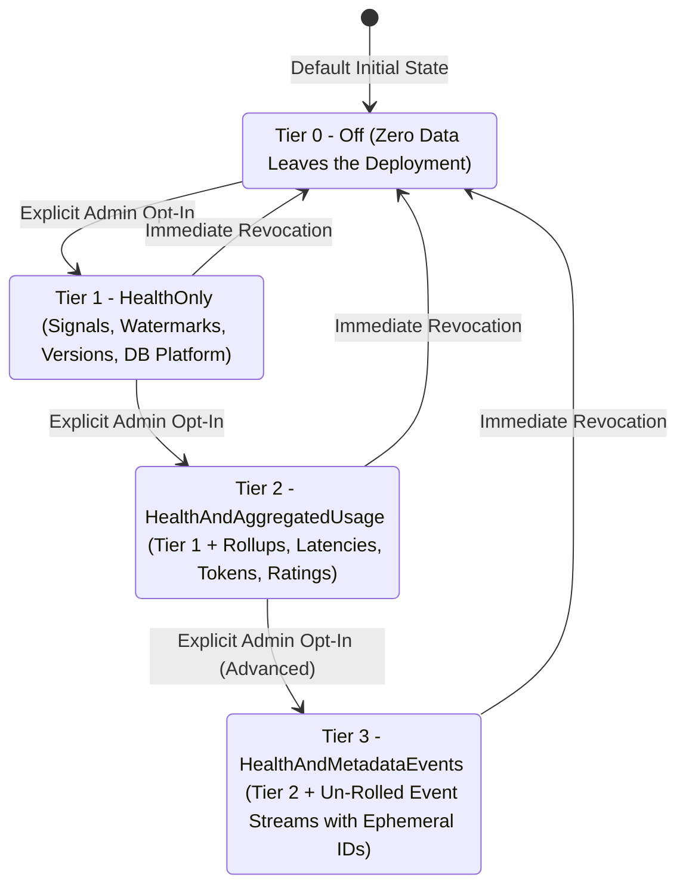

# MemberJunction Shareable Telemetry Schema Specification

- **Document Version:** 1.0.0
- **Status:** Normative Specification (PR #6420)
- **Target Audience:** Security Auditors, System Administrators, Framework Engineers, and AI Subagents
- **Companion Architecture Document:** [plans/mj-health-signals-and-openapp-live-probes.md](file:///Users/amith/Dropbox/develop/MJ-factory-builder/plans/mj-health-signals-and-openapp-live-probes.md)

---

## 1. Overview & Privacy Principles

This document specifies the exact, normative schema for data that can be packaged and shared outside an individual MemberJunction (MJ) deployment boundary.

In MemberJunction, **privacy is guaranteed by architecture, not by policy**. The system does not rely on post-hoc redaction filters, heuristic regexes, or LLM-based sanitizers. Instead, the data types and schema domain are structurally constrained so that personally identifiable information (PII), customer business data, free-text inputs, and conversation contents **have nowhere to live in a typed payload**.

### Core Guarantees

1. **Zero Content Transmission:** Prompt text, LLM completions, action inputs/outputs, and user messages are structurally excluded.
2. **Zero Personal Identifiers:** User IDs, full names, email addresses, IP addresses, and user session tokens are strictly absent.
3. **Zero Record Primary Keys:** Business record primary keys (`RecordID`), customer transaction IDs, and entity row identifiers cannot be represented in shareable payloads.
4. **Coarse Temporal Granularity:** High-resolution timestamps are forbidden; temporal observations are grouped into minimum one-minute intervals (`date_bucket`).
5. **Radical Transparency:** The complete payload for any outbound transmission can be previewed locally using `PreviewNextPackage()` before transmission, and all outbound dispatches are logged to an append-only local table (`__mj.TelemetryAuditLog`).

---

## 2. Consent Tiers & Data Boundaries

Telemetry sharing is governed by an explicit four-tier consent hierarchy. The default setting across all unmanaged and self-hosted environments is **Tier 0 (`Off`)**.



| Consent Tier | Permitted Data Categories | Strictly Forbidden Data | Default State |
|---|---|---|---|
| **Tier 0: `Off`** | **None.** Zero network traffic, zero packaging, zero background transmission. | All telemetry data. | **Default across all installations.** |
| **Tier 1: `HealthOnly`** | • `InstallProfile` (MJ core version, database engine, OS family)<br/>• `HealthSignals` (Rollup status `GREEN`/`YELLOW`/`RED`, signal codes, numeric latency metrics, pre-defined error classes) | Any usage statistics, execution counts, agent identifiers, prompt identifiers, user counts, or entity metrics. | Opt-in |
| **Tier 2: `HealthAndAggregatedUsage`** *(Primary Sharing Mode)* | • All Tier 1 data<br/>• Aggregated daily rollups of `AIAgents`, `AIPrompts`, `Actions`<br/>• Latency distributions (p50, p95, p99 percentiles)<br/>• Total token counts (input/output)<br/>• Aggregated rating averages (1–5 scale)<br/>• `FeatureAdoption` counts (k-anonymity enforced, min 5 users) | Raw event streams, individual request timings, correlation timestamps, any free-text strings, any record primary keys. | Opt-in |
| **Tier 3: `HealthAndMetadataEvents`** *(Advanced Operational Mode)* | • All Tier 2 data<br/>• Un-rolled individual event records for `AIAgents`, `AIPrompts`, and `Actions`<br/>• Minute-bucketed execution timestamps<br/>• Per-event metadata tuples (e.g. AgentID + ModelID + ErrorClass)<br/>• **Ephemeral per-payload `EventID`s only** | Local database run primary keys (`AIAgentRun.ID`), conversation IDs, user IDs, parameter values, error message strings. | Opt-in (Separate explicit confirmation required) |

---

## 3. Telemetry Field Type DSL Specification

The schema definition language is defined in `@memberjunction/telemetry/src/schema.ts`. Every field declared in a shareable provider must match one of the following closed types:

```typescript
export type TelemetryFieldType =
  | { kind: 'count' }                                       // Non-negative integer (e.g., 0, 1, 42)
  | { kind: 'duration_ms' }                                 // Non-negative number in milliseconds
  | { kind: 'tokens' }                                      // Non-negative integer token tally
  | { kind: 'rating'; min: number; max: number }            // Bounded numeric score (e.g., 1.0 to 5.0)
  | { kind: 'percentile'; buckets: readonly number[] }      // Distribution percentiles (e.g., [50, 95, 99])
  | { kind: 'enum'; values: readonly string[] }             // Compile-time static string literal union
  | { kind: 'metadata_uuid'; entity: SafeEntityType }       // UUID pointing strictly to SafeEntityType
  | { kind: 'histogram'; bucketKey: SafeBucketKey }         // Pre-defined categorical distribution
  | { kind: 'date_bucket'; granularity: 'minute' | 'hour' | 'day' } // Bucketed ISO calendar boundary
  | { kind: 'boolean' }                                     // Binary state (true / false)
  | { kind: 'version_string' };                             // SemVer string matching /^\d+\.\d+\.\d+/
```

### Architectural Omissions (Why Certain Types Do Not Exist)

The exclusion of certain primitive types is the foundation of the privacy architecture:

1. **No `string` Shape:**
   - Free-form text fields are completely omitted from the DSL.
   - Text classifications must use `{ kind: 'enum'; values: [...] }` with values declared at compile time, or `{ kind: 'version_string' }` constrained by a SemVer regular expression.
   - It is impossible for a provider to declare a field for user names, emails, prompt text, or raw error messages.
2. **No Raw `timestamp` Shape:**
   - Sub-second or microsecond timestamps can be correlated with server access logs, network captures, or concurrent user activity to de-anonymize actors.
   - Time is represented solely as `{ kind: 'date_bucket' }` with a minimum granularity of one minute (`'minute'`, `'hour'`, or `'day'`).
3. **No Generic `uuid` Shape:**
   - Unconstrained UUID fields could inadvertently capture user IDs, session tokens, or business record keys.
   - The only UUID type permitted is `{ kind: 'metadata_uuid'; entity: SafeEntityType }`, which enforces validation against the metadata allowlist.

---

## 4. Entity Allowlist & Exclusions

### 4.1 The `SafeEntityType` Allowlist

The `metadata_uuid` type is restricted to the following closed set of configuration artifacts:

```typescript
export type SafeEntityType =
  | 'Entity'            // Core or OpenApp entity metadata definitions
  | 'AIAgent'           // First-party AI Agent metadata definitions
  | 'AIAgentType'       // Architectural agent classification (e.g. Loop, Flow, Harness)
  | 'AIPrompt'          // First-party Prompt template configuration metadata
  | 'AIModel'           // LLM / Embedding model registration (e.g. Gemini 3.8 Flash, GPT-6.1 Sol, Claude Sonnet 5)
  | 'AIVendor'          // Model provider registration (e.g. Google, OpenAI, Anthropic)
  | 'AIConfiguration'   // Shared model configuration preset metadata
  | 'Action'            // Registered MJ Action metadata definition
  | 'Query'             // Saved catalog Query metadata definition (never parameter values or ad-hoc SQL)
  | 'Application'       // Registered Explorer Application metadata definition
  | 'OpenApp'           // Installed OpenApp catalog definition
  | 'Dashboard';        // Registered Dashboard metadata definition
```

Every entity in `SafeEntityType` represents an immutable configuration definition shipped with the platform or established during system provisioning.

### 4.2 Explicitly Excluded Entity Classes

The following entity types are **strictly excluded** from the allowlist. Any provider attempting to declare a reference to them will fail compile-time TypeScript checks and fail the CI allowlist gate:

| Excluded Entity Category | Concrete Entities (Non-Exhaustive) | Rationale for Exclusion |
|---|---|---|
| **Identity & Users** | `User`, `UserRole`, `UserView`, `UserSetting`, `UserFavorite` | Direct PII; exposes individual humans and user activities. |
| **Conversations & Chat** | `Conversation`, `ConversationDetail`, `ConversationArtifact` | Contains user prompt text, model responses, and message histories. |
| **Execution Runs** | `AIAgentRun`, `AIPromptRun`, `ActionExecutionLog` | Dynamic transactional instances containing runtime variables and parameter bindings. |
| **Customer Records** | All domain entity tables (e.g. `Account`, `Contact`, `Invoice`, `Member`) | Proprietary business data. |
| **Search & Ad-Hoc Filter Text** | `UserSearchHistory`, `AuditLog`, ad-hoc `RunView.ExtraFilter` / query params | May contain sensitive member names, search terms, or filtered entity values. |

---

## 5. Canonical Schemas

Below are the canonical JSON schemas generated from the compile-time DSL.

### 5.1 `InstallProfile` Schema

Emitted in Tiers 1, 2, and 3 to describe deployment topology.

```json
{
  "$schema": "https://json-schema.org/draft/2020-12/schema",
  "title": "InstallProfile",
  "type": "object",
  "required": ["InstallID", "MJVersion", "DatabasePlatform", "OSPlatform", "NodeVersion"],
  "additionalProperties": false,
  "properties": {
    "InstallID": {
      "type": "string",
      "format": "uuid",
      "description": "Opaque UUID minted once at initial installation. Never derived from tenant identity."
    },
    "FriendlyLabel": {
      "type": "string",
      "maxLength": 200,
      "description": "Optional administrator-designated label. Emitted ONLY if ShareFriendlyLabel is true."
    },
    "MJVersion": {
      "type": "string",
      "pattern": "^\\d+\\.\\d+\\.\\d+",
      "description": "Installed @memberjunction/core semantic version."
    },
    "DatabasePlatform": {
      "type": "string",
      "enum": ["sqlserver", "postgresql"]
    },
    "OSPlatform": {
      "type": "string",
      "enum": ["linux", "darwin", "win32"]
    },
    "NodeVersion": {
      "type": "string",
      "pattern": "^v\\d+\\.\\d+\\.\\d+"
    },
    "CloudProvider": {
      "type": "string",
      "enum": ["aws", "azure", "gcp", "self-hosted", "unknown"]
    }
  }
}
```

### 5.2 `HealthSignals` Schema

Emitted in Tiers 1, 2, and 3 to report operational integrity.

```json
{
  "$schema": "https://json-schema.org/draft/2020-12/schema",
  "title": "HealthSignals",
  "type": "object",
  "required": ["OverallStatus", "EvaluatedAtBucket", "SummaryCounts", "Signals"],
  "additionalProperties": false,
  "properties": {
    "OverallStatus": {
      "type": "string",
      "enum": ["GREEN", "YELLOW", "RED"]
    },
    "EvaluatedAtBucket": {
      "type": "string",
      "format": "date-time",
      "description": "ISO-8601 timestamp truncated to the nearest minute boundary."
    },
    "SummaryCounts": {
      "type": "object",
      "required": ["Green", "Yellow", "Red"],
      "additionalProperties": false,
      "properties": {
        "Green": { "type": "integer", "minimum": 0 },
        "Yellow": { "type": "integer", "minimum": 0 },
        "Red": { "type": "integer", "minimum": 0 }
      }
    },
    "Signals": {
      "type": "array",
      "items": {
        "type": "object",
        "required": ["Code", "Layer", "Status", "DurationMs"],
        "additionalProperties": false,
        "properties": {
          "Code": {
            "type": "string",
            "pattern": "^[A-Z0-9_]+(\\.[A-Z0-9_]+)+$"
          },
          "Layer": {
            "type": "string",
            "enum": ["core", "open-app", "server-extension", "connector", "live-test"]
          },
          "Status": {
            "type": "string",
            "enum": ["GREEN", "YELLOW", "RED"]
          },
          "DurationMs": {
            "type": "number",
            "minimum": 0
          },
          "ErrorClass": {
            "type": "string",
            "enum": [
              "none",
              "connection_timeout",
              "pool_exhaustion",
              "schema_version_drift",
              "metadata_desync",
              "rate_limit_exceeded",
              "auth_failure",
              "rls_check_failure",
              "event_loop_lag_critical",
              "unhandled_probe_exception"
            ]
          }
        }
      }
    }
  }
}
```

### 5.3 `AIAgents` Schema (Aggregated & Raw)

#### Aggregated Mode (Tier 2 & Tier 3)
```json
{
  "$schema": "https://json-schema.org/draft/2020-12/schema",
  "title": "AIAgentsAggregated",
  "type": "array",
  "items": {
    "type": "object",
    "required": [
      "AgentID", "AgentTypeID", "DayUTC", "RunCount", "SuccessCount", "FailureCount",
      "LatencyP50Ms", "LatencyP95Ms", "LatencyP99Ms", "InputTokens", "OutputTokens"
    ],
    "additionalProperties": false,
    "properties": {
      "AgentID": { "type": "string", "format": "uuid" },
      "AgentTypeID": { "type": "string", "format": "uuid" },
      "DayUTC": { "type": "string", "format": "date" },
      "RunCount": { "type": "integer", "minimum": 0 },
      "SuccessCount": { "type": "integer", "minimum": 0 },
      "FailureCount": { "type": "integer", "minimum": 0 },
      "LatencyP50Ms": { "type": "number", "minimum": 0 },
      "LatencyP95Ms": { "type": "number", "minimum": 0 },
      "LatencyP99Ms": { "type": "number", "minimum": 0 },
      "InputTokens": { "type": "integer", "minimum": 0 },
      "OutputTokens": { "type": "integer", "minimum": 0 },
      "AverageRating": { "type": "number", "minimum": 1.0, "maximum": 5.0 },
      "ErrorsByClass": {
        "type": "object",
        "additionalProperties": { "type": "integer", "minimum": 0 }
      }
    }
  }
}
```

#### Raw Events Mode (Tier 3 Only)
```json
{
  "$schema": "https://json-schema.org/draft/2020-12/schema",
  "title": "AIAgentsRaw",
  "type": "array",
  "items": {
    "type": "object",
    "required": [
      "EventID", "AgentID", "AgentTypeID", "ModelID", "VendorID",
      "StartedAtBucket", "LatencyMs", "InputTokens", "OutputTokens", "Status"
    ],
    "additionalProperties": false,
    "properties": {
      "EventID": {
        "type": "string",
        "format": "uuid",
        "description": "Freshly minted ephemeral UUID. Never equals AIAgentRun.ID."
      },
      "AgentID": { "type": "string", "format": "uuid" },
      "AgentTypeID": { "type": "string", "format": "uuid" },
      "ModelID": { "type": "string", "format": "uuid" },
      "VendorID": { "type": "string", "format": "uuid" },
      "StartedAtBucket": {
        "type": "string",
        "format": "date-time",
        "description": "Truncated to 1-minute boundary."
      },
      "LatencyMs": { "type": "number", "minimum": 0 },
      "InputTokens": { "type": "integer", "minimum": 0 },
      "OutputTokens": { "type": "integer", "minimum": 0 },
      "Status": { "type": "string", "enum": ["success", "failure", "timeout"] },
      "ErrorClass": {
        "type": "string",
        "enum": ["model_timeout", "rate_limit", "context_window_exceeded", "tool_validation_failed", "internal_error"]
      },
      "UserRating": { "type": "number", "minimum": 1.0, "maximum": 5.0 }
    }
  }
}
```

### 5.4 `AIPrompts` Schema (Aggregated)

```json
{
  "$schema": "https://json-schema.org/draft/2020-12/schema",
  "title": "AIPromptsAggregated",
  "type": "array",
  "items": {
    "type": "object",
    "required": ["PromptID", "ModelID", "DayUTC", "ExecutionCount", "LatencyP50Ms", "InputTokens", "OutputTokens"],
    "additionalProperties": false,
    "properties": {
      "PromptID": { "type": "string", "format": "uuid" },
      "ModelID": { "type": "string", "format": "uuid" },
      "DayUTC": { "type": "string", "format": "date" },
      "ExecutionCount": { "type": "integer", "minimum": 0 },
      "SuccessCount": { "type": "integer", "minimum": 0 },
      "LatencyP50Ms": { "type": "number", "minimum": 0 },
      "LatencyP95Ms": { "type": "number", "minimum": 0 },
      "InputTokens": { "type": "integer", "minimum": 0 },
      "OutputTokens": { "type": "integer", "minimum": 0 }
    }
  }
}
```

### 5.5 `Actions` Schema (Aggregated)

```json
{
  "$schema": "https://json-schema.org/draft/2020-12/schema",
  "title": "ActionsAggregated",
  "type": "array",
  "items": {
    "type": "object",
    "required": ["ActionID", "DayUTC", "InvocationCount", "SuccessCount", "FailureCount", "LatencyP50Ms"],
    "additionalProperties": false,
    "properties": {
      "ActionID": { "type": "string", "format": "uuid" },
      "DayUTC": { "type": "string", "format": "date" },
      "InvocationCount": { "type": "integer", "minimum": 0 },
      "SuccessCount": { "type": "integer", "minimum": 0 },
      "FailureCount": { "type": "integer", "minimum": 0 },
      "LatencyP50Ms": { "type": "number", "minimum": 0 },
      "LatencyP95Ms": { "type": "number", "minimum": 0 }
    }
  }
}
```

### 5.6 `FeatureAdoption` Schema (Aggregated, k-Anonymity Enforced)

Tracks platform capability utilization without identifying individual users or schemas:

```json
{
  "$schema": "https://json-schema.org/draft/2020-12/schema",
  "title": "FeatureAdoption",
  "type": "object",
  "required": ["DayUTC", "ActiveUserCountBucket", "ResourceInteractions", "ScrubbedRouteInteractions"],
  "additionalProperties": false,
  "properties": {
    "DayUTC": { "type": "string", "format": "date" },
    "ActiveUserCountBucket": {
      "type": "string",
      "enum": ["1-4", "5-10", "11-50", "51-250", "251-1000", "1000+"],
      "description": "k-anonymity gate: if active users < 5, detailed route statistics are suppressed."
    },
    "ResourceInteractions": {
      "type": "object",
      "required": ["RecordViews", "QueryExecutions", "DashboardOpens", "SearchCount"],
      "additionalProperties": false,
      "properties": {
        "RecordViews": { "type": "integer", "minimum": 0 },
        "QueryExecutions": { "type": "integer", "minimum": 0 },
        "DashboardOpens": { "type": "integer", "minimum": 0 },
        "SearchCount": { "type": "integer", "minimum": 0 }
      }
    },
    "ScrubbedRouteInteractions": {
      "type": "array",
      "items": {
        "type": "object",
        "required": ["RouteTemplate", "OpenCount"],
        "additionalProperties": false,
        "properties": {
          "RouteTemplate": {
            "type": "string",
            "enum": [
              "app/:appName/record/:entityName/:recordId",
              "resource/record/:entityName/:recordId",
              "resource/view/:viewId",
              "resource/dashboard/:dashboardId",
              "resource/search/:searchInput",
              "unknown"
            ]
          },
          "OpenCount": { "type": "integer", "minimum": 0 }
        }
      }
    }
  }
}
```

### 5.7 `ServerMetrics` Schema

Emitted to track host runtime health.

```json
{
  "$schema": "https://json-schema.org/draft/2020-12/schema",
  "title": "ServerMetrics",
  "type": "object",
  "required": ["WindowStartBucket", "WindowEndBucket", "HttpRequests", "GraphQLExecutions", "EventLoopLagP99Ms"],
  "additionalProperties": false,
  "properties": {
    "WindowStartBucket": { "type": "string", "format": "date-time" },
    "WindowEndBucket": { "type": "string", "format": "date-time" },
    "HttpRequests": {
      "type": "object",
      "required": ["TotalCount", "DurationP50Ms", "DurationP95Ms", "ErrorCount"],
      "additionalProperties": false,
      "properties": {
        "TotalCount": { "type": "integer", "minimum": 0 },
        "DurationP50Ms": { "type": "number", "minimum": 0 },
        "DurationP95Ms": { "type": "number", "minimum": 0 },
        "ErrorCount": { "type": "integer", "minimum": 0 }
      }
    },
    "GraphQLExecutions": {
      "type": "object",
      "required": ["TotalCount", "DurationP50Ms", "DurationP95Ms"],
      "additionalProperties": false,
      "properties": {
        "TotalCount": { "type": "integer", "minimum": 0 },
        "DurationP50Ms": { "type": "number", "minimum": 0 },
        "DurationP95Ms": { "type": "number", "minimum": 0 }
      }
    },
    "EventLoopLagP99Ms": {
      "type": "number",
      "minimum": 0,
      "description": "99th percentile Node.js event loop delay over the window."
    },
    "MemoryHeapUsedBytes": { "type": "integer", "minimum": 0 },
    "DbPoolActiveConnections": { "type": "integer", "minimum": 0 }
  }
}
```

---

## 6. Verification & Auditing Mechanics

Security auditors and deployment engineers have multiple deterministic mechanisms to verify compliance before and during operation.

### 6.1 The CI Static Allowlist Gate Test

The test suite in `packages/Telemetry/src/__tests__/schema-ci-gate.test.ts` executes on every pull request and build:
1. **AST Scan:** Discovers all classes decorated with `@RegisterClass(BaseTelemetryProvider, ...)`.
2. **Type Allowlist Check:** Verifies that every field type maps strictly to the `TelemetryFieldType` union.
3. **Entity Allowlist Check:** Verifies that every `{ kind: 'metadata_uuid' }` references an entity present in `SafeEntityType`.
4. **Pattern Deny-List Check:** Rejects any provider declaring field names containing forbidden substrings (regardless of casing):
   `Content`, `PromptText`, `CompletionText`, `Message`, `User`, `Email`, `Secret`, `Token`, `Password`, `RecordID`, `PrimaryValue`.

If any provider violates these constraints, **the build fails immediately**, preventing publication to npm.

### 6.2 Administrator Local Preview (`PreviewNextPackage()`)

Administrators can inspect telemetry payloads locally via the MJ Explorer administrative console or the CLI:

```bash
# Execute local preview via MJ CLI
mj telemetry preview --tier HealthAndAggregatedUsage
```

This invokes `ShareLayerPackager.Instance.PreviewNextPackage()`, executing the extraction queries, applying Zod schema validation, and rendering the exact JSON output in the console without establishing network connections or writing to outbound queues.

### 6.3 Local Audit Log (`__mj.TelemetryAuditLog`)

Every payload dispatched to an external sink writes an immutable record to the local database:

```sql
SELECT 
    AuditID,
    SinkKey,
    ConsentTier,
    DispatchedAt,
    StatusCode,
    PackageManifestJson
FROM __mj.TelemetryAuditLog
ORDER BY DispatchedAt DESC;
```

The manifest includes payload byte lengths, provider row counts, schema versions, and cryptographic hashes (SHA-256), providing a full verifiable audit trail of all outbound activity.
