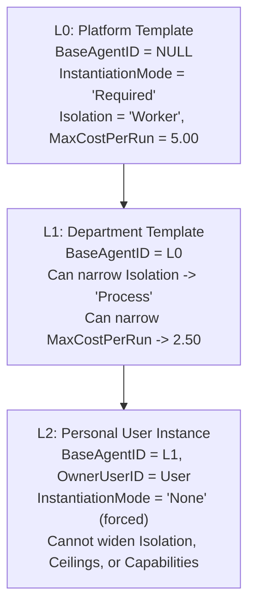
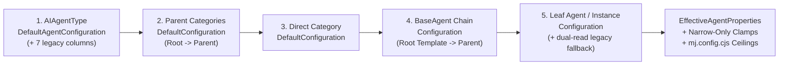
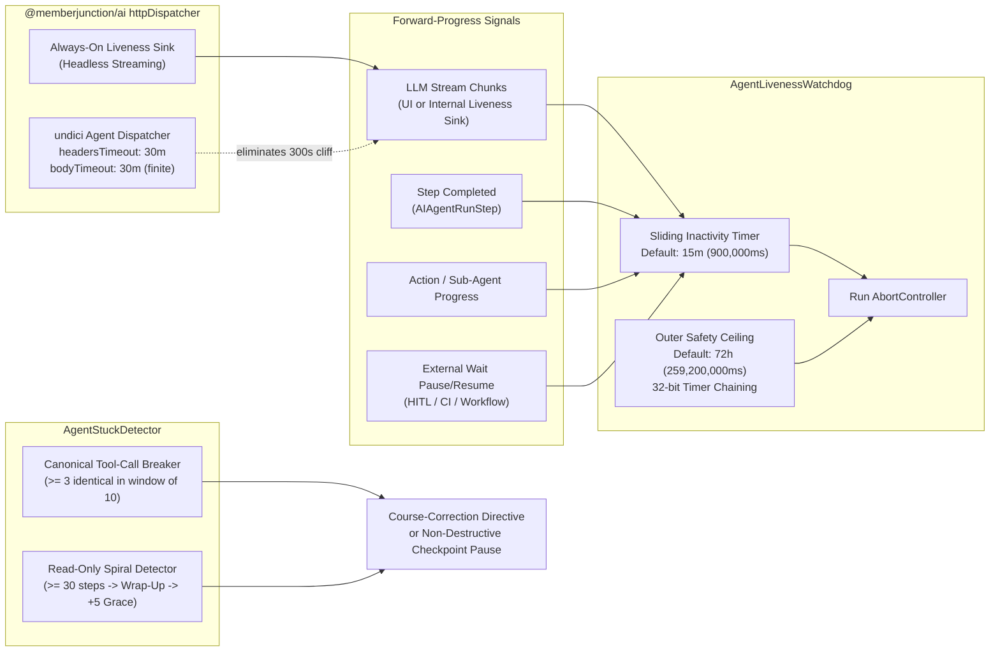

# MemberJunction AI Agent Administrator Guide

This guide is the authoritative reference for **platform administrators, security architects, and operators** governing MemberJunction AI Agents. It covers security and sandbox boundaries, prototype inheritance (`BaseAgentID`), the 3-table `IAgentConfiguration` cascade, the `v6.x` → `v7.0` legacy column deprecation roadmap, sliding liveness watchdogs, `undici` long-running HTTP transport tuning, semantic stuck-run detection, and `MJ: AI Agent Step Types` administration.

> **Canonical Agent Documentation Suite**
> - **Administrators & Operators:** [Agent Administrator Guide](AGENT_ADMINISTRATOR_GUIDE.md) *(this guide)*
> - **Developers & Extension Authors:** [Agent Builder & Extension Guide](AGENT_BUILDER_EXTENSION_GUIDE.md)
> - **Everyday Users & Personal Instances:** [Agent End-User Guide](AGENT_END_USER_GUIDE.md)
> - **Subclass & PR Rebase Reference:** [BaseAgent Rebase Map](BASE_AGENT_REBASE_MAP.md)

---

## 1. Security Model, Sandboxing & Governance Invariants

MemberJunction enforces defense-in-depth across database Row-Level Security (RLS), server-side entity validation (`MJAIAgentEntityServer`), metadata resolution (`AIEngineBase.ResolveEffectiveAgentProperties`), and runtime execution (`BaseAgentLimitsHelper` & `BaseAgentActionPolicyHelper`).

### 1.1 `BaseAgentID` Prototype Inheritance & Narrow-Only Invariants

Instead of cloning agent rows, derived agents reference a prototype template through `AIAgent.BaseAgentID` (up to `MAX_AGENT_INHERITANCE_DEPTH = 5` hops, cycle-checked at save and resolution time). Capabilities flow down live; security bounds **never loosen** down a chain.



Every narrow-only invariant enforced by `AIEngineBase.ResolveEffectiveAgentProperties` (`packages/AI/BaseAIEngine/src/BaseAIEngine.ts`) and `ValidateAgentInheritanceAndSandbox` (`packages/MJCoreEntitiesServer/src/custom/MJAIAgentEntityServer.server.ts`):

| Control | Direction | Enforcement Rule |
| --- | --- | --- |
| **`Isolation`** | Strictest wins (`Container` > `Process` > `Worker` > `InProcess`) | Descendant cannot choose a less strict isolation level than any ancestor. |
| **`AcceptsSkills`** | Narrow-only (`All` → `Limited` → `None`) | Monotonic minimum rank down the `BaseAgentID` chain. |
| **`Configuration.skills.activationMode`** (`SkillActivationMode`) | Narrow-only (`Auto` → `RequestedOnly`) | Once `RequestedOnly` on a template, no descendant can re-enable `Auto`. |
| **`Configuration.scope.searchScopeAccess`** (`SearchScopeAccess`) | Narrow-only (`All` → `Assigned` → `None`) | Descendant cannot widen search scope access beyond its ancestor. |
| **`Configuration.execution.requirePlanMode`** (`RequirePlanMode`) | Monotonic `OR` | If an AgentType, Category, or ancestor requires Plan Mode (`true`), every descendant requires it. |
| **`Configuration.execution.supportsPlanMode`** (`SupportsPlanMode`) | Monotonic `AND` | If an AgentType, Category, or ancestor disables Plan Mode (`false`), descendants cannot re-enable it. |
| **`Configuration.clientTools.allowEphemeral`** (`AllowEphemeralClientTools`) | Monotonic `AND` | Once `false` on a Category, AgentType, or ancestor, descendants cannot enable ephemeral client tools. |
| **`Configuration.attachments.acceptUnregisteredFiles`** (`AcceptUnregisteredFiles`) | Monotonic `AND` | Once `false`, descendants cannot widen to `true`. |
| **Run Ceilings** (`MaxCostPerRun`, `MaxTokensPerRun`, `MaxTimePerRun`, `MaxIterationsPerRun`) | Monotonic `Math.min` | Clamped against every ancestor agent, every ancestor `AIAgentUserPolicy`, and `mj.config.cjs` ceilings. |
| **Sub-Agent Ceilings** (`subAgentExecution.maxExecutionsPerRun`, `subAgentExecution.maxConsultRounds`) | Monotonic `Math.min` | Clamped to the minimum finite positive value across defaults and the inheritance chain. |
| **Inherited Actions & Grants** | Descendant Veto | Any descendant `AIAgentAction` or `AIAgentSkill` row with `Status !== 'Active'` (`Revoked`, `Pending`) vetoes the inherited grant. |

### 1.2 Non-Admin (`UI` Role) Ownership & RLS Sandbox (`#6852`)

`MJAIAgentEntityServer` (`packages/MJCoreEntitiesServer/src/custom/MJAIAgentEntityServer.server.ts`) uses `IsAgentAdminOrOwnerUser(user)` — returning `true` for internal system-context saves (`user == null`), `Owner`-type users, or members of the `System Administrator`, `Administrator`, `Admin`, `Administration`, or `Agent Administrator` roles (tracked for future migration to a dedicated MJ `Authorization` per `UNIFIED_PERMISSIONS_GUIDE.md`) — and enforces the following sandbox for all non-admin users:

1. **Derived Instances Only:** Non-admin users can only create, update, or delete rows with `BaseAgentID != null`. Root catalog agents (`BaseAgentID == null`) are admin-only.
2. **Immutable Lineage & Ownership:**
   - `OwnerUserID` is auto-attributed on create to `ContextCurrentUser.ID` and verified against pre-save `OldValue` on update and delete so ownership cannot be hijacked or reassigned.
   - `BaseAgentID` cannot be re-parented on an existing saved instance.
   - Only one active `IsPrimaryInstance = true` row exists per `(OwnerUserID, RootBaseAgentID)`.
3. **Instantiation Gate & Quotas:**
   - Creating a derived instance requires `baseAgent.InstantiationMode !== 'None'` (`'Optional'` or `'Required'`) and effective `CanRun` permission on `BaseAgentID` (evaluated via `AIAgentPermissionHelper.ComputeEffectivePermissionsSync` with fail-closed ancestor `CanRun`).
   - Enforces `instantiation.maxInstancesPerUser` (read from `Configuration.instantiation` / `TypeConfiguration.instantiation`) against active instances owned by that user.
   - Personal instances must keep `InstantiationMode = 'None'` and `ExposeAsAction = false`.
4. **Admin-Only Extension Fields (`DriverClass` & `helperPlugins`):**
   - Non-admin users **cannot** set a custom `DriverClass` on a derived instance.
   - Non-admin users **cannot** configure **any** `Configuration.helperPlugins` (or `TypeConfiguration.helperPlugins`) entries.

See [Agent Permissions & Inheritance Guide](AGENT_PERMISSIONS_AND_INHERITANCE_GUIDE.md) for the full 2×2 RBAC matrix and SQL RLS view details.

### 1.3 Code-Only Security Seams

`BaseAgent` delegates execution across 13 pluggable helper seams (`packages/AI/Agents/src/helpers/`). Seven behavioral seams (`messaging`, `payload`, `compaction`, `realtime`, `iteration`, `skills`, `prompt`) can be overridden per agent by administrators via `Configuration.helperPlugins`. **Six security- and invariant-critical seams are strictly code-only** and can **never** be overridden from database metadata — not even by System Administrators:

| Code-Only Seam | Base Token Class | Why Metadata Override Is Forbidden |
| --- | --- | --- |
| **`limits`** | `BaseAgentLimitsHelper` | Owns 5-tier budget resolution, `AgentTreeBudgetTracker`, `BudgetEnforcementGuard`, runaway governance, cooperative pause, `AgentLivenessWatchdog`, and `AgentStuckDetector`. |
| **`actionPolicy`** | `BaseAgentActionPolicyHelper` | Owns taint tracking (`TaintedSources`), tainted-egress checks, bound/hidden action parameters, per-user action policies (`CheckUserActionPolicy`), audience enforcement, and run-scope validation. |
| **`setup`** | `BaseAgentRunSetupHelper` | Owns run-permission verification, `ResolveFullRunLimits`, liveness watchdog lifecycle, and Plan Mode gate resolution. |
| **`steps`** | `BaseAgentStepExecutionHelper` | Owns per-step tree-budget checks, Plan Mode unapproved-step gating, and step-type dispatch. |
| **`actions`** | `BaseAgentActionsHelper` | Invokes `CheckUserActionPolicy`, `CheckTaintedEgress`, and bound/hidden parameter enforcement around every action call. |
| **`subAgents`** | `BaseAgentSubAgentHelper` | Invokes sub-agent execution permission checks and parent/child budget & watchdog propagation. |

This invariant is enforced in **two independent layers**:
1. **Entity Save Time (`ValidateAgentInheritanceAndSandbox` & `ValidateAgentConfigurationJson`):** Checks `IsForbiddenMetadataHelperSeam(plugin.seam)` from `@memberjunction/ai-core-plus` (rejecting `'limits'`, `'actionpolicy'`, `'policy'`, `'permissions'`, `'permission'`, `'setup'`, `'steps'`, `'actions'`, `'subagents'`, and `'subagent'`, case- and punctuation-insensitive) for **all** users including administrators.
2. **Runtime Resolution (`AgentHelperCache.ResetForRun` & `ResolveAgentHelper` in `packages/AI/Agents/src/helpers/AgentHelperResolver.ts`):** Re-checks `CODE_ONLY_HELPER_SEAMS` and `IsForbiddenMetadataHelperSeam` before resolving any `DriverClass`, throwing a `Security violation` error if a tampered database row attempts to override any code-only seam.

To customize any code-only seam organization-wide, deploy a server-side `@RegisterClass(BaseAgent<Seam>Helper, 'Default', priority)` subclass in audited TypeScript code (see [Agent Builder & Extension Guide](AGENT_BUILDER_EXTENSION_GUIDE.md)).

### 1.4 5-Tier Limits Hierarchy & `mj.config.cjs` Ceilings

`LimitsConfigResolver` (`packages/MJCore/src/generic/limitsConfig.ts`) merges execution budgets, liveness timers, stuck-detector thresholds, isolation ceilings, and resource guards across five tiers (lowest to highest priority, with org ceilings clamping downward):

1. **`CodeFallback`** (`CODE_FALLBACK_LIMITS` in `@memberjunction/core`)
2. **`MjConfig`** (`mj.config.cjs` `limits` block registered via `LimitsConfigResolver.RegisterMjConfigLimits`)
3. **`AgentOrWorkflowMetadata`** (`AIAgent.MaxCostPerRun`, `MaxTokensPerRun`, `MaxTimePerRun`, `MaxIterationsPerRun`)
4. **`UserAgentPolicy`** (`MJ: AI Agent User Policies` intersected strictest-wins across the `BaseAgentID` chain)
5. **`RunOverride`** (`ExecuteAgentParams` per-run limits)

Example `mj.config.cjs` `limits` section:

```javascript
// mj.config.cjs
module.exports = {
  // ...database & server config...
  limits: {
    AgentAbsoluteIterations: 250,
    Budgets: {
      PerRun: {
        MaxCostUsd: 10.0,
        MaxTokens: 2_000_000,
        MaxWallClockMs: null, // Defer to Liveness.OuterMaxWallClockMs unless a hard run cap is desired
      },
      PerUserPerDay: {
        MaxCostUsd: 50.0,
        MaxWallClockMs: null,
        DayBoundaryTimezone: 'UTC',
      },
      CountPausedTimeTowardsWallClock: false,
    },
    Liveness: {
      Enabled: true,
      InactivityTimeoutMs: 900_000,        // 15m sliding inactivity window
      OuterMaxWallClockMs: 259_200_000,    // 72h outer safety ceiling
      StreamChunkTouchThrottleMs: 5_000,   // 5s throttle on stream-chunk timer resets
      HttpHeadersTimeoutMs: 1_800_000,     // 30m undici headersTimeout (0 = disable, rely on AbortSignal)
      HttpBodyTimeoutMs: 0,                // 0 = disabled, rely on AbortSignal
    },
    StuckDetector: {
      Enabled: true,
      WindowSize: 10,                      // Sliding tool-call fingerprint window
      IdenticalToolCallThreshold: 3,       // Course-correct at 3 identical calls, pause if repeated again
      ReadOnlyStepThreshold: 30,           // Wrap-up directive after 30 consecutive read-only steps
      ReadOnlyPostDirectiveGraceSteps: 5,  // Pause if 5 more read-only steps occur after wrap-up
    },
  },
};
```

---

## 2. Three-Table `IAgentConfiguration` Cascade

Operational agent settings live in a single strongly-typed JSON contract — **`IAgentConfiguration`** (defined canonically in `metadata/entities/JSONType-interfaces/IAgentConfiguration.ts` and auto-copied into `packages/AI/CorePlus/src/JSONType-interfaces/IAgentConfiguration.ts` at build time via `sync:json-types`) — stored across three tables:

| Table (Entity Name) | JSON Column | Role in Cascade |
| --- | --- | --- |
| **`MJ: AI Agent Types`** (`AIAgentType`) | `DefaultAgentConfiguration` | Lowest metadata tier: defaults shared by every agent of that type (e.g., `Loop`, `Flow`, `Harness`). *(Distinct from `AIAgentType.DefaultConfiguration`, which holds per-type `TypeConfiguration` defaults.)* |
| **`MJ: AI Agent Categories`** (`AIAgentCategory`) | `DefaultConfiguration` | Middle metadata tier: inherited recursively along `AIAgentCategory.ParentID` (root category → child category) for operational grouping (e.g., *Executive Assistants*, *Research*). |
| **`MJ: AI Agents`** (`AIAgent`) | `Configuration` | Highest metadata tier: merged root template → intermediate templates → leaf instance along `BaseAgentID`. |

### 2.1 Resolution Order (`AIEngineBase.ResolveEffectiveAgentProperties`)



Key merge semantics implemented in `DeepMergeAgentConfigurations` and `ResolveEffectiveAgentProperties`:
- **Deep object merge:** Nested section objects (`execution`, `contextWindow`, `memory`, `payload`, `subAgentExecution`, `attachments`, `artifacts`, `scope`, `skills`, `clientTools`, `recording`, `promptDefaults`) merge recursively by leaf key; higher-precedence tiers override only the keys they specify.
- **Base-chain category folding:** Categories referenced by every node along the `BaseAgentID` chain (root template → intermediate templates → leaf) are folded into the category tier so a derived instance can never drop narrow-only policies enforced by an ancestor's category. Keys set only by an ancestor's category flow to derived leaves, while deduplication keeps the **last** occurrence of each category ID so the leaf's own category chain takes precedence for overridable keys.
- **Arrays and `null` replace cleanly:** Setting an array or explicit `null` replaces the lower-tier value.
- **Stripping template-only UX hints:** `instantiation` (suggested names, icons, personality presets, `maxInstancesPerUser`) is stripped from resolved `Configuration` and `TypeConfiguration` on non-instantiable leaf instances (`BaseAgentID != null && InstantiationMode === 'None'`).
- **Cumulative `helperPlugins`:** Admin-authored `helperPlugins` entries are collected in order (`AgentType → Categories → BaseAgent Chain → Agent`) and resolved by ascending `priority` (highest `priority` wins per seam; ties favor the later entry).
- **Clean separation from `TypeConfiguration`:** `AIAgent.TypeConfiguration` remains strictly per-AgentType (validated against `AIAgentType.ConfigSchema`, preserving `"additionalProperties": false` on schemas such as `realtime-type-config.schema.json`). `AIAgent.AgentTypePromptParams` remains per-AgentType prompt options (layered over `Configuration.promptDefaults`).

### 2.2 `IAgentConfiguration` Section Reference

| Section | Keys | Governance Notes |
| --- | --- | --- |
| `execution` | `modelSelectionMode`, `defaultPromptEffortLevel`, `chatHandlingOption`, `supportsPlanMode`, `requirePlanMode`, `declareActionsAsNativeTools` | `requirePlanMode` is monotonic `OR`; `supportsPlanMode` is monotonic `AND`. *(`chatHandlingOption` remains a direct-column read today.)* |
| `contextWindow` | `enableCompression`, `compressionMessageThreshold`, `compressionPromptID`, `compressionMessageRetentionCount`, `maxTokens`, `compactionTriggerPercent`, `compactionTargetPercent`, `summaryPromptID` | Also populated from `AIAgentType.DefaultAgentConfiguration.contextWindow`. |
| `memory` | `injectNotes`, `maxNotesToInject`, `noteInjectionStrategy`, `injectExamples`, `maxExamplesToInject`, `exampleInjectionStrategy`, `noteRetentionDays`, `exampleRetentionDays`, `autoArchiveEnabled`, `allowMemoryWrite`, `reranker` | `reranker` is a parsed JSON object (replaces stringified `RerankerConfiguration`). *(Retention/archive keys `noteRetentionDays`, `exampleRetentionDays`, `autoArchiveEnabled` remain direct-column reads today.)* |
| `payload` | `downstreamPaths`, `upstreamPaths`, `selfReadPaths`, `selfWritePaths`, `scope`, `startingValidationSchema`, `startingValidationMode`, `finalValidationSchema`, `finalValidationMode`, `finalValidationMaxRetries` | Path fields are typed `string[]` (replaces JSON-encoded strings). *(Direct-column reads today; cascading via `EffectiveAgentProperties` is tracked as a follow-up.)* |
| `subAgentExecution` | `mode`, `minExecutionsPerRun`, `maxExecutionsPerRun`, `maxConsultRounds` | `maxExecutionsPerRun` (≥ 1) and `maxConsultRounds` clamp via `Math.min`. *(`minExecutionsPerRun` remains a direct-column read today.)* |
| `attachments` | `messageMode`, `maxMessages`, `rootPath`, `inlineStorageThresholdBytes`, `acceptUnregisteredFiles` | `acceptUnregisteredFiles` is narrow-only (`AND`). *(`inlineStorageThresholdBytes` remains a direct-column read today.)* |
| `artifacts` | `creationMode`, `defaultArtifactTypeID` | Controls output artifact lifecycle (`Always`, `Never`, `System Only`). *(Resolved on `EffectiveAgentProperties`; `AgentRunner.ts` persist decision and `defaultArtifactTypeID` remain direct-column reads today.)* |
| `scope` | `searchScopeAccess`, `secondaryScopeConfig` | `searchScopeAccess` is narrow-only (`All > Assigned > None`). *(Note: roots and instantiable templates (`InstantiationMode <> 'None'`) enforce their `SearchScopeAccess` column even when `'None'`; non-instantiable derived rows (`BaseAgentID IS NOT NULL AND InstantiationMode = 'None'`) with untouched legacy `'None'` and no `scope.searchScopeAccess` JSON inherit from their ancestor chain. Before tightening a template or migrating legacy rows, you can audit derived templates sitting at default `'None'` under a broader ancestor via: `SELECT c.ID, c.Name, c.InstantiationMode, c.SearchScopeAccess, p.Name AS BaseName, p.SearchScopeAccess AS BaseAccess FROM __mj.AIAgent c INNER JOIN __mj.AIAgent p ON p.ID = c.BaseAgentID WHERE c.SearchScopeAccess = 'None' AND c.InstantiationMode <> 'None' AND p.SearchScopeAccess <> 'None' AND (c.Configuration IS NULL OR JSON_VALUE(c.Configuration, '$.scope.searchScopeAccess') IS NULL)`.)* |
| `skills` | `activationMode` | Narrow-only (`Auto > RequestedOnly`). |
| `clientTools` | `allowEphemeral` | Narrow-only (`AND`). Default: `true`. |
| `recording` | `defaultMode` | Realtime session recording default (`Audio`, `AudioVideo`, `None`). |
| `helperPlugins` | `Array<{ seam: string; driverClass: string; priority?: number }>` | **Admin-only, cumulative.** Code-only seams (`limits`, `actionPolicy`, `setup`, `steps`, `actions`, `subAgents`) are forbidden in metadata. |
| `instantiation` | `suggestedNames`, `suggestedIcons`, `suggestedPersonaNames`, `maxInstancesPerUser`, `onboardingGreeting`, `personalityPresets` | Canonical location (dual-read fallback to `TypeConfiguration.instantiation`). |
| `promptDefaults` | `Record<string, unknown>` | Category/type defaults merged beneath `AIAgent.AgentTypePromptParams`. |

> **Note on `EffectiveAgentProperties.Configuration`:** `EffectiveAgentProperties.Configuration` holds the raw merged JSON snapshot; always read the narrowed scalar fields on `EffectiveAgentProperties` for security/narrow-only decisions. Direct `InjectNotes`/`InjectExamples` reads in `AgentCompactionHelper` and `memory-manager-agent` are tracked as follow-ups alongside the non-cascading columns noted above.
>
> **Governance Change — Admin-Only Category & Agent Type Mutations:** Because `MJ: AI Agent Categories` (`DefaultConfiguration`) and `MJ: AI Agent Types` (`DefaultAgentConfiguration`) now carry org-wide narrow-only security policies and `helperPlugins`, `MJAIAgentCategoryEntityServer` and `MJAIAgentTypeEntityServer` enforce `IsAgentAdminOrOwnerUser` on create, update, and delete (blocking non-admin `Developer`, `Integration`, and `UI` users from stripping org-wide policies or `helperPlugins`; Owner-type users, system contexts, and Administrator / Agent Administrator roles remain permitted). Deployments delegating category/type administration to non-Owner admins should ensure their `Agent Administrator` or `Administrator` role has `EntityPermission` grants on both entities.

---

## 3. `v6.x` Bidirectional Dirty-Field Sync & `v7.0` Removal Roadmap

In accordance with `packages/OpenApp/PUBLISH_NO_BREAK_POLICY.md`, no physical columns are dropped during `v6.x`. Instead:

- **49 operational columns on `MJ: AI Agents`** and **7 context-window columns on `MJ: AI Agent Types`** are marked `Status = 'Deprecated'`, `IncludeInGeneratedForm = false`, and `AutoUpdateDescription = false` via `metadata/entities/.ai-agent-configuration-columns-deprecation.json`.
- **38 identity, structural FK, security, and ceiling columns STAY physical columns on `MJ: AI Agents`** permanently (including `ID`, `Name`, `Description`, `LogoURL`, `IconClass`, `Status`, `TypeID`, `CategoryID`, `BaseAgentID`, `ParentID`, `OwnerUserID`, `DefaultStorageAccountID`, `DefaultCoAgentID`, `DriverClass`, `Isolation`, `AcceptsSkills`, `InstantiationMode`, `ExposeAsAction`, `IsRestricted`, `InvocationMode`, `MaxCostPerRun`, `MaxTokensPerRun`, `MaxTimePerRun`, `MaxIterationsPerRun`, `AdditionalInstructions`, `IsPrimaryInstance`, `TypeConfiguration`, `AgentTypePromptParams`, and `Configuration`).

### 3.1 How Bidirectional Dirty-Field Sync Works (`v6.x`)

Both `MJAIAgentEntityServer.Save()` and `MJAIAgentTypeEntityServer.Save()` invoke pure sync functions in `@memberjunction/ai-core-plus` (`SyncAgentLegacyColumnsAndConfiguration` and `SyncAgentTypeLegacyColumnsAndConfiguration`):

1. **Direction 1 (`Configuration` JSON → Legacy Columns):** When a caller edits `Configuration` (or creates a new record with `Configuration`), every configured JSON value mirrors into the corresponding legacy column — **except** any legacy column that is itself dirty on the same save. Removing or explicitly nulling a previously configured JSON key also resets its corresponding legacy column back to `null`/default (using the pre-save `Configuration` diff).
2. **Direction 2 (Dirty Legacy Columns → `Configuration` JSON):** When legacy code, SQL tools, or older metadata files modify any deprecated column (`field.Dirty === true`), only those dirty legacy columns are patched into `Configuration` via `DeepMergeAgentConfigurations`. Legacy writers are **never** silently shadowed by stale JSON values.
3. **Read-Path Dual-Read (Stricter-of-Two for Narrow-Only Fields):** `AIEngineBase.ResolveEffectiveAgentProperties` takes the **stricter of JSON and legacy column** for every narrow-only security/ceiling field (so a direct SQL tightening on a legacy column is never shadowed by a looser JSON value), and falls back from `Configuration.<section>.<key>` to the legacy column for general operational fields.

### 3.2 Complete Legacy Column → `IAgentConfiguration` Deprecation Map

#### `MJ: AI Agents` (49 Deprecated Columns — Slated for Removal in `v7.0`)

| Legacy `AIAgent` Column | Replacement in `AIAgent.Configuration` |
| --- | --- |
| `ModelSelectionMode` | `execution.modelSelectionMode` |
| `DefaultPromptEffortLevel` | `execution.defaultPromptEffortLevel` |
| `ChatHandlingOption` | `execution.chatHandlingOption` |
| `SupportsPlanMode` | `execution.supportsPlanMode` |
| `RequirePlanMode` | `execution.requirePlanMode` |
| `DeclareActionsAsNativeTools` | `execution.declareActionsAsNativeTools` |
| `EnableContextCompression` | `contextWindow.enableCompression` |
| `ContextCompressionMessageThreshold` | `contextWindow.compressionMessageThreshold` |
| `ContextCompressionPromptID` | `contextWindow.compressionPromptID` |
| `ContextCompressionMessageRetentionCount` | `contextWindow.compressionMessageRetentionCount` |
| `ContextWindowMaxTokens` | `contextWindow.maxTokens` |
| `CompactionTriggerPercent` | `contextWindow.compactionTriggerPercent` |
| `CompactionTargetPercent` | `contextWindow.compactionTargetPercent` |
| `ConversationSummaryPromptID` | `contextWindow.summaryPromptID` *(also retained as FK mirror during v6.x)* |
| `InjectNotes` | `memory.injectNotes` |
| `MaxNotesToInject` | `memory.maxNotesToInject` |
| `NoteInjectionStrategy` | `memory.noteInjectionStrategy` |
| `InjectExamples` | `memory.injectExamples` |
| `MaxExamplesToInject` | `memory.maxExamplesToInject` |
| `ExampleInjectionStrategy` | `memory.exampleInjectionStrategy` |
| `NoteRetentionDays` | `memory.noteRetentionDays` |
| `ExampleRetentionDays` | `memory.exampleRetentionDays` |
| `AutoArchiveEnabled` | `memory.autoArchiveEnabled` |
| `AllowMemoryWrite` | `memory.allowMemoryWrite` |
| `RerankerConfiguration` | `memory.reranker` |
| `PayloadDownstreamPaths` | `payload.downstreamPaths` |
| `PayloadUpstreamPaths` | `payload.upstreamPaths` |
| `PayloadSelfReadPaths` | `payload.selfReadPaths` |
| `PayloadSelfWritePaths` | `payload.selfWritePaths` |
| `PayloadScope` | `payload.scope` |
| `StartingPayloadValidation` | `payload.startingValidationSchema` |
| `StartingPayloadValidationMode` | `payload.startingValidationMode` |
| `FinalPayloadValidation` | `payload.finalValidationSchema` |
| `FinalPayloadValidationMode` | `payload.finalValidationMode` |
| `FinalPayloadValidationMaxRetries` | `payload.finalValidationMaxRetries` |
| `ExecutionMode` | `subAgentExecution.mode` |
| `MinExecutionsPerRun` | `subAgentExecution.minExecutionsPerRun` |
| `MaxExecutionsPerRun` | `subAgentExecution.maxExecutionsPerRun` |
| `MaxSubAgentConsultRounds` | `subAgentExecution.maxConsultRounds` |
| `MessageMode` | `attachments.messageMode` |
| `MaxMessages` | `attachments.maxMessages` |
| `AttachmentRootPath` | `attachments.rootPath` |
| `InlineStorageThresholdBytes` | `attachments.inlineStorageThresholdBytes` |
| `AcceptUnregisteredFiles` | `attachments.acceptUnregisteredFiles` |
| `ArtifactCreationMode` | `artifacts.creationMode` |
| `DefaultArtifactTypeID` | `artifacts.defaultArtifactTypeID` *(also retained as FK mirror during v6.x)* |
| `SearchScopeAccess` | `scope.searchScopeAccess` |
| `ScopeConfig` | `scope.secondaryScopeConfig` |
| `SkillActivationMode` | `skills.activationMode` |
| `AllowEphemeralClientTools` | `clientTools.allowEphemeral` |
| `RecordingDefault` | `recording.defaultMode` |

*(Note: `ConversationSummaryPromptID` and `DefaultArtifactTypeID` are kept bidirectionally synchronized with `contextWindow.summaryPromptID` and `artifacts.defaultArtifactTypeID`; the 49 deprecated fields in `.ai-agent-configuration-columns-deprecation.json` cover all operational behavioral columns listed above.)*

#### `MJ: AI Agent Types` (7 Deprecated Columns — Slated for Removal in `v7.0`)

| Legacy `AIAgentType` Column | Replacement in `AIAgentType.DefaultAgentConfiguration` |
| --- | --- |
| `ContextCompressionMessageThreshold` | `contextWindow.compressionMessageThreshold` |
| `ContextCompressionPromptID` | `contextWindow.compressionPromptID` |
| `ContextCompressionMessageRetentionCount` | `contextWindow.compressionMessageRetentionCount` |
| `ContextWindowMaxTokens` | `contextWindow.maxTokens` |
| `CompactionTriggerPercent` | `contextWindow.compactionTriggerPercent` |
| `CompactionTargetPercent` | `contextWindow.compactionTargetPercent` |
| `ConversationSummaryPromptID` | `contextWindow.summaryPromptID` |

### 3.3 `v7.0` Upgrade Checklist for Administrators

Before upgrading to `v7.0`:
1. Migrate custom SQL queries, BI views, and metadata JSON files to read/write `AIAgent.Configuration` and `AIAgentType.DefaultAgentConfiguration` instead of the deprecated columns.
2. Confirm any direct-SQL updates are migrated so they don't bypass `MJAIAgentEntityServer.Save()`. (The `v7.0` migration will run a final idempotent reconcile before dropping the deprecated columns.)
3. Audit any custom `BaseAgent` subclasses for deprecated helper calls (see [BaseAgent Rebase Map](BASE_AGENT_REBASE_MAP.md)).

---

## 4. Long-Running Execution: Sliding Liveness Watchdog, `undici` Tuning & `StuckDetector`

Long-running autonomous agents (multi-hour research, code generation, or multi-day workflows with external waits) previously suffered from two artificial timeout cliffs: a blunt wall-clock `setTimeout` abort and Node `undici`'s 5-minute (`300s`) `headersTimeout` on non-streaming LLM requests. Slice `A7b` replaces both with a three-pillar liveness and stuck-detection architecture.



### 4.1 Sliding Forward-Progress Watchdog (`AgentLivenessWatchdog`)

Implemented in `packages/AI/Agents/src/helpers/limits/AgentLivenessWatchdog.ts`:

- **Sliding Inactivity Window (`Liveness.InactivityTimeoutMs`, default `900_000` ms = 15 min):** Resets whenever `RecordProgress(signal)` receives a `'run-start'`, `'llm-stream-chunk'`, `'step-complete'`, `'action-progress'`, `'sub-agent-heartbeat'`, or `'external-wait-resumed'` signal. High-frequency stream chunks update `LastProgressAtMs` immediately while throttling timer re-arming via `StreamChunkTouchThrottleMs` (default `5_000` ms).
- **Outer Safety Ceiling (`Liveness.OuterMaxWallClockMs`, default `259_200_000` ms = 72 hours):** Absolute wall-clock bound (clamped downward by any tighter `AIAgent.MaxTimePerRun`, `Budgets.PerRun.MaxWallClockMs`, user policy, or caller `maxExecutionTimeMs`). Chains delays at `MAX_SAFE_TIMER_DELAY_MS` (`2_147_483_647` ms ≈ 24.85 days) so multi-week runs never hit V8's 32-bit `TimeoutOverflowWarning`.
- **External Wait Suspension:** Calling `SuspendForExternalWait(waitId, reason)` pauses the sliding inactivity timer (while keeping the outer ceiling armed) during `AwaitingFeedback`, CI checks, or external workflow waits. `ResumeFromExternalWait(waitId)` restarts a fresh inactivity window when the last wait clears.
- **Abort Reason Mapping (`BaseAgent.CancellationReasonForAbort`):**
  - Sliding inactivity timeout aborts with `BaseAgent.AgentInactivityAbortReason` (`'Agent execution stalled with no progress signal'`).
  - Outer ceiling / explicit cap breach aborts with `BaseAgent.AgentTimeoutAbortReason` (`'Agent execution exceeded maxExecutionTimeMs'`).

### 4.2 Always-On Liveness Streaming & Node `undici` `headersTimeout` Tuning

1. **Always-On Liveness Sink:** When `LivenessWatchdog` is active (`Liveness.Enabled === true`), headless runs (`params.onStreaming === undefined`) automatically attach an internal `onStreaming` callback so streaming-capable LLM drivers stream tokens continuously and feed `'llm-stream-chunk'` heartbeats into the watchdog. Setting `limits.Liveness.Enabled: false` disables automatic streaming promotion.
2. **AI-Scoped Long-Running `undici` Fetch (`packages/AI/Core/src/generic/httpDispatcher.ts`):** For extended-thinking models or native tool-calling turns where streaming is suppressed, Node's default `undici` `headersTimeout` of `300_000` ms (5 minutes) would throw `UND_ERR_HEADERS_TIMEOUT`. `MJServer` calls `ConfigureLongRunningAIFetch(...)` at startup using `Liveness.HttpHeadersTimeoutMs` / `Liveness.HttpBodyTimeoutMs` (default 30 minutes) without replacing Node's process-global dispatcher, so unrelated outbound HTTP (OAuth, webhooks, connectors) retains Node defaults and corporate `ProxyAgent` / mTLS setups are preserved (hosts with custom CA/mTLS `Agent` instances can also pass `options.dispatcher` or `options.disabled: true`). Currently `OpenAILLM` (and OpenAI-compatible subclasses) and `AnthropicLLM` consume `GetLongRunningAIFetch()`; wiring remaining provider SDKs (Gemini, Vertex, Groq, Mistral, Cerebras, Azure, Fireworks) is tracked as a follow-up. Custom Node workers can call the same helper:

```typescript
import {
    ConfigureLongRunningAIFetch,
    DEFAULT_LONG_RUNNING_BODY_TIMEOUT_MS,
    DEFAULT_LONG_RUNNING_HEADERS_TIMEOUT_MS,
    PrimeNodeBuiltinUndiciDispatcher,
} from '@memberjunction/ai';

await PrimeNodeBuiltinUndiciDispatcher();
const handle = ConfigureLongRunningAIFetch({
    headersTimeoutMs: DEFAULT_LONG_RUNNING_HEADERS_TIMEOUT_MS, // Default: 1_800_000 (30m); pass 0 to disable
    bodyTimeoutMs: DEFAULT_LONG_RUNNING_BODY_TIMEOUT_MS,       // Default: 1_800_000 (30m); pass 0 to defer to AbortSignal
});

// During graceful shutdown:
// await handle.Restore();
```

Default transport bounds in `@memberjunction/ai`:
- `DEFAULT_LONG_RUNNING_HEADERS_TIMEOUT_MS`: `1_800_000` ms (30 minutes; set `0` to rely solely on `AbortSignal`)
- `DEFAULT_LONG_RUNNING_BODY_TIMEOUT_MS`: `1_800_000` ms (30 minutes finite default so stalled sockets fail cleanly; set `0` explicitly for `AbortSignal`-only per-request wrappers)
- `DEFAULT_LONG_RUNNING_CONNECT_TIMEOUT_MS`: `30_000` ms (30 seconds so dead endpoints still fail fast)
- `DEFAULT_LONG_RUNNING_KEEP_ALIVE_TIMEOUT_MS`: `60_000` ms / `DEFAULT_LONG_RUNNING_KEEP_ALIVE_MAX_TIMEOUT_MS`: `600_000` ms

### 4.3 Semantic Stuck-Run Detection (`AgentStuckDetector`)

`AgentStuckDetector` (`packages/AI/Agents/src/helpers/limits/AgentStuckDetector.ts`) complements error-based circuit breakers and `DeterministicProgressDetector` by catching two subtle failure modes where actions *succeed* without making progress:

1. **Canonical Repeated Tool-Call Breaker:** Normalizes tool/action names and serializes arguments via `StableSortedJSON` (`ComputeCanonicalToolFingerprint`). If the exact same canonical call appears `>= IdenticalToolCallThreshold` (default `3`) times within the last `WindowSize` (default `10`) tool calls:
   - **First breach:** Injects a `[System Course-Correction]` user message directing the model to change approach or synthesize its answer.
   - **Second breach (directive ignored):** Escalates to a non-destructive checkpoint pause (`PauseReason: 'StuckToolCallLoop'`).
2. **Read-Without-Act Spiral Detector:** Classifies actions using `IsReadOnlyToolOrActionName` (fail-safe: any mutating token resets the streak, as do payload mutations, sub-agent delegations, `Tasks`, `Handoff`, `Plan`, or terminal steps).
   - At `>= ReadOnlyStepThreshold` (default `30`) consecutive read-only steps: injects a non-lethal Wrap-Up Directive instructing the agent to conclude or invoke its terminal action.
   - After `ReadOnlyPostDirectiveGraceSteps` (default `5`) additional read-only steps with no state mutation: escalates to a non-destructive checkpoint pause (`PauseReason: 'ReadOnlySpiral'`).

---

## 5. Administering `MJ: AI Agent Step Types`

The `MJ: AI Agent Step Types` (`AIAgentStepType`) entity governs which step types `BaseAgent` can validate and execute through `AgentStepTypeRegistry` (`packages/AI/Agents/src/helpers/steps/AgentStepTypeRegistry.ts`). All rows are cached in `AIEngineBase.Instance.AgentStepTypes`.

### 5.1 Built-In Seeded Step Types (`metadata/agent-step-types/.agent-step-types.json`)

Fourteen core step types ship active out of the box:

| `Name` (`StepKey`) | `DriverClass` | `AppliesTo` | `AllowedInUnapprovedPlanMode` | `CountsAgainstTreeBudget` |
| --- | --- | --- | :---: | :---: |
| `Actions` | `ActionsStepHandler` | `Both` | `false` | `true` |
| `Sub-Agent` | `SubAgentStepHandler` | `Both` | `false` | `true` |
| `Retry` | `RetryStepHandler` | `All` | `true` | `true` |
| `Success` | `SuccessStepHandler` | `All` | `true` | `true` |
| `Failed` | `FailedStepHandler` | `All` | `true` | `true` |
| `Chat` | `ChatStepHandler` | `Both` | `true` | `false` |
| `ForEach` | `ForEachStepHandler` | `Both` | `true` | `true` |
| `While` | `WhileStepHandler` | `Both` | `true` | `true` |
| `Skill` | `SkillStepHandler` | `Loop` | `true` | `true` |
| `Plan` | `PlanStepHandler` | `Loop` | `true` | `true` |
| `Tasks` | `TasksStepHandler` | `Both` | `true` | `true` |
| `Handoff` | `HandoffStepHandler` | `Loop` | `true` | `true` |
| `ClientTools` | `ClientToolsStepHandler` | `Loop` | `true` | `true` |
| `Decision` | `DecisionStepHandler` | `Both` | `true` | `true` |

### 5.2 Governance Controls for Custom OpenApp Step Types

When reviewing or activating a custom `MJ: AI Agent Step Types` row from an OpenApp:
- **Kill Switch (`Status`) — Custom Step Types Only:** Setting `Status` to anything other than `'Active'` immediately disables a **custom** step type across all agents (`AgentStepTypeRegistry.ResolveEffectivePolicy` returns `null`). Built-in step types cannot be disabled via `Status` (both `MJAIAgentStepTypeEntityServer` and `AgentStepTypeRegistry` prevent disabling built-ins so core agent loops cannot be bricked).
- **Plan Mode Safety (`AllowedInUnapprovedPlanMode`):** Fails closed (`false` by default on `BaseAgentStepHandler`, evaluated as `row.AllowedInUnapprovedPlanMode && handler.AllowedInUnapprovedPlanMode`). Set to `false` for **any** custom step that performs external writes, mutations, or side effects so Plan Mode automatically blocks it until human approval is granted.
- **Budget Accounting (`CountsAgainstTreeBudget`):** Evaluated conservatively as `row.CountsAgainstTreeBudget || handler.CountsAgainstTreeBudget`. Keep `true` for any step that executes compute, actions, or LLM work; set `false` only for pure human-wait / conversational pause steps.
- **Prompt Visibility (`DefaultEnabledInPrompt` & `PromptDocsTemplate`):** Controls whether `AgentStepTypeRegistry.GetActiveCustomStepPolicies(scope)` advertises the custom step in prompts and whether Loop agents may invoke it globally. *(Note: per-agent custom-step allow-lists and JSON Schema validation of `customStepData` are tracked as follow-up enhancements; custom handlers should validate `customStepData` inside `BaseAgentStepHandler.Validate`.)*
- **Flow & Run Observability:** Flow agents support `AIAgentStep.StepType = 'Custom'` (referencing a non-built-in `StepTypeID` or `Configuration.stepType` whose `AppliesTo` includes `'Flow'`). Because `BaseAgentStepHandler.Execute` requires an in-process `AgentRunContext`, top-level Flow agents containing active `'Custom'` steps automatically route to `executionMode: 'inRun'` (explicit `executionMode: 'dispatch'` fails loudly instructing callers to use `'inRun'`). Custom step executions are logged on `MJ: AI Agent Run Steps` with `StepType = 'Custom'` and `StepTypeID` linked to the `AIAgentStepType.ID` row.

---

## 6. Operational Troubleshooting Quick Reference

| Symptom | Where to Look | Action |
| --- | --- | --- |
| Non-admin user save rejected on `MJ: AI Agents` | `MJAIAgentEntityServer.ValidateAsync` (`ValidateAgentInheritanceAndSandbox`) | Confirm `BaseAgentID` is set, `baseAgent.InstantiationMode !== 'None'`, user has `CanRun` on `BaseAgentID`, `InstantiationMode === 'None'`, `ExposeAsAction === false`, and no `DriverClass` or `helperPlugins` are set. |
| `Security violation: helper seam 'limits' is code-only` | `AgentHelperResolver.ts` / `ValidateAgentInheritanceAndSandbox` | Remove any code-only seam (`limits`, `actionPolicy`, `setup`, `steps`, `actions`, `subAgents`) from `Configuration.helperPlugins` and register a server-side `@RegisterClass` subclass instead. |
| Agent aborted with `UND_ERR_HEADERS_TIMEOUT` | Host startup / `httpDispatcher.ts` | Ensure `ConfigureLongRunningAIFetch` is called at server startup with `headersTimeoutMs >= 1_800_000` (or `0`) and verify the provider SDK uses `GetLongRunningAIFetch()`. |
| Long-running agent aborted after 15 minutes | `AgentLivenessWatchdog` (`AgentInactivityAbortReason`) | Verify `Liveness.InactivityTimeoutMs` in `mj.config.cjs`, confirm external waits call `SuspendForExternalWait`, or verify streaming/progress heartbeats are emitted. |
| Agent paused with `StuckToolCallLoop` or `ReadOnlySpiral` | `AgentStuckDetector` (`mj.config.cjs` `limits.StuckDetector`) | Inspect the checkpoint summary; tune `ReadOnlyStepThreshold` or `IdenticalToolCallThreshold` for deep read-only investigator agents if needed. |
| Legacy column edit didn't appear in `Configuration` | Direct SQL write bypassed `MJAIAgentEntityServer.Save()` | Always mutate agents via `Metadata.GetEntityObject('MJ: AI Agents')` or `mj sync push` so bidirectional dirty-field sync runs. |
