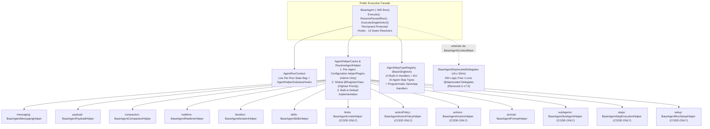

# MemberJunction AI Agent Builder & Extension Guide

This guide is the technical handbook for **developers and OpenApp authors** building, extending, and testing MemberJunction AI Agents. It documents the refactored `~600`-line `BaseAgent` architecture, `AgentRunContext`, the 13 pluggable helper seams, copy-paste TypeScript recipes for all **Four Extension Points**, isolated helper unit testing, prompt prefix-cache discipline, and migrating off `BaseAgentDeprecatedDelegates` before `v7.0`.

> **Canonical Agent Documentation Suite**
> - **Administrators & Operators:** [Agent Administrator Guide](AGENT_ADMINISTRATOR_GUIDE.md)
> - **Developers & Extension Authors:** [Agent Builder & Extension Guide](AGENT_BUILDER_EXTENSION_GUIDE.md) *(this guide)*
> - **Everyday Users & Personal Instances:** [Agent End-User Guide](AGENT_END_USER_GUIDE.md)
> - **Subclass & PR Rebase Reference:** [BaseAgent Rebase Map](BASE_AGENT_REBASE_MAP.md)

---

## 1. Architecture of the Refactored `BaseAgent`

`packages/AI/Agents/src/base-agent.ts` is now a **~600-line** public execution facade. All runtime business logic lives in **13 cohesive `BaseAgent*Helper` seams** under `packages/AI/Agents/src/helpers/` (every single file `<= 1,000` lines, zero `file-size-ok` exemptions), communicating through a strongly-typed live state bag (**`AgentRunContext`**) and resolving through **`MJGlobal.Instance.ClassFactory`**.



### 1.1 `AgentRunContext` & Virtual-Dispatch `Hooks`

`AgentRunContext` (`packages/AI/Agents/src/helpers/AgentRunContext.ts`) is created lazily once per `BaseAgent` instance by `BaseAgentContextBase.getRunContext()` (`packages/AI/Agents/src/helpers/compat/BaseAgentContextBase.ts`). Every property on `AgentRunContext` is a live getter/setter backed directly by `BaseAgent`'s state fields:

- **Zero state divergence:** Mutating `ctx.MediaOutputs`, `ctx.PromptTurnCount`, `ctx.PlanModeActive`, `ctx.LivenessWatchdog`, etc. updates the exact live state on the running `BaseAgent`.
- **Virtual-dispatch preservation (`ctx.Hooks`):** Whenever one helper invokes another seam method that a `BaseAgent` subclass might override (e.g., `ctx.Hooks.ValidateSuccessNextStep(...)`, `ctx.Hooks.ExecutePrompt(...)`, `ctx.Hooks.FilterAvailableSkills(...)`), it calls through `ctx.Hooks` (`AgentHelperSubclassHooks`), preserving exact virtual-dispatch semantics for custom subclasses and unit-test spies.
- **Per-run helper resolution (`AgentHelperCache`):** At the start of every `Execute()` run, `AgentHelperCache.ResetForRun(effectiveProps.HelperPlugins)` clears cached helper instances and binds any admin-configured per-agent `helperPlugins` for that run.
- **Protected Liveness Watchdog Hooks for Custom Subclasses:** Subclasses overriding `executePrompt` or `executeAgentInternal` (e.g., `HarnessAgentBase` or custom drivers) can feed or suspend the run's sliding inactivity watchdog directly via `this.recordLivenessProgress(kind, detail)`, `this.suspendLivenessWatchdog(waitId, reason)`, and `this.resumeLivenessWatchdog(waitId)`. Subclasses wrapping `super.executeAgentInternal(...)` automatically resume standard 15-minute supervision when `super.executeAgentInternal` enters, and any subclass may override `protected get autoSuspendLivenessDuringExecuteInternal(): boolean` to control auto-suspend explicitly.

### 1.2 The 13 Pluggable Helper Seams

| Seam Key (`AgentHelperSeamKey`) | Base Token Class | Default Implementation Class | Directory (`packages/AI/Agents/src/helpers/`) | Per-Agent `helperPlugins`? |
| --- | --- | --- | --- | :---: |
| `'messaging'` | `BaseAgentMessagingHelper` | `AgentMessagingHelper` | `messaging/` | Yes (Admin-Only) |
| `'payload'` | `BaseAgentPayloadHelper` | `AgentPayloadHelper` | `payload/` | Yes (Admin-Only) |
| `'compaction'` | `BaseAgentCompactionHelper` | `AgentCompactionHelper` | `compaction/` | Yes (Admin-Only) |
| `'realtime'` | `BaseAgentRealtimeHelper` | `AgentRealtimeHelper` | `realtime/` | Yes (Admin-Only) |
| `'iteration'` | `BaseAgentIterationHelper` | `AgentIterationHelper` | `iteration/` | Yes (Admin-Only) |
| `'skills'` | `BaseAgentSkillsHelper` | `AgentSkillsHelper` | `skills/` | Yes (Admin-Only) |
| `'limits'` | `BaseAgentLimitsHelper` | `AgentLimitsHelper` | `limits/` | **FORBIDDEN (Code-Only `@RegisterClass`)** |
| `'actionPolicy'` | `BaseAgentActionPolicyHelper` | `AgentActionPolicyHelper` | `actions/` | **FORBIDDEN (Code-Only `@RegisterClass`)** |
| `'actions'` | `BaseAgentActionsHelper` | `AgentActionsHelper` | `actions/` | **FORBIDDEN (Code-Only `@RegisterClass`)** |
| `'prompt'` | `BaseAgentPromptHelper` | `AgentPromptHelper` | `prompt/` | Yes (Admin-Only) |
| `'subAgents'` | `BaseAgentSubAgentHelper` | `AgentSubAgentHelper` | `subagents/` | **FORBIDDEN (Code-Only `@RegisterClass`)** |
| `'steps'` | `BaseAgentStepExecutionHelper` | `AgentStepExecutionHelper` | `steps/` | **FORBIDDEN (Code-Only `@RegisterClass`)** |
| `'setup'` | `BaseAgentRunSetupHelper` | `AgentRunSetupHelper` | `setup/` | **FORBIDDEN (Code-Only `@RegisterClass`)** |

---

## 2. Choosing the Right Extension Point

MemberJunction provides **four clean extension points**. Prefer the narrowest extension point that solves your problem:

| Extension Point | When to Use | Registration Mechanism |
| --- | --- | --- |
| **1. `BaseAgentType`** | Define a brand-new reusable execution pattern shared by many agents (like `Loop`, `Flow`, `Harness`, `Realtime`). | `@RegisterClass(BaseAgentType, 'MyAgentType')` + `MJ: AI Agent Types` row |
| **2. `AIAgentStepType` + `BaseAgentStepHandler`** | Add a new next-step verb (`step: 'ApprovalGate'`, `step: 'WebhookWait'`, etc.) or override how a built-in step executes. | `@RegisterClass(BaseAgentStepHandler, 'MyStepHandler')` + `MJ: AI Agent Step Types` row (or `AgentStepTypeRegistry.Instance.RegisterStepType`) |
| **3. `BaseAgent<Seam>Helper`** | Customize one horizontal concern (e.g., payload validation, compaction strategy, prompt enrichment, step logging) globally or for specific agents without subclassing `BaseAgent`. | Global `@RegisterClass(BaseAgent<Seam>Helper, 'Default', 100)` **or** keyed `@RegisterClass(BaseAgent<Seam>Helper, 'MyKey')` + `Configuration.helperPlugins` |
| **4. `BaseAgent` Subclass (`DriverClass`)** | Orchestrate an end-to-end custom agent driver that combines domain state, custom prompt execution (e.g., `HarnessAgentBase`), or app-specific skill filtering. | `@RegisterClass(BaseAgent, 'MyAgentDriver')` + `AIAgent.DriverClass` |

---

## 3. Copy-Paste Recipes for All Four Extension Points

Every import path, class name, decorator signature, and method name below is verified directly against `@memberjunction/ai-agents` and `@memberjunction/ai-core-plus`.

### 3.1 Extension Point #1: Custom `BaseAgentType`

Implement `BaseAgentType` when you are introducing a new execution paradigm (e.g., a state-machine or single-pass verifier type) reusable across multiple agents.

```typescript
import { RegisterClass } from '@memberjunction/global';
import {
    BaseAgentType,
    type NativeToolBinding,
} from '@memberjunction/ai-agents';
import type {
    AgentConfiguration,
    AIPromptParams,
    AIPromptRunResult,
    BaseAgentNextStep,
    ExecuteAgentParams,
    MJAIPromptEntityExtended,
} from '@memberjunction/ai-core-plus';

interface SinglePassState {
    completed: boolean;
}

@RegisterClass(BaseAgentType, 'SinglePassAgentType')
export class SinglePassAgentType extends BaseAgentType {
    public override get SupportsNativeToolCalls(): boolean {
        return false;
    }

    public override async InitializeAgentTypeState<ATS = SinglePassState, P = unknown>(
        _params: ExecuteAgentParams<unknown, P>
    ): Promise<ATS> {
        const state: SinglePassState = { completed: false };
        return state as unknown as ATS;
    }

    public override async DetermineInitialStep<P = unknown, ATS = SinglePassState>(
        _params: ExecuteAgentParams<P>,
        _payload: P,
        _agentTypeState: ATS
    ): Promise<BaseAgentNextStep<P> | null> {
        // Return null so BaseAgent executes the initial prompt step.
        return null;
    }

    public override async DetermineNextStep<P = unknown, ATS = SinglePassState>(
        promptResult: AIPromptRunResult | null,
        _params: ExecuteAgentParams<unknown, P>,
        payload: P,
        agentTypeState: ATS,
        _nativeToolBindings?: ReadonlyMap<string, NativeToolBinding>
    ): Promise<BaseAgentNextStep<P>> {
        const state = agentTypeState as unknown as SinglePassState;
        state.completed = true;

        if (!promptResult?.success) {
            return {
                step: 'Failed',
                terminate: true,
                previousPayload: payload,
                newPayload: payload,
                errorMessage: promptResult?.errorMessage ?? 'Single-pass prompt execution failed',
            };
        }

        return {
            step: 'Success',
            terminate: true,
            previousPayload: payload,
            newPayload: (promptResult.result as P) ?? payload,
            message: promptResult.rawResult ?? 'Completed',
        };
    }

    public override async PreProcessNextStep<P = unknown, ATS = SinglePassState>(
        _params: ExecuteAgentParams<P>,
        _step: BaseAgentNextStep<P>,
        _payload: P,
        _agentTypeState: ATS
    ): Promise<BaseAgentNextStep<P> | null> {
        return null;
    }

    public override async InjectPayload<P = unknown, ATS = SinglePassState>(
        payload: P,
        _agentTypeState: ATS,
        prompt: AIPromptParams,
        _agentInfo: { agentId: string; agentRunId?: string }
    ): Promise<void> {
        prompt.data = {
            ...(prompt.data ?? {}),
            currentPayload: payload,
        };
    }

    public override async GetPromptForStep<P = unknown, ATS = SinglePassState>(
        _params: ExecuteAgentParams,
        config: AgentConfiguration,
        _payload: P,
        _agentTypeState: ATS,
        _previousDecision?: BaseAgentNextStep<P> | null
    ): Promise<MJAIPromptEntityExtended | null> {
        return config.childPrompt ?? null;
    }
}
```

Link this driver by creating an `MJ: AI Agent Types` metadata row with `"DriverClass": "SinglePassAgentType"`.

---

### 3.2 Extension Point #2: Custom Step Type (`AIAgentStepType` + `BaseAgentStepHandler`)

Register a new step handler when an OpenApp needs a first-class step verb with Plan Mode enforcement, tree-budget participation, and automatic prompt instruction injection.

#### Step A: Implement & Register the `BaseAgentStepHandler`

```typescript
import { RegisterClass } from '@memberjunction/global';
import {
    AgentStepTypeRegistry,
    BaseAgentStepHandler,
    type AgentRunContext,
} from '@memberjunction/ai-agents';
import type {
    AgentConfiguration,
    BaseAgentNextStep,
    ExecuteAgentParams,
    MJAIAgentRunEntityExtended,
    MJAIAgentRunStepEntityExtended,
} from '@memberjunction/ai-core-plus';

@RegisterClass(BaseAgentStepHandler, 'ComplianceApprovalStepHandler')
export class ComplianceApprovalStepHandler extends BaseAgentStepHandler {
    public readonly StepKey = 'ComplianceApproval';

    // Mutating / external-gating step: block during unapproved Plan Mode
    public override readonly AllowedInUnapprovedPlanMode = false;
    public override readonly CountsAgainstTreeBudget = true;

    public override async Validate<P>(
        _ctx: AgentRunContext,
        _params: ExecuteAgentParams,
        nextStep: BaseAgentNextStep<P>,
        currentPayload: P,
        _agentRun: MJAIAgentRunEntityExtended,
        _currentStep: MJAIAgentRunStepEntityExtended
    ): Promise<BaseAgentNextStep<P>> {
        if (!nextStep.message || nextStep.message.trim().length === 0) {
            return {
                step: 'Retry',
                terminate: false,
                previousPayload: currentPayload,
                newPayload: currentPayload,
                message: 'ComplianceApproval step requires a non-empty rationale in `message`.',
            };
        }
        return nextStep;
    }

    public override async Execute<P>(
        ctx: AgentRunContext,
        params: ExecuteAgentParams,
        _config: AgentConfiguration,
        previousDecision: BaseAgentNextStep<P>,
        _stepCount: number
    ): Promise<BaseAgentNextStep<P>> {
        const stepEntity = await ctx.Hooks.CreateStepEntity({
            stepType: 'Custom',
            stepName: `Compliance Approval: ${previousDecision.message?.slice(0, 60) ?? 'Request'}`,
            contextUser: params.contextUser,
            payloadAtStart: previousDecision.previousPayload,
        });

        // Pause the sliding inactivity timer while waiting on an external approval system
        const waitId = `compliance-${stepEntity.ID}`;
        ctx.LivenessWatchdog?.SuspendForExternalWait(waitId, 'compliance-approval');
        try {
            // Perform external compliance gate check or raise feedback request...
            await ctx.Hooks.FinalizeStepEntity(stepEntity, true, undefined, { approved: true });
        } finally {
            ctx.LivenessWatchdog?.ResumeFromExternalWait(waitId);
        }

        // Return 'Retry' to re-enter the prompt loop with updated context
        return {
            step: 'Retry',
            terminate: false,
            previousPayload: previousDecision.previousPayload,
            newPayload: previousDecision.newPayload ?? previousDecision.previousPayload,
            message: 'Compliance approval granted.',
        };
    }

    public override BuildPromptInstructions(_ctx: AgentRunContext, _params: ExecuteAgentParams): string | null {
        return 'Emit `nextStep.type = "ComplianceApproval"` with a rationale in `message` before executing regulated changes.';
    }
}
```

#### Step B: Wire via Metadata (`MJ: AI Agent Step Types`) or Programmatically

Option 1 — **Metadata JSON (recommended for OpenApps)** in `metadata/agent-step-types/.my-step-types.json`:

```json
[
  {
    "fields": {
      "Name": "ComplianceApproval",
      "Description": "Requests compliance sign-off before executing regulated mutations.",
      "DriverClass": "ComplianceApprovalStepHandler",
      "AppliesTo": "Loop",
      "AllowedInUnapprovedPlanMode": false,
      "CountsAgainstTreeBudget": true,
      "DefaultEnabledInPrompt": true,
      "PromptDocsTemplate": "Use step `ComplianceApproval` with `message` stating the compliance rationale.",
      "Status": "Active"
    }
  }
]
```

Option 2 — **Programmatic Registration** (for code-only plugins or unit tests):

```typescript
AgentStepTypeRegistry.Instance.RegisterStepType({
    StepKey: 'ComplianceApproval',
    DriverClass: 'ComplianceApprovalStepHandler',
    AppliesTo: 'Loop',
    AllowedInUnapprovedPlanMode: false,
    CountsAgainstTreeBudget: true,
    DefaultEnabledInPrompt: true,
});
```

> **Overriding Built-In Step Handlers:** Because `AgentStepTypeRegistry` resolves all 14 built-in handlers through `MJGlobal.Instance.ClassFactory` (`ActionsStepHandler`, `SubAgentStepHandler`, `RetryStepHandler`, `SuccessStepHandler`, `FailedStepHandler`, `ChatStepHandler`, `ForEachStepHandler`, `WhileStepHandler`, `SkillStepHandler`, `PlanStepHandler`, `TasksStepHandler`, `HandoffStepHandler`, `ClientToolsStepHandler`, `DecisionStepHandler`), you can also customize a built-in step cleanly by subclassing it with a higher `@RegisterClass` priority.

---

### 3.3 Extension Point #3: Pluggable `BaseAgent*Helper` Seams (Global & Per-Agent)

Subclass the default `Agent<Seam>Helper` implementation (which already extends `BaseAgent<Seam>Helper`) and register it against the base token class `BaseAgent<Seam>Helper`.

#### Pattern A: Global Replacement (Applies to Every Agent on the Server)

Register with key `'Default'` (or unkeyed) and a priority `> 0` (built-in defaults register at priority `0`):

```typescript
import { RegisterClass } from '@memberjunction/global';
import {
    AgentCompactionHelper,
    BaseAgentCompactionHelper,
    type AgentRunContext,
} from '@memberjunction/ai-agents';
import type { ChatMessage } from '@memberjunction/ai';

@RegisterClass(BaseAgentCompactionHelper, 'Default', 100)
export class CustomTokenEstimatorCompactionHelper extends AgentCompactionHelper {
    public override EstimateTokens(
        ctx: AgentRunContext,
        content: ChatMessage['content'],
        modelName?: string
    ): number {
        const baseEstimate = super.EstimateTokens(ctx, content, modelName);
        // Apply a conservative 10% safety buffer for domain-dense payloads
        return Math.ceil(baseEstimate * 1.1);
    }
}
```

#### Pattern B: Per-Agent Plug-In (`AIAgent.Configuration.helperPlugins` — Admin-Only)

Register with a **non-`'Default'` key** so it never bleeds into unrelated agents, then opt specific agents (or categories) into it via `Configuration.helperPlugins`:

```typescript
import { RegisterClass } from '@memberjunction/global';
import {
    AgentPayloadHelper,
    BaseAgentPayloadHelper,
    type AgentRunContext,
} from '@memberjunction/ai-agents';
import type {
    BaseAgentNextStep,
    ExecuteAgentParams,
    MJAIAgentRunEntityExtended,
    MJAIAgentRunStepEntityExtended,
} from '@memberjunction/ai-core-plus';

@RegisterClass(BaseAgentPayloadHelper, 'StrictAuditPayloadHelper')
export class StrictAuditPayloadHelper extends AgentPayloadHelper {
    public override async ValidateSuccessNextStep<P>(
        ctx: AgentRunContext,
        params: ExecuteAgentParams,
        nextStep: BaseAgentNextStep<P>,
        currentPayload: P,
        agentRun: MJAIAgentRunEntityExtended,
        currentStep: MJAIAgentRunStepEntityExtended
    ): Promise<BaseAgentNextStep<P>> {
        const validated = await super.ValidateSuccessNextStep(
            ctx,
            params,
            nextStep,
            currentPayload,
            agentRun,
            currentStep
        );
        if (validated.step === 'Success' && validated.newPayload == null) {
            return {
                step: 'Retry',
                terminate: false,
                previousPayload: currentPayload,
                newPayload: currentPayload,
                message: 'Final payload cannot be empty for audited runs.',
            };
        }
        return validated;
    }
}
```

Then attach it on the target `MJ: AI Agents` row (or `MJ: AI Agent Categories.DefaultConfiguration`) as an administrator:

```json
{
  "helperPlugins": [
    {
      "seam": "payload",
      "driverClass": "StrictAuditPayloadHelper",
      "priority": 10
    }
  ]
}
```

> **Security Rule Reminder:** `ResolveAgentHelper` and `ValidateAgentInheritanceAndSandbox` **reject** `helperPlugins` entries targeting any of the **6 code-only seams** (`'limits'`, `'actionPolicy'`, `'setup'`, `'steps'`, `'actions'`, `'subAgents'`). Those seams can **only** be overridden globally in server code via `@RegisterClass(BaseAgent<Seam>Helper, 'Default', 100)` (for example `@RegisterClass(BaseAgentLimitsHelper, 'Default', 100)` or `@RegisterClass(BaseAgentActionPolicyHelper, 'Default', 100)`).

---

### 3.4 Extension Point #4: `BaseAgent` Subclassing (`AIAgent.DriverClass`)

Subclass `BaseAgent` when you need a dedicated whole-agent driver (such as `FormBuilderAgent`, `MemoryManagerAgent`, or `HarnessAgentBase`). Stick to the **permanent protected hooks** directly on `BaseAgent` rather than deprecated internal helpers:

```typescript
import { RegisterClass } from '@memberjunction/global';
import { BaseAgent } from '@memberjunction/ai-agents';
import type {
    MJAIAgentEntityExtended,
    SkillAvailabilityPurpose,
} from '@memberjunction/ai-core-plus';
import type { UserInfo } from '@memberjunction/core';
import type { MJAISkillEntity } from '@memberjunction/core-entities';

@RegisterClass(BaseAgent, 'LicensedEnterpriseAgent')
export class LicensedEnterpriseAgent extends BaseAgent {
    protected override async filterAvailableSkills(
        skills: MJAISkillEntity[],
        _purpose: SkillAvailabilityPurpose,
        _agent: MJAIAgentEntityExtended,
        contextUser?: UserInfo
    ): Promise<MJAISkillEntity[]> {
        if (!contextUser) {
            return [];
        }
        // Apply tenant/entitlement filtering on top of MJ's built-in skill gates
        return skills.filter((skill) => skill.Status === 'Active');
    }
}
```

Permanent `BaseAgent` protected hooks and accessors (safe across `v6.x` and `v7.0+`):
- **Lifecycle & Extension Hooks:** `Execute`, `ResumePausedRun`, `ExecuteSingleAction`, `StartBridgeRealtimeSession`, `EndConversationSkill`, `FlushPendingCheckpointPersistence`, `PromoteMediaOutputs`, `filterAvailableSkills`, `checkExecutionGuardrails`, `hasExceededAgentRunGuardrails`, `incrementExecutionCount`, `mapWithConcurrency`, `contentToString`, `pruneAndCompactExpiredMessages`, plus the 13 `get*Helper()` seam resolvers (`getMessagingHelper`, `getPayloadHelper`, `getCompactionHelper`, `getRealtimeHelper`, `getIterationHelper`, `getSkillsHelper`, `getLimitsHelper`, `getActionPolicyHelper`, `getActionsHelper`, `getPromptHelper`, `getSubAgentHelper`, `getStepExecutionHelper`, `getRunSetupHelper`).
- **State Accessors:** `ProviderToUse`, `AgentRun`, `AgentTypeInstance`, `AgentTypeState`, `TreeBudget`, `IsRunTainted`, `TaintedSources`, `MediaOutputs`, `FileOutputs`, `ResolvedStorageAccountId`, `Depth`, `AgentHierarchy`, `ParentStepCounts`, `RunExecutionScope`, `ActivatedSkillIDs`, `scratchpadManager`, `ArtifactManager`, `ActionSpilloverManager`.

---

## 4. Isolated Unit Testing Against `BaseAgent<Seam>Helper`

One of the biggest wins of the refactor is testing any helper seam in complete isolation — **without instantiating `BaseAgent` or wiring database mocks** — using `CreateMockAgentRunContext` (`packages/AI/Agents/src/__tests__/helpers/mock-agent-run-context.ts`):

```typescript
import { describe, it, expect } from 'vitest';
import {
    AgentLivenessWatchdog,
    AgentStuckDetector,
    AgentPayloadHelper,
} from '@memberjunction/ai-agents';
import { CreateMockAgentRunContext } from './helpers/mock-agent-run-context';

describe('Custom Helper Seam Unit Test', () => {
    it('promotes media outputs directly via AgentRunContext', () => {
        const ctx = CreateMockAgentRunContext();
        const helper = new AgentPayloadHelper();

        helper.PromoteMediaOutputs(ctx, [
            { modality: 'Image', mimeType: 'image/png', data: 'base64...' },
        ]);

        expect(ctx.MediaOutputs).toHaveLength(1);
    });

    it('detects repeated canonical tool calls deterministically', () => {
        const detector = new AgentStuckDetector();
        const cfg = {
            Enabled: true,
            WindowSize: 10,
            IdenticalToolCallThreshold: 3,
            ReadOnlyStepThreshold: 30,
            ReadOnlyPostDirectiveGraceSteps: 5,
        };

        expect(detector.RecordToolCall('GetRecord', { b: 2, a: 1 }, cfg).Action).toBe('none');
        expect(detector.RecordToolCall('GetRecord', { a: 1, b: 2 }, cfg).Action).toBe('none');
        expect(detector.RecordToolCall('getrecord', { a: 1, b: 2 }, cfg).Action).toBe('inject-directive');
        expect(detector.RecordToolCall('GetRecord', { a: 1, b: 2 }, cfg).Action).toBe('pause');
    });

    it('suspends sliding inactivity watchdog cleanly during external waits', () => {
        let fakeNow = 1_000;
        const watchdog = new AgentLivenessWatchdog({
            AgentName: 'TestAgent',
            InactivityTimeoutMs: 5_000,
            OuterMaxWallClockMs: 60_000,
            InactivityAbortReasonPrefix: 'Stalled',
            TimeoutAbortReasonPrefix: 'TimedOut',
            Now: () => fakeNow,
        });
        const controller = new AbortController();
        watchdog.Start(controller);
        watchdog.SuspendForExternalWait('ci-check-1', 'CI');
        expect(watchdog.GetSnapshot().SuspendedWaitCount).toBe(1);
        watchdog.ResumeFromExternalWait('ci-check-1');
        expect(watchdog.GetSnapshot().SuspendedWaitCount).toBe(0);
        watchdog.Stop();
    });
});
```

---

## 5. Prompt Prefix-Cache Discipline

When extending `BaseAgentPromptHelper` (`AgentNativeToolsAndPrefixCacheHelper` / `AgentPromptExecutionHelper`) or authoring custom agent prompts, preserve the static-first / volatile-tail layout so provider prompt caches stay warm across iterations:

1. **Keep the system prompt byte-identical across turns:** Never interpolate per-turn timestamps, payload snapshots, or scratchpad contents into the system prompt. Those belong in the trailing `<mj-runtime-state>` message built by `AgentNativeToolsAndPrefixCacheHelper.BuildVolatileStateMessage`.
2. **Never mutate earlier conversation messages unless recovering from overflow:** Append directives (circuit breaker warnings, `AgentStuckDetector` course-corrections, wrap-up directives) as new `user` messages at the tail so byte-prefix caches (`PrefixPromptCache: true`) and Anthropic's replayed-thinking prefix remain intact.
3. **Avoid volatile placeholders in child specialization prompts:** Referencing `_CURRENT_DATE`, `_CURRENT_PAYLOAD`, or `_SCRATCHPAD_*` inside a child prompt triggers `auto` relocation into `<mj-agent-specialization>` (~3K uncached tokens per turn).
4. **Verify with the snapshot suite:** Run `loop-agent-system-prompt-snapshot.test.ts` and `base-agent-volatile-state.test.ts` in `packages/AI/Agents` whenever modifying prompt assembly.

See [Agent Prompt Caching Guide](AGENT_PROMPT_CACHING_GUIDE.md) for full provider-specific mechanics.

---

## 6. Migrating Off `BaseAgentDeprecatedDelegates` Before `v7.0`

During `v6.x`, `BaseAgent` inherits `BaseAgentDeprecatedDelegates` (`packages/AI/Agents/src/helpers/compat/BaseAgentDeprecatedDelegates*.ts`), which preserves **494** historical `protected` methods as logic-free 1-line `@deprecated` pass-throughs. Every legacy call continues to compile and pass untouched in `v6.x`, while surfacing an IDE `@deprecated` hint naming the target helper seam.

### How to Migrate a Subclass

1. **Look up every `this.<legacyMethod>(...)` or `override <legacyMethod>(...)` in the [BaseAgent Rebase Map](BASE_AGENT_REBASE_MAP.md).**
2. **If you are calling an internal method from a `BaseAgent` subclass:** Call the typed helper seam directly via `this.get<Seam>Helper().<PascalCaseMethod>(this.getRunContext(), ...)`.
3. **If you are overriding a horizontal concern (e.g., payload validation, compaction, messaging, prompt assembly):** Move the override out of your `BaseAgent` subclass into a registered `BaseAgent<Seam>Helper` subclass (Extension Point #3) — you no longer need a `BaseAgent` subclass at all!
4. **If you are adding a custom step verb:** Migrate from overriding `validateNextStep` / `executeNextStep` to a `BaseAgentStepHandler` (Extension Point #2).

```typescript
// ❌ Deprecated in v6.x (will be removed in v7.0)
class LegacyAgent extends BaseAgent {
    protected override async validateSuccessNextStep<P>(...args: Parameters<BaseAgent['validateSuccessNextStep']>) {
        this.logStatus('Validating custom payload...');
        return super.validateSuccessNextStep(...args);
    }
}

// ✅ Canonical v6.x / v7.0+ pattern: Pluggable Helper Seam
@RegisterClass(BaseAgentPayloadHelper, 'MyCustomPayloadHelper')
export class MyCustomPayloadHelper extends AgentPayloadHelper {
    public override async ValidateSuccessNextStep<P>(
        ctx: AgentRunContext,
        params: ExecuteAgentParams,
        nextStep: BaseAgentNextStep<P>,
        currentPayload: P,
        agentRun: MJAIAgentRunEntityExtended,
        currentStep: MJAIAgentRunStepEntityExtended
    ): Promise<BaseAgentNextStep<P>> {
        ctx.MessagingHelper.LogStatus(ctx, 'Validating custom payload...', false, params);
        return super.ValidateSuccessNextStep(ctx, params, nextStep, currentPayload, agentRun, currentStep);
    }
}
```
