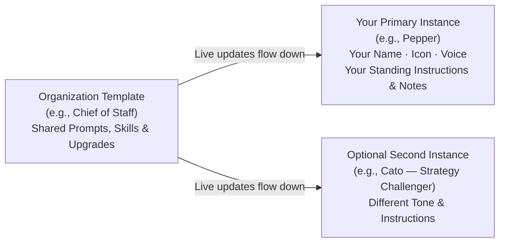
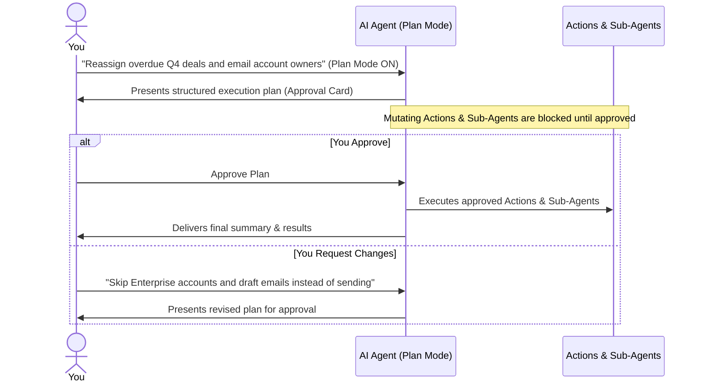

# MemberJunction AI Agent End-User Guide

Welcome to MemberJunction AI Agents! This guide explains — in plain language — how to work with AI agents day to day, personalize your own agent instances, guide how they communicate and remember your preferences, review plans before they act, and stay in control of long-running background tasks.

> **Canonical Agent Documentation Suite**
> - **Administrators & Operators:** [Agent Administrator Guide](AGENT_ADMINISTRATOR_GUIDE.md)
> - **Developers & Extension Authors:** [Agent Builder & Extension Guide](AGENT_BUILDER_EXTENSION_GUIDE.md)
> - **Everyday Users & Personal Instances:** [Agent End-User Guide](AGENT_END_USER_GUIDE.md) *(this guide)*
> - **Subclass & PR Rebase Reference:** [BaseAgent Rebase Map](BASE_AGENT_REBASE_MAP.md)

---

## 1. Catalog Agents vs. Your Personal Agent Instances

In MemberJunction, some agents are ready to chat with immediately as shared workspace tools, while others can (or should) be **personalized as your own private instance**:

| Agent Type (`InstantiationMode`) | How You Use It | Examples |
| --- | --- | --- |
| **Shared Catalog Agent (`None`)** | Use directly in chat or workflows. Everyone uses the same shared configuration. | *Sage* (Workspace Concierge), *Memory Manager* |
| **Optional Personalization (`Optional`)** | Use the shared agent right away, **or** spin up your own personalized copy with custom instructions and presets. | *Research Agent*, *Query Builder* |
| **Personal Instance Required (`Required`)** | The catalog entry is a template — MemberJunction guides you to create your own personal instance (for example, naming your own *Chief of Staff* "Pepper" or "Cato"). | *Chief of Staff* |

### Why Personal Instances Stay Automatically Up to Date

Your personal agent instance is linked live to its template (rather than being a frozen copy). When your organization adds new skills, improves prompts, or upgrades capabilities on the template, **your personal agent gets those improvements automatically** while keeping your custom name, avatar, voice, personality, notes, and standing instructions intact.

- **Private by default:** Your personal instances belong to you (`OwnerUserID`) and are invisible to other users unless you (or an administrator) explicitly share them.
- **Primary instance:** If you create multiple personal instances from the same template (for instance, *Pepper* for daily operations and *Cato* for red-team strategy critiques), one is marked as your **Primary Instance** so scheduled wakes, briefings, and colleague agent requests always know which assistant represents you by default.

---

## 2. Customizing Your Agent: Personas, Presets & Standing Instructions

When you create or customize a personal agent instance, you can tailor how it looks, sounds, and works:

1. **Name, Icon & Avatar:** Pick from the template's suggested names and icons (or enter your own) and optionally upload a custom avatar (`LogoURL`).
2. **Personality Presets & Voice Persona:** Choose a communication preset (such as *Direct & Concise*, *Warm & Collaborative*, or *Socratic Challenger*) and voice persona. The same persona applies consistently in both text chat and live Realtime voice calls.
3. **Speed vs. Depth Presets (Configuration Presets):** Many agents offer semantic presets (such as **Fast**, **Balanced**, or **High Quality**) that let you trade off response speed against deeper reasoning on a per-conversation basis.
4. **Standing Instructions (`AdditionalInstructions`):** Write plain-English rules your agent should always follow — for example:
   - *"Always open briefings with 3 bullets: decisions needed today, blockers, and key metric movements."*
   - *"Format currency in USD rounded to the nearest thousand, and include record links for every customer mentioned."*
   - Note: Organization and department standing rules stay above your personal instructions, so company policies are never accidentally overridden.

---

## 3. How Agent Memory & Personal Notes Work

MemberJunction agents remember context across three clear layers:

1. **In-Conversation Scratchpad (Temporary):** Notes and checklists the agent tracks during the current run. These disappear when the run finishes.
2. **Provisional Notes (Captured Immediately):** When you tell an agent a preference — *"Please always summarize executive updates in three bullets"* — the agent can save a provisional note right away so your next conversation immediately respects it.
3. **Long-Term Notes & Examples (Curated):** Over time, the background *Memory Manager* consolidates, deduplicates, and maintains your durable preferences and facts (`MJ: AI Agent Notes`).

**Precedence when information conflicts:**
1. What you say in the **current message** always wins.
2. **Recent provisional notes** beat older established notes.
3. **Your personal notes** override company-wide defaults.

> **Security Safeguard:** If an agent reads untrusted external data (like a public web page or inbound email) during a turn, MemberJunction marks that run as *tainted* and holds any newly extracted memories in `Pending` status so instructions hidden on a web page can never hijack your agent's memory.

---

## 4. Plan Mode: Review Before the Agent Acts

When you want an agent to think through a multi-step task **before** changing records, sending messages, or delegating work, enable **Plan Mode**:

- **Opt-in per request:** Toggle Plan Mode on in the chat composer for any agent that supports it.
- **Always-on for high-trust templates:** Administrators can mandate Plan Mode (`RequirePlanMode`) on sensitive agents so you always see a plan before execution.
- **Read-only research still works:** While drafting its plan, an agent can ask clarifying questions or inspect context, while mutating actions and sub-agent delegations remain safely locked until you click **Approve**.

---

## 5. Skills & Specialist Handoffs

### Using Skills (`/skill`)

**Skills** are reusable bundles of instructions and tools (such as *Calendar Management*, *SQL Analytics*, or *Strategic Planning*).
- You can explicitly invoke any skill you have permission to use by typing `/skill` in chat.
- Agents only self-activate skills on their own when **both** the agent and the skill are explicitly configured for `Auto` activation — otherwise, skills only activate when you ask for them.

### Seamless Handoffs & Sub-Agent Specialists

- **Sub-Agents:** When you ask a generalist like *Sage* or your *Chief of Staff* for deep research or a complex database query, it delegates the work to a specialist (like *Research Agent* or *Query Builder*) and folds the results back into your conversation.
- **Handoff:** When a request belongs squarely to a dedicated specialist, a router agent can hand the entire conversation turn directly to that specialist so you work with the expert immediately without repeating yourself.

---

## 6. Long-Running Tasks, Pause/Resume & Human-in-the-Loop

Complex research reports, multi-step workflows, and background routines can run for **hours or even days** without timing out arbitrarily:

- **Progress-Aware Liveness:** MemberJunction monitors whether your agent is actively making forward progress (streaming responses, completing steps, running actions) rather than cutting it off at a short fixed clock limit. While an agent is waiting on your approval or an external check, its inactivity timer pauses automatically.
- **Human-in-the-Loop Requests (`MJ: AI Agent Requests`):** When an agent needs your input, a decision, or approval for a sensitive action (like sending an external email or scheduling a meeting), the run pauses cleanly and surfaces an approval/feedback card in your inbox or chat. Once you reply, the agent resumes right where it left off.
- **Cooperative Pause & Safe Checkpoints:** If a long-running task hits a budget checkpoint, detects a repetitive loop, or is paused by you, MemberJunction saves a **non-destructive checkpoint** of the run's full payload and loop position. You can inspect what it has done so far and resume cleanly without losing progress.
- **Stopping a Run:** Clicking **Stop** cancels the active run cleanly; if you follow up in the next message, the agent carries forward completed results from before the stop so it doesn't start from scratch.

---

## 7. Your Personal Policy Controls (`MJ: AI Agent User Policies`)

Every agent always runs under **your own user identity** — it can never read or modify records that you yourself cannot access. Beyond that, you can tighten any agent's boundaries even further using your **Personal Agent Policy**:

- **Channel Controls (e.g., Chief of Staff):** Independently set **Email**, **Calendar**, **Phone**, and **Messaging** modes to `Disabled`, `ReadOnly`, `DraftOnly` / `ProposeWithApproval`, or `Autonomous`.
- **Action Approval Gates:** Require explicit human approval before specific actions run, or deny specific actions outright.
- **Execution Time Windows:** Restrict autonomous actions to your preferred days of the week and hours of the day; actions attempted outside your window defer cleanly instead of running overnight.
- **Data Scope & Field Masks:** Narrow which entities or fields an agent can view or modify below your normal permissions.
- **Personal Cost & Iteration Ceilings:** Set tighter per-run or daily spending limits than your organization's defaults (note: you can always tighten limits further, never raise them above your organization's ceilings).

You can adjust these settings in the **Governance** page of the Chief of Staff app or simply ask your personal agent directly (for example: *"Update my policy so you always ask for my approval before sending external emails"*).
