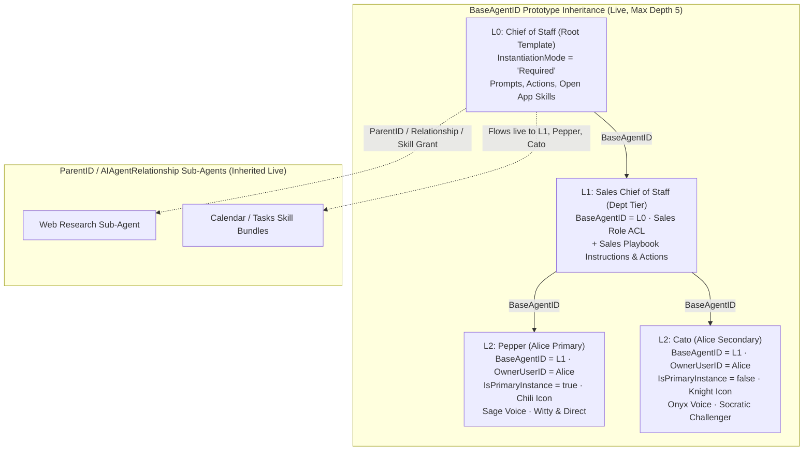
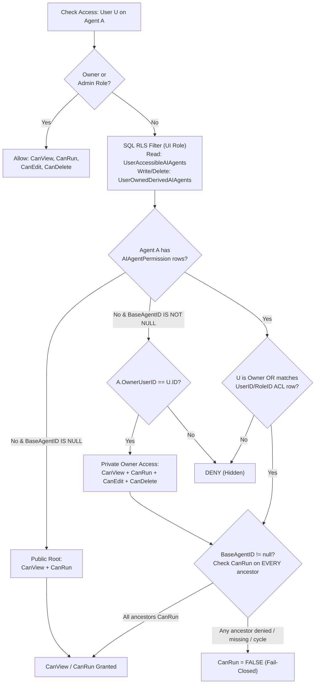

# Agent Instances, Multi-Level Prototype Inheritance & Permissions Guide

MemberJunction provides **first-class personalized and team-scoped AI Agent instances** backed by **multi-level prototype inheritance** (`AIAgent.BaseAgentID`), **2×2 RBAC with SQL Row-Level Security (RLS)**, **strictest-wins policy and run-limit ceiling inheritance**, and **unified text + Realtime voice personas**.

Instead of cloning agent rows (which freezes copies and orphans them from platform or Open App upgrades), derived agents point to a prototype via `BaseAgentID` and inherit prompts, actions, sub-agents, Open App skills, rhythm templates, presets, client tools, modalities, and configuration **live** while customizing name, avatar/icon, voice persona, personality style, standing instructions, and per-instance governance policies.

---

## 1. Architecture Overview: `BaseAgentID` vs `ParentID`

MemberJunction deliberately separates **vertical capability inheritance (`BaseAgentID`)** from **horizontal sub-agent delegation (`ParentID` / `AIAgentRelationship`)**:

- **`BaseAgentID` (Prototype Inheritance, Max Depth 5)**: *"What template am I derived from?"* Used to specialize a root template (`L0`) into an optional department/team tier (`L1`) and finally into personal user instances (`L2`, such as *Pepper* or *Cato*). Capabilities, skills, and prompts flow down **live**; policies and run limits narrow monotonically.
- **`ParentID` / `AIAgentRelationship` (Sub-Agent Composition)**: *"Which specialist agents can I delegate work to?"* Sub-agents bound to an ancestor template (`L0`) are automatically available to every derived descendant (`L1`, `L2`) without duplicating rows.



---

## 2. Schema & CodeGen Hierarchy Support

Five columns on `[__mj].[AIAgent]` power prototype inheritance and personalization:

| Column | SQL Type | Default | Purpose |
| --- | --- | --- | --- |
| `BaseAgentID` | `UNIQUEIDENTIFIER NULL` (FK → `AIAgent.ID`) | `NULL` | Prototype parent agent (`NULL` for root/catalog agents). Configured with `EntityField.Configuration = { "Hierarchy": { "IsHierarchy": true, "MaxDepth": 5 } }`. |
| `InstantiationMode` | `NVARCHAR(20) NOT NULL` (`CHECK` constraint) | `'None'` | `'None'` (not user-instantiable), `'Optional'` (usable directly **and** instantiable, e.g., *Research Agent*, *Query Builder*), or `'Required'` (template only — users instantiate personal copies, e.g., *Chief of Staff*). |
| `AdditionalInstructions` | `NVARCHAR(MAX) NULL` | `NULL` | Layer-specific standing instructions stacked root → leaf onto prompt context. |
| `IsPrimaryInstance` | `BIT NOT NULL` | `0` | Designates a user's primary active instance per `(OwnerUserID, RootBaseAgentID)` for inbound wakes, colleague Agent Channels, and inter-agent requests. |
| `LogoURL` | `NVARCHAR(MAX) NULL` | `NULL` | Custom avatar image URL or data URI (widened from `NVARCHAR(255)`). |

### CodeGen Hierarchy TVFs, View Columns & Typed Methods

Because `MJ: AI Agents.BaseAgentID` is declared as a CodeGen recursive hierarchy field (`MaxDepth = 5`; see [Recursive Foreign Keys & Hierarchies Guide](./RECURSIVE_FOREIGN_KEYS_AND_HIERARCHIES_GUIDE.md)), CodeGen generates:

- **SQL Table-Valued & Scalar Functions**:
  - `fnAIAgentBaseAgentID_GetHierarchyMeta` — computes root, depth, path, leaf status, and child count across `BaseAgentID`
  - `fnAIAgentBaseAgentID_GetAncestors` — returns ancestor rows up to `MaxDepth = 5`
  - `fnAIAgentBaseAgentID_GetDescendants` — returns descendant rows down to `MaxDepth = 5`
  - `fnAIAgentBaseAgentID_GetRootID` — resolves the top-level root `BaseAgentID`
- **Computed View Columns on `vwAIAgents`** (exposed as strongly-typed getters on `MJAIAgentEntity`):
  - `RootBaseAgentID`, `BaseAgentIDDepth`, `BaseAgentIDPath`, `BaseAgentIDIsLeaf`, `BaseAgentIDChildCount`
- **Strongly-Typed Navigation Methods on `MJAIAgentEntity`**:
  - `GetBaseAgentIDAncestors()` — loads ancestor `MJAIAgentEntity` rows ordered root → parent
  - `GetBaseAgentIDDescendants(maxDepth?)` — loads descendant `MJAIAgentEntity` rows ordered by depth
  - `GetBaseAgentIDChildren()` — loads direct `BaseAgentID` child rows

---

## 3. Multi-Level Prototype Inheritance (`L0 → L1 → L2 …`)

`AIEngineBase` (and its server facade `AIEngine`) resolves effective runtime configuration across `GetAgentInheritanceChain(agentId)` (ordered **root → leaf**, cycle-safe, capped at `MAX_AGENT_INHERITANCE_DEPTH = 5`):

| Surface | Method | Resolution Rule |
| --- | --- | --- |
| **Chain & Root** | `GetAgentInheritanceChain(agentId)`, `GetRootAgent(agentId)` | Walks `BaseAgentID` safely up to 5 hops; returns `[root, ..., parent, leaf]`. |
| **Scalar Properties** | `ResolveEffectiveAgentProperties(agent)` | Nearest non-null descendant wins for `TypeID`, `DriverClass`, `ExecutionMode`, `ModelSelectionMode`, `PayloadDownstreamPaths`, `PayloadUpstreamPaths`, `DefaultArtifactTypeID`, `ArtifactCreationMode`, `LogoURL`, `IconClass`; `Isolation`, `AcceptsSkills`, and `SkillActivationMode` narrow monotonically; run limits clamp to the tightest bound. |
| **JSON Config** | `DeepMergeAgentConfigObjects` (via `ResolveEffectiveAgentProperties`) | Deep-merges `TypeConfiguration` and `AgentTypePromptParams` root → leaf; strips `instantiation` UI hints from non-instantiable leaves. |
| **Prompts** | `GetEffectiveAgentPrompts(agentId, status?)` | Uses the leaf's own active `AIAgentPrompt` rows when present; otherwise inherits from the nearest prompt-owning ancestor. |
| **Actions** | `GetEffectiveAgentActions(agentId)` | Unions `AIAgentAction` rows root → leaf by `ActionID`. Any descendant row with `Status !== 'Active'` (e.g. `'Revoked'` or `'Pending'`) **vetoes** an inherited action. |
| **Sub-Agents** | `GetSubAgents(agentId)` | Unions active `ParentID` children and `AIAgentRelationship` rows across the chain (leaf-first precedence for `MessageMode` and `MaxMessages`). |
| **Open App Skills** | `GetSkillsForAgent(agent, user?)`, `GetAutoActivatableSkillsForAgent(agent, user?)` | Skills granted to an ancestor template (e.g. *Chief of Staff Tasks & To-dos* or *Strategic Plan & OKRs* granted to `Chief of Staff`) flow down live to *Pepper* and *Cato* with zero copy-on-write; descendant non-active grants veto. |
| **Presets, Tools, Modalities & Personas** | `GetAgentConfigurationPresets`, `GetClientToolsForAgent`, `GetAgentModalities`, `AgentSupportsModality`, `GetAgentPersonas`, `ResolveAgentPersona` | Walk the `BaseAgentID` chain with descendant overrides and explicit vetoes (`IsAllowed = false` / non-active status). |
| **Rhythm Templates** | `Manage Chief of Staff Rhythms` action | Walks the chain root → leaf deduplicating by `WorkstreamKey`; enabling an inherited template writes `UserRoutine.TargetID = instance.ID`. |
| **Standing Instructions** | `GetStackedAdditionalInstructions(agentId)` | Collects non-empty `AdditionalInstructions` root → leaf so org/department rules always sit above personal preferences. |

### TypeScript Usage Examples (`@memberjunction/ai-engine-base` & `@memberjunction/ai-core-plus`)

```typescript
import { AIEngineBase, AIAgentPermissionHelper } from '@memberjunction/ai-engine-base';
import { AgentUserPolicyEngine } from '@memberjunction/ai-core-plus';
import type { UserInfo } from '@memberjunction/core';

async function inspectDerivedInstance(instanceId: string, user: UserInfo): Promise<void> {
  const ai = AIEngineBase.Instance;

  // 1. Inspect the full prototype chain [L0, L1, L2] (root -> leaf)
  const chain = ai.GetAgentInheritanceChain(instanceId);
  const effectiveProps = ai.ResolveEffectiveAgentProperties(chain[chain.length - 1]);
  const effectiveActions = ai.GetEffectiveAgentActions(instanceId);
  const stackedRules = ai.GetStackedAdditionalInstructions(instanceId);

  // 2. Collision-free user-scoped lookup ("Pepper" resolves to THIS user's Pepper first)
  const pepper = ai.ResolveAgentForUser('Pepper', user);

  // 3. List instantiable templates (Chief of Staff, Research Agent, Query Builder) & user instances
  const templates = ai.GetInstantiableAgents(user);
  const myInstances = ai.GetUserDerivedAgents(user);

  // 4. Synchronous 2x2 RBAC + Ancestor CanRun evaluation
  const perms = AIAgentPermissionHelper.ComputeEffectivePermissionsSync(
    chain[chain.length - 1],
    ai.Agents,
    ai.AgentPermissions,
    user
  );

  // 5. Strictest-wins policy ceiling across [L0, L1, L2]
  const effectivePolicy = await AgentUserPolicyEngine.Instance.GetEffectivePolicyForAgentChain(
    chain.map((a) => a.ID),
    user.ID,
    user
  );

  console.log({
    chainNames: chain.map((a) => a.Name),
    driverClass: effectiveProps.DriverClass,
    actionCount: effectiveActions.length,
    instructionLayers: stackedRules.length,
    resolvedPepperId: pepper?.ID,
    templateCount: templates.length,
    myInstanceCount: myInstances.length,
    canRun: perms.canRun,
    coordinationMode: effectivePolicy?.CoordinationMode,
  });
}
```

---

## 4. 2×2 RBAC Model, Ancestor `CanRun` Invariant & SQL RLS

Permissions are enforced consistently at **both** the application layer (`AIAgentPermissionHelper`) and the database layer (`RowLevelSecurityFilter`).

### The 2×2 Visibility & Access Matrix

| Agent Kind | 0 `MJ: AI Agent Permissions` Rows | ≥ 1 `MJ: AI Agent Permissions` Rows |
| --- | --- | --- |
| **Root / Catalog Agent** (`BaseAgentID == null`) | **Public** (`CanView = true`, `CanRun = true`) | `OwnerUserID` + matching `RoleID` / `UserID` ACL rows |
| **Derived Instance** (`BaseAgentID != null`) | **Private to `OwnerUserID`** (hidden from all other users) | `OwnerUserID` + matching `RoleID` / `UserID` ACL rows (enables team-shared derived agents) |

### Ancestor `CanRun` Invariant (Fail-Closed)

Evaluating `CanRun` on any derived agent walks every ancestor in its `BaseAgentID` chain:
- If an administrator revokes a user's `Sales` role on `L1: Sales Chief of Staff`, the user's `CanRun` on `L2: Alice's Pepper` is **revoked immediately**, even though Alice owns `L2`.
- Missing, RLS-hidden, cyclic, or over-depth (`> 5`) ancestors **fail closed** (`canRun = false`).



### SQL Server & PostgreSQL Row-Level Security Filters

Seeded in `metadata/row-level-security-filters/.agent-instance-rls-filters.json` and wired onto the `UI` role in `metadata/entity-permissions/.agent-instance-permissions.json` (each filter ships with both T-SQL `FilterText` and verified PostgreSQL `PlatformVariants`):

| Filter Name | Entity Permission Slot | SQL Predicate Semantics |
| --- | --- | --- |
| **`UserAccessibleAIAgents`** | `MJ: AI Agents` → `ReadRLSFilterID` (`UI` role) | Allows rows where `OwnerUserID = '{{UserID}}'`, OR (`BaseAgentID IS NULL` with zero `AIAgentPermission` rows), OR an explicit `AIAgentPermission` row grants `CanView`/`CanRun`/`CanEdit`/`CanDelete` to `{{UserID}}` or one of their `UserRole`s, OR the user is `Owner` / Admin role. |
| **`UserOwnedDerivedAIAgents`** | `MJ: AI Agents` → `UpdateRLSFilterID` & `DeleteRLSFilterID` (`UI` role) | Restricts non-Owner updates and deletes strictly to rows where `BaseAgentID IS NOT NULL AND OwnerUserID = '{{UserID}}'` (admins/Owners bypass). |

### Server-Side Entity Sandbox Guards (`@memberjunction/core-entities-server`)

Because the `UI` role receives `CanCreate`/`CanUpdate`/`CanDelete` on `MJ: AI Agents` and `MJ: AI Agent Personas` so regular users can mint and personalize their own instances, three server entity subclasses enforce strict invariants before persistence:

1. **`MJAIAgentEntityServer`**:
   - **Chain Integrity (all users)**: Validates `BaseAgentID` exists, rejects self-reference and cycles, and enforces `MAX_AGENT_INHERITANCE_DEPTH = 5`.
   - **Instantiation Policy on Create**: Blocks non-admins from deriving from an agent whose `InstantiationMode === 'None'` and enforces `TypeConfiguration.instantiation.maxInstancesPerUser`.
   - **Non-Owner (`UI` role) Sandbox**: Requires `BaseAgentID != null`, pins `OwnerUserID = ContextCurrentUser.ID` (checked against pre-save `OldValue` on update/delete so ownership cannot be hijacked), forces `InstantiationMode = 'None'`, blocks `ExposeAsAction = true`, requires effective `CanRun` on `BaseAgentID`, blocks custom `DriverClass`, blocks loosening `Isolation`, and blocks raising finite `MaxCostPerRun` / `MaxTokensPerRun` / `MaxTimePerRun` / `MaxIterationsPerRun` above the base agent's bounds.
   - **Automatic Capability Copy & Primary Uniqueness**: Copies untouched capability defaults (`TypeID`, `AcceptsSkills`, `SkillActivationMode`, `ModelSelectionMode`, `Isolation`, memory & compaction settings) from `BaseAgentID` on create, auto-defaults the first instance per `(OwnerUserID, RootBaseAgentID)` to `IsPrimaryInstance = true`, and atomically demotes sibling `IsPrimaryInstance` rows when another sibling is promoted.
2. **`MJAIAgentPersonaEntityServer`**:
   - Confines non-Owner `Create`/`Update`/`Delete` on `MJ: AI Agent Personas` strictly to derived agents (`BaseAgentID != null`) owned by `ContextCurrentUser` (checked against both pre-save `OldValue` and new `AgentID`).
3. **`MJAIAgentUserPolicyEntityServer`**:
   - Lets an executing template agent (e.g., `Chief of Staff` during Grok-Bot onboarding) initialize the policy on a newly minted derived child owned by `ContextCurrentUser`, while blocking sibling policy tampering and enforcing `DetectAgentPolicyWidening` against every ancestor template policy ceiling.

### Discovery & Name Disambiguation

- Templates with `InstantiationMode === 'Required'` (such as `Chief of Staff`) are excluded from `GetUserRunnableAgentDirectory`, `@mention` autocomplete, and the default conversation agent picker; they are surfaced via `GetInstantiableAgents(user)`.
- `ResolveAgentForUser(nameOrId, user)` resolves (1) exact UUID match, then by name: (2) user-owned derived instances, (3) shared derived instances visible to `user`, (4) root catalog agents — ensuring multiple users naming their Chief of Staff *"Pepper"* never collide.

---

## 5. Policy Ceilings, Unified Persona & Sibling Memory Isolation

- **Strictest-Wins Policy & Run-Limit Ceilings**: `AgentUserPolicyEngine.GetEffectivePolicyForAgentChain` intersects policies across `[root … leaf]` without mutating entities (strictest `CoordinationMode`: `Observer < Coordinator < Autonomous`; strictest channel modes; logical OR on approval gates; minimum `AutoApproveAmountThreshold`; union of `EntityAccessRules` and `ActionPolicyRules`). `ResolveAgentRunLimits` likewise clamps run limits by `AncestorAgents` and `AncestorUserPolicies`.
- **Unified Text + Realtime Voice Persona (`BuildAgentPersonaAndInstructionsBlock`)**: `BaseAgent` resolves `AIEngine.ResolveAgentPersona(agent.ID)` (`Tone`, `SpeakingStyle`, `StyleOverrideObject`) and `GetStackedAdditionalInstructions(agent.ID)` into text prompts alongside the **Audience-Aware Tone Guardrail**: personal wit, sarcasm, or informality applies in 1:1 owner conversations, while external emails, calendar invites, and peer Agent Channels remain crisp and professional unless explicitly instructed otherwise.
- **Sibling Memory Isolation + Org-Note Inheritance**: In `AgentContextInjector` and `AIEngine.composeNoteFilters`, org/agent-wide notes (`UserID == null`) authored on `BaseAgentID` ancestors flow down live to derived instances, while per-user notes (`UserID != null`) remain strictly isolated per concrete instance (*Pepper*'s private memory never leaks into *Cato*).
- **Primary Instance Routing**: `AIEngine.ResolvePrimaryUserAgentInstance(baseAgentId, userId)` and `AgentWakeTriggerService.ResolvePrimaryUserAgentInstance` route colleague inter-agent requests, Agent Channels, utility mailbox wakes, and workstreams to the recipient's active `IsPrimaryInstance = true` instance (falling back to oldest active instance, then base agent if un-onboarded).

---

## 6. Conversational Onboarding (`Manage My Agent Instance`) & Angular UX

### Programmatic / Agent Action Usage (`@memberjunction/core-actions`)

`ManageMyAgentInstanceAction` (`Manage My Agent Instance`) supports `Create`, `Update`, `ListMine`, `SetPrimary`, and `Archive`. On `Create`, it atomically saves `AIAgent`, `AIAgentPersona` (`StyleOverride`), and `AIAgentUserPolicy`, refreshes `AIEngine`, and re-pins `Conversation.DefaultAgentID` when `ConversationID` is supplied so conversational onboarding seamlessly morphs into the newly created instance in the same chat thread:

```typescript
import { ActionEngineServer } from '@memberjunction/actions';
import type { UserInfo } from '@memberjunction/core';

async function createPersonalChiefOfStaff(user: UserInfo, conversationId?: string): Promise<void> {
  const result = await ActionEngineServer.Instance.RunAction({
    Action: ActionEngineServer.Instance.Actions.find((a) => a.Name === 'Manage My Agent Instance')!,
    ContextUser: user,
    Params: [
      { Name: 'Operation', Value: 'Create', Type: 'Input' },
      { Name: 'BaseAgentName', Value: 'Chief of Staff', Type: 'Input' },
      { Name: 'Name', Value: 'Pepper', Type: 'Input' },
      { Name: 'IconClass', Value: 'fa-solid fa-pepper-hot', Type: 'Input' },
      { Name: 'VoicePersonaName', Value: 'Sage', Type: 'Input' },
      { Name: 'Tone', Value: 'Direct, playful, a touch sarcastic and funny', Type: 'Input' },
      { Name: 'SpeakingStyle', Value: 'Punchy bullets with one dry opener', Type: 'Input' },
      { Name: 'AdditionalInstructions', Value: 'Keep executive check-ins to 3 bullets.', Type: 'Input' },
      { Name: 'CoordinationMode', Value: 'Coordinator', Type: 'Input' },
      { Name: 'IsPrimaryInstance', Value: true, Type: 'Input' },
      ...(conversationId ? [{ Name: 'ConversationID', Value: conversationId, Type: 'Input' as const }] : []),
    ],
  });
  console.log(result.Success, result.Message);
}
```

### Angular UX, Smart `@Mention` & Local Mock Communication Testing

- **`My Agents` Explorer Application** (`@memberjunction/ng-dashboards`): Replaces the single-agent Chief of Staff shell with a multi-instance workspace (`Overview`, `Agents`, `Agent Channels`):
  - **`Overview`**: Full-width Executive Bento Canvas aggregating approvals, scheduled wake routines, briefings, and Agent Channels across **all** personal instances and shared agents, with an interactive `My Agents` card strip for 1-click filtering or deep-linking into `Agents?agent=<Name>`.
  - **`Agents`**: Master-Detail workspace separating **`My Agents`** (user-owned derived instances) and **`Shared`** (org/team & catalog agents), featuring per-user **`Default Chat Agent`** selection (`chat.defaultAgentId` via `UserInfoEngine`), **`Make Primary`** toggle with immediate `AIEngineBase` sibling normalization, inline Persona/Instructions, Governance Policy (with ancestor ceiling enforcement), and 2×2 RBAC Sharing (`MJ: AI Agent Permissions` role grants).
  - **`Agent Channels`**: Observable multi-agent coordination threads across all user and shared agents with per-agent filter pills.
- **Per-User Default Chat Agent & Smart `@Mention` Autocomplete** (`@memberjunction/ng-explorer-core`, `@memberjunction/conversations-runtime`, `@memberjunction/ng-composer`):
  - `ChatConversationsResource` binds `UserInfoEngine`'s `chat.defaultAgentId` setting to `<mj-conversation-chat-area [DefaultAgentId]="...">` (preserving a clean Conversations + Routines sidebar).
  - `MentionAutocomplete` ranks `@` suggestions by `UserInfoEngine`-persisted Frecency (`chat.mentionFrecency`) + context boosts (`In Thread`, `Default Chat Agent`, `My Agent`), supports acronym (`@fcs`) and multi-field capability search (`@sql`), auto-syncs caches via `BaseEntity` events without manual `Config(true)` reloads, and surfaces FK-inspired population pills (`All | My Agents | Shared | People`) and search-scope controls (`All Fields | Name | Capabilities | Template`).
- **`AgentInstanceEditorModalComponent` (`mj-agent-instance-editor-modal`)** (`@memberjunction/ng-conversations`): Dual-mode studio supporting **"Chat to Onboard"** and direct interactive creation/tailoring (template cards, name suggestion chips, icon grid, avatar URL, voice persona selector, personality presets writing `StyleOverride`, standing instructions, autonomy mode, and primary toggle).
- **`LocalJsonCommunicationProvider` (`Local JSON Mock`)** (`@memberjunction/communication-engine`): Opt-in local JSON-file-backed Email Inbox and Calendar provider activated when `MJ_MOCK_COMM_DIR` is set, enabling full deterministic integration testing (`IT186`) and local smoke-testing of derived-instance calendar availability, event proposals, inbox triage, drafts, and policy-gated approval requests without external cloud OAuth credentials.

---

## Related Guides

- [Built-In Agents Guide (including Chief of Staff Architecture)](./BUILT_IN_AGENTS_GUIDE.md#4-chief-of-staff-agent-core-and-extensions)
- [Recursive Foreign Keys & Hierarchies Guide](./RECURSIVE_FOREIGN_KEYS_AND_HIERARCHIES_GUIDE.md)
- [Agent Skills & Plan Mode Guide](./AGENT_SKILLS_AND_PLAN_MODE_GUIDE.md)
