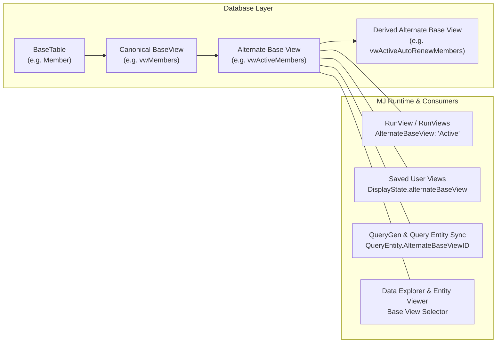

# Alternate Base Views Guide

Alternate Base Views (**MJ Canon, Layer 1**) let an entity expose multiple governed SQL views that share its canonical `BaseView` column contract while returning a curated row subset — for example, **Active** vs. **Lapsed** members on `Members`, **Open** vs. **Fulfilled** orders on `Orders`, or **Pipeline** vs. **Closed Won** opportunities on `Opportunities`.

Instead of repeating complex SQL filter predicates or cross-table `EXISTS` clauses across dozens of User Views, Stored Queries, AI Agent prompts, and dashboards, application authors define the canonical SQL view once in a database migration and register it on the entity in **`MJ: Entity Alternate Base Views`**. Every MemberJunction layer — `RunView`, `RunViews`, `BaseEngine`, `QueryGen`, SQL AST security gates, `Lists`, `DataContext`, and `MJExplorer` — then understands the alternate view natively.

---

## Architecture & Mental Model



### The Non-Negotiable Contract: 100% Column Parity

Every registered Alternate Base View **must project the exact same column set and column types** as the parent entity's canonical `BaseView`:

```sql
CREATE VIEW [__mj_BizAppsCommon].[vwActiveMembers] AS
SELECT m.*
FROM [__mj_BizAppsCommon].[vwMembers] m
WHERE m.[Status] = N'Active'
  AND (m.[ExpirationDate] IS NULL OR m.[ExpirationDate] >= CAST(GETUTCDATE() AS DATE));
```

Why this matters:
- **Zero duplicate entities**: Records loaded from an alternate base view instantiate the exact same `BaseEntity` subclass, form, and permissions as records loaded from `BaseView`.
- **Single-record CRUD is unaffected**: `BaseEntity.Load()`, `Save()`, and `Delete()` always operate against the entity's canonical `BaseView` and `spCreate` / `spUpdate` / `spDelete`. Alternate base views are strictly a **collection-read (`RunView` / SQL query) lens**.
- **CodeGen column parity audit**: During `mj codegen`, `ManageMetadataBase.validateAlternateBaseViewsColumnParity` compares `INFORMATION_SCHEMA.COLUMNS` for every `Active` and `Deprecated` alternate base view against its parent `BaseView` and logs a warning whenever columns are missing, extra, or mismatched in data type.

---

## Metadata Schema

### 1. `MJ: Entity Alternate Base Views` (`__mj.EntityAlternateBaseView`)

| Column | Type | Description |
| --- | --- | --- |
| `ID` | `uniqueidentifier` | Primary key. |
| `EntityID` | `uniqueidentifier` | Owning entity (`__mj.Entity.ID`). |
| `ParentID` | `uniqueidentifier NULL` | Optional same-entity parent `EntityAlternateBaseView.ID` when this view selects from another alternate base view on the same entity. Auto-populated via SQL AST inspection on save when omitted. |
| `Name` | `nvarchar(100)` | Semantic code name unique per entity (e.g., `'Active'`, `'CurrentTerm'`). Validated by `CK_EntityAlternateBaseView_Name` (`NOT LIKE '%|%' AND NOT LIKE '%:%'`). |
| `DisplayName` | `nvarchar(255) NULL` | Optional human-readable label for UI dropdowns and badges (falls back to `Name` via `EffectiveDisplayName`). |
| `Description` | `nvarchar(max)` | Business definition of the subset. Injected into LLM prompts (`QueryGen`, `GetEntityDetails`) so AI agents pick the right view automatically. |
| `SchemaName` | `nvarchar(255) NULL` | Optional physical schema override. When `NULL`, defaults to the parent entity's `SchemaName` (`EffectiveSchemaName`). |
| `ViewName` | `nvarchar(255)` | Physical SQL view name in the database (e.g., `'vwActiveMembers'`). Must be globally unique across all entities' `(SchemaName, BaseView)`, `(SchemaName, BaseTable)`, and other alternate base views. |
| `CachePolicy` | `'Default' \| 'Bypass'` | `'Default'` caches results under an isolated `abv:<name>` cache key and invalidates on parent entity saves. Use `'Bypass'` when the SQL view filters on wall-clock functions (`GETUTCDATE()`) or joins external tables whose mutations do not fire `BaseEntity` events on this entity. |
| `Status` | `'Active' \| 'Deprecated' \| 'Disabled'` | Lifecycle state. `'Deprecated'` views still execute (emitting a deprecation warning) but are hidden from new selection in UI/AI surfaces unless already pinned; `'Disabled'` views fail closed at runtime. |
| `Sequence` | `int` | Display order in UI selectors and prompt catalogs. |

### 2. `MJ: Query Entities.AlternateBaseViewID` (`__mj.QueryEntity.AlternateBaseViewID`)

When a stored Query (`MJ: Queries`) references an alternate base view in its `SELECT ... FROM` clause, MJ's automatic SQL AST extractor (`extractQueryMetadata` / `syncQueryEntities`) resolves the physical view via `FindAlternateBaseViewByPhysicalName`:
- `QueryEntity.EntityID` points to the **owning entity** (preserving entity permission checks and dependency tracking).
- `QueryEntity.AlternateBaseViewID` points to the **matched `EntityAlternateBaseView`** record.
- If a single query joins both an entity's canonical `BaseView` and one of its alternate base views, `syncQueryEntities` keys on `(EntityID, AlternateBaseViewID)` so both lineage edges are preserved.

---

## Step-by-Step: Authoring an Alternate Base View

### Step 1: Create the SQL View in a Migration

Always layer your alternate base view on top of the entity's `BaseView` (or on top of a parent alternate base view on the same entity) using `SELECT v.*`:

```sql
CREATE VIEW [__mj].[vwActiveUsers] AS
SELECT u.*
FROM [__mj].[vwUsers] u
WHERE u.[IsActive] = 1;
GO
```

### Step 2: Register Metadata in `metadata/`

Declare the `MJ: Entity Alternate Base Views` record in your metadata seed file (either as a `relatedEntities` child under `MJ: Entities` or in a dedicated metadata file):

```json
{
  "fields": {
    "EntityID": "@lookup:MJ: Entities.Name=MJ: Users",
    "Name": "Active",
    "DisplayName": "Active Users",
    "Description": "Users with IsActive = 1. Use this view for all active user lookups, assignments, and notifications.",
    "ViewName": "vwActiveUsers",
    "CachePolicy": "Default",
    "Status": "Active",
    "Sequence": 1
  },
  "primaryKey": {
    "ID": "8A74C910-4D3B-4E91-9A15-2C8E4B0D1F22"
  }
}
```

### Step 3: Derivation Hierarchies (`ParentID`)

If a specialized alternate view selects from another alternate view on the same entity (for example, `vwActiveAdminUsers` selecting from `vwActiveUsers`), `MJEntityAlternateBaseViewEntityServer` parses the view definition using `SQLParser.ExtractTableRefs` on save and automatically links `ParentID` when not explicitly set.

In runtime metadata (`EntityAlternateBaseViewInfo`):
- `IsUsable`, `IsDeprecated`, and `IsBypassCache` walk the `ParentView` chain automatically — disabling or setting `CachePolicy = 'Bypass'` on a parent alternate base view cascades to all derived child views on that entity.
- `vwEntityAlternateBaseViews` includes a recursive CTE computing `RootParentID`.

---

## Using Alternate Base Views in Code

### 1. `RunView` and `RunViews`

Pass `AlternateBaseView` (by semantic `Name`, case-insensitive) in `RunViewParams`:

```typescript
import { RunView } from '@memberjunction/core';

const rv = new RunView();
const result = await rv.RunView<MJUserEntity>({
  EntityName: 'MJ: Users',
  AlternateBaseView: 'Active',
  ExtraFilter: "Type = 'Owner'",
  OrderBy: 'Name ASC',
  ResultType: 'entity_object',
}, contextUser);
```

**Precedence order**:
1. Explicit `params.AlternateBaseView`
2. Saved User View's pinned `DisplayState.alternateBaseView` (when running via `ViewID` / `ViewName` / `ViewEntity`)
3. Entity's canonical `BaseView`

**Fail-closed guarantee**: If `AlternateBaseView` names an unknown or `Disabled` view, `ResolveAlternateBaseView` throws an error and **never** falls back to `entity.BaseView`.

### 2. `BaseEngine` Property Configs

`BaseEnginePropertyConfig` supports `AlternateBaseView?: string`:

```typescript
{
  PropertyName: 'ActiveUsers',
  EntityName: 'MJ: Users',
  AlternateBaseView: 'Active',
  CacheLocal: true,
}
```

When a record on `MJ: Users` is saved or updated, `BaseEngine` automatically classifies the mutation as `{ action: 'refresh' }` for any config with `AlternateBaseView` set, ensuring the database view's filter predicate re-evaluates whether the mutated row still belongs in the subset.

### 3. Saved User Views (`DisplayState.alternateBaseView`)

Saved User Views (`MJ: User Views`) can pin an alternate base view inside `DisplayState` JSON (`ViewDisplayState.alternateBaseView`). When a user opens or executes that User View (in `MJExplorer`, `RunView`, `Lists`, or `DataContext`), MJ automatically executes the view against the pinned alternate base view unless overridden by an explicit `RunViewParams.AlternateBaseView`.

---

## Security & Caching Semantics

### Security Model

Alternate base views inherit the parent entity's security boundaries with zero duplicate configuration:
1. **Entity Permissions**: Requires `CanRead` on the parent entity.
2. **Row-Level Security (RLS)**: The parent entity's read RLS filter (`getRowLevelSecurityWhereClause`) is appended to the `WHERE` clause when querying the alternate base view, identical to `BaseView`.
3. **Field-Level Security (FLS)**: Output column projection (`GetDeniedReadFields`) and predicate screening (`ExtraFilter`, `OrderBy`, `Aggregates`) apply identically because column names match `BaseView` 1:1.
4. **Ad-hoc SQL & `ClientClauseScreen`**: `SQLServerDataProvider` and `GenericDatabaseProvider` register all usable alternate base views in the read-only entity view catalog and `ClientClauseScreen` allowlist so governed queries and subqueries referencing an alternate view pass read-authorization checks under the owning entity's permissions.

### Cache Isolation & Invalidation

- **Isolated fingerprints**: `LocalCacheManager.GenerateRunViewFingerprint` and `GenericDatabaseProvider.generateRunViewCacheKey` append `|abv:<lowercased-name>` when `AlternateBaseView` is active, ensuring cached results for `Active` never collide with `BaseView` or another alternate view.
- **Narrowing segment classification**: `LocalCacheManager.hasNarrowingSegment` classifies `abv:<name>` as a narrowing segment so in-memory smart-cache filtering never serves unfiltered `BaseView` rows to an `AlternateBaseView` request.
- **Invalidation**: Saving or deleting a record on the parent entity invalidates both the canonical `BaseView` cache and all `Default`-policy alternate base view caches for that entity.
