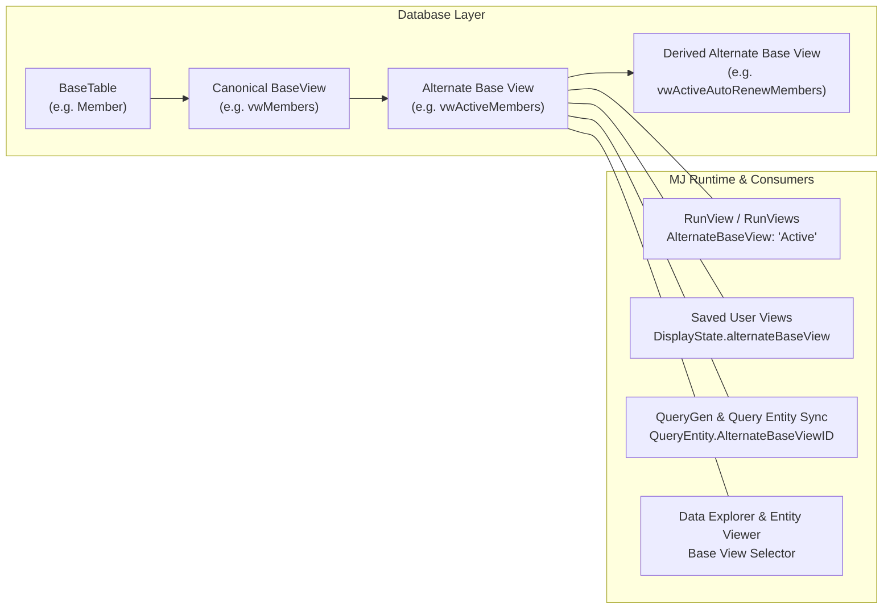

# Alternate Base Views Guide

Alternate Base Views (**MJ Canon, Layer 1**) let an entity expose multiple governed SQL views that share its canonical `BaseView` column contract while returning a curated row subset — for example, **Active** vs. **Lapsed** members on `Members`, **Open** vs. **Fulfilled** orders on `Orders`, or **Pipeline** vs. **Closed Won** opportunities on `Opportunities`.

Instead of repeating complex SQL filter predicates or cross-table `EXISTS` clauses across dozens of User Views, Stored Queries, AI Agent prompts, and dashboards, application authors define the canonical SQL view once in a database migration and register it on the entity in **`MJ: Entity Alternate Base Views`**. Every MemberJunction layer — `RunView`, `RunViews`, `BaseEngine`, `QueryGen`, SQL AST security gates, `Lists`, `DataContext`, and `MJExplorer` — then understands the alternate view natively.

---

## Architecture & Mental Model



### The Non-Negotiable Contract: 100% Column Parity

Every registered Alternate Base View **must project the exact same column set and column types** as the parent entity's canonical `BaseView`:

```sql
-- Note: because this view uses GETUTCDATE(), register it with CachePolicy = 'Bypass'
CREATE VIEW [__mj_BizAppsCommon].[vwActiveMembers] AS
SELECT m.*
FROM [__mj_BizAppsCommon].[vwMembers] m
WHERE m.[Status] = N'Active'
  AND (m.[ExpirationDate] IS NULL OR m.[ExpirationDate] >= CAST(GETUTCDATE() AS DATE));
```

Why this matters:
- **Zero duplicate entities**: Records loaded from an alternate base view instantiate the exact same `BaseEntity` subclass, form, and permissions as records loaded from `BaseView`.
- **Single-record CRUD is unaffected**: `BaseEntity.Load()`, `Save()`, and `Delete()` always operate against the entity's canonical `BaseView` and `spCreate` / `spUpdate` / `spDelete`. Alternate base views are strictly a **collection-read (`RunView` / SQL query) lens**.
- **CodeGen column parity & cache safety audit**: During `mj codegen`, `SQLCodeGenBase.validateAlternateBaseViews` (via `EvaluateAlternateBaseViewParityAndSafety`) compares every `Active` and `Deprecated` alternate base view against its parent `BaseView` after view DDL and `sp_refreshview` / `spRebindLayeredOuterView` execute, logging warnings whenever columns are missing or when a `CachePolicy = 'Default'` view references clock functions or external tables.

---

## Metadata Schema

### 1. `MJ: Entity Alternate Base Views` (`__mj.EntityAlternateBaseView`)

| Column | Type | Description |
| --- | --- | --- |
| `ID` | `uniqueidentifier` | Primary key. |
| `EntityID` | `uniqueidentifier` | Owning entity (`__mj.Entity.ID`). |
| `ParentID` | `uniqueidentifier NULL` | Optional same-entity parent `EntityAlternateBaseView.ID` when this view selects from another alternate base view on the same entity. Auto-populated via SQL AST inspection on save when omitted. |
| `Name` | `nvarchar(100)` | Semantic code name unique per entity (e.g., `'Active'`, `'CurrentTerm'`). Validated by `CK_EntityAlternateBaseView_Name` (`NOT LIKE '%|%' AND NOT LIKE '%:%'`). |
| `DisplayName` | `nvarchar(255) NULL` | Optional human-readable label for UI dropdowns and badges (falls back to `Name` via `EffectiveDisplayName`). |
| `Description` | `nvarchar(max)` | Business definition of the subset. Injected into LLM prompts (`QueryGen`, `GetEntityDetails`) so AI agents pick the right view automatically. |
| `SchemaName` | `nvarchar(255) NULL` | Optional physical schema override. When `NULL`, defaults to the parent entity's `SchemaName` (`EffectiveSchemaName`). |
| `ViewName` | `nvarchar(255)` | Physical SQL view name in the database (e.g., `'vwActiveMembers'`). Must be globally unique across all entities' `(SchemaName, BaseView)`, `(SchemaName, BaseTable)`, and other alternate base views. |
| `CachePolicy` | `'Default' \| 'Bypass'` | `'Default'` caches results under an isolated `abv:<name>` cache key and invalidates on parent entity saves. Use `'Bypass'` when the SQL view filters on wall-clock functions (`GETUTCDATE()`) or joins external tables whose mutations do not fire `BaseEntity` events on this entity. |
| `Status` | `'Active' \| 'Deprecated' \| 'Disabled'` | Lifecycle state. `'Deprecated'` views still execute (emitting a deprecation warning) but are hidden from new selection in UI/AI surfaces unless already pinned; `'Disabled'` views fail closed at runtime. |
| `Sequence` | `int` | Display order in UI selectors and prompt catalogs. |

### 2. `MJ: Query Entities.AlternateBaseViewID` (`__mj.QueryEntity.AlternateBaseViewID`)

When a stored Query (`MJ: Queries`) references an alternate base view in its `SELECT ... FROM` clause, MJ's automatic SQL AST extractor (`extractFromSQL` / `syncQueryMetadata` in `packages/MJCoreEntitiesServer/src/custom/query-extraction/`) resolves the physical view via `FindAlternateBaseViewByPhysicalName`:
- `QueryEntity.EntityID` points to the **owning entity** (preserving entity permission checks and dependency tracking).
- `QueryEntity.AlternateBaseViewID` points to the **matched `EntityAlternateBaseView`** record.
- If a single query joins both an entity's canonical `BaseView` and one of its alternate base views, `syncQueryMetadata` keys on `(EntityID, AlternateBaseViewID)` so both lineage edges are preserved.

---

## Step-by-Step: Authoring an Alternate Base View

### Step 1: Create the SQL View in a Migration

Always layer your alternate base view on top of the entity's `BaseView` (or on top of a parent alternate base view on the same entity) using `CREATE OR ALTER VIEW ... AS SELECT v.*` and grant `SELECT` to the standard MJ database roles (`cdp_UI`, `cdp_Developer`, `cdp_Integration`):

```sql
CREATE OR ALTER VIEW [${flyway:defaultSchema}].[vwUsersActive]
AS
SELECT
    u.*
FROM
    [${flyway:defaultSchema}].[vwUsers] AS u
WHERE
    u.[IsActive] = 1;
GO
GRANT SELECT ON [${flyway:defaultSchema}].[vwUsersActive] TO [cdp_UI], [cdp_Developer], [cdp_Integration];
GO
```

**PostgreSQL Dialect Note**: On PostgreSQL, `CREATE OR REPLACE VIEW` expands `SELECT u.*` at view creation time. During `mj codegen`, `PostgreSQLCodeGenProvider` automatically invokes `__mj."spRebindLayeredOuterView"` (in topological `ParentID` order) after regenerating `BaseView` so `u.*` is re-expanded to include any newly added columns on `BaseView` or `ParentView`. Similarly, `MJEntityAlternateBaseViewEntityServer` uses `pg_get_viewdef(to_regclass(...), true)` on PostgreSQL to auto-populate `ParentID` via the PostgreSQL SQL AST dialect.

### Step 2: Register Metadata in `metadata/entities/.alternate-base-views.json`

Declare the `MJ: Entity Alternate Base Views` record in `metadata/entities/.alternate-base-views.json` as a `relatedEntities` child under `MJ: Entities` (using `@parent:ID` for `EntityID`, a CLI `uuidgen` UUID for the child's `primaryKey`, and `@lookup:MJ: Entities.Name=...` for the parent entity's `primaryKey` — never inline `INSERT INTO EntityAlternateBaseView` in a migration):

```json
[
  {
    "fields": {
      "Name": "MJ: Users"
    },
    "relatedEntities": {
      "MJ: Entity Alternate Base Views": [
        {
          "fields": {
            "EntityID": "@parent:ID",
            "Name": "Active",
            "DisplayName": "Active Users",
            "Description": "Users with IsActive = 1. Excludes deactivated user accounts from pickers, assignments, notifications, and active user queries.",
            "ViewName": "vwUsersActive",
            "CachePolicy": "Default",
            "Status": "Active",
            "Sequence": 1
          },
          "primaryKey": {
            "ID": "8D1544F7-988A-4450-9A26-40513B71F329"
          }
        }
      ]
    },
    "primaryKey": {
      "ID": "@lookup:MJ: Entities.Name=MJ: Users"
    }
  }
]
```

### Step 3: Derivation Hierarchies (`ParentID`)

If a specialized alternate view selects from another alternate view on the same entity (for example, `vwScheduledJobsDueNow` selecting from `vwScheduledJobsActive`), `MJEntityAlternateBaseViewEntityServer` parses the view definition using `SQLParser.ExtractTableRefs` on save and automatically links `ParentID` when not explicitly set (or you can declare `ParentID` explicitly in `.alternate-base-views.json`).

In runtime metadata (`EntityAlternateBaseViewInfo`):
- `IsUsable`, `IsDeprecated`, and `IsBypassCache` walk the `ParentView` chain automatically — disabling or setting `CachePolicy = 'Bypass'` on a parent alternate base view cascades to all derived child views on that entity.
- During `mj codegen`, `sp_refreshview` (SQL Server) and `spRebindLayeredOuterView` (PostgreSQL) execute in topological `ParentID` order so parent alternate views rebind before derived child views.

---

## Relationship to Other MJ View & Filtering Mechanisms

MemberJunction provides several complementary view and filtering primitives. Use the table below to pick the right layer:

| Mechanism | Cardinality | Changes Columns? | Changes Rows? | Who Owns It? | When to Use |
| --- | --- | --- | --- | --- | --- |
| **Canonical Base View (`Entity.BaseView`)** | 1 per entity | Defines the canonical column contract | No (all non-deleted rows) | CodeGen (`BaseViewGenerated = 1`) | Default read surface for every entity. |
| **Layered Base View (`Entity.GeneratedBaseViewName`)** | 1 per entity | **Yes** — wraps `vw<Entity>Generated` (`SELECT g.*, <computed>`) to add cross-hop or aggregate columns | No | CodeGen writes inner view; migration writes outer `BaseView` (`metadata/entities/`) | Every consumer of the entity needs extra computed columns that CodeGen cannot infer from direct FKs. |
| **Alternate Base Views (`MJ: Entity Alternate Base Views`)** | N per entity | **No** — must maintain 100% column parity with `BaseView` (`SELECT v.*`) | **Yes** — exposes named, governed row subsets | Migration writes `CREATE OR ALTER VIEW`; metadata registers in `.alternate-base-views.json` | Domain-canonical subsets (`Active`, `DueNow`, `Completed`, `OpenBalance`, `Sellable`, `OpenPipeline`) shared across `RunView`, `BaseEngine`, User Views, Stored Queries, and AI Agents. |
| **Saved User Views (`MJ: User Views`)** | N per entity / user | Projects a UI column list (`Columns`) | Filters via `WhereClause` / `FilterState`, and can pin `DisplayState.alternateBaseView` | End users or app metadata (`metadata/user-views/`) | User-facing grid/card layouts in Explorer and dashboards. Can layer on top of an Alternate Base View. |
| **Row-Level Security (`MJ: Row Level Security Filters`)** | Per role × entity | No | Mandatory security boundary appended to every read | Administrators / security metadata | Access control (`CanRead` row scoping). Enforced identically on both `BaseView` and every `AlternateBaseView`. |
| **Soft Deletes (`Entity.DeleteType = 'Soft'`)** | 1 per entity | Adds `__mj_DeletedAt` | Filters `__mj_DeletedAt IS NULL` inside `BaseView` | CodeGen ([Soft Deletes Guide](SOFT_DELETES_GUIDE.md)) | Physical deletion replacement. Because `BaseView` already excludes soft-deleted rows, Alternate Base Views selecting from `BaseView` inherit soft-delete filtering automatically. |

> [!TIP]
> **Layered Base Views and Alternate Base Views compose naturally.** For example, in `bizapps-sales`, `MJ_BizApps_Sales: Deals` uses a **Layered Base View** (`vwDeals` wrapping `vwDealsGenerated`) to add predictive win-probability columns, and then layers the **`OpenPipeline`** Alternate Base View (`vwDealsOpenPipeline`) on top of `vwDeals` (`SELECT d.* FROM vwDeals AS d WHERE ...`).

---

## Out-of-the-Box Alternate Base Views

MemberJunction Core ships with **6 canonical Alternate Base Views** out of the box (defined in [`migrations/v6/V202610240805__v6.2.x__Entity_Alternate_Base_Views.sql`](../migrations/v6/V202610240805__v6.2.x__Entity_Alternate_Base_Views.sql) and registered in [`metadata/entities/.alternate-base-views.json`](../metadata/entities/.alternate-base-views.json)), and sections 2–4 below document the companion BizApps patterns (`bizapps-common`, `bizapps-orders`, `bizapps-sales`).

### 1. MemberJunction Core (`@memberjunction/*` — schema `__mj`)

Defined in [`migrations/v6/V202610240805__v6.2.x__Entity_Alternate_Base_Views.sql`](../migrations/v6/V202610240805__v6.2.x__Entity_Alternate_Base_Views.sql) and registered in [`metadata/entities/.alternate-base-views.json`](../metadata/entities/.alternate-base-views.json):

| Entity | Alternate Base View `Name` | Physical SQL View | `ParentID` | `CachePolicy` | Predicate Summary |
| --- | --- | --- | --- | --- | --- |
| `MJ: Users` | `Active` | `vwUsersActive` | `NULL` | `Default` | `IsActive = 1` — excludes deactivated user accounts from user pickers, assignments, notifications, and active user queries. |
| `MJ: AI Agents` | `Active` | `vwAIAgentsActive` | `NULL` | `Default` | `Status = N'Active' AND IsRestricted = 0` — active, non-restricted agents ready for interactive selection, orchestration, and sub-agent delegation. |
| `MJ: AI Prompts` | `Active` | `vwAIPromptsActive` | `NULL` | `Default` | `Status = N'Active'` — excludes `Disabled`, `Pending`, and `Inactive` prompts. |
| `MJ: Actions` | `Active` | `vwActionsActive` | `NULL` | `Default` | `Status = N'Active'` — excludes `Disabled` and `Pending` actions from workflow, agent, and action catalogs. |
| `MJ: Scheduled Jobs` | `Active` | `vwScheduledJobsActive` | `NULL` | `Default` | `Status = N'Active'` — excludes `Paused`, `Disabled`, `Pending`, and `Expired` jobs. |
| `MJ: Scheduled Jobs` | `DueNow` | `vwScheduledJobsDueNow` | `Active` (`vwScheduledJobsActive`) | `Bypass` | Selects from `vwScheduledJobsActive` where `NextRunAt IS NOT NULL AND NextRunAt <= GETUTCDATE()`. Demonstrates two-level `ParentID` derivation and `Bypass` cache policy for wall-clock predicates. |

### 2. BizApps Common (`MemberJunction/bizapps-common` — schema `__mj_BizAppsCommon`)

Registered in `bizapps-common` (`metadata/entities/.alternate-base-views.json`):

| Entity | Alternate Base View `Name` | Physical SQL View | `CachePolicy` | Predicate Summary |
| --- | --- | --- | --- | --- |
| `MJ_BizApps_Common: People` | `Active` | `vwPeopleActive` | `Default` | `Status = N'Active'` — excludes `Inactive`, `Deceased`, and `Merged` person records across CRM, Orders, Sales, Committees, and Tasks. |
| `MJ_BizApps_Common: Organizations` | `Active` | `vwOrganizationsActive` | `Default` | `Status = N'Active'` — excludes `Inactive`, `Dissolved`, and `Merged` organization records. |

### 3. BizApps Orders (`MemberJunction/bizapps-orders` — schema `__mj_BizAppsOrders`)

Registered in `bizapps-orders` (`metadata/entities/.alternate-base-views.json`):

| Entity | Alternate Base View `Name` | Physical SQL View | `CachePolicy` | Predicate Summary |
| --- | --- | --- | --- | --- |
| `MJ_BizApps_Orders: Order Headers` | `Completed` | `vwOrderHeadersCompleted` | `Default` | `Status = N'Confirmed' AND FulfillmentStatus IN (N'Fulfilled', N'NotApplicable') AND ISNULL(Balance, 0) <= 0` — settled, fulfilled orders ready for recognized-revenue reporting and customer history. |
| `MJ_BizApps_Orders: Order Headers` | `OpenBalance` | `vwOrderHeadersOpenBalance` | `Default` | `Status = N'Confirmed' AND ISNULL(Balance, 0) > 0` — confirmed orders carrying an unpaid A/R balance for collections, dunning, and open-receivables dashboards. |
| `MJ_BizApps_Orders: Products` | `Sellable` | `vwProductsSellable` | `Bypass` | `Status = N'Active' AND (AvailableFrom IS NULL OR AvailableFrom <= CAST(GETUTCDATE() AS DATE)) AND (AvailableTo IS NULL OR AvailableTo >= CAST(GETUTCDATE() AS DATE))` — active products currently within their sellable availability window (`Bypass` because the window depends on the UTC date). |

### 4. BizApps Sales (`MemberJunction/bizapps-sales` — schema `__mj_BizAppsSales`)

Registered in `bizapps-sales` (`metadata/entities/.alternate-base-views.json`):

| Entity | Alternate Base View `Name` | Physical SQL View | `CachePolicy` | Predicate Summary |
| --- | --- | --- | --- | --- |
| `MJ_BizApps_Sales: Deals` | `OpenPipeline` | `vwDealsOpenPipeline` | `Default` | `ClosedAt IS NULL AND DealStatusType.IsOpen = 1` — open pipeline deals layered directly on top of the `vwDeals` layered base view (including win-probability columns) and filtered by the `DealStatusType.IsOpen` type-table flag (never comparing status names) for pipeline boards, forecasting, and AI deal coaching. |

---

## Using Alternate Base Views in Code

### 1. `RunView` and `RunViews`

Pass `AlternateBaseView` (by semantic `Name`, case-insensitive) in `RunViewParams`:

```typescript
import { RunView } from '@memberjunction/core';

const rv = new RunView();
const result = await rv.RunView<MJUserEntity>({
  EntityName: 'MJ: Users',
  AlternateBaseView: 'Active',
  ExtraFilter: "Type = 'Owner'",
  OrderBy: 'Name ASC',
  ResultType: 'entity_object',
}, contextUser);
```

**Precedence order**:
1. Explicit `params.AlternateBaseView` (passing `AlternateBaseView: ""` explicitly overrides a saved User View's pin and forces execution against the entity's canonical `BaseView`)
2. Saved User View's pinned `DisplayState.alternateBaseView` (when running via `ViewID` / `ViewName` / `ViewEntity` and `params.AlternateBaseView` is `undefined`)
3. Entity's canonical `BaseView`

**Fail-closed guarantee**: If `AlternateBaseView` names an unknown or `Disabled` view (or is combined with `DataSource: 'Materialized'`), `ResolveAlternateBaseView` fails closed and **never** falls back to `entity.BaseView`.

### 2. `BaseEngine` Property Configs

`BaseEnginePropertyConfig` supports `AlternateBaseView?: string`:

```typescript
{
  PropertyName: 'ActiveUsers',
  EntityName: 'MJ: Users',
  AlternateBaseView: 'Active',
  CacheLocal: true,
}
```

When a record on `MJ: Users` is saved or updated, `BaseEngine` automatically classifies the mutation as `{ action: 'refresh' }` for any config with `AlternateBaseView` set, ensuring the database view's filter predicate re-evaluates whether the mutated row still belongs in the subset.

### 3. Saved User Views (`DisplayState.alternateBaseView`)

Saved User Views (`MJ: User Views`) can pin an alternate base view inside `DisplayState` JSON (`ViewDisplayState.alternateBaseView`). When a user opens or executes that User View (in `MJExplorer`, `RunView`, `Lists`, or `DataContext`), MJ automatically executes the view against the pinned alternate base view unless overridden by an explicit `RunViewParams.AlternateBaseView`.

---

## Security & Caching Semantics

### Security Model

Alternate base views inherit the parent entity's security boundaries with zero duplicate configuration:
1. **Entity Permissions**: Requires `CanRead` on the parent entity.
2. **Row-Level Security (RLS)**: The parent entity's read RLS filter (`getRowLevelSecurityWhereClause`) is appended to the `WHERE` clause when querying the alternate base view, identical to `BaseView`.
3. **Field-Level Security (FLS)**: Output column projection (`GetDeniedReadFields`) and predicate screening (`ExtraFilter`, `OrderBy`, `Aggregates`) apply identically because column names match `BaseView` 1:1.
4. **Ad-hoc SQL & `ClientClauseScreen`**: `SQLServerDataProvider` and `GenericDatabaseProvider` register all usable alternate base views in the read-only entity view catalog and `ClientClauseScreen` allowlist so governed queries and subqueries referencing an alternate view pass read-authorization checks under the owning entity's permissions.

### Cache Isolation & Invalidation

- **Isolated fingerprints**: `LocalCacheManager.GenerateRunViewFingerprint` and `GenericDatabaseProvider.buildSingleFlightRunViewKey` append `|abv:<lowercased-name>` when `AlternateBaseView` is active, ensuring cached results for `Active` never collide with `BaseView` or another alternate view.
- **Narrowing segment classification**: `LocalCacheManager.hasNarrowingSegment` classifies `abv:<name>` as a narrowing segment so in-memory smart-cache filtering never serves unfiltered `BaseView` rows to an `AlternateBaseView` request.
- **Invalidation**: Saving or deleting a record on the parent entity invalidates both the canonical `BaseView` cache and all `Default`-policy alternate base view caches for that entity.
