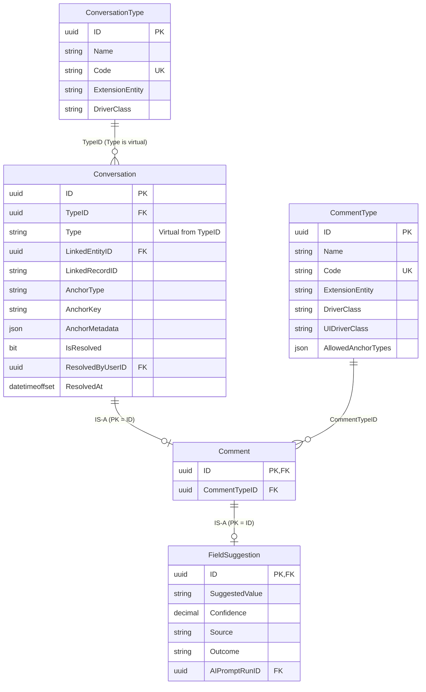

# Anchored Conversations, Typed Record Comments & Field Suggestions Guide

MemberJunction provides a unified **Anchored Conversations, Typed Record Comments & Field Suggestions** architecture built on top of `MJ: Conversations`, `MJ: Conversation Types`, `MJ: Comments` (IS-A `MJ: Conversations`), `MJ: Comment Types`, and `MJ: Field Suggestions` (IS-A `MJ: Comments`).

Instead of bolting separate comment or AI-suggestion tables onto individual domain entities, record discussions and structured field proposals are modeled once in MJ Core as typed, anchored conversations:
- **Multi-message threading** (`MJ: Conversation Details`) — created on demand only when someone posts a note or clicks **Discuss** on a suggestion
- **User and AI agent `@mention` autocomplete** and in-app notifications (`MJ: User Notifications`)
- **Shared resolution tracking** (`IsResolved`, `ResolvedByUserID`, `ResolvedAt` on `MJ: Conversations`)
- **Row-Level Security (RLS) and Field-Level Security (FLS)** enforced uniformly across `MJ: Conversations`, `MJ: Comments`, `MJ: Field Suggestions`, and `MJ: Conversation Details`
- **Declarative IS-A Subtype Chaining (`Entity.SubtypeSelector`)** — saving an `MJ: Field Suggestions` entity writes the `Conversation`, `Comment`, and `FieldSuggestion` rows atomically in one transaction

---

## 1. Entity Model & Two-Level IS-A Chain



### 1.1 Schema Entities (Migrations `v6.2.x` & `V202611091230__v6.3.x`)

| Entity | Relationship | Key Columns | Purpose |
| :--- | :--- | :--- | :--- |
| **`MJ: Conversation Types`** | Lookup / Type Table | `Name`, `Code` (unique), `Description`, `ExtensionEntity`, `DriverClass` | Seeded with `Chat` (`CHAT`), `Skip` (`SKIP`), `Routine` (`ROUTINE`), `Meeting Room` (`MEETING_ROOM`), and `Comment` (`COMMENT`, `ExtensionEntity = 'MJ: Comments'`), plus any custom legacy `Conversation.Type` values migrated during upgrade. |
| **`MJ: Conversations`** | IS-A Root | `TypeID` (FK), virtual `Type`, `LinkedEntityID`, `LinkedRecordID`, `AnchorType`, `AnchorKey`, `AnchorMetadata`, `IsResolved`, `ResolvedByUserID`, `ResolvedAt` | Declares `SubtypeSelector` (`Path: "TypeID.ExtensionEntity"`, `AutoEnsureOnSave: true`, `Driver: { Path: "TypeID.DriverClass", BaseClass: "ConversationTypeDriver" }`). |
| **`MJ: Comments`** | IS-A `MJ: Conversations` | `ID` (PK/FK to `Conversation.ID`), `CommentTypeID` (FK) | Extension entity for the `Comment` conversation type. Declares `SubtypeSelector` (`Path: "CommentTypeID.ExtensionEntity"`, `AutoEnsureOnSave: true`, `Driver: { Path: "CommentTypeID.DriverClass", BaseClass: "CommentTypeDriver" }`, `UIDriver: { Path: "CommentTypeID.UIDriverClass" }`). |
| **`MJ: Comment Types`** | Lookup / Type Table | `Name`, `Code` (unique), `ExtensionEntity`, `DriverClass`, `UIDriverClass`, `AllowedAnchorTypes` (`JSONType = 'CommentTypeAllowedAnchorTypes'`) | Seeded with **Comment** (`COMMENT`, plain note) and **Field Suggestion** (`FIELD_SUGGESTION`, `ExtensionEntity = 'MJ: Field Suggestions'`, `DriverClass = 'FieldSuggestionCommentDriver'`, `UIDriverClass = 'FieldSuggestionCardComponent'`, `AllowedAnchorTypes = ['Field']`). |
| **`MJ: Field Suggestions`** | IS-A `MJ: Comments` | `ID` (PK/FK to `Comment.ID`), `SuggestedValue`, `Confidence`, `Source` (`LLM`, `Integration`, `Agent`, `Person`), `Outcome` (`Accepted`, `Rejected`, `Superseded`), `AIPromptRunID` | First shipped structured comment subtype. Stores proposed field values without overwriting record truth until accepted by an authorized user or superseded by authoritative data. |

### 1.2 Virtual `Conversation.Type` & Release / GraphQL Migration Note

In MJ 6.3 (`V202611091230__v6.3.x__Conversation_Types_Comments_And_Field_Suggestions.sql`), the physical `Conversation.Type` column was replaced by `Conversation.TypeID` (`NOT NULL`, referencing `MJ: Conversation Types`):
- **Reads & Filters Stay Unchanged**: Because the foreign key is named `TypeID`, CodeGen exposes `Type` on `vwConversations` (and inherited IS-A views `vwComments` and `vwFieldSuggestions`) as a read-only virtual column. Existing `RunView` filters such as `Type = 'Skip'` or `Type = 'Comment'` and property reads (`conversation.Type`) continue to work identically.
- **TypeScript Writers Use `TypeID` + `CONVERSATION_TYPE_CODES`**: `ConversationEngine.Instance.TypeByCode(CONVERSATION_TYPE_CODES.ROUTINE)` resolves the cached `MJConversationTypeEntity` row without magic strings. When `TypeID` is omitted on a new conversation, `MJConversationEntityServer` defaults `TypeID` to `Comment` when `AnchorType IS NOT NULL` and to `Chat` otherwise.
- **⚠️ Breaking Change for External GraphQL Mutation Callers**: Because `Conversation.Type` is now a virtual view column (`IncludeInGeneratedForm = 0`, no stored-procedure parameter), `CreateMJConversationInput` and `UpdateMJConversationInput` no longer include `Type`. External GraphQL clients that previously sent `Type` in `CreateMJConversation` or `UpdateMJConversation` mutations must either omit `Type` (to accept the server default) or pass `TypeID`.

### 1.3 Constraints & Indexes
- **`CK_Conversation_AnchorType`**: Enforces valid `AnchorType` values (`NULL`, `'Contribution'`, `'DocBlock'`, `'Field'`, `'Group'`, `'Record'`, `'Section'`, `'SheetRange'`, `'SlideRegion'`).
- **`CK_Conversation_AnchorLinkBinding`**: Enforces `AnchorType IS NULL OR (LinkedEntityID IS NOT NULL AND LinkedRecordID IS NOT NULL)`.
- **`IDX_Conversation_LinkedRecord_Anchor_Type`**: Composite index on `(LinkedEntityID, LinkedRecordID, AnchorType, TypeID)` (plus `AnchorKey`, `IsResolved`) for sub-millisecond anchored note/suggestion loading while keeping anchored threads isolated from main AI chat lists (`AnchorType IS NULL AND LinkedEntityID IS NULL`).

---

## 2. Strongly-Typed JSON Metadata (`IConversationAnchorMetadata`)

Defined in `metadata/entities/JSONType-interfaces/IConversationAnchorMetadata.ts` and generated onto `MJConversationEntity.AnchorMetadataObject` (inherited by `MJCommentEntity` and `MJFieldSuggestionEntity`):

```typescript
export interface IConversationAnchorMetadata {
    /** Friendly display label of the anchor target at the time the comment was created */
    anchorDisplayName?: string;
    /** Target field code name when AnchorType is 'Field' */
    fieldName?: string;
    /** Collapsible panel SectionKey containing the target field or section */
    sectionKey?: string;
    /** Friendly display name of the section */
    sectionDisplayName?: string;
    /** Left-nav rail group key containing the target section */
    groupKey?: string;
    /** Friendly display name of the rail group */
    groupDisplayName?: string;
    /** Formatted snapshot of the field's value at the moment the thread was started */
    quotedValue?: string;
    /** Field names on the linked entity whose FLS read permission is required to view this thread */
    restrictedFields?: string[];
    /** Optional character/block range for rich-text or document blocks */
    selectionRange?: {
        startOffset?: number;
        endOffset?: number;
        blockId?: string;
    };
}
```

> **Type Derivation Rule**: Always derive value-list unions from generated entity types (`MJConversationEntity['AnchorType']`, `MJFieldSuggestionEntity['Source']`, `MJFieldSuggestionEntity['Outcome']`) rather than hand-copying string unions.

---

## 3. Comment Type Drivers & Field Suggestion Lifecycle

Each `MJ: Comment Types` row can name a server/shared behavior driver (`DriverClass`, extending `CommentTypeDriver` -> `EntitySubtypeDriverBase`) and an Angular card renderer (`UIDriverClass`, extending `EntitySubtypeUIDriverBase`).

### 3.1 `CommentTypeDriver` & `FieldSuggestionCommentDriver`

`FieldSuggestionCommentDriver` (`@RegisterClass(CommentTypeDriver, 'FieldSuggestionCommentDriver')` in `@memberjunction/core-entities`) implements the full lifecycle for `MJ: Field Suggestions`:

1. **Anchor & Entity Opt-In Validation (`Validate` & `MJFieldSuggestionEntityServer`)**:
   - Verifies `AnchorType === 'Field'` (matching `CommentType.AllowedAnchorTypes = ['Field']`), a valid `AnchorKey` naming an existing `EntityField` on the linked entity, and that the linked entity allows `'FIELD_SUGGESTION'` in `EntityInfo.AllowedCommentTypeCodes`.
2. **Accept (`ConversationEngine.AcceptFieldSuggestion` -> `FieldSuggestionCommentDriver.OnAccept`)**:
   - Loads the linked target record as `acceptingUser`, verifies `entityInfo.AllowUpdateAPI`, entity `CanUpdate` permission, and FLS `IsFieldUpdatableByUser(field, acceptingUser)`.
   - Coerces `SuggestedValue` to the field's MJ scalar/boolean/numeric/date type and saves the target record normally as `acceptingUser` — so **`MJ: Record Changes` auditing, server-side entity hooks, and FLS apply identically to a manual user edit**.
   - Marks the suggestion `Outcome = 'Accepted'`, `IsResolved = true`, `ResolvedByUserID = acceptingUser.ID`, `ResolvedAt = new Date()`.
3. **Reject (`ConversationEngine.RejectFieldSuggestion` -> `FieldSuggestionCommentDriver.OnReject`)**:
   - Requires the exact same entity and field update permissions on the target field as `Accept`.
   - Marks the suggestion `Outcome = 'Rejected'`, `IsResolved = true`, `ResolvedByUserID = rejectingUser.ID`, `ResolvedAt = new Date()` without modifying the target record.
4. **Automatic Superseding (`AfterSave` & `FieldSuggestionPostSaveHook`)**:
   - **Newer Suggestion Supersedes Older**: When a new open `MJ: Field Suggestions` row is saved for `(LinkedEntityID, LinkedRecordID, AnchorKey)`, `FieldSuggestionCommentDriver.AfterSave()` automatically marks any older unresolved suggestion on that same field as `Outcome = 'Superseded'` and `IsResolved = true`.
   - **Direct Field Edit Supersedes Pending Suggestions (`PostSaveHook`)**: `@memberjunction/core` provides a generic `'PostSave'` provider hook (`PostSaveHook`, fired after `BaseEntity` commits a create or update with `ChangedFieldNames`). `FieldSuggestionPostSaveHook` (`@memberjunction/core-entities-server`) listens for saves on entities that opt into `FIELD_SUGGESTION`, resolves each open comment's `CommentTypeDriver`, and invokes `OnRecordChanged()`, automatically marking pending suggestions for modified fields as `Outcome = 'Superseded'` and `IsResolved = true` (skipping the suggestion currently being accepted via `AcceptFieldSuggestion`).
5. **Zero-Noise Discussion (`Discuss`)**:
   - Creating a `Field Suggestion` does **not** require creating an `MJ: Conversation Details` message row. Message rows exist only if a user or agent clicks **Discuss** on the suggestion card to start a thread inside that suggestion's conversation.

### 3.2 Entity-Level Opt-In (`MJ: Entities.Configuration.Comments`)

Administrators and Open Apps configure commenting and allowed comment types per entity in `MJ: Entities.Configuration`:

```json
{
  "Comments": {
    "Enabled": true,
    "RequiredPermission": "Read",
    "AllowedRoles": ["Developer", "Reviewer"],
    "AllowedCommentTypes": ["COMMENT", "FIELD_SUGGESTION"]
  }
}
```

- **`Enabled`** (`boolean`, default `true`): Set to `false` to disable all record commenting on the entity (`EntityInfo.AllowRecordComments === false`).
- **`RequiredPermission`** (`'Read' | 'Update'`, default `'Read'`): Controls whether starting/replying to plain comments requires `CanRead` or `CanUpdate` (`EntityInfo.CanUserComment(user)`). Accepting or rejecting a `Field Suggestion` **always** requires update permission on both the entity and the target field regardless of `RequiredPermission`.
- **`AllowedRoles`** (`string[]`, optional): Restricts commenting to users holding at least one listed role name or ID.
- **`AllowedCommentTypes`** (`string[]`, default `['COMMENT']`): Lists the `MJ: Comment Types.Code` values permitted on this entity (`EntityInfo.AllowedCommentTypeCodes`, `EntityInfo.IsCommentTypeAllowed(code)`). Plain notes (`'COMMENT'`) are enabled by default; structured types such as `'FIELD_SUGGESTION'` are opt-in per entity (e.g., `MJ_BizApps_Tasks: Tasks`, `GitHubIssueTask`, `GitHubPullRequestTask`).

---

## 4. Security Architecture: RLS & Two-Stage FLS Protection Across All IS-A Views

Anchored conversations, comments, and field suggestions share one defense-in-depth security pipeline across `@memberjunction/core-entities` and `@memberjunction/core-entities-server`:

### 4.1 Server-Side `PostRunView` Enforcement (`AnchoredConversationPostRunViewHook`)
Registered via `RegisterProviderHook('PostRunView', AnchoredConversationPostRunViewHook)` in `@memberjunction/core-entities-server` and `MJServer`, every server-side `RunView` against **`MJ: Conversations`**, **`MJ: Comments`**, **`MJ: Field Suggestions`**, or **`MJ: Conversation Details`** automatically filters out any row whose linked record fails `UserCanReadLinkedRecord` (RLS) or whose target/stamped fields fail `IsConversationHiddenByFieldSecurity` (FLS) for `contextUser` — even when callers request narrow `Fields` projections that omit `AnchorType`, `AnchorKey`, or `LinkedEntityID`.

### 4.2 Field-Level Security (FLS) — Read Gate & `quotedValue` Redaction
When `entityInfo.FieldLevelSecurityApplies === true`, `IsConversationHiddenByFieldSecurity(entityInfo, user, anchorType, anchorKey, anchorMetadata)` computes `denied = entityInfo.GetDeniedReadFields(user)` and hides the note or suggestion in 0ms when:
1. `AnchorType === 'Field'` and `denied.has(anchorKey.toLowerCase())` — **a `Field Suggestion` on a field the user cannot read is completely invisible**, OR
2. `AnchorMetadataObject.fieldName` is in `denied`, OR
3. Any field listed in `AnchorMetadataObject.restrictedFields` is in `denied`.

Both client-side (`<mj-form-field>` and `<mj-record-comments>`) and server-side (`MJConversationEntityServer.Save()`) strip `AnchorMetadataObject.quotedValue` whenever the target field has `HasFieldPermissions === true` or `Encrypt === true`.

### 4.3 Write-Time Unanchored Comment Classifier (`InspectAndStampRestrictedFieldsForComment`)
On every `MJConversationDetailEntityServer.Save()` belonging to an anchored thread (`AnchorType != null`) on an FLS-governed entity, `InspectAndStampRestrictedFieldsForComment()` runs the two-stage lexical/author-readable-value + governed `AIPromptRunner` classifier (`'Anchored Comment Restricted Field Classifier'`), rejecting unauthorized restricted-field references with a generic non-oracle error and stamping authorized references into `AnchorMetadataObject.restrictedFields`.

### 4.4 `@Mention` Notifications with FLS/RLS Gating
`DispatchConversationMentionNotifications()` verifies both `IsConversationHiddenByFieldSecurity` and `UserCanReadLinkedRecord` before dispatching `MJ: User Notifications`, ensuring restricted comment or suggestion discussions never leak via notification previews.

---

## 5. Angular Form UX (`@memberjunction/ng-base-forms`)

Generated and custom forms inherit the unified **Notes & suggestions** UX automatically through `<mj-record-form-container>`, `<mj-form-toolbar>`, `<mj-collapsible-panel>`, and `<mj-form-field>`:

1. **Per-Type Field Badges (`<mj-form-field>`)**:
   - Fields with open plain notes show the note badge (`fa-solid fa-comment`, `.mj-forms-field__comment-pill`).
   - Fields with pending `MJ: Field Suggestions` show a distinct suggestion badge (`fa-solid fa-wand-magic-sparkles`, `.mj-forms-field__comment-pill--suggestion`).
   - Clicking either badge opens the anchored popover pre-filtered (`PreferredTypeFilter`) to `'COMMENT'` or `'FIELD_SUGGESTION'`. Fields with open notes or suggestions are never collapsed away as empty in read mode.
2. **"Notes & suggestions" Drawer & Popover (`<mj-record-comments>`)**:
   - Toolbar action (`RecordCommentsToolbarAction`, key `'comments'`) is labeled **Notes & suggestions** and displays the combined open thread + pending suggestion count.
   - When the entity allows multiple comment types (`AvailableTypeFilterCodes.length > 1`), an accessible type filter pill bar (`role="group"` + `aria-pressed`) lets users filter between **All**, **Notes**, **Suggestions**, and any additional custom `MJ: Comment Types`, alongside **Open** / **Resolved** / **All** status filters.
3. **Dynamic Card Rendering via `UIDriverClass` (`<mj-comment-card-driver-host>` & `FieldSuggestionCardComponent`)**:
   - Plain comments (`UIDriverClass == null`) render with the standard threaded note card.
   - When a comment's `MJ: Comment Types` row declares a `UIDriverClass` (such as `FieldSuggestionCardComponent`, registered via `@RegisterClass(EntitySubtypeUIDriverBase, 'FieldSuggestionCardComponent')`), `<mj-comment-card-driver-host>` instantiates that component dynamically via `MJGlobal.Instance.ClassFactory`.
   - **`FieldSuggestionCardComponent`** displays:
     - Source badge (`LLM`, `Integration`, `Agent`, `Person`) and confidence percentage pill
     - Current field value vs. ghost **Suggested value** diff block (or outcome pill `Accepted` / `Rejected` / `Superseded` once closed)
     - **Accept**, **Reject** (enabled only when `CanUserUpdateTargetField` is true), and **Discuss** (revealing and focusing the inline reply composer on demand; generic `Resolve` is suppressed on suggestion cards so resolution always flows through Accept/Reject/Supersede)
   - Accepting a suggestion through `FormRecordCommentsCoordinatorService.AcceptFieldSuggestion` reloads the clean server record into the open form (`InnerLoad` + `FormRecordRefreshCoordinator.NotifyRemoteUpdate`), and saving the form directly reloads open suggestions so auto-superseded items update immediately on screen.
