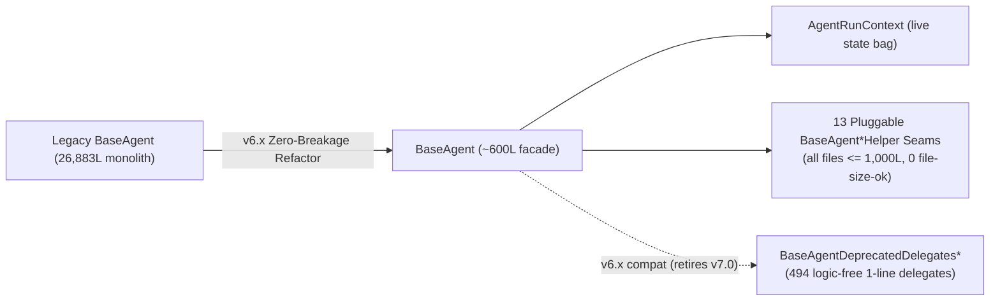

# BaseAgent Refactor — Complete Method-to-Helper Rebase Map (`v6.x` → `v7.0`)

This document provides an exhaustive, 1-to-1 mapping of all **494** historical `BaseAgent` protected/internal methods (plus 2 compatibility getters) from the pre-refactor monolithic `packages/AI/Agents/src/base-agent.ts` to their new `BaseAgent<Seam>Helper` classes, exact helper method names, implementation files, and `AgentRunContext` state bags.

> **Canonical Agent Documentation Suite**
> - **Administrators & Operators:** [Agent Administrator Guide](AGENT_ADMINISTRATOR_GUIDE.md)
> - **Developers & Extension Authors:** [Agent Builder & Extension Guide](AGENT_BUILDER_EXTENSION_GUIDE.md)
> - **Everyday Users & Personal Instances:** [Agent End-User Guide](AGENT_END_USER_GUIDE.md)
> - **Subclass & PR Rebase Reference:** [BaseAgent Rebase Map](BASE_AGENT_REBASE_MAP.md) *(this guide)*

> **Zero-Breakage `v6.x` Compatibility Guarantee:** Every one of the **494** methods below remains callable and overridable on `BaseAgent` throughout `v6.x` via logic-free 1-line `@deprecated` delegates in `packages/AI/Agents/src/helpers/compat/BaseAgentDeprecatedDelegates*.ts`. Existing subclasses (including external products such as *Skip* and *Betty*), all existing test suites, and in-flight PRs continue to compile and pass untouched. The compat shim layer is scheduled for removal in **`v7.0`**.

---

## 1. Architecture & Seam Summary

| Slice | Seam Key | Helper Base Class | Implementation Files | Extensibility | Methods |
| --- | --- | --- | --- | --- | ---: |
| s1 | `messaging` | `BaseAgentMessagingHelper` | `packages/AI/Agents/src/helpers/messaging/AgentMessagingHelper.ts (+ AgentStoppedRunContinuationHelper.ts)` | Pluggable (`messaging`) | 32 |
| s2 | `payload` | `BaseAgentPayloadHelper` | `packages/AI/Agents/src/helpers/payload/AgentPayloadHelper.ts` | Pluggable (`payload`) | 9 |
| s3 | `compaction` | `BaseAgentCompactionHelper` | `packages/AI/Agents/src/helpers/compaction/AgentCompactionHelper.ts (+ AgentContextRecoveryHelper.ts)` | Pluggable (`compaction`) | 27 |
| s4 | `realtime` | `BaseAgentRealtimeHelper` | `packages/AI/Agents/src/helpers/realtime/AgentRealtimeHelper.ts (+ AgentRealtimePersistenceHelper.ts)` | Pluggable (`realtime`) | 11 |
| s5 | `iteration` | `BaseAgentIterationHelper` | `packages/AI/Agents/src/helpers/iteration/AgentIterationHelper.ts (+ AgentLoopBodyExecutor.ts)` | Pluggable (`iteration`) | 23 |
| s6 | `skills` | `BaseAgentSkillsHelper` | `packages/AI/Agents/src/helpers/skills/AgentSkillsHelper.ts` | Pluggable (`skills`) | 19 |
| s7 + s12 (A7b) | `limits` | `BaseAgentLimitsHelper` | `packages/AI/Agents/src/helpers/limits/AgentLimitsHelper.ts (+ AgentCheckpointAndPauseHelper.ts, AgentLivenessWatchdog.ts, AgentStuckDetector.ts)` | **CODE-ONLY** (`@RegisterClass` only; `helperPlugins` rejected) | 35 |
| s8a (D3) | `actionPolicy` | `BaseAgentActionPolicyHelper` | `packages/AI/Agents/src/helpers/actions/AgentActionPolicyHelper.ts (+ AgentRunScopeAndAudienceHelper.ts)` | **CODE-ONLY** (`@RegisterClass` only; `helperPlugins` rejected) | 52 |
| s8b | `actions` | `BaseAgentActionsHelper` | `packages/AI/Agents/src/helpers/actions/AgentActionsHelper.ts (+ AgentActionExecutionHelper.ts, AgentActionCircuitBreakerHelper.ts)` | **CODE-ONLY** (`@RegisterClass` only; `helperPlugins` rejected) | 53 |
| s9 | `prompt` | `BaseAgentPromptHelper` | `packages/AI/Agents/src/helpers/prompt/AgentPromptHelper.ts (+ AgentPromptExecutionHelper.ts, AgentPromptContextAndDiscoveryHelper.ts, AgentNativeToolsAndPrefixCacheHelper.ts, AgentPromptCatalogAndNarrowingHelper.ts, AgentTurnToolsAndFinishIfHelper.ts, AgentDecisionsHelper.ts)` | Pluggable (`prompt`) | 131 |
| s10 | `subAgents` | `BaseAgentSubAgentHelper` | `packages/AI/Agents/src/helpers/subagents/AgentSubAgentHelper.ts (+ AgentSubAgentExecutionHelper.ts, AgentSubAgentValidationHelper.ts, AgentParallelSubAgentHelper.ts, AgentRelatedSubAgentAndTaskGraphHelper.ts)` | **CODE-ONLY** (`@RegisterClass` only; `helperPlugins` rejected) | 52 |
| s11a + s13 | `steps` | `BaseAgentStepExecutionHelper` | `packages/AI/Agents/src/helpers/steps/AgentStepExecutionHelper.ts (+ AgentStepValidationHelper.ts, AgentStepTypeRegistry.ts, BuiltInAgentStepHandlers.ts)` | **CODE-ONLY** (`@RegisterClass` only; custom step types via `AIAgentStepType`) | 18 |
| s11b + s14 | `setup` | `BaseAgentRunSetupHelper` | `packages/AI/Agents/src/helpers/setup/AgentRunSetupHelper.ts (+ AgentRunInitializationHelper.ts, AgentRunFinalizationHelper.ts)` | **CODE-ONLY** (`@RegisterClass` only; `helperPlugins` rejected) | 30 |
| compat | `compat` | `BaseAgentDeprecatedDelegates` | `packages/AI/Agents/src/helpers/compat/BaseAgentDeprecatedDelegates.ts (+ BaseAgentDeprecatedDelegatesCore.ts)` | Compatibility shim only (retiring in `v7.0`) | 2 |
| **Total** | **13 Seams + Compat** | **All files `<= 1,000L` (`base-agent.ts` = `~600L`)** | `packages/AI/Agents/src/helpers/` | **7 Metadata-Pluggable + 6 Code-Only** | **494** |

---

## 2. Rebase Guidance for In-Flight PRs (Including `MJ#6878`) & Custom Subclasses

### 2.1 Rebasing `MJ#6878` (`feat/conversation-side-questions`) & Other Open PRs

If your branch modified `packages/AI/Agents/src/base-agent.ts` before the refactor:
1. Identify each method your diff touched in the table below (Section 3).
2. Move your hunks into the corresponding helper implementation file under `packages/AI/Agents/src/helpers/<seam>/`.
3. Replace direct `this._<field>` reads/writes with `ctx.<Property>` on `AgentRunContext` (see each seam's `AgentRunContext` state bag below), and call sibling helpers through `ctx.Hooks.<Method>(...)` when virtual-dispatch subclass override semantics should be preserved.
4. Specifically for **`MJ#6878` (`feat/conversation-side-questions`)**:
   - Conversation/message lifecycle, step logging, prior-turn tool injection, or feedback requests → `packages/AI/Agents/src/helpers/messaging/AgentMessagingHelper.ts` (`BaseAgentMessagingHelper`)
   - Prompt assembly, system/user message construction, native tools, or decisions → `packages/AI/Agents/src/helpers/prompt/AgentPromptExecutionHelper.ts` & sibling prompt helpers (`BaseAgentPromptHelper`)
   - Run setup, agent config loading, or checkpoint restore → `packages/AI/Agents/src/helpers/setup/AgentRunSetupHelper.ts` & `AgentRunInitializationHelper.ts` (`BaseAgentRunSetupHelper`)
   - Step dispatch or next-step validation → `packages/AI/Agents/src/helpers/steps/AgentStepExecutionHelper.ts` (`BaseAgentStepExecutionHelper`) or a custom `BaseAgentStepHandler` via `MJ: AI Agent Step Types`
   - Sub-agent consult/chat handling → `packages/AI/Agents/src/helpers/subagents/AgentSubAgentExecutionHelper.ts` (`BaseAgentSubAgentHelper`)

### 2.2 Migrating Custom `BaseAgent` Subclasses

- **Permanent hooks kept directly on `BaseAgent`** (no migration needed): `Execute`, `ResumePausedRun`, `ExecuteSingleAction`, `StartBridgeRealtimeSession`, `EndConversationSkill`, `FlushPendingCheckpointPersistence`, `WaitForPendingFastJudgeEvaluations`, `FlushPendingLateFastJudgeSaves`, `GetConfigurationPresets`, `GetDefaultConfigurationPreset`, `PromoteMediaOutputs`, `filterAvailableSkills`, `checkExecutionGuardrails`, `hasExceededAgentRunGuardrails`, `incrementExecutionCount`, `mapWithConcurrency`, `contentToString`, `pruneAndCompactExpiredMessages`, and the 13 `get*Helper()` resolvers.
- **Calling a migrated method from a subclass:** Replace `this.<legacyMethod>(...)` with `this.<getSeamHelper>().<NewMethod>(this.getRunContext(), ...)`.
- **Overriding a horizontal behavior:** Prefer replacing the seam via `@RegisterClass(BaseAgent<Seam>Helper, ...)` (Extension Point #3) or registering a `BaseAgentStepHandler` (Extension Point #2) instead of overriding internal `BaseAgent` methods. See [Agent Builder & Extension Guide](AGENT_BUILDER_EXTENSION_GUIDE.md).

---

## 3. Exhaustive 1-to-1 Method Mapping (All 494 Preserved Methods)

### s1 — `BaseAgentMessagingHelper` (32 methods)

- **Seam Key:** `messaging` | **Extensibility:** Pluggable (`messaging`)
- **BaseAgent Resolver:** `this.getMessagingHelper()`
- **Default Implementation File(s):** `packages/AI/Agents/src/helpers/messaging/AgentMessagingHelper.ts (+ AgentStoppedRunContinuationHelper.ts)`
- **Primary `AgentRunContext` State Bag:** `StepSaveQueue`, `FeedbackCoordinator`, `AllProgressSteps`, `LastRecordedPromptStack`, `ConversationBranches`, `MessageLifecycleCallback`, `FeedbackRequestId`

| # | Legacy `BaseAgent` Method | Target Helper Class & Method | Compat Delegate File |
| ---: | --- | --- | --- |
| 1 | `logStatus` | `BaseAgentMessagingHelper.LogStatus(ctx, ...)` | `helpers/compat/BaseAgentDeprecatedDelegates.ts` |
| 2 | `createStepEntity` | `BaseAgentMessagingHelper.CreateStepEntity(ctx, ...)` | `helpers/compat/BaseAgentDeprecatedDelegates.ts` |
| 3 | `finalizeStepEntity` | `BaseAgentMessagingHelper.FinalizeStepEntity(ctx, ...)` | `helpers/compat/BaseAgentDeprecatedDelegates.ts` |
| 4 | `formatHierarchicalMessage` | `BaseAgentMessagingHelper.FormatHierarchicalMessage(ctx, ...)` | `helpers/compat/BaseAgentDeprecatedDelegates.ts` |
| 5 | `logError` | `BaseAgentMessagingHelper.LogError(ctx, ...)` | `helpers/compat/BaseAgentDeprecatedDelegatesCore.ts` |
| 6 | `warnAboutDroppedValues` | `BaseAgentMessagingHelper.WarnAboutDroppedValues(ctx, ...)` | `helpers/compat/BaseAgentDeprecatedDelegatesCore.ts` |
| 7 | `queueStepSave` | `BaseAgentMessagingHelper.QueueStepSave(ctx, ...)` | `helpers/compat/BaseAgentDeprecatedDelegatesCore.ts` |
| 8 | `buildInitializationProgressMessage` | `BaseAgentMessagingHelper.BuildInitializationProgressMessage(ctx, ...)` | `helpers/compat/BaseAgentDeprecatedDelegatesCore.ts` |
| 9 | `buildPromptProgressMessage` | `BaseAgentMessagingHelper.BuildPromptProgressMessage(ctx, ...)` | `helpers/compat/BaseAgentDeprecatedDelegatesCore.ts` |
| 10 | `fitStepName` | `BaseAgentMessagingHelper.FitStepName(ctx, ...)` | `helpers/compat/BaseAgentDeprecatedDelegatesCore.ts` |
| 11 | `buildHierarchicalStep` | `BaseAgentMessagingHelper.BuildHierarchicalStep(ctx, ...)` | `helpers/compat/BaseAgentDeprecatedDelegatesCore.ts` |
| 12 | `emitMessageLifecycleEvent` | `BaseAgentMessagingHelper.EmitMessageLifecycleEvent(ctx, ...)` | `helpers/compat/BaseAgentDeprecatedDelegatesCore.ts` |
| 13 | `convertUIMarkupInMessages` | `BaseAgentMessagingHelper.ConvertUIMarkupInMessages(ctx, ...)` | `helpers/compat/BaseAgentDeprecatedDelegatesCore.ts` |
| 14 | `capturePromptStepMessages` | `BaseAgentMessagingHelper.CapturePromptStepMessages(ctx, ...)` | `helpers/compat/BaseAgentDeprecatedDelegatesCore.ts` |
| 15 | `capStandaloneToolResultText` | `BaseAgentMessagingHelper.CapStandaloneToolResultText(ctx, ...)` | `helpers/compat/BaseAgentDeprecatedDelegatesCore.ts` |
| 16 | `injectConversationToolResultsMessage` | `BaseAgentMessagingHelper.InjectConversationToolResultsMessage(ctx, ...)` | `helpers/compat/BaseAgentDeprecatedDelegatesCore.ts` |
| 17 | `injectArtifactToolResultsMessage` | `BaseAgentMessagingHelper.InjectArtifactToolResultsMessage(ctx, ...)` | `helpers/compat/BaseAgentDeprecatedDelegatesCore.ts` |
| 18 | `injectMemoryWriteResultsMessage` | `BaseAgentMessagingHelper.InjectMemoryWriteResultsMessage(ctx, ...)` | `helpers/compat/BaseAgentDeprecatedDelegatesCore.ts` |
| 19 | `injectPipelineResultMessage` | `BaseAgentMessagingHelper.InjectPipelineResultMessage(ctx, ...)` | `helpers/compat/BaseAgentDeprecatedDelegatesCore.ts` |
| 20 | `injectDecisionResultsMessage` | `BaseAgentMessagingHelper.InjectDecisionResultsMessage(ctx, ...)` | `helpers/compat/BaseAgentDeprecatedDelegatesCore.ts` |
| 21 | `createSubAgentResultMessage` | `BaseAgentMessagingHelper.CreateSubAgentResultMessage(ctx, ...)` | `helpers/compat/BaseAgentDeprecatedDelegatesCore.ts` |
| 22 | `buildConversationSummaryHost` | `BaseAgentMessagingHelper.BuildConversationSummaryHost(ctx, ...)` | `helpers/compat/BaseAgentDeprecatedDelegatesCore.ts` |
| 23 | `injectPriorTurnToolResults` | `BaseAgentMessagingHelper.InjectPriorTurnToolResults(ctx, ...)` | `helpers/compat/BaseAgentDeprecatedDelegatesCore.ts` |
| 24 | `loadPriorTurnToolResultSteps` | `BaseAgentMessagingHelper.LoadPriorTurnToolResultSteps(ctx, ...)` | `helpers/compat/BaseAgentDeprecatedDelegatesCore.ts` |
| 25 | `cachePriorTurnToolResults` | `BaseAgentMessagingHelper.CachePriorTurnToolResults(ctx, ...)` | `helpers/compat/BaseAgentDeprecatedDelegatesCore.ts` |
| 26 | `injectStoppedRunResults` | `BaseAgentMessagingHelper.InjectStoppedRunResults(ctx, ...)` | `helpers/compat/BaseAgentDeprecatedDelegatesCore.ts` |
| 27 | `loadStoppedRunContinuation` | `BaseAgentMessagingHelper.LoadStoppedRunContinuation(ctx, ...)` | `helpers/compat/BaseAgentDeprecatedDelegatesCore.ts` |
| 28 | `applyStoppedRunContinuation` | `BaseAgentMessagingHelper.ApplyStoppedRunContinuation(ctx, ...)` | `helpers/compat/BaseAgentDeprecatedDelegatesCore.ts` |
| 29 | `buildResumedStoppedRunTurns` | `BaseAgentMessagingHelper.BuildResumedStoppedRunTurns(ctx, ...)` | `helpers/compat/BaseAgentDeprecatedDelegatesCore.ts` |
| 30 | `buildStoppedRunTail` | `BaseAgentMessagingHelper.BuildStoppedRunTail(ctx, ...)` | `helpers/compat/BaseAgentDeprecatedDelegatesCore.ts` |
| 31 | `raiseFeedbackRequest` | `BaseAgentMessagingHelper.RaiseFeedbackRequest(ctx, ...)` | `helpers/compat/BaseAgentDeprecatedDelegatesCore.ts` |
| 32 | `createFeedbackRequest` | `BaseAgentMessagingHelper.CreateFeedbackRequest(ctx, ...)` | `helpers/compat/BaseAgentDeprecatedDelegatesCore.ts` |

### s2 — `BaseAgentPayloadHelper` (9 methods)

- **Seam Key:** `payload` | **Extensibility:** Pluggable (`payload`)
- **BaseAgent Resolver:** `this.getPayloadHelper()`
- **Default Implementation File(s):** `packages/AI/Agents/src/helpers/payload/AgentPayloadHelper.ts`
- **Primary `AgentRunContext` State Bag:** `PayloadManager`, `MediaOutputs`, `FileOutputs`, `HeldCompletionChanges`, `ValidationRetryCount`, `AgentDecisionService`

| # | Legacy `BaseAgent` Method | Target Helper Class & Method | Compat Delegate File |
| ---: | --- | --- | --- |
| 1 | `validateSuccessNextStep` | `BaseAgentPayloadHelper.ValidateSuccessNextStep(ctx, ...)` | `helpers/compat/BaseAgentDeprecatedDelegates.ts` |
| 2 | `initializeStartingPayload` | `BaseAgentPayloadHelper.InitializeStartingPayload(ctx, ...)` | `helpers/compat/BaseAgentDeprecatedDelegatesCore.ts` |
| 3 | `handleStartingPayloadValidation` | `BaseAgentPayloadHelper.HandleStartingPayloadValidation(ctx, ...)` | `helpers/compat/BaseAgentDeprecatedDelegatesCore.ts` |
| 4 | `handleFinalPayloadValidationFailure` | `BaseAgentPayloadHelper.HandleFinalPayloadValidationFailure(ctx, ...)` | `helpers/compat/BaseAgentDeprecatedDelegatesCore.ts` |
| 5 | `serializePayloadAtStart` | `BaseAgentPayloadHelper.SerializePayloadAtStart(ctx, ...)` | `helpers/compat/BaseAgentDeprecatedDelegatesCore.ts` |
| 6 | `serializePayloadAtEnd` | `BaseAgentPayloadHelper.SerializePayloadAtEnd(ctx, ...)` | `helpers/compat/BaseAgentDeprecatedDelegatesCore.ts` |
| 7 | `interceptLargeBinaryContent` | `BaseAgentPayloadHelper.InterceptLargeBinaryContent(ctx, ...)` | `helpers/compat/BaseAgentDeprecatedDelegatesCore.ts` |
| 8 | `resolveMediaPlaceholdersInPayload` | `BaseAgentPayloadHelper.ResolveMediaPlaceholdersInPayload(ctx, ...)` | `helpers/compat/BaseAgentDeprecatedDelegatesCore.ts` |
| 9 | `checkPayloadChangesWhenOn` | `BaseAgentPayloadHelper.CheckPayloadChangesWhenOn(ctx, ...)` | `helpers/compat/BaseAgentDeprecatedDelegatesCore.ts` |

### s3 — `BaseAgentCompactionHelper` (27 methods)

- **Seam Key:** `compaction` | **Extensibility:** Pluggable (`compaction`)
- **BaseAgent Resolver:** `this.getCompactionHelper()`
- **Default Implementation File(s):** `packages/AI/Agents/src/helpers/compaction/AgentCompactionHelper.ts (+ AgentContextRecoveryHelper.ts)`
- **Primary `AgentRunContext` State Bag:** `AgentConfig`, `LastModelSelectionInfo`, `ContextRecoveryAttempts`, `MaxRecoveryAttempts`, `MessageLifecycleCallback`

| # | Legacy `BaseAgent` Method | Target Helper Class & Method | Compat Delegate File |
| ---: | --- | --- | --- |
| 1 | `smartTrimContent` | `BaseAgentCompactionHelper.SmartTrimContent(ctx, ...)` | `helpers/compat/BaseAgentDeprecatedDelegatesCore.ts` |
| 2 | `recoveryStrategy_DropStaleVolatileState` | `BaseAgentCompactionHelper.RecoveryStrategyDropStaleVolatileState(ctx, ...)` | `helpers/compat/BaseAgentDeprecatedDelegatesCore.ts` |
| 3 | `recoveryStrategy_RemoveOldestToolResults` | `BaseAgentCompactionHelper.RecoveryStrategyRemoveOldestToolResults(ctx, ...)` | `helpers/compat/BaseAgentDeprecatedDelegatesCore.ts` |
| 4 | `recoveryStrategy_CompactOldToolResults` | `BaseAgentCompactionHelper.RecoveryStrategyCompactOldToolResults(ctx, ...)` | `helpers/compat/BaseAgentDeprecatedDelegatesCore.ts` |
| 5 | `recoveryStrategy_CompactAllToolResults` | `BaseAgentCompactionHelper.RecoveryStrategyCompactAllToolResults(ctx, ...)` | `helpers/compat/BaseAgentDeprecatedDelegatesCore.ts` |
| 6 | `recoveryStrategy_TrimLastUserMessage` | `BaseAgentCompactionHelper.RecoveryStrategyTrimLastUserMessage(ctx, ...)` | `helpers/compat/BaseAgentDeprecatedDelegatesCore.ts` |
| 7 | `attemptContextRecovery` | `BaseAgentCompactionHelper.AttemptContextRecovery(ctx, ...)` | `helpers/compat/BaseAgentDeprecatedDelegatesCore.ts` |
| 8 | `isMidLoopCompactionThresholdReached` | `BaseAgentCompactionHelper.IsMidLoopCompactionThresholdReached(ctx, ...)` | `helpers/compat/BaseAgentDeprecatedDelegatesCore.ts` |
| 9 | `resolveCompactionBudget` | `BaseAgentCompactionHelper.ResolveCompactionBudget(ctx, ...)` | `helpers/compat/BaseAgentDeprecatedDelegatesCore.ts` |
| 10 | `checkPreTurnCompaction` | `BaseAgentCompactionHelper.CheckPreTurnCompaction(ctx, ...)` | `helpers/compat/BaseAgentDeprecatedDelegatesCore.ts` |
| 11 | `startPostTurnCompaction` | `BaseAgentCompactionHelper.StartPostTurnCompaction(ctx, ...)` | `helpers/compat/BaseAgentDeprecatedDelegatesCore.ts` |
| 12 | `runCrossTurnCompaction` | `BaseAgentCompactionHelper.RunCrossTurnCompaction(ctx, ...)` | `helpers/compat/BaseAgentDeprecatedDelegatesCore.ts` |
| 13 | `recordCompactionRunStep` | `BaseAgentCompactionHelper.RecordCompactionRunStep(ctx, ...)` | `helpers/compat/BaseAgentDeprecatedDelegatesCore.ts` |
| 14 | `runPostRunCompaction` | `BaseAgentCompactionHelper.RunPostRunCompaction(ctx, ...)` | `helpers/compat/BaseAgentDeprecatedDelegatesCore.ts` |
| 15 | `triggerPostRunMemoryExtraction` | `BaseAgentCompactionHelper.TriggerPostRunMemoryExtraction(ctx, ...)` | `helpers/compat/BaseAgentDeprecatedDelegatesCore.ts` |
| 16 | `createCompactionStep` | `BaseAgentCompactionHelper.CreateCompactionStep(ctx, ...)` | `helpers/compat/BaseAgentDeprecatedDelegatesCore.ts` |
| 17 | `updateCompactionStep` | `BaseAgentCompactionHelper.UpdateCompactionStep(ctx, ...)` | `helpers/compat/BaseAgentDeprecatedDelegatesCore.ts` |
| 18 | `compactMessage` | `BaseAgentCompactionHelper.CompactMessage(ctx, ...)` | `helpers/compat/BaseAgentDeprecatedDelegatesCore.ts` |
| 19 | `getSystemDefaultCompactPromptId` | `BaseAgentCompactionHelper.GetSystemDefaultCompactPromptId(ctx, ...)` | `helpers/compat/BaseAgentDeprecatedDelegatesCore.ts` |
| 20 | `IsToolResultMessage` | `BaseAgentCompactionHelper.IsToolResultMessage(ctx, ...)` | `helpers/compat/BaseAgentDeprecatedDelegatesCore.ts` |
| 21 | `IsVolatileResultMessage` | `BaseAgentCompactionHelper.IsVolatileResultMessage(ctx, ...)` | `helpers/compat/BaseAgentDeprecatedDelegatesCore.ts` |
| 22 | `estimateTokens` | `BaseAgentCompactionHelper.EstimateTokens(ctx, ...)` | `helpers/compat/BaseAgentDeprecatedDelegatesCore.ts` |
| 23 | `heuristicTokenCount` | `BaseAgentCompactionHelper.HeuristicTokenCount(ctx, ...)` | `helpers/compat/BaseAgentDeprecatedDelegatesCore.ts` |
| 24 | `getModelContextLimit` | `BaseAgentCompactionHelper.GetModelContextLimit(ctx, ...)` | `helpers/compat/BaseAgentDeprecatedDelegatesCore.ts` |
| 25 | `tryGetModelMaxInputTokens` | `BaseAgentCompactionHelper.TryGetModelMaxInputTokens(ctx, ...)` | `helpers/compat/BaseAgentDeprecatedDelegatesCore.ts` |
| 26 | `estimateConversationTokens` | `BaseAgentCompactionHelper.EstimateConversationTokens(ctx, ...)` | `helpers/compat/BaseAgentDeprecatedDelegatesCore.ts` |
| 27 | `executeExpandMessageStep` | `BaseAgentCompactionHelper.ExecuteExpandMessageStep(ctx, ...)` | `helpers/compat/BaseAgentDeprecatedDelegatesCore.ts` |

### s4 — `BaseAgentRealtimeHelper` (11 methods)

- **Seam Key:** `realtime` | **Extensibility:** Pluggable (`realtime`)
- **BaseAgent Resolver:** `this.getRealtimeHelper()`
- **Default Implementation File(s):** `packages/AI/Agents/src/helpers/realtime/AgentRealtimeHelper.ts (+ AgentRealtimePersistenceHelper.ts)`
- **Primary `AgentRunContext` State Bag:** `RealtimeInFlightTurns`, `RealtimePersistQueues`, `RealtimeRecording`, `RealtimeRecordingAccountId`

| # | Legacy `BaseAgent` Method | Target Helper Class & Method | Compat Delegate File |
| ---: | --- | --- | --- |
| 1 | `executeRealtimeSession` | `BaseAgentRealtimeHelper.ExecuteRealtimeSession(ctx, ...)` | `helpers/compat/BaseAgentDeprecatedDelegatesCore.ts` |
| 2 | `buildBridgePrepInput` | `BaseAgentRealtimeHelper.BuildBridgePrepInput(ctx, ...)` | `helpers/compat/BaseAgentDeprecatedDelegatesCore.ts` |
| 3 | `resolveRealtimeModel` | `BaseAgentRealtimeHelper.ResolveRealtimeModel(ctx, ...)` | `helpers/compat/BaseAgentDeprecatedDelegatesCore.ts` |
| 4 | `resolveRealtimePlatformCredentials` | `BaseAgentRealtimeHelper.ResolveRealtimePlatformCredentials(ctx, ...)` | `helpers/compat/BaseAgentDeprecatedDelegatesCore.ts` |
| 5 | `resolveRealtimeEffectiveConfig` | `BaseAgentRealtimeHelper.ResolveRealtimeEffectiveConfig(ctx, ...)` | `helpers/compat/BaseAgentDeprecatedDelegatesCore.ts` |
| 6 | `buildRealtimeSessionDeps` | `BaseAgentRealtimeHelper.buildRealtimeSessionDeps(ctx, ...)` | `helpers/compat/BaseAgentDeprecatedDelegatesCore.ts` |
| 7 | `delegateRealtimeToTarget` | `BaseAgentRealtimeHelper.DelegateRealtimeToTarget(ctx, ...)` | `helpers/compat/BaseAgentDeprecatedDelegatesCore.ts` |
| 8 | `resolveRealtimeTargetAgent` | `BaseAgentRealtimeHelper.ResolveRealtimeTargetAgent(ctx, ...)` | `helpers/compat/BaseAgentDeprecatedDelegatesCore.ts` |
| 9 | `parseDelegateRequestText` | `BaseAgentRealtimeHelper.ParseDelegateRequestText(ctx, ...)` | `helpers/compat/BaseAgentDeprecatedDelegatesCore.ts` |
| 10 | `persistRealtimeTranscript` | `BaseAgentRealtimeHelper.PersistRealtimeTranscript(ctx, ...)` | `helpers/compat/BaseAgentDeprecatedDelegatesCore.ts` |
| 11 | `finalizeRealtimeRecording` | `BaseAgentRealtimeHelper.FinalizeRealtimeRecording(ctx, ...)` | `helpers/compat/BaseAgentDeprecatedDelegatesCore.ts` |

### s5 — `BaseAgentIterationHelper` (23 methods)

- **Seam Key:** `iteration` | **Extensibility:** Pluggable (`iteration`)
- **BaseAgent Resolver:** `this.getIterationHelper()`
- **Default Implementation File(s):** `packages/AI/Agents/src/helpers/iteration/AgentIterationHelper.ts (+ AgentLoopBodyExecutor.ts)`
- **Primary `AgentRunContext` State Bag:** `StepDispatcher`, `PendingLoopCursorToResume`, `PausedRunOutcome`, `ActionResultCrush`

| # | Legacy `BaseAgent` Method | Target Helper Class & Method | Compat Delegate File |
| ---: | --- | --- | --- |
| 1 | `buildPipelineRegistry` | `BaseAgentIterationHelper.BuildPipelineRegistry(ctx, ...)` | `helpers/compat/BaseAgentDeprecatedDelegatesMid.ts` |
| 2 | `executePipelineAsStep` | `BaseAgentIterationHelper.ExecutePipelineAsStep(ctx, ...)` | `helpers/compat/BaseAgentDeprecatedDelegatesMid.ts` |
| 3 | `resolveLoopParams` | `BaseAgentIterationHelper.ResolveLoopParams(ctx, ...)` | `helpers/compat/BaseAgentDeprecatedDelegatesMid.ts` |
| 4 | `resolveTemplates` | `BaseAgentIterationHelper.ResolveTemplates(ctx, ...)` | `helpers/compat/BaseAgentDeprecatedDelegatesMid.ts` |
| 5 | `resolveValueFromContext` | `BaseAgentIterationHelper.ResolveValueFromContext(ctx, ...)` | `helpers/compat/BaseAgentDeprecatedDelegatesMid.ts` |
| 6 | `resolveInlineTemplateExpressions` | `BaseAgentIterationHelper.ResolveInlineTemplateExpressions(ctx, ...)` | `helpers/compat/BaseAgentDeprecatedDelegatesMid.ts` |
| 7 | `getValueFromPath` | `BaseAgentIterationHelper.GetValueFromPath(ctx, ...)` | `helpers/compat/BaseAgentDeprecatedDelegatesMid.ts` |
| 8 | `executeForEachLoop` | `BaseAgentIterationHelper.ExecuteForEachLoop(ctx, ...)` | `helpers/compat/BaseAgentDeprecatedDelegatesMid.ts` |
| 9 | `validateWhileOperation` | `BaseAgentIterationHelper.ValidateWhileOperation(ctx, ...)` | `helpers/compat/BaseAgentDeprecatedDelegatesMid.ts` |
| 10 | `validateForEachHeader` | `BaseAgentIterationHelper.ValidateForEachHeader(ctx, ...)` | `helpers/compat/BaseAgentDeprecatedDelegatesMid.ts` |
| 11 | `validateLoopBodyOperation` | `BaseAgentIterationHelper.ValidateLoopBodyOperation(ctx, ...)` | `helpers/compat/BaseAgentDeprecatedDelegatesMid.ts` |
| 12 | `getCollectionFromPayload` | `BaseAgentIterationHelper.GetCollectionFromPayload(ctx, ...)` | `helpers/compat/BaseAgentDeprecatedDelegatesMid.ts` |
| 13 | `executeForEachIterations` | `BaseAgentIterationHelper.ExecuteForEachIterations(ctx, ...)` | `helpers/compat/BaseAgentDeprecatedDelegatesMid.ts` |
| 14 | `applyForEachResultsSequentially` | `BaseAgentIterationHelper.ApplyForEachResultsSequentially(ctx, ...)` | `helpers/compat/BaseAgentDeprecatedDelegatesMid.ts` |
| 15 | `applyLoopOutputFold` | `BaseAgentIterationHelper.ApplyLoopOutputFold(ctx, ...)` | `helpers/compat/BaseAgentDeprecatedDelegatesMid.ts` |
| 16 | `executeSingleForEachIteration` | `BaseAgentIterationHelper.ExecuteSingleForEachIteration(ctx, ...)` | `helpers/compat/BaseAgentDeprecatedDelegatesMid.ts` |
| 17 | `formatLoopErrors` | `BaseAgentIterationHelper.FormatLoopErrors(ctx, ...)` | `helpers/compat/BaseAgentDeprecatedDelegatesMid.ts` |
| 18 | `formatLoopResultsAsMarkdown` | `BaseAgentIterationHelper.FormatLoopResultsAsMarkdown(ctx, ...)` | `helpers/compat/BaseAgentDeprecatedDelegatesMid.ts` |
| 19 | `resolveLoopExpirationMetadata` | `BaseAgentIterationHelper.ResolveLoopExpirationMetadata(ctx, ...)` | `helpers/compat/BaseAgentDeprecatedDelegatesMid.ts` |
| 20 | `executeWhileLoop` | `BaseAgentIterationHelper.ExecuteWhileLoop(ctx, ...)` | `helpers/compat/BaseAgentDeprecatedDelegatesMid.ts` |
| 21 | `executeWhileIterations` | `BaseAgentIterationHelper.ExecuteWhileIterations(ctx, ...)` | `helpers/compat/BaseAgentDeprecatedDelegatesMid.ts` |
| 22 | `executeSingleWhileIteration` | `BaseAgentIterationHelper.ExecuteSingleWhileIteration(ctx, ...)` | `helpers/compat/BaseAgentDeprecatedDelegatesMid.ts` |
| 23 | `completeWhileLoop` | `BaseAgentIterationHelper.CompleteWhileLoop(ctx, ...)` | `helpers/compat/BaseAgentDeprecatedDelegatesMid.ts` |

### s6 — `BaseAgentSkillsHelper` (19 methods)

- **Seam Key:** `skills` | **Extensibility:** Pluggable (`skills`)
- **BaseAgent Resolver:** `this.getSkillsHelper()`
- **Default Implementation File(s):** `packages/AI/Agents/src/helpers/skills/AgentSkillsHelper.ts`
- **Primary `AgentRunContext` State Bag:** `ActivatedSkillIDs`, `ConversationSkillIDs`, `SkillInvocations`

| # | Legacy `BaseAgent` Method | Target Helper Class & Method | Compat Delegate File |
| ---: | --- | --- | --- |
| 1 | `activeSkillIDsForRun` | `BaseAgentSkillsHelper.ActiveSkillIDsForRun(ctx, ...)` | `helpers/compat/BaseAgentDeprecatedDelegatesMid.ts` |
| 2 | `validateSkillNextStep` | `BaseAgentSkillsHelper.ValidateSkillNextStep(ctx, ...)` | `helpers/compat/BaseAgentDeprecatedDelegatesMid.ts` |
| 3 | `executeSkillStep` | `BaseAgentSkillsHelper.ExecuteSkillStep(ctx, ...)` | `helpers/compat/BaseAgentDeprecatedDelegatesMid.ts` |
| 4 | `availableSkills` | `BaseAgentSkillsHelper.AvailableSkills(ctx, ...)` | `helpers/compat/BaseAgentDeprecatedDelegatesMid.ts` |
| 5 | `preActivateRequestedSkills` | `BaseAgentSkillsHelper.PreActivateRequestedSkills(ctx, ...)` | `helpers/compat/BaseAgentDeprecatedDelegatesMid.ts` |
| 6 | `activateRequestedSkills` | `BaseAgentSkillsHelper.ActivateRequestedSkills(ctx, ...)` | `helpers/compat/BaseAgentDeprecatedDelegatesMid.ts` |
| 7 | `mergeSkillIDs` | `BaseAgentSkillsHelper.MergeSkillIDs(ctx, ...)` | `helpers/compat/BaseAgentDeprecatedDelegatesMid.ts` |
| 8 | `loadConversationSkillIDs` | `BaseAgentSkillsHelper.LoadConversationSkillIDs(ctx, ...)` | `helpers/compat/BaseAgentDeprecatedDelegatesMid.ts` |
| 9 | `persistConversationSkillActivation` | `BaseAgentSkillsHelper.PersistConversationSkillActivation(ctx, ...)` | `helpers/compat/BaseAgentDeprecatedDelegatesMid.ts` |
| 10 | `notifyDroppedSkillRequests` | `BaseAgentSkillsHelper.NotifyDroppedSkillRequests(ctx, ...)` | `helpers/compat/BaseAgentDeprecatedDelegatesMid.ts` |
| 11 | `resolveSkillActivations` | `BaseAgentSkillsHelper.ResolveSkillActivations(ctx, ...)` | `helpers/compat/BaseAgentDeprecatedDelegatesMid.ts` |
| 12 | `buildSkillActivationMessage` | `BaseAgentSkillsHelper.BuildSkillActivationMessage(ctx, ...)` | `helpers/compat/BaseAgentDeprecatedDelegatesMid.ts` |
| 13 | `resolveSkillInstructions` | `BaseAgentSkillsHelper.ResolveSkillInstructions(ctx, ...)` | `helpers/compat/BaseAgentDeprecatedDelegatesMid.ts` |
| 14 | `buildSkillTemplateData` | `BaseAgentSkillsHelper.BuildSkillTemplateData(ctx, ...)` | `helpers/compat/BaseAgentDeprecatedDelegatesMid.ts` |
| 15 | `enableSkillCapabilities` | `BaseAgentSkillsHelper.EnableSkillCapabilities(ctx, ...)` | `helpers/compat/BaseAgentDeprecatedDelegatesMid.ts` |
| 16 | `buildSkillInvocation` | `BaseAgentSkillsHelper.BuildSkillInvocation(ctx, ...)` | `helpers/compat/BaseAgentDeprecatedDelegatesMid.ts` |
| 17 | `getSkillAttributionForAction` | `BaseAgentSkillsHelper.GetSkillAttributionForAction(ctx, ...)` | `helpers/compat/BaseAgentDeprecatedDelegatesMid.ts` |
| 18 | `getSkillAttributionForSubAgent` | `BaseAgentSkillsHelper.GetSkillAttributionForSubAgent(ctx, ...)` | `helpers/compat/BaseAgentDeprecatedDelegatesMid.ts` |
| 19 | `recordSkillActivationStep` | `BaseAgentSkillsHelper.RecordSkillActivationStep(ctx, ...)` | `helpers/compat/BaseAgentDeprecatedDelegatesMid.ts` |

### s7 + s12 (A7b) — `BaseAgentLimitsHelper` (35 methods)

- **Seam Key:** `limits` | **Extensibility:** **CODE-ONLY** (`@RegisterClass` only; `helperPlugins` rejected)
- **BaseAgent Resolver:** `this.getLimitsHelper()`
- **Default Implementation File(s):** `packages/AI/Agents/src/helpers/limits/AgentLimitsHelper.ts (+ AgentCheckpointAndPauseHelper.ts, AgentLivenessWatchdog.ts, AgentStuckDetector.ts)`
- **Primary `AgentRunContext` State Bag:** `TreeBudget`, `BudgetTracker`, `BudgetEnforcementGuard`, `ActiveLimitsResolution`, `ActiveBudgets`, `ResolvedUserPolicy`, `ProgressDetector`, `FastConvergenceJudge`, `CheckpointManager`, `CooperativePauseState`, `LivenessWatchdog`, `StuckDetector`, `ExecutionCounts`

| # | Legacy `BaseAgent` Method | Target Helper Class & Method | Compat Delegate File |
| ---: | --- | --- | --- |
| 1 | `resolvedLimits` | `BaseAgentLimitsHelper.ResolvedLimits(ctx, ...)` | `helpers/compat/BaseAgentDeprecatedDelegatesMid.ts` |
| 2 | `resolveFullRunLimits` | `BaseAgentLimitsHelper.ResolveFullRunLimits(ctx, ...)` | `helpers/compat/BaseAgentDeprecatedDelegatesMid.ts` |
| 3 | `resolveServerUserPolicy` | `BaseAgentLimitsHelper.ResolveServerUserPolicy(ctx, ...)` | `helpers/compat/BaseAgentDeprecatedDelegatesMid.ts` |
| 4 | `ensureTreeBudget` | `BaseAgentLimitsHelper.EnsureTreeBudget(ctx, ...)` | `helpers/compat/BaseAgentDeprecatedDelegatesMid.ts` |
| 5 | `recordPromptUsageInTreeBudget` | `BaseAgentLimitsHelper.RecordPromptUsageInTreeBudget(ctx, ...)` | `helpers/compat/BaseAgentDeprecatedDelegatesMid.ts` |
| 6 | `checkTreeBudgetLimit` | `BaseAgentLimitsHelper.CheckTreeBudgetLimit(ctx, ...)` | `helpers/compat/BaseAgentDeprecatedDelegatesMid.ts` |
| 7 | `calculateTokenStats` | `BaseAgentLimitsHelper.CalculateTokenStats(ctx, ...)` | `helpers/compat/BaseAgentDeprecatedDelegatesMid.ts` |
| 8 | `applyTokenStatsToRun` | `BaseAgentLimitsHelper.ApplyTokenStatsToRun(ctx, ...)` | `helpers/compat/BaseAgentDeprecatedDelegatesMid.ts` |
| 9 | `getActionExecutionCount` | `BaseAgentLimitsHelper.GetActionExecutionCount(ctx, ...)` | `helpers/compat/BaseAgentDeprecatedDelegatesMid.ts` |
| 10 | `getSubAgentExecutionCount` | `BaseAgentLimitsHelper.GetSubAgentExecutionCount(ctx, ...)` | `helpers/compat/BaseAgentDeprecatedDelegatesMid.ts` |
| 11 | `getExecutionCount` | `BaseAgentLimitsHelper.GetExecutionCount(ctx, ...)` | `helpers/compat/BaseAgentDeprecatedDelegatesMid.ts` |
| 12 | `checkMinimumExecutionRequirements` | `BaseAgentLimitsHelper.CheckMinimumExecutionRequirements(ctx, ...)` | `helpers/compat/BaseAgentDeprecatedDelegatesMid.ts` |
| 13 | `checkRepeatedFailingStep` | `BaseAgentLimitsHelper.CheckRepeatedFailingStep(ctx, ...)` | `helpers/compat/BaseAgentDeprecatedDelegatesMid.ts` |
| 14 | `applySelfCheck` | `BaseAgentLimitsHelper.ApplySelfCheck(ctx, ...)` | `helpers/compat/BaseAgentDeprecatedDelegatesMid.ts` |
| 15 | `selfCheckSuccess` | `BaseAgentLimitsHelper.SelfCheckSuccess(ctx, ...)` | `helpers/compat/BaseAgentDeprecatedDelegatesMid.ts` |
| 16 | `hasExplicitWorkflowBudgetCaps` | `BaseAgentLimitsHelper.HasExplicitWorkflowBudgetCaps(ctx, ...)` | `helpers/compat/BaseAgentDeprecatedDelegatesMid.ts` |
| 17 | `checkAndPauseOnBudgetBreach` | `BaseAgentLimitsHelper.CheckAndPauseOnBudgetBreach(ctx, ...)` | `helpers/compat/BaseAgentDeprecatedDelegatesMid.ts` |
| 18 | `registerActiveRunForCooperativePause` | `BaseAgentLimitsHelper.RegisterActiveRunForCooperativePause(ctx, ...)` | `helpers/compat/BaseAgentDeprecatedDelegatesMid.ts` |
| 19 | `requestCooperativePause` | `BaseAgentLimitsHelper.RequestCooperativePause(ctx, ...)` | `helpers/compat/BaseAgentDeprecatedDelegatesMid.ts` |
| 20 | `checkPersistedCooperativePauseRequest` | `BaseAgentLimitsHelper.CheckPersistedCooperativePauseRequest(ctx, ...)` | `helpers/compat/BaseAgentDeprecatedDelegatesMid.ts` |
| 21 | `checkAndPauseOnCooperativeRequest` | `BaseAgentLimitsHelper.CheckAndPauseOnCooperativeRequest(ctx, ...)` | `helpers/compat/BaseAgentDeprecatedDelegatesMid.ts` |
| 22 | `evaluateRunawayGovernanceAfterStep` | `BaseAgentLimitsHelper.EvaluateRunawayGovernanceAfterStep(ctx, ...)` | `helpers/compat/BaseAgentDeprecatedDelegatesMid.ts` |
| 23 | `checkInlineLoopIterationGovernance` | `BaseAgentLimitsHelper.CheckInlineLoopIterationGovernance(ctx, ...)` | `helpers/compat/BaseAgentDeprecatedDelegatesMid.ts` |
| 24 | `buildProgressSample` | `BaseAgentLimitsHelper.BuildProgressSample(ctx, ...)` | `helpers/compat/BaseAgentDeprecatedDelegatesMid.ts` |
| 25 | `initCurrentLateJudgeScope` | `BaseAgentLimitsHelper.InitCurrentLateJudgeScope(ctx, ...)` | `helpers/compat/BaseAgentDeprecatedDelegatesMid.ts` |
| 26 | `attributeFastJudgeUsage` | `BaseAgentLimitsHelper.AttributeFastJudgeUsage(ctx, ...)` | `helpers/compat/BaseAgentDeprecatedDelegatesMid.ts` |
| 27 | `handleLateFastJudgeUsage` | `BaseAgentLimitsHelper.HandleLateFastJudgeUsage(ctx, ...)` | `helpers/compat/BaseAgentDeprecatedDelegatesMid.ts` |
| 28 | `handleLateFastJudgeUsageForScope` | `BaseAgentLimitsHelper.HandleLateFastJudgeUsageForScope(ctx, ...)` | `helpers/compat/BaseAgentDeprecatedDelegatesMid.ts` |
| 29 | `drainPendingFastJudgeUsage` | `BaseAgentLimitsHelper.DrainPendingFastJudgeUsage(ctx, ...)` | `helpers/compat/BaseAgentDeprecatedDelegatesMid.ts` |
| 30 | `prepareRunForFinalSave` | `BaseAgentLimitsHelper.PrepareRunForFinalSave(ctx, ...)` | `helpers/compat/BaseAgentDeprecatedDelegatesMid.ts` |
| 31 | `markPreSaveFastJudgeIdsPersisted` | `BaseAgentLimitsHelper.MarkPreSaveFastJudgeIdsPersisted(ctx, ...)` | `helpers/compat/BaseAgentDeprecatedDelegatesMid.ts` |
| 32 | `trackScopeFinalSave` | `BaseAgentLimitsHelper.TrackScopeFinalSave(ctx, ...)` | `helpers/compat/BaseAgentDeprecatedDelegatesMid.ts` |
| 33 | `buildBudgetEvaluationInput` | `BaseAgentLimitsHelper.BuildBudgetEvaluationInput(ctx, ...)` | `helpers/compat/BaseAgentDeprecatedDelegatesMid.ts` |
| 34 | `captureCurrentBudgetLedger` | `BaseAgentLimitsHelper.CaptureCurrentBudgetLedger(ctx, ...)` | `helpers/compat/BaseAgentDeprecatedDelegatesMid.ts` |
| 35 | `pauseNonDestructively` | `BaseAgentLimitsHelper.PauseNonDestructively(ctx, ...)` | `helpers/compat/BaseAgentDeprecatedDelegatesMid.ts` |

### s8a (D3) — `BaseAgentActionPolicyHelper` (52 methods)

- **Seam Key:** `actionPolicy` | **Extensibility:** **CODE-ONLY** (`@RegisterClass` only; `helperPlugins` rejected)
- **BaseAgent Resolver:** `this.getActionPolicyHelper()`
- **Default Implementation File(s):** `packages/AI/Agents/src/helpers/actions/AgentActionPolicyHelper.ts (+ AgentRunScopeAndAudienceHelper.ts)`
- **Primary `AgentRunContext` State Bag:** `TaintedSources`, `IsRunTainted`, `AudienceReaders`, `AudienceSource`, `RunScope`, `RunExecutionScope`, `ActionPolicyHelper`

| # | Legacy `BaseAgent` Method | Target Helper Class & Method | Compat Delegate File |
| ---: | --- | --- | --- |
| 1 | `resolveActionTrustLevel` | `BaseAgentActionPolicyHelper.ResolveActionTrustLevel(ctx, ...)` | `helpers/compat/BaseAgentDeprecatedDelegatesActions.ts` |
| 2 | `recordTaintedSource` | `BaseAgentActionPolicyHelper.RecordTaintedSource(ctx, ...)` | `helpers/compat/BaseAgentDeprecatedDelegatesActions.ts` |
| 3 | `GetHighestRunTaint` | `BaseAgentActionPolicyHelper.GetHighestRunTaint(ctx, ...)` | `helpers/compat/BaseAgentDeprecatedDelegatesActions.ts` |
| 4 | `seedTaintFromSecurityEnvelope` | `BaseAgentActionPolicyHelper.SeedTaintFromSecurityEnvelope(ctx, ...)` | `helpers/compat/BaseAgentDeprecatedDelegatesActions.ts` |
| 5 | `seedTaintFromParentRun` | `BaseAgentActionPolicyHelper.SeedTaintFromParentRun(ctx, ...)` | `helpers/compat/BaseAgentDeprecatedDelegatesActions.ts` |
| 6 | `absorbSubAgentTaint` | `BaseAgentActionPolicyHelper.AbsorbSubAgentTaint(ctx, ...)` | `helpers/compat/BaseAgentDeprecatedDelegatesActions.ts` |
| 7 | `checkTaintedEgress` | `BaseAgentActionPolicyHelper.CheckTaintedEgress(ctx, ...)` | `helpers/compat/BaseAgentDeprecatedDelegatesActions.ts` |
| 8 | `applyActionBindings` | `BaseAgentActionPolicyHelper.ApplyActionBindings(ctx, ...)` | `helpers/compat/BaseAgentDeprecatedDelegatesActions.ts` |
| 9 | `whereInRun` | `BaseAgentActionPolicyHelper.WhereInRun(ctx, ...)` | `helpers/compat/BaseAgentDeprecatedDelegatesActions.ts` |
| 10 | `toActionParams` | `BaseAgentActionPolicyHelper.ToActionParams(ctx, ...)` | `helpers/compat/BaseAgentDeprecatedDelegatesActions.ts` |
| 11 | `refuseBoundAction` | `BaseAgentActionPolicyHelper.RefuseBoundAction(ctx, ...)` | `helpers/compat/BaseAgentDeprecatedDelegatesActions.ts` |
| 12 | `bindsAnyAction` | `BaseAgentActionPolicyHelper.BindsAnyAction(ctx, ...)` | `helpers/compat/BaseAgentDeprecatedDelegatesActions.ts` |
| 13 | `hasBoundActionParams` | `BaseAgentActionPolicyHelper.HasBoundActionParams(ctx, ...)` | `helpers/compat/BaseAgentDeprecatedDelegatesActions.ts` |
| 14 | `boundActionParamsError` | `BaseAgentActionPolicyHelper.BoundActionParamsError(ctx, ...)` | `helpers/compat/BaseAgentDeprecatedDelegatesActions.ts` |
| 15 | `inheritBoundActionParams` | `BaseAgentActionPolicyHelper.InheritBoundActionParams(ctx, ...)` | `helpers/compat/BaseAgentDeprecatedDelegatesActions.ts` |
| 16 | `shownActionParamEntries` | `BaseAgentActionPolicyHelper.ShownActionParamEntries(ctx, ...)` | `helpers/compat/BaseAgentDeprecatedDelegatesActions.ts` |
| 17 | `checkUserActionPolicy` | `BaseAgentActionPolicyHelper.CheckUserActionPolicy(ctx, ...)` | `helpers/compat/BaseAgentDeprecatedDelegatesActions.ts` |
| 18 | `collectPolicyAgentChain` | `BaseAgentActionPolicyHelper.CollectPolicyAgentChain(ctx, ...)` | `helpers/compat/BaseAgentDeprecatedDelegatesActions.ts` |
| 19 | `runPromptExecutionScope` | `BaseAgentActionPolicyHelper.RunPromptExecutionScope(ctx, ...)` | `helpers/compat/BaseAgentDeprecatedDelegatesActions.ts` |
| 20 | `actionMayUseRuntimeAPIKey` | `BaseAgentActionPolicyHelper.ActionMayUseRuntimeAPIKey(ctx, ...)` | `helpers/compat/BaseAgentDeprecatedDelegatesActions.ts` |
| 21 | `buildRuntimeAPIKeyResolver` | `BaseAgentActionPolicyHelper.BuildRuntimeAPIKeyResolver(ctx, ...)` | `helpers/compat/BaseAgentDeprecatedDelegatesActions.ts` |
| 22 | `stampActionContext` | `BaseAgentActionPolicyHelper.StampActionContext(ctx, ...)` | `helpers/compat/BaseAgentDeprecatedDelegatesActions.ts` |
| 23 | `runBoundDispatchParams` | `BaseAgentActionPolicyHelper.RunBoundDispatchParams(ctx, ...)` | `helpers/compat/BaseAgentDeprecatedDelegatesActions.ts` |
| 24 | `audienceReadersFor` | `BaseAgentActionPolicyHelper.AudienceReadersFor(ctx, ...)` | `helpers/compat/BaseAgentDeprecatedDelegatesActions.ts` |
| 25 | `resolveRunAudience` | `BaseAgentActionPolicyHelper.ResolveRunAudience(ctx, ...)` | `helpers/compat/BaseAgentDeprecatedDelegatesActions.ts` |
| 26 | `ResolveAudienceUsers` | `BaseAgentActionPolicyHelper.ResolveAudienceUsers(ctx, ...)` | `helpers/compat/BaseAgentDeprecatedDelegatesActions.ts` |
| 27 | `runAudienceAddsReader` | `BaseAgentActionPolicyHelper.RunAudienceAddsReader(ctx, ...)` | `helpers/compat/BaseAgentDeprecatedDelegatesActions.ts` |
| 28 | `dispatchReaders` | `BaseAgentActionPolicyHelper.DispatchReaders(ctx, ...)` | `helpers/compat/BaseAgentDeprecatedDelegatesActions.ts` |
| 29 | `checkStructuralAudienceAction` | `BaseAgentActionPolicyHelper.CheckStructuralAudienceAction(ctx, ...)` | `helpers/compat/BaseAgentDeprecatedDelegatesActions.ts` |
| 30 | `resolveActionSupportsAudience` | `BaseAgentActionPolicyHelper.ResolveActionSupportsAudience(ctx, ...)` | `helpers/compat/BaseAgentDeprecatedDelegatesActions.ts` |
| 31 | `sessionAudienceRefusal` | `BaseAgentActionPolicyHelper.SessionAudienceRefusal(ctx, ...)` | `helpers/compat/BaseAgentDeprecatedDelegatesActions.ts` |
| 32 | `taskGraphConstraint` | `BaseAgentActionPolicyHelper.TaskGraphConstraint(ctx, ...)` | `helpers/compat/BaseAgentDeprecatedDelegatesActions.ts` |
| 33 | `taskGraphWithholdingReason` | `BaseAgentActionPolicyHelper.TaskGraphWithholdingReason(ctx, ...)` | `helpers/compat/BaseAgentDeprecatedDelegatesActions.ts` |
| 34 | `runWithholdsTaskGraphs` | `BaseAgentActionPolicyHelper.RunWithholdsTaskGraphs(ctx, ...)` | `helpers/compat/BaseAgentDeprecatedDelegatesActions.ts` |
| 35 | `taskGraphRefusal` | `BaseAgentActionPolicyHelper.TaskGraphRefusal(ctx, ...)` | `helpers/compat/BaseAgentDeprecatedDelegatesActions.ts` |
| 36 | `runWithholdsHandoff` | `BaseAgentActionPolicyHelper.RunWithholdsHandoff(ctx, ...)` | `helpers/compat/BaseAgentDeprecatedDelegatesActions.ts` |
| 37 | `promptWithholding` | `BaseAgentActionPolicyHelper.PromptWithholding(ctx, ...)` | `helpers/compat/BaseAgentDeprecatedDelegatesActions.ts` |
| 38 | `callerContextSections` | `BaseAgentActionPolicyHelper.CallerContextSections(ctx, ...)` | `helpers/compat/BaseAgentDeprecatedDelegatesActions.ts` |
| 39 | `clientToolsRefusal` | `BaseAgentActionPolicyHelper.ClientToolsRefusal(ctx, ...)` | `helpers/compat/BaseAgentDeprecatedDelegatesActions.ts` |
| 40 | `withoutTaskGraphs` | `BaseAgentActionPolicyHelper.WithoutTaskGraphs(ctx, ...)` | `helpers/compat/BaseAgentDeprecatedDelegatesActions.ts` |
| 41 | `withoutHandoff` | `BaseAgentActionPolicyHelper.WithoutHandoff(ctx, ...)` | `helpers/compat/BaseAgentDeprecatedDelegatesActions.ts` |
| 42 | `runScopeFor` | `BaseAgentActionPolicyHelper.RunScopeFor(ctx, ...)` | `helpers/compat/BaseAgentDeprecatedDelegatesActions.ts` |
| 43 | `runScopeInputs` | `BaseAgentActionPolicyHelper.RunScopeInputs(ctx, ...)` | `helpers/compat/BaseAgentDeprecatedDelegatesActions.ts` |
| 44 | `scopeDimensions` | `BaseAgentActionPolicyHelper.ScopeDimensions(ctx, ...)` | `helpers/compat/BaseAgentDeprecatedDelegatesActions.ts` |
| 45 | `runScopeForContext` | `BaseAgentActionPolicyHelper.RunScopeForContext(ctx, ...)` | `helpers/compat/BaseAgentDeprecatedDelegatesActions.ts` |
| 46 | `scopedPromptConfigScope` | `BaseAgentActionPolicyHelper.ScopedPromptConfigScope(ctx, ...)` | `helpers/compat/BaseAgentDeprecatedDelegatesActions.ts` |
| 47 | `scopeText` | `BaseAgentActionPolicyHelper.ScopeText(ctx, ...)` | `helpers/compat/BaseAgentDeprecatedDelegatesActions.ts` |
| 48 | `validatedRunScope` | `BaseAgentActionPolicyHelper.ValidatedRunScope(ctx, ...)` | `helpers/compat/BaseAgentDeprecatedDelegatesActions.ts` |
| 49 | `hostSearchScopeIDs` | `BaseAgentActionPolicyHelper.HostSearchScopeIDs(ctx, ...)` | `helpers/compat/BaseAgentDeprecatedDelegatesActions.ts` |
| 50 | `writeRunScope` | `BaseAgentActionPolicyHelper.WriteRunScope(ctx, ...)` | `helpers/compat/BaseAgentDeprecatedDelegatesActions.ts` |
| 51 | `parseSecondaryScopeConfig` | `BaseAgentActionPolicyHelper.ParseSecondaryScopeConfig(ctx, ...)` | `helpers/compat/BaseAgentDeprecatedDelegatesActions.ts` |
| 52 | `validateAndApplySecondaryScopes` | `BaseAgentActionPolicyHelper.ValidateAndApplySecondaryScopes(ctx, ...)` | `helpers/compat/BaseAgentDeprecatedDelegatesActions.ts` |

### s8b — `BaseAgentActionsHelper` (53 methods)

- **Seam Key:** `actions` | **Extensibility:** Pluggable (`actions`)
- **BaseAgent Resolver:** `this.getActionsHelper()`
- **Default Implementation File(s):** `packages/AI/Agents/src/helpers/actions/AgentActionsHelper.ts (+ AgentActionExecutionHelper.ts, AgentActionCircuitBreakerHelper.ts)`
- **Primary `AgentRunContext` State Bag:** `EffectiveActions`, `EffectiveCatalogComputed`, `DynamicActionLimits`, `FatalActionFailures`, `AudienceLockedActions`, `TaintLockedActions`, `ActionFailureHistory`, `AgentToolBreaker`, `ActionSpilloverManager`, `PendingAgentToolResults`, `ActionsHelper`

| # | Legacy `BaseAgent` Method | Target Helper Class & Method | Compat Delegate File |
| ---: | --- | --- | --- |
| 1 | `normalizeActionParams` | `BaseAgentActionsHelper.NormalizeActionParams(ctx, ...)` | `helpers/compat/BaseAgentDeprecatedDelegatesActions.ts` |
| 2 | `normalizeActionParamEntry` | `BaseAgentActionsHelper.NormalizeActionParamEntry(ctx, ...)` | `helpers/compat/BaseAgentDeprecatedDelegatesActions.ts` |
| 3 | `normalizeActionParamValue` | `BaseAgentActionsHelper.NormalizeActionParamValue(ctx, ...)` | `helpers/compat/BaseAgentDeprecatedDelegatesActions.ts` |
| 4 | `isFatalActionError` | `BaseAgentActionsHelper.IsFatalActionError(ctx, ...)` | `helpers/compat/BaseAgentDeprecatedDelegatesActions.ts` |
| 5 | `hasCredentialShapedArguments` | `BaseAgentActionsHelper.HasCredentialShapedArguments(ctx, ...)` | `helpers/compat/BaseAgentDeprecatedDelegatesActions.ts` |
| 6 | `recordActionFailure` | `BaseAgentActionsHelper.RecordActionFailure(ctx, ...)` | `helpers/compat/BaseAgentDeprecatedDelegatesActions.ts` |
| 7 | `lockOutAction` | `BaseAgentActionsHelper.LockOutAction(ctx, ...)` | `helpers/compat/BaseAgentDeprecatedDelegatesActions.ts` |
| 8 | `resetActionCircuitBreaker` | `BaseAgentActionsHelper.ResetActionCircuitBreaker(ctx, ...)` | `helpers/compat/BaseAgentDeprecatedDelegatesActions.ts` |
| 9 | `lockedOutActionResult` | `BaseAgentActionsHelper.LockedOutActionResult(ctx, ...)` | `helpers/compat/BaseAgentDeprecatedDelegatesActions.ts` |
| 10 | `taintLockoutText` | `BaseAgentActionsHelper.TaintLockoutText(ctx, ...)` | `helpers/compat/BaseAgentDeprecatedDelegatesActions.ts` |
| 11 | `clearActionFailureRecord` | `BaseAgentActionsHelper.ClearActionFailureRecord(ctx, ...)` | `helpers/compat/BaseAgentDeprecatedDelegatesActions.ts` |
| 12 | `checkActionCircuitBreaker` | `BaseAgentActionsHelper.CheckActionCircuitBreaker(ctx, ...)` | `helpers/compat/BaseAgentDeprecatedDelegatesActions.ts` |
| 13 | `buildBlockedActionResult` | `BaseAgentActionsHelper.BuildBlockedActionResult(ctx, ...)` | `helpers/compat/BaseAgentDeprecatedDelegatesActions.ts` |
| 14 | `classifyActionFailure` | `BaseAgentActionsHelper.ClassifyActionFailure(ctx, ...)` | `helpers/compat/BaseAgentDeprecatedDelegatesActions.ts` |
| 15 | `formatPolicyRefusalDirective` | `BaseAgentActionsHelper.FormatPolicyRefusalDirective(ctx, ...)` | `helpers/compat/BaseAgentDeprecatedDelegatesActions.ts` |
| 16 | `formatActionFailureDirective` | `BaseAgentActionsHelper.FormatActionFailureDirective(ctx, ...)` | `helpers/compat/BaseAgentDeprecatedDelegatesActions.ts` |
| 17 | `recordDispatchOutcome` | `BaseAgentActionsHelper.RecordDispatchOutcome(ctx, ...)` | `helpers/compat/BaseAgentDeprecatedDelegatesActions.ts` |
| 18 | `actionOptionsForAgentType` | `BaseAgentActionsHelper.ActionOptionsForAgentType(ctx, ...)` | `helpers/compat/BaseAgentDeprecatedDelegatesActions.ts` |
| 19 | `validateActionsNextStep` | `BaseAgentActionsHelper.ValidateActionsNextStep(ctx, ...)` | `helpers/compat/BaseAgentDeprecatedDelegatesActions.ts` |
| 20 | `validateActionInAgent` | `BaseAgentActionsHelper.ValidateActionInAgent(ctx, ...)` | `helpers/compat/BaseAgentDeprecatedDelegatesActions.ts` |
| 21 | `getEffectiveActionsForValidation` | `BaseAgentActionsHelper.GetEffectiveActionsForValidation(ctx, ...)` | `helpers/compat/BaseAgentDeprecatedDelegatesActions.ts` |
| 22 | `getFlowStepActions` | `BaseAgentActionsHelper.GetFlowStepActions(ctx, ...)` | `helpers/compat/BaseAgentDeprecatedDelegatesActions.ts` |
| 23 | `getAvailableActionsForAgent` | `BaseAgentActionsHelper.GetAvailableActionsForAgent(ctx, ...)` | `helpers/compat/BaseAgentDeprecatedDelegatesActions.ts` |
| 24 | `resolveActionEntityForAgent` | `BaseAgentActionsHelper.ResolveActionEntityForAgent(ctx, ...)` | `helpers/compat/BaseAgentDeprecatedDelegatesActions.ts` |
| 25 | `doesChangeScopeApply` | `BaseAgentActionsHelper.DoesChangeScopeApply(ctx, ...)` | `helpers/compat/BaseAgentDeprecatedDelegatesActions.ts` |
| 26 | `applyActionChanges` | `BaseAgentActionsHelper.ApplyActionChanges(ctx, ...)` | `helpers/compat/BaseAgentDeprecatedDelegatesActions.ts` |
| 27 | `filterActionChangesForSubAgent` | `BaseAgentActionsHelper.FilterActionChangesForSubAgent(ctx, ...)` | `helpers/compat/BaseAgentDeprecatedDelegatesActions.ts` |
| 28 | `buildActionInvocationMessage` | `BaseAgentActionsHelper.BuildActionInvocationMessage(ctx, ...)` | `helpers/compat/BaseAgentDeprecatedDelegatesActions.ts` |
| 29 | `buildActionResultsMessage` | `BaseAgentActionsHelper.BuildActionResultsMessage(ctx, ...)` | `helpers/compat/BaseAgentDeprecatedDelegatesActions.ts` |
| 30 | `formatActionResultsAsMarkdown` | `BaseAgentActionsHelper.FormatActionResultsAsMarkdown(ctx, ...)` | `helpers/compat/BaseAgentDeprecatedDelegatesActions.ts` |
| 31 | `resolveActionResultCrush` | `BaseAgentActionsHelper.ResolveActionResultCrush(ctx, ...)` | `helpers/compat/BaseAgentDeprecatedDelegatesActions.ts` |
| 32 | `formatParamValueForMessage` | `BaseAgentActionsHelper.FormatParamValueForMessage(ctx, ...)` | `helpers/compat/BaseAgentDeprecatedDelegatesActions.ts` |
| 33 | `formatActionDetails` | `BaseAgentActionsHelper.FormatActionDetails(ctx, ...)` | `helpers/compat/BaseAgentDeprecatedDelegatesActions.ts` |
| 34 | `resolveClientToolsForRun` | `BaseAgentActionsHelper.ResolveClientToolsForRun(ctx, ...)` | `helpers/compat/BaseAgentDeprecatedDelegatesActions.ts` |
| 35 | `buildClientToolPromptSection` | `BaseAgentActionsHelper.BuildClientToolPromptSection(ctx, ...)` | `helpers/compat/BaseAgentDeprecatedDelegatesActions.ts` |
| 36 | `formatActionParameter` | `BaseAgentActionsHelper.FormatActionParameter(ctx, ...)` | `helpers/compat/BaseAgentDeprecatedDelegatesActions.ts` |
| 37 | `payloadToolResult` | `BaseAgentActionsHelper.PayloadToolResult(ctx, ...)` | `helpers/compat/BaseAgentDeprecatedDelegatesActions.ts` |
| 38 | `appendActionResults` | `BaseAgentActionsHelper.AppendActionResults(ctx, ...)` | `helpers/compat/BaseAgentDeprecatedDelegatesActions.ts` |
| 39 | `reconcileUnansweredToolCalls` | `BaseAgentActionsHelper.ReconcileUnansweredToolCalls(ctx, ...)` | `helpers/compat/BaseAgentDeprecatedDelegatesActions.ts` |
| 40 | `PushToolResultTurn` | `BaseAgentActionsHelper.PushToolResultTurn(ctx, ...)` | `helpers/compat/BaseAgentDeprecatedDelegatesActions.ts` |
| 41 | `insertToolResultsAfterCallTurn` | `BaseAgentActionsHelper.InsertToolResultsAfterCallTurn(ctx, ...)` | `helpers/compat/BaseAgentDeprecatedDelegatesActions.ts` |
| 42 | `stubToolTurn` | `BaseAgentActionsHelper.StubToolTurn(ctx, ...)` | `helpers/compat/BaseAgentDeprecatedDelegatesActions.ts` |
| 43 | `executeActionsStep` | `BaseAgentActionsHelper.ExecuteActionsStep(ctx, ...)` | `helpers/compat/BaseAgentDeprecatedDelegatesActions.ts` |
| 44 | `describeClientToolInvocations` | `BaseAgentActionsHelper.DescribeClientToolInvocations(ctx, ...)` | `helpers/compat/BaseAgentDeprecatedDelegatesActions.ts` |
| 45 | `executeClientToolsStep` | `BaseAgentActionsHelper.ExecuteClientToolsStep(ctx, ...)` | `helpers/compat/BaseAgentDeprecatedDelegatesActions.ts` |
| 46 | `ExecuteAgentToolCallsAsSteps` | `BaseAgentActionsHelper.ExecuteAgentToolCallsAsSteps(ctx, ...)` | `helpers/compat/BaseAgentDeprecatedDelegatesActions.ts` |
| 47 | `executeAgentToolCallAsStep` | `BaseAgentActionsHelper.ExecuteAgentToolCallAsStep(ctx, ...)` | `helpers/compat/BaseAgentDeprecatedDelegatesActions.ts` |
| 48 | `runAndApplyAgentTool` | `BaseAgentActionsHelper.RunAndApplyAgentTool(ctx, ...)` | `helpers/compat/BaseAgentDeprecatedDelegatesActions.ts` |
| 49 | `agentToolBreakerKey` | `BaseAgentActionsHelper.AgentToolBreakerKey(ctx, ...)` | `helpers/compat/BaseAgentDeprecatedDelegatesActions.ts` |
| 50 | `recordAgentToolOutcome` | `BaseAgentActionsHelper.RecordAgentToolOutcome(ctx, ...)` | `helpers/compat/BaseAgentDeprecatedDelegatesActions.ts` |
| 51 | `runAgentTool` | `BaseAgentActionsHelper.RunAgentTool(ctx, ...)` | `helpers/compat/BaseAgentDeprecatedDelegatesActions.ts` |
| 52 | `applyAgentToolPayloadChange` | `BaseAgentActionsHelper.ApplyAgentToolPayloadChange(ctx, ...)` | `helpers/compat/BaseAgentDeprecatedDelegatesActions.ts` |
| 53 | `appendAgentToolResults` | `BaseAgentActionsHelper.AppendAgentToolResults(ctx, ...)` | `helpers/compat/BaseAgentDeprecatedDelegatesActions.ts` |

### s9 — `BaseAgentPromptHelper` (131 methods)

- **Seam Key:** `prompt` | **Extensibility:** Pluggable (`prompt`)
- **BaseAgent Resolver:** `this.getPromptHelper()`
- **Default Implementation File(s):** `packages/AI/Agents/src/helpers/prompt/AgentPromptHelper.ts (+ AgentPromptExecutionHelper.ts, AgentPromptContextAndDiscoveryHelper.ts, AgentNativeToolsAndPrefixCacheHelper.ts, AgentPromptCatalogAndNarrowingHelper.ts, AgentTurnToolsAndFinishIfHelper.ts, AgentDecisionsHelper.ts)`
- **Primary `AgentRunContext` State Bag:** `PromptRunner`, `ContextAssembler`, `AgentDecisionService`, `ConversationToolManager`, `ArtifactToolManager`, `MemoryWriteManager`, `ScratchpadManager`, `InjectedMemory`, `InjectedRAG`, `CatalogNarrowing`, `HeldDecisions`, `NativeToolBindings`, `NativeControl`, `LastVolatileStateMessage`, `LastSentFingerprints`, `LastSentPrefix`, `ResolvedTrailingStateMode`

| # | Legacy `BaseAgent` Method | Target Helper Class & Method | Compat Delegate File |
| ---: | --- | --- | --- |
| 1 | `executePromptStep` | `BaseAgentPromptHelper.ExecutePromptStep(ctx, ...)` | `helpers/compat/BaseAgentDeprecatedDelegatesPrompt.ts` |
| 2 | `preparePromptParams` | `BaseAgentPromptHelper.PreparePromptParams(ctx, ...)` | `helpers/compat/BaseAgentDeprecatedDelegatesPrompt.ts` |
| 3 | `finalizePromptParams` | `BaseAgentPromptHelper.FinalizePromptParams(ctx, ...)` | `helpers/compat/BaseAgentDeprecatedDelegatesPrompt.ts` |
| 4 | `executePrompt` | `BaseAgentPromptHelper.ExecutePrompt(ctx, ...)` | `helpers/compat/BaseAgentDeprecatedDelegatesPrompt.ts` |
| 5 | `determineNextStep` | `BaseAgentPromptHelper.DetermineNextStep(ctx, ...)` | `helpers/compat/BaseAgentDeprecatedDelegatesPrompt.ts` |
| 6 | `determineNoteScope` | `BaseAgentPromptHelper.DetermineNoteScope(ctx, ...)` | `helpers/compat/BaseAgentDeprecatedDelegatesPrompt.ts` |
| 7 | `MemoryObservability` | `BaseAgentPromptHelper.MemoryObservability(ctx, ...)` | `helpers/compat/BaseAgentDeprecatedDelegatesPrompt.ts` |
| 8 | `InjectContextMemory` | `BaseAgentPromptHelper.InjectContextMemory(ctx, ...)` | `helpers/compat/BaseAgentDeprecatedDelegatesPrompt.ts` |
| 9 | `getEffectiveAgentPrompts` | `BaseAgentPromptHelper.GetEffectiveAgentPrompts(ctx, ...)` | `helpers/compat/BaseAgentDeprecatedDelegatesPrompt.ts` |
| 10 | `getEffectiveAgentActions` | `BaseAgentPromptHelper.GetEffectiveAgentActions(ctx, ...)` | `helpers/compat/BaseAgentDeprecatedDelegatesPrompt.ts` |
| 11 | `indexEffectiveAgentActions` | `BaseAgentPromptHelper.IndexEffectiveAgentActions(ctx, ...)` | `helpers/compat/BaseAgentDeprecatedDelegatesPrompt.ts` |
| 12 | `InjectAgentPersonaAndInstructions` | `BaseAgentPromptHelper.InjectAgentPersonaAndInstructions(ctx, ...)` | `helpers/compat/BaseAgentDeprecatedDelegatesPrompt.ts` |
| 13 | `InjectScopedPromptParts` | `BaseAgentPromptHelper.InjectScopedPromptParts(ctx, ...)` | `helpers/compat/BaseAgentDeprecatedDelegatesPrompt.ts` |
| 14 | `replaceScopedPartPlaceholders` | `BaseAgentPromptHelper.ReplaceScopedPartPlaceholders(ctx, ...)` | `helpers/compat/BaseAgentDeprecatedDelegatesPrompt.ts` |
| 15 | `InjectPreExecutionRAG` | `BaseAgentPromptHelper.InjectPreExecutionRAG(ctx, ...)` | `helpers/compat/BaseAgentDeprecatedDelegatesPrompt.ts` |
| 16 | `InjectDecisionDiscovery` | `BaseAgentPromptHelper.InjectDecisionDiscovery(ctx, ...)` | `helpers/compat/BaseAgentDeprecatedDelegatesPrompt.ts` |
| 17 | `isDecisionDiscoveryOnFor` | `BaseAgentPromptHelper.IsDecisionDiscoveryOnFor(ctx, ...)` | `helpers/compat/BaseAgentDeprecatedDelegatesPrompt.ts` |
| 18 | `decisionDiscoveryPromptParams` | `BaseAgentPromptHelper.DecisionDiscoveryPromptParams(ctx, ...)` | `helpers/compat/BaseAgentDeprecatedDelegatesPrompt.ts` |
| 19 | `cachedBasePromptParams` | `BaseAgentPromptHelper.CachedBasePromptParams(ctx, ...)` | `helpers/compat/BaseAgentDeprecatedDelegatesPrompt.ts` |
| 20 | `buildDecisionDiscoveryPromptParams` | `BaseAgentPromptHelper.BuildDecisionDiscoveryPromptParams(ctx, ...)` | `helpers/compat/BaseAgentDeprecatedDelegatesPrompt.ts` |
| 21 | `runDecisionDiscovery` | `BaseAgentPromptHelper.RunDecisionDiscovery(ctx, ...)` | `helpers/compat/BaseAgentDeprecatedDelegatesPrompt.ts` |
| 22 | `boundDecisionDiscovery` | `BaseAgentPromptHelper.BoundDecisionDiscovery(ctx, ...)` | `helpers/compat/BaseAgentDeprecatedDelegatesPrompt.ts` |
| 23 | `discoverAgent` | `BaseAgentPromptHelper.DiscoverAgent(ctx, ...)` | `helpers/compat/BaseAgentDeprecatedDelegatesPrompt.ts` |
| 24 | `decisionDiscoveryOptionSet` | `BaseAgentPromptHelper.DecisionDiscoveryOptionSet(ctx, ...)` | `helpers/compat/BaseAgentDeprecatedDelegatesPrompt.ts` |
| 25 | `startDecisionDiscoveryStep` | `BaseAgentPromptHelper.StartDecisionDiscoveryStep(ctx, ...)` | `helpers/compat/BaseAgentDeprecatedDelegatesPrompt.ts` |
| 26 | `finishDecisionDiscoveryStep` | `BaseAgentPromptHelper.FinishDecisionDiscoveryStep(ctx, ...)` | `helpers/compat/BaseAgentDeprecatedDelegatesPrompt.ts` |
| 27 | `warnDecisionDiscovery` | `BaseAgentPromptHelper.WarnDecisionDiscovery(ctx, ...)` | `helpers/compat/BaseAgentDeprecatedDelegatesPrompt.ts` |
| 28 | `recordToolCallingInstrumentation` | `BaseAgentPromptHelper.RecordToolCallingInstrumentation(ctx, ...)` | `helpers/compat/BaseAgentDeprecatedDelegatesPrompt.ts` |
| 29 | `appendNativeAssistantTurn` | `BaseAgentPromptHelper.AppendNativeAssistantTurn(ctx, ...)` | `helpers/compat/BaseAgentDeprecatedDelegatesPrompt.ts` |
| 30 | `applyNativeTools` | `BaseAgentPromptHelper.ApplyNativeTools(ctx, ...)` | `helpers/compat/BaseAgentDeprecatedDelegatesPrompt.ts` |
| 31 | `GetAgentTools` | `BaseAgentPromptHelper.GetAgentTools(ctx, ...)` | `helpers/compat/BaseAgentDeprecatedDelegatesPrompt.ts` |
| 32 | `frameworkToolAvailability` | `BaseAgentPromptHelper.FrameworkToolAvailability(ctx, ...)` | `helpers/compat/BaseAgentDeprecatedDelegatesPrompt.ts` |
| 33 | `frameworkToolHost` | `BaseAgentPromptHelper.FrameworkToolHost(ctx, ...)` | `helpers/compat/BaseAgentDeprecatedDelegatesPrompt.ts` |
| 34 | `applyScratchpadFromTool` | `BaseAgentPromptHelper.ApplyScratchpadFromTool(ctx, ...)` | `helpers/compat/BaseAgentDeprecatedDelegatesPrompt.ts` |
| 35 | `writeMemoryFromTool` | `BaseAgentPromptHelper.WriteMemoryFromTool(ctx, ...)` | `helpers/compat/BaseAgentDeprecatedDelegatesPrompt.ts` |
| 36 | `ExecuteNativeArtifactTool` | `BaseAgentPromptHelper.ExecuteNativeArtifactTool(ctx, ...)` | `helpers/compat/BaseAgentDeprecatedDelegatesPrompt.ts` |
| 37 | `runConversationToolFromTool` | `BaseAgentPromptHelper.RunConversationToolFromTool(ctx, ...)` | `helpers/compat/BaseAgentDeprecatedDelegatesPrompt.ts` |
| 38 | `runDecisionsFromTool` | `BaseAgentPromptHelper.RunDecisionsFromTool(ctx, ...)` | `helpers/compat/BaseAgentDeprecatedDelegatesPrompt.ts` |
| 39 | `resolveToolChoiceForTurn` | `BaseAgentPromptHelper.ResolveToolChoiceForTurn(ctx, ...)` | `helpers/compat/BaseAgentDeprecatedDelegatesPrompt.ts` |
| 40 | `GetNativeControlConfig` | `BaseAgentPromptHelper.GetNativeControlConfig(ctx, ...)` | `helpers/compat/BaseAgentDeprecatedDelegatesPrompt.ts` |
| 41 | `isFinalPermittedIteration` | `BaseAgentPromptHelper.IsFinalPermittedIteration(ctx, ...)` | `helpers/compat/BaseAgentDeprecatedDelegatesPrompt.ts` |
| 42 | `refreshRelocatedSpecialization` | `BaseAgentPromptHelper.RefreshRelocatedSpecialization(ctx, ...)` | `helpers/compat/BaseAgentDeprecatedDelegatesPrompt.ts` |
| 43 | `dropReasoningBehindChangedHistory` | `BaseAgentPromptHelper.DropReasoningBehindChangedHistory(ctx, ...)` | `helpers/compat/BaseAgentDeprecatedDelegatesPrompt.ts` |
| 44 | `replaysPrefixBoundReasoning` | `BaseAgentPromptHelper.ReplaysPrefixBoundReasoning(ctx, ...)` | `helpers/compat/BaseAgentDeprecatedDelegatesPrompt.ts` |
| 45 | `shouldTrackSentFingerprints` | `BaseAgentPromptHelper.ShouldTrackSentFingerprints(ctx, ...)` | `helpers/compat/BaseAgentDeprecatedDelegatesPrompt.ts` |
| 46 | `trackSentPrefix` | `BaseAgentPromptHelper.TrackSentPrefix(ctx, ...)` | `helpers/compat/BaseAgentDeprecatedDelegatesPrompt.ts` |
| 47 | `restoreTurn1VolatileStateIfNeeded` | `BaseAgentPromptHelper.RestoreTurn1VolatileStateIfNeeded(ctx, ...)` | `helpers/compat/BaseAgentDeprecatedDelegatesPrompt.ts` |
| 48 | `runHasVolatileStateMessage` | `BaseAgentPromptHelper.RunHasVolatileStateMessage(ctx, ...)` | `helpers/compat/BaseAgentDeprecatedDelegatesPrompt.ts` |
| 49 | `assembleOutgoingMessages` | `BaseAgentPromptHelper.AssembleOutgoingMessages(ctx, ...)` | `helpers/compat/BaseAgentDeprecatedDelegatesPrompt.ts` |
| 50 | `shouldUseAppendOnlyTrailingState` | `BaseAgentPromptHelper.ShouldUseAppendOnlyTrailingState(ctx, ...)` | `helpers/compat/BaseAgentDeprecatedDelegatesPrompt.ts` |
| 51 | `ResolveAppendOnlyState` | `BaseAgentPromptHelper.ResolveAppendOnlyState(ctx, ...)` | `helpers/compat/BaseAgentDeprecatedDelegatesPrompt.ts` |
| 52 | `DriverRequiresStableReasoningPrefix` | `BaseAgentPromptHelper.DriverRequiresStableReasoningPrefix(ctx, ...)` | `helpers/compat/BaseAgentDeprecatedDelegatesPrompt.ts` |
| 53 | `resolvePrefixPromptCache` | `BaseAgentPromptHelper.ResolvePrefixPromptCache(ctx, ...)` | `helpers/compat/BaseAgentDeprecatedDelegatesPrompt.ts` |
| 54 | `buildVolatileStateMessage` | `BaseAgentPromptHelper.BuildVolatileStateMessage(ctx, ...)` | `helpers/compat/BaseAgentDeprecatedDelegatesPrompt.ts` |
| 55 | `resolveRelocatedSpecialization` | `BaseAgentPromptHelper.ResolveRelocatedSpecialization(ctx, ...)` | `helpers/compat/BaseAgentDeprecatedDelegatesPrompt.ts` |
| 56 | `resolveRuntimeStateDelivery` | `BaseAgentPromptHelper.ResolveRuntimeStateDelivery(ctx, ...)` | `helpers/compat/BaseAgentDeprecatedDelegatesPrompt.ts` |
| 57 | `templateTextEmbedsVolatileState` | `BaseAgentPromptHelper.TemplateTextEmbedsVolatileState(ctx, ...)` | `helpers/compat/BaseAgentDeprecatedDelegatesPrompt.ts` |
| 58 | `ensureTemplateEngineConfigured` | `BaseAgentPromptHelper.EnsureTemplateEngineConfigured(ctx, ...)` | `helpers/compat/BaseAgentDeprecatedDelegatesPrompt.ts` |
| 59 | `loadPromptTemplateText` | `BaseAgentPromptHelper.LoadPromptTemplateText(ctx, ...)` | `helpers/compat/BaseAgentDeprecatedDelegatesPrompt.ts` |
| 60 | `loadChildPromptTemplateText` | `BaseAgentPromptHelper.LoadChildPromptTemplateText(ctx, ...)` | `helpers/compat/BaseAgentDeprecatedDelegatesPrompt.ts` |
| 61 | `resolveFragmentDateTime` | `BaseAgentPromptHelper.ResolveFragmentDateTime(ctx, ...)` | `helpers/compat/BaseAgentDeprecatedDelegatesPrompt.ts` |
| 62 | `readScratchpadFromTemplateData` | `BaseAgentPromptHelper.ReadScratchpadFromTemplateData(ctx, ...)` | `helpers/compat/BaseAgentDeprecatedDelegatesPrompt.ts` |
| 63 | `gatherPromptTemplateData` | `BaseAgentPromptHelper.GatherPromptTemplateData(ctx, ...)` | `helpers/compat/BaseAgentDeprecatedDelegatesPrompt.ts` |
| 64 | `ensureCatalogNarrowing` | `BaseAgentPromptHelper.EnsureCatalogNarrowing(ctx, ...)` | `helpers/compat/BaseAgentDeprecatedDelegatesPrompt.ts` |
| 65 | `reachableCatalogNarrowingLimits` | `BaseAgentPromptHelper.ReachableCatalogNarrowingLimits(ctx, ...)` | `helpers/compat/BaseAgentDeprecatedDelegatesPrompt.ts` |
| 66 | `catalogNarrowingCandidates` | `BaseAgentPromptHelper.CatalogNarrowingCandidates(ctx, ...)` | `helpers/compat/BaseAgentDeprecatedDelegatesPrompt.ts` |
| 67 | `narrowCatalog` | `BaseAgentPromptHelper.NarrowCatalog(ctx, ...)` | `helpers/compat/BaseAgentDeprecatedDelegatesPrompt.ts` |
| 68 | `askCatalogNarrowing` | `BaseAgentPromptHelper.AskCatalogNarrowing(ctx, ...)` | `helpers/compat/BaseAgentDeprecatedDelegatesPrompt.ts` |
| 69 | `startCatalogNarrowingStep` | `BaseAgentPromptHelper.StartCatalogNarrowingStep(ctx, ...)` | `helpers/compat/BaseAgentDeprecatedDelegatesPrompt.ts` |
| 70 | `finishCatalogNarrowingStep` | `BaseAgentPromptHelper.FinishCatalogNarrowingStep(ctx, ...)` | `helpers/compat/BaseAgentDeprecatedDelegatesPrompt.ts` |
| 71 | `warnCatalogNarrowing` | `BaseAgentPromptHelper.WarnCatalogNarrowing(ctx, ...)` | `helpers/compat/BaseAgentDeprecatedDelegatesPrompt.ts` |
| 72 | `hideNarrowedOut` | `BaseAgentPromptHelper.HideNarrowedOut(ctx, ...)` | `helpers/compat/BaseAgentDeprecatedDelegatesPrompt.ts` |
| 73 | `narrowedCatalogSection` | `BaseAgentPromptHelper.NarrowedCatalogSection(ctx, ...)` | `helpers/compat/BaseAgentDeprecatedDelegatesPrompt.ts` |
| 74 | `buildAgentBaseCatalog` | `BaseAgentPromptHelper.BuildAgentBaseCatalog(ctx, ...)` | `helpers/compat/BaseAgentDeprecatedDelegatesPrompt.ts` |
| 75 | `applySubAgentChanges` | `BaseAgentPromptHelper.ApplySubAgentChanges(ctx, ...)` | `helpers/compat/BaseAgentDeprecatedDelegatesPrompt.ts` |
| 76 | `filterSubAgentChangesForSubAgent` | `BaseAgentPromptHelper.FilterSubAgentChangesForSubAgent(ctx, ...)` | `helpers/compat/BaseAgentDeprecatedDelegatesPrompt.ts` |
| 77 | `buildAgentTypePromptParams` | `BaseAgentPromptHelper.BuildAgentTypePromptParams(ctx, ...)` | `helpers/compat/BaseAgentDeprecatedDelegatesPrompt.ts` |
| 78 | `warnOnceOnUnknownFinishIfMode` | `BaseAgentPromptHelper.WarnOnceOnUnknownFinishIfMode(ctx, ...)` | `helpers/compat/BaseAgentDeprecatedDelegatesPrompt.ts` |
| 79 | `DecisionsEnabled` | `BaseAgentPromptHelper.DecisionsEnabled(ctx, ...)` | `helpers/compat/BaseAgentDeprecatedDelegatesPrompt.ts` |
| 80 | `applyResponseTypeAutoAlignment` | `BaseAgentPromptHelper.ApplyResponseTypeAutoAlignment(ctx, ...)` | `helpers/compat/BaseAgentDeprecatedDelegatesPrompt.ts` |
| 81 | `extractSchemaDefaults` | `BaseAgentPromptHelper.ExtractSchemaDefaults(ctx, ...)` | `helpers/compat/BaseAgentDeprecatedDelegatesPrompt.ts` |
| 82 | `formatSubAgentDetails` | `BaseAgentPromptHelper.FormatSubAgentDetails(ctx, ...)` | `helpers/compat/BaseAgentDeprecatedDelegatesPrompt.ts` |
| 83 | `formatSkillsCatalog` | `BaseAgentPromptHelper.FormatSkillsCatalog(ctx, ...)` | `helpers/compat/BaseAgentDeprecatedDelegatesPrompt.ts` |
| 84 | `getAgentPromptParameters` | `BaseAgentPromptHelper.GetAgentPromptParameters(ctx, ...)` | `helpers/compat/BaseAgentDeprecatedDelegatesPrompt.ts` |
| 85 | `getAgentPromptParametersJSON` | `BaseAgentPromptHelper.GetAgentPromptParametersJSON(ctx, ...)` | `helpers/compat/BaseAgentDeprecatedDelegatesPrompt.ts` |
| 86 | `buildAppContextSection` | `BaseAgentPromptHelper.BuildAppContextSection(ctx, ...)` | `helpers/compat/BaseAgentDeprecatedDelegatesPrompt.ts` |
| 87 | `executeArtifactToolCallsAsSteps` | `BaseAgentPromptHelper.ExecuteArtifactToolCallsAsSteps(ctx, ...)` | `helpers/compat/BaseAgentDeprecatedDelegatesPrompt.ts` |
| 88 | `executeConversationToolCallsAsSteps` | `BaseAgentPromptHelper.ExecuteConversationToolCallsAsSteps(ctx, ...)` | `helpers/compat/BaseAgentDeprecatedDelegatesPrompt.ts` |
| 89 | `memoryWriteOptions` | `BaseAgentPromptHelper.MemoryWriteOptions(ctx, ...)` | `helpers/compat/BaseAgentDeprecatedDelegatesPrompt.ts` |
| 90 | `executeMemoryWritesAsSteps` | `BaseAgentPromptHelper.ExecuteMemoryWritesAsSteps(ctx, ...)` | `helpers/compat/BaseAgentDeprecatedDelegatesPrompt.ts` |
| 91 | `processMemoryWritesForTurn` | `BaseAgentPromptHelper.ProcessMemoryWritesForTurn(ctx, ...)` | `helpers/compat/BaseAgentDeprecatedDelegatesPrompt.ts` |
| 92 | `isArtifactSupportEnabled` | `BaseAgentPromptHelper.IsArtifactSupportEnabled(ctx, ...)` | `helpers/compat/BaseAgentDeprecatedDelegatesPrompt.ts` |
| 93 | `memoryWriteSkip` | `BaseAgentPromptHelper.MemoryWriteSkip(ctx, ...)` | `helpers/compat/BaseAgentDeprecatedDelegatesPrompt.ts` |
| 94 | `skipMemoryWrites` | `BaseAgentPromptHelper.SkipMemoryWrites(ctx, ...)` | `helpers/compat/BaseAgentDeprecatedDelegatesPrompt.ts` |
| 95 | `runWithConcurrencyLimit` | `BaseAgentPromptHelper.RunWithConcurrencyLimit(ctx, ...)` | `helpers/compat/BaseAgentDeprecatedDelegatesPrompt.ts` |
| 96 | `executeDecisionRequestsAsSteps` | `BaseAgentPromptHelper.ExecuteDecisionRequestsAsSteps(ctx, ...)` | `helpers/compat/BaseAgentDeprecatedDelegatesPrompt.ts` |
| 97 | `decisionRequestCap` | `BaseAgentPromptHelper.DecisionRequestCap(ctx, ...)` | `helpers/compat/BaseAgentDeprecatedDelegatesPrompt.ts` |
| 98 | `decisionCallBudget` | `BaseAgentPromptHelper.DecisionCallBudget(ctx, ...)` | `helpers/compat/BaseAgentDeprecatedDelegatesPrompt.ts` |
| 99 | `decisionMaxItems` | `BaseAgentPromptHelper.DecisionMaxItems(ctx, ...)` | `helpers/compat/BaseAgentDeprecatedDelegatesPrompt.ts` |
| 100 | `decisionLimit` | `BaseAgentPromptHelper.DecisionLimit(ctx, ...)` | `helpers/compat/BaseAgentDeprecatedDelegatesPrompt.ts` |
| 101 | `allotDecisionCalls` | `BaseAgentPromptHelper.AllotDecisionCalls(ctx, ...)` | `helpers/compat/BaseAgentDeprecatedDelegatesPrompt.ts` |
| 102 | `decisionCallsWanted` | `BaseAgentPromptHelper.DecisionCallsWanted(ctx, ...)` | `helpers/compat/BaseAgentDeprecatedDelegatesPrompt.ts` |
| 103 | `overBudgetDecisionResult` | `BaseAgentPromptHelper.OverBudgetDecisionResult(ctx, ...)` | `helpers/compat/BaseAgentDeprecatedDelegatesPrompt.ts` |
| 104 | `decisionRequestId` | `BaseAgentPromptHelper.DecisionRequestId(ctx, ...)` | `helpers/compat/BaseAgentDeprecatedDelegatesPrompt.ts` |
| 105 | `executeDecisionStep` | `BaseAgentPromptHelper.ExecuteDecisionStep(ctx, ...)` | `helpers/compat/BaseAgentDeprecatedDelegatesPrompt.ts` |
| 106 | `executeSingleDecisionRequestAsStep` | `BaseAgentPromptHelper.ExecuteSingleDecisionRequestAsStep(ctx, ...)` | `helpers/compat/BaseAgentDeprecatedDelegatesPrompt.ts` |
| 107 | `decisionAsker` | `BaseAgentPromptHelper.DecisionAsker(ctx, ...)` | `helpers/compat/BaseAgentDeprecatedDelegatesPrompt.ts` |
| 108 | `askOnce` | `BaseAgentPromptHelper.AskOnce(ctx, ...)` | `helpers/compat/BaseAgentDeprecatedDelegatesPrompt.ts` |
| 109 | `askForEachItem` | `BaseAgentPromptHelper.AskForEachItem(ctx, ...)` | `helpers/compat/BaseAgentDeprecatedDelegatesPrompt.ts` |
| 110 | `askItemAsStep` | `BaseAgentPromptHelper.AskItemAsStep(ctx, ...)` | `helpers/compat/BaseAgentDeprecatedDelegatesPrompt.ts` |
| 111 | `attachDecisionPromptRun` | `BaseAgentPromptHelper.AttachDecisionPromptRun(ctx, ...)` | `helpers/compat/BaseAgentDeprecatedDelegatesPrompt.ts` |
| 112 | `linkLateDecisionPromptRun` | `BaseAgentPromptHelper.LinkLateDecisionPromptRun(ctx, ...)` | `helpers/compat/BaseAgentDeprecatedDelegatesPrompt.ts` |
| 113 | `resolveDecisionState` | `BaseAgentPromptHelper.ResolveDecisionState(ctx, ...)` | `helpers/compat/BaseAgentDeprecatedDelegatesPrompt.ts` |
| 114 | `resolvePayloadPath` | `BaseAgentPromptHelper.ResolvePayloadPath(ctx, ...)` | `helpers/compat/BaseAgentDeprecatedDelegatesPrompt.ts` |
| 115 | `decisionStateText` | `BaseAgentPromptHelper.DecisionStateText(ctx, ...)` | `helpers/compat/BaseAgentDeprecatedDelegatesPrompt.ts` |
| 116 | `finishDecisionStep` | `BaseAgentPromptHelper.FinishDecisionStep(ctx, ...)` | `helpers/compat/BaseAgentDeprecatedDelegatesPrompt.ts` |
| 117 | `processTurnDecisions` | `BaseAgentPromptHelper.ProcessTurnDecisions(ctx, ...)` | `helpers/compat/BaseAgentDeprecatedDelegatesPrompt.ts` |
| 118 | `decisionsHoldReason` | `BaseAgentPromptHelper.DecisionsHoldReason(ctx, ...)` | `helpers/compat/BaseAgentDeprecatedDelegatesPrompt.ts` |
| 119 | `runHeldDecisions` | `BaseAgentPromptHelper.RunHeldDecisions(ctx, ...)` | `helpers/compat/BaseAgentDeprecatedDelegatesPrompt.ts` |
| 120 | `skipHeldDecisions` | `BaseAgentPromptHelper.SkipHeldDecisions(ctx, ...)` | `helpers/compat/BaseAgentDeprecatedDelegatesPrompt.ts` |
| 121 | `runEndForHeldDecisions` | `BaseAgentPromptHelper.RunEndForHeldDecisions(ctx, ...)` | `helpers/compat/BaseAgentDeprecatedDelegatesPrompt.ts` |
| 122 | `finishIfSettings` | `BaseAgentPromptHelper.FinishIfSettings(ctx, ...)` | `helpers/compat/BaseAgentDeprecatedDelegatesPrompt.ts` |
| 123 | `finishIfActs` | `BaseAgentPromptHelper.FinishIfActs(ctx, ...)` | `helpers/compat/BaseAgentDeprecatedDelegatesPrompt.ts` |
| 124 | `gateEndsRun` | `BaseAgentPromptHelper.GateEndsRun(ctx, ...)` | `helpers/compat/BaseAgentDeprecatedDelegatesPrompt.ts` |
| 125 | `finishAfterActions` | `BaseAgentPromptHelper.FinishAfterActions(ctx, ...)` | `helpers/compat/BaseAgentDeprecatedDelegatesPrompt.ts` |
| 126 | `finishAfterSubAgent` | `BaseAgentPromptHelper.FinishAfterSubAgent(ctx, ...)` | `helpers/compat/BaseAgentDeprecatedDelegatesPrompt.ts` |
| 127 | `evaluateFinishIf` | `BaseAgentPromptHelper.EvaluateFinishIf(ctx, ...)` | `helpers/compat/BaseAgentDeprecatedDelegatesPrompt.ts` |
| 128 | `askFinishIf` | `BaseAgentPromptHelper.AskFinishIf(ctx, ...)` | `helpers/compat/BaseAgentDeprecatedDelegatesPrompt.ts` |
| 129 | `finishIfValidationRefusal` | `BaseAgentPromptHelper.FinishIfValidationRefusal(ctx, ...)` | `helpers/compat/BaseAgentDeprecatedDelegatesPrompt.ts` |
| 130 | `finishIfSuccessStep` | `BaseAgentPromptHelper.FinishIfSuccessStep(ctx, ...)` | `helpers/compat/BaseAgentDeprecatedDelegatesPrompt.ts` |
| 131 | `finalizeFinishCheckStep` | `BaseAgentPromptHelper.FinalizeFinishCheckStep(ctx, ...)` | `helpers/compat/BaseAgentDeprecatedDelegatesPrompt.ts` |

### s10 — `BaseAgentSubAgentHelper` (52 methods)

- **Seam Key:** `subAgents` | **Extensibility:** Pluggable (`subAgents`)
- **BaseAgent Resolver:** `this.getSubAgentHelper()`
- **Default Implementation File(s):** `packages/AI/Agents/src/helpers/subagents/AgentSubAgentHelper.ts (+ AgentSubAgentExecutionHelper.ts, AgentSubAgentValidationHelper.ts, AgentParallelSubAgentHelper.ts, AgentRelatedSubAgentAndTaskGraphHelper.ts)`
- **Primary `AgentRunContext` State Bag:** `EffectiveSubAgents`, `OpenSubAgentConsults`, `SubAgentConsultRounds`, `SubAgentRuns`, `LastSubAgentArtifactDirective`, `LastSubAgentPayloadArtifactTypeID`, `ResolvedHandoffTarget`, `HandoffResult`

| # | Legacy `BaseAgent` Method | Target Helper Class & Method | Compat Delegate File |
| ---: | --- | --- | --- |
| 1 | `getTotalSubAgentConsultRounds` | `BaseAgentSubAgentHelper.GetTotalSubAgentConsultRounds(ctx, ...)` | `helpers/compat/BaseAgentDeprecatedDelegatesSubAgents.ts` |
| 2 | `getRequestedSubAgents` | `BaseAgentSubAgentHelper.GetRequestedSubAgents(ctx, ...)` | `helpers/compat/BaseAgentDeprecatedDelegatesSubAgents.ts` |
| 3 | `validateSubAgentNextStep` | `BaseAgentSubAgentHelper.ValidateSubAgentNextStep(ctx, ...)` | `helpers/compat/BaseAgentDeprecatedDelegatesSubAgents.ts` |
| 4 | `stripSubAgentToolPrefix` | `BaseAgentSubAgentHelper.StripSubAgentToolPrefix(ctx, ...)` | `helpers/compat/BaseAgentDeprecatedDelegatesSubAgents.ts` |
| 5 | `matchNamedBySanitizedToolName` | `BaseAgentSubAgentHelper.MatchNamedBySanitizedToolName(ctx, ...)` | `helpers/compat/BaseAgentDeprecatedDelegatesSubAgents.ts` |
| 6 | `buildAvailableRunnableAgentsHint` | `BaseAgentSubAgentHelper.BuildAvailableRunnableAgentsHint(ctx, ...)` | `helpers/compat/BaseAgentDeprecatedDelegatesSubAgents.ts` |
| 7 | `validateTasksNextStep` | `BaseAgentSubAgentHelper.ValidateTasksNextStep(ctx, ...)` | `helpers/compat/BaseAgentDeprecatedDelegatesSubAgents.ts` |
| 8 | `getFlowStepSubAgents` | `BaseAgentSubAgentHelper.GetFlowStepSubAgents(ctx, ...)` | `helpers/compat/BaseAgentDeprecatedDelegatesSubAgents.ts` |
| 9 | `canonicalizeTaskGraphSpec` | `BaseAgentSubAgentHelper.CanonicalizeTaskGraphSpec(ctx, ...)` | `helpers/compat/BaseAgentDeprecatedDelegatesSubAgents.ts` |
| 10 | `getEffectiveSubAgentsForValidation` | `BaseAgentSubAgentHelper.GetEffectiveSubAgentsForValidation(ctx, ...)` | `helpers/compat/BaseAgentDeprecatedDelegatesSubAgents.ts` |
| 11 | `validateHandoffNextStep` | `BaseAgentSubAgentHelper.ValidateHandoffNextStep(ctx, ...)` | `helpers/compat/BaseAgentDeprecatedDelegatesSubAgents.ts` |
| 12 | `resolveSubAgentChatHandlingOption` | `BaseAgentSubAgentHelper.ResolveSubAgentChatHandlingOption(ctx, ...)` | `helpers/compat/BaseAgentDeprecatedDelegatesSubAgents.ts` |
| 13 | `isSubAgentConsultActive` | `BaseAgentSubAgentHelper.IsSubAgentConsultActive(ctx, ...)` | `helpers/compat/BaseAgentDeprecatedDelegatesSubAgents.ts` |
| 14 | `effectiveSubAgentChatHandlingOption` | `BaseAgentSubAgentHelper.EffectiveSubAgentChatHandlingOption(ctx, ...)` | `helpers/compat/BaseAgentDeprecatedDelegatesSubAgents.ts` |
| 15 | `isSubAgentConsultEnabledForSubAgent` | `BaseAgentSubAgentHelper.IsSubAgentConsultEnabledForSubAgent(ctx, ...)` | `helpers/compat/BaseAgentDeprecatedDelegatesSubAgents.ts` |
| 16 | `validateSubAgentInAgent` | `BaseAgentSubAgentHelper.ValidateSubAgentInAgent(ctx, ...)` | `helpers/compat/BaseAgentDeprecatedDelegatesSubAgents.ts` |
| 17 | `makeToolTurnsSelfConsistent` | `BaseAgentSubAgentHelper.MakeToolTurnsSelfConsistent(ctx, ...)` | `helpers/compat/BaseAgentDeprecatedDelegatesSubAgents.ts` |
| 18 | `prepareSubAgentMessages` | `BaseAgentSubAgentHelper.PrepareSubAgentMessages(ctx, ...)` | `helpers/compat/BaseAgentDeprecatedDelegatesSubAgents.ts` |
| 19 | `cloneMessageForSubAgent` | `BaseAgentSubAgentHelper.CloneMessageForSubAgent(ctx, ...)` | `helpers/compat/BaseAgentDeprecatedDelegatesSubAgents.ts` |
| 20 | `ExecuteSubAgent` | `BaseAgentSubAgentHelper.ExecuteSubAgent(ctx, ...)` | `helpers/compat/BaseAgentDeprecatedDelegatesSubAgents.ts` |
| 21 | `resolveSubAgentConfiguration` | `BaseAgentSubAgentHelper.ResolveSubAgentConfiguration(ctx, ...)` | `helpers/compat/BaseAgentDeprecatedDelegatesSubAgents.ts` |
| 22 | `subAgentTemplateParameters` | `BaseAgentSubAgentHelper.SubAgentTemplateParameters(ctx, ...)` | `helpers/compat/BaseAgentDeprecatedDelegatesSubAgents.ts` |
| 23 | `formatSubAgentResultAsMarkdown` | `BaseAgentSubAgentHelper.FormatSubAgentResultAsMarkdown(ctx, ...)` | `helpers/compat/BaseAgentDeprecatedDelegatesSubAgents.ts` |
| 24 | `computeUpstreamDownstreamPaths` | `BaseAgentSubAgentHelper.ComputeUpstreamDownstreamPaths(ctx, ...)` | `helpers/compat/BaseAgentDeprecatedDelegatesSubAgents.ts` |
| 25 | `computeChildSubAgentPayload` | `BaseAgentSubAgentHelper.ComputeChildSubAgentPayload(ctx, ...)` | `helpers/compat/BaseAgentDeprecatedDelegatesSubAgents.ts` |
| 26 | `executeChildSubAgentStep` | `BaseAgentSubAgentHelper.ExecuteChildSubAgentStep(ctx, ...)` | `helpers/compat/BaseAgentDeprecatedDelegatesSubAgents.ts` |
| 27 | `extractSubAgentWorkflowTaskID` | `BaseAgentSubAgentHelper.ExtractSubAgentWorkflowTaskID(ctx, ...)` | `helpers/compat/BaseAgentDeprecatedDelegatesSubAgents.ts` |
| 28 | `processSubAgentStep` | `BaseAgentSubAgentHelper.ProcessSubAgentStep(ctx, ...)` | `helpers/compat/BaseAgentDeprecatedDelegatesSubAgents.ts` |
| 29 | `resolveSubAgentByName` | `BaseAgentSubAgentHelper.ResolveSubAgentByName(ctx, ...)` | `helpers/compat/BaseAgentDeprecatedDelegatesSubAgents.ts` |
| 30 | `cloneSubAgentPayload` | `BaseAgentSubAgentHelper.CloneSubAgentPayload(ctx, ...)` | `helpers/compat/BaseAgentDeprecatedDelegatesSubAgents.ts` |
| 31 | `prepareParallelSubAgentDispatch` | `BaseAgentSubAgentHelper.PrepareParallelSubAgentDispatch(ctx, ...)` | `helpers/compat/BaseAgentDeprecatedDelegatesSubAgents.ts` |
| 32 | `buildSubAgentInputs` | `BaseAgentSubAgentHelper.BuildSubAgentInputs(ctx, ...)` | `helpers/compat/BaseAgentDeprecatedDelegatesSubAgents.ts` |
| 33 | `parseSubAgentContextPaths` | `BaseAgentSubAgentHelper.ParseSubAgentContextPaths(ctx, ...)` | `helpers/compat/BaseAgentDeprecatedDelegatesSubAgents.ts` |
| 34 | `mergeParallelSubAgentResult` | `BaseAgentSubAgentHelper.MergeParallelSubAgentResult(ctx, ...)` | `helpers/compat/BaseAgentDeprecatedDelegatesSubAgents.ts` |
| 35 | `buildParallelSubAgentSummary` | `BaseAgentSubAgentHelper.BuildParallelSubAgentSummary(ctx, ...)` | `helpers/compat/BaseAgentDeprecatedDelegatesSubAgents.ts` |
| 36 | `runSingleParallelSubAgent` | `BaseAgentSubAgentHelper.RunSingleParallelSubAgent(ctx, ...)` | `helpers/compat/BaseAgentDeprecatedDelegatesSubAgents.ts` |
| 37 | `synthesizeUnresolvedSubAgentExecution` | `BaseAgentSubAgentHelper.SynthesizeUnresolvedSubAgentExecution(ctx, ...)` | `helpers/compat/BaseAgentDeprecatedDelegatesSubAgents.ts` |
| 38 | `mergeParallelExecutionsIntoParent` | `BaseAgentSubAgentHelper.MergeParallelExecutionsIntoParent(ctx, ...)` | `helpers/compat/BaseAgentDeprecatedDelegatesSubAgents.ts` |
| 39 | `recordParallelStepCompletion` | `BaseAgentSubAgentHelper.RecordParallelStepCompletion(ctx, ...)` | `helpers/compat/BaseAgentDeprecatedDelegatesSubAgents.ts` |
| 40 | `executeParallelSubAgents` | `BaseAgentSubAgentHelper.ExecuteParallelSubAgents(ctx, ...)` | `helpers/compat/BaseAgentDeprecatedDelegatesSubAgents.ts` |
| 41 | `pushSubAgentConversationMessage` | `BaseAgentSubAgentHelper.PushSubAgentConversationMessage(ctx, ...)` | `helpers/compat/BaseAgentDeprecatedDelegatesSubAgents.ts` |
| 42 | `handleSingleSubAgentChatStep` | `BaseAgentSubAgentHelper.HandleSingleSubAgentChatStep(ctx, ...)` | `helpers/compat/BaseAgentDeprecatedDelegatesSubAgents.ts` |
| 43 | `executeRelatedSubAgentStep` | `BaseAgentSubAgentHelper.ExecuteRelatedSubAgentStep(ctx, ...)` | `helpers/compat/BaseAgentDeprecatedDelegatesSubAgents.ts` |
| 44 | `warnIfDiscardingSubAgentArtifactDirective` | `BaseAgentSubAgentHelper.WarnIfDiscardingSubAgentArtifactDirective(ctx, ...)` | `helpers/compat/BaseAgentDeprecatedDelegatesSubAgents.ts` |
| 45 | `applySubAgentOutputMapping` | `BaseAgentSubAgentHelper.ApplySubAgentOutputMapping(ctx, ...)` | `helpers/compat/BaseAgentDeprecatedDelegatesSubAgents.ts` |
| 46 | `applySubAgentInputMapping` | `BaseAgentSubAgentHelper.ApplySubAgentInputMapping(ctx, ...)` | `helpers/compat/BaseAgentDeprecatedDelegatesSubAgents.ts` |
| 47 | `prepareRelatedSubAgentContextMessage` | `BaseAgentSubAgentHelper.PrepareRelatedSubAgentContextMessage(ctx, ...)` | `helpers/compat/BaseAgentDeprecatedDelegatesSubAgents.ts` |
| 48 | `executeTasksStep` | `BaseAgentSubAgentHelper.ExecuteTasksStep(ctx, ...)` | `helpers/compat/BaseAgentDeprecatedDelegatesSubAgents.ts` |
| 49 | `subAgentTaint` | `BaseAgentSubAgentHelper.SubAgentTaint(ctx, ...)` | `helpers/compat/BaseAgentDeprecatedDelegatesSubAgents.ts` |
| 50 | `taskGraphSecurityEnvelope` | `BaseAgentSubAgentHelper.TaskGraphSecurityEnvelope(ctx, ...)` | `helpers/compat/BaseAgentDeprecatedDelegatesSubAgents.ts` |
| 51 | `executeHandoffStep` | `BaseAgentSubAgentHelper.ExecuteHandoffStep(ctx, ...)` | `helpers/compat/BaseAgentDeprecatedDelegatesSubAgents.ts` |
| 52 | `recordFoldedTaskGraph` | `BaseAgentSubAgentHelper.RecordFoldedTaskGraph(ctx, ...)` | `helpers/compat/BaseAgentDeprecatedDelegatesSubAgents.ts` |

### s11a + s13 — `BaseAgentStepExecutionHelper` (18 methods)

- **Seam Key:** `steps` | **Extensibility:** Pluggable (`steps` + `AIAgentStepType` handlers)
- **BaseAgent Resolver:** `this.getStepExecutionHelper()`
- **Default Implementation File(s):** `packages/AI/Agents/src/helpers/steps/AgentStepExecutionHelper.ts (+ AgentStepValidationHelper.ts, AgentStepTypeRegistry.ts, BuiltInAgentStepHandlers.ts)`
- **Primary `AgentRunContext` State Bag:** `AgentTypeInstance`, `AgentTypeState`, `PlanModeActive`, `PlanApproved`, `GeneralValidationRetryCount`, `MaxConsecutiveFailedSteps`, `MaxConsecutiveUnproductiveRetries`

| # | Legacy `BaseAgent` Method | Target Helper Class & Method | Compat Delegate File |
| ---: | --- | --- | --- |
| 1 | `executeAgentInternal` | `BaseAgentStepExecutionHelper.ExecuteAgentInternal(ctx, ...)` | `helpers/compat/BaseAgentDeprecatedDelegates.ts` |
| 2 | `executeNextStep` | `BaseAgentStepExecutionHelper.ExecuteNextStep(ctx, ...)` | `helpers/compat/BaseAgentDeprecatedDelegates.ts` |
| 3 | `recordExecutionRouting` | `BaseAgentStepExecutionHelper.RecordExecutionRouting(ctx, ...)` | `helpers/compat/BaseAgentDeprecatedDelegates.ts` |
| 4 | `validateNextStep` | `BaseAgentStepExecutionHelper.ValidateNextStep(ctx, ...)` | `helpers/compat/BaseAgentDeprecatedDelegates.ts` |
| 5 | `validatePlanNextStep` | `BaseAgentStepExecutionHelper.ValidatePlanNextStep(ctx, ...)` | `helpers/compat/BaseAgentDeprecatedDelegates.ts` |
| 6 | `validateFailedNextStep` | `BaseAgentStepExecutionHelper.ValidateFailedNextStep(ctx, ...)` | `helpers/compat/BaseAgentDeprecatedDelegates.ts` |
| 7 | `validateRetryNextStep` | `BaseAgentStepExecutionHelper.ValidateRetryNextStep(ctx, ...)` | `helpers/compat/BaseAgentDeprecatedDelegates.ts` |
| 8 | `validateChatNextStep` | `BaseAgentStepExecutionHelper.ValidateChatNextStep(ctx, ...)` | `helpers/compat/BaseAgentDeprecatedDelegates.ts` |
| 9 | `isFatalPromptError` | `BaseAgentStepExecutionHelper.IsFatalPromptError(ctx, ...)` | `helpers/compat/BaseAgentDeprecatedDelegates.ts` |
| 10 | `isConfigurationError` | `BaseAgentStepExecutionHelper.IsConfigurationError(ctx, ...)` | `helpers/compat/BaseAgentDeprecatedDelegates.ts` |
| 11 | `processNextStep` | `BaseAgentStepExecutionHelper.ProcessNextStep(ctx, ...)` | `helpers/compat/BaseAgentDeprecatedDelegates.ts` |
| 12 | `noteHeldCompletionChange` | `BaseAgentStepExecutionHelper.NoteHeldCompletionChange(ctx, ...)` | `helpers/compat/BaseAgentDeprecatedDelegates.ts` |
| 13 | `answerNativeRetryTurn` | `BaseAgentStepExecutionHelper.AnswerNativeRetryTurn(ctx, ...)` | `helpers/compat/BaseAgentDeprecatedDelegates.ts` |
| 14 | `declineTerminalAfterFailedWrite` | `BaseAgentStepExecutionHelper.DeclineTerminalAfterFailedWrite(ctx, ...)` | `helpers/compat/BaseAgentDeprecatedDelegates.ts` |
| 15 | `nativeToolNameForCall` | `BaseAgentStepExecutionHelper.NativeToolNameForCall(ctx, ...)` | `helpers/compat/BaseAgentDeprecatedDelegates.ts` |
| 16 | `executePlanStep` | `BaseAgentStepExecutionHelper.ExecutePlanStep(ctx, ...)` | `helpers/compat/BaseAgentDeprecatedDelegates.ts` |
| 17 | `buildPlanApprovalForm` | `BaseAgentStepExecutionHelper.BuildPlanApprovalForm(ctx, ...)` | `helpers/compat/BaseAgentDeprecatedDelegates.ts` |
| 18 | `resolveChildPayloadArtifactTypeID` | `BaseAgentStepExecutionHelper.ResolveChildPayloadArtifactTypeID(ctx, ...)` | `helpers/compat/BaseAgentDeprecatedDelegates.ts` |

### s11b + s14 — `BaseAgentRunSetupHelper` (30 methods)

- **Seam Key:** `setup` | **Extensibility:** Pluggable (`setup`)
- **BaseAgent Resolver:** `this.getRunSetupHelper()`
- **Default Implementation File(s):** `packages/AI/Agents/src/helpers/setup/AgentRunSetupHelper.ts (+ AgentRunInitializationHelper.ts, AgentRunFinalizationHelper.ts)`
- **Primary `AgentRunContext` State Bag:** `ActiveProvider`, `ProviderToUse`, `ExecuteParams`, `AgentRun`, `AgentHierarchy`, `Depth`, `ParentStepCounts`, `ResolvedStorageAccountId`, `ResumedCheckpointContext`, `HelperCache`, `RunAbortController`, `LivenessWatchdog`

| # | Legacy `BaseAgent` Method | Target Helper Class & Method | Compat Delegate File |
| ---: | --- | --- | --- |
| 1 | `executeRun` | `BaseAgentRunSetupHelper.ExecuteRun(ctx, ...)` | `helpers/compat/BaseAgentDeprecatedDelegates.ts` |
| 2 | `endRun` | `BaseAgentRunSetupHelper.EndRun(ctx, ...)` | `helpers/compat/BaseAgentDeprecatedDelegates.ts` |
| 3 | `failRunAtStart` | `BaseAgentRunSetupHelper.FailRunAtStart(ctx, ...)` | `helpers/compat/BaseAgentDeprecatedDelegates.ts` |
| 4 | `clearRunBoundState` | `BaseAgentRunSetupHelper.ClearRunBoundState(ctx, ...)` | `helpers/compat/BaseAgentDeprecatedDelegates.ts` |
| 5 | `releasePerRunDataCache` | `BaseAgentRunSetupHelper.ReleasePerRunDataCache(ctx, ...)` | `helpers/compat/BaseAgentDeprecatedDelegates.ts` |
| 6 | `finalizeRun` | `BaseAgentRunSetupHelper.FinalizeRun(ctx, ...)` | `helpers/compat/BaseAgentDeprecatedDelegates.ts` |
| 7 | `deriveRunOutcome` | `BaseAgentRunSetupHelper.DeriveRunOutcome(ctx, ...)` | `helpers/compat/BaseAgentDeprecatedDelegates.ts` |
| 8 | `isSessionDrivenAgentType` | `BaseAgentRunSetupHelper.IsSessionDrivenAgentType(ctx, ...)` | `helpers/compat/BaseAgentDeprecatedDelegates.ts` |
| 9 | `initializeAgentType` | `BaseAgentRunSetupHelper.InitializeAgentType(ctx, ...)` | `helpers/compat/BaseAgentDeprecatedDelegates.ts` |
| 10 | `preloadAgentData` | `BaseAgentRunSetupHelper.PreloadAgentData(ctx, ...)` | `helpers/compat/BaseAgentDeprecatedDelegates.ts` |
| 11 | `withRunDataTrustApplied` | `BaseAgentRunSetupHelper.WithRunDataTrustApplied(ctx, ...)` | `helpers/compat/BaseAgentDeprecatedDelegates.ts` |
| 12 | `initializeEngines` | `BaseAgentRunSetupHelper.InitializeEngines(ctx, ...)` | `helpers/compat/BaseAgentDeprecatedDelegates.ts` |
| 13 | `validateRunChain` | `BaseAgentRunSetupHelper.ValidateRunChain(ctx, ...)` | `helpers/compat/BaseAgentDeprecatedDelegates.ts` |
| 14 | `validateAgent` | `BaseAgentRunSetupHelper.ValidateAgent(ctx, ...)` | `helpers/compat/BaseAgentDeprecatedDelegates.ts` |
| 15 | `loadAgentConfiguration` | `BaseAgentRunSetupHelper.LoadAgentConfiguration(ctx, ...)` | `helpers/compat/BaseAgentDeprecatedDelegates.ts` |
| 16 | `initializeAgentRun` | `BaseAgentRunSetupHelper.InitializeAgentRun(ctx, ...)` | `helpers/compat/BaseAgentDeprecatedDelegates.ts` |
| 17 | `restorePausedRunFromCheckpoint` | `BaseAgentRunSetupHelper.RestorePausedRunFromCheckpoint(ctx, ...)` | `helpers/compat/BaseAgentDeprecatedDelegates.ts` |
| 18 | `resolvePlanModeGate` | `BaseAgentRunSetupHelper.ResolvePlanModeGate(ctx, ...)` | `helpers/compat/BaseAgentDeprecatedDelegates.ts` |
| 19 | `validateAgentWithTracking` | `BaseAgentRunSetupHelper.ValidateAgentWithTracking(ctx, ...)` | `helpers/compat/BaseAgentDeprecatedDelegates.ts` |
| 20 | `getStorageAccountID` | `BaseAgentRunSetupHelper.GetStorageAccountID(ctx, ...)` | `helpers/compat/BaseAgentDeprecatedDelegates.ts` |
| 21 | `areArtifactToolsEnabled` | `BaseAgentRunSetupHelper.AreArtifactToolsEnabled(ctx, ...)` | `helpers/compat/BaseAgentDeprecatedDelegates.ts` |
| 22 | `getAgentTypeName` | `BaseAgentRunSetupHelper.GetAgentTypeName(ctx, ...)` | `helpers/compat/BaseAgentDeprecatedDelegates.ts` |
| 23 | `getValueListItems` | `BaseAgentRunSetupHelper.GetValueListItems(ctx, ...)` | `helpers/compat/BaseAgentDeprecatedDelegates.ts` |
| 24 | `getActionCategoryName` | `BaseAgentRunSetupHelper.GetActionCategoryName(ctx, ...)` | `helpers/compat/BaseAgentDeprecatedDelegates.ts` |
| 25 | `assertLastRunIdIsUUID` | `BaseAgentRunSetupHelper.AssertLastRunIdIsUUID(ctx, ...)` | `helpers/compat/BaseAgentDeprecatedDelegates.ts` |
| 26 | `flushPromptRunnerSaves` | `BaseAgentRunSetupHelper.FlushPromptRunnerSaves(ctx, ...)` | `helpers/compat/BaseAgentDeprecatedDelegates.ts` |
| 27 | `createFailureResult` | `BaseAgentRunSetupHelper.CreateFailureResult(ctx, ...)` | `helpers/compat/BaseAgentDeprecatedDelegates.ts` |
| 28 | `createCancelledResult` | `BaseAgentRunSetupHelper.CreateCancelledResult(ctx, ...)` | `helpers/compat/BaseAgentDeprecatedDelegates.ts` |
| 29 | `releaseFinishedRun` | `BaseAgentRunSetupHelper.ReleaseFinishedRun(ctx, ...)` | `helpers/compat/BaseAgentDeprecatedDelegates.ts` |
| 30 | `finalizeAgentRun` | `BaseAgentRunSetupHelper.FinalizeAgentRun(ctx, ...)` | `helpers/compat/BaseAgentDeprecatedDelegates.ts` |

### compat — `BaseAgentDeprecatedDelegates` (2 methods)

- **Seam Key:** `compat` | **Extensibility:** Compatibility shim only (retiring in `v7.0`)
- **BaseAgent Resolver:** `this.getRunContext()`
- **Default Implementation File(s):** `packages/AI/Agents/src/helpers/compat/BaseAgentDeprecatedDelegates.ts (+ BaseAgentDeprecatedDelegatesCore.ts)`
- **Primary `AgentRunContext` State Bag:** `AgentRun`, `MediaOutputs`, `FileOutputs`, `TaintedSources`, `PausedRunOutcome`

| # | Legacy `BaseAgent` Method | Target Helper Class & Method | Compat Delegate File |
| ---: | --- | --- | --- |
| 1 | `hasDefaultPayloadSerializers` | `BaseAgentDeprecatedDelegates.hasDefaultPayloadSerializers` *(compat inline)* | `helpers/compat/BaseAgentDeprecatedDelegates.ts` |
| 2 | `buildPausedExecuteResult` | `BaseAgentDeprecatedDelegates.BuildPausedExecuteResult` *(compat inline)* | `helpers/compat/BaseAgentDeprecatedDelegatesMid.ts` |

### Additional Preserved Protected Getters (2)

| Legacy `BaseAgent` Getter | Target Replacement | Compat Delegate File |
| --- | --- | --- |
| `maxStandaloneToolResultChars` | `BaseAgentMessagingHelper.MaxStandaloneToolResultChars(ctx)` | `helpers/compat/BaseAgentDeprecatedDelegatesCore.ts` |
| `volatileTemplateMarkers` | `VOLATILE_TEMPLATE_MARKERS` in `packages/AI/Agents/src/constants.ts` | `helpers/compat/BaseAgentDeprecatedDelegatesPrompt.ts` |
