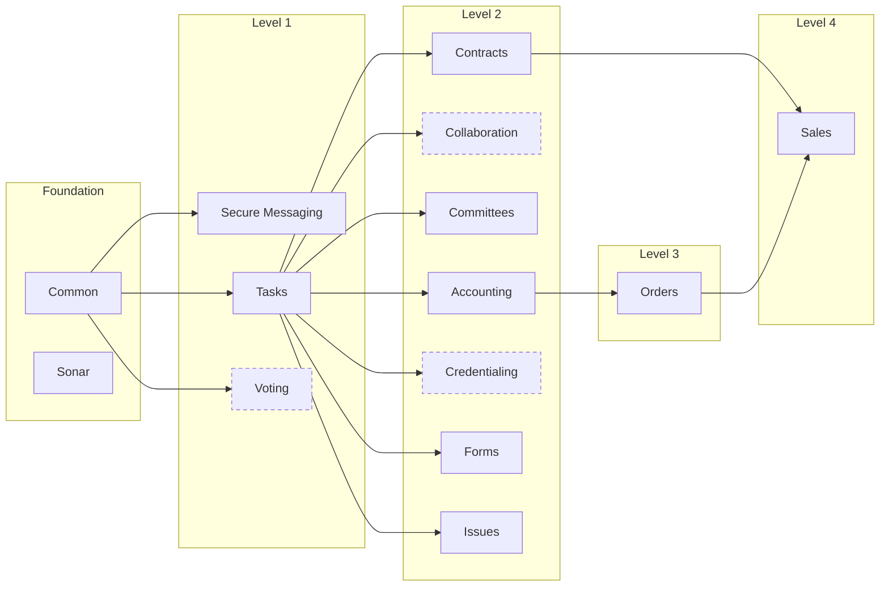

<!--
  GENERATED FILE. Do not edit by hand: your change would be overwritten by the next refresh.
  Source: every public `bizapps-*` repository in the MemberJunction GitHub organization, read from its mj-app.json.
  Regenerate:  node docs-site/scripts/bizapps-guide.mjs
  Hand-written parts (featured repos, stories, this page's prose): docs-site/scripts/lib/bizapps-catalog.mjs
  and docs-site/scripts/lib/bizapps-markdown.mjs.
-->

# MemberJunction BizApps

BizApps are the business applications built on MemberJunction. There are **14** in the public catalog (11 released, 3 in development). Each one is an MJ **Open App**: its own repository, database schema and npm packages, installed into any MJ instance with `mj app install`, which installs the apps it builds on first.

This page lists every public `bizapps-*` repository in the [MemberJunction GitHub organization](https://github.com/MemberJunction) and is generated from each app's `mj-app.json`, so it follows the apps rather than a hand-kept list.

> **Interactive version:** [docs.memberjunction.org → BizApps](https://docs.memberjunction.org/guides/bizapps/) adds the current release of each app and a map you can explore.

## The map

An arrow points from an app to the apps that build on it. Only direct links are drawn: when Sales builds on Orders and Orders builds on Accounting, there is no separate arrow from Accounting to Sales. Each app below lists everything it declares. A dashed box is an app still in development.

**Read left to right:**

- **Foundation:** Common, Sonar
- **Level 1:** Secure Messaging, Tasks, Voting
- **Level 2:** Accounting, Collaboration, Committees, Contracts, Credentialing, Forms, Issues
- **Level 3:** Orders
- **Level 4:** Sales

## At a glance

| App | What it does | Builds on | Status |
|---|---|---|---|
| [Accounting](#accounting) | AR subsidiary ledger of record and journal entry primitives (GL accounts, balanced JEs with multi-currency, dimensions, tax) for MemberJunction. | [Common](#common), [Tasks](#tasks) | Released |
| [Collaboration](#collaboration) | Spaces: the permission boundary and the agent retrieval boundary for collaborative team and outside work. | [Common](#common), [Tasks](#tasks) | In development |
| [Committees](#committees) | Unified governance platform for managing committees, memberships, meetings, action items, and documents — with AI-powered minutes generation and health analytics | [Common](#common), [Tasks](#tasks) | Released |
| [Common](#common) | Common business entities (Person, Organization, Address, ContactMethod, Relationship) shared across MemberJunction business applications | — | Released |
| [Contracts](#contracts) | The record of customer agreements — executed documents, which version of the standard agreement each one incorporates, the provisions negotiated away from it, and the… | [Common](#common), [Tasks](#tasks) | Released |
| [Credentialing](#credentialing) | Credentialing, certification, and licensure management for MemberJunction: credential definitions, requirements, holder records, verification, expiration and renewal… | [Common](#common), [Tasks](#tasks) | In development |
| [Forms](#forms) | Forms, surveys & intake for MemberJunction — anonymous-friendly, mobile-first, responses as first-class records. | [Common](#common), [Tasks](#tasks) | Released |
| [Issues](#issues) | Reusable case / issue / ticket primitives — Issue, IssueType, IssueStatus, IssueComment — the shared foundation for ticketing UX (Izzy) and the cloud-feedback destination | [Common](#common), [Tasks](#tasks) | Released |
| [Orders](#orders) | Unified order management for MemberJunction — products, orders, payments, subscriptions. | [Accounting](#accounting), [Common](#common), [Tasks](#tasks) | Released |
| [Sales](#sales) | Deal pipeline management for MemberJunction — accounts, contacts, pipelines, deals with priced lines, deal teams, stage history and forecasting. | [Accounting](#accounting), [Common](#common), [Contracts](#contracts), [Orders](#orders), [Tasks](#tasks) | Released |
| [Secure Messaging](#secure-messaging) | A secure client portal for exchanging messages, documents, and e-signatures with external contacts. | [Common](#common) | Released |
| [Sonar](#sonar) | Configurable engagement scoring engine on the MemberJunction entity graph. | — | Released |
| [Tasks](#tasks) | Reusable task management with multi-person assignment, sub-tasks, dependencies, Kanban/Gantt views, templates, and activity tracking | [Common](#common) | Released |
| [Voting](#voting) | Secret, verifiable, embeddable voting (motions, elections, referendums and polls) for any app built on MemberJunction | [Common](#common) | In development |

## How they fit together

### Quote to cash

[Sales](#sales) (deal) → [Contracts](#contracts) (agreement) → [Orders](#orders) (order, payment & subscription) → [Accounting](#accounting) (journal entries) → Your ERP

A won deal becomes a signed agreement, then an order with its payments and subscriptions, then balanced journal entries that batch to the ERP that owns your general ledger. Sales records intent and never computes money; Orders prices and bills; Accounting is the subledger, not the general ledger.

## The apps

### Accounting

AR subsidiary ledger of record and journal entry primitives (GL accounts, balanced JEs with multi-currency, dimensions, tax) for MemberJunction. Not a general ledger — batches to ERP/QBO/NetSuite/BC.

- **Repository:** [MemberJunction/bizapps-accounting](https://github.com/MemberJunction/bizapps-accounting)
- **Status:** Released
- **Database schema:** `__mj_BizAppsAccounting`
- **Builds on:** [Common](#common), [Tasks](#tasks)
- **Used by:** [Orders](#orders), [Sales](#sales)
- **Packages:** `@mj-biz-apps/accounting-server` (server), `@mj-biz-apps/accounting-core-entities-server` (server), `@mj-biz-apps/accounting-actions` (server), `@mj-biz-apps/accounting-ng` (client), `@mj-biz-apps/accounting-entities` (shared)

### Collaboration

Spaces: the permission boundary and the agent retrieval boundary for collaborative team and outside work.

- **Repository:** [MemberJunction/bizapps-collaboration](https://github.com/MemberJunction/bizapps-collaboration)
- **Status:** In development
- **Database schema:** `__mj_BizAppsCollaboration`
- **Builds on:** [Common](#common), [Tasks](#tasks)
- **Packages:** `@mj-biz-apps/collaboration-server` (server), `@mj-biz-apps/collaboration-core-entities-server` (server), `@mj-biz-apps/collaboration-ng` (client), `@mj-biz-apps/collaboration-ng-widgets` (client), `@mj-biz-apps/collaboration-entities` (shared), `@mj-biz-apps/collaboration-actions` (shared), `@mj-biz-apps/collaboration-core` (shared)

### Committees

Unified governance platform for managing committees, memberships, meetings, action items, and documents — with AI-powered minutes generation and health analytics

- **Repository:** [MemberJunction/bizapps-committees](https://github.com/MemberJunction/bizapps-committees)
- **Status:** Released
- **Database schema:** `__mj_BizAppsCommittees`
- **Builds on:** [Common](#common), [Tasks](#tasks)
- **Packages:** `@mj-biz-apps/committees-server` (server), `@mj-biz-apps/committees-ng` (client), `@mj-biz-apps/committees-entities` (shared), `@mj-biz-apps/committees-core-entities-server` (shared), `@mj-biz-apps/committees-core` (shared), `@mj-biz-apps/committees-actions` (shared)

### Common

Common business entities (Person, Organization, Address, ContactMethod, Relationship) shared across MemberJunction business applications

- **Repository:** [MemberJunction/bizapps-common](https://github.com/MemberJunction/bizapps-common)
- **Status:** Released
- **Database schema:** `__mj_BizAppsCommon`
- **Builds on:** MemberJunction core only
- **Used by:** [Accounting](#accounting), [Collaboration](#collaboration), [Committees](#committees), [Contracts](#contracts), [Credentialing](#credentialing), [Forms](#forms), [Issues](#issues), [Orders](#orders), [Sales](#sales), [Secure Messaging](#secure-messaging), [Tasks](#tasks), [Voting](#voting)
- **Packages:** `@mj-biz-apps/common-server` (server), `@mj-biz-apps/common-actions` (server), `@mj-biz-apps/common-ng` (client), `@mj-biz-apps/common-entities` (shared)

### Contracts

The record of customer agreements — executed documents, which version of the standard agreement each one incorporates, the provisions negotiated away from it, and the renewal, notice and escalation terms that appear nowhere on an order. A record-keeping and lookup surface: it does not price, bill, recognize revenue, or create orders.

- **Repository:** [MemberJunction/bizapps-contracts](https://github.com/MemberJunction/bizapps-contracts)
- **Status:** Released
- **Database schema:** `__mj_BizAppsContracts`
- **Builds on:** [Common](#common), [Tasks](#tasks)
- **Used by:** [Sales](#sales)
- **Packages:** `@mj-biz-apps/contracts-server` (server), `@mj-biz-apps/contracts-ng` (client), `@mj-biz-apps/contracts-entities` (shared), `@mj-biz-apps/contracts-actions` (shared)

### Credentialing

Credentialing, certification, and licensure management for MemberJunction: credential definitions, requirements, holder records, verification, expiration and renewal cycles.

- **Repository:** [MemberJunction/bizapps-credentialing](https://github.com/MemberJunction/bizapps-credentialing)
- **Status:** In development
- **Database schema:** `__mj_BizAppsCredentialing`
- **Builds on:** [Common](#common), [Tasks](#tasks)
- **Packages:** `@mj-biz-apps/credentialing-server` (server), `@mj-biz-apps/credentialing-ng` (client), `@mj-biz-apps/credentialing-entities` (shared), `@mj-biz-apps/credentialing-actions` (shared), `@mj-biz-apps/credentialing-core` (shared), `@mj-biz-apps/credentialing-core-entities-server` (shared)

### Forms

Forms, surveys & intake for MemberJunction — anonymous-friendly, mobile-first, responses as first-class records.

- **Repository:** [MemberJunction/bizapps-forms](https://github.com/MemberJunction/bizapps-forms)
- **Status:** Released
- **Database schema:** `__mj_BizAppsForms`
- **Builds on:** [Common](#common), [Tasks](#tasks)
- **Packages:** `@mj-biz-apps/forms-server` (server), `@mj-biz-apps/forms-ng` (client), `@mj-biz-apps/forms-entities` (shared), `@mj-biz-apps/forms-actions` (shared)

### Issues

Reusable case / issue / ticket primitives — Issue, IssueType, IssueStatus, IssueComment — the shared foundation for ticketing UX (Izzy) and the cloud-feedback destination

- **Repository:** [MemberJunction/bizapps-issues](https://github.com/MemberJunction/bizapps-issues)
- **Status:** Released
- **Database schema:** `__mj_BizAppsIssues`
- **Builds on:** [Common](#common), [Tasks](#tasks)
- **Packages:** `@mj-biz-apps/issues-server` (server), `@mj-biz-apps/issues-core-entities-server` (server), `@mj-biz-apps/issues-ng` (client), `@mj-biz-apps/issues-entities` (shared), `@mj-biz-apps/issues-actions` (shared), `@mj-biz-apps/issues-core` (shared)

### Orders

Unified order management for MemberJunction — products, orders, payments, subscriptions. The Order is the transactional substrate and the A/R primitive; payments and subscriptions are aspects of the same business event. Emits balanced journal entries into BizApps Accounting.

- **Repository:** [MemberJunction/bizapps-orders](https://github.com/MemberJunction/bizapps-orders)
- **Status:** Released
- **Database schema:** `__mj_BizAppsOrders`
- **Builds on:** [Accounting](#accounting), [Common](#common), [Tasks](#tasks)
- **Used by:** [Sales](#sales)
- **Packages:** `@mj-biz-apps/orders-server` (server), `@mj-biz-apps/orders-core-entities-server` (server), `@mj-biz-apps/orders-actions` (server), `@mj-biz-apps/orders-ng` (client), `@mj-biz-apps/orders-entities` (shared)

### Sales

Deal pipeline management for MemberJunction — accounts, contacts, pipelines, deals with priced lines, deal teams, stage history and forecasting. Sits at the top of the revenue stack: sales records intent and asks BizApps Orders for every number, so a closed deal becomes a contract and an order in one transaction rather than a notification to re-key it by hand.

- **Repository:** [MemberJunction/bizapps-sales](https://github.com/MemberJunction/bizapps-sales)
- **Status:** Released
- **Database schema:** `__mj_BizAppsSales`
- **Builds on:** [Accounting](#accounting), [Common](#common), [Contracts](#contracts), [Orders](#orders), [Tasks](#tasks)
- **Packages:** `@mj-biz-apps/sales-server` (server), `@mj-biz-apps/sales-ng` (client), `@mj-biz-apps/sales-entities` (shared), `@mj-biz-apps/sales-actions` (shared)

### Secure Messaging

A secure client portal for exchanging messages, documents, and e-signatures with external contacts. Passwordless magic-link entry deep-links contacts into subject-lined conversation threads; staff work the same threads from an inbox in MJ Explorer. Includes file requests with a full lifecycle, e-signature via the MJ eSignature engine, and an embeddable &lt;mj-secure-messaging&gt; Angular Element widget any site can host.

- **Repository:** [MemberJunction/bizapps-secure-messaging](https://github.com/MemberJunction/bizapps-secure-messaging)
- **Status:** Released
- **Database schema:** `__mj_BizAppsSecureMessaging`
- **Builds on:** [Common](#common)
- **Packages:** `@mj-biz-apps/secure-messaging-server` (server), `@mj-biz-apps/secure-messaging-ng` (client), `@mj-biz-apps/secure-messaging-entities` (shared), `@mj-biz-apps/secure-messaging-core` (shared), `@mj-biz-apps/secure-messaging-actions` (shared), `@mj-biz-apps/secure-messaging-element` (shared)

### Sonar

Configurable engagement scoring engine on the MemberJunction entity graph. Define any number of concurrent scoring models over any anchor entity, with explainable, trending scores and an action layer.

- **Repository:** [MemberJunction/bizapps-sonar](https://github.com/MemberJunction/bizapps-sonar)
- **Status:** Released
- **Database schema:** `__mj_BizAppsSonar`
- **Builds on:** MemberJunction core only
- **Packages:** `@mj-biz-apps/sonar-server` (server), `@mj-biz-apps/sonar-actions` (server), `@mj-biz-apps/sonar-ng` (client), `@mj-biz-apps/sonar-entities` (shared)

### Tasks

Reusable task management with multi-person assignment, sub-tasks, dependencies, Kanban/Gantt views, templates, and activity tracking

- **Repository:** [MemberJunction/bizapps-tasks](https://github.com/MemberJunction/bizapps-tasks)
- **Status:** Released
- **Database schema:** `__mj_BizAppsTasks`
- **Builds on:** [Common](#common)
- **Used by:** [Accounting](#accounting), [Collaboration](#collaboration), [Committees](#committees), [Contracts](#contracts), [Credentialing](#credentialing), [Forms](#forms), [Issues](#issues), [Orders](#orders), [Sales](#sales)
- **Packages:** `@mj-biz-apps/tasks-server` (server), `@mj-biz-apps/tasks-entities-server` (server), `@mj-biz-apps/tasks-actions` (server), `@mj-biz-apps/tasks-ng` (client), `@mj-biz-apps/tasks-entities` (shared), `@mj-biz-apps/tasks-core` (shared)

### Voting

Secret, verifiable, embeddable voting (motions, elections, referendums and polls) for any app built on MemberJunction

- **Repository:** [MemberJunction/bizapps-voting](https://github.com/MemberJunction/bizapps-voting)
- **Status:** In development
- **Database schema:** `__mj_BizAppsVoting`
- **Builds on:** [Common](#common)
- **Packages:** `@mj-biz-apps/voting-server` (server), `@mj-biz-apps/voting-core-entities-server` (server), `@mj-biz-apps/voting-ng` (client), `@mj-biz-apps/voting-ng-widgets` (client), `@mj-biz-apps/voting-entities` (shared), `@mj-biz-apps/voting-actions` (shared), `@mj-biz-apps/voting-engine-base` (shared)

## Also in the MemberJunction org

Not BizApps, but worth knowing about. These are picked by hand and are never added to the catalog automatically.

### More Cheese

*Demo association.* The MoreCheese demo association (International Cheese Federation): a generated, causally-consistent dataset demonstrating the MJ platform across composed BizApps.

Builds on 9 BizApps: [Accounting](#accounting), [Committees](#committees), [Common](#common), [Forms](#forms), [Issues](#issues), [Orders](#orders), [Secure Messaging](#secure-messaging), [Sonar](#sonar), [Tasks](#tasks).

[MemberJunction/more-cheese](https://github.com/MemberJunction/more-cheese)

### Loom

*Data simulation engine.* Deterministic, causal business-world and data simulation engine for MemberJunction. It generates the connected, realistic data behind demos such as More Cheese.

[MemberJunction/loom](https://github.com/MemberJunction/loom)

### Forge

*Desktop SQL IDE.* An AI-native SQL IDE for SQL Server, PostgreSQL, and MySQL, on macOS and Windows.

[MemberJunction/Forge](https://github.com/MemberJunction/Forge) · [Download](https://github.com/MemberJunction/Forge/releases/latest) · [Wiki](https://github.com/MemberJunction/Forge/wiki)

## About this page

**Adding a BizApp:** create a public repository named `bizapps-<name>` in the MemberJunction organization with an `mj-app.json` at its root. It joins this page on the next refresh and the docs site on its next build; nothing here needs editing. An app counts as released once its `mj-app.json` is on the repository's `main` branch at a real version.

**How it stays current:** the docs site reads the live catalog every time it builds. This copy is refreshed by [`.github/workflows/bizapps-guide.yml`](../.github/workflows/bizapps-guide.yml), which runs after each docs deploy and weekly, and opens a pull request when the catalog has changed.

Related guides: [Building Applications on MemberJunction](BUILDING_APPS_ON_MJ.md) · [Dev Workspace Quickstart](DEV_WORKSPACE_QUICKSTART.md) (develop several apps side by side) · [Release Metadata Migrations](RELEASE_METADATA_MIGRATIONS_GUIDE.md) (how an Open App ships its metadata).
