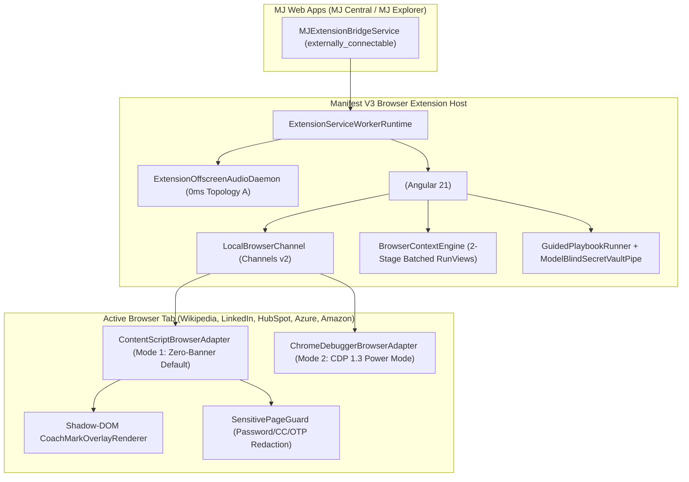

# MemberJunction Browser Extension Guide

This guide covers the architecture, configuration, extensibility, and build pipeline for the **MemberJunction Browser Extension** across four packages:

- [`@memberjunction/browser-extension-core`](../packages/BrowserExtension/Core/README.md) — Dual-mode + Auto browser control adapters (`ContentScriptBrowserAdapter`, `ChromeDebuggerBrowserAdapter`, `ExtensionBrowserAdapter`), `LocalBrowserChannel` (Channels v2), `BrowserContextEngine` (2-stage batched `RunViews()` Multi-App Context Braiding), `ExtensionSessionHandoffCoordinator` (Topology A 0ms daemon & Topology B warm resume), `GuidedPlaybookRunner` + `ModelBlindSecretVaultPipe`, and `RuntimeBrandKitHydrator`.
- [`@memberjunction/ng-browser-extension`](../packages/Angular/Generic/browser-extension/README.md) — Standalone Angular 21 Side Panel UI components (`<mj-extension-side-panel>`, `<mj-extension-trust-bar>`, `<mj-braided-context-drawer>`, `<mj-extension-playbook-stepper>`) and `MJExtensionBridgeService`.
- [`@memberjunction/browser-extension-host`](../packages/BrowserExtension/Host/README.md) — Manifest V3 Chrome Extension entry points (`service-worker.ts`, `content-script.ts`, `offscreen-audio.ts`, `sidepanel-bootstrap.ts`, and `manifest.template.json`).
- [`@memberjunction/browser-extension-builder`](../packages/BrowserExtension/Builder/README.md) — White-Label Brand Stamping Factory (`mj-ext-build` CLI and `ExtensionBrandBuilder`) plus the reference brand profiles in `packages/BrowserExtension/Brands/` (`mj-copilot`, `betty`, `sidecar`).

---

## 1. Architecture Overview



---

## 2. Dual-Mode & Auto Browser Control (`ContentScript` vs. `Debugger CDP`)

Chrome displays a persistent top-of-window warning bar (`"Started debugging this browser"`) whenever an extension attaches `chrome.debugger`. To give everyday enterprise users a friction-free experience while retaining hardware-level automation power when required, the extension supports **three control modes** governed by a **4-Layer Configuration Cascade**:

| Mode | Class | Banner? | Capabilities |
| --- | --- | --- | --- |
| **`'content-script'`** *(Recommended Default)* | `ContentScriptBrowserAdapter` | **Zero Banner** | Grounded DOM perception via `@memberjunction/computer-use/browser-probe` (`INTERACTIVITYPROBE`), selector & element-index click/fill/scroll, `ReresolveTarget` healing, `captureVisibleTab` screenshots, and Shadow-DOM Coach-Mark Spotlights |
| **`'debugger-cdp'`** *(Power Mode)* | `ChromeDebuggerBrowserAdapter` | Shows Chrome Debugger Banner while attached (auto-detaches after 15s idle) | Attaches `chrome.debugger` (CDP 1.3) for `isTrusted: true` hardware mouse/keyboard dispatch (`Input.dispatchMouseEvent`, `Input.dispatchKeyEvent`), closed Shadow DOM piercing, and cross-origin `<iframe>` inspection |
| **`'auto'`** *(Adaptive Escalation)* | `ExtensionBrowserAdapter` | Zero banner 99% of the time; attaches transiently per step | Runs in `'content-script'` mode by default; escalates to `'debugger-cdp'` only for a single step when `RequireTrustedInput: true` or when a target resides inside a closed Shadow root / cross-origin iframe, then detaches immediately |

### The 4-Layer Control Mode Cascade

`ControlModeCascade.Resolve()` evaluates precedence in this order:
1. **Layer 1 — Code Default:** `'content-script'` (Zero-Banner Mode).
2. **Layer 2 — Brand / App Default:** `mj-extension-brand.json` (`DefaultControlBackend`).
3. **Layer 3 — Agent / Playbook / Domain Policy:** `IAgentSettings.BrowserExtension.DefaultControlBackend` or `GuidedPlaybookSpec.PreferredBackend`.
4. **Layer 4 — User Per-Domain Runtime Toggle:** Stored via `DomainPolicyPreferencesStore` using `UserInfoEngine.Instance` (`MJ: User Settings` key `'BrowserExtension.DomainPolicies'`).

> **Enterprise Safety Ceiling:** When `IAgentSettings.BrowserExtension.AllowDebuggerCDP === false` (or `IncludeDebuggerPermission === false` in `mj-extension-brand.json`), Layers 3 and 4 are strictly clamped to `'content-script'`.

---

## 3. Multi-App Context "Braiding" (`BrowserContextEngine`)

When a user views a web page (e.g., a LinkedIn profile or company website), `BrowserContextEngine.Instance.ResolveBraidedContext(snapshot)` executes a **two-stage batched `RunViews()` pipeline**:

1. **Stage 1 — Anchor Entity Resolution (`BrowserContextRuleSpec`):**
   - Evaluates URL patterns (`UrlPattern`) against registered `BrowserContextRuleSpec` rules.
   - Runs `@RegisterClass`-registered `BaseBrowserPageExtractor` plugins (`StandardPageExtractor` for URL, hostname root, OpenGraph, Schema.org JSON-LD, meta tags, and CSS/XPath selectors; `LinkedInPageExtractor` for canonicalized `/in/<slug>` and `/company/<slug>` URLs).
   - Executes **one batched `RunViews()` call** across all matching rules to resolve Anchor Entities (e.g., `People`, `Organizations`).
2. **Stage 2 — Cross-App Facet Braiding (`BrowserEntityFacetSpec`):**
   - Collects all `BrowserEntityFacetSpec` declarations targeting each matched `AnchorEntityName` across installed Open Apps (Sales, Recruiting/ATS, Caliber Assessments, Tasks, and Betty/Association Memberships & Events).
   - Executes **one second batched `RunViews()` call** in parallel so every Open App's context renders in a single unified drawer (`<mj-braided-context-drawer>`).
3. **Page-to-Entity Field Diffing & 1-Click Capture:**
   - Compares extracted page signals against the matched MJ record to produce `BrowserEntityFieldDiff[]` (`'add' | 'update' | 'unchanged'`), or surfaces an `UnmatchedPageEntityCandidate` when no record exists yet (`AllowCreateIfUnmatched: true`).

### Authoring `BrowserContextRules` & `BrowserEntityFacets` in `IAgentSettings`

Both `metadata/entities/JSONType-interfaces/IAgentSettings.ts` and `@memberjunction/ai-core-plus` define `IAgentSettings.BrowserExtension` in lockstep:

```json
{
  "BrowserExtension": {
    "DefaultControlBackend": "content-script",
    "AllowDebuggerCDP": true,
    "ContextRules": [
      {
        "Name": "LinkedIn Person Profile Match",
        "UrlPattern": "*://*.linkedin.com/in/*",
        "TargetEntityName": "People",
        "LookupFilterTemplate": "LinkedInURL = '{{LinkedInCanonicalUrl}}' OR Email = '{{Email}}'",
        "CustomExtractorClass": "LinkedInPageExtractor",
        "AllowCreateIfUnmatched": true,
        "Signals": [
          { "Source": "FullUrl", "Normalize": "StripTrailingSlash" },
          { "Source": "OpenGraph", "SelectorOrPattern": "og:title" }
        ]
      }
    ],
    "EntityFacets": [
      {
        "AnchorEntityName": "People",
        "FacetEntityName": "Memberships",
        "ForeignKeyField": "MemberID",
        "CardTemplate": {
          "HeaderTitle": "Association Memberships",
          "TitleField": "MembershipTier",
          "SubtitleField": "ChapterName",
          "BadgeField": "Status",
          "SummaryFields": ["MembershipTier", "ChapterName", "Status"]
        }
      }
    ]
  }
}
```

---

## 4. Seamless Session Handoff (Topology A & Topology B) & Guided Playbooks

When a user is conversing with an agent (via voice or text) in **MJ Central** or **MJ Explorer** and needs to complete a multi-site workflow (such as registering an OAuth app in **HubSpot** or **Microsoft Entra ID**):

- **Topology A (`'topology-a-shared-daemon'`, Recommended Default):** The live WebRTC audio stream and WebSocket session run inside the extension's persistent `ExtensionOffscreenAudioDaemon` (`offscreen.html`). Navigating across tabs or OAuth redirects produces a **0ms zero-blip transition**.
- **Topology B (`'topology-b-warm-resume'`, Fallback):** `MJExtensionBridgeService.RequestSessionHandoff()` sends `ExtensionSessionHandoffPayload` over `externally_connectable`, opening the Side Panel and resuming the session with `LastSessionID` continuity.

### Model-Blind Secret Vault Pipe (`CopySecretToMJVault`)

During OAuth app setup playbooks (`HUBSPOT_OAUTH_PLAYBOOK`, `ENTRA_ID_OAUTH_PLAYBOOK`), `ModelBlindSecretVaultPipe.CopySecretToMJVault()` reads generated client secrets directly from the page DOM in the content script and writes them straight into the MemberJunction Credential Vault (`MJ: Credentials`), returning only a redacted receipt (`[REDACTED-BY-MJ-EXTENSION-GUARD]`) so plaintext secrets **never** enter LLM prompts, context windows, or conversation transcripts.

---

## 5. Building White-Label Branded Extensions (`mj-copilot`, `betty`, `sidecar`)

Use `@memberjunction/browser-extension-builder` (`mj-ext-build`) to stamp unpacked MV3 directories and Chrome Web Store `.zip` packages from declarative `mj-extension-brand.json` profiles:

```bash
npx mj-ext-build \
  --brand packages/BrowserExtension/Brands/mj-copilot/mj-extension-brand.json \
  --brand packages/BrowserExtension/Brands/betty/mj-extension-brand.json \
  --brand packages/BrowserExtension/Brands/sidecar/mj-extension-brand.json \
  --out dist/extensions
```

At runtime, `RuntimeBrandKitHydrator` also hydrates tenant-specific `MJ: Brand Kits` records via `@memberjunction/theme-engine` (`Derive` + `EmitOverlayCss`), updating `--mj-*` CSS design tokens dynamically without rebuilding the extension binary.
