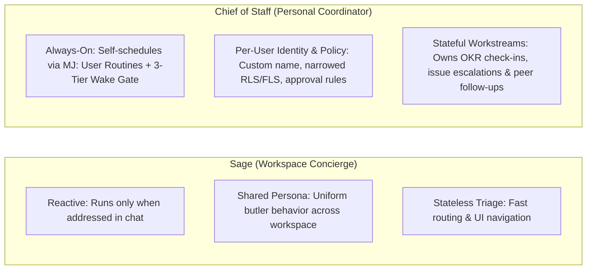
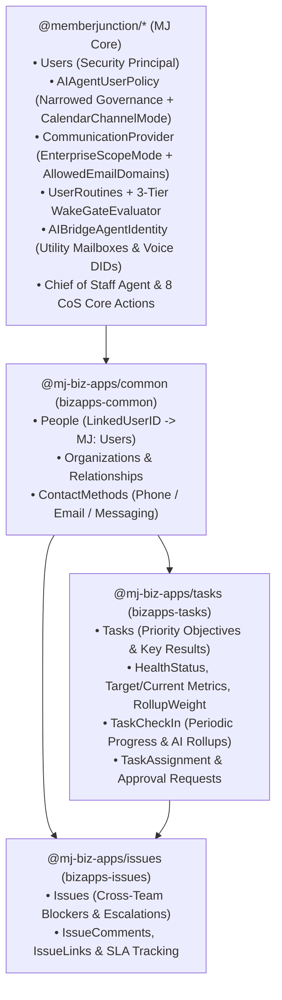

# MemberJunction Built-In AI Agents Guide

MemberJunction ships with a rich catalog of built-in AI agents spanning conversational orchestration, autonomous personal coordination, deep research, query and form authoring, agent/skill engineering, and system operations.

---

## 1. Architectural Overview & Agent Taxonomy

All built-in MemberJunction agents run on the unified `@memberjunction/ai-agents` runtime (`BaseAgent`), inheriting:
- **User Identity Ceiling (`contextUser`)**: Every agent execution—whether interactive, scheduled (`UserRoutineDispatcherDriver` / `AgentScheduledJobDriver`), durable task graph (`TaskGraphOrchestrator`), or sub-agent delegation—executes under the originating user's security principal (`MJ: Users`), enforcing Entity Permissions, Row-Level Security (RLS), Field-Level Security (FLS), and scoped knowledge retrieval.
- **Per-User Policy Narrowing (`MJ: AI Agent User Policies`)**: Users can further narrow any agent's permissions below their own ceiling via `AgentUserPolicyEngine`, including custom RLS filters, FLS hidden/read-only field masks, action approval gates, and time-of-day / day-of-week execution windows.
- **3-Tier Wake Gate (`MJ: User Routines`)**: Self-scheduling agents register `RoutineType = 'AgentWake'` routines evaluated by `WakeGateEvaluator` (Tier 0 durable watermarks & unchanged-hash skip, Tier 1 `SafeExpressionEvaluator`, Tier 2 `AIDecisionRunner`, Tier 3 `AIPromptRunner`).

```mermaid
flowchart TB
    subgraph UserFacing["User-Facing Orchestrators"]
        Sage["Sage<br/>(Ambient Workspace Concierge)"]
        CoS["Chief of Staff<br/>(Personal Always-On Coordinator)"]
        VoiceCo["Voice Co-Agent<br/>(Realtime Voice Sidecar)"]
    end

    subgraph DomainSpecialists["Research & Analytics Specialists"]
        Research["Research Agent<br/>(DB + Web + Files + KB + Report Writer)"]
        QueryBuilder["Query Builder<br/>(Strategist + SQL Author)"]
        Knowledge["Knowledge Agent<br/>(Scoped Enterprise Search)"]
        Infographic["Infographic Agent<br/>(SVG & Visual Briefs)"]
    end

    subgraph BuilderAgents["Application & Platform Builders"]
        FormBuilder["Form Builder<br/>(Designer + Deterministic Builder)"]
        DBDesigner["Database Designer<br/>(Schema & Migration Architect)"]
        AgentMgr["Agent Manager<br/>(Planning + Architect + Builder)"]
        Codesmith["Codesmith / ActionSmith / SkillSmith"]
    end

    subgraph SystemOps["Governance, Memory & Lifecycle"]
        WorkflowPlanner["Workflow Planner<br/>(Multi-Agent Task Graph Planner)"]
        MemoryMgr["Memory Manager<br/>(Notes & Examples Extraction)"]
        RubricEval["Rubric Architect & Evaluator"]
        Onboarding["User Onboarding Flow Agent"]
    end

    Sage -->|"Single-Task or Multi-Agent Graph"| WorkflowPlanner
    Sage -->|"Delegates Ad-Hoc Requests"| Research
    Sage -->|"Delegates Ad-Hoc Requests"| QueryBuilder
    Sage -->|"Delegates Form Requests"| FormBuilder
    CoS -->|"Delegates Deep Analysis"| Research
    CoS -->|"Delegates SQL/KPI Queries"| QueryBuilder
    CoS -->|"Coordinates Peer CoS"| CoS
```

---

## 2. Catalog of Built-In Agents in MJ Core

| Agent Name | Type | Category | Primary Role & Capabilities |
| :--- | :--- | :--- | :--- |
| **Sage** | Loop | Assistant | Ambient concierge present in every MJ conversation. Answers quick questions, navigates the UI, and delegates specialized work via `nextStep.type = 'Tasks'`. |
| **Chief of Staff** | Loop | Assistant | Personal, self-scheduling agent (`One CoS per user`) that tracks quarterly priorities/OKRs, monitors workstreams & issues, writes executive briefings, manages approvals, and coordinates across chat, email, and voice/telephony. |
| **Workflow Planner** | Loop (Sub-Agent of Sage) | Assistant | Designs multi-agent dependency DAGs (`TaskGraph`) using `Find Candidate Agents` and confirms execution plans with the user. |
| **Form Builder** | Loop (`FormBuilderAgent`) | Assistant | Two-stage deterministic orchestrator (`Form Builder - Designer` + `Form Builder - Builder`) that designs, lints, and persists interactive entity forms. |
| **Research Agent** | Loop | Research | Multi-source research orchestrator coordinating `Database Research Agent`, `Web Research Agent`, `File Research Agent`, `KB Research Agent`, and `Research Report Writer`. |
| **Query Builder** | Loop | Data & Analytics | Translates natural-language analytics questions into validated, parameterized MJ Stored Queries via `Query Strategist` and schema exploration tools. |
| **Database Designer** | Loop | Engineering | Assists administrators and developers in designing normalized tables, foreign keys, views, and MemberJunction migrations. |
| **Agent Manager** | Loop | Agent Management | Meta-agent system (`Planning Designer`, `Agent Architect`, `Builder`) for creating and refining MJ AI Agents, Prompts, and Actions. |
| **Codesmith / ActionSmith / SkillSmith** | Loop | Engineering | Specialized builder agents for authoring TypeScript code artifacts, custom MJ Actions, and reusable Agent Skills. |
| **Memory Manager** | Loop / System | Memory | Background service agent that extracts durable `MJ: AI Agent Notes` and `MJ: AI Agent Examples` from completed conversations. |
| **User Onboarding Flow Agent** | Flow | Administration | Deterministic Flow agent that guides administrators through provisioning new users, roles, and welcome communications. |
| **Rubric Architect & Evaluator** | Loop | Evaluation | Designs evaluation rubrics and scores agent runs for quality assurance. |
| **Voice Co-Agent** | Loop | Realtime | Low-latency voice companion that narrates tool execution and coordinates realtime audio sessions. |

---

## 3. Sage vs. Chief of Staff: Why Two Distinct Personas?

A core architectural principle in MemberJunction is keeping **Sage** and **Chief of Staff** separate:

1. **Sage is the Reactive Concierge**: Sage is lightweight, fast, and stateless across sessions. When a user asks *"Open the Accounts dashboard"* or *"Run a quick web search on Acme Corp"*, Sage handles or delegates it immediately and steps back.
2. **Chief of Staff is the Proactive Personal Coordinator**: Each user has their own Chief of Staff relationship governed by a dedicated `MJ: AI Agent User Policies` row. The Chief of Staff wakes up autonomously on its own schedule or entity-change watermarks, checks the user's Objectives & Key Results (`Tasks` & `TaskCheckIns`) and escalations (`Issues`), drafts briefings, and (when permitted) reaches out to colleagues or their Chief of Staff agents.

---

## 4. Chief of Staff Agent & Its BizApps Dependency Graph

While the **Chief of Staff** agent metadata (`metadata/agents/.chief-of-staff-agent.json`), **User Policy Engine** (`@memberjunction/ai-agents` + `@memberjunction/ai-core-plus`), **8 Chief of Staff Core Actions** (`@memberjunction/core-actions`), **Calendar / Free-Busy / Preflight Communication Verbs** (`@memberjunction/communication-types`, `@memberjunction/communication-ms-graph`, `@memberjunction/communication-gmail`), and **3-Tier Wake Gate** (`@memberjunction/scheduling-engine`) live in **MJ Core** so every MemberJunction installation has the foundational primitives, the Chief of Staff's **full organizational work-tracking experience** depends on three peer BizApps packages:

### Chief of Staff Built-In Core Actions (`@memberjunction/core-actions`)

| Action Name | Purpose & Security Enforcement |
| :--- | :--- |
| **`Configure Agent User Policy`** | Creates or updates the calling user's `MJ: AI Agent User Policies` record (`CoordinationMode`, `EmailChannelMode`, `CalendarChannelMode`, `PhoneChannelMode`, `MessagingChannelMode`, approval gates, and narrowed `EntityAccessRules` / `ActionPolicyRules`). |
| **`Schedule Next Agent Wake`** | Registers or updates a `RoutineType = 'AgentWake'` row in `MJ: User Routines` with `OneShot`, `Adaptive`, or `Recurring` scheduling and a 3-Tier Wake Gate (`WakeConfigurationJSON`). |
| **`Verify My Communication Capabilities`** | Runs the 4-layer Enterprise Mailbox Security Gate (`EnterpriseScopeMode`, `AllowedEmailDomains`, `MJ: AI Bridge Agent Identities` utility mailbox lookup, and live `VerifyMailboxAccess` preflight) so the agent only offers email/calendar capabilities that the admin's enterprise credential actually permits. |
| **`Get My Calendar Events and Availability`** | Hard-pinned to `contextUser.Email`: reads calendar events, checks free/busy intervals, computes optimal meeting times across attendees (`Microsoft Graph`, `Gmail`), and queries external scheduling links and availability (`HubSpot` Meetings API v3, `Calendly` API v2). |
| **`Manage My Calendar Event`** | Hard-pinned to `contextUser.Email` and governed by `CalendarChannelMode` (`Disabled`, `ReadOnly`, `ProposeWithApproval`, `Autonomous`): creates, updates, responds to (`accept`/`tentative`/`decline`), or cancels calendar events, creating an `MJ: AI Agent Requests` approval when required. |
| **`Manage My Email Inbox and Drafts`** | Hard-pinned to `contextUser.Email` (or the agent's registered Utility Mailbox in `SendAsAgent` mode) and governed by `EmailChannelMode`: lists messages, creates drafts (`DraftOnly`), or sends/replies/forwards emails. |
| **`Send Inter-Agent Request`** | Sends a structured coordination message or creates an approval request between two users' Chief of Staff agents without crossing user permission ceilings. |
| **`Prepare Outbound Call Brief`** | Validates `PhoneChannelMode`, builds a mandatory AI disclosure greeting, and structures the call objective, fallback plan, and prohibited commitments before any outbound voice call. |

**Where a wake's output lands.** `UserRoutineDispatcherDriver` runs each `AgentWake` routine in a conversation of its own, named after the routine (`Chief of Staff — Wake (<workstreamKey>)`), owned by the routine's user and filed under the **Routines** application so it stays out of the default chat list. The run's reply is written there, and the user gets an in-app notification linking to the routine run. The wake does not post into the conversation the user scheduled it from. Four clicks lead to it: the "Routine completed" notification opens the conversation in the Chat app; the Routines app's run history has a "Conversation" button that does the same; and each routine card on the Chief of Staff cockpit has "Read Briefing" (a slide-in reader inside the cockpit) and "Open in Chat". The chat sidebar itself never lists it. The Chief of Staff prompt tells the user this when it schedules a wake, and it does not create new `Recurring` routines on its own: a `OneShot` check-in ends when it has reported.

**Event-driven wakes alongside the schedule.** The cron/adaptive routines above are not the only way a Chief of Staff wakes. `AgentWakeTriggerService` in `@memberjunction/ai-agents` reacts to specific events by writing a `OneShot` `RoutineType = 'AgentWake'` row to `MJ: User Routines` with `NextRunAt = now`, which the 1-minute `UserRoutineDispatcherDriver` sweep picks up — so an event wake lands within about a minute, not at the next scheduled slot. It is still a routine, not a direct agent call, and an existing routine for the same `workstreamKey` keeps whatever 3-Tier Wake Gate it already has. Today the events are:

- An action-created `MJ: AI Agent Requests` row (`Manage My Calendar Event`, `Manage My Email Inbox and Drafts`, `Prepare Outbound Call Brief` approvals) moving from `Requested` to `Approved` / `Rejected` / `Responded` wakes the request owner's agent with the outcome in `resumeState`.
- A new `InterAgent` request from `Send Inter-Agent Request` wakes the target user's Chief of Staff; its later resolution wakes the sender's. These cross-user paths currently need an Owner/system saving context (`MJUserRoutineEntityServer.validateOwnership`); a fix is pending.
- An inbound email to an `MJ: AI Bridge Agent Identities` utility mailbox from a verified internal user can wake that user's agent via `RouteInboundUtilityMailboxWake` — available, but no ingestion path is wired to it yet.

Triggers, user scoping, `resumeState` shapes, result codes and a code sample: [Event-Driven Agent Wakes](../packages/AI/Agents/README.md#event-driven-agent-wakes-agentwaketriggerservice) in the `@memberjunction/ai-agents` README.

### Why These Three Dependencies Exist

1. **`bizapps-common` (`MJ_BizApps_Common: People`) — Bridging Security Principal to Org Identity**:
   - In MJ Core, `MJ: Users` is the authentication and authorization principal (`contextUser`).
   - In business applications, real-world people (employees, executives, committee members, external partners) are modeled in `MJ_BizApps_Common: People` with rich organizational relationships and contact methods.
   - `People.LinkedUserID` links an org `Person` record to their `MJ: Users` login, allowing the Chief of Staff to map its invoking user (`contextUser.ID`) to their organizational `Person` record, direct reports, and contact channels.
   - **Setup step: every Chief of Staff user needs a People record.** Nothing in MJ creates one when a user is provisioned, and the BizApps `UI` role can read People but not create them. An administrator adds the record (Data Explorer → `MJ_BizApps_Common: People`) with the user's sign-in `Email`, or sets `LinkedUserID` on an existing one. The Executive Cockpit and the agent both resolve the person by `LinkedUserID` first and then by an exact, case-insensitive `Email` match, so either is enough.
   - **To-dos and reminders.** A personal request ("remind me to call Mom on Wednesday") becomes a `General` task with a `DueAt` and no objective fields, plus a `OneShot` wake at the due time whose reply is the reminder. The cockpit Overview lists open to-do-type root tasks under "To-dos & Reminders" with a tick control; marking one done sets `Status = Completed`.
   - **Wake Now runs out of schedule.** The cockpit's "Wake Now" calls the `Run User Routine Now` action, which hands the routine to the dispatcher's manual-run path: no claim, no wake gate, so a one-shot (a reminder) keeps its scheduled time and a recurring routine keeps its cadence. Setting `NextRunAt` to now instead would make the dispatcher claim the routine and spend a one-shot. The caller must own the routine; bookkeeping runs as the scheduler's system user, the target as the owner. A one-shot that has fired shows as **Fired** in the cockpit (the dispatcher disables it, which is "done", not "broken") and sits behind a "Show fired" toggle.
   - **Role grants.** A regular user (the `UI` role only) needs Create + Update on `MJ: AI Agent User Policies` and `MJ: AI Agent Requests`, or onboarding cannot save their policy and no approval request can be raised for them. The grants ship as metadata (`metadata/entity-permissions/.chief-of-staff-permissions.json`, pushed with `mj sync push`); server-side entity subclasses keep both rows private to their user (`MJAIAgentUserPolicyEntityServer`, `MJAIAgentRequestEntityServer`): a non-Owner user can only save their own policy and only create or resolve requests that are for them. Cross-user paths such as Send Inter-Agent Request still need an Owner or system context. If the save does fail, the prompt tells the agent to say so and never to claim the preferences were kept in memory.
   - **Ownership rule.** The cockpit's Priorities & OKRs tab shows tasks the user's person created (`CreatedByPersonID`) or is assigned to (`Task Assignments`, polymorphic `AssigneeEntityID` + `AssigneeRecordID`), plus every task under a root objective they own, whoever created those milestones, and the objective above any milestone they are assigned to. The objective's owner (creator, or assigned to the objective itself) sees every milestone; anyone else sees only the milestones they hold. A milestone with no `Task Assignments` row is not nobody's: it is held by the person who created it, or failing that by the objective's owner, so the agent creates an assignment row only when delegating work to someone else. Objective cards and milestone rows show who holds each item; an implicit holder renders as an outlined chip, an assignment as a filled one. The agent prompt therefore resolves `MyPersonID` before touching tasks and sets `CreatedByPersonID` on every task or issue it creates; with no person it says so and offers to create one, falling back to an administrator request on `PERMISSION_DENIED`.
2. **`bizapps-tasks` (`MJ_BizApps_Tasks: Tasks` & `Task Check Ins`) — Unified Workstream & OKR Spine**:
   - Rather than inventing a separate OKR database, `bizapps-tasks` extends `Task` with additive Priority/OKR fields (`HealthStatus`, `ConfidenceScore`, `BaselineValue`, `TargetValue`, `CurrentValue`, `UnitOfMeasure`, `MetricDirection`, `RollupWeight`, `PlanningPeriod`, `CheckInCadence`, `LastCheckInAt`, `NextCheckInDueAt`) and the `TaskCheckIn` entity.
   - This lets quarterly **Priority Objectives**, measurable **Key Results**, **Deliverables**, and **Approval Requests** share the same hierarchy, assignment model, and automatic progress rollups.
3. **`bizapps-issues` (`MJ_BizApps_Issues: Issues`) — Impediment & Escalation Tracking**:
   - Workstreams rarely slip in a vacuum—they slip because of open defects, customer escalations, or cross-departmental blockers tracked in `bizapps-issues`.
   - Because `bizapps-issues` sits at the leaf of the dependency graph (`MJ` → `bizapps-common` → `bizapps-tasks` → `bizapps-issues`), the comprehensive end-to-end guide for the Chief of Staff Agent lives in the `bizapps-issues` repository.

> [!IMPORTANT]
> **Full Chief of Staff Documentation**: See **`docs/Chief-Of-Staff-Agent.md` in the `bizapps-issues` repository** for the complete Chief of Staff architecture, onboarding flow, Enterprise Mailbox Security Gates, Calendar/Availability/HubSpot/Calendly integration, 3-Tier Wake Gate reference, `AIAgentUserPolicy` JSON schemas, and cross-app operational playbooks.
