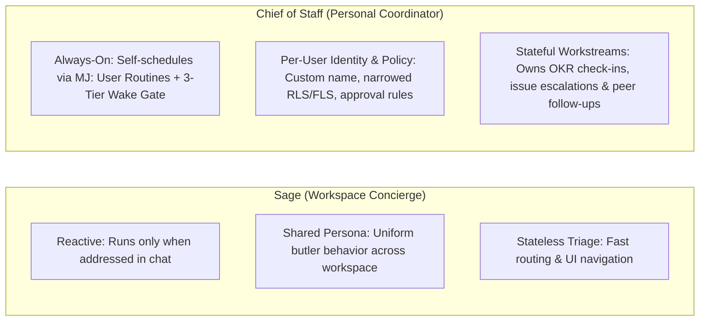
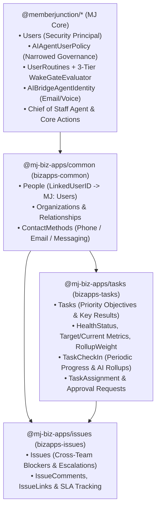

# MemberJunction Built-In AI Agents Guide

MemberJunction ships with a rich catalog of built-in AI agents spanning conversational orchestration, autonomous personal coordination, deep research, query and form authoring, agent/skill engineering, and system operations.

---

## 1. Architectural Overview & Agent Taxonomy

All built-in MemberJunction agents run on the unified `@memberjunction/ai-agents` runtime (`BaseAgent`), inheriting:
- **User Identity Ceiling (`contextUser`)**: Every agent execution—whether interactive, scheduled (`UserRoutineDispatcherDriver` / `AgentScheduledJobDriver`), durable task graph (`TaskGraphOrchestrator`), or sub-agent delegation—executes under the originating user's security principal (`MJ: Users`), enforcing Entity Permissions, Row-Level Security (RLS), Field-Level Security (FLS), and scoped knowledge retrieval.
- **Per-User Policy Narrowing (`MJ: AI Agent User Policies`)**: Users can further narrow any agent's permissions below their own ceiling via `AgentUserPolicyEngine`, including custom RLS filters, FLS hidden/read-only field masks, action approval gates, and time-of-day / day-of-week execution windows.
- **3-Tier Wake Gate (`MJ: User Routines`)**: Self-scheduling agents register `RoutineType = 'AgentWake'` routines evaluated by `WakeGateEvaluator` (Tier 0 durable watermarks & unchanged-hash skip, Tier 1 `SafeExpressionEvaluator`, Tier 2 `AIDecisionRunner`, Tier 3 `AIPromptRunner`).

```mermaid
flowchart TB
    subgraph UserFacing["User-Facing Orchestrators"]
        Sage["Sage<br/>(Ambient Workspace Concierge)"]
        CoS["Chief of Staff<br/>(Personal Always-On Coordinator)"]
        VoiceCo["Voice Co-Agent<br/>(Realtime Voice Sidecar)"]
    end

    subgraph DomainSpecialists["Research & Analytics Specialists"]
        Research["Research Agent<br/>(DB + Web + Files + KB + Report Writer)"]
        QueryBuilder["Query Builder<br/>(Strategist + SQL Author)"]
        Knowledge["Knowledge Agent<br/>(Scoped Enterprise Search)"]
        Infographic["Infographic Agent<br/>(SVG & Visual Briefs)"]
    end

    subgraph BuilderAgents["Application & Platform Builders"]
        FormBuilder["Form Builder<br/>(Designer + Deterministic Builder)"]
        DBDesigner["Database Designer<br/>(Schema & Migration Architect)"]
        AgentMgr["Agent Manager<br/>(Planning + Architect + Builder)"]
        Codesmith["Codesmith / ActionSmith / SkillSmith"]
    end

    subgraph SystemOps["Governance, Memory & Lifecycle"]
        WorkflowPlanner["Workflow Planner<br/>(Multi-Agent Task Graph Planner)"]
        MemoryMgr["Memory Manager<br/>(Notes & Examples Extraction)"]
        RubricEval["Rubric Architect & Evaluator"]
        Onboarding["User Onboarding Flow Agent"]
    end

    Sage -->|"Single-Task or Multi-Agent Graph"| WorkflowPlanner
    Sage -->|"Delegates Ad-Hoc Requests"| Research
    Sage -->|"Delegates Ad-Hoc Requests"| QueryBuilder
    Sage -->|"Delegates Form Requests"| FormBuilder
    CoS -->|"Delegates Deep Analysis"| Research
    CoS -->|"Delegates SQL/KPI Queries"| QueryBuilder
    CoS -->|"Coordinates Peer CoS"| CoS
```

---

## 2. Catalog of Built-In Agents in MJ Core

| Agent Name | Type | Category | Primary Role & Capabilities |
| :--- | :--- | :--- | :--- |
| **Sage** | Loop | Assistant | Ambient concierge present in every MJ conversation. Answers quick questions, navigates the UI, and delegates specialized work via `nextStep.type = 'Tasks'`. |
| **Chief of Staff** | Loop | Assistant | Personal, self-scheduling agent (`One CoS per user`) that tracks quarterly priorities/OKRs, monitors workstreams & issues, writes executive briefings, manages approvals, and coordinates across chat, email, and voice/telephony. |
| **Workflow Planner** | Loop (Sub-Agent of Sage) | Assistant | Designs multi-agent dependency DAGs (`TaskGraph`) using `Find Candidate Agents` and confirms execution plans with the user. |
| **Form Builder** | Loop (`FormBuilderAgent`) | Assistant | Two-stage deterministic orchestrator (`Form Builder - Designer` + `Form Builder - Builder`) that designs, lints, and persists interactive entity forms. |
| **Research Agent** | Loop | Research | Multi-source research orchestrator coordinating `Database Research Agent`, `Web Research Agent`, `File Research Agent`, `KB Research Agent`, and `Research Report Writer`. |
| **Query Builder** | Loop | Data & Analytics | Translates natural-language analytics questions into validated, parameterized MJ Stored Queries via `Query Strategist` and schema exploration tools. |
| **Database Designer** | Loop | Engineering | Assists administrators and developers in designing normalized tables, foreign keys, views, and MemberJunction migrations. |
| **Agent Manager** | Loop | Agent Management | Meta-agent system (`Planning Designer`, `Agent Architect`, `Builder`) for creating and refining MJ AI Agents, Prompts, and Actions. |
| **Codesmith / ActionSmith / SkillSmith** | Loop | Engineering | Specialized builder agents for authoring TypeScript code artifacts, custom MJ Actions, and reusable Agent Skills. |
| **Memory Manager** | Loop / System | Memory | Background service agent that extracts durable `MJ: AI Agent Notes` and `MJ: AI Agent Examples` from completed conversations. |
| **User Onboarding Flow Agent** | Flow | Administration | Deterministic Flow agent that guides administrators through provisioning new users, roles, and welcome communications. |
| **Rubric Architect & Evaluator** | Loop | Evaluation | Designs evaluation rubrics and scores agent runs for quality assurance. |
| **Voice Co-Agent** | Loop | Realtime | Low-latency voice companion that narrates tool execution and coordinates realtime audio sessions. |

---

## 3. Sage vs. Chief of Staff: Why Two Distinct Personas?

A core architectural principle in MemberJunction is keeping **Sage** and **Chief of Staff** separate:

1. **Sage is the Reactive Concierge**: Sage is lightweight, fast, and stateless across sessions. When a user asks *"Open the Accounts dashboard"* or *"Run a quick web search on Acme Corp"*, Sage handles or delegates it immediately and steps back.
2. **Chief of Staff is the Proactive Personal Coordinator**: Each user has their own Chief of Staff relationship governed by a dedicated `MJ: AI Agent User Policies` row. The Chief of Staff wakes up autonomously on its own schedule or entity-change watermarks, checks the user's Objectives & Key Results (`Tasks` & `TaskCheckIns`) and escalations (`Issues`), drafts briefings, and (when permitted) reaches out to colleagues or their Chief of Staff agents.

---

## 4. Chief of Staff Agent & Its BizApps Dependency Graph

While the **Chief of Staff** agent metadata (`metadata/agents/.chief-of-staff-agent.json`), **User Policy Engine** (`@memberjunction/ai-agents`), **4 Chief of Staff Actions** (`@memberjunction/core-actions`), and **3-Tier Wake Gate** (`@memberjunction/scheduling-engine`) live in **MJ Core** so every MemberJunction installation has the foundational primitives, the Chief of Staff's **full organizational work-tracking experience** depends on three peer BizApps packages:

### Why These Three Dependencies Exist

1. **`bizapps-common` (`MJ_BizApps_Common: People`) — Bridging Security Principal to Org Identity**:
   - In MJ Core, `MJ: Users` is the authentication and authorization principal (`contextUser`).
   - In business applications, real-world people (employees, executives, committee members, external partners) are modeled in `MJ_BizApps_Common: People` with rich organizational relationships and contact methods.
   - `People.LinkedUserID` links an org `Person` record to their `MJ: Users` login, allowing the Chief of Staff to map its invoking user (`contextUser.ID`) to their organizational `Person` record, direct reports, and contact channels.
2. **`bizapps-tasks` (`MJ_BizApps_Tasks: Tasks` & `Task Check Ins`) — Unified Workstream & OKR Spine**:
   - Rather than inventing a separate OKR database, `bizapps-tasks` extends `Task` with additive Priority/OKR fields (`HealthStatus`, `ConfidenceScore`, `BaselineValue`, `TargetValue`, `CurrentValue`, `UnitOfMeasure`, `MetricDirection`, `RollupWeight`, `PlanningPeriod`, `CheckInCadence`, `LastCheckInAt`, `NextCheckInDueAt`) and the `TaskCheckIn` entity.
   - This lets quarterly **Priority Objectives**, measurable **Key Results**, **Deliverables**, and **Approval Requests** share the same hierarchy, assignment model, and automatic progress rollups.
3. **`bizapps-issues` (`MJ_BizApps_Issues: Issues`) — Impediment & Escalation Tracking**:
   - Workstreams rarely slip in a vacuum—they slip because of open defects, customer escalations, or cross-departmental blockers tracked in `bizapps-issues`.
   - Because `bizapps-issues` sits at the leaf of the dependency graph (`MJ` → `bizapps-common` → `bizapps-tasks` → `bizapps-issues`), the comprehensive end-to-end guide for the Chief of Staff Agent lives in the `bizapps-issues` repository.

> [!IMPORTANT]
> **Full Chief of Staff Documentation**: See **[`Chief-Of-Staff-Agent.md`](../../bizapps-issues/docs/Chief-Of-Staff-Agent.md)** in `bizapps-issues/docs/Chief-Of-Staff-Agent.md` for the complete Chief of Staff architecture, onboarding flow, 3-Tier Wake Gate reference, `AIAgentUserPolicy` JSON schemas, and cross-app operational playbooks.
