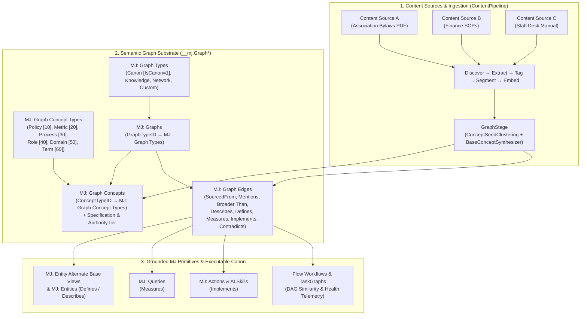

# Canon-First Methodology & Semantic Graphs Guide

**Read this before building or customizing Semantic Graphs (`MJ: Graphs`, `MJ: Graph Concepts`, `MJ: Graph Edges`), configuring Content Pipeline Graph Overlays (`GraphStage`), or working with Executable Canon workflow promotion and health telemetry.**

- **Packages**:
  - [`@memberjunction/core-entities`](../packages/MJCoreEntities/package.json) — Generated entity classes for `MJ: Graph Types`, `MJ: Graph Concept Types`, `MJ: Graph Authority Tiers`, `MJ: Graphs`, `MJ: Graph Concepts`, `MJ: Graph Edge Types`, `MJ: Graph Edge Type Endpoints`, `MJ: Graph Edge Providers`, `MJ: Graph Edges`, and `MJ: Content Sources` (`GraphID`, `Configuration.GraphOverlay`)
  - [`@memberjunction/content-pipeline-base`](../packages/ContentPipeline/base/README.md) — `ContentSourceGraphOverlayConfig`, `ResolveGraphOverlayConfig`, `GraphTypeDescriptor`, `GraphConceptTypeDescriptor`, `GraphAuthorityTierDescriptor`, `ClusterContentIntoConceptSeeds`, `BaseConceptSynthesizer`, `AuthorityTierPrecedence`
  - [`@memberjunction/content-pipeline`](../packages/ContentPipeline/engine/README.md) — `GraphStage` (`@RegisterClass(BasePipelineStage, 'Graph')`), `EntityGraphOverlayStore`, and `DeterministicConceptSynthesizer`
  - [`@memberjunction/ai-core-plus`](../packages/AI/CorePlus/README.md) — Deterministic `TaskGraph` DAG fingerprinting, Weisfeiler-Lehman similarity, clustering, promotion discovery (`dag-similarity.ts`), and saved-workflow health telemetry (`workflow-telemetry.ts`)
- **Companion Guides**:
  - **[Alternate Base Views Guide](ALTERNATE_BASE_VIEWS_GUIDE.md)** — **Canon Layer 1**: Governed SQL cohort views (`MJ: Entity Alternate Base Views`) that define canonical entity slices (e.g., *Active Subscribers*)
  - **[Content Pipeline, Training, and Retrieval Guide](CONTENT_PIPELINE_GUIDE.md)** — How documents in `MJ: Content Sources` flow through `Discover` → `Extract` → `Tag` → `Segment` → `Embed` → `Graph`
  - **[Workflows and Task Graphs Guide](WORKFLOW_AND_TASK_GRAPH_GUIDE.md)** — How one-off Loop `TaskGraphSpec` runs graduate into durable, deterministic Flow Agents

---

## 1. What Is MJ Canon (and How Does It Generalize to Semantic Graphs)?

In MemberJunction, **Canon** is the governed, machine-readable representation of how an organization defines its concepts, computes its metrics, enforces its policies, and executes its recurring processes.

Rather than building a separate, siloed schema just for Canon, MemberJunction provides a **general-purpose Semantic Graph substrate** (`MJ:Graph Types` + `MJ: Graphs` + `MJ: Graph Concept Types` + `MJ: Graph Concepts` + `MJ: Graph Edges`) where **Canon is governed by `MJ: Graph Types` (`IsCanon = 1`)**:

### Seeded `MJ: Graph Types` (`/metadata/graph-types/.graph-types.json`)

Organizations can add custom graph types via metadata or UI and toggle `IsCanon = 1` on any graph type that should feed organizational Canon:

| `GraphType.Name` | `IsCanon` | `Rank` | Primary Purpose | Default `ConceptTaxonomyMode` | Default `GroundingMode` | Default `AuthorityTier` |
|---|---|---|---|---|---|---|
| `'Canon'` | `true` | `10` | Governed organizational definitions, bylaws, policies, metrics, and processes anchored to live MJ schema, queries, actions, and workflows | `'propose-only'` (creates `Status = 'Proposed'` for human/steward approval) | `'full-canon'` (grounds concepts to `Entities`, `Alternate Base Views`, `Queries`, `Actions`, and `AI Skills`) | `'ExecutiveSOP'` |
| `'Knowledge'` | `false` | `20` | Document / RAG topic & concept overlay across one or more `MJ: Content Sources` (GraphRAG) | `'auto-grow'` (creates `Status = 'Approved'` automatically) | `'none'` (or `'schema-and-queries'` when opted in) | `'Reference'` |
| `'Network'` | `false` | `30` | Entity-to-entity relationship networks (e.g., people, organizations, chapters, committees) | `'constrained'` | `'none'` | `'Reference'` |
| `'Custom'` | `false` | `40` | Application-specific semantic graphs (or custom canonical graphs when `IsCanon = true`) | Configurable per graph/source | Configurable | Configurable |

### Seeded `MJ: Graph Concept Types` (`/metadata/graph-concept-types/.graph-concept-types.json`)

Concept types are also configurable and ranked via `MJ: Graph Concept Types` (`Rank` controls UI sorting and tie-breaking during `GraphStage` synthesis, with lower numbers taking higher priority):

| `GraphConceptType.Name` | `Rank` | `IconClass` | Purpose |
|---|---|---|---|
| `'Policy'` | `10` | `fa-solid fa-gavel` | Governing rule, bylaw provision, compliance mandate, threshold, or eligibility requirement |
| `'Metric'` | `20` | `fa-solid fa-chart-line` | Quantifiable KPI, financial calculation, retention formula, or operational benchmark |
| `'Process'` | `30` | `fa-solid fa-diagram-project` | Repeatable business procedure, multi-step operational SOP, or lifecycle workflow |
| `'Role'` | `40` | `fa-solid fa-user-shield` | Organizational role, committee, steward, or decision-making authority |
| `'Domain'` | `50` | `fa-solid fa-layer-group` | High-level functional area or subject-matter umbrella that groups child concepts |
| `'Term'` | `60` | `fa-solid fa-book-bookmark` | Canonical glossary term, entity cohort definition, or domain vocabulary item |



---

## 2. The Semantic Graph Schema (`__mj.Graph*`)

All nine Semantic Graph tables live in `__mj` and are created in [`V202611022300__v6.2.x__Semantic_Graph_And_Graph_Concepts.sql`](../migrations/v6/V202611022300__v6.2.x__Semantic_Graph_And_Graph_Concepts.sql):

| Entity Name | Table / Base View | Role |
|---|---|---|
| `MJ: Graph Types` | `GraphType` / `vwGraphTypes` | Configurable lookup table of semantic graph types (`Name`, `Description`, `IsCanon` bit flag indicating whether graphs of this type contribute to organizational Canon, `Rank` sort order, `IconClass`, `Status` = `'Active' \| 'Inactive'`). Seeded via [`metadata/graph-types/.graph-types.json`](../metadata/graph-types/.graph-types.json). |
| `MJ: Graph Concept Types` | `GraphConceptType` / `vwGraphConceptTypes` | Configurable lookup table of concept classifications (`Name`, `Description`, `Rank` priority order, `IconClass`, `Status` = `'Active' \| 'Inactive'`). Seeded via [`metadata/graph-concept-types/.graph-concept-types.json`](../metadata/graph-concept-types/.graph-concept-types.json). |
| `MJ: Graph Authority Tiers` | `GraphAuthorityTier` / `vwGraphAuthorityTiers` | Configurable lookup table of authority tiers (`Name`, `Description`, `Rank` precedence order, `Status` = `'Active' \| 'Inactive'`). Seeded via [`metadata/graph-authority-tiers/.graph-authority-tiers.json`](../metadata/graph-authority-tiers/.graph-authority-tiers.json). |
| `MJ: Graphs` | `Graph` / `vwGraphs` | Named graph partition (`Name`, `Description`, `GraphTypeID` FK to `MJ: Graph Types`, `LoadMode` = `'Preload' \| 'OnDemand'`, `Status` = `'Active' \| 'Disabled'`). |
| `MJ: Graph Concepts` | `GraphConcept` / `vwGraphConcepts` | Higher-level concept node scoped to a `GraphID`, with self-referencing `ParentID` hierarchy, `ConceptTypeID` FK to `MJ: Graph Concept Types`, `AuthorityTierID` FK to `MJ: Graph Authority Tiers`, short `Description`, structured Markdown `Specification`, JSON `Synonyms`, `AuthorityTier` (`'Bylaws' \| 'BoardPolicy' \| 'ExecutiveSOP' \| 'DepartmentPractice' \| 'Reference' \| 'Inferred'`), and `Status` (`'Draft' \| 'Proposed' \| 'Approved' \| 'Deprecated'`). |
| `MJ: Graph Edge Types` | `GraphEdgeType` / `vwGraphEdgeTypes` | Global (`GraphID IS NULL`) or graph-scoped relationship definitions (`Name`, `InverseName`, `IsDirected`, `DefaultWeight`, `AllowStored`). Standard edge types include `Broader Than`, `SourcedFrom`, `Mentions`, `Describes`, `Defines`, `Measures`, `Implements`, `Governs`, `Contradicts`, and `Related To`. |
| `MJ: Graph Edge Type Endpoints` | `GraphEdgeTypeEndpoint` / `vwGraphEdgeTypeEndpoints` | Optional schema constraints restricting which `MJ: Entities` may appear on the `Source` or `Target` side of an edge type. |
| `MJ: Graph Edge Providers` | `GraphEdgeProvider` / `vwGraphEdgeProviders` | Pluggable derived-edge providers (`DriverClass`, `Configuration`, `Sequence`, `IsActive`) that project edges from existing relational FKs (`QueryEntity`, `EntityRelationship`, `TaggedItem`) at read time without duplicating rows. |
| `MJ: Graph Edges` | `GraphEdge` / `vwGraphEdges` | Polymorphic stored edges connecting `(SourceEntityID, SourceRecordID)` to `(TargetEntityID, TargetRecordID)` with `Weight` (`0..1`), `Confidence` (`0..1`), `Origin` (`'Declared' \| 'Inferred'`), `Status` (`'Proposed' \| 'Approved' \| 'Rejected'`), and JSON `Attributes`. Both `SourceRecordID` and `TargetRecordID` are decorated with `EntityField.EntityIDFieldName` in [`metadata/entities/.polymorphic-fk-entity-fields.json`](../metadata/entities/.polymorphic-fk-entity-fields.json) so Explorer forms and grids render clickable polymorphic record links. |

---

## 3. `MJ: Graph Concepts` vs. `MJ: AI Agent Notes`

A cornerstone of the Canon-First methodology is **using `GraphConcept`s for durable domain knowledge and reserving `MJ: AI Agent Notes` for tactical memory**:

| Dimension | `MJ: Graph Concepts` | `MJ: AI Agent Notes` |
|---|---|---|
| **Scope & Lifespan** | Durable domain definitions, policies, business rules, metrics, and multi-step procedures owned by a `Graph` | Tactical user/company preferences, episodic takeaways, or single-agent reminders |
| **Structure** | Typed (`Domain`, `Term`, `Policy`, `Metric`, `Process`), hierarchical (`ParentID`), authority-ranked (`AuthorityTier`), with a structured `Specification` and explicit `GraphEdge` links | Short unstructured text note scoped to an agent, user, or company |
| **Provenance & Conflict Resolution** | Linked to source document chunks via `SourcedFrom` edges; cross-document conflicts are surfaced via `Contradicts` edges and resolved by `AuthorityTier` (`Bylaws` > `BoardPolicy` > `ExecutiveSOP` > `DepartmentPractice`) | Consolidated periodically by `MemoryManagerAgent` |
| **Grounding** | Explicitly linked via `GraphEdge`s to `MJ: Entities` (`Describes`), `Alternate Base Views` (`Defines`), `MJ: Queries` (`Measures`), and `Actions`/`Skills` (`Implements`) | Unlinked prose |

> [!IMPORTANT]
> When onboarding a 400- or 4,000-page policy manual, operations handbook, or bylaws corpus, **never dump thousands of extracted rules into `MJ: AI Agent Notes`**. Route the corpus through `MJ: Content Sources` with `GraphOverlay` enabled so chunks are deterministically clustered and synthesized into structured `MJ: Graph Concepts` and `MJ: Graph Edges`.

---

## 4. Onboarding Manuals & Corpora via Content Pipeline `GraphStage`

### How `GraphStage` Layers onto the Content Pipeline

`GraphStage` (`@RegisterClass(BasePipelineStage, 'Graph')` in `@memberjunction/content-pipeline`) runs on `MJ: Content Items` after `Extract`, `Tag`, `Segment`, and `Embed`:

1. **Standard RAG First**: `ExtractStage`, `TagStage`, `SegmentStage`, and `EmbedStage` parse the document, classify governed tags (`MJ: Content Item Tags`), split structural chunks (`MJ: Content Item Chunks` with heading breadcrumbs in `Decorator`), and embed vectors into the vector index.
2. **Deterministic Pre-Clustering (`ClusterContentIntoConceptSeeds`)**:
   - Why not call an LLM chunk-by-chunk? Running an LLM over 5,000 chunks individually invents thousands of fragmented, near-duplicate concepts.
   - Instead, `ClusterContentIntoConceptSeeds` (`@memberjunction/content-pipeline-base`) deterministically groups chunks across one or more `Content Sources` by:
     - Normalized leaf section headings (`ExtractLeafTopicFromHeading`, stripping section numbers like `Article IV > §4.2.1` and boilerplate headers like `Overview` or `Introduction`).
     - Governed `TagStage` tags (`MJ: Content Item Tags`).
     - Stemmed lexical + synonym similarity (`ScoreConceptNameSimilarity`) against existing `MJ: Graph Concepts` in the target `GraphID`.
   - Within each `ConceptSeedCluster`, chunks are sorted by **`AuthorityTierPrecedence`** (`Bylaws` [100] > `BoardPolicy` [80] > `ExecutiveSOP` [60] > `DepartmentPractice` [40] > `Reference` [20] > `Inferred` [10]) and scanned for numeric/threshold conflicts (`detectPotentialChunkConflicts`, e.g., `"60 days"` in Bylaws vs. `"90 days"` in a staff desk manual, or `"$500"` vs. `"$1,000"`).
3. **Concept & Edge Synthesis (`BaseConceptSynthesizer` / `ManagedPromptConceptSynthesizer`)**:
   - Synthesizes one `SynthesizedGraphConcept` per cluster (preserving existing `Description`/`Specification` when enriching an existing concept, and extracting `ParentConceptName` from multi-level heading breadcrumbs).
   - Emits provenance edges (`SourcedFrom` to `MJ: Content Item Chunks`, `Mentions` from `MJ: Content Items`), hierarchy edges (`Broader Than` from parent concept), schema/operational grounding edges (`Describes`, `Defines`, `Measures`, `Implements`), and `Contradicts` edges between conflicting chunks.

### Single-Source vs. Multi-Source Shared Graphs

`MJ: Content Sources` includes a nullable `GraphID` foreign key (`FK_ContentSource_Graph`) alongside `Configuration.GraphOverlay`:
- **Dedicated Graph per Content Source**: Point a single `ContentSource.GraphID` to its own `MJ: Graphs` row (e.g., an isolated industry benchmark report).
- **Shared Graph across Multiple Content Sources**: Point multiple `ContentSource` rows (e.g., *Association Bylaws*, *Board Policy Manual*, *Finance SOPs*, and *Member Services Handbook*) to the **same** `GraphID`, while assigning each source its own `AuthorityTier` in `Configuration.GraphOverlay`. Chunks from all sources merge into the same `GraphConcept`s, with higher-authority sources taking precedence and `Contradicts` edges flagging where lower-tier manuals have drifted from the Bylaws or Board Policy.

### Configuring `GraphOverlay` on `MJ: Content Sources`

```json
{
  "GraphOverlay": {
    "EnableGraphOverlay": true,
    "GraphID": "8D42F6A0-0E3D-4693-AF69-22B681F0E67A",
    "TargetGraphType": "Canon",
    "ConceptTaxonomyMode": "propose-only",
    "AuthorityTier": "Bylaws",
    "GroundingMode": "full-canon",
    "ConceptMatchThreshold": 0.82,
    "MaxNewConceptsPerRun": 50,
    "SynthesizerKey": "ManagedPrompt"
  }
}
```

---

## 5. Executable Canon: Deterministic DAG Similarity, Promotion Discovery, & Workflow Telemetry

In MemberJunction, an ad-hoc multi-step plan executed by a Loop Agent is a `TaskGraphSpec` (`MJ: Tasks` + `MJ: Task Dependencies`), and a canonized, deterministic workflow is a **Flow Agent** (`MJ: AI Agents` where `Type = 'Flow'`).

To close the loop between ad-hoc agent work and canonized workflows without relying on expensive or non-deterministic LLM comparisons alone, `@memberjunction/ai-core-plus` provides two pure, deterministic engines.

### 1. Deterministic `TaskGraph` Fingerprinting & Promotion Discovery (`dag-similarity.ts`)

| Export | Purpose |
|---|---|
| `CanonicalizeNodeSignature(node, options)` | Strips run-specific noise (`tempId`, `assignToUserID`, layout coordinates, literal values) and produces a canonical operator token (`Action:send_invoice_reminder`, `Agent:member_concierge:fast_triage`, `Decision:credit_risk_evaluator[requires_approval:Likelihood]`, `ForEach:Action:send_invoice_email`, `While:Agent:erp_sync_poller`). |
| `NormalizeEdgeConditionShape(dep)` | Normalizes edge conditions into structural shape tokens (`unconditional`, `xor:cond(decisions)`, `cond(stepResult+payload)`) so equivalent branching logic matches even when tempIds differ. |
| `ComputeDAGFingerprint(spec, options)` | Computes a `DAGFingerprint` containing an **isomorphism-invariant 64-bit hex `ExactStructureHash`**, operator multiset, directed edge bigrams, **2-hop transitive reachability pairs** (`opA ~> opB`, preserving alignment when an intermediate step is inserted), and **2-iteration Weisfeiler-Lehman (WL) bidirectional subtree features**. |
| `CompareDAGFingerprints(a, b, weights)` / `ComputeDAGSimilarity(specA, specB)` | Combines `OperatorJaccard` (`0.30`), `EdgeBigramJaccard` (`0.25`), `TransitivePairJaccard` (`0.20`), and `WLSubtreeCosine` (`0.25`) into a deterministic score in `[0, 1]`. |
| `DiffDAGFingerprints(baseline, candidate)` | Returns exact `SharedOperators`, `AddedOperators`, `RemovedOperators`, `AddedEdges`, and `RemovedEdges`. |
| `DiscoverWorkflowPromotionCandidates(executedGraphs, savedWorkflows, options)` | Clusters executed runtime task graphs using **complete-linkage agglomerative clustering** (guaranteeing every pair in a cluster has similarity $\ge$ threshold), picks the cleanest medoid, and classifies each cluster against existing saved Flow workflows. |

#### The Three Promotion Discovery Dispositions

```typescript
import { DiscoverWorkflowPromotionCandidates } from '@memberjunction/ai-core-plus';

const analysis = DiscoverWorkflowPromotionCandidates(executedTaskGraphs, savedFlowWorkflows, {
    clusterSimilarityThreshold: 0.75,
    minClusterSize: 3,
    minSuccessRate: 0.80,
});
```

1. **`PromoteToWorkflow` (`analysis.PromotionCandidates`)**: A recurring cluster of successful ad-hoc task graphs ($\ge 3$ runs, $\ge 80\%$ success) that has no matching saved Flow workflow. Ready to promote into a canonized Flow Agent.
2. **`EvolveExistingWorkflow` (`analysis.EvolutionCandidates`)**: A recurring successful ad-hoc cluster that overlaps an existing saved Flow workflow (`0.40 <= similarity < 0.85`), with `ClosestSavedWorkflow.Diff` pinpointing the exact added or removed steps (e.g., `+Action:fetch_d&b_credit_score`).
3. **`ExistingWorkflowDiscoveryGap` (`analysis.DiscoveryGaps`)**: Agents are dynamically reconstructing a `TaskGraph` that already exists as a saved Flow workflow (`similarity >= 0.85`), signaling that agent routing or skill descriptions need to point to the existing workflow.

---

### 2. Saved Workflow Canon Health & Drift Telemetry (`workflow-telemetry.ts`)

Over time, canonized workflows can decay as business rules change or users bypass them. `EvaluateWorkflowCanonHealth` evaluates saved Flow workflows over a trailing window (`recentWindowDays`, default 30) against a prior baseline window (`baselineWindowDays`, default 60) and correlates them with discovered ad-hoc `TaskGraph` clusters:

| Health Signal | Detection Rule | Recommended Triage Action | Risk Level |
|---|---|---|---|
| `'Dormant'` | Zero runs in the recent window and `DaysSinceLastRun >= dormantDaysThreshold` (default 60 days; brand-new workflows within the grace period are exempt) | `'PruneOrDeprecate'` | `'Low'` (`'Medium'` if `HasActiveSchedule: true`) |
| `'UsageDecay'` | `UsageVelocityRatio <= 0.35` (>65% drop in daily invocation rate) **and** `DomainAdjustedVelocityRatio` confirms the drop is specific to this workflow rather than a seasonal slowdown across the domain | `'HumanReview'` | `'Medium'` |
| `'ExceptionSpike'` | Recent failure or Loop-recovery escalation rate $\ge 25\%$ (or $+15\%$ delta over baseline); pinpoints the exact failing steps in `HotspotNodes` | `'AdjustOrReExtract'` | `'High'` |
| `'OutcomeDrift'` | Downstream human approval / clean completion rate dropped by $\ge 15\%$ relative to baseline | `'HumanReview'` | `'High'` |
| `'ShadowBypassed'` | A decaying, dormant, or exception-spiking saved Workflow correlates (`0.40 <= similarity < 0.85`) with an active cluster of recent ad-hoc Loop `TaskGraph` runs — proving agents/users bypassed the rigid v1 workflow in favor of an evolved ad-hoc DAG | `'SupersedeWithShadowCluster'` | `'High'` |

```typescript
import { EvaluateWorkflowCanonHealth } from '@memberjunction/ai-core-plus';

const healthReports = EvaluateWorkflowCanonHealth(workflowTelemetryInputs, discoveredAdHocClusters, {
    recentWindowDays: 30,
    baselineWindowDays: 60,
});

for (const report of healthReports) {
    if (!report.Signals.includes('Healthy')) {
        console.log(report.Summary);
        // e.g. Workflow "Standard Member Renewal" flagged for UsageDecay, ShadowBypassed:
        // usage dropped 80% vs. baseline; shadow-bypassed by a recurring ad-hoc DAG cluster (4 recent runs, 74% overlap, +2/-0 steps).
    }
}
```

---

## 6. Automated Test Coverage

- **Unit Tests**:
  - [`packages/ContentPipeline/base/src/__tests__/ConceptSeedClustering.test.ts`](../packages/ContentPipeline/base/src/__tests__/ConceptSeedClustering.test.ts) — `ResolveGraphOverlayConfig`, `ExtractLeafTopicFromHeading`, `ScoreConceptNameSimilarity`, `InferConceptTypeFromSignals`, `ClusterContentIntoConceptSeeds`, authority-tier sorting, day/currency conflict detection, and schema/query/action grounding.
  - [`packages/ContentPipeline/engine/src/__tests__/GraphStage.test.ts`](../packages/ContentPipeline/engine/src/__tests__/GraphStage.test.ts) — `GraphStage` registration, `Canon` vs. `Knowledge` mode execution, `ManagedPromptConceptSynthesizer`, `Broader Than` hierarchy edges, `Contradicts` edges, `constrained` mode, dry-run (`IsTest: true`), and `AbortSignal` handling.
  - [`packages/AI/CorePlus/src/__tests__/dag-similarity.test.ts`](../packages/AI/CorePlus/src/__tests__/dag-similarity.test.ts) — Node signature canonicalization across all 8 `TaskGraphNodeKind` variants, WL isomorphism invariance, diamond/fan-out/fan-in topologies, 2-hop transitive reachability, complete-linkage clustering, and `DiscoverWorkflowPromotionCandidates`.
  - [`packages/AI/CorePlus/src/__tests__/workflow-telemetry.test.ts`](../packages/AI/CorePlus/src/__tests__/workflow-telemetry.test.ts) — `Dormant`, `UsageDecay` vs. seasonal domain slowdown (`DomainAdjustedVelocityRatio`), `ExceptionSpike` + `HotspotNodes`, `OutcomeDrift`, and `ShadowBypassed` correlation.
- **Integration Tests (`@memberjunction/integration-test-suite`)**:
  - [`packages/TestingFramework/integration-test-suite/src/checks/semantic-graph.checks.ts`](../packages/TestingFramework/integration-test-suite/src/checks/semantic-graph.checks.ts) (`IT162`, checks `SG1`–`SG7`) — Verifies live metadata coherence, polymorphic `EntityIDFieldName` links, physical SQL catalog constraints, `RunView` execution across all 8 Semantic Graph views (`MJ: Graph Types`, `MJ: Graph Concept Types`, `MJ: Graphs`, `MJ: Graph Concepts`, `MJ: Graph Edge Types`, `MJ: Graph Edge Type Endpoints`, `MJ: Graph Edge Providers`, `MJ: Graph Edges`), live DB CRUD + CHECK constraint rejection (`RequiresMutation: true`), end-to-end `GraphStage` execution with live `Provider.Entities`, and deterministic DAG similarity & workflow health telemetry.
