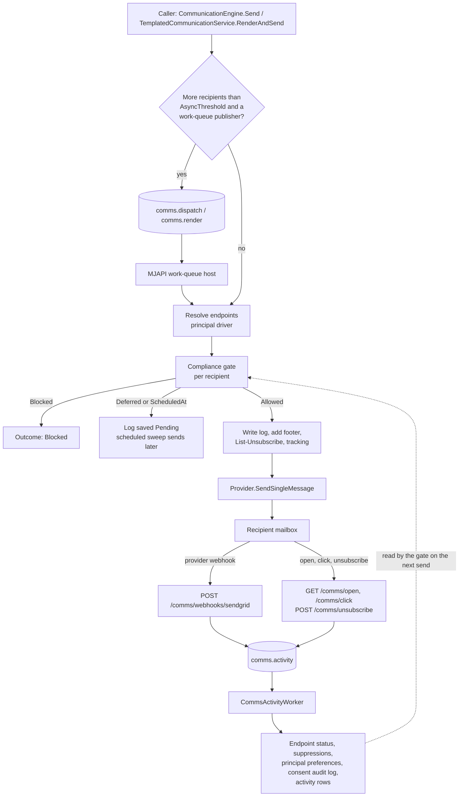

# Communications V2 Guide

How MemberJunction decides whether a message may be sent, what it adds to the message, and what it does with
the bounces, complaints, opens, clicks and unsubscribes that come back. Read this before you send to people
outside your own organization, before you deploy the public `/comms` routes, and before you write a rule
driver, a principal driver, a suppression policy or provider support for delivery events.

V2 lives beside the original Communication framework (V1). V1's `SendSingleMessage`, `SendMessages` and
`RunEntityCommunication` keep working; section 10 says what changed for them.

| Package | Role in V2 |
|---|---|
| [`@memberjunction/communication-types`](../packages/Communication/base-types/README.md) | DTOs (`V2Types.ts`), driver base classes (`V2Drivers.ts`), provider contract additions |
| [`@memberjunction/communication-engine`](../packages/Communication/engine/README.md) | `CommunicationEngine.Send()` / `EvaluateEligibility()`, the compliance gate, built-in rule drivers, the activity worker |
| [`@memberjunction/entity-communications-server`](../packages/Communication/entity-comm-server/README.md) | `TemplatedCommunicationService` (templated sends), the V1 bridge |
| [`@memberjunction/communication-sendgrid`](../packages/Communication/providers/sendgrid/README.md) | Event Webhook parsing, sending-domain authentication, suppression removal |
| [`@memberjunction/server`](../packages/MJServer/README.md) | Public `/comms` routes, work-queue handlers, admin Remote Operations |
| [`@memberjunction/ng-communications`](../packages/Angular/Generic/communications/README.md) | `<mj-comms-preference-center>` component and custom element |
| [`@memberjunction/ng-dashboards`](../packages/Angular/Explorer/dashboards/README.md) | "Compliance & Admin" tab of the Communication application |

---

## 1. Data flow



1. **Send.** A caller passes an envelope (sender, channel, message class, optional preference), a payload and
   recipients. The engine checks the sender, the caller's permission to use it, the provider and, when the
   provider requires one, a verified sending domain.
2. **Gate.** Each recipient is resolved to an endpoint (one normalized address) and evaluated. The result is
   `Allowed`, `Blocked` or `Deferred`, plus the obligations the message must carry.
3. **Dispatch.** For allowed recipients the engine writes an `MJ: Communication Logs` row, appends the
   compliance footer, sets the unsubscribe headers, rewrites links and adds the open pixel as the obligations
   allow, and hands the message to the provider.
4. **Activity.** Provider webhooks and MJ's own open, click and unsubscribe routes publish onto the
   `comms.activity` work-queue topic. The worker correlates each event to its log, updates the endpoint's
   health, creates suppressions, records opt-outs, and writes an audit trail.
5. **Next send.** The gate reads those suppressions, endpoint statuses and preferences. Nothing else connects
   the two halves.

---

## 2. Entities

All names carry the `MJ: ` prefix. The generated classes in `packages/MJCoreEntities/src/generated/` are the
source of truth for fields and value lists.

| Entity | What a row is |
|---|---|
| `MJ: Communication Senders` | An identity messages are sent as: from address, postal address, jurisdiction, provider, credential, branding (`TemplateContext`), `EnforcementMode`. Senders form a tree through `ParentSenderID`. Exactly one active sender should have `IsDefault = 1`. |
| `MJ: Communication Sender Types` | A kind of sender, optionally with a `DriverClass` that supplies template data. |
| `MJ: Communication Sender Permissions` | Who may send as a sender (`View`, `Send`, `Manage`), by user or role; `AppliesToChildSenders` extends a grant down the tree. A sender chain with no permission rows is unrestricted. |
| `MJ: Communication Sending Domains` | A domain registered with a provider for SPF/DKIM, with its DNS records and `Status`. |
| `MJ: Communication Principals` | An entity whose records receive messages, with the `DriverClass` and `Configuration` used to read their addresses and attributes. |
| `MJ: Communication Endpoints` | One address on one channel: `NormalizedValue`, `ValueHash` (SHA-256), `Status`, bounce counters and last-activity timestamps. |
| `MJ: Communication Endpoint Principals` | Which principal records share an endpoint. |
| `MJ: Communication Preferences` | A topic a recipient can opt in to or out of, with its `MessageClass` and `DefaultState`. |
| `MJ: Communication Principal Preferences` | One principal's state for one preference (`Opted In`, `Opted Out`, `Pending`) and the evidence of consent. |
| `MJ: Communication Suppressions` | A reason not to send: scoped to an endpoint and/or a principal, optionally to a sender, a preference and a channel. |
| `MJ: Communication Suppression Policies` | An automated rule that creates suppressions from activity, with a `DriverClass` and `Parameters`. |
| `MJ: Communication Consent Audit Logs` | Append-only history of every suppression and preference change. The database enforces it: the trigger `trgCommunicationConsentAuditLog_AppendOnly` refuses every update and every delete, through MJ or raw SQL. The one exception is `spDeleteEntityWithCoreDependencies`, which removes the audit rows of the preferences and principal-only suppressions it deletes when their entity is deleted (section 7). |
| `MJ: Communication Activities` | One delivery or engagement event. |
| `MJ: Communication Provider Events` | Provider event IDs already processed (the deduplication ledger). |
| `MJ: Communication Run Chunks` | One row per finished chunk of a chunked run; the run ends when its `ChunkCount` chunks are recorded. |
| `MJ: Jurisdictions`, `MJ: Jurisdiction Members` | Countries, subdivisions and groups (`EU`, `EEA`), and which jurisdictions belong to which group. |
| `MJ: Communication Compliance Regimes` | A body of rules (CAN-SPAM, GDPR, ...) with how it applies (`AppliesBy`) and whether it applies when the jurisdiction is unknown. |
| `MJ: Communication Compliance Regime Jurisdictions` | The jurisdictions a regime is attached to. |
| `MJ: Communication Compliance Rule Types` | A kind of rule, with the `DriverClass` that evaluates it and a `ParameterSchema`. |
| `MJ: Communication Compliance Regime Rules` | One rule of one regime: rule type, optional channel and message class, JSON `Parameters`. |

V2 also adds columns to existing entities: `MJ: Communication Logs` gains the sender, preference, endpoint,
principal (`EntityID`/`RecordID`), `RecipientAddress`, `MessageClass`, `ScheduledAt`, `UnsubscribeToken`, `TrackingToken`,
`ProviderMessageID`, `CorrelationData` and `ComplianceDecision`; `MJ: Communication Providers` gains
`RequireVerifiedDomain`.

Record Changes tracking is off for activities, provider events and endpoints: they are high-volume and the
activity rows are themselves the history.

---

## 3. Message classes

Every send declares a `MessageClass`. It is the main switch for how strictly the send is gated.

| Class | Use for | How the gate treats it |
|---|---|---|
| `Transactional` | Messages the recipient needs: receipts, password resets, security notices | The built-in rule drivers let it through. Only `Hard Bounce` and `Invalid Address` suppressions apply, plus any suppression scoped to the envelope's preference. Still blocked by a `Hard Bounced`, `Invalid` or `Erased` endpoint, and by an opt-out of the envelope's preference when one is named. |
| `Operational` | Service messages that are useful but not required | Non-transactional: every suppression reason applies, and so do quiet hours, consent and sender-identification rules that match its class. |
| `Marketing` | Promotional content | As `Operational`. The seeded regimes attach all of their rules to this class. |

**A `Marketing` message must be sent under a preference** (`Envelope.PreferenceID`). The preference is the topic
the recipient opts in to or out of, and it is what the one-click unsubscribe header and the preference page act
on: unsubscribing from a message opts the recipient out of the preference it was sent under. A `Marketing`
message with no preference is blocked with `PreferenceRequired`, in every enforcement mode. `Operational` and
`Transactional` messages do not need one.

The classes are ordered `Transactional` < `Operational` < `Marketing`. An envelope may not use a class less
strict than its preference's class: sending a `Marketing` preference as `Transactional` is blocked with
`MessageClassMismatch`.

---

## 4. The compliance gate

`ComplianceGate.Evaluate()` is synchronous and does no I/O. It evaluates one recipient in this order; the first
block wins.

1. **Endpoint status.** `Hard Bounced`, `Invalid` and `Erased` block every class. `Complained` blocks
   non-transactional sends.
2. **Suppressions.** A suppression applies when it is `Active`, not expired, matches the endpoint or the
   principal, and its sender (if any) is the sender or one of its ancestors, its channel (if any) is the
   envelope's channel, and its preference (if any) is the envelope's preference. `Hard Bounce` and
   `Invalid Address` cover every class; `Spam Complaint` and `Admin Block` cover non-transactional sends;
   `User Unsubscribe` and `Policy` cover non-transactional sends, or every class when scoped to a preference.
3. **Regimes.** The gate expands the recipient's and sender's jurisdictions through their groups, selects the
   active regimes that apply, groups their rules by rule type, merges each group to its strictest form, and
   evaluates it. Rules contribute blocks, a quiet-hours deferral, and obligations.
4. **Preference.** Runs only when the envelope names a preference. A disabled preference, a class mismatch, an
   `Opted Out` or (for non-transactional sends) `Pending` principal preference, or a preference whose
   `DefaultState` is `Opted Out` with no opt-in on record blocks the send.
5. **Quiet hours.** A deferral from step 3 becomes `Deferred` with a `DeferUntil` time.

An unsubscribe-all (a `User Unsubscribe` suppression with no preference) can be overridden by a later opt-in to
the envelope's preference, but only if that opt-in is newer than the suppression, came from a `Signup Form` or
the `Preference Center`, and is either a `Double` opt-in or linked to a log. The audit snapshot then records
`OverrideApplied: 'OptionB:PreferenceResubscribe'`.

### Reasons

`BlockedRecipient.Reason` and `SendV2RecipientOutcome.Reason` take these values:

| Reason | Meaning |
|---|---|
| `SenderNotFound` | No active sender matched the envelope (and no default sender exists). |
| `NoEndpoint`, `EndpointNotFound` | No address could be resolved for the recipient. |
| `Hard Bounce`, `Invalid Address`, `Spam Complaint`, `Admin Block`, `User Unsubscribe`, `Policy` | The endpoint's status or a suppression with this reason. |
| `Erased` | The endpoint was erased. |
| `ComplianceRegime` | A rule driver failed the send; `Detail` has its explanation. Also returned when a rule's driver class cannot be loaded or its `Parameters` are not a JSON object (the gate fails closed). |
| `PreferenceRequired` | A `Marketing` message was sent with no `Envelope.PreferenceID`. Not waived by `Shadow` or `Off`. |
| `PreferenceDisabled`, `MessageClassMismatch`, `DoubleOptInPending`, `OptedOut` | Preference step. |
| `QuietHours` | Deferral (any rule that returns `Decision: 'Deferred'` is reported under this reason). |
| `ObligationValidationFailed` | The final body lacked a required unsubscribe link or postal address (dispatch-time check, `Enforce` mode only). |

### Enforcement mode

`MJ: Communication Senders`.`EnforcementMode` controls what happens to a block or deferral. A sender with no
value uses `V2DispatchConfig.InstanceEnforcementMode`, then `Enforce`.

| Mode | Effect |
|---|---|
| `Enforce` | Decisions are applied. |
| `Shadow` | The message is sent. The gate's own result keeps the reason and a `Shadow mode: would have ...` detail, which the gate simulator shows; `Send()` and `EvaluateEligibility()` report the recipient as sendable and do not return or store that reason. |
| `Off` | The message is sent with no reason recorded. |

`Hard Bounce`, `Invalid Address`, `Erased` and `PreferenceRequired` blocks are applied in every mode.

### What the dispatcher adds

Given the gate's obligations, the dispatcher:

- appends a compliance footer (`<div data-mj-compliance-footer="true">`) containing the sender's postal address
  and an unsubscribe link, when either is required;
- sets `List-Unsubscribe: <.../comms/unsubscribe/<token>>` and `List-Unsubscribe-Post: List-Unsubscribe=One-Click`
  when the one-click header is required, which is always the case for a `Marketing` email. A recipient who uses
  it is opted out of the preference the message was sent under;
- rewrites `http(s)` links in the HTML body to `/comms/click/<token>?u=...&sig=...` when click tracking is
  allowed, the envelope did not set `TrackClicks: false`, and an HMAC secret is configured (the unsubscribe and
  preference-center links are never rewritten, and neither is a link whose tracked form would be longer than
  2,000 characters);
- adds a 1x1 image pointing at `/comms/open/<token>.gif?sig=...` when open tracking is allowed and the envelope
  did not set `TrackOpens: false` (the signature is left off when no HMAC secret is configured);
- tells the provider to turn its own open and click tracking off (`Message.DisableProviderTracking`) and passes
  the log ID for webhook correlation (`Message.CorrelationLogID`).

The sender address, recipient address, unsubscribe headers, footer and log ID are frozen before principal hooks
run and checked afterwards; a hook cannot change them.

---

## 5. Jurisdictions, regimes and rule types

These are metadata, synced from `metadata/` with `mj sync push`:

| Folder | Seeds |
|---|---|
| `metadata/jurisdictions`, `metadata/jurisdiction-members` | 41 jurisdictions: countries, a few subdivisions (`US-CA`, `CA-QC`, ...), and the `EU` and `EEA` groups with their members |
| `metadata/communication-compliance-rule-types` | The nine rule types below, each with a JSON Schema for its parameters |
| `metadata/communication-compliance-regimes` | CAN-SPAM, GDPR, UK GDPR, CASL, TCPA, CCPA, with their jurisdictions and rules |
| `metadata/communication-principals` | `MJ: Users` as a principal |
| `metadata/entity-communication-message-types` | The address mapping for that principal: `MJ: Users`, `Email` channel, read from the `Email` field |
| `metadata/communication-sender-types`, `metadata/communication-senders` | The `Company` sender type and a `Default Organization` sender (`IsDefault = 1`) |
| `metadata/communication-preferences` | `General updates` (`Marketing`, default `Opted In`) |
| `metadata/communication-suppression-policies` | `SoftBounceThresholdPolicy` |
| `metadata/work-queue-topics`, `metadata/work-queue-subscriptions` | The three `comms.*` topics and their workers |
| `metadata/authorizations`, `metadata/authorization-roles` | `Communications: Admin`, granted to the `Developer` role |

**Every seeded regime ships with `Status = 'Disabled'`.** Until you enable the regimes that apply to you, the
gate enforces endpoint status, suppressions and preferences only. No unsubscribe footer or postal address is
added to any message, and open and click tracking stay allowed. The one exception is the one-click unsubscribe
header: every `Marketing` email carries `List-Unsubscribe` and `List-Unsubscribe-Post`, with or without a
regime, because mailbox providers require it (RFC 8058) wherever the sender and recipient are. A regime can add
obligations to that; it cannot remove it. The seeded regimes are a starting point, not legal advice: review each rule with counsel before
enabling it. Fill in the default sender's `FromEmail`, `PostalAddress` and `JurisdictionID` first; a regime
that requires a postal address blocks marketing sends from a sender that has none.

### How a regime is selected

A regime applies to a send when it is `Active` and the side named by `AppliesBy` (`Recipient`, `Sender`, or
`Recipient or Sender`) has a jurisdiction, or a group containing it, attached to the regime. When that side's
jurisdiction is unknown, the regime applies if `AppliesWhenJurisdictionUnknown` is set. All seeded regimes set
it, so an unknown recipient is treated under every enabled regime: the strictest reading.

A rule of an applicable regime is used when its channel (`BaseMessageTypeID`) and `MessageClass` match the
envelope; a rule with either left empty matches all.

### Built-in rule types

When several regimes define the same rule type, the driver merges their parameters to the strictest value.
Parameter keys are accepted in camelCase or PascalCase.

| Rule type (`Name`) | Parameters | Strictest merge | Effect |
|---|---|---|---|
| `ConsentModel` | `model`: `opt-in` \| `opt-out`; `softOptIn`: boolean | `opt-in` wins; soft opt-in only if every opt-in regime allows it | Under `opt-in`, blocks non-transactional sends unless the principal is `Opted In`, or soft opt-in is allowed and the principal is an existing customer with no choice on record. |
| `RequireDoubleOptIn` | `required`: boolean | `true` wins | Blocks non-transactional sends unless the principal preference is `Opted In` with `OptInMethod = 'Double'`. |
| `ConsentEvidence` | `requireSource`, `requireTimestamp`, `requireConsentText`: boolean | `true` wins per field | Blocks non-transactional sends when the named evidence is missing from the principal preference. |
| `ConsentExpiry` | `maxDays`: number; `impliedOnly`: boolean | Shortest `maxDays`; `impliedOnly` only if every regime sets it | Blocks when the preference's `ExpiresAt` has passed or `ConsentAt + maxDays` has passed. |
| `UnsubscribeMechanism` | `oneClickHeader`, `footerLink`: `required` \| `optional` \| `none` | `required` > `optional` > `none` | Sets the one-click header and footer link obligations. Never blocks. A `Marketing` email keeps the header whatever the rule says. |
| `UnsubscribeHonorWindow` | `maxHours`: number | Shortest | Recorded in the audit snapshot only. The CAN-SPAM and CASL seeds use 240 hours (10 calendar days), stricter than the statutes' 10 business days. |
| `SenderIdentification` | `requirePostalAddress`, `requireSenderName`: boolean | `true` wins | Blocks non-transactional sends from a sender missing the address or name; sets the postal address obligation. |
| `QuietHours` | `windows`: `[{ startHour, endHour }]` (local hours 0-23, may wrap midnight) | Union of windows | Defers non-transactional sends to the next hour outside every window. The time zone is the principal's, else the recipient jurisdiction's, else the sender's `Configuration.timezone`, else UTC. |
| `TrackingConsent` | `openPixel`, `clickTracking`: `allowed` \| `consent-required` \| `prohibited` (or `requireConsentForOpenPixel` / `requireConsentForClickTracking`: boolean) | `prohibited` > `consent-required` > `allowed` | Sets `AllowOpenPixel` and `AllowClickTracking`. Never blocks. |

The gate also reads the merged `ConsentModel` result by that exact rule type name in its preference step, so
keep the name if you replace the driver.

---

## 6. Sending

### Direct send

```typescript
import { CommunicationEngine } from '@memberjunction/communication-engine';
import type { SendToPrincipalsParams } from '@memberjunction/communication-types';

await CommunicationEngine.Instance.Config(false, contextUser);

const params: SendToPrincipalsParams = {
    Envelope: {
        // SenderID omitted: the active sender with IsDefault = 1
        ChannelID: emailChannelID,          // MJ: Communication Base Message Types ID
        MessageClass: 'Marketing',
        PreferenceID: newsletterPreferenceID,
    },
    Payload: {
        Subject: 'October newsletter',
        HTMLBody: '<p>Hello</p>',
        Body: 'Hello',
    },
    Recipients: [
        { Principal: { EntityID: contactsEntityID, RecordID: contactID } },
        { Endpoint: { CommunicationEndpointID: knownEndpointID } },
    ],
};

const result = await CommunicationEngine.Instance.Send(params, contextUser);
if (!result.Success) {
    throw new Error(result.ErrorMessage);          // the send could not start
}
for (const outcome of result.Outcomes ?? []) {     // present for inline sends
    console.log(outcome.Status, outcome.Reason, outcome.Detail);
}
```

`Success` is `false` only when the send could not start. A recipient that is blocked or whose provider call
fails is reported in `Outcomes` and the counts, not in `Success`.

A send with more recipients than `AsyncThreshold` (default 100) is split into `comms.dispatch` work items of
`ChunkSize` recipients (default 50) when a work-queue publisher is configured. The result then has
`IsAsyncRun: true` and no `Outcomes`; read the run's `MJ: Communication Logs` rows for per-recipient results.

### Check before sending

```typescript
const eligibility = await CommunicationEngine.Instance.EvaluateEligibility(
    { Envelope: params.Envelope, Recipients: params.Recipients },
    contextUser,
);
// eligibility.Sendable[i].Obligations, eligibility.Blocked[i].Reason
```

Nothing is sent and no log is written. Endpoint rows may be created, because resolving a principal's address
registers it.

### Templated send

```typescript
import { TemplatedCommunicationService } from '@memberjunction/entity-communications-server';

const result = await TemplatedCommunicationService.Instance.RenderAndSend(
    {
        Envelope: params.Envelope,
        EntityID: contactsEntityID,
        Recipients: [{ Principal: { EntityID: contactsEntityID, RecordID: contactID } }],
        Templates: { SubjectTemplateID: subjectID, HTMLBodyTemplateID: htmlID },
        AutoAppendComplianceFooter: true,
    },
    contextUser,
);
```

Eligibility is evaluated before anything is rendered, so no template data is loaded for a blocked recipient.
Templates receive `Sender` (the sender's merged `TemplateContext`), `Recipient` (the record's data, the
principal attributes and `Endpoint`) and `Comms.Obligations`, in addition to their own parameters.
`Comms.Obligations.UnsubscribeURL` is empty at render time, because each recipient's unsubscribe link is created
with its log at dispatch. Templates do not need to render the link: the dispatcher appends the compliance footer
after rendering whenever the gate requires it.

### Delivery guarantee: a missed message or a duplicate

Every send records a log before it calls the provider. If the worker dies, or saving the log fails after
the provider accepted the message, the log is left `In-Progress` with no `ProviderMessageID`, and nobody
knows whether the message went out. There are only two safe answers, and you choose one:

| `DeliveryGuarantee` | When a log is stuck `In-Progress` for over 15 minutes | Risk you accept |
|---|---|---|
| **`At Most Once`** (default) | Reported `Failed` with reason `OutcomeUnknown`. Never resent. | **A recipient may miss the message.** |
| **`At Least Once`** | Reclaimed and sent again. | **A recipient may get the message twice.** |

Pick `At Most Once` for anything where a duplicate is worse than a gap: invoices, payment notices,
marketing. Pick `At Least Once` where a gap is worse than a duplicate: password resets, security alerts,
one-time codes.

Set it at whichever level fits; the most specific one wins:

1. `Envelope.DeliveryGuarantee`, for one send.
2. `MJ: Communication Runs`.`DeliveryGuarantee`, for every send in a run (a chunked send stores the
   envelope's value on its run).
3. `MJ: Communication Senders`.`DeliveryGuarantee`, then each ancestor sender's, nearest first.
4. `MJ: Communication Providers`.`DeliveryGuarantee`, which is never empty and defaults to `At Most Once`.

If the setting cannot be read, `At Most Once` is used, because it never sends twice. Either way, two
workers never send the same run and endpoint at the same moment: each log is claimed with one conditional
`UPDATE` before the provider call.

### Scheduling and deferral

A recipient deferred by quiet hours, or any recipient when `Envelope.ScheduledAt` is in the future, is stored
as a `Pending` log with its rendered message in `DeferredPayload`, which is cleared once it is sent. `CommunicationEngine.StartScheduledDeferralSweep()` (started by MJAPI,
every 60 seconds) picks up due logs, evaluates them again, and sends, fails or re-defers each one.

---

## 7. Activity, suppression and consent

`CommsActivityWorker.ProcessActivityBatch()` applies `NormalizedActivityEvent`s:

| Event | Endpoint | Suppression / consent |
|---|---|---|
| `Delivered` | Sets `LastDeliveredAt`; resets `SoftBounceCount` and returns a `Soft Bouncing` endpoint to `Active` | - |
| `Soft Bounce` | Increments `SoftBounceCount`; `Active` becomes `Soft Bouncing` | Suppression policies run (see below) |
| `Hard Bounce` | `Hard Bounced` | `Hard Bounce` suppression, all senders |
| `Dropped` | By drop reason: `Invalid`, `Hard Bounced` or `Complained` | `Invalid Address` / `Hard Bounce` (all senders), `User Unsubscribe` / `Spam Complaint` (this sender). Other drop reasons are only recorded. |
| `Spam Complaint` | `Complained` | `Spam Complaint` suppression for the sender |
| `Unsubscribed` | - | With a principal and a preference on the log: the principal preference becomes `Opted Out` and a suppression scoped to that preference is created. With a principal and no preference: a sender-scoped unsubscribe-all. With no principal: an endpoint suppression. |
| `Opened`, `Clicked` | Sets `LastEngagedAt`, unless the event is a machine event | - |

Every suppression and preference change appends an `MJ: Communication Consent Audit Logs` row. Events carrying a
`ProviderEventID` are processed at most once per provider. Opens and clicks from mail proxies and link scanners
(Apple Mail Privacy Protection, Google image proxy, Microsoft SafeLinks, Proofpoint, Barracuda) are flagged
`IsMachineEvent` and do not count as engagement.

The seeded `SoftBounceThresholdPolicy` creates a `Policy` suppression that expires after `cooldownDays`
(default 30) once an endpoint's `SoftBounceCount` reaches `threshold` (default 5).

**Erasure.** `CommsActivityWorker.EraseEndpointPII(endpointIdOrAddress, channelID, contextUser)` marks the
endpoint `Erased`, removes its address while keeping the hash, clears the address on its logs and the IP
address, user agent and raw payload on its activity rows. Suppressions are kept, so an erased address stays
suppressed if it is ever supplied again. The consent audit log is not changed.

**Removing an entity.** When CodeGen removes an entity with `spDeleteEntityWithCoreDependencies`, the
principals, endpoint links and principal preferences of its records are deleted, and so are principal-only
suppressions, with the consent audit rows that reference them. A suppression that also names an endpoint (a
hard bounce or complaint recorded against a principal) is kept with its principal link cleared, so the address
stays blocked, and its audit rows are kept.

---

## 8. Public routes

`MountPublicCoreRoutes` mounts the router from `CreateCommsWebhookHandler()` at `ApiRoute('/comms')`, before the
authentication middleware. No route requires a signed-in user; each checks its own capability. `/comms` is a
reserved root that server extensions cannot claim.

| Route | Capability | What it does |
|---|---|---|
| `POST /comms/webhooks/sendgrid/:credentialId`<br/>`POST /comms/webhooks/sendgrid` | SendGrid ECDSA signature over the raw body, within a 10-minute replay window | Publishes the batch to `comms.activity`. `202` on success, `401` on a missing key or bad signature, `503` when the queue rejects it. |
| `GET /comms/open/:token.gif?sig=<hmac>` | HMAC-SHA256 over `token:open`. With no `sig`, the `TrackingToken` of an existing log | Records an `Opened` event. Always answers with a 1x1 GIF, whatever the signature. |
| `GET /comms/click/:token?u=<url>&sig=<hmac>` | HMAC-SHA256 over `token:url` | Records a `Clicked` event and redirects to `u`. `400` when the signature does not verify, so the route cannot be used as an open redirect. |
| `POST /comms/unsubscribe/:token`<br/>`POST /comms/unsubscribe` | `UnsubscribeToken` (UUID v4) of an existing log | RFC 8058 one-click target. Publishes an `Unsubscribed` event. |
| `GET /comms/unsubscribe/:token` | `UnsubscribeToken` | Redirects to the sender's `PreferenceCenterURL` with `?token=`, or to `/comms/preferences/:token`. |
| `GET /comms/preferences/:token` | `UnsubscribeToken` | The preference center page, or its data as JSON when the request asks for `application/json`. |
| `POST /comms/preferences/:token` | `UnsubscribeToken` | Saves choices (`{ Preferences: [{ PreferenceID, State }] }`) or `{ UnsubscribeAll: true }`. Written immediately, not through the queue. |
| `GET /comms/confirm/:token`<br/>`POST /comms/confirm/:token` | `ConfirmationToken` of a principal preference | `GET` renders a page with a button; only `POST` confirms, so a link scanner that prefetches the link cannot confirm an opt-in. |
| `GET /comms/preferences-element.js` | none | Serves the preference center custom element bundle, or `404` when it is not built. |

The two webhook URLs differ in where the verification key comes from: with `:credentialId`, from that
`MJ: Credentials` row's `webhookVerificationKey` value (the credential's type or name must contain "sendgrid");
without it, from `COMMUNICATION_VENDOR_WEBHOOK_KEY__SENDGRID`. Use the credential form when more than one
SendGrid account posts to the same MJAPI.

Preference pages are served with a per-response CSP nonce, `frame-ancestors 'none'` and `Cache-Control: no-store`.

### Open and click hits do no database work on the request

A mail scanner can follow every link in a message, so these two routes are the busiest in the package. They
are built to answer without touching the database:

1. The route checks the signature. That is the whole capability: a request that passes is a link or pixel this
   system issued for that tracking token. Nothing is looked up.
2. The hit goes into an in-memory buffer and the route answers.
3. The buffer publishes what it holds to `comms.activity` in one call, one second later or as soon as 500 hits
   are waiting.
4. The `comms.activity` worker matches the tracking token to a message. A hit whose token matches no message
   (the message was deleted, for example) is dropped there: it is not recorded and not retried.

Two consequences to know about:

- **Hits can be lost.** A hit still in the buffer when the process dies is gone, and a batch the queue refuses
  is dropped, not retried. A graceful shutdown publishes what is held. Open and click counts are statistics;
  unsubscribes and provider webhooks never go through the buffer and are published before the route answers.
- **An open pixel with no signature is still looked up.** Mail sent before pixels were signed, or with no HMAC
  secret configured, carries a bare `/comms/open/<token>.gif`. Nothing but a read of `MJ: Communication Logs`
  can tell that from a guessed token, so that one request still costs a read.

The buffer is `CommsTrackingEventBuffer` in `@memberjunction/server`. A host that mounts
`CreateCommsWebhookHandler` itself can tune it with `TrackingBuffer` (`FlushIntervalMs`, `MaxBatchSize`,
`MaxBufferedEvents`) or pass its own as `TrackingEventBuffer`.

### Preference center

`GET /comms/preferences/:token` renders `<mj-comms-preference-center>` when the element bundle is available
(`MJ_COMMS_PREFERENCE_ELEMENT_SRC`, or the built `@memberjunction/ng-communications` package), and otherwise a
built-in page with the same functions, so footer links always work. The page lists the sender's active,
user-visible preferences (and those not tied to a sender) with the recipient's state. Per-preference choices
need the token's log to identify a single principal; an address shared by several records can only use
"unsubscribe from all".

### Double opt-in

`POST /comms/confirm/:token` moves a `Pending` principal preference to `Opted In` and records `ConfirmedAt` and
an audit entry. Creating the `Pending` row, generating its `ConfirmationToken`, setting `OptInMethod = 'Double'`
and sending the confirmation email (as a `Transactional` message linking to `/comms/confirm/<token>`) is the
calling application's job; the framework does not do it.

---

## 9. Administration

The Communication application's **Compliance & Admin** tab (`CommunicationComplianceAdminResource`) manages
senders and permissions, sending domains, regimes and jurisdictions, policies and principals, endpoints and
suppressions, and includes a gate simulator.

Operations that need the server are [Remote Operations](REMOTE_OPERATIONS_GUIDE.md) in the `Communications`
category, implemented in `packages/MJServer/src/operations/CommsAdminOperations.ts`:

| Operation key | Purpose |
|---|---|
| `Communications.SimulateComplianceGate` | Runs the gate for a sender, optional principal record, preference, message class and jurisdiction, and returns the full result. Sends nothing. |
| `Communications.CreateSendingDomain` | Registers a sending domain with its provider and stores the DNS records to publish. |
| `Communications.VerifySendingDomain` | Asks the provider to validate the DNS records, stores the per-record results, and sets the status to `Verified`, `Pending` or `Failed`. |
| `Communications.DeleteSendingDomain` | Removes the registration from the provider and marks the row `Revoked`. |
| `Communications.RevokeSuppression` | Revokes a suppression, writes the audit entry, clears the matching suppression at the provider when it supports that, and returns the endpoint to `Active` when no active suppression remains. |
| `Communications.BlockEndpoint` | Creates an `Admin Block` suppression for an endpoint. An address has at most one active Admin Block (a filtered unique index enforces it); blocking an already-blocked address returns the existing block. |

Each requires the caller to be an Owner or to hold the **`Communications: Admin`** authorization.

A provider with `RequireVerifiedDomain = 1` refuses to send unless a `Verified` sending-domain row exists for
the sender's `SendingDomain`, provider and credential.

---

## 10. V1 behavior and the V1 bridge

**V1 sends are unchanged unless you opt in.** `CommunicationEngine.SendSingleMessage()` and `SendMessages()`
call the provider exactly as before. Two switches turn on a check against the V2 suppression data:

- per message, `Message.CheckComplianceGate = true`;
- for the whole instance, the environment variable `MJ_COMMS_V1_COMPLIANCE_GATE=true`.

With either set, the To, CC and BCC addresses are checked against endpoint status and active suppressions before
the provider is called. The class is `Message.MessageClass`, defaulting to `Transactional`, so a V1 send that
does not set one is blocked only by hard bounces, invalid addresses and erased endpoints. An address MJ has
never seen is always allowed. A blocked V1 send returns `Success: false` with the reason in `Error` and marks
its log `Failed`. Regimes, preferences, footers and tracking are never applied to V1 sends.

`RunEntityCommunication()` sets `MessageClass = 'Operational'` on V1 sends unless the message already carries
one. So when the check is on, entity communications are also stopped by complaints, unsubscribes, admin blocks
and policy suppressions.

**Opting in to V2.** Set `EntityCommunicationParams.UseV2 = true` (or `Message.ContextData.UseV2 = true`) to
route `RunEntityCommunication()` through the full V2 pipeline:

- the default sender, `MessageClass = 'Operational'`, no preference, the channel of the entity message type and
  the provider named in the params;
- each record becomes a principal (`EntityID` + primary key) with its address as the endpoint;
- templated messages go through `TemplatedCommunicationService` with the compliance footer appended; untemplated
  messages go straight to `CommunicationEngine.Send()`;
- the result keeps V1's `EntityCommunicationResult` shape, with blocked and deferred recipients reported as
  skipped items.

The opt-in is ignored, and the V1 path used, when the message sets `From`, CC or BCC recipients, or combines a
literal `Subject` with a body template: V2 takes the from address from the sender and sends one message per
recipient. `UseV2` defaults to `false`.

---

## 11. Deployment requirements

| Requirement | Why | What happens without it |
|---|---|---|
| Migration `V202611231029__v6.3.x__Communications_V2_Schema.sql` applied, CodeGen run, `mj sync push` run | Tables, generated entities, and the metadata in section 5 | The engine fails to load its metadata. |
| A public URL: `MJAPI_PUBLIC_URL` (and `MJAPI_BASE_PATH` when a proxy forwards a prefix) | Unsubscribe, open and click links in emails are built from `ApiRoute('/comms', { absolute: true })` | Links point at the internal host and port and do not work for recipients. |
| `/comms/*` reachable from the internet, without authentication | Recipients' mail clients and the provider call it | Unsubscribes, tracking and webhooks fail. |
| `MJ_COMMS_HMAC_SECRET`, identical on every MJAPI instance | Signs and verifies click links and open pixels | Links are not rewritten and `/comms/click` answers `400`; open pixels are unsigned and each open costs a database read. |
| The provider's webhook verification key | Authenticates delivery events | `/comms/webhooks/sendgrid` answers `401`; bounces and complaints never reach MJ. |
| Work queue enabled (`workQueue.enabled`, on by default) and at least one MJAPI instance whose server role runs background workers (`all` or `worker`) | `comms.dispatch`, `comms.render` and `comms.activity` are consumed by the work-queue host | With `workQueue.enabled: false`, sends of any size run inline in the calling process. The public routes still publish to `comms.activity`; with no instance consuming it, bounces, complaints, unsubscribes, opens and clicks wait in the queue and no suppression is created. A rejected publish answers `503` for webhooks and unsubscribes; opens and clicks are dropped. |
| A default sender with `FromEmail` set | The envelope's sender supplies the from address | `Send()` fails with `Sender not found`, or sends with an empty from address. |
| A provider on the sender (`CommunicationProviderID`), or `Envelope.ProviderID` on each send | Chooses which provider delivers | The send uses the first provider the engine has loaded, whichever that is. |
| A `MJ: Communication Provider Message Types` row for that provider and channel | Tells the dispatcher how the provider sends on the channel | The recipient fails with `MissingProviderMessageType`. |
| For each principal entity: a `MJ: Entity Communication Message Types` row per channel, with at least one `MJ: Entity Communication Fields` row naming the address field | This is how a record's address is found | The recipient is blocked with `NoEndpoint`. Seeded for `MJ: Users` and `Email` only. |
| The provider configured to post events to `/comms/webhooks/...`, and its own unsubscribe handling left off | MJ owns suppression | Provider and MJ suppression lists diverge. |

The work-queue handlers run as the work-queue system user (`workQueue.systemUserEmail`), and the scheduled
sweep as the engine's context user. API-only instances still publish to the queue; only worker instances
consume it. The scheduled sweep is started on every MJAPI instance.

### Minimum setup to send one email

A new installation can evaluate the gate straight away, but it cannot send until each of these is in place.
They are listed in the order a send needs them.

1. **A sender.** `Default Organization` is seeded and is the default. Set its `FromEmail` and `FromName`.
2. **A provider on the sender.** Set the sender's `CommunicationProviderID`. The provider's `Status` must be
   `Active`. Leave `CredentialID` empty to use the provider's environment credentials, or point it at an
   `MJ: Credentials` row.
3. **A provider message type for the channel.** The provider needs a `MJ: Communication Provider Message Types`
   row for `Email`. SendGrid and Microsoft Graph have one; a provider you add yourself does not.
4. **An address mapping for the recipient's entity.** A `MJ: Entity Communication Message Types` row for the
   entity and the `Email` channel, with a `MJ: Entity Communication Fields` row naming the field that holds the
   address. `MJ: Users` is seeded. Every other principal entity (contacts, members, customers) needs its own,
   along with a `MJ: Communication Principals` row.
5. **A recipient that is a principal record**, as `{ Principal: { EntityID, RecordID } }`. Resolving a principal
   is what registers its address as an endpoint. A recipient given only as `{ Endpoint: { Address } }` is
   matched against endpoints that already exist and is blocked with `NoEndpoint` when the address is new.
6. **A preference, for `Marketing`.** A `Marketing` message must name one in `Envelope.PreferenceID`.
   `General updates` is seeded for the default sender; define your own topics alongside it.
7. **Something that calls `Send`.** There is no screen for it. Call `CommunicationEngine.Instance.Send()` on the
   server, or use V1 `RunEntityCommunication` with `UseV2 = true`.

For links in the message to work, also set `MJAPI_PUBLIC_URL` and `MJ_COMMS_HMAC_SECRET` from the table above.

To try this without a mail service, use the `Local JSON Mock` provider: set its `Status` to `Active`, add its
`Email` provider message type, set `MJ_MOCK_COMM_DIR` to a writable folder, and make it the sender's provider.
Each message is written to a JSON file per mailbox in that folder.

---

## 12. Configuration reference

### Environment variables

| Variable | Read by | Required | Default | Purpose and notes |
|---|---|---|---|---|
| `MJ_COMMS_HMAC_SECRET` | MJAPI (`ConfigureCommsV2WorkQueue`, `/comms/click`), `V2SendService` | For click tracking | none | Secret for the HMAC-SHA256 signature on click-tracking links and open pixels. **Secret**: use a long random value (`openssl rand -hex 32`), keep it out of source control, and set the same value on every instance. Unset: links are left unrewritten, `/comms/click` rejects every request, and open pixels are unsigned. Changing it invalidates the click links in mail already sent (they answer `400`) and stops opens of that mail being recorded (the pixel is still served); unsubscribe links are unaffected. |
| `COMMUNICATION_VENDOR_WEBHOOK_KEY__SENDGRID` | MJAPI (`POST /comms/webhooks/sendgrid`) | For the webhook URL without a credential ID | none | SendGrid Event Webhook **public** verification key (PEM, or the base64 key SendGrid shows). Not a secret, but it must match the signing key SendGrid uses. Unset: that route answers `401`. Not used by `/comms/webhooks/sendgrid/:credentialId`, which reads the key from the credential. |
| `MJ_COMMS_PREFERENCE_ELEMENT_SRC` | MJAPI (`GET /comms/preferences/:token`) | No | none | URL of the `<mj-comms-preference-center>` bundle to load in the preference page, for example a CDN copy. Unset: MJAPI serves the bundle from the installed `@memberjunction/ng-communications` package at `/comms/preferences-element.js`, and falls back to the built-in page when that bundle is not built. The script is loaded with the page's CSP nonce; only point this at a URL you control. |
| `MJ_COMMS_V1_COMPLIANCE_GATE` | `CommunicationEngine.SendSingleMessage` | No | off | Set to `true` to check every V1 send against endpoint status and active suppressions (section 10). Unset: V1 sends are not checked unless the message sets `CheckComplianceGate`. |
| `COMMS_ELEMENT_SOURCEMAP` | `@memberjunction/ng-communications` build (`scripts/build-element.mjs`) | No | off | Set to `1` to emit a source map for the element bundle. Build-time only; leave it off for published builds. |
| `COMMUNICATION_VENDOR_API_KEY__SENDGRID` | `@memberjunction/communication-sendgrid` | When the sender has no credential | none | SendGrid API key. Used for sends and for sending-domain operations when no `MJ: Credentials` row is linked. **Secret.** A sender with a `CredentialID` never falls back to it. |
| `MJAPI_PUBLIC_URL`, `MJAPI_BASE_PATH` | MJAPI | For any real deployment | derived from host and port | Base of every link placed in a message. See [`packages/MJAPI/CLAUDE.md`](../packages/MJAPI/CLAUDE.md). |
| `MJ_SERVER_ROLE` | MJAPI | No | `all` | `all` and `worker` instances run the work-queue host and so the `comms.*` handlers; `api` instances do not. |

### `mj.config.cjs`

| Key | Default | Purpose |
|---|---|---|
| `workQueue.enabled` | `true` | Runs the work-queue host and lets sends and public routes publish. See the [Work Queue engine README](../packages/WorkQueue/engine/README.md). |
| `workQueue.subscriptions` | `[{ name: '*', concurrency: 4 }]` | Which subscriptions this instance works, including `comms.dispatch-worker`, `comms.render-worker` and `comms.activity-worker`. |
| `rateLimiting.routes.commsWebhooks` | `{ enabled: true, windowMs: 60000, maxRequests: 1200 }` | Per-IP limit for `POST /comms/webhooks/*`. |
| `rateLimiting.routes.commsTracking` | `{ enabled: true, windowMs: 60000, maxRequests: 1200 }` | Per-IP limit for `/comms/open/*` and `/comms/click/*`. |
| `rateLimiting.routes.commsUnsubscribe` | `{ enabled: true, windowMs: 60000, maxRequests: 300 }` | Per-IP limit for `/comms/unsubscribe*`, `/comms/preferences/*` and `/comms/confirm/*`. |
| `rateLimiting.routes.comms` | `{ enabled: true, windowMs: 60000, maxRequests: 600 }` | Passed to the handler as the fallback for the three groups above. |
| `serverRole` | `all` | Same as `MJ_SERVER_ROLE`. |

The per-route limiters are independent of the global `rateLimiting.enabled` switch. Behind a proxy, make sure
Express sees the client's IP, or every request shares one budget. Opens arriving through a mail provider's
image proxy come from few addresses; raise `commsTracking` if legitimate opens are being limited.

### Programmatic settings

| Setting | Where | Default |
|---|---|---|
| `V2DispatchConfig.ChunkSize`, `AsyncThreshold` | `CommunicationEngine.Instance.ConfigureV2Dispatch()` | 50, 100 |
| `V2DispatchConfig.BaseTrackingURL`, `TrackingHMACSecret`, `EnqueueWork` | same; set by MJAPI at startup | `ApiRoute('/comms', { absolute: true })`, `MJ_COMMS_HMAC_SECRET`, a `WorkQueueEngine` publisher |
| `V2DispatchConfig.InstanceEnforcementMode` | same | `Enforce` (MJAPI does not set it) |
| `TemplatedCommunicationConfig.BatchSize`, `EnqueueWork`, `ResolveUser` | `TemplatedCommunicationService.Instance.Configure()` | 50; the last two set by MJAPI |
| `CommsWebhookHandlerOptions` | `CreateCommsWebhookHandler()` | See its TSDoc; every data hook can be replaced |

A host that calls `ConfigureV2Dispatch()` itself must call it after MJAPI's startup configuration, since each
call merges over the previous one.

### Settings stored in metadata

| Row | Field | Effect |
|---|---|---|
| `MJ: Communication Senders` | `EnforcementMode` | Section 4. |
| `MJ: Communication Senders` | `Configuration` JSON, key `timezone` (or `defaultTimezone`) | Fallback time zone for quiet hours. |
| `MJ: Communication Senders` | `TemplateContext` JSON | Template data under `Sender`; `BrandName`, `LogoURL`, `PrimaryColor` and `FooterText` also brand the preference center. |
| `MJ: Communication Senders` | `PreferenceCenterURL` | Sends `GET /comms/unsubscribe/:token` to your own page. |
| `MJ: Communication Providers` | `RequireVerifiedDomain` | Section 9. |
| `MJ: Communication Principals` | `Configuration` JSON, `Slots` | Field names for `FullName`, `Jurisdiction`, `Timezone`, `PreferredLanguage`, `IsExistingCustomer`. |
| `MJ: Communication Suppression Policies` | `Parameters` JSON | For `SoftBounceThresholdPolicy`: `threshold`, `cooldownDays`. |

---

## 13. Extension points

Every driver is a class registered with `@RegisterClass(<base class>, '<DriverClass>')` and named in a metadata
row. The class must be loaded in the server process. MJ's class-registration manifests pick up decorated classes
from the packages MJAPI depends on (see [`packages/CodeGenLib/CLAUDE.md`](../packages/CodeGenLib/CLAUDE.md));
a driver in a package nothing imports is never registered. For a rule driver the gate then blocks with
`ComplianceRegime`; the other driver kinds are simply not used.

| Extension point | Base class | Named in |
|---|---|---|
| Compliance rule | `BaseComplianceRule` | `MJ: Communication Compliance Rule Types`.`DriverClass` |
| Principal | `BaseCommunicationPrincipal` | `MJ: Communication Principals`.`DriverClass` |
| Sender type | `BaseCommunicationSender` | `MJ: Communication Sender Types`.`DriverClass` |
| Suppression policy | `BaseCommunicationSuppressionPolicy` | `MJ: Communication Suppression Policies`.`DriverClass` |
| Provider domain authentication and delivery events | `BaseCommunicationProvider` | `MJ: Communication Providers`.`Name` |

The base classes and DTOs are in `@memberjunction/communication-types`.

### 13.1 Writing a compliance rule driver

A rule driver does two things: `MergeStrictest` reduces the parameters of every applicable regime's rule to one
requirement, and `Evaluate` applies it to one recipient. `Evaluate` is synchronous and must not query: read
only the context.

This driver holds marketing mail over the weekend when any applicable regime asks for it:

```typescript
import { RegisterClass } from '@memberjunction/global';
import {
    BaseComplianceRule,
    ComplianceEvalContext,
    ComplianceRuleOutcome,
} from '@memberjunction/communication-types';

interface WeekendHoldMerged {
    HoldWeekends: boolean;
}

@RegisterClass(BaseComplianceRule, 'WeekendHoldRuleDriver')
export class WeekendHoldRuleDriver extends BaseComplianceRule<WeekendHoldMerged> {
    public MergeStrictest(parameterSets: ReadonlyArray<Record<string, unknown>>): WeekendHoldMerged {
        // Strictest wins: one regime asking for the hold is enough.
        return { HoldWeekends: parameterSets.some((p) => p['holdWeekends'] === true) };
    }

    public Evaluate(merged: WeekendHoldMerged, ctx: ComplianceEvalContext): ComplianceRuleOutcome {
        if (!merged.HoldWeekends || ctx.MessageClass === 'Transactional') {
            return { Passed: true };
        }
        const day = ctx.Now.getUTCDay();               // use ctx.Now, never new Date()
        if (day !== 0 && day !== 6) {
            return { Passed: true };
        }
        const monday = new Date(ctx.Now);
        monday.setUTCDate(monday.getUTCDate() + (day === 6 ? 2 : 1));
        monday.setUTCHours(0, 0, 0, 0);
        return {
            Passed: false,
            Decision: 'Deferred',
            DeferUntil: monday,                         // a deferral without DeferUntil is ignored
            FailureReason: 'Marketing mail is held until Monday',
        };
    }
}
```

Register it in metadata and attach a rule to a regime (see [`metadata/CLAUDE.md`](../metadata/CLAUDE.md) for
`primaryKey` and `@lookup` conventions):

```json
{
  "fields": {
    "Name": "WeekendHold",
    "Description": "Defers marketing mail sent on a weekend to Monday.",
    "DriverClass": "WeekendHoldRuleDriver",
    "ParameterSchema": "@file:schemas/weekend-hold.schema.json",
    "Status": "Active"
  },
  "primaryKey": { "ID": "<uuidgen>" }
}
```

```json
{
  "fields": {
    "CommunicationComplianceRegimeID": "@parent:ID",
    "CommunicationComplianceRuleTypeID": "@lookup:MJ: Communication Compliance Rule Types.Name=WeekendHold",
    "MessageClass": "Marketing",
    "Parameters": { "holdWeekends": true },
    "Status": "Active"
  },
  "primaryKey": { "ID": "<uuidgen>" }
}
```

What to know:

- Return `{ Passed: false }` (optionally with `Decision: 'Blocked'` and a `FailureReason`) to block. The gate
  reports the block as `ComplianceRegime` with your reason as `Detail`.
- Return `ObligationsPatch` to require something of the message, such as `{ RequireFooterUnsubscribe: true }`.
  Patches are applied in rule-type order with `Object.assign`, so a later rule overwrites an earlier one for
  the same field; do not relax an obligation another rule may have set.
- The merged value is stored in the audit snapshot under the rule type's `Name`. Keep it small and
  serializable.
- The gate fails closed: an unknown driver class or `Parameters` that are not a JSON object block the send.
  `ParameterSchema` documents the parameters and drives the admin UI; the gate does not validate against it, so
  validate inside `MergeStrictest`.
- Test with `ComplianceGate` directly; `JurisdictionResolver` accepts a plain `ComplianceMetadataSource`, so no
  database is needed. `packages/Communication/engine/src/__tests__/ComplianceRules.test.ts` is the model.

### 13.2 Writing a principal driver

A principal driver tells the engine how to reach a record and what it knows about it. Without one, an entity
uses `DefaultCommunicationPrincipal`, which reads addresses from the entity's Entity Communication Fields and
attributes from the fields named in the principal row's `Configuration.Slots`. That covers most entities with
metadata alone:

```json
{
  "fields": {
    "EntityID": "@lookup:MJ: Entities.Name=Contacts",
    "Name": "Contacts",
    "DriverClass": null,
    "Configuration": {
      "Slots": { "FullName": "FullName", "Jurisdiction": "CountryCode", "Timezone": "Timezone", "IsExistingCustomer": "IsCustomer" }
    },
    "Status": "Active"
  },
  "primaryKey": { "ID": "<uuidgen>" }
}
```

Write a driver when a value has to be computed or looked up, or when you want the hooks. Extending the default
keeps endpoint handling:

```typescript
import { RegisterClass } from '@memberjunction/global';
import { UserInfo } from '@memberjunction/core';
import {
    BaseCommunicationPrincipal,
    NormalizedActivityEvent,
    PrincipalMessageContext,
    PrincipalRecordRef,
} from '@memberjunction/communication-types';
import { DefaultCommunicationPrincipal, PrincipalRecordKey } from '@memberjunction/communication-engine';

@RegisterClass(BaseCommunicationPrincipal, 'MemberCommunicationPrincipal')
export class MemberCommunicationPrincipal extends DefaultCommunicationPrincipal {
    public override async ResolveJurisdiction(
        records: PrincipalRecordRef[],
        contextUser: UserInfo,
    ): Promise<Map<string, string | null>> {
        const countryByMember = await LoadMemberCountries(records.map((r) => r.RecordID), contextUser); // one query
        const result = new Map<string, string | null>();
        for (const ref of records) {
            // An MJ: Jurisdictions ID or Code; null when unknown
            result.set(PrincipalRecordKey(ref), countryByMember.get(ref.RecordID) ?? null);
        }
        return result;
    }

    public override async PreProcess(contexts: PrincipalMessageContext[]): Promise<void> {
        for (const ctx of contexts) {
            ctx.AddContent('footer', { html: '<p>Member services: 555-0100</p>', text: 'Member services: 555-0100' });
            ctx.SetHeader('X-Member-Segment', 'standard');
        }
    }

    public override async OnActivity(events: NormalizedActivityEvent[], contextUser: UserInfo): Promise<void> {
        const bounced = events.filter((e) => e.EventType === 'Hard Bounce' && e.Principal);
        await FlagMembersForAddressReview(bounced.map((e) => e.Principal!.RecordID), contextUser);
    }
}
```

`LoadMemberCountries` and `FlagMembersForAddressReview` stand for your own data access. Then set
`DriverClass` to `MemberCommunicationPrincipal` on the entity's principal row.

Contract:

- All three resolve methods are batch-shaped: take the whole array, run one query, return a map keyed by
  `PrincipalRecordKey(ref)` (`<EntityID lower-cased>:<RecordID>`).
- `ResolveEndpoints` must return endpoints that exist in `MJ: Communication Endpoints`. If you implement it
  yourself, normalize with `NormalizeEndpointAddress`, look up by `ValueHash`, and create missing rows. The
  first endpoint returned for a record is the one used.
- `PreProcess` and `PostProcess` receive a controlled context: they can add header or footer content, set
  non-protected headers and replace the subject. They cannot change the addresses, the unsubscribe headers or
  the compliance footer.
- `OnActivity` runs after a batch has been applied, with the events of your entity. Throwing only logs.
- Run every query as the `contextUser` you are given.

### 13.3 Writing a sender type driver

A sender type driver adds template data for senders of its type, on top of the `TemplateContext` JSON stored
on the sender and its ancestors.

```typescript
import { RegisterClass } from '@memberjunction/global';
import { UserInfo } from '@memberjunction/core';
import type { MJCommunicationSenderEntity } from '@memberjunction/core-entities';
import { BaseCommunicationSender } from '@memberjunction/communication-types';

@RegisterClass(BaseCommunicationSender, 'ChapterSender')
export class ChapterSender extends BaseCommunicationSender {
    public override async ResolveTemplateContext(
        sender: MJCommunicationSenderEntity,
        _ancestors: MJCommunicationSenderEntity[],
        contextUser: UserInfo,
    ): Promise<Record<string, unknown>> {
        const chapter = await LoadChapter(sender.RecordID, contextUser);   // RecordID points at the sender's source record
        return { ChapterName: chapter?.Name, ChapterPhone: chapter?.Phone };
    }
}
```

Set `DriverClass = 'ChapterSender'` on the `MJ: Communication Sender Types` row. Templates then read
`{{ Sender.ChapterName }}`. The result is cached per sender for 60 seconds.

### 13.4 Writing a suppression policy

A suppression policy turns a pattern of activity into a suppression. It runs once per processed batch, after
endpoint health has been updated, for each `Active` policy row naming its class.

```typescript
import { RegisterClass } from '@memberjunction/global';
import { UserInfo } from '@memberjunction/core';
import { BaseCommunicationSuppressionPolicy, NormalizedActivityEvent } from '@memberjunction/communication-types';
import { CommsActivityWorker } from '@memberjunction/communication-engine';

const MS_PER_DAY = 86_400_000;

/** Rests an address for a while after the provider drops a message for a reason MJ does not map. */
@RegisterClass(BaseCommunicationSuppressionPolicy, 'DroppedCooldownPolicy')
export class DroppedCooldownPolicy extends BaseCommunicationSuppressionPolicy {
    public async Evaluate(
        events: NormalizedActivityEvent[],
        parameters: Record<string, unknown>,
        contextUser: UserInfo,
    ): Promise<void> {
        const days = typeof parameters['cooldownDays'] === 'number' ? parameters['cooldownDays'] : 7;
        const worker = new CommsActivityWorker();
        const seen = new Set<string>();
        for (const ev of events) {
            const endpointID = ev.CommunicationEndpointID;
            if (ev.EventType !== 'Dropped' || !endpointID || seen.has(endpointID.toLowerCase())) continue;
            seen.add(endpointID.toLowerCase());
            await worker.CreatePolicySuppression(
                {
                    CommunicationEndpointID: endpointID,
                    Reason: 'Policy',
                    Source: 'Policy',
                    EffectiveAt: ev.OccurredAt,
                    ExpiresAt: new Date(ev.OccurredAt.getTime() + days * MS_PER_DAY),
                    CommunicationLogID: ev.CommunicationLogID ?? null,
                    Notes: `Dropped: ${ev.DropReason ?? 'unknown reason'}`,
                },
                contextUser,
            );
        }
    }
}
```

```json
{
  "fields": {
    "Name": "DroppedCooldownPolicy",
    "DriverClass": "DroppedCooldownPolicy",
    "Parameters": { "cooldownDays": 7 },
    "Status": "Active"
  },
  "primaryKey": { "ID": "<uuidgen>" }
}
```

What to know:

- `events` is the whole batch, every event type and endpoint. Filter first.
- A work item can be delivered more than once. Events with a provider event ID are deduplicated before your
  policy runs; for others, check for an existing active suppression before creating one.
- `Policy` suppressions block non-transactional sends. Give them an `ExpiresAt` unless the block is meant to be
  permanent; an admin can revoke them from the dashboard.
- `CreatePolicySuppression` writes the consent audit entry for you.

### 13.5 Adding delivery events and domain authentication to a provider

A provider takes part in V2 at three levels. Each is independent.

**Sending.** No V2-specific method is needed, but `SendSingleMessage` should honor three `Message` fields and
return one result field:

| Field | What to do |
|---|---|
| `Message.Headers` | Pass through unchanged; they carry `List-Unsubscribe`. |
| `Message.CorrelationLogID` | Attach to the outgoing message as provider metadata so webhook events echo it back (SendGrid: `customArgs.mj_log_id`). Never attach `CorrelationData`. |
| `Message.DisableProviderTracking` | When `true`, turn the provider's own open and click tracking off for this message. |
| `MessageResult.ProviderMessageID` | Return the provider's message ID. It is stored on the log and used to correlate events that do not carry the log ID. |

**Domain authentication.** Override the three methods and list them in `getSupportedOperations()`. The admin
operations in section 9 then work for your provider with no further code.

```typescript
public override getSupportedOperations(): ProviderOperation[] {
    return ['SendSingleMessage', 'CreateDomainAuthentication', 'VerifyDomainAuthentication', 'DeleteDomainAuthentication'];
}

public override async CreateDomainAuthentication(
    params: CreateDomainAuthParams,
    credentials?: ProviderCredentialsBase,
): Promise<CreateDomainAuthResult> {
    const created = await this.api(credentials).createDomain(params.Domain);   // your provider client
    return {
        Success: true,
        ProviderDomainID: String(created.id),
        DNSRecords: created.records.map((r) => ({
            Type: r.type,              // 'CNAME' | 'TXT' | 'MX'
            Purpose: r.purpose,        // 'DKIM' | 'SPF' | 'DMARC' | 'ReturnPath'
            Host: r.host,
            Value: r.value,
            Validated: false,
        })),
    };
}
```

`VerifyDomainAuthentication` returns the same records with `Validated` set, and `Verified: true` only when all
required records validate. `DeleteDomainAuthentication` should treat "already gone" as success. Report failures
through `Success: false` and `ErrorMessage`, not by throwing. The base class answers "not supported" for a
provider that overrides none of them.

To let admins lift provider-side suppressions when they revoke one in MJ, add a public
`RemoveSuppression(email, suppressionType?, credentials?)` method returning `BaseMessageResult`; the revoke
operation calls it when it exists.

**Delivery events.** Normalize the provider's webhook payload into `NormalizedActivityEvent`s. Implement
`ParseNotification` so it verifies the provider's signature and returns notifications with `Kind: 'activity'`
and `ActivityEvents`:

```typescript
public override async ParseNotification(
    input: WebhookNotificationInput,
    credentials?: ProviderCredentialsBase,
): Promise<ParseNotificationResult> {
    if (!this.verifySignature(input.RawBody, input.Headers, credentials)) {
        return { Success: false, ErrorMessage: 'Invalid signature', SignatureValid: false, Notifications: [], SuggestedResponseStatus: 401 };
    }
    const events: NormalizedActivityEvent[] = this.mapEvents(JSON.parse(input.RawBody));
    return {
        Success: true,
        SignatureValid: true,
        Notifications: [{ Kind: 'activity', ActivityEvents: events }],
        SuggestedResponseStatus: 200,
    };
}
```

For each event set `EventType`, `OccurredAt`, `NormalizedAddress` (lower-cased), `IsMachineEvent`, and whatever
identifies the message: `CommunicationLogID` if the provider echoes your metadata, else `ProviderMessageID`.
Set `ProviderEventID` so retried webhooks are not applied twice, and `CommunicationProviderID` to your
`MJ: Communication Providers` row.

The ingest route is the part that is not yet generic. `POST /comms/webhooks/sendgrid` and the `comms.activity`
handler are written for SendGrid, and `CommsActivityWorkPayload.Source` is a closed list. A new provider
therefore brings its own route and handler:

1. Mount a route with `ApiRoute()` (in MJServer, or in a [server extension](SERVER_EXTENSIONS_GUIDE.md)) that
   reads the raw body, verifies the signature, and publishes the raw body to a work-queue topic of your own.
   Verify at the edge and answer `2xx` only after the publish succeeds, so the provider retries on failure.
2. Register a `BaseWorkHandler` for that topic that parses the body with your provider and calls the worker:

```typescript
// BaseWorkHandler: @memberjunction/work-queue-engine; Outcome, WorkJson, WorkMessage, WorkOutcome: @memberjunction/work-queue-core
@RegisterClass(BaseWorkHandler, 'comms.activity.acme')
export class AcmeActivityHandler extends BaseWorkHandler<AcmeWebhookPayload & WorkJson> {
    public async Handle(message: WorkMessage<AcmeWebhookPayload & WorkJson>): Promise<WorkOutcome> {
        await CommunicationEngine.Instance.Config(false, this.ContextUser);
        const provider = CommunicationEngine.Instance.GetProvider('Acme Mail');
        const parsed = await provider.ParseNotification({ RawBody: message.Payload.RawBody, Headers: message.Payload.Headers, QueryParams: {} });
        if (!parsed.Success) return Outcome.DeadLetter(parsed.ErrorMessage ?? 'Unparseable webhook');
        const events = (parsed.Notifications ?? []).flatMap((n) => n.ActivityEvents ?? []);
        const result = await new CommsActivityWorker().ProcessActivityBatch(events, this.ContextUser);
        return result.ErrorCount > 0 ? Outcome.Retry(`${result.ErrorCount} event(s) failed`) : Outcome.Complete();
    }
}
```

Read the [Work Queue Consumer Guide](WORK_QUEUE_CONSUMER_GUIDE.md) first: the payload cap, idempotency and retry
rules there apply. `ProcessActivityBatch` is idempotent for events with a `ProviderEventID`.

### 13.6 Reacting to activity

There is no general event bus for communication activity. The two hooks are the ones above:

| You want to | Use |
|---|---|
| Update your own records when a message to them bounces, is opened, or is unsubscribed | `BaseCommunicationPrincipal.OnActivity` (13.2): called with the events of your entity |
| Create suppressions from patterns across any recipients | `BaseCommunicationSuppressionPolicy` (13.4): called with every event in the batch |
| Report on activity | Query `MJ: Communication Activities`; `CorrelationData` carries what the sender attached to the envelope |

Both run inside the `comms.activity` worker, after the batch's own effects are saved, and neither can fail the
batch.

---

## 14. Known limitations

Check these against the code before relying on the opposite; they describe the implementation as it stands.

- **Open and click hits can be lost.** They wait up to a second in memory before they are published (section
  8), so a process crash loses that second, and a batch the queue refuses is dropped. The buffer's settings are
  options of `CreateCommsWebhookHandler`, not `mj.config.cjs` keys.
- **One provider for delivery events.** The public webhook route and the `comms.activity` handler support
  SendGrid only (13.5). Open, click and unsubscribe events from MJ's own routes are attributed to the provider
  that sent the message, taken from its log.
- **Long links are not click-tracked.** The target travels inside the tracked link, so a link whose tracked
  form would exceed 2,000 characters (`MAX_TRACKED_LINK_LENGTH`) is left as written. It works for the recipient;
  its clicks are not recorded. A clicked URL reported by a provider is stored shortened to 2,000 characters.
- **Mixed-entity sends.** Jurisdiction and attributes are resolved with the principal driver of the first
  recipient's entity. Send one entity per call when entities use different drivers.
- **Per-recipient `CorrelationData`** on `RecipientSendTarget` is not stored; only `Envelope.CorrelationData`
  reaches the log. After a deferred send, only its string values remain.
- **`MessagePayload.PreviewText`** is carried through hooks but not passed to the provider.
- **Async results.** An async `Send()` returns counts only, and an async templated send reports
  `DeferredCount: 0`; the logs hold the outcome.
- **`RequestMutation({ CorrelationData })`** in a principal hook is accepted and ignored.
- **`Shadow` mode leaves no record.** The would-be block reason is on the gate's result only; `Send()`,
  `EvaluateEligibility()` and the log's `ComplianceDecision` do not carry it.
- **`ParameterSchema`** on a rule type is not enforced when the gate reads a rule's `Parameters`.
- **`Communication Endpoints`.`LastSentAt`** is not maintained by the send pipeline.
- **`QuietHours` `days`.** The parameter schema allows a `days` array per window; the driver ignores it and
  applies every window on every day.
- **Quiet-hours time zones by jurisdiction** come from a built-in table of common jurisdictions. Others fall
  back to the sender's time zone or UTC unless the principal supplies one.
- **`UnsubscribeHonorWindow`** is informational. Unsubscribes take effect when their event is processed.
- **Double opt-in** has a confirm route but no issuing API (section 8).
- **The scheduled sweep** filters on `GETUTCDATE()`, which is SQL Server syntax.
- **Record keys.** The default principal driver loads records by a single string primary key.

---

## 15. Testing

- Unit tests: `cd packages/Communication/engine && pnpm test` (gate, rules, send service, activity worker),
  and the same in `entity-comm-server`, `providers/sendgrid`, `MJServer` and `Angular/Generic/communications`.
- Integration bundles IT188 to IT192 (`comms-v2-core`, `-compliance`, `-send`, `-activity`, and `-wire`, which
  drives the public routes over HTTP against a running MJAPI) run in the deterministic tier:
  `pnpm run test:integration`. See the
  [Integration Testing Quickstart](INTEGRATION_TESTING_QUICKSTART.md).
- To see a decision without sending, use the gate simulator in the dashboard or
  `CommunicationEngine.Instance.EvaluateEligibility()`. To send without delivering, set `Envelope.DryRun`.
- To preview a regime, enable it with the sender in `Shadow` mode and run representative recipients through
  the gate simulator, which shows the `Shadow mode: would have ...` detail. Sends in `Shadow` mode go out and do
  not record what would have been blocked.
