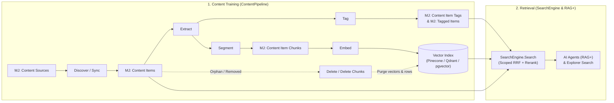
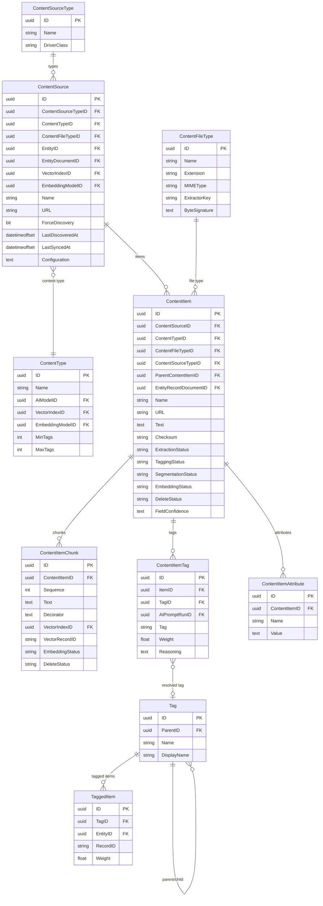

# Content Pipeline, Training, and Retrieval Guide

**Read this before building or customizing content ingestion, document extraction, classification/autotagging, segmentation, vector embedding, or RAG retrieval pipelines in MemberJunction.**

- **Packages**:
  - [`@memberjunction/content-pipeline-base`](../packages/ContentPipeline/base/README.md) — `WorkingRecord`, `BasePipelineStage`, `ConfidenceScale`, `BaseAccessDriver`, `BaseContentExtractor`, `BaseContentClassifier`, byte-signature detection, and `PipelineTuning` (zero database dependencies)
  - [`@memberjunction/content-pipeline`](../packages/ContentPipeline/engine/README.md) — `PipelineProcessor` (`WorkType = 'Pipeline Stage'`), `WorkingRecordHydrator`, `WorkingRecordCommitter`, `AccessResolver`, `ExtractorCascade`, `ManagedPromptClassifier`, and the built-in stages (`Discover`, `Extract`, `Tag`, `Segment`, `Embed`, `Delete`, `DeleteContentItem`, `NoOp`)
  - [`@memberjunction/content-autotagging`](../packages/ContentAutotagging/README.md) — Source-type drivers (`AutotagBase` subclasses: `AutotagLocalFileSystem`, `AutotagCloudStorage`, `AutotagRSSFeed`, `AutotagWebsite`, `AutotagEntity`) and shared vector/prompt infrastructure (`ContentVectorInfrastructure`, `ContentVectorMetadata`, `ContentAutotagPrompt`)
  - [`@memberjunction/document-parsing`](../packages/DocumentParsing/src/index.ts) — Shared PDF, Word (`docx`), and Excel (`xlsx`) text extraction helpers
- **Companion Guides**:
  - **[Record Set Processing & Record Processes Guide](RECORD_SET_PROCESSING_GUIDE.md)** — The execution substrate (`MJ: Record Processes`, batching, concurrency, rate limiting, resume, and `DryRun`)
  - **[Content Segmentation Guide](CONTENT_SEGMENTATION_GUIDE.md)** — How text and media are split into meaningful chunks via [`@memberjunction/ai-segmentation`](../packages/AI/Segmentation/README.md)
  - **[Taxonomy & Tagging Guide](TAXONOMY_TAGGING_GUIDE.md)** — How the formal `MJ: Tags` taxonomy is governed, scoped, embedded, and resolved
  - **[Search Overview Guide](SEARCH_OVERVIEW_GUIDE.md)** & **[Search Scopes & RAG+ Guide](SEARCH_SCOPES_AND_RAG_GUIDE.md)** — How trained content and vectors are queried by `SearchEngine.Search` and injected into AI agents

---

## 1. Overview: Content Training to Retrieval

MemberJunction treats **content training (ingestion and indexing)** and **retrieval (search and RAG)** as two halves of one lifecycle:

1. **Content Training (`ContentPipeline`)**: Discovers items across external and internal sources, extracts normalized text and metadata, classifies items into the governed tag taxonomy, segments content into semantic chunks, and embeds those chunks into vector indexes — while tracking per-stage state so re-runs, incremental updates, metadata-only refreshes, and deletions are idempotent.
2. **Retrieval (`SearchEngine` & Agent RAG+)**: Queries the resulting vector indexes, full-text indexes, entity rows, and `MJ: Tagged Items` inside governed **[Search Scopes](SEARCH_SCOPES_AND_RAG_GUIDE.md)**, fuses results via Reciprocal Rank Fusion (RRF), enforces entity row-level permissions and scope filters, and injects cited context into AI agent runs.



---

## 2. Consolidation of `ContentAutotagging` into `ContentPipeline`

Historically, [`@memberjunction/content-autotagging`](../packages/ContentAutotagging/README.md) ran source crawling, file parsing, LLM keyword extraction, and vectorization inside a single monolithic loop (`AutotagBaseEngine` + `AutotagAndVectorizeContentAction`), where each provider's `Autotag()` method executed the entire pipeline start-to-finish.

The **Content Pipeline Framework** (`@memberjunction/content-pipeline-base` and `@memberjunction/content-pipeline`) replaces that monolithic loop with **six independent, observable, resumable stages** (`Discover`, `Extract`, `Tag`, `Segment`, `Embed`, `Delete`) orchestrated by **[Record Set Processing](RECORD_SET_PROCESSING_GUIDE.md)** (`WorkType = 'Pipeline Stage'`).

All active source drivers and shared AI/vector helpers have been unified with the pipeline, and `ContentPipeline` has **zero runtime dependency on legacy `AutotagBaseEngine`**:

| Capability | Active Pipeline Component | Legacy Status |
|---|---|---|
| **Source Drivers** | `AutotagBase` subclasses (`AutotagLocalFileSystem`, `AutotagCloudStorage`, `AutotagRSSFeed`, `AutotagWebsite`, `AutotagEntity`) implement `Discover(request)` for `DiscoverStage` and `Fetch(request)` for `ExtractStage` | `Autotag()` and `SetContentItemsToProcess()` are marked `@deprecated` |
| **Document Parsing** | [`@memberjunction/document-parsing`](../packages/DocumentParsing/src/index.ts) (`ParsePDF`, `ParseDOCX`, `ParseXLSX`) invoked by `DocumentExtractor` in `ExtractStage` | Legacy `AutotagBaseEngine` parse methods delegate here |
| **Metadata Caching** | `KnowledgeHubMetadataEngine` (`@memberjunction/core-entities`) caches `MJ: Content Sources`, `MJ: Content Types`, `MJ: Content Type Attributes`, `MJ: Content Source Types`, `MJ: Content File Types`, and `MJ: Entity Documents` | `AutotagBaseEngine` delegates to `KnowledgeHubMetadataEngine` |
| **LLM Classification & Custom Attributes** | `ManagedPromptClassifier` (`TagStage`) calls `ContentAutotagPrompt` (`GetContentAutotagPrompt`, `BuildContentAutotagPromptData`, `GetContentTypeAttributePrompt`, `RunContentAutotagPrompt` with `ContentType.AIModelID` override) and persists `MJ: Content Item Tags` + `MJ: Content Item Attributes` | `AutotagBaseEngine` is marked `@deprecated` |
| **Taxonomy Promotion** | `ContentItemTagBridge` & `TagEngine` (`@memberjunction/tag-engine`) resolve free-text tags into `MJ: Tags` and create `MJ: Tagged Items` during `TagStage` | Unified into `@memberjunction/tag-engine` |
| **Vector Routing & Metadata** | `ContentVectorInfrastructure` & `ContentVectorMetadata` (`@memberjunction/content-autotagging`) resolve the vector index, embedding model, credential, namespace, and vector metadata payload for `EmbedStage` and `DeleteStage` | `AutotagAndVectorizeContentAction` is marked `@deprecated` |

---

## 3. Architecture, Schema, & Execution Model

### Database Schema (ER Diagram)



### Record Set Processing Integration

`ContentPipelineStartup` registers the `'Pipeline Stage'` work type and `PipelineProcessRunTracker` with [`@memberjunction/record-set-processor`](RECORD_SET_PROCESSING_GUIDE.md). Each stage is configured as an `MJ: Record Processes` row whose `ScopeFilter` selects records ready for that stage:

```mermaid
sequenceDiagram
    participant RSP as RecordSetProcessor
    participant PP as PipelineProcessor
    participant Hyd as WorkingRecordHydrator
    participant Stg as BasePipelineStage (e.g. ExtractStage)
    participant Com as WorkingRecordCommitter
    participant DB as MJ Database

    RSP->>PP: ProcessRecord / ProcessBatch (BaseEntity[], StageConfiguration)
    PP->>Hyd: Hydrate(entity, stageContext)
    Hyd->>DB: Load lookup names, FieldConfidence, chunk/item state
    Hyd-->>PP: WorkingRecord (in-memory)
    PP->>Stg: Run(workingRecord, stageContext)
    Stg-->>PP: StageOutcome (Complete | Skipped | Retry | Fatal)
    alt Finalize supported (e.g. EmbedStage batch)
        PP->>Stg: Finalize(records, stageContext)
    end
    alt IsTest === false && DryRun === false
        PP->>Com: Commit(workingRecord, outcome, stageContext)
        Com->>DB: Save entity, child items/chunks, tags, status & FieldConfidence
    else IsTest === true or DryRun === true
        PP-->>RSP: Withhold all DB writes; report in-memory preview
    end
```

### Strict Separation of Concerns

1. **Stages never touch the database directly** for the working record. They read and mutate an in-memory `WorkingRecord` (`Propose`, `SetExtension`, `ProduceChild`) and return a `StageOutcome`.
2. **`WorkingRecordHydrator` and `WorkingRecordCommitter` own persistence.** Only the hydrator and committer translate between `WorkingRecord` fields and `MJContentSourceEntity`, `MJContentItemEntity`, and `MJContentItemChunkEntity`.
3. **Cold-start resilience.** Every stage runs against a freshly hydrated `WorkingRecord` with no assumption that an earlier stage ran in the same process. When `Stages` chains multiple stages in a test run (e.g. `["Discover", "Extract"]`), `PipelineProcessor` passes produced records in memory from stage to stage without writing to the database.

---

## 4. The `WorkingRecord` & Confidence Scoring

### Well-Known Fields and Competition on Merit

Multiple stages can discover values for the same field — for example, a directory or RSS listing provides an item title during `Discover`, while an HTML `<title>` or PDF header provides one during `Extract`.

Instead of letting whichever stage runs last blindly overwrite earlier values, `WorkingRecord.Propose(field, value, confidence, source)` resolves shared fields **by integer confidence score**:

```typescript
const confidence = ResolveConfidence(context.Configuration);

// In DiscoverStage (title from source listing, default score 4):
record.Propose('Title', discoveredTitle, confidence.DiscoveredTitle, 'Discover');

// In ExtractStage (title found inside the document itself, default score 6):
record.Propose('Title', extractedTitle, confidence.ExtractorTitle, 'Extract');
```

A proposal wins **only if its confidence score is greater than or equal to** the field's recorded score in `FieldConfidence` (a JSON column persisted on `MJ: Content Items`). Because `ExtractorTitle` (`6`) outranks `DiscoveredTitle` (`4`) by default, a title extracted from the document body upgrades a raw filename discovered from a directory listing — while a source that has authoritative listing titles (like an Entity or curated RSS feed) can override `"Confidence": { "DiscoveredTitle": 8 }` on the `ContentSource` so the listing title wins.

### Default `ConfidenceScale`

Defined in [`packages/ContentPipeline/base/src/ConfidenceScale.ts`](../packages/ContentPipeline/base/src/ConfidenceScale.ts):

| Scale Key | Default Score | Meaning |
|---|---|---|
| `FileTypeByteCorrection` | `9` | Byte signature that unambiguously contradicts a declared file type |
| `FileTypeDeclared` | `7` | File type explicitly declared for the item |
| `ContentTypeStructural` | `7` | Content type recognized from the document's own structure |
| `ExtractorText` | `6` | Text extracted by a format-aware extractor |
| `ExtractorTitle` | `6` | Title found inside the document by an extractor |
| `SegmentText` | `6` | Verbatim chunk slice produced by `SegmentStage` |
| `Modality` | `6` | Modality detected from a recognized non-text format |
| `FileTypeSignature` | `5` | Magic byte signature match when no file type was declared |
| `DiscoveredTitle` | `4` | Title reported by a source listing during `Discover` |
| `DiscoveredDate` | `4` | Date reported by a source listing during `Discover` |
| `DiscoveredFileType` | `3` | File type reported by a source listing before bytes are seen |
| `DiscoveredContentType` | `3` | Content type declared by a source listing |
| `FileTypeExtension` | `2` | File type inferred from a filename extension |
| `FallbackText` | `2` | Text from a last-resort plain-text read (loses to any format-aware extractor) |
| `FileTypeSourceDefault` | `1` | The `ContentSource`'s default file type |

Any scale key can be overridden under `Configuration.Confidence` (at the Source Type, Content Type, Source, or Run level) via `ResolveConfidence(...configurations)`. When an item's extracted content checksum changes on re-extraction, `WorkingRecordCommitter` resets `FieldConfidence` entries so stale metadata from old content does not block fresh extraction proposals.

---

## 5. Five-Level Configuration Precedence

Every stage resolves its driver keys (`ExtractorKey`, `SegmenterKey`, `ClassifierKey`, `AccessDriverKey`), confidence overrides (`Confidence`), and operational tuning (`Tuning`) through a single 5-level cascade implemented in [`ContentSourceConfigurationResolver`](../packages/ContentPipeline/engine/src/ContentSourceConfigurationResolver.ts):

```
1. Item Override          (e.g., ContentItem.ExtractorKeyOverride / ClassifierKeyOverride / SegmenterKeyOverride)
       ↓
2. Run Configuration      (StageContext.Configuration, from RecordProcess.Configuration.Options)
       ↓
3. Content Source         (ContentSource.Configuration JSON + per-extension Configuration.Extractors)
       ↓
4. Source Type / Type     (ContentSourceType.Configuration / ContentType.Configuration JSON)
       ↓
5. File Type / Default    (ContentFileType.ExtractorKey, capability auto-detection, or built-in default)
```

---

## 6. Stage-by-Stage Reference

### Stage 1: `Discover` and `Sync`

- **Class**: [`DiscoverStage`](../packages/ContentPipeline/engine/src/stages/DiscoverStage.ts) (`@RegisterClass(BasePipelineStage, 'Discover')`)
- **Entity**: `MJ: Content Sources`
- **Drivers**: Resolves `ContentSourceType.DriverClass` via `ClassFactory.CreateInstance<AutotagBase>(AutotagBase, driverClass)` and calls `driver.Discover(request)`.

#### Incremental `Discover` vs Exhaustive `Sync`

`DiscoverStage` supports two modes controlled by `Options.Mode`:

| Mode | Record Process | Watermark Passed (`request.Since`) | Orphan Reconciliation | Timestamps Updated on Source |
|---|---|---|---|---|
| `'Discover'` (default) | `Content Pipeline — Discover` | `LastDiscoveredAt - ClockSkewOverlapMs` (or `null` on first run) | None — only upserts discovered items | Stamps `LastDiscoveredAt`, clears `ForceDiscovery = 0` |
| `'Sync'` | `Content Pipeline — Sync` | `null` (forces an exhaustive walk of the source) | Marks existing top-level items missing from the walk as `DeleteStatus = 'Pending'` (when `driver.SupportsExhaustiveWalk === true`) | Stamps both `LastDiscoveredAt` and `LastSyncedAt` (leaves `ForceDiscovery` untouched) |

#### Safeguards in `Discover` and `Sync`

- **Clock-Skew Overlap (`ClockSkewOverlapMs`)**: Defaults to `60,000` ms (60 seconds). Subtracted from `LastDiscoveredAt` when computing `request.Since` so items committed just before the watermark on a clock-drifted remote server are never missed. Also subtracted from `walkStartedAt` during `Sync` so items created concurrently during the walk are never falsely marked as orphans.
- **Mass-Deletion Circuit Breaker (`MaxSyncRemovalShare`)**: Defaults to `0.5` (50%). If a `Sync` walk would mark more than 50% of a source's active top-level items as `DeleteStatus = 'Pending'` (for example, when an upstream API returns a partial outage response), `PipelineProcessor` aborts orphan marking for that source and logs a warning.
- **Inline Text Checksum Optimization**: When a driver supplies inline `Text` during `Discover`, `DiscoverStage` computes its SHA-256 `Checksum` immediately. If the item already exists with the identical SHA-256 checksum and `ExtractionStatus = 'Complete'`, `WorkingRecordCommitter` skips resetting `ExtractionStatus` to `'Pending'` — avoiding redundant downstream work on every `Sync` or `Discover` pass. If item metadata (`Name`, `Description`, or driver `Columns`) changed while the text checksum stayed the same and `EmbeddingStatus = 'Complete'`, it promotes `EmbeddingStatus` to `'MetadataOnly'`.
- **Two Driver Channels (`Columns` vs `Request`)**:
  - `DiscoveredItem.Columns`: Whitelisted entity columns on `MJ: Content Items` (`EntityRecordDocumentID` and custom schema columns; framework-owned status, checksum, and audit columns are blocked by `FRAMEWORK_OWNED_COLUMNS`).
  - `DiscoveredItem.Request`: Per-item fetch recipe (`Method`, `Headers`, `Body`) persisted into `ContentItem.Configuration` (`__fetchRequest`) and consumed by `ContentFetcher` during `Extract`.

#### Registering a Custom Source Driver

To add a new content source type:
1. Create a database record in `MJ: Content Source Types` with a unique `DriverClass` value (e.g., `'AutotagSlack'`).
2. Create a TypeScript class extending `AutotagBase` with `@RegisterClass(AutotagBase, 'AutotagSlack')` and implement `Discover` (and optionally `Fetch`):

```typescript
import { RegisterClass } from '@memberjunction/global';
import { AutotagBase } from '@memberjunction/content-autotagging';
import {
    ConfidenceScale,
    DiscoverRequest,
    DiscoveredItem,
    LocatorFetchRequest,
    LocatorFetchResponse,
} from '@memberjunction/content-pipeline-base';

@RegisterClass(AutotagBase, 'AutotagSlack')
export class AutotagSlack extends AutotagBase {
    public override readonly SupportsExhaustiveWalk = true;

    public override async *Discover(request: DiscoverRequest): AsyncIterable<DiscoveredItem> {
        const confidence = request.Confidence ?? ConfidenceScale;
        // Yield discovered items (filtering by request.Since when provided)
        yield {
            URL: 'slack://channel/C123/msg/456',
            Fields: [{ Field: 'Title', Value: 'Thread summary', Confidence: confidence.DiscoveredTitle }],
        };
    }

    public override async Fetch(request: LocatorFetchRequest): Promise<LocatorFetchResponse> {
        // Return raw bytes for ExtractStage (or omit Fetch if URL is directly HTTP-fetchable)
        return {
            Content: new TextEncoder().encode('Message body'),
            ContentType: 'text/plain',
            ResolvedURL: `${request.URL}.txt`,
        };
    }
}
```

---

### Stage 2: `Extract`

- **Class**: [`ExtractStage`](../packages/ContentPipeline/engine/src/stages/ExtractStage.ts) (`@RegisterClass(BasePipelineStage, 'Extract')`)
- **Entity**: `MJ: Content Items`
- **Status Column**: `ExtractionStatus` (`Pending` → `Complete` | `Failed` | `Skipped`)

#### Step 1: Session Access & Fetching (`AccessResolver` & `ContentFetcher`)

Before fetching bytes, `AccessResolver` resolves any `AccessCredentials` configured on the `ContentSource` (via `BaseAccessDriver`, defaulting to `CredentialAccessDriver` backed by `MJ: Credentials`).
- Session artifacts (Bearer tokens, Basic auth headers, API key headers/query params, cookies) are cached in memory per `(ContentSourceID, AccessDriverKey, CredentialID)` for the duration of the run and **never written to `MJ: Content Items`**.
- **Origin-Scoped Header Security**: `ContentFetcher` attaches session headers only when the target URL's origin matches the `ContentSource.URL` origin, and strips session headers if an HTTP redirect crosses to a different origin. All outbound HTTP requests pass through `@memberjunction/network-utils` (`SafeFetch` / `HttpGet`) to block SSRF against private/loopback networks.

#### Step 2: File-Type Detection & `ExtractorCascade`

If the driver did not already supply inline text, `ExtractStage` inspects magic byte signatures (`MatchByteSignature`) and MIME/extension rules loaded from the 39 rows in `MJ: Content File Types` (`DetectionCatalog`), then selects an extractor via `ExtractorCascade`:

| Extractor Key | Class | Supported Formats |
|---|---|---|
| `PlainText` | `PlainTextExtractor` | UTF-8 / text formats (`.txt`, `.md`, `.csv`, `.json`, `.yaml`, source code) validated by `IsPlausibleText` |
| `Html` | `HtmlExtractor` | HTML / XHTML pages (strips script/style chrome, extracts title & structural text) |
| `Pdf` / `Word` / `Spreadsheet` | `DocumentExtractor` | PDF, `.docx`, and `.xlsx` via [`@memberjunction/document-parsing`](../packages/DocumentParsing/src/index.ts) |
| `Archive` | `ArchiveExtractor` | `.zip` and `.tar` / `.tar.gz` archives — recursively extracts members as child `WorkingRecord` items under a shared whole-tree `ArchiveBudget` (`MaxArchiveMembers`, `MaxArchiveBytes`, `MaxArchiveDepth`) that fails closed if any limit is exceeded |

Non-text binary media (images, audio, video) that are not archives can be persisted as durable copies in `FileStorageEngine` (`KeepOriginalBytes` + `RenderStorageObjectKey` validated by `IsSafeStorageObjectKey`) and routed down the multimodal path.

#### Step 3: SHA-256 Content Checksum Reconciliation

`WorkingRecordCommitter` computes the SHA-256 hex digest of the extracted text:
- **Unchanged Checksum**: If the item's previous `Checksum` matches the new SHA-256 digest, downstream `TaggingStatus`, `SegmentationStatus`, and `EmbeddingStatus` are **not** reset. If item-level metadata (`Name`, `Description`, or custom columns) changed while `EmbeddingStatus === 'Complete'`, `EmbeddingStatus` transitions to `'MetadataOnly'` so vector metadata is updated in place without re-chunking or re-embedding.
- **Legacy Non-SHA-256 Checksum Upgrade**: Items previously ingested by the legacy autotagger have their `Checksum` upgraded in place to SHA-256 when the extracted text matches, without triggering unnecessary re-tagging or re-embedding.
- **Changed Checksum**: Updates `Text` and `Checksum`, resets `FieldConfidence` entries, and sets `TaggingStatus = 'Pending'`, `SegmentationStatus = 'Pending'`, and `EmbeddingStatus = 'Pending'`.

---

### Stage 3: `Tag` (Managed Prompt Classification & Taxonomy Bridge)

- **Class**: [`TagStage`](../packages/ContentPipeline/engine/src/stages/TagStage.ts) (`@RegisterClass(BasePipelineStage, 'Tag')`)
- **Entity**: `MJ: Content Items`
- **Status Column**: `TaggingStatus` (`Pending` → `Complete` | `Failed` | `Skipped`)

`TagStage` resolves a `BaseContentClassifier` via `ClassifierKey` (defaulting to `ManagedPromptClassifier`, registered under `'ManagedPrompt'`):
1. Runs the managed **"Content Autotagging"** AI prompt via `ContentAutotagPrompt` (honoring `ContentType.AIModelID` when set, custom attribute prompts from `MJ: Content Type Attributes` via `KnowledgeHubMetadataEngine`, and taxonomy context from `TagEngine`).
2. Diff-updates `MJ: Content Item Tags` (preserving existing tag rows and updating weights) and bridges new tags into the governed `MJ: Tags` taxonomy and `MJ: Tagged Items` via `ContentItemTagBridge` and `TagEngine`.
3. Upserts any custom attributes extracted by the prompt into `MJ: Content Item Attributes`.
4. If the item's `EmbeddingStatus` is already `'Complete'` and tagging changed its tags, `TagStage` flags the item and its `Complete` chunks as `EmbeddingStatus = 'MetadataOnly'` so the vector store's metadata payload picks up the new tags on the next `Embed` run without re-running the embedding model.

#### Managed `"Content Autotagging"` Prompt Structure

The prompt is stored as the `"Content Autotagging"` AI Prompt record (`metadata/prompts/templates/knowledge-hub/content-autotagging.template.md`) and receives:

| Template Variable | Source | Description |
|---|---|---|
| `contentType` | `ContentType.Name` | Expected content type (e.g., `"Article"`, `"Documentation"`), omitted when `RequiresContentType === false` |
| `contentSourceType` | `ContentSourceType.Name` | Source type name (e.g., `"Entity"`, `"RSS Feed"`, `"Website"`) |
| `minTags` / `maxTags` | `ContentType.MinTags` / `MaxTags` | Minimum and maximum number of tags to extract |
| `additionalAttributePrompts` | `MJ: Content Type Attributes` | Extra JSON key-value extraction instructions configured for the content type |
| `existingTaxonomy` | `TagEngine.GetTaxonomyMarkdown()` | Live taxonomy tree so the LLM prefers existing tags and valid parent names |
| `classificationContext` | `ClassificationContextResolver` | Optional organization, content-type, and content-source classification instructions |
| `contentText` | `WorkingRecord.Get('Text')` | The extracted text to classify |

The template places static instructions first, the taxonomy section second, and dynamic per-item text last to maximize **LLM prefix caching** across batches.

#### Tag Weight Tiers & Response Format

The prompt instructs the model to assign relevance weights (`0.0`–`1.0`) and optional hierarchical `parentTag` links:

| Weight Range | Tier | Meaning |
|---|---|---|
| `1.0` | Central topic | The content is primarily about this concept |
| `0.7` – `0.9` | Major theme | Strongly discussed throughout the content |
| `0.4` – `0.6` | Moderate relevance | Mentioned meaningfully but not a primary focus |
| `0.1` – `0.3` | Tangential | Briefly touched on or loosely related |

```json
{
    "title": "extracted or generated title",
    "description": "short summary",
    "keywords": [
        { "tag": "keyword", "weight": 0.95, "parentTag": null, "reasoning": "central topic" },
        { "tag": "child concept", "weight": 0.7, "parentTag": "existing parent tag name" }
    ],
    "isValidContent": true
}
```

#### Taxonomy Modes & `TagEngine.ResolveTag`

`ContentItemTagBridge` resolves each saved `MJ: Content Item Tags` row into `MJ: Tags` and (for entity-backed items) `MJ: Tagged Items` using the source's `TagTaxonomyMode`:

| Mode | Behavior | Use Case |
|---|---|---|
| `'constrained'` | Only matches existing tags in `MJ: Tags`. Returns `null` if no match meets `TagMatchThreshold`. | Strict corporate taxonomies where tag creation requires manual approval |
| `'auto-grow'` | Matches existing tags first (exact case-insensitive name match, then semantic cosine similarity ≥ `TagMatchThreshold`). If no match, creates a new tag under the LLM-suggested `parentTag` or the source's `TagRootID`. | Recommended default — expands organically under a governed root |
| `'free-flow'` | Matches existing tags first; if no match, creates a new root-level tag when no parent was suggested. | Exploratory tagging where any concept can become a top-level tag |

See the **[Taxonomy & Tagging Guide](TAXONOMY_TAGGING_GUIDE.md)** for full details on taxonomy governance, scoping, and the suggestion queue.

---

### Stage 4: `Segment`

- **Class**: [`SegmentStage`](../packages/ContentPipeline/engine/src/stages/SegmentStage.ts) (`@RegisterClass(BasePipelineStage, 'Segment')`)
- **Entity**: `MJ: Content Items`
- **Status Column**: `SegmentationStatus` (`Pending` → `Complete` | `Failed` | `Skipped`)

`SegmentStage` splits `ContentItem.Text` into `MJ: Content Item Chunks` using [`@memberjunction/ai-segmentation`](CONTENT_SEGMENTATION_GUIDE.md):
1. Resolves `SegmenterKey` through the 5-level configuration cascade (`StructuralText`, `AdaptiveBoundary`, `SemanticText`, `Transcript`, `FixedWindow`, or `SuggestSegmenterKey` auto-selection).
2. Calls `segmenter.Segment(...)` using the target embedding model's token budget.
3. **Chunk Reconciliation on Commit**:
   - Matching or updated chunk positions upsert `MJ: Content Item Chunks` with `EmbeddingStatus = 'Pending'` (if text changed).
   - **Surplus Chunks**: If a re-segmentation produces fewer chunks than the item previously had (e.g., 5 chunks instead of 8), the surplus old chunks (indices 5..7) are marked `DeleteStatus = 'Pending'` so the `Delete Chunks` process removes their stale vectors from the vector database before purging the rows.

---

### Stage 5: `Embed`

- **Class**: [`EmbedStage`](../packages/ContentPipeline/engine/src/stages/EmbedStage.ts) (`@RegisterClass(BasePipelineStage, 'Embed')`)
- **Entity**: `MJ: Content Item Chunks` (also supports item-level media embeddings)
- **Status Column**: `EmbeddingStatus` (`Pending` | `MetadataOnly` → `Complete` | `Failed` | `Skipped`)

`EmbedStage` uses `Finalize` to batch embedding model calls and vector database upserts across each page of chunks:

#### Five-Step Vector Index Resolution Cascade

`ContentVectorInfrastructure.ResolveVectorTarget` resolves the target `MJ: Vector Indexes` row and embedding `MJ: AI Models` row in strict priority order:

1. **Content Source**: `ContentSource.VectorIndexID` (using `ContentSource.EmbeddingModelID` if set, otherwise falling back to the vector index's own `VectorIndex.EmbeddingModelID`).
2. **Content Type**: `ContentType.VectorIndexID` (using `ContentType.EmbeddingModelID` if set, otherwise `VectorIndex.EmbeddingModelID`).
3. **System-Wide Default AI Configuration**: A `ContentPipeline.DefaultVectorIndexID` parameter on the active default `MJ: AI Configurations` row (`IsDefault = 1`, read through `AIEngine`'s cached configurations). In strict pipeline mode, if more than one active `MJ: AI Configurations` row is marked `IsDefault = 1`, resolution fails closed with a descriptive error naming the conflicting configurations.
4. **Sole Vector Index**: When the database has exactly one `MJ: Vector Indexes` row (`VectorIndexes.length === 1`), that index and its `EmbeddingModelID` are used automatically.
5. **Fail Closed**: Throws a clear configuration error naming steps 1–4.

#### Full Embed vs `MetadataOnly` Refresh

- **`EmbeddingStatus = 'Pending'`**: Calls `AIEmbeddingRunner` once per batch, writes vectors + rich metadata (`ContentVectorMetadata`: `Entity`, `RecordID`, `ContentItemID`, `ContentSourceID`, `ContentTypeID`, `Title`, `Description`, `URL`, `Tags`, plus any custom columns) via `vectorDB.CreateRecords(records, namespace)`, and records `VectorIndexID` and `VectorRecordID` on each `MJ: Content Item Chunks` row.
- **`EmbeddingStatus = 'MetadataOnly'`**: Skips the embedding model call entirely and calls `vectorDB.UpdateRecord({ id, values: [], metadata }, namespace)` to refresh the vector's metadata payload in place (supported across Pinecone, Qdrant, and pgvector).

---

### Stage 6: `Delete` and `DeleteContentItem`

- **Classes**:
  - [`DeleteContentItemStage`](../packages/ContentPipeline/engine/src/stages/DeleteStage.ts) (`@RegisterClass(BasePipelineStage, 'DeleteContentItem')`) — runs over `MJ: Content Items` where `DeleteStatus = 'Pending'`
  - [`DeleteStage`](../packages/ContentPipeline/engine/src/stages/DeleteStage.ts) (`@RegisterClass(BasePipelineStage, 'Delete')`) — runs over `MJ: Content Item Chunks` where `DeleteStatus = 'Pending'`

Deletion is two-phased (`DeleteStatus = 'Pending'` → vector & storage cleanup → row delete or `'Deleted'` tombstone) so external vectors and stored files are never orphaned when a database row is removed:

1. **`Content Pipeline — Delete` (`DeleteContentItemStage`)**:
   - Removes any item-level vector from the vector index (`VectorIndexID` / `VectorRecordID` in the resolved namespace) and deletes any durable copy from `FileStorageEngine`.
   - Marks all child `MJ: Content Item Chunks` and archive-member child `MJ: Content Items` as `DeleteStatus = 'Pending'` via `ContentPipelineDeleteMarker`.
   - Transitions the item's `DeleteStatus` to `'Deleted'` (or hard-deletes unreferenced rows). If external vector removal fails, the item stays `DeleteStatus = 'Pending'` so the next run retries.
2. **`Content Pipeline — Delete Chunks` (`DeleteStage`)**:
   - Calls `vectorDB.DeleteRecords([vectorRecordID], namespace)` for each pending chunk.
   - Attempts to hard-delete the `MJ: Content Item Chunks` row. If a foreign key reference exists (for example, an audit or citation log pointing to the chunk), it falls back to keeping the row as a tombstone with `DeleteStatus = 'Deleted'` and `VectorRecordID = null`.

---

## 7. Content Source Configuration & UI Panels

Each `MJ: Content Sources` record has a typed `Configuration` JSON column (`IContentSourceConfiguration`) that controls taxonomy bridging, driver keys, run budgets, and website crawler behavior:

| Property | Type | Default | Description |
|---|---|---|---|
| `ExtractorKey` / `SegmenterKey` / `ClassifierKey` / `AccessDriverKey` | `string` | stage default | Per-source stage driver overrides (level 3 in the 5-level cascade) |
| `Confidence` | `Partial<Record<ConfidenceScaleKey, number>>` | `ConfidenceScale` | Per-source confidence score overrides |
| `Tuning` | `PipelineTuning` | `DefaultPipelineTuning` | Per-source operational tuning (`ClockSkewOverlapMs`, `MaxSyncRemovalShare`, `MaxArchiveMembers`, `MaxArchiveBytes`, `MaxArchiveDepth`, `MinimumPrintableRatio`) |
| `TagTaxonomyMode` | `'constrained' \| 'auto-grow' \| 'free-flow'` | `'auto-grow'` | Controls how unmatched tags are handled in `ContentItemTagBridge` |
| `TagRootID` | `string \| null` | `null` | Root `MJ: Tags` ID for taxonomy scoping and child creation in `'auto-grow'` mode |
| `TagMatchThreshold` | `number` | `0.9` | Minimum cosine similarity score (`0`–`1`) for semantic tag matching |
| `ShareTaxonomyWithLLM` | `boolean` | `true` | Whether to inject the existing tag taxonomy into the classification prompt |
| `MaxItemsPerRun` / `MaxNewTagsPerRun` / `MaxNewTagsPerItem` / `MaxTokensPerRun` / `MaxCostPerRun` | `number` | unlimited | Per-run / per-item budget caps |
| `Website` | `IContentSourceWebsiteConfiguration` | — | Website crawler settings (`MaxDepth`, `CrawlSitesInLowerLevelDomain`, `CrawlOtherSitesInTopLevelDomain`, `URLPattern`, `RootURL`) |

In MJ Explorer, these settings are surfaced automatically on the `MJ: Content Sources` form via two dynamically injected `BaseFormPanel` components in `@memberjunction/ng-core-entity-forms`:
- **`TagPipelineConfigurationPanel`** (`sortKey: 100`) — taxonomy mode, root scope, match thresholds, and run-budget caps.
- **`WebsiteCrawlerSettingsPanel`** (`sortKey: 80`) — `MaxDepth`, crawl domain toggles, `URLPattern`, and `RootURL` (rendered only when `ContentSourceType = "Website"`).

---

## 8. From Content Training to Retrieval (Search & RAG+)

Once `EmbedStage` and `TagStage` complete, trained content is immediately live across MemberJunction's retrieval stack:

| Artifact Written by Pipeline | How Retrieval Uses It |
|---|---|
| **Vector Records** (in Pinecone / Qdrant / pgvector, keyed by `VectorRecordID` with `ContentVectorMetadata`) | Queried by the `Semantic` (`VectorSearchProvider`) lane in `SearchEngine.Search`. Hits return the chunk text, score, parent `ContentItem` metadata, and tags. |
| **`MJ: Content Items` & `MJ: Content Item Chunks`** | Queried for full chunk context, citation URLs, and origin promotion. When a `ContentItem` originated from an MJ Entity record (via `EntityRecordDocumentID`), `SearchEngine` promotes the hit to the source entity record and enforces that entity's row-level permissions and scope `ExtraFilter`. |
| **`MJ: Content Item Tags` & `MJ: Tagged Items`** | Queried by the `Tag` search provider in `SearchEngine.Search` and used for faceted filtering in Knowledge Hub. |

### Connecting a Content Source to an Agent's Search Scope

To make a trained `ContentSource` searchable by an AI Agent (or a scoped search UI):

1. Ensure the source's target `MJ: Vector Indexes` row is included in the scope's `MJ: Search Scope External Indexes` child table (and the `Semantic` provider is enabled in `MJ: Search Scope Providers`).
2. If using `AutotagEntity` (entity-backed content sources), include the source entity in `MJ: Search Scope Entities` (with an optional `ExtraFilter` boundary).
3. Bind the `MJ: Search Scope` to the agent. During execution, the agent's RAG+ pipeline queries `SearchEngine.Search`, fuses vector + lexical + tag results with RRF, and injects cited chunks into the prompt context.

For full retrieval configuration, see:
- **[Search Overview Guide](SEARCH_OVERVIEW_GUIDE.md)** — Decision tree across `EntityByName`, `SearchEntity`, `FullTextSearch`, `SearchEngine.Search`, and `WebSearchEngine`.
- **[Search Scopes & RAG+ Guide](SEARCH_SCOPES_AND_RAG_GUIDE.md)** — Configuring `MJ: Search Scopes`, lane filters, origin promotion, RRF fusion, and agent RAG+ bindings.

---

## 9. Shipped Record Processes & Testing

### The 9 Shipped Record Processes

Defined in [`metadata/record-processes/.content-pipeline.json`](../metadata/record-processes/.content-pipeline.json) (all shipped `Status = 'Active'`, `OnDemandEnabled = true`, `ScheduleEnabled = false` so operators can schedule them per environment or trigger them on demand from the Bulk Operations / Feature Pipelines studio):

| Record Process Name | Target Entity | Stages | Scope Filter |
|---|---|---|---|
| `Content Pipeline — Discover` | `MJ: Content Sources` | `["Discover"]` | `ForceDiscovery = 1` |
| `Content Pipeline — Sync` | `MJ: Content Sources` | `["Discover"]` (`Mode: "Sync"`) | `LastSyncedAt IS NULL OR LastSyncedAt < DATEADD(day, -30, GETUTCDATE())` |
| `Content Pipeline — Extract` | `MJ: Content Items` | `["Extract"]` | `(ExtractionStatus IS NULL OR ExtractionStatus = 'Pending') AND (DeleteStatus IS NULL)` |
| `Content Pipeline — Tag` | `MJ: Content Items` | `["Tag"]` | `(TaggingStatus IS NULL OR TaggingStatus = 'Pending') AND (DeleteStatus IS NULL)` |
| `Content Pipeline — Segment` | `MJ: Content Items` | `["Segment"]` | `(SegmentationStatus IS NULL OR SegmentationStatus = 'Pending') AND (DeleteStatus IS NULL)` |
| `Content Pipeline — Embed` | `MJ: Content Item Chunks` | `["Embed"]` | `(EmbeddingStatus IS NULL OR EmbeddingStatus IN ('Pending','MetadataOnly')) AND (DeleteStatus IS NULL)` |
| `Content Pipeline — Delete` | `MJ: Content Items` | `["DeleteContentItem"]` | `DeleteStatus = 'Pending'` |
| `Content Pipeline — Delete Chunks` | `MJ: Content Item Chunks` | `["Delete"]` | `DeleteStatus = 'Pending'` |
| `Content Pipeline — Test (Discover then Extract)` | `MJ: Content Sources` | `["Discover", "Extract"]` (`IsTest: true`) | `SingleRecord` (on-demand chained dry run) |

### Test & Dry-Run Mode (`IsTest` / `DryRun`)

Setting `"IsTest": true` in `RecordProcess.Configuration` (or running a Record Process with `DryRun = true`) executes the full stage logic — including multi-stage in-memory chaining such as `["Discover", "Extract"]` — while **withholding every database commit**. Produced child records and extracted fields are reported in `ProcessRunDetails` keyed by their URL so operators can preview discovery and extraction rules safely before running live.

### Automated Test Coverage

- **Unit Tests**:
  - `packages/ContentPipeline/base/src/__tests__/` — `WorkingRecord`, `Confidence`, `ByteSignature`, `FileTypeResolution`, `DurableCopy`, `PlausibleText`, `ArchiveBudget`, `PipelineTuning`, and `StageOutcome`.
  - `packages/ContentPipeline/engine/src/__tests__/` — `PipelineProcessor`, `WorkingRecordHydrator`, `WorkingRecordCommitter`, `AccessResolver`, `ContentFetcher`, `ExtractorCascade`, `ArchiveExtractor`, `DocumentExtractor`, `DiscoverStage`, `ExtractStage`, `TagStage` (including custom `MJ: Content Item Attributes` persistence), `SegmentStage`, `EmbedStage`, and `DeleteStage`.
  - `packages/ContentAutotagging/src/__tests__/` — Driver `Discover` and `Fetch` implementations (`AutotagLocalFileSystem`, `AutotagCloudStorage`, `AutotagRSSFeed`, `AutotagWebsite`, `AutotagEntity`), `ContentVectorInfrastructure`, and `ContentVectorMetadata`.
- **Integration Tests (`@memberjunction/integration-test-suite`)**:
  - [`content-pipeline.checks.ts`](../packages/TestingFramework/integration-test-suite/src/checks/content-pipeline.checks.ts) (`IT132`, checks `CP1`–`CP15`) — Validates schema columns/constraints, the 39 `MJ: Content File Types` rows and baseline IDs, the 9 shipped `MJ: Record Processes`, stage registration, hydrate/commit round-trips, `FieldConfidence` persistence, SHA-256 checksum short-circuiting, `MetadataOnly` promotion, chunk surplus marking, and `DryRun` write withholding against a live SQL Server instance.
  - [`content-vectorization.checks.ts`](../packages/TestingFramework/integration-test-suite/src/checks/content-vectorization.checks.ts) (`IT67`, checks `CV1`–`CV10`) — Validates vector index resolution cascade, `ContentVectorMetadata`, and end-to-end vectorization infrastructure.
