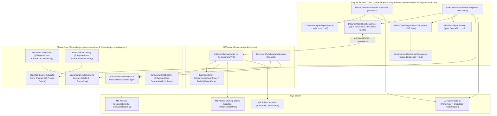

# MemberJunction Docs, Slides, and Sheets Architecture Guide

This guide documents the shared real-time collaboration core, viewer-scoped live MJ blocks, "MS OLE" inline artifact embedding, server-side agent tool libraries (`BaseArtifactToolLibrary`), the collaborative **MJ Docs** editor (Wave 1), and the **MJ Slides** presentation deck editor & OpenXML `.pptx` exporter (Wave 2) implemented per [plans/docs-slides-sheets.md](../plans/docs-slides-sheets.md).

---

## 1. Architectural Overview

---

## 2. Schema & Metadata Foundation (§ 3.1, `O1`, `O2`, `O4`)

1. **`MJ: Artifact Working States` (`__mj.ArtifactWorkingState`)**:
   - Stores transient binary Yjs CRDT state vectors (`YjsState VARBINARY(MAX)`) between immutable `MJ: Artifact Versions` checkpoints.
   - Indexed with a unique constraint `UQ_ArtifactWorkingState_ArtifactID` on `ArtifactID`.
2. **Delegated Host Entity Permissions (`MJ: Artifacts.DelegateEntityID` + `DelegateRecordID`, `O4`)**:
   - Polymorphic foreign key pair decorated with `EntityField.EntityIDFieldName = "DelegateEntityID"` in `metadata/entities/.polymorphic-fk-entity-fields.json`.
   - Evaluated via `ArtifactPermissionEngine.Instance.ResolvePermissions(provider, artifactId, user)` and `IArtifactPermissionDelegate` (`@RegisterClass(BaseArtifactPermissionDelegate, '<EntityName>')`).
   - Built-in `ParentArtifactPermissionDelegate` (`@RegisterClass(BaseArtifactPermissionDelegate, 'MJ: Artifacts')`) allows inline OLE child artifacts (such as an embedded Whiteboard created via `/whiteboard`) to inherit permissions directly from their host Document artifact.
3. **Artifact Type Metadata (`metadata/artifact-types/.artifact-types.json`, `O1`)**:
   - `"Markdown Document"` -> `DriverClass: "MarkdownArtifactViewerPlugin"`, `ToolLibraryClass: "DocumentToolLibrary"`.
   - `"Whiteboard"` -> `DriverClass: "WhiteboardArtifactViewerPlugin"`, `ToolLibraryClass: "WhiteboardToolLibrary"`.
   - `"Presentation"` -> `DriverClass: "SlideDeckArtifactViewerPlugin"`, `ToolLibraryClass: "SlideDeckToolLibrary"`.
   - `"Excel Spreadsheet"` -> `DriverClass: "SpreadsheetArtifactViewerPlugin"`, `ToolLibraryClass: "SpreadsheetToolLibrary"`.

---

## 3. Real-Time Collaboration Service (`ArtifactCollaborationServer`, § 3.2, `O2`, `O3`)

Located in `packages/MJServer/src/collaboration/`:
- **`ArtifactCollaborationServer.ts`**:
  - Handles WebSocket upgrades on `/collaboration/yjs?artifactId=<uuid>`.
  - Authenticates the connecting user via `getUserPayload` and verifies `CanRead` / `CanEdit` via `ArtifactPermissionEngine`.
  - Hydrates room state from `MJ: Artifact Working States.YjsState` (or initializes `Y.Text('content')` from the latest `MJ: Artifact Versions.Content`).
  - Enforces read-only access at the binary frame layer: any `syncStep2` or `update` write frame sent by a client with `CanEdit === false` is dropped before mutating `room.Doc`, returning a `YJS_MESSAGE_CONTROL` (`readonly-rejected`) frame.
  - Subscribes to `ArtifactPermissionEngine.Instance.OnPermissionsChanged` to immediately downgrade active editors to read-only (`YJS_MESSAGE_PERMISSION_STATUS` with `canEdit: false`) or close sockets (`4403`) when `CanRead` is revoked mid-session.
  - Periodically checkpoints binary updates to `MJ: Artifact Working States` and compacts into a new `MJ: Artifact Versions` record on explicit save, last-client disconnect, or server-side agent tool execution.
- **`YjsRoomRelay.ts` (`O3`)**:
  - `IYjsRoomRelay` interface with `InMemoryYjsRoomRelay` (default) and `RedisYjsRoomRelay` (using `RedisLocalStorageProvider.SubscribeToChannel` / `PublishMessageAndWait` on `yjs:room:<artifactId>`).

---

## 4. Viewer-Scoped Live MJ Blocks & Freeze Semantics (`DocumentLiveBlockEngine`, § 3.4, `O5`)

Located in `packages/MJCoreEntities/src/custom/DocumentLiveBlockEngine.ts`:
- Parses and serializes fenced `:::mj-block` directives inside Markdown documents.
- Supports `EntityView`, `SavedQuery`, `DashboardPart`, `InteractiveComponent`, and `Artifact` block kinds.
- **Viewer-Scoped Security**:
  - Executes `RunView` and `RunQuery` using the viewing user's `UserInfo`.
  - Strips any parameter whose metadata declares `IsServerSet === true` (or matches server-only parameter prefixes) before execution so untrusted block JSON can never override server-bound security parameters.
  - Projects output columns through Field-Level Security (`CanUserViewField`) so restricted fields are never leaked.
- **Explicit `Live` vs. `Frozen` Mode (`O5`)**:
  - Blocks default to `Mode: "Live"`.
  - Freezing a block requires `acknowledgeSecurityWarning === true` (enforced both in `MarkdownArtifactViewerComponent`'s confirmation modal and in `DocumentLiveBlockEngine.FreezeBlock`), recording `FrozenAt`, `FrozenByUserID`, and `FrozenByUserName` provenance metadata.

---

## 5. "MS OLE" Inline Artifact Blocks & Whiteboard Inline Editing (§ 3.4.1 / D12)

- `BaseArtifactViewerPluginComponent` (`@memberjunction/ng-artifacts`) exposes:
  - `SupportsInlineEdit: boolean` (default `false`)
  - `@Output() ContentCommitted = new EventEmitter<string>()`
- `WhiteboardArtifactViewerComponent` (`@memberjunction/ng-conversations`) sets `SupportsInlineEdit = true`.
  - When `[readonly]="true"`, it renders `<mj-whiteboard-snapshot>`.
  - When `[readonly]="false"` (toggled via **Edit Inline (OLE Canvas)** inside a Document or in the Artifact Viewer Panel), it mounts `<mj-realtime-whiteboard-host [State]="EditableBoardState" [ShowFocusToggle]="false">` and emits `ContentCommitted` with `state.ToJSON()`.

---

## 6. Server-Side Agent Tool Libraries (`BaseArtifactToolLibrary`, § 3.6)

Located in `packages/AI/Agents/src/artifact-tools/`:
- **`DocumentToolLibrary`** (`@RegisterClass(BaseArtifactToolLibrary, 'DocumentToolLibrary')`):
  - Inspection tools: `get_outline`, `get_section`, `get_blocks`, `search_blocks`, `grep`, `get_lines`.
  - Mutation tools (with optional `expectedRevisionHash` SHA-256 optimistic concurrency check): `insert_block_after`, `replace_block`, `delete_block`, `upsert_table`, `insert_live_block`, `embed_artifact_block`, `propose_suggestion`.
- **`WhiteboardToolLibrary`** (`@RegisterClass(BaseArtifactToolLibrary, 'WhiteboardToolLibrary')`):
  - Inspection & layout tools: `get_board_summary`, `list_elements`, `upsert_nodes`, `connect_nodes`, `add_sticky_notes`, `delete_elements`, `auto_layout`.
- **`SlideDeckToolLibrary`** (`@RegisterClass(BaseArtifactToolLibrary, 'SlideDeckToolLibrary')`):
  - Inspection tools: `read_deck`, `get_deck_outline`, `get_slide`.
  - Mutation tools: `add_slide`, `update_slide`, `delete_slide`, `reorder_slides`, `upsert_slide_element`, `update_slide_region`, `delete_slide_element`, `update_speaker_notes`, `apply_theme`, `generate_deck_from_markdown`.

---

## 7. MJ Slides — Presentation Deck Architecture (Wave 2, § 5)

### 7.1 `SlideDeckSpec` & `SlideDeckEngine` (`@memberjunction/core-entities`)

Located in `packages/MJCoreEntities/src/custom/SlideDeckEngine.ts`:
- **Canonical Slide Layouts (11 supported layouts)**:
  - `Title`, `SectionHeader`, `TitleAndBody`, `TwoColumn`, `Comparison`, `LiveDataSlide`, `ChartAndText`, `BigNumber`, `Quote`, `FullBleedImage`, and `Blank`.
- **Theme Engine & Brand Color Seed Derivation (`Accept #4`)**:
  - `SLIDE_DECK_THEME_PRESETS` provides 4 built-in themes (`mj-corporate-light`, `mj-executive-dark`, `mj-emerald-growth`, `mj-sunset-strategy`).
  - `SlideDeckEngine.Instance.DeriveThemeFromBrandSeeds(seeds)` deterministically derives a high-contrast slide theme (surface, elevated card, primary/secondary text, accent badges, borders, and font stacks) from an organization's brand color seeds (`PrimaryColor`, `SecondaryColor`, `AccentColor`, `DarkMode`) and applies it across every slide via `ApplyTheme`.
- **"Make a Deck from This Doc" (`ConvertMarkdownToSlideDeck`, § 5.2)**:
  - Converts Markdown documents (headings, bullet lists, callouts, and `:::mj-block` directives) into a structured multi-slide `SlideDeckSpec`, preserving live MJ blocks (`EntityView`, `SavedQuery`, `DashboardPart`, `InteractiveComponent`) and embedded `Artifact` blocks (`Whiteboard`) as live slide regions.
- **Presentation Mode Automatic Live-Block Freeze (`O6` & `Accept #2`)**:
  - `SlideDeckEngine.Instance.FreezeDeckLiveBlocksForPresentation(deck, user, executionSnapshots)` freezes all live MJ blocks across the deck when entering `Present` / `Presenter View` (or exporting `.pptx`), stamping `FrozenAt`, `FrozenByUserID`, and `FrozenByUserName` so live presentations never flicker or fail mid-talk while supporting one-click **Refresh Live Data**.

### 7.2 Per-Slide Yjs CRDT Room Synchronization (`Accept #1`)

- Both `ArtifactCollaborationServer` (`@memberjunction/server`) and `DocumentCollaborationSession` (`@memberjunction/ng-artifacts`) synchronize `SlideDeckSpec` decks using structured Yjs shared types alongside `Y.Text('content')`:
  - `doc.getMap('deckMeta')`: Deck title, subtitle, aspect ratio, theme JSON, and master header/footer settings.
  - `doc.getMap('slidesById')`: Keyed by `SlideID`, storing each slide's serialized `SlideSpec` independently.
  - `doc.getArray('slideOrder')`: Ordered list of `SlideID` strings.
- **Conflict-Free Co-Editing**:
  - When User A edits Slide 1 (`slidesById.set(slide1Id, ...)`), User B edits Slide 2 (`slidesById.set(slide2Id, ...)`), and User A reorders slides in the filmstrip (`slideOrder`), Yjs merges all operations with zero data loss or last-writer-wins clobbering.

### 7.3 Angular Slides Editor & OpenXML `.pptx` Exporter (`@memberjunction/ng-artifacts`)

- **`SlideDeckArtifactViewerComponent` (`@RegisterClass(BaseArtifactViewerPluginComponent, 'SlideDeckArtifactViewerPlugin')`)**:
  - 16:9 widescreen visual slide stage with CSS custom property bindings derived from `Deck.Theme`.
  - Left filmstrip sorter rail (`add`, `duplicate`, `move up/down`, `delete`) with per-slide awareness badges and comment counters.
  - In-place `contenteditable` editing for slide titles, subtitles, rich-text regions, callouts, big-number metrics, and speaker notes.
  - Live MJ Block region execution via `DocumentLiveBlockEngine` with viewer RLS/FLS, `O5` freeze warning modal, and inline OLE `Whiteboard` canvas editing (`<mj-artifact-type-plugin-viewer>` -> `<mj-realtime-whiteboard-host>`).
  - Full-screen **Presenter View** (`O6`) with elapsed timer, speaker notes, slide navigation, automatic live-block freeze, and one-click **Refresh Live Data**.
  - Anchored `SlideRegion` comment threads (`AnchorType = 'SlideRegion'`) with `@SlidesAgent` invocation that mutates only the targeted slide (`Accept #3`).
- **`SlideDeckExportService`**:
  - `ExportToPptxPackage(deck, user, executionSnapshots)`: Generates a standards-compliant OpenXML `.pptx` PKZIP archive (`PK\x03\x04`) containing `[Content_Types].xml`, `ppt/presentation.xml`, `ppt/theme/theme1.xml`, `ppt/slides/slide1..N.xml` (with editable `<p:sp>` `<a:t>` text runs and native DrawingML `<a:tbl>` tables for frozen live block rows per `Accept #2`), and `ppt/notesSlides/notesSlide1..N.xml` (preserving speaker notes per `Accept #5`).
  - `BuildPrintableDeckHtml(deck, executionSnapshots)`: Generates a 16:9 widescreen `@page { size: 13.333in 7.5in; }` HTML document for `.pdf` export.
