# MemberJunction Docs, Slides, Sheets, Version Compare & Library Architecture Guide

This guide is the canonical architectural reference for MemberJunction's collaborative productivity and workspace stack:

- **Real-Time Yjs CRDT Collaboration Core** (`MJ: Artifact Working States`, `ArtifactCollaborationServer`, `InMemoryYjsRoomRelay` / `RedisYjsRoomRelay`, and delegated permission enforcement via `ArtifactPermissionEngine`)
- **Viewer-Scoped Live MJ Blocks & MS OLE Inline Artifacts** (`DocumentLiveBlockEngine`, `O5` freeze confirmation, and inline `Whiteboard` / cross-artifact `Sheet` chart embedding)
- **MJ Docs (`Markdown Document`)** with progressive-disclosure formatting chrome, two-tier **Word-Level Suggesting Redlines**, anchored `DocBlock` comments, and `.md` / `.docx` / `.pdf` import/export
- **MJ Slides (`Presentation`)** with 11 structured 16:9 layouts, per-slide Yjs CRDT co-editing, Organization Brand Color Seed theme derivation, `O6` Presenter View freeze, and standards-compliant OpenXML `.pptx` export
- **MJ Sheets (`Excel Spreadsheet`)** with stable `RowID`/`ColumnID` formula compilation (`@RANGE`), headless 35+ function evaluator, viewer-scoped `=MJ.QUERY` / `=MJ.VIEW` & bound Live Tables, `.xlsx` OpenXML round-trip, and Microsoft Excel Add-In custom functions
- **Git-Style Visual Version Compare (`<mj-artifact-version-compare>`)** across Documents, Spreadsheets, Presentations, Interactive `ComponentSpec` artifacts, SQL Queries, and structured JSON/text
- **Top-Level `Library` Application & Stateless Connected Cloud Drives** (`Hub` + `Power Navigator` + `Full-Canvas Studio`, 7 AI Agent Client Tools, zero-`MJ: Files` remote drive browsing, and `Chat` **`Agent Activity`** scoping)

---

## 1. End-to-End System Architecture

```mermaid
flowchart TD
    subgraph Explorer["MJ Explorer & Workspace Applications (@memberjunction/ng-explorer-core & @memberjunction/ng-conversations)"]
        LibApp["LibraryResource + LibraryWorkspaceComponent (Hub | Navigator | Full-Canvas Studio)"]
        RemoteDrive["LibraryRemoteDrivePaneComponent (Stateless Zero-MJ:Files Cloud Drives)"]
        ChatAct["ChatTasksResource ('Agent Activity' — Agent/Conversation Scoped)"]
    end

    subgraph Browser["Artifact Viewers, Collaboration & Diff (@memberjunction/ng-artifacts & @memberjunction/ng-conversations)"]
        Panel["ArtifactViewerPanelComponent (Toolbar, Save to Collection, Compare)"]
        VerComp["ArtifactVersionCompareComponent (Visual | JSON-Tree | Unified | Split)"]
        Docs["MarkdownArtifactViewerComponent (MJ Docs + Word-Level Redlines)"]
        Slides["SlideDeckArtifactViewerComponent (MJ Slides 16:9 Studio + Presenter)"]
        Sheets["SpreadsheetArtifactViewerComponent (MJ Sheets Multi-Tab Workbook)"]
        CollabSvc["DocumentCollaborationService (Yjs CRDT + Awareness)"]
        PluginHost["ArtifactTypePluginViewerComponent (MS OLE Host)"]
        WbPlugin["WhiteboardArtifactViewerComponent (SupportsInlineEdit = true)"]
    end

    subgraph Server["MJServer (@memberjunction/server)"]
        CollabSrv["ArtifactCollaborationServer (/collaboration/yjs)"]
        Relay["IYjsRoomRelay (InMemoryYjsRoomRelay | RedisYjsRoomRelay)"]
        GqlRes["DocumentCollaborationResolver (GraphQL)"]
        FileRes["ArtifactFileResolver (ArtifactPermissionEngine + FileStorageEngine Gate)"]
    end

    subgraph Core["Shared Engines & Agent Tool Libraries (@memberjunction/core-entities & @memberjunction/ai-agents)"]
        PermEng["ArtifactPermissionEngine + ParentArtifactPermissionDelegate (O4)"]
        LiveEng["DocumentLiveBlockEngine (Viewer RLS/FLS + IsServerSet Strip + O5 Freeze)"]
        SlideEng["SlideDeckEngine (Layouts, Brand Themes, O6 Freeze, Markdown-to-Deck)"]
        SheetEng["SpreadsheetEngine (Stable IDs, Headless Formulas, =MJ.VIEW/=MJ.QUERY, .xlsx)"]
        Tools["DocumentToolLibrary | SlideDeckToolLibrary | SpreadsheetToolLibrary | WhiteboardToolLibrary"]
    end

    subgraph Database["SQL Server / PostgreSQL + MJStorage"]
        Art["MJ: Artifacts (DelegateEntityID, DelegateRecordID)"]
        Ver["MJ: Artifact Versions (Immutable Version Checkpoints)"]
        Work["MJ: Artifact Working States (YjsState VARBINARY(MAX))"]
        Conv["MJ: Conversations (AnchorType = DocBlock | SlideRegion | SheetRange)"]
        Cloud["External Cloud Drives (GDrive, SharePoint/OneDrive, Dropbox, Box, S3, Azure)"]
    end

    LibApp --> Panel
    LibApp --> RemoteDrive
    RemoteDrive <-->|"GraphQLFileStorageClient (No MJ: Files rows)"| Cloud
    Panel --> VerComp
    Panel --> Docs
    Panel --> Slides
    Panel --> Sheets
    Docs & Slides & Sheets --> CollabSvc
    Docs & Slides & Sheets --> PluginHost
    PluginHost --> WbPlugin
    CollabSvc <-->|"y-protocols/sync + awareness"| CollabSrv
    CollabSrv <--> Relay
    CollabSrv --> PermEng
    CollabSrv --> Work
    CollabSrv --> Ver
    GqlRes --> LiveEng
    FileRes --> PermEng
    Tools --> LiveEng & SlideEng & SheetEng
    PermEng --> Art
    Docs & Slides & Sheets --> Conv
```

---

## 2. Schema & Metadata Foundation (`O1`, `O2`, `O4`)

1. **`MJ: Artifact Working States` (`__mj.ArtifactWorkingState`)**:
   - Stores active compacted binary Yjs CRDT state vectors (`YjsState VARBINARY(MAX)`, exposed as base64 on `MJArtifactWorkingStateEntity`) in a strict 1:1 relationship (`UQ_ArtifactWorkingState_ArtifactID` with `ON DELETE CASCADE` to `MJ: Artifacts`).
   - Locked down as a server-internal entity (`IncludeInAPI = 0`, `TrackRecordChanges = 0`, no `UI` role permissions); persisted strictly via `ArtifactCollaborationServer` under the server system user (`LastModifiedByUserID` recording the editing user).
   - Separates high-frequency real-time keystroke/cell/slide synchronization from clean, human-meaningful `MJ: Artifact Versions` checkpoints.
2. **Delegated Host Entity Permissions (`MJ: Artifacts.DelegateEntityID` + `DelegateRecordID`, `O4`)**:
   - Enforced physically by `CK_Artifact_DelegateBinding` (both columns `NULL` or both `NOT NULL`), guarded server-side by `MJArtifactEntityServer` (owner-only updates, self-delegation prevention, and mandatory `CanEdit` verification on the target delegate record), and decorated with `EntityField.EntityIDFieldName = "DelegateEntityID"` in `metadata/entities/.polymorphic-fk-entity-fields.json`.
   - Evaluated via `ArtifactPermissionEngine.Instance.ResolvePermissions(provider, artifactId, user)` and `IArtifactPermissionDelegate` (`@RegisterClass(BaseArtifactPermissionDelegate, '<EntityName>')`), with cycle detection and `MAX_DELEGATE_DEPTH = 8`.
   - Built-in `ParentArtifactPermissionDelegate` (`@RegisterClass(BaseArtifactPermissionDelegate, 'MJ: Artifacts')`) cascades read/edit/delete/share decisions from a host Document, Slide Deck, or Spreadsheet to inline OLE child artifacts (such as an embedded Whiteboard created via `/whiteboard`) without duplicating permission rows.
3. **Artifact Type Metadata (`metadata/artifact-types/.artifact-types.json`, `O1`)**:

   | Artifact Type | `ContentType` | Viewer Plugin (`DriverClass`) | Agent Tool Library (`ToolLibraryClass`) |
   |---|---|---|---|
   | `Markdown Document` | `text/markdown` | `MarkdownArtifactViewerPlugin` | `DocumentToolLibrary` |
   | `Presentation` | `application/vnd.mj.presentation+json` | `SlideDeckArtifactViewerPlugin` | `SlideDeckToolLibrary` |
   | `Excel Spreadsheet` | `application/vnd.openxmlformats-officedocument.spreadsheetml.sheet` | `SpreadsheetArtifactViewerPlugin` | `SpreadsheetToolLibrary` |
   | `Whiteboard` | `application/json` | `WhiteboardArtifactViewerPlugin` | `WhiteboardToolLibrary` |

---

## 3. Real-Time Yjs Collaboration Service (`ArtifactCollaborationServer`, `O2`, `O3`)

Located in `packages/MJServer/src/collaboration/`:

- **Why Yjs Is Built Into `@memberjunction/server`**:
  - GraphQL request/response mutations cannot merge concurrent character, cell, or slide edits without lock contention or last-writer-wins overwrites. Yjs provides mathematically deterministic CRDT convergence (the same foundation used by **JupyterLab**, **Affine**, **Nextcloud Text**, **BlockSuite**, and **Hocuspocus/TipTap**) over a lightweight binary WebSocket endpoint mounted directly on MJServer's HTTP upgrade pipeline.
- **`ArtifactCollaborationServer.ts`**:
  - Handles WebSocket upgrades on `ApiRoute('/collaboration/yjs')` (`?artifactId=<uuid>&ticket=<nonce>`).
  - Authenticates browser connections via single-use short-lived tickets minted by `DocumentCollaborationResolver.MintArtifactCollaborationTicket` (with `Origin` validation, `APIKeyEngine` `artifact:read`/`artifact:edit` scope checks, and exponential-backoff client reconnection in `DocumentCollaborationService`).
  - Hydrates room state from `MJ: Artifact Working States.YjsState` (or seeds `Y.Text('content')` and structured maps from the latest `MJ: Artifact Versions.Content`).
  - **Binary Frame Read-Only Enforcement**: Any `syncStep2` or `update` write frame sent by a client with `CanEdit === false` is dropped before mutating `room.Doc`, returning a `YJS_MESSAGE_CONTROL` (`readonly-rejected`) frame while still allowing live cursor/selection awareness.
  - **Mid-Session Permission Revocation**: Subscribes to `ArtifactPermissionEngine.Instance.OnPermissionsChanged` to immediately downgrade active editors (`YJS_MESSAGE_PERMISSION_STATUS` with `canEdit: false`) or close sockets (`4403`) when `CanRead` is revoked.
  - **Checkpointing & Compaction**: Debounces binary checkpoints to `MJ: Artifact Working States` during active sessions and compacts into an immutable `MJ: Artifact Versions` record on explicit checkpoint save, last-client disconnect, or server-side agent tool mutation.
- **Multi-Instance Horizontal Scaling (`YjsRoomRelay.ts`, `O3`)**:
  - `IYjsRoomRelay` abstracts room fan-out behind `InMemoryYjsRoomRelay` (single-node default) and `RedisYjsRoomRelay` (broadcasting binary CRDT & awareness frames across MJAPI cluster nodes on `yjs:room:<artifactId>`).
  - **Multi-Instance Deployment & Ticket Verification**: Tickets minted by `MintArtifactCollaborationTicket` are statelessly verifiable across cluster instances via HMAC-SHA256 signatures paired with single-use nonce consumption and Redis PubSub replay protection, so a WebSocket upgrade can land on any MJAPI instance even before sticky-session affinity is established. In multi-node production deployments, configuring WebSocket sticky sessions (e.g., load-balancer affinity on `?artifactId=<uuid>`) is recommended to minimize cross-node Redis relay chatter while `RedisYjsRoomRelay` guarantees full CRDT convergence across nodes.

---

## 4. Viewer-Scoped Live MJ Blocks & Freeze Semantics (`DocumentLiveBlockEngine`, `O5`)

Located in `packages/MJCoreEntities/src/custom/DocumentLiveBlockEngine.ts`:

- Parses and serializes fenced `:::mj-block` directives across Markdown documents, Slide regions, and Sheet references.
- Registers 5 `BaseDocumentBlock` handlers: `EntityView`, `SavedQuery`, `DashboardPart`, `InteractiveComponent`, and `Artifact`.
- **Zero-Trust Viewer-Scoped Execution**:
  - Executes `RunView` and `RunQuery` strictly under the **viewing user's** `UserInfo` (never the document author's credentials).
  - Strips any parameter whose query metadata declares `IsServerSet === true` or matches `SERVER_ONLY_RUN_QUERY_PARAMS` (`StripServerOnlyRunQueryParams`) so untrusted block JSON can never spoof tenant or identity parameters.
  - Projects output columns and rows through Field-Level Security (`ProjectEntityValueRowsForUser`) so restricted columns are omitted from both `Columns` and `Rows`.
- **Explicit `Live` vs. `Frozen` Governance & HMAC-SHA256 Signature Verification (`O5`, `B7`)**:
  - Blocks default to `Mode: 'Live'`.
  - Converting a block to `Mode: 'Frozen'` bakes the freezing user's visible rows into the shared artifact payload. Therefore, `DocumentLiveBlockEngine.FreezeBlock` fails closed unless `acknowledgeSecurityWarning === true` (paired with a confirmation modal in the UI), stamping `FrozenAt`, `FrozenByUserID`, `FrozenByUserName`, `SecurityWarningAcknowledged: true`, and a server-side HMAC-SHA256 signature (`SnapshotContentHash: 'hmac-sha256:<hex>'` computed via `ComputeFrozenSnapshotHash` over the canonical snapshot payload including `FrozenByUserName`).
  - On evaluation (`ExecuteBlock` / `ValidateFrozenBlockSnapshot`), any frozen snapshot with `SecurityWarningAcknowledged !== true` is rejected, and any snapshot whose `SnapshotContentHash` is missing, uses a plain unkeyed SHA-256 hash, or fails HMAC verification (e.g., tampered rows or spoofed `FrozenByUserName`) sets `SnapshotVerified = false` and renders an explicit **Unverified Snapshot** warning badge in the UI instead of a trusted freeze attribution badge.

---

## 5. "MS OLE" Inline Artifact Blocks & Whiteboard Inline Editing

- `BaseArtifactViewerPluginComponent` (`@memberjunction/ng-artifacts`) exposes:
  - `SupportsInlineEdit: boolean` (default `false`)
  - `@Output() ContentCommitted = new EventEmitter<string>()`
- `WhiteboardArtifactViewerComponent` (`@memberjunction/ng-conversations`) sets `SupportsInlineEdit = true`:
  - When `[readonly]="true"`, renders a lightweight `<mj-whiteboard-snapshot>`.
  - When `[readonly]="false"` (toggled via **Edit Inline (OLE Canvas)** inside a Document, Slide, or Sheet), mounts `<mj-realtime-whiteboard-host [State]="EditableBoardState" [ShowFocusToggle]="false">` directly in place and commits serialized JSON changes via `ContentCommitted`.
  - Inline child artifacts automatically set `DelegateEntityID` (`MJ: Artifacts`) and `DelegateRecordID` (`hostArtifact.ID`) so permissions stay in lockstep with the host document.

---

## 6. Server-Side Agent Tool Libraries (`BaseArtifactToolLibrary`)

Located in `packages/AI/Agents/src/artifact-tools/`, all 4 tool libraries register on `MJGlobal.Instance.ClassFactory` under `BaseArtifactToolLibrary` and support SHA-256 `expectedRevisionHash` optimistic concurrency so agents never overwrite concurrent human edits:

| Class | Registered Key | Capabilities |
|---|---|---|
| `DocumentToolLibrary` | `'DocumentToolLibrary'` | `get_outline`, `get_section`, `get_blocks`, `search_blocks`, `grep`, `get_lines`, `insert_block_after`, `replace_block`, `delete_block`, `upsert_table`, `insert_live_block`, `embed_artifact_block`, `propose_suggestion` |
| `SlideDeckToolLibrary` | `'SlideDeckToolLibrary'` | `read_deck`, `get_deck_outline`, `get_slide`, `add_slide`, `update_slide`, `delete_slide`, `reorder_slides`, `upsert_slide_element`, `update_slide_region`, `delete_slide_element`, `update_speaker_notes`, `apply_theme`, `generate_deck_from_markdown` |
| `SpreadsheetToolLibrary` | `'SpreadsheetToolLibrary'` | `get_workbook_summary`, `read_range`, `write_cells`, `evaluate_formula`, `insert_rows`, `delete_rows`, `add_worksheet`, `bind_live_table`, `add_chart`, `export_xlsx_base64`, `import_xlsx_base64` |
| `WhiteboardToolLibrary` | `'WhiteboardToolLibrary'` | `get_board_summary`, `list_elements`, `upsert_nodes`, `connect_nodes`, `add_sticky_notes`, `delete_elements`, `auto_layout` |

---

## 7. MJ Slides — Collaborative Presentation Studio

- **`SlideDeckEngine` (`packages/MJCoreEntities/src/custom/SlideDeckEngine.ts`)**:
  - **11 Canonical 16:9 Layouts**: `Title`, `SectionHeader`, `TitleAndBody`, `TwoColumn`, `Comparison`, `LiveDataSlide`, `ChartAndText`, `BigNumber`, `Quote`, `FullBleedImage`, and `Blank`.
  - **Organization Brand Color Seeds (`DeriveThemeFromBrandSeeds`)**: Deterministically computes WCAG-conscious background, elevated surface, primary/muted foreground text, and accent tokens from brand seed colors, alongside 4 curated presets (`SLIDE_DECK_THEME_PRESETS`).
  - **"Make a Deck from This Doc" (`ConvertMarkdownToSlideDeck`)**: Transforms Markdown headings, bullets, speaker notes (`> Speaker Notes: ...`), and live `:::mj-block` directives into a multi-slide presentation while keeping live data blocks and OLE Whiteboards interactive.
  - **Presenter Mode Freeze (`O6` — `FreezeDeckLiveBlocksForPresentation`)**: Freezes live blocks when entering full-screen Presenter View or exporting `.pptx` so presentations never flicker mid-talk, with one-click **Refresh Live Data**.
- **Per-Slide Yjs CRDT Synchronization**:
  - Synchronizes `deckMeta` (`Y.Map`), `slidesById` (`Y.Map` keyed by `SlideID`), and `slideOrder` (`Y.Array`) so concurrent edits to different slides and filmstrip reorders merge cleanly without clobbering.
- **OpenXML `.pptx` & `.pdf` Export (`SlideDeckExportService`)**:
  - Produces standards-compliant `.pptx` archives (`ppt/presentation.xml`, `ppt/slides/slide1..N.xml`, DrawingML `<a:tbl>` tables for frozen live blocks, and `ppt/notesSlides/notesSlide1..N.xml` speaker notes) plus 16:9 print-ready HTML/PDF output.

---

## 8. MJ Sheets & Excel Custom Functions (`=MJ.QUERY`, `=MJ.VIEW`)

- **`SpreadsheetEngine` (`packages/MJCoreEntities/src/custom/SpreadsheetEngine.ts`)**:
  - **Stable Row/Column ID Formula Compilation**: Compiles A1 formulas (`=SUM(B2:B5)`) into immutable `RowID`/`ColumnID` tokens (`@CELL(...)`, `@RANGE(...)`) stored in `FormulaStable`. When collaborators insert or delete rows/columns concurrently over Yjs (`worksheetsById` + `sheetCellsByCoord`), `ResolveFormulaFromStableIds` deterministically reconstructs shifted A1 coordinates (`=SUM(B3:B6)`).
  - **Headless 35+ Function Evaluator**: Evaluates math, logical, conditional (`SUMIF`, `COUNTIF`, `AVERAGEIF`), lookup (`VLOOKUP`, `XLOOKUP`, `INDEX`, `MATCH`), text, date, and financial (`NPV`, `PMT`) formulas, cross-sheet references (`'Rates'!B2`), and named ranges with `#CYCLE!` detection and O(dirty-subgraph) topological DAG recalculation (`~10ms` for a 10k-formula dirty subgraph).
  - **Viewer-Scoped `=MJ.QUERY` / `=MJ.VIEW` & Bound Live Tables**: Enforces viewer RLS + FLS, strips `IsServerSet` parameters, rejects raw SQL injection tokens in filter strings (`#MJ_ACCESS_DENIED!`), caches per-viewer results for 60 seconds, and auto-fills `CalculatedColumns` (`=ROUND(B{ROW}*1.03, 2)`).
  - **Isomorphic `.xlsx` OpenXML Round-Trip**: `ExportToXlsxBytes` and `ImportFromXlsxBytes` (with RFC 1951 DEFLATE support for Excel / `exceljs` workbooks) preserve `<f>` formulas, currency/percent/date `numFmt` styles, column widths, and hidden `_mj_sheets_meta` workbook state.
  - **Cross-Artifact Live Range Charts**: `ExtractChartDataset` feeds live Sheet charts directly into MJ Slides and MJ Docs `Artifact` blocks.
- **Microsoft Excel Add-In (`packages/OfficeAddins/Excel`)**:
  - Ships `MJ.QUERY` and `MJ.VIEW` custom functions with matching viewer-scoped security, 60s TTL caching, concurrency throttling, and 2D spill matrix projection.

---

## 9. Word-Level Redline Diff & Suggesting Mode (`MarkdownArtifactViewerComponent`)

MJ Docs implements a **two-tier Suggesting Mode** modeled directly on Google Docs Suggesting and Microsoft Word Track Changes:

1. **Tier 1 — Logical Block Alignment**:
   - Aligns paragraphs, headings, lists, tables, code fences, and `:::mj-block` directives between the baseline Markdown and suggested edits (whether typed interactively in **Suggesting** mode or proposed by `@DocsAgent` via `DocumentToolLibrary.propose_suggestion` with rationale metadata).
2. **Tier 2 — Sub-Paragraph Myers Word & Punctuation Diffing (`computeWordDiffSpans`)**:
   - Whenever a modified block shares prose with its baseline (similarity threshold check rather than whole-block replacement), MJ Docs tokenizes both strings into word, whitespace, and punctuation tokens and computes the shortest Myers edit script.
   - Unchanged words render in normal document prose; only the exact deleted words render as inline red strikethrough (`<del class="mj-doc-redline-del">`) and inserted words render as inline green underline/pill (`<ins class="mj-doc-redline-ins">`).
   - **Granular Per-Hunk & Batch Review**: Reviewers can **Accept** or **Reject** individual word/phrase hunks inline, accept/reject an entire suggestion card (including `@DocsAgent` rationale), or run **Accept All** / **Reject All** across the document.

---

## 10. Git-Style Visual Version Compare (`<mj-artifact-version-compare>`)

Located in `packages/Angular/Generic/artifacts/src/lib/components/version-diff/` and powered by `ArtifactVersionDiffService` (`artifact-version-diff.service.ts`), `<mj-artifact-version-compare>` brings Git-grade version comparison directly into `ArtifactViewerPanelComponent` (accessible from both the **Compare** toolbar button and any entry in the Version History drawer):

- **Unified Compare Chrome**:
  - **Base (`vA`) <-> Target (`vB`) Selectors** with `(HEAD)` labeling, one-click **Swap (`⇄`)**, collapsible **Commit History Timeline Rail** (`fa-code-branch`), `+N / -M / ~K` change summary badges, and mode switching across **Visual**, **JSON Tree**, **Unified**, and **Side-by-Side (Split)** views.
- **6 Specialized Visual Diff Renderers**:
  1. **`DocsVersionDiffComponent` (`Markdown Document`)**: Visual rendered document redline with inline Myers word-level `<del>`/`<ins>` spans, plus raw Markdown line-diff toggle.
  2. **`SpreadsheetVersionDiffComponent` (`Excel Spreadsheet`)**: Worksheet tab pills with change counts and a visual coordinate grid highlighting **Added** cells (green), **Removed** cells (red), **Formula Changed** cells (indigo `oldFormula -> newFormula` + computed value delta), and **Value Changed** cells (amber `old -> new`).
  3. **`SlidesVersionDiffComponent` (`Presentation`)**: Side-by-side 16:9 slide diff cards classifying each slide as `Added`, `Removed`, `Modified`, `Moved`, or `Unchanged`, highlighting title, layout, region Markdown, and speaker note deltas.
  4. **`ComponentVersionDiffComponent` (`Component`)**: Structured `ComponentSpec` inspector comparing root properties (`title`, `functionalRequirements`, `technicalDesign`), `dataRequirements` entities/queries, child components, library dependencies, and unified source-code diffs.
  5. **`QueryVersionDiffComponent` (`SQL` / `Query`)**: Syntax-aware SQL line and intra-line token diff.
  6. **Universal Semantic JSON Tree & Text Diff (`GitDiffLinesViewComponent`)**: Recursive key-path diff (`added`, `removed`, `changed`) for arbitrary JSON artifacts plus Myers unified/split line diff for code, HTML, SVG, and plain text.

---

## 11. Top-Level `Library` Application, Stateless Connected Drives & Scoped `Agent Activity`

### 11.1 Top-Bar Pinned `Library` Application (`LibraryResource` & `<mj-library-workspace>`)

- **Application Metadata (`metadata/applications/.library-application.json`)**:
  - Dedicated top-level **`Library`** application (`ID: DB6B9D62-CB8E-417D-8A04-4CBC5F65CD9A`, `Icon: fa-solid fa-book-open`, `DefaultForNewUser: true`, `NavigationStyle: Both`, `TopNavLocation: Left of User Menu`, `DefaultSequence: 2` directly beside `Chat`), while preserving `File Browser` (`EB07016C-AE35-4EF9-804B-91563529A08A`) intact. Existing users are provisioned via an idempotent migration step, while new users receive `Library` automatically via `DefaultForNewUser: true`.
- **3 Progressive Workspace Modes (`LibraryWorkspaceComponent`)**:
  1. **Hub Mode** (default landing): *Create New* quick-launch strip (`Blank Document`, `Blank Spreadsheet`, `Blank Presentation`, `New Collection`, `Upload File` via `LibraryCreationService`), *Continue Working* recent items, curated *Collections*, and *Connected Cloud Drives* overview cards.
  2. **Power Navigator Mode**: Split-pane hierarchy with nested `MJ: Collections` + Connected Cloud Drive folders on the left, `MJFilterPanelComponent` faceted search & list/grid toggle in the center, and a contextual preview/metadata drawer on the right. User preferences (`Library.SurfaceMode`, `Library.ListStyle`, `Library.StarredArtifactIDs`) persist server-side via `UserInfoEngine.Instance`.
  3. **Full-Canvas Studio Mode**: Distraction-free full-viewport collaborative editor hosting `<mj-artifact-viewer-panel>` with breadcrumb navigation back to Hub/Navigator, **Save to Collection**, **Export to Connected Drive** (`LibraryExportDriveDialogComponent`), **Share**, and **Compare Versions**.
- **Deep-Link Query Parameter Round-Trip & 7 AI Agent Client Tools**:
  - `LibraryResource` synchronizes `mode`, `tab`, `section`, `collectionId`, `driveId`, `folder`, `artifactId`, `version`, `canvas`, and `q` bidirectionally with `NavigationService.UpdateActiveTabQueryParams` and registers 7 client tools (`SwitchLibrarySection`, `SwitchLibraryViewMode`, `OpenArtifactInStudio`, `OpenCollection`, `BrowseConnectedDrive`, `CreateBlankOfficeArtifact`, `FilterLibraryItems`) in `library-agent-context.ts`.

### 11.2 Stateless Connected Cloud Drives — Zero `MJ: Files` Architectural Invariant

`LibraryRemoteDrivePaneComponent` (`<mj-library-remote-drive-pane>`) connects directly to configured `MJStorage` accounts (Google Drive, SharePoint/OneDrive, Dropbox, Box, Amazon S3, Azure Blob Storage) via `GraphQLFileStorageClient`:

- **Dynamic Live Browsing (Zero `MJ: Files` Records)**: Listing folders, searching across drives (`SearchFiles`), downloading/previewing files, uploading (`CreatePreAuthUploadUrl`), creating folders, moving, copying, renaming, and deleting operate **dynamically against the remote provider** without inserting shadow rows into `MJ: Files`. This eliminates stale metadata sync jobs and orphaned database records.
- **Explicit Governed Import & Export**:
  - Clicking **Import to MJ Library** on a remote `.md`, `.docx`, `.xlsx`, or `.csv` file converts it into a governed, versioned `MJ: Artifacts` record ready for Yjs co-editing.
  - Clicking **Export to Drive** in Studio exports any MJ Doc (`.docx` / `.md`), MJ Sheet (`.xlsx` / `.csv`), or MJ Slide Deck (`.pptx`) directly into the chosen remote drive folder.

### 11.3 Dual-Layer Binary Artifact Permission Gate (`ArtifactFileResolver`)

For binary-backed artifacts (`ContentMode = 'File'`), `packages/MJServer/src/resolvers/ArtifactFileResolver.ts` evaluates `ArtifactPermissionEngine.Instance.ResolvePermissions(provider, artifactId, user)` **ahead of** `FileStorageEngine.Instance.ResolveFileObject`. This guarantees that owner access, direct `MJ: Artifact Permissions` shares, `MJ: Collection Permissions` shares, and `O4` delegated permissions (`ParentArtifactPermissionDelegate`) govern binary file downloads identically to text artifacts and Yjs rooms.

### 11.4 Chat `Collections` & `Agent Activity` Navigation

- In `metadata/applications/.chat-application.json` (`7A873E1A-692E-43FA-97F8-57D8161A985C`), `Chat` exposes **`Conversations`**, **`Collections`** (`ChatCollectionsResource`, opening `<mj-library-workspace>` directly on Collections), and **`Agent Activity`** (`Icon: fa-solid fa-diagram-project`, `ChatTasksResource`), with `MOVED_NAV_ITEMS` retargeting legacy `Chat -> Tasks` links/pins to `Agent Activity`.
- `ChatTasksResource` (`BuildAgentBackedTaskExtraFilter`) scopes `MJ: Tasks` queries via a single server-side SQL subquery filter (`[AgentRunID] IS NOT NULL`, `vwAIAgentRunSteps` `StepType = 'Sub-Agent'`, and parent/child task subqueries) without client-side `IgnoreMaxRows` round-trips or `UserID` restriction, so managers and admins see all readable agent-backed tasks while non-agent human deliverables never bleed into the Chat `Agent Activity` view.

---

## 12. Automated Testing & Verification Matrix

| Layer | Package / Location | What It Verifies |
|---|---|---|
| **Core Engine Unit Tests** | `packages/MJCoreEntities/src/__tests__/` (`DocsLiveBlocksAndPermissions.test.ts`, `SlideDeckEngine.test.ts`, `SpreadsheetEngine.test.ts`) | `ArtifactPermissionEngine`, `ParentArtifactPermissionDelegate` (`O4`), `DocumentLiveBlockEngine` RLS/FLS + `IsServerSet` stripping + `O5` freeze, `SlideDeckEngine` layouts/brand contrast/`O6` freeze, `SpreadsheetEngine` stable-ID `@RANGE` shifts, 35+ formulas, `=MJ.QUERY`/`=MJ.VIEW`, and `.xlsx` OpenXML round-trip |
| **Server Collaboration & File Gate Tests** | `packages/MJServer/src/__tests__/` (`ArtifactCollaborationServer.test.ts`, `ArtifactFileResolver.permissions.test.ts`) | Yjs WebSocket auth, binary frame read-only rejection, mid-session permission downgrade/disconnect, `InMemoryYjsRoomRelay` / `RedisYjsRoomRelay`, working-state compaction, and `ArtifactFileResolver` pre-download permission enforcement |
| **Agent Tool Library Tests** | `packages/AI/Agents/src/__tests__/DocumentAndWhiteboardToolLibraries.test.ts` | Headless execution + SHA-256 `expectedRevisionHash` optimistic concurrency across `DocumentToolLibrary`, `SlideDeckToolLibrary`, `SpreadsheetToolLibrary`, and `WhiteboardToolLibrary` |
| **Angular UI & Diff Unit Tests** | `packages/Angular/Generic/artifacts`, `packages/Angular/Generic/conversations`, `packages/Angular/Explorer/explorer-core` | Myers word-level Suggesting redlines, `ArtifactVersionDiffService` + all 6 visual diff views, `LibraryCreationService`, `LibraryWorkspaceComponent`, stateless `LibraryRemoteDrivePaneComponent`, 7 Library agent tools, and `ChatTasksResource` `Agent Activity` scoping |
| **Tier-2 Live DB Integration Suite** | `packages/TestingFramework/integration-test-suite/src/checks/docs-slides-sheets-library.checks.ts` (`IT164`, `DSL1`–`DSL7`) | Live SQL Server / PostgreSQL catalog constraints (`ArtifactWorkingState`, `CK_Artifact_DelegateBinding`), polymorphic `DelegateRecordID -> DelegateEntityID`, live `MJArtifactWorkingStateEntity` VARBINARY round-trip, live `ParentArtifactPermissionDelegate` cascade, live `DocumentLiveBlockEngine` + `SpreadsheetEngine` `RunView` evaluation, and `ClassFactory` tool library execution |
