# MemberJunction Docs, Slides, Sheets, Version Compare & Library Architecture Guide

This guide is the canonical architectural reference for MemberJunction's collaborative productivity and workspace stack:

- **Real-Time Yjs CRDT Collaboration Core** (`MJ: Artifact Working States`, `ArtifactCollaborationServer` with 30s idle TTL & server-enforced locks, `InMemoryYjsRoomRelay` / `RedisYjsRoomRelay`, distributed `RedisTicketReplayStore`, single-writer compaction lease, and delegated permission enforcement via `ArtifactPermissionEngine`)
- **Hierarchical Collection ACL & Guest External Sharing (`NW-1`, `NW-2`)** (Cycle-safe `ParentID` collection ACL inheritance with `'Defer'`, `MJ: Artifact Guest Share Links` linked to `MJ: Magic Link Invites` (`Kind: 'resource-share'`, `IdentityMode: 'anonymous'`), `/magic-link/redeem` → `/guest/artifact#token=<jwt>`, `ResolveGuestArtifactSnapshot`, viewer `DriverClass` allowlist + `FrozenProvenance` server verification, and Live-vs-Frozen drift banner)
- **Viewer-Scoped Live MJ Blocks & MS OLE Inline Artifacts** (`DocumentLiveBlockEngine`, `O5` freeze confirmation, and inline `Whiteboard` / cross-artifact `Sheet` chart embedding)
- **MJ Docs (`Markdown Document`)** with progressive-disclosure formatting chrome, two-tier **Word-Level Suggesting Redlines**, Yjs-backed `suggestions` proposals, anchored `DocBlock` comment threads & replies (`NW-3`), and `.md` / `.docx` / `.pdf` import/export
- **MJ Slides (`Presentation`)** with 11 structured 16:9 layouts, per-slide Yjs CRDT co-editing, Organization Brand Color Seed theme derivation, `O6` Presenter View freeze, anchored `SlideRegion` comment threads/suggestions (`NW-3`), and standards-compliant OpenXML `.pptx` export including native DrawingML charts (`ppt/charts/chartN.xml`)
- **MJ Sheets (`Excel Spreadsheet`)** with stable `RowID`/`ColumnID` formula compilation (`@RANGE`), **100+ function headless evaluator** including 2D dynamic arrays (`FILTER`, `UNIQUE`, `SORT`, `SORTBY`, `SEQUENCE`, `LET`, `LAMBDA`) with `#SPILL!` collision detection, merged cells (`MergeRanges`), conditional formatting, data validation, named ranges (`NW-4`), viewer-scoped `=MJ.QUERY` / `=MJ.VIEW` & `=MJ.AI` AST evaluation, native `.xlsx` DrawingML charts (`xl/charts/chartN.xml`), and Microsoft Excel Add-In custom functions
- **Git-Style Visual Version Compare (`<mj-artifact-version-compare>`)** across Documents, Spreadsheets, Presentations, Interactive `ComponentSpec` artifacts, SQL Queries, and structured JSON/text
- **Top-Level `Library` Application, Stateless Connected Cloud Drives, & Bidirectional `ArtifactWorkspace` (`NW-6`)** (`Hub` + `Power Navigator` + `Full-Canvas Studio`, 7 AI Agent Client Tools, zero-`MJ: Files` remote drive browsing, Linked Drive Push/Pull/ETag sync, Multi-Artifact Synthesis, `Chat -> Library` & `Agent Activity` scoping)

---

## 1. End-to-End System Architecture

```mermaid
flowchart TD
    subgraph Explorer["MJ Explorer & Public Routes (@memberjunction/ng-explorer-core & @memberjunction/ng-conversations)"]
        LibApp["LibraryResource + LibraryWorkspaceComponent (Hub | Navigator | Full-Canvas Studio)"]
        RemoteDrive["LibraryRemoteDrivePaneComponent (Stateless Zero-MJ:Files Cloud Drives)"]
        ChatAct["ChatTasksResource ('Agent Activity' — Agent/Conversation Scoped)"]
        GuestComp["PublicArtifactGuestComponent (/guest/artifact — Magic Link Standalone Route)"]
    end

    subgraph Browser["Artifact Viewers, Collaboration & Diff (@memberjunction/ng-artifacts & @memberjunction/ng-conversations)"]
        Panel["ArtifactViewerPanelComponent (Toolbar, Save to Collection, Share, Compare)"]
        ShareModal["ArtifactShareModalComponent (Internal ACL + Guest Share Links)"]
        VerComp["ArtifactVersionCompareComponent (Visual | JSON-Tree | Unified | Split)"]
        Docs["MarkdownArtifactViewerComponent (MJ Docs + Word-Level Redlines + Suggest-Mode)"]
        Slides["SlideDeckArtifactViewerComponent (MJ Slides 16:9 Studio + Presenter)"]
        Sheets["SpreadsheetArtifactViewerComponent (MJ Sheets Multi-Tab + Dynamic Arrays + CF/Validation)"]
        CollabSvc["DocumentCollaborationService (Yjs CRDT + Awareness + Suggestions)"]
        PluginHost["ArtifactTypePluginViewerComponent (MS OLE Host)"]
        WbPlugin["WhiteboardArtifactViewerComponent (SupportsInlineEdit = true)"]
        WorkspaceCh["ArtifactWorkspaceChannel (Bidirectional Realtime Voice Surface)"]
    end

    subgraph Server["MJServer (@memberjunction/server)"]
        CollabSrv["ArtifactCollaborationServer (/collaboration/yjs — 30s TTL, Locks, CompactionQueue)"]
        Relay["IYjsRoomRelay + RedisTicketReplayStore (InMemory | Redis Cluster + Compaction Lease)"]
        GqlRes["DocumentCollaborationResolver & PublicGuestShareResolver (@Public)"]
        RestGuest["PublicGuestShareHandler (POST /guest-share/resolve)"]
        FileRes["ArtifactFileResolver (ArtifactPermissionEngine + FileStorageEngine Gate)"]
    end

    subgraph Core["Shared Engines & Agent Tool Libraries (@memberjunction/core-entities & @memberjunction/ai-agents)"]
        PermEng["ArtifactPermissionEngine (Collection Ancestry + Defer + ParentArtifactPermissionDelegate)"]
        LiveEng["DocumentLiveBlockEngine (Viewer RLS/FLS + IsServerSet Strip + O5 HMAC Freeze)"]
        SlideEng["SlideDeckEngine + SlideDeckPptxEngine (Layouts, Themes, O6 Freeze, .pptx + Charts)"]
        SheetEng["SpreadsheetEngine (100+ Formulas, Dynamic Arrays/#SPILL!, CF/Validation/Merges, .xlsx)"]
        Tools["13 BaseArtifactToolLibrary Subclasses + ArtifactToolManager + GovernedArtifactService"]
    end

    subgraph Database["SQL Server / PostgreSQL + Redis + MJStorage"]
        Art["MJ: Artifacts (DelegateEntityID, DelegateRecordID)"]
        Ver["MJ: Artifact Versions (Immutable Version Checkpoints)"]
        Work["MJ: Artifact Working States (YjsState VARBINARY(MAX) — API Locked Down)"]
        GuestTbl["MJ: Artifact Guest Share Links (TokenHash, ExpiresAt, RevokedAt — API Locked Down)"]
        Conv["MJ: Conversations (AnchorType = DocBlock | SlideRegion | SheetRange)"]
        Cloud["External Cloud Drives (GDrive, SharePoint/OneDrive, Dropbox, Box, S3, Azure)"]
    end

    LibApp --> Panel
    LibApp --> RemoteDrive
    RemoteDrive <-->|"GraphQLFileStorageClient (No MJ: Files rows)"| Cloud
    Panel --> ShareModal
    Panel --> VerComp
    Panel --> Docs & Slides & Sheets
    WorkspaceCh --> Panel
    Docs & Slides & Sheets --> CollabSvc
    Docs & Slides & Sheets --> PluginHost
    PluginHost --> WbPlugin
    CollabSvc <-->|"y-protocols/sync + awareness"| CollabSrv
    CollabSrv <--> Relay
    CollabSrv --> PermEng & Work & Ver
    GuestComp <-->|"Pre-Auth Token Resolve"| RestGuest & GqlRes
    RestGuest & GqlRes --> GuestTbl & LiveEng
    FileRes --> PermEng
    Tools --> LiveEng & SlideEng & SheetEng & WorkspaceCh
    PermEng --> Art
    Docs & Slides & Sheets --> Conv
```

---

## 2. Schema, Metadata & Permission Foundation (`O1`, `O2`, `O4`, `NW-1`, `NW-2`)

1. **`MJ: Artifact Working States` (`__mj.ArtifactWorkingState`) & `MJ: Artifact Guest Share Links` (`__mj.ArtifactGuestShareLink`) API Lockdown**:
   - Configured in `metadata/entities/.artifact-working-states-api-exclusion.json` with **`IncludeInAPI: true` (`1`)** so CodeGen generates strongly-typed `MJArtifactWorkingStateEntity` / `MJArtifactGuestShareLinkEntity` subclasses, GraphQL server schema entries, and Angular Explorer form components in lockstep — `.github/scripts/check-codegen-tail.mjs` requires **`subclasses === server === forms`** (`entity_subclasses.ts`, `generated.ts`, and `generated-forms.module.ts`), so forms **are** generated for CodeGen-tail parity rather than suppressed.
   - All five public row/CRUD API flags are disabled (`AllowAllRowsAPI: false` / `0`, `AllowCreateAPI: false` / `0`, `AllowUpdateAPI: false` / `0`, `AllowDeleteAPI: false` / `0`, `AllowUserSearchAPI: false` / `0`), alongside `AllowCaching: false`, `TrustServerCacheCompletely: false`, `TrackRecordChanges: false`, and `EntityRelationships` `DisplayInForm: false` / `BundleInAPI: false`.
   - `EntityPermission` for the `UI` role is **`0, 0, 0, 0`** (`CanRead`, `CanCreate`, `CanUpdate`, `CanDelete` all `false`), with `Developer`/`Integration` holding server-internal permissions only.
   - At runtime, `RegisterArtifactPostRunViewProtectedEntities()` (`packages/MJServer/src/generic/RegisterArtifactProtectedEntities.ts`) registers `RegisterPostRunViewProtectedEntity` (`ClientClauseScreen.AssertUnscopedRead` protection) and `EnsureArtifactWorkingStateReadHookRegistered` / `EnsureArtifactGuestShareLinkReadHookRegistered`, paired with `MJArtifactWorkingStateEntityServer`, `MJArtifactGuestShareLinkEntityServer`, and `ResolverBase` stored-row ACL checks. Working CRDT states persist exclusively through `ArtifactCollaborationServer` under the server `SystemUser` (`LastModifiedByUserID` tracking the editing user), and guest share records persist exclusively through `ArtifactGuestShareServerOperations` (`Artifact.CreateGuestShareLink` / `Artifact.RevokeGuestShareLink` / `Artifact.ResolveGuestShareLink`).
2. **Delegated Host Entity Permissions (`MJ: Artifacts.DelegateEntityID` + `DelegateRecordID`, `O4`) & Hierarchical Collection ACL (`NW-2`)**:
   - Enforced physically by `CK_Artifact_DelegateBinding`, guarded server-side by `MJArtifactEntityServer`, and decorated with `EntityField.EntityIDFieldName = "DelegateEntityID"` in `metadata/entities/.polymorphic-fk-entity-fields.json`.
   - Evaluated via `ArtifactPermissionEngine.Instance.ResolvePermissions(provider, artifactId, user)` (`packages/MJCoreEntities/src/engines/artifact-permission-engine.ts`), supporting:
     - **Direct & Delegated ACL (`MAX_DELEGATE_DEPTH = 8`)**: Evaluates owner rights, explicit `MJ: Artifact Permissions` grants, and `IArtifactPermissionDelegate` subclasses (`ParentArtifactPermissionDelegate` cascades host Docs/Slides/Sheets permissions to inline OLE children).
     - **Hierarchical Collection Ancestry (`ResolveCollectionAncestryPermissions`, `BuildReadableArtifactIdSet`, `NW-2`)**: Walks upward through `MJ: Collections.ParentID` with visited-set cycle detection so child collections inherit ancestor grants cleanly. Supports **`'Defer'`** permission delegation so collections or shares can defer resolution to parent/host rules without overriding higher-priority grants.
3. **API Scopes (`metadata/api-scopes/.artifact-scopes.json`)**:
   - Enforces granular scopes across server resolvers and collaboration routes: `artifact`, `artifact:read`, `artifact:edit`, `artifact:comment`, and **`artifact:share`** (required for internal permission updates and guest share link creation/revocation).
4. **Artifact Type Metadata (`metadata/artifact-types/.artifact-types.json`)**:

   | Artifact Type | `ContentType` | Viewer Plugin (`DriverClass`) | Agent Tool Library (`ToolLibraryClass`) |
   |---|---|---|---|
   | `Markdown Document` | `text/markdown` | `MarkdownArtifactViewerPlugin` | `DocumentToolLibrary` |
   | `Presentation` | `application/vnd.mj.presentation+json` | `SlideDeckArtifactViewerPlugin` | `SlideDeckToolLibrary` |
   | `Excel Spreadsheet` | `application/vnd.openxmlformats-officedocument.spreadsheetml.sheet` | `SpreadsheetArtifactViewerPlugin` | `SpreadsheetToolLibrary` |
   | `Whiteboard` | `application/json` | `WhiteboardArtifactViewerPlugin` | `WhiteboardToolLibrary` |

---

## 3. Real-Time Yjs Collaboration Service (`ArtifactCollaborationServer`, `O2`, `O3`, `NW-5`)

Located in `packages/MJServer/src/collaboration/`:

- **`ArtifactCollaborationServer.ts`**:
  - Handles WebSocket upgrades on `ApiRoute('/collaboration/yjs')` (`?artifactId=<uuid>&ticket=<nonce>`).
  - Authenticates connections with single-use HMAC-SHA256 tickets (`MJ_ARTIFACT_COLLAB_HMAC_SECRET >= 32 bytes`, failing closed if unset), Origin checks, and `artifact:read`/`artifact:edit` scope validation. Browser clients remain read-only until remote `syncStep2` finishes (`HasCompletedInitialSync`).
  - **Idle Room TTL (`DEFAULT_IDLE_ROOM_TTL_MS = 30_000`) & Lock Retention**: Idle rooms are evicted after **30 seconds** (`30_000 ms`) once empty, **unless `Room.HasActiveLocks` is `true`**, keeping active region-lock metadata (`set_lock` / `release_lock`) alive across brief reconnects.
  - **Binary Frame Read-Only & Lock Enforcement**: Read-only clients (`CanEdit === false`) cannot mutate `room.Doc`. Client WebSocket updates attempting to mutate server-protected `meta` map entries (such as lock tables) are rejected server-side so region locks set by agents or owners are enforced authoritatively.
  - **Serialized Compaction (`CompactionQueue`)**: Each room executes version checkpoints sequentially through a per-room `CompactionQueue` so concurrent last-client disconnect, explicit checkpoint save, and server-side agent mutation compactions never race or lose updates.
  - **Spoof-Proof Live Agent Presence (`C3`)**: Server-reserved client IDs (`[0x70000000, 0x7fffffff]`, tracked in `ProtectedAgentClientIDs`) emit `enter -> working -> settled -> exit` awareness states (150 ms coalesce, 8 s working->settled decay, 60 s expiry). Client attempts to spoof `isAgent: true` or protected IDs are stripped/dropped server-side.
- **Distributed Multi-Instance Scaling (`YjsRoomRelay.ts`, `NW-5`)**:
  - **Tenant-Scoped Room Keys**: Rooms key by `${providerKey}::${NormalizeUUID(artifactId)}` so multi-tenant or multi-provider deployments never collide.
  - **`RedisTicketReplayStore` (`packages/MJServer/src/index.ts`)**: When a shared Redis cache is configured, `ArtifactCollaborationServer.Instance.SetTicketReplayStore(new RedisTicketReplayStore(sharedCache))` enforces atomic single-use ticket redemption (`SET ... PX ... NX`) across all MJAPI cluster nodes (no sticky-session assumption required for ticket verification).
  - **`RedisYjsRoomRelay`**: Relays binary Yjs sync/awareness frames, tracks live cluster peers via **Redis ZSETs (`HasRoomPeers`)**, and acquires a **single-writer Redis compaction lease** before flushing checkpoints so duplicate compactions cannot run across pods.

---

## 4. Live MJ Blocks, Freeze Semantics & Guest External Sharing (`O5`, `NW-1`)

### 4.1 Viewer-Scoped Live MJ Blocks (`DocumentLiveBlockEngine`)

Located in `packages/MJCoreEntities/src/custom/DocumentLiveBlockEngine.ts`:

- Supports 5 `BaseDocumentBlock` handlers: `EntityView`, `SavedQuery`, `DashboardPart`, `InteractiveComponent`, and `Artifact`.
- **Zero-Trust Execution**: Evaluates `RunView` / `RunQuery` under the viewing user's `UserInfo`, strips `IsServerSet` and `SERVER_ONLY_RUN_QUERY_PARAMS` parameters (`StripServerOnlyRunQueryParams`), and enforces Field-Level Security (`ProjectEntityValueRowsForUser`).
- **HMAC-Signed Frozen Snapshots (`FreezeBlock`)**: Freezes `Mode: 'Frozen'` snapshots with `MJ_FROZEN_BLOCK_HMAC_SECRET` (`>= 32` bytes), stamping `FrozenAt`, `FrozenByUserID`, `FrozenByUserName`, `SecurityWarningAcknowledged: true`, and `SnapshotContentHash: 'hmac-sha256:<hex>'`. Verification runs strictly server-side via `VerifyFrozenBlockSnapshot`.

### 4.2 Guest External Sharing (`NW-1`, Unified on MJ Magic Link Auth)

Allows authorized owners/editors (`CanShare` + `artifact:share` scope) to share read-only **Frozen** artifact links with external recipients through native MJ Magic Link (`Kind: 'resource-share'`, `IdentityMode: 'anonymous'`):

- **Server Operations (`packages/MJServer/src/operations/ArtifactGuestShareServerOperations.ts`)**:
  - Delegates opaque link issuance, expiration, revocation, `MaxUses`, and per-redemption audit telemetry (`MJ: Magic Link Redemptions`) to `MagicLinkService` (`MJ: Magic Link Invites` scoped to `'Magic Link Baseline'`, `'Artifacts'` resource type, and `ResourceID = ArtifactID`).
  - Stores only an immutable binding row in `MJ: Artifact Guest Share Links` (`ID`, `MagicLinkInviteID`, `ArtifactID`, `ArtifactVersionID`, `CreatedByUserID`, `Label`) pinning the exact shared `ArtifactVersionID`.
  - **Frozen-Only & Allowlist Invariant**: Validates that the artifact's `DriverClass` is on `SAFE_GUEST_SHARE_DRIVER_CLASSES` (excluding executable `ComponentArtifactViewerPlugin` and binary `File` mode) and verifies all document live blocks, slide regions, spreadsheet `LiveTables`, `=MJ.*` formulas, and dual-field `EmbeddedArtifacts` (`FrozenSnapshot` + `InlineContentJSON`) are strictly Frozen before creating or resolving a share link. Returns `ShareUrlPath` pointing to `/magic-link/redeem?token=...`.
- **Magic Link Redemption & Scoped GraphQL Resolution**:
  - **Magic Link Redemption (`/magic-link/redeem`)**: Validates and consumes one use of the opaque link, mints a short-lived RS256 session JWT (`mj_magic_link: true`, `mj_identity_mode: 'anonymous'`, `mj_scopes: [{ inviteId, kind: 'resource-share', resourceType: 'Artifacts', resourceId }]`), and 302-redirects to `/guest/artifact#token=<sessionJwt>` (or `/guest/artifact?mlError=<code>`).
  - **Authenticated GraphQL (`packages/MJServer/src/resolvers/PublicGuestShareResolver.ts`)**: `ResolveGuestArtifactSnapshot: PublicArtifactGuestShareResult!` (requires a valid Magic Link `anonymous` `resource-share` JWT scoped to `Artifacts`; checks invite status/expiry, active inviter status, version pin, viewer allowlist, and `FrozenProvenance` server verification via `MJ_FROZEN_BLOCK_HMAC_SECRET`).
  - **Owner Listing (`ListArtifactGuestShareLinks`)**: Enforces `CheckAPIKeyScopeAuthorization('artifact:read', ...)` and `CanShare || CanDelete`, joining active link bindings with their backing `MJ: Magic Link Invites`.
- **Standalone Frontend Route & Drift Detection**:
  - `STANDALONE_ROUTE_PATHS` (`packages/Angular/Explorer/explorer-app/src/lib/standalone-routes.ts`) registers `/guest/artifact` so `MJMagicLinkProvider` ingests `#token=<jwt>` into `sessionStorage`, strips the hash fragment from the URL, and mounts `PublicArtifactGuestComponent` (`packages/Angular/Explorer/explorer-core/src/lib/public-guest/public-artifact-guest.component.ts`) over the Magic-Link-authenticated `ResolveGuestArtifactSnapshot` query without an OAuth redirect or token-in-path exposure.
  - Binds `[DriverClass]` and `[PreVerifiedFrozenSnapshots]` on `<mj-artifact-viewer-panel>` / `<mj-artifact-type-plugin-viewer>` (`ComponentArtifactViewerComponent` fails closed when `GuestSnapshotMode === true`) so verified frozen blocks display **HMAC Verified Snapshot** provenance badges, while unverified snapshots fail closed (`[data-testid="unverified-snapshot-banner"]`) alongside a **Live vs. Frozen drift banner** when the artifact has newer versions.
  - `<mj-artifact-share-modal>` (`ArtifactShareModalComponent` in `@memberjunction/ng-conversations`) surfaces internal user/role grants and Magic-Link-backed guest share creation/revocation.

### 4.3 Compliance Audit Logging (`Artifact.LogComplianceAudit`)

- **Remote Operation & Server Helper (`packages/MJCoreEntities/src/custom/operations/ArtifactComplianceAuditOperation.ts`, `packages/MJServer/src/operations/ArtifactComplianceAuditHelper.ts`)**:
  - `ArtifactComplianceAuditServerOperation` (`'Artifact.LogComplianceAudit'`) and `WriteArtifactComplianceAudit` record immutable `MJ: Audit Logs` entries linked to `EntityID = MJ: Artifacts`, `RecordID = ArtifactID`, and authoritative `artifactVersionId` inside `Details` JSON.
  - Server operations log block freezes, guest share creation/revocation, and exports internally; direct client callers are restricted to allowlisted types (`'Artifact Exported'` requiring `'Read'`, `'Artifact Guest Share Link'` requiring `'Share'`, `'Artifact Connected Drive Sync'` requiring `'Edit'`) with bounded `Summary` (`<= 1000` chars) and `Details` (`<= 16_384` bytes).

---

## 5. "MS OLE" Inline Artifact Blocks & Whiteboard Inline Editing

- `BaseArtifactViewerPluginComponent` (`@memberjunction/ng-artifacts`) exposes `SupportsInlineEdit: boolean` (default `false`) and `@Output() ContentCommitted = new EventEmitter<string>()`.
- `WhiteboardArtifactViewerComponent` (`@memberjunction/ng-conversations`) sets `SupportsInlineEdit = true`, rendering `<mj-whiteboard-snapshot>` in read-only mode and mounting `<mj-realtime-whiteboard-host [State]="EditableBoardState" [ShowFocusToggle]="false">` in-place when editing inline, committing JSON via `ContentCommitted`.
- Inline child artifacts automatically attach `DelegateEntityID` (`MJ: Artifacts`) and `DelegateRecordID` (`hostArtifact.ID`) so ACL stays locked to the host artifact.

---

## 6. Server-Side Agent Tool Libraries & Realtime `ArtifactWorkspace` (`NW-3`, `NW-4`, `NW-6`)

Located in `packages/AI/Agents/src/artifact-tools/`, **13 registered `BaseArtifactToolLibrary` subclasses** register on `MJGlobal.Instance.ClassFactory`. Every invocation receives `ArtifactToolExecutionContext` (`contextUser`, `actorUserId`, `ownerUserId`, `isEditor`, `provider`, `artifactId`, `agentRunId`, `agentName`, `resolveArtifactId`, `resolveVersionId`), serializes through `GovernedArtifactService.Instance.WithArtifactLock`, validates `expectedRevisionHash` optimistic concurrency, enforces ReDoS-safe regex guards (`CompileSafeUserRegex`, `ExecuteSafeRegexBatchWithRecovery`), and respects server-enforced `set_lock` / `release_lock` region locks.

`ArtifactToolManager` exposes 6 workspace tools (`create_artifact`, `open_artifact`, `list_workspace_artifacts`, `create_synthesized_artifact`, `refresh_and_snapshot_artifact`, `reload_artifact`) regardless of whether initial `inputArtifacts` was empty, and records touched collaborative artifacts in `ExecuteAgentResult.touchedArtifacts`.

| Library Class | Artifact Type | Tools | Highlights |
|---|---|---|---|
| `DocumentToolLibrary` | `Markdown Document` | 26 | `get_full`, structural blocks/sections/tables, `insert_live_block`, `embed_artifact_block`, `mutate_markdown_table`, `upsert_frontmatter`, `set_lock`/`release_lock`, NW-3 comments & `propose_suggestion`/`review_suggestion`/`list_suggestions` |
| `SlideDeckToolLibrary` | `Presentation` | 29 | `get_full`, slides/regions/speaker notes/themes, `generate_deck_from_markdown`, `duplicate_region`, `align_distribute_regions`, `batch_mutate_slides`, `set_lock`/`release_lock`, NW-3 comments & suggestions (`list_suggestions`) |
| `SpreadsheetToolLibrary` | `Excel Spreadsheet` | 47 | `get_full`, workbook/range/row/col/sheet CRUD, `upsert_live_table`, `refresh_live_tables`, `upsert_chart`, `embed_artifact`, `sort_and_filter`, **NW-4** `merge_cells`/`unmerge_cells`, `upsert_conditional_format`/`delete_conditional_format`, `upsert_validation_rule`/`delete_validation_rule`, `upsert_named_range`/`delete_named_range`, `set_lock`/`release_lock`, NW-3 comments & suggestions (`list_suggestions`) |
| `WhiteboardToolLibrary` | `Whiteboard` | 8 | `get_full`, `get_board_summary`, `list_elements`, `upsert_nodes`, `connect_nodes`, `add_sticky_notes`, `delete_elements`, `auto_layout` |
| *9 Additional File/Data Libraries* | Snapshot, `.docx`, `.xlsx`, PDF, CSV, JSON, Search, Text, Binary | 2–9 each | `DataSnapshotToolLibrary` (9), `DocxToolLibrary` (6), `ExcelToolLibrary` (6), `PDFToolLibrary` (5), `CSVToolLibrary` (4), `JSONToolLibrary` (5), `SearchResultSetToolLibrary` (6, RLS on `followSourceLink`), `TextToolLibrary` (3), `GenericBinaryToolLibrary` (2) |

*(See [`packages/AI/Agents/docs/ARTIFACT_TOOLS_GUIDE.md`](../packages/AI/Agents/docs/ARTIFACT_TOOLS_GUIDE.md) for every exact tool name and parameter schema.)*

### 6.1 Bidirectional `ArtifactWorkspace` & Atomic Live Sheets (`NW-6`)

- **`ArtifactWorkspaceChannel` (`@memberjunction/ng-conversations`) & `ArtifactWorkspaceChannelServer` (`@memberjunction/ai-agents`)**:
  - Realtime voice/co-agents operate Docs, Slides, Sheets, and Whiteboards beside the call via `open`, `focus`, `show_version`, `refresh`, `close`, **`navigate_to_anchor`** (`{ artifactId?, sheet?, range?, slideNumber?, elementId?, heading?, blockId?, highlightMs? }`), and **`set_view_mode`** (`{ artifactId?, mode: 'edit' | 'suggest' | 'diff' | 'present' }`), wired directly between `<mj-realtime-artifact-workspace-surface>` and `<mj-artifact-viewer-panel>` (`[viewMode]`, `[navigationAnchor]`, `(selectionChanged)` -> `ReportSelectionAnchor` -> `OnUserSelectionChanged` -> `EmitSelectionDelta` -> `selection_changed`, plus `version_changed` notifications).
- **Atomic `v1` Live Sheets (`packages/Angular/Explorer/dashboards/src/shared/live-sheet-client-tool.helper.ts`)**:
  - `CreateLiveSheetFromQuery`, `AppendQueryToLiveSheet`, and `CreateLiveSheetFromView` (in Query Browser and Data Explorer) materialize bound live tables immediately as atomic `v1` `Excel Spreadsheet` artifacts (passing `InitialOperations` to `__CreateGovernedArtifact`) — computing headers, `rowCount`, and `BoundingRange` (`=SUM(...)` ready) and focusing the sheet inside `ArtifactWorkspace` when a realtime call is active.

### 6.2 Scheduled Living Reports (`Refresh and Snapshot Artifact`, GraphQL Schedule UI & `P0-16` Digest Stability)

- **`RefreshAndSnapshotArtifactAction` (`__RefreshAndSnapshotArtifact` in `packages/Actions/CoreActions/src/custom/utilities/refresh-and-snapshot-artifact.action.ts`, metadata `.refresh-and-snapshot-artifact.json`) -> `GovernedArtifactService.Instance.RefreshAndSnapshotArtifact(...)`**:
  - Acquires the artifact lock (`WithArtifactLock`), hydrates active Yjs room state if open, re-evaluates live `DocumentLiveBlockEngine` blocks, `SpreadsheetEngine.RefreshLiveTables`, and `=MJ.*` custom functions (`FreezeRefreshedBlocks`, `ForceRefreshFrozen`, `ForceSaveIfUnchanged`), and compares the refreshed payload against the baseline digest.
  - Only persists a new `MJ: Artifact Versions` checkpoint (and `.xlsx` binary when `ContentMode === 'File'`) if content or evaluated data actually changed (or `ForceSaveIfUnchanged: true`), optionally posting a summary to an owned `MJ: Conversations` thread (`PostToConversation` + `verifyConversationOwnership`).
  - **`P0-16` Digest Stability**: `canonicalizeWorkbookForDigest` (using `SpreadsheetEngine.Instance.SerializeWorkbook(wb, { preserveTimestamps: true })` and zeroing `UpdatedAt` and `LiveTables[*].LastRefreshedAt`) and `canonicalizeDeckForDigest` (zeroing `UpdatedAt` across deck and slides) ensure unchanged Sheets, Decks, and Docs deterministically return `changed: false` (`NO_CHANGES`) with zero spurious timestamp-churn versions.
- **Browser Living Report Refresh & Scheduling (`DocumentCollaborationResolver`, `LivingReportScheduleHelpers`, `ActionScheduledJobDriver`, `<mj-artifact-viewer-panel>`)**:
  - Because `UI` roles hold read-only entity access on `MJ: Scheduled Jobs`, editable Docs, Slides, and Sheets surface toolbar **Refresh Live Data** (`RefreshLivingArtifact`) and **Living Report Schedule** (`GetArtifactLivingReportSchedule`, `UpsertArtifactLivingReportSchedule`, `DeleteArtifactLivingReportSchedule`) controls backed by server-enforced `ArtifactPermissionEngine` (`CanEdit` / `CanRead`) checks.
  - Server schedule helpers (`packages/MJServer/src/collaboration/LivingReportScheduleHelpers.ts`) resolve `ActionScheduledJobDriver` (`3B94DD43-E961-4D85-B7F4-B6783D748766`) and `__RefreshAndSnapshotArtifact` (`A4D18C20-5B3E-4C1A-9E8F-100000000001`), validate canonical IANA timezones (via `Intl.supportedValuesOf('timeZone')`) and `cron-parser` cadence (`CronExpressionHelper.GetMinIntervalMs(..., 128) >= 5 minutes`, rejecting infinite/impossible crons and expressions `> 120` chars), permit `ValueType: 'Static'` parameters exclusively without duplicate `ArtifactID` bindings, enforce strict schedule-owner isolation (including null-`OwnerUserID` rejection; exposing `IsCallerScheduleOwner` & `CanDelete`), and hardcode `FreezeRefreshedBlocks: false` / `ForceRefreshFrozen: false` to keep the interactive human freeze boundary intact.
  - Background scheduled Action execution (`BaseScheduledJob.resolveScheduleOwnerUser` shared by both `ActionScheduledJobDriver` and `AgentScheduledJobDriver`) resolves `Schedule.OwnerUserID` via `UserCache` and runs `ActionEngineServer.Instance.RunAction` (`__RefreshAndSnapshotArtifact`) strictly under that owner's security context, failing closed if the owner user is missing or inactive (`IsActive === false`).

---

## 7. MJ Slides — Collaborative Presentation Studio (`NW-4`)

- **`SlideDeckEngine` (`packages/MJCoreEntities/src/custom/SlideDeckEngine.ts`)**:
  - 11 canonical 16:9 layouts (`Title`, `SectionHeader`, `TitleAndBody`, `TwoColumn`, `Comparison`, `LiveDataSlide`, `ChartAndText`, `BigNumber`, `Quote`, `FullBleedImage`, `Blank`), Organization Brand Color Seeds (`DeriveThemeFromBrandSeeds`), `"Make a Deck from This Doc"` (`ConvertMarkdownToSlideDeck`), and `O6` Presenter Mode Freeze (`FreezeDeckLiveBlocksForPresentation`).
- **Native OpenXML `.pptx` Charts (`SlideDeckPptxEngine.ts` & `SlideDeckExportService`)**:
  - Generates standards-compliant `.pptx` packages (`ppt/presentation.xml`, `ppt/slides/slide1..N.xml`, DrawingML `<a:tbl>` tables, **native `ppt/charts/chartN.xml` charts**, and `ppt/notesSlides/notesSlide1..N.xml` speaker notes) alongside 16:9 print-ready PDF HTML.

---

## 8. MJ Sheets — Formulas, Dynamic Arrays & Excel Add-In (`NW-4`)

- **`SpreadsheetEngine` (`packages/MJCoreEntities/src/custom/SpreadsheetEngine.ts`)**:
  - **Stable Row/Column ID Formula Compilation**: Compiles A1 references into `@CELL(...)`/`@RANGE(...)` tokens so concurrent row/column inserts over Yjs reconstruct shifted A1 formulas deterministically.
  - **Headless 100+ Function Evaluator (`NW-4` Dynamic Arrays & `#SPILL!`)**: Evaluates 100+ Excel functions across math, logical, lookup (`XLOOKUP`, `INDEX`, `MATCH`, `XMATCH`), conditional aggregates, text, date, and **native 2D dynamic arrays (`FILTER`, `UNIQUE`, `SORT`, `SORTBY`, `SEQUENCE`, `LET`, `LAMBDA`)** with automatic **`#SPILL!`** collision detection when spill targets are occupied, cross-sheet refs, and `#CYCLE!` DAG topological recalculation.
  - **Workbook Structure & Formatting (`MergeRanges`, CF, Validation, Named Ranges)**: Native support for merged cells (`merge_cells`/`unmerge_cells`), conditional formatting (`cellValue`, `colorScale`, `dataBar`, `formula`), data validation (`list`, `numberRange`, `dateRange`, `textLength`, `customFormula`, `notEmpty`), and workbook/sheet-scoped named ranges, all persisted in JSON + Yjs + `.xlsx`.
  - **Native `.xlsx` Chart Parts & Excel Recalculation Handoff**: `ExportToXlsxBytes` / `ImportFromXlsxBytes` preserve formulas, `numFmt`, `_mj_sheets_meta`, and **native DrawingML `xl/charts/chartN.xml`** chart parts. Unimplemented Excel functions such as `RANDARRAY` continue returning `#NAME?` headlessly while round-tripping `_xlfn.*` metadata cleanly for desktop Excel recalculation.
  - **Viewer-Scoped `=MJ.QUERY`, `=MJ.VIEW`, `=MJ.IMPORTRANGE` & `=MJ.AI`**:
    - `=MJ.QUERY`, `=MJ.VIEW`, and `=MJ.AI` enforce viewer RLS/FLS, strip `IsServerSet` params, check AST arguments (`#MJ_ACCESS_DENIED!`), cache per viewer (60s), and support `#SPILL!` on multi-row outputs.
    - **`=MJ.IMPORTRANGE(artifact, range, [versionNumber])`** (`SpreadsheetEngine.executeImportRangeFunction`): Resolves the target `MJ: Artifacts` row by UUID or `Name`, enforces `ArtifactPermissionEngine.Instance.ResolvePermissions(...).CanRead` for the viewing `contextUser`, reads either inline workbook JSON or `ContentMode = 'File'` `.xlsx` bytes (`DocumentLiveBlockEngine.Instance.LoadArtifactFileBytes`), parses `'Sheet Name'!A1:D20` / `A1:D20` (`ParseSheetAndRangeSpecifier`), refreshes nested live tables/`=MJ.*` formulas recursively, prevents cycles with **`ImportRangeDepth` capped at `3`**, and caches per viewer (60s).
- **Microsoft Excel Add-In (`packages/OfficeAddins/Excel`)**: Ships `MJ.QUERY` and `MJ.VIEW` custom functions with matching RLS/FLS enforcement and 2D spill matrix projection.

---

## 9. Collaborative Suggest-Mode, Comments & Context Menus (`NW-3`)

- **Shared Yjs Suggestions (`Y.Map('suggestions')` <-> `Configuration.suggestions` Bridge) & Anchored Threads**:
  - `DocumentToolLibrary`, `SlideDeckToolLibrary`, and `SpreadsheetToolLibrary` share `list_comments`, `add_comment`, `reply_comment`, `resolve_comment`, `list_suggestions`, `propose_suggestion`, and `review_suggestion`.
  - **`NW-3` Unified Suggestions Bridge**: Live suggestions reside in `Y.Doc.getMap<string>('suggestions')` (keyed by `SuggestionID`, sorted deterministically by `CreatedAt` then `SuggestionID`) without altering canonical document content until accepted. `ArtifactCollaborationServer` (`readSuggestionsFromVersionConfiguration`, `readSuggestionsFromDoc`, `syncSuggestionsIntoDoc`, `mergeConfigurationWithSuggestions`) and `GovernedArtifactService` / `ArtifactToolManager` keep `Y.Map('suggestions')` synchronized with `MJ: Artifact Versions.Configuration.suggestions` across room hydration, out-of-band agent mutations, version restores, rollbacks, and compaction checkpoints.
- **Two-Tier Docs Suggesting Redlines (`MarkdownArtifactViewerComponent`)**: Combines block alignment with sub-paragraph Myers word/punctuation diffing (`<del>` / `<ins>`), inline per-hunk Accept/Reject, and batch review.
- **Unified `<mj-context-menu>` (`@memberjunction/ng-artifacts`)**: Docs, Slides, and Sheets surface domain-specific right-click context menus (`MjContextMenuComponent` + domain menu helpers). *(Note: Inline Ask AI context-menu actions remain gated off via `ARTIFACT_AI_ASSISTANT_ENABLED = false` in `artifact-ai-assistant-bridge.ts`.)*

---

## 10. Git-Style Visual Version Compare (`<mj-artifact-version-compare>`)

Located in `packages/Angular/Generic/artifacts/src/lib/components/version-diff/` and powered by `ArtifactVersionDiffService`:

- Unified **Base (`vA`) <-> Target (`vB`)** chrome, swap (`⇄`), commit history timeline rail, `+N / -M / ~K` summary badges, and 4 modes (**Visual**, **JSON Tree**, **Unified**, **Side-by-Side**).
- **6 Specialized Renderers**: `DocsVersionDiffComponent`, `SpreadsheetVersionDiffComponent`, `SlidesVersionDiffComponent`, `ComponentVersionDiffComponent`, `QueryVersionDiffComponent`, and `GitDiffLinesViewComponent`.

---

## 11. Top-Level `Library` Application, Stateless Connected Drives & Scoped `Agent Activity`

### 11.1 Top-Bar Pinned `Library` Application (`LibraryResource` & `<mj-library-workspace>`)

- **Application Metadata (`metadata/applications/.library-application.json`)**: Top-level **`Library`** application (`ID: DB6B9D62-CB8E-417D-8A04-4CBC5F65CD9A`, `DefaultForNewUser: true`, `DefaultSequence: 2`), keeping `File Browser` (`EB07016C-AE35-4EF9-804B-91563529A08A`) separate.
- **3 Progressive Workspace Modes (`LibraryWorkspaceComponent`)**: **Hub Mode** (Create New, Continue Working, Collections, Cloud Drives, Multi-Artifact Synthesis via `Artifact.SynthesizeFromSources`), **Power Navigator Mode** (split-pane collections + connected cloud drives, `MJFilterPanelComponent`, server-side preferences via `UserInfoEngine.Instance`), and **Full-Canvas Studio Mode** (`<mj-artifact-viewer-panel>`, Save to Collection, Export to Connected Drive, Linked Drive Pull/Push/ETag sync, Share, Compare Versions).
- **Deep-Link Round-Trip & 7 AI Agent Client Tools**: `LibraryResource` syncs `mode`, `tab`, `section`, `collectionId`, `driveId`, `folder`, `artifactId`, `version`, `canvas`, and `q` with `NavigationService` and registers 7 client tools (`SwitchLibrarySection`, `SwitchLibraryViewMode`, `OpenArtifactInStudio`, `OpenCollection`, `BrowseConnectedDrive`, `CreateBlankOfficeArtifact`, `FilterLibraryItems`).

### 11.2 Stateless Connected Cloud Drives & Bidirectional Linked-Drive Sync

`LibraryRemoteDrivePaneComponent` connects via `GraphQLFileStorageClient` to configured `MJStorage` accounts (Google Drive, SharePoint/OneDrive, Dropbox, Box, S3, Azure Blob) **without creating `MJ: Files` shadow rows**, supporting live browsing/search/upload/move/copy/delete plus **Import to MJ Library**, **Export to Drive**, and **Push/Pull ETag-checked sync** (`ConnectedDriveSyncRequested`) for linked `.md`/`.docx`/`.xlsx`/`.pptx`/`.csv` artifacts.

### 11.3 Dual-Layer Binary Artifact Permission Gate (`ArtifactFileResolver`)

For binary artifacts (`ContentMode = 'File'`), `packages/MJServer/src/resolvers/ArtifactFileResolver.ts` evaluates `ArtifactPermissionEngine.Instance.ResolvePermissions` ahead of `FileStorageEngine.Instance.ResolveFileObject`.

### 11.4 `Chat -> Library` & `Agent Activity` Navigation

- In `metadata/applications/.chat-application.json` (`7A873E1A-692E-43FA-97F8-57D8161A985C`), `Chat` exposes **`Conversations`**, **`Library`** (`DriverClass: "ChatCollectionsResource"`, opening `<mj-library-workspace>`), and **`Agent Activity`** (`DriverClass: "ChatTasksResource"`), with `MOVED_NAV_ITEMS` redirecting legacy `Chat -> Collections` and `Chat -> Tasks` links/pins automatically.
- `ChatTasksResource` scopes `MJ: Tasks` to the signed-in user's tasks and conversation-linked tasks while hiding non-agent human deliverables, gating an **All Users** switcher behind `Agent Activity: View All Users` or the `Owner` role.

---

## 12. Automated Testing & Verification Matrix

| Layer | Package / Location | What It Verifies |
|---|---|---|
| **Core Engine Unit Tests** | `packages/MJCoreEntities/src/__tests__/` (`DocsLiveBlocksAndPermissions.test.ts`, `SlideDeckEngine.test.ts`, `SpreadsheetEngine.test.ts`, `SpreadsheetAndSlideNextWave.test.ts`) | `ArtifactPermissionEngine` + hierarchical `ParentID`/`Defer` (`NW-2`), `DocumentLiveBlockEngine` RLS/FLS/`O5` HMAC freeze, `SlideDeckEngine`/`SlideDeckPptxEngine` native `.pptx` charts (`NW-4`), `SpreadsheetEngine` 100+ formulas, 2D dynamic arrays + `#SPILL!`, `MergeRanges`/CF/validation, `=MJ.*` AST, and `.xlsx` native DrawingML charts |
| **Server Collaboration, Guest Share, Living Schedules & File Gate Tests** | `packages/MJServer/src/__tests__/` (`ArtifactCollaborationServer.test.ts`, `ArtifactFileResolver.permissions.test.ts`, `ArtifactNextHorizonsServer.test.ts`, `living-report-schedule.test.ts`) | Yjs WebSocket auth, 30s TTL + lock retention, server-enforced locks, `RedisTicketReplayStore`, `RedisYjsRoomRelay` ZSET peers + compaction lease (`NW-5`), Magic-Link guest share resolution + drift + Frozen invariant (`NW-1`), Living Report cron/timezone/IDOR schedule security, and `ArtifactFileResolver` pre-download ACL |
| **Agent Tool Library & Channel Tests** | `packages/AI/Agents/src/__tests__/` (`DocumentAndWhiteboardToolLibraries.test.ts`, `realtime-delegated-governed-artifacts.test.ts`) | All tool libraries, NW-3 comment/suggestion + NW-4 spreadsheet tools, ReDoS bounds, `expectedRevisionHash`, workspace tools, and `ArtifactWorkspaceChannelServer` |
| **Angular UI, Guest Route & Channel Tests** | `packages/Angular/Generic/artifacts`, `packages/Angular/Generic/conversations`, `packages/Angular/Explorer/explorer-core`, `packages/Angular/Explorer/dashboards` | Word-level Suggesting redlines, 6 visual diffs, `<mj-context-menu>`, `Y.UndoManager` scoped undo, `ArtifactWorkspaceChannel` (`navigate_to_anchor`, `set_view_mode`, `EmitSelectionDelta`), `PublicArtifactGuestComponent` (`/guest/artifact` Magic Link flow), Living Report toolbar & schedule modal, `ArtifactShareModalComponent`, `LibraryWorkspaceComponent`, Linked Drive sync, and live-sheet client tools |
| **Playwright Explorer Browser E2E** | `e2e/specs/library-docs-slides-sheets.spec.ts` | Live MJ Explorer journeys: Hub/Navigator/Full-Canvas Library, 2-context Yjs convergence + isolated Undo/Redo, Sheets formulas/merges/named-ranges/fill-handle/resize/TSV-paste/IMPORTRANGE, Slides filmstrip drag-reorder, Cross-Artifact `Update from Source Workbook`, Living Reports refresh & scheduling, External Guest Share + revocation, and Multi-Artifact AI Synthesis |
| **Tier-2 Live DB & Wire Integration Suites** | `packages/TestingFramework/integration-test-suite/src/checks/docs-slides-sheets-library.checks.ts` | Live SQL Server / PostgreSQL constraints, API lockdown enforcement, live permission cascades, tool library execution, and GraphQL + WebSocket ACL enforcement |

---

## 13. Docs in the Semantic Graph

A saved MJ Doc is indexed into the Content Pipeline and the "Library Knowledge" graph with no extra
step: its passages attach to concepts, `[[Name]]` links become `LinksTo` Record Links, and docs that
share concepts become related. Visibility follows the doc's own sharing; nothing in the graph shows a
reader text from a doc they cannot open. Full path, seeds and access rules:
[Canon & Semantic Graphs §7](CANON_AND_SEMANTIC_GRAPHS_GUIDE.md#7-mj-docs-in-the-graph).

**In the viewer.** `<mj-artifact-viewer-panel>` shows a **Related** tab when an active graph projects
document relations. The tab hosts `<mj-artifact-related-panel>` (standalone, L2, in
`@memberjunction/ng-artifacts`), which lists *Links to*, *Linked from* and *Related by concepts*, and
loads on first open. Picking a related artifact emits `OpenArtifactRequested` from the viewer panel; if
nothing subscribes, the viewer switches to that artifact in place. Picking any other record emits
`OpenEntityRecord`.

Not built yet: the `[[` autocomplete (waits for the editor replacement), links to entity records or
concepts, inline Canon-check comments, and a Library inbox of unconnected docs.
