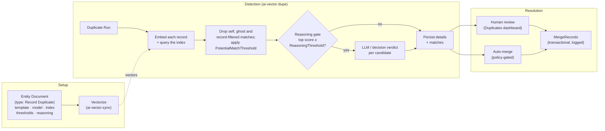
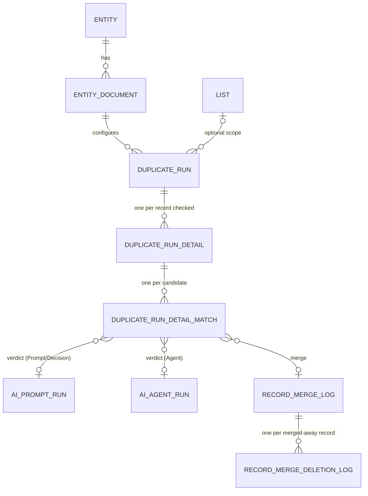
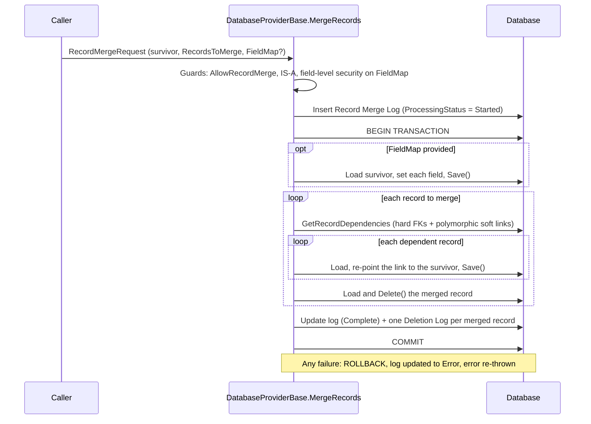

# Duplicate Management Guide — Detection, Review & Merge

How MemberJunction finds duplicate records, decides which ones really are duplicates, and merges
them safely. This guide is written for three readers:

- **Administrators and users** configuring duplicate detection on an entity and reviewing results.
- **Professional-services teams** implementing it for a client (there is a checklist in
  [§13](#13-implementation-checklist)).
- **Developers** calling the APIs, extending the reasoning layer, or building UI on top of it.

> **The principle: vectors filter, reasoning validates, policy decides.** A fast embedding/vector
> pass surfaces *candidate* near-duplicates. An optional, threshold-gated LLM pass judges each
> candidate (`Merge` / `NotDuplicate` / `Uncertain`) and proposes how to merge. The LLM never
> *originates* a match — it only annotates what the vector pass surfaced. Whether anything is merged
> is decided by the entity's merge policy (`AllowRecordMerge`) and the document's `AutomationLevel`,
> and every merge is transactional and logged.

---

## Contents

1. [How it fits together](#1-how-it-fits-together)
2. [Quick start](#2-quick-start)
3. [Setting up an entity](#3-setting-up-an-entity)
4. [Keeping vectors current](#4-keeping-vectors-current)
5. [Running detection](#5-running-detection)
6. [The LLM reasoning layer](#6-the-llm-reasoning-layer)
7. [The entry-time duplicate check](#7-the-entry-time-duplicate-check)
8. [Reviewing results](#8-reviewing-results)
9. [Merging records](#9-merging-records)
10. [Configuration reference](#10-configuration-reference)
11. [Security and permissions](#11-security-and-permissions)
12. [Tuning, performance and troubleshooting](#12-tuning-performance-and-troubleshooting)
13. [Implementation checklist](#13-implementation-checklist)
14. [Known limitations](#14-known-limitations)
15. [Source map](#15-source-map)

---

## 1. How it fits together

### The pipeline



There is also a **real-time path**: the [entry-time check](#7-the-entry-time-duplicate-check) runs
the same candidate search plus a fast typed decision while a person is typing a *new* record, and
flags likely duplicates before they are saved.

### Packages

| Package | Path | What it owns |
|---|---|---|
| `@memberjunction/ai-vector-dupe` | [`packages/AI/Vectors/Dupe`](../packages/AI/Vectors/Dupe/README.md) | `DuplicateRecordDetector` (batch runs, single-record check, entry-time check, auto-merge), the pluggable reasoning seam and its `Prompt` / `Decision` / `DecisionThenPrompt` providers |
| `@memberjunction/ai-vector-sync` | [`packages/AI/Vectors/Sync`](../packages/AI/Vectors/Sync/README.md) | `EntityVectorSyncer` (vectorizes an entity document's records), the template data builder detection reuses, the record filter, `EntityDocumentSuggester` (AI-suggested templates and thresholds) |
| `@memberjunction/ai-agents` | [`packages/AI/Agents`](../packages/AI/Agents/README.md) | `DuplicateReasoningAgentProvider`, the `Agent` reasoning mode |
| `@memberjunction/record-comparison` | [`packages/RecordComparison`](../packages/RecordComparison/README.md) | `RecordComparisonEngine` (field-level deltas) and the `RecordComparison.Compare` Remote Operation |
| `@memberjunction/core` | [`packages/MJCore`](../packages/MJCore/readme.md) | The request/response types, `Metadata.MergeRecords`, `GetRecordDependencies`, and the merge engine in `DatabaseProviderBase` |
| `@memberjunction/core-entities-server` | [`packages/MJCoreEntitiesServer`](../packages/MJCoreEntitiesServer/README.md) | `MJDuplicateRunEntityServer` (saving a run starts detection) and `MJEntityDocumentEntityServer` (the writable `TemplateText`) |
| `@memberjunction/server` | [`packages/MJServer`](../packages/MJServer/README.md) | GraphQL: `GetRecordDuplicates`, `CheckDuplicateEntry`, `MergeRecords`, `GetRecordDependencies` |
| `@memberjunction/graphql-dataprovider` | [`packages/GraphQLDataProvider`](../packages/GraphQLDataProvider/README.md) | Client side of the above, including `GraphQLAIClient.CheckDuplicateEntry` |
| `@memberjunction/ng-dashboards` | [`packages/Angular/Explorer/dashboards`](../packages/Angular/Explorer/dashboards/README.md) | The **Duplicates** dashboard (run, review, merge) and the **Vectors** dashboard (set up documents, sync vectors) |
| `@memberjunction/ng-record-merge` | [`packages/Angular/Generic/record-merge`](../packages/Angular/Generic/record-merge/README.md) | The reusable side-by-side merge panel |
| `@memberjunction/ng-entity-viewer` | [`packages/Angular/Generic/entity-viewer`](../packages/Angular/Generic/entity-viewer/README.md) | Merging selected rows from an entity grid |
| `@memberjunction/ng-base-forms` | [`packages/Angular/Generic/base-forms`](../packages/Angular/Generic/base-forms/README.md) | The entry-time check on new-record forms |

### Data model



| Entity | One row per | Key columns |
|---|---|---|
| `MJ: Entity Documents` | detection configuration for an entity | `TemplateID`, `AIModelID`, `VectorDatabaseID`, `VectorIndexID`, thresholds, reasoning settings, `Configuration` JSON |
| `MJ: Duplicate Runs` | detection run | `EntityDocumentID`, `SourceListID`, `ProcessingStatus`, `ApprovalStatus`, `TotalItemCount`, `ProcessedItemCount`, `LastProcessedOffset`, `CancellationRequested` |
| `MJ: Duplicate Run Details` | record checked in a run | `RecordID`, `MatchStatus`, `MergeStatus`, `RecordMetadata` |
| `MJ: Duplicate Run Detail Matches` | candidate found for a record | `MatchRecordID`, `MatchProbability`, `ApprovalStatus`, `MergeStatus`, `Action`, `LLMRecommendation`, `LLMConfidence`, `LLMReasoning`, `LLMProposedSurvivorRecordID`, `LLMProposedFieldMap`, `AIPromptRunID` / `AIAgentRunID`, `RecordMergeLogID` |
| `MJ: Record Merge Logs` | merge | `SurvivingRecordID`, `InitiatedByUserID`, `ProcessingStatus`, `ProcessingLog` |
| `MJ: Record Merge Deletion Logs` | record merged away | `DeletedRecordID`, `Status`, `ProcessingLog` |

The generated classes in `@memberjunction/core-entities` are the authoritative shape of each entity
(`MJEntityDocumentEntity`, `MJDuplicateRunEntity`, and so on).

---

## 2. Quick start

The shortest path to a first run, using the in-process vector store and local embedding model that
ship with MJ (no API keys, no per-token cost):

1. **Allow merging** on the entity (`AllowRecordMerge = true`) if you will merge. Leave it off to
   detect and review only.
2. **Create a `Record Duplicate` entity document** for the entity — easiest from the
   **Vectors** dashboard's AI suggestion dialog ([§3.1](#31-ai-assisted-setup-recommended)).
3. **Vectorize** the entity's records ([§4](#4-keeping-vectors-current)).
4. **Run detection** from **Knowledge Hub → Duplicates** ([§5.1](#51-from-the-duplicates-dashboard)).
5. **Review and merge** on the same page ([§8](#8-reviewing-results), [§9](#9-merging-records)).
6. Optionally **turn on LLM reasoning** to have a model judge each candidate
   ([§6](#6-the-llm-reasoning-layer)).

> ⚠️ **Read [§9.6](#96-auto-merge) before your first run on an entity that allows merging.** With
> LLM reasoning **off**, every candidate at or above `AbsoluteMatchThreshold` (default `0.95`) is
> merged automatically at the end of the run.

---

## 3. Setting up an entity

Duplicate detection for an entity is driven by an **Entity Document** (`MJ: Entity Documents`) of
type **`Record Duplicate`**. The document says which records to compare, how to turn each one into
text, which embedding model and vector index to use, and how to judge the results.

### 3.1 AI-assisted setup (recommended)

The **Vectors** dashboard has a suggestion dialog backed by `EntityDocumentSuggester`
(`@memberjunction/ai-vector-sync`). Pick the entity and the **duplicate detection** use case; an AI
prompt reads the entity's fields and relationships and proposes a template, the fields it chose and
why, and `PotentialMatchThreshold` / `AbsoluteMatchThreshold` values. You can edit the template, then
save it as an Active entity document of type `Record Duplicate`. Saving fills in the vector database,
embedding model and vector index from what is configured (creating the index if needed) and creates
the template. The Knowledge agent offers the same suggestion in chat (`create_entity_document`).

The dialog needs a vector database and an embedding model configured first; if there are none it
sends you to the Knowledge Hub **Config** section.

### 3.2 Manual setup

Create the record from the standard **Entity Documents** form, or ship it as metadata. A metadata
file follows MJ's metadata rules ([`metadata/CLAUDE.md`](../metadata/CLAUDE.md)): a `primaryKey` UUID
from `uuidgen`, `@lookup:` references, no `sync` block.

```json
[
  {
    "primaryKey": { "ID": "<uuidgen output>" },
    "fields": {
      "Name": "Contacts - Duplicate Detection",
      "EntityID": "@lookup:MJ: Entities.Name=Contacts",
      "TypeID": "@lookup:MJ: Entity Document Types.Name=Record Duplicate",
      "Status": "Active",
      "VectorDatabaseID": "@lookup:MJ: Vector Databases.Name=Simple Vector Service Provider",
      "VectorIndexID": "@lookup:MJ: Vector Indexes.Name=Default - SVS + gte-small (Local)",
      "AIModelID": "@lookup:MJ: AI Models.Name=gte-small (Local)",
      "TemplateText": "@file:templates/contacts-duplicates.njk",
      "PotentialMatchThreshold": 0.75,
      "AbsoluteMatchThreshold": 0.97,
      "Configuration": { "recordFilter": { "extraFilter": "Status <> 'Merged'" } }
    }
  }
]
```

`TemplateText` is a writable virtual property: on save, `MJEntityDocumentEntityServer` creates (or
updates) the backing `MJ: Templates` + `MJ: Template Contents` records and stamps `TemplateID` for
you. The seeded Search documents in [`metadata/entity-documents/`](../metadata/entity-documents/README.md)
show the same pattern.

Every one of `AIModelID`, `VectorDatabaseID` and `VectorIndexID` is required at run time: the
detector refuses a document without an embedding model or vector database, and fails with *"No
vector index found for entity document"* when the index cannot be resolved.

### 3.3 Writing the template

The template (Nunjucks) decides what "similar" means: it is rendered for every record, embedded, and
compared. Record fields are top-level variables:

```jinja
{{ FirstName }} {{ LastName }}
Email: {{ Email }}
Phone: {{ Phone }}
Company: {{ Company }}
Location: {{ City }}, {{ State }}
```

- **Use identifying fields** — names, emails, phone numbers, external IDs, addresses. Leave out
  free text that differs between true duplicates (notes, descriptions), timestamps and status
  fields: they add noise and pull genuine duplicates apart.
- **Denormalized view fields are fine** (`Company` from a `CompanyID` join) and usually better than
  raw foreign keys.
- **Related rows** come in through `Entity`-type template parameters (a person's phones, emails,
  addresses). The detector loads them once per batch.
- **The query text is the stored text.** Detection renders the template exactly the way vector sync
  does — through the same `EntityDocumentTemplateDataBuilder`, from the `RunView` row
  (`ResultType: 'simple'`), not `BaseEntity.GetAll()`. If a related parameter's rows cannot be
  loaded, the batch fails rather than query with text that cannot match.
- **Changing the template changes every vector.** Re-vectorize after editing it
  ([§4](#4-keeping-vectors-current)).

### 3.4 Scoping which records take part: the record filter

`Configuration.recordFilter.extraFilter` on the entity document is a RunView `ExtraFilter` predicate.
A record that fails it is **never vectorized, never checked by a batch run and never offered as a
candidate**, yet stays readable everywhere else. Typical uses: records a source system flagged as
deleted or merged, inactive records, test data.

```json
{ "recordFilter": { "extraFilter": "IsDeleted = 0 AND Status <> 'Merged'" } }
```

- A whole-entity run ANDs the filter into its own filter; a list or view run is narrowed to the
  members that pass it.
- Candidates are re-checked against the filter even when their vectors predate it. To keep TopK
  meaningful, the query asks for `3 × TopK` neighbors and trims back after filtering.
- `CheckSingleRecord` and the entry-time check still check the record they are given; only its
  candidates are filtered.
- If the filter cannot be applied (a mistyped column, say), the run **fails** rather than letting
  excluded records through.
- Keep it to plain comparisons (`=`, `<>`, `IN`, `IS NULL`, `AND`/`OR`) so it runs on both SQL Server
  and PostgreSQL. See the [Sync README](../packages/AI/Vectors/Sync/README.md#record-filter).

### 3.5 Allowing merges

Set **`AllowRecordMerge = true`** on the entity (`MJ: Entities`) to permit merging. With it off:

- detection runs and any LLM verdicts are recorded as usual;
- the Duplicates dashboard shows the matches read-only;
- auto-merge is skipped ("matches recorded for manual review only");
- `MergeRecords` refuses the entity, on the client and on the server.

---

## 4. Keeping vectors current

**Detection does not vectorize by default.** It assumes the entity document's vectors already exist
in the index. If nothing has been vectorized, every run reports **0 matches** — that means "0
vectors", not "0 duplicates". On an index shared by several documents (a provider that scopes by
metadata filter), the run fails with *"No vectors in index … are tagged with entity document …"*
instead, which means the stored vectors predate per-document tagging and need a re-sync.

| Way to vectorize | When to use it |
|---|---|
| **Vectors dashboard → Sync** for the entity | Interactive, after creating or editing a document |
| **`Vectorize Entity` action** (`EntityNames`, `EntityDocumentType`) | From a workflow, an agent, or a scheduled job. `EntityDocumentType` **defaults to `Record Duplicate`**. |
| **`Revectorize: true`** on a detection run | One-off: vectorize the document's records, then detect |
| `npx tsx packages/AI/Vectors/scripts/test-vectorize-entity.ts "Record Duplicate"` | Development harness, run from the repo root; prints full errors |

> ⚠️ **The shipped daily sync does not cover duplicate documents.** The seeded
> **`Entity Vector Sync - Daily`** scheduled job runs `Vectorize Entity` with
> `EntityDocumentType = "Search"`, so it only refreshes **Search** documents. To keep a
> `Record Duplicate` document current, add your own scheduled job that runs `Vectorize Entity` with
> `EntityDocumentType = "Record Duplicate"` (and, optionally, `EntityNames` for the entities you
> care about), or vectorize before each run with `Revectorize: true`.

Re-vectorize whenever source records change materially or the template changes. Vector sync does not
remove vectors for records that were deleted or that the record filter now excludes; detection copes
by dropping those "ghost" matches at query time ([§5.4](#54-what-a-run-does)).

---

## 5. Running detection

### 5.1 From the Duplicates dashboard

Open **Knowledge Hub → Duplicates** (resource `DuplicateDetectionResource`, page title *Record
Duplicates*).

1. **Pick the entity document** in the header. The list shows every **Active** entity document as
   *Name (Entity)* — including `Search` documents — so choose the `Record Duplicate` one. On first
   load the page selects the document of the newest run it can show.
2. **Adjust the thresholds** if you want. The **Potential Match** (30–99%) and **Absolute Match**
   (50–100%) sliders start at the document's values. ⚠️ When you run with values different from the
   document's, the page **saves them onto the entity document** — they are not one-off overrides, and
   they become the document's thresholds for every later run.
3. **Turn LLM reasoning on or off** with the **LLM Reasoning** switch and its threshold slider. These
   also save straight to the document (`EnableLLMReasoning`, `ReasoningThreshold`). Pick the mode and
   automation level on the entity document's form.
4. **Run Detection.** The page creates a `MJ: Duplicate Runs` record for the **whole entity** (there is
   no list, view or filter scope on this page; the record filter still applies), which starts
   detection on the server ([§5.2](#52-by-creating-a-duplicate-run-record-server)).

Progress arrives through the `PipelineProgress` GraphQL subscription (stages *Vectorizing records*,
*Querying vector database*, *Analyzing matches*) with a database poll every 15 seconds as a fallback.
If the run reports no progress for about two minutes, the page shows *"Duplicate detection timed out
with no progress from the server."* — the run itself is not changed and may still finish. Reopening
the page while a run is in progress (updated in the last five minutes) reconnects to it. There is no
cancel button; cancel a run by setting `CancellationRequested` on its record.

### 5.2 By creating a Duplicate Run record (server)

Saving a **new** `MJ: Duplicate Runs` record on the server starts detection. `MJDuplicateRunEntityServer`
fires `DuplicateRecordDetector.GetDuplicateRecords` asynchronously after the first save, so the save
returns immediately:

```typescript
const md = provider; // the request-scoped IMetadataProvider
const run = await md.GetEntityObject<MJDuplicateRunEntity>('MJ: Duplicate Runs', contextUser);
run.NewRecord();
run.EntityID = entityId;
run.EntityDocumentID = entityDocumentId; // optional — see below
run.SourceListID = listId;               // optional — omit to scan the whole entity
run.StartedByUserID = contextUser.ID;
if (!(await run.Save())) {
    throw new Error(run.LatestResult?.CompleteMessage ?? 'Could not start the run');
}
// Detection is now running. Progress is published on the server's PIPELINE_PROGRESS pub/sub topic
// (PipelineRunID = run.ID; clients subscribe with the PipelineProgress GraphQL subscription), and the
// run row's ProcessedItemCount / ProcessingStatus update as it goes.
```

- **No document named?** The run takes the entity's newest-updated **Active** document, preferring a
  `Record Duplicate` one over any other type (an entity may also have a `Search` document, whose
  template is built for search, not matching).
- **Thresholds.** This path treats a threshold `<= 0` or `>= 1.0` on the document as unconfigured and
  substitutes `0.70` (potential) and `0.95` (absolute).
- **Exactly once.** The detector re-saves the run many times (progress, resume cursor, completion);
  a process-wide in-flight guard keyed on the run ID makes sure only the first save starts a pass.
- **Failure.** Any error marks the run `ProcessingStatus = 'Failed'` with `ProcessingErrorMessage`.

### 5.3 Calling the detector directly

```typescript
import { DuplicateRecordDetector } from '@memberjunction/ai-vector-dupe';
import { PotentialDuplicateRequest } from '@memberjunction/core';

const detector = new DuplicateRecordDetector(provider); // request-scoped provider
const request: PotentialDuplicateRequest = {
    EntityID: entityId,
    EntityDocumentID: entityDocumentId,
    ViewID: savedViewId,          // or ListID, or ExtraFilter, or none of them for the whole entity
    RecordIDs: [],                // required by the type; not used by batch runs
    Options: {
        TopK: 10,
        PotentialMatchThreshold: 0.75,
        OnProgress: p => console.log(`[${p.Phase}] ${p.ProcessedRecords}/${p.TotalRecords}`),
    },
};
const response = await detector.GetDuplicateRecords(request, contextUser);
```

| Entry point | What it checks | Persists? | Reasoning? | Merges? |
|---|---|---|---|---|
| `GetDuplicateRecords(request, user)` | A list (`ListID`), a saved view (`ViewID`), an `ExtraFilter`, or the whole entity — always narrowed by the record filter | Run, details, matches | When the gate opens | Eligible pairs, after the full pass |
| `CheckSingleRecord(docId, key, options, user)` | One saved record | Nothing | When the gate opens (verdict rides on the returned result) | Never |
| `CheckRecordValues(entityName, values, user, options)` | Unsaved values (entry time) | Nothing | One typed decision | Never |
| `Metadata.GetRecordDuplicates(request, user)` / GraphQL `GetRecordDuplicates` | A list | A new run (detection runs asynchronously) | When the gate opens | As above |

`GetRecordDuplicates` is the list-based entry point exposed over GraphQL. It requires a `ListID`,
creates the run, and returns `Status: 'Inprogress'` with no results; read the run's rows for the
outcome. Its GraphQL input carries only `EntityID`, `ListID`, `EntityDocumentID`, `RecordIDs` and
`ProbabilityScore` — per-run `Options` are not transmitted.

### 5.4 What a run does

For each outer batch of records (500 at a time):

1. **Load** the batch's records and write one `Duplicate Run Detail` per record (`MatchStatus = 'Pending'`).
2. **Render and embed** the template text in sub-batches of 100 (`AIEmbeddingRunner`, using the
   document's model and the index's dimensions).
3. **Query** the vector index for each record's nearest neighbors — `HybridQuery` when the provider
   supports hybrid search, otherwise `QueryIndex` — with up to `maxConcurrentRequests` queries in
   flight (default 10). On an index shared by several documents, the query carries a metadata filter
   that scopes it to this document's vectors.
4. **Filter** each record's candidates:
   - drop the record itself (compared with `CompositeKey.Equals`, so UUID casing differences between
     SQL Server and PostgreSQL do not let a self-match through);
   - drop **ghost** matches — vectors whose record no longer exists, or fails the record filter —
     checked against the live table in one batched query per chunk;
   - drop candidates below `PotentialMatchThreshold`;
   - keep the top `TopK`.
5. **Suppress inverse pairs.** If A→B was recorded in this run, B→A is skipped.
6. **Reason** over the record's matched set, once, when the [gate](#61-the-gate) opens.
7. **Persist** one `Duplicate Run Detail Match` per candidate (`ApprovalStatus = 'Pending'`,
   `MergeStatus = 'Pending'`, the vector score in `MatchProbability`, a display snapshot in
   `RecordMetadata`, and the candidate's own LLM verdict when reasoning ran). The detail moves to
   `MatchStatus = 'Complete'`.
8. **Advance the cursor** (`ProcessedItemCount`, `LastProcessedOffset`) and check
   `CancellationRequested`.

After the last batch the run is marked `Complete` and the [auto-merge](#96-auto-merge) step runs over
the eligible candidates collected along the way.

**Resume and cancel.** Setting `CancellationRequested = true` on the run stops it after the current
batch; it stays `In Progress` with its cursor saved. Calling `GetDuplicateRecords` with
`Options.DuplicateRunID` loads that run and continues from `LastProcessedOffset`. A direct call with a
`ListID` and no `DuplicateRunID` reuses the existing run for that list (and therefore its cursor).

**Large entities.** Record ids are loaded with `IgnoreMaxRows`, so a whole-entity run checks every
record rather than the entity's `UserViewMaxRows`. The in-memory `PotentialDuplicateResult` array is
capped at 1,000 entries (`ResultsTruncated` says so); `TotalRecordsWithDuplicates` stays exact, and the
persisted match rows are the complete record of the run.

**Progress phases:** `Vectorizing` (only with `Revectorize`) → `Loading` → `Embedding` → `Querying` →
`Matching` → `Merging`. A run started from a Duplicate Run record republishes them on the
`PIPELINE_PROGRESS` topic.

---

## 6. The LLM reasoning layer

Vector similarity is good at *recall* and poor at the final "is this actually the same entity?"
judgment. Two records can be close without being duplicates (*Acme Corp* vs. its subsidiary *Acme
Labs*; *Robert Johnson Sr.* vs. *Robert Johnson Jr.*), and two true duplicates can look different
(typos, abbreviations, an old address). The reasoning layer asks a model to judge **each candidate**
against its source record.

It is **off by default** (`EnableLLMReasoning = false`). Off, the pipeline is the vector-only path,
unchanged.

### 6.1 The gate

Reasoning runs **once per source record's matched set**, and only when:

1. `EnableLLMReasoning` is `true`, **and**
2. the set has at least one candidate (after filtering), **and**
3. the set's **highest** vector score is at or above `ReasoningThreshold`. A `null` threshold means
   "reason over every non-empty set".

`ReasoningThreshold` is the cost dial. At `0.80` the model only sees sets the vectors already think
are likely; lower it to let the model adjudicate more borderline sets (more calls, more catches),
raise it to spend only on near-certain matches.

### 6.2 Reasoning modes

`ReasoningMode` on the entity document picks the provider, resolved through the class factory under
that key:

| Mode | Provider (package) | What runs | Recommends | Proposes survivor + fields | Can lead to auto-merge | Run recorded in |
|---|---|---|---|---|---|---|
| `Prompt` *(default)* | `PromptReasoningProvider` (`ai-vector-dupe`) | One call to the **Duplicate Resolution** prompt (or `ReasoningPromptID`) | `Merge` / `NotDuplicate` / `Uncertain` | Yes | Yes | `AIPromptRunID` |
| `Agent` | `DuplicateReasoningAgentProvider` (`ai-agents`) | The **Duplicate Resolution Agent** (or `ReasoningAgentID`), a Loop agent running the same instructions with memory notes | Same as `Prompt` | Yes | Yes | `AIAgentRunID` |
| `Decision` | `DecisionReasoningProvider` (`ai-vector-dupe`) | One typed decision (the **Default Decision** prompt) with one `Likelihood` per candidate | `Uncertain` (flag for review) or `NotDuplicate` — never `Merge` | No | No | `AIPromptRunID` |
| `DecisionThenPrompt` | `DecisionThenPromptReasoningProvider` (`ai-vector-dupe`) | The decision drops implausible candidates; the prompt reasons over the survivors | As `Prompt` for survivors; `NotDuplicate` for dropped ones | Yes | Yes | Survivors: the prompt run; dropped: the decision run |

Guidance:

- **`Prompt`** is the right start for most entities: cheap, fast, and it can propose how to merge.
- **`Agent`** is for heavy entities that need deeper reasoning; it costs an agent run per set. The
  agent ships with a rubric that samples 10% of production runs for evaluation.
- **`Decision`** is the cheapest and fastest, and the only mode (with `DecisionThenPrompt`) that
  turns on the [entry-time check](#7-the-entry-time-duplicate-check). It never recommends a merge, so
  it never auto-merges.
- **`DecisionThenPrompt`** keeps the prompt's merge proposals while the decision removes most
  non-duplicates first, so the prompt sees fewer candidates. If the decision fails, every candidate
  goes to the prompt; with no survivors, the prompt never runs.

### 6.3 What the model sees

`BuildReasoningInput` assembles, per set:

- the entity's name and description;
- the source record and each candidate, labelled by name (loaded from the records, falling back to
  the vector metadata name, then the key), each candidate with its vector score;
- the **field deltas** — only the fields whose values differ across the set — computed by
  `MatchedSetDeltaBuilder` over [`RecordComparisonEngine`](../packages/RecordComparison/README.md).

Field-level security: the prompt and the stored reasoning text are read by everyone who can see the
duplicate run, so any field that field-level security restricts for **any** role
(`GetIndexRestrictedFieldNames`) is left out of the deltas, and a record whose name field is
restricted is labelled by its key. See the [Field-Level Security Guide](FIELD_LEVEL_SECURITY_GUIDE.md).

### 6.4 What comes back

Providers return a `DuplicateReasoningOutput` (`DuplicateReasoningTypes.ts`):

- **`CandidateVerdicts`** — one per candidate, judged independently: `Recommendation`, `Confidence`
  (0–1, or `null` for "unknown" — never conflated with `0`, which means "confidently not a
  duplicate") and `Reasoning`. A false-positive candidate reads `NotDuplicate` even when another
  candidate in the same set is a confident `Merge`.
- **Set-level `Recommendation` / `Confidence`** — derived from the verdicts (`Merge` if any candidate
  is `Merge`, else `Uncertain` if any is, else `NotDuplicate`). Used for the group's headline and,
  together with each candidate's own verdict, the auto-merge gate.
- **`SurvivorRecordID`** — the record to keep. A survivor that is not one of the set's records is
  treated as hallucinated and dropped.
- **`FieldChoices`** — "keep field *X* from record *Y*". The detector resolves each to a literal
  `{ FieldName, Value }` from the deltas it already loaded, and skips choices whose value is empty
  (an empty override would blank out good data). The result is ready to pass to
  `RecordMergeRequest.FieldMap`.

The detector writes each candidate's own verdict to its match row (`LLMRecommendation`,
`LLMConfidence`, `LLMReasoning`), the set's proposal to every row (`LLMProposedSurvivorRecordID`,
`LLMProposedFieldMap`), and the run that produced the verdict (`AIPromptRunID` or `AIAgentRunID`).
A failed reasoning call never aborts a run: the set's rows are saved with empty LLM columns, so every
candidate stays `Pending` for review and none is auto-merge eligible. The `Prompt` provider asks the
runner to try a JSON-repair pass before a full retry, and the prompt itself is configured with strict
validation and up to two retries.

### 6.5 Choosing and swapping models

No model is named in code.

| Mode | Where the model comes from | Shipped bindings |
|---|---|---|
| `Prompt`, `DecisionThenPrompt` (prompt stage) | The **Duplicate Resolution** prompt's `MJ: AI Prompt Models` rows (or the prompt named by `ReasoningPromptID`) | GPT-OSS-120B (Groq, Cerebras) and Gemini 3.1 Flash-Lite (Google, Vertex AI) |
| `Agent` | The **Duplicate Resolution Agent** (or `ReasoningAgentID`); it runs the same Duplicate Resolution prompt | As above |
| `Decision`, `DecisionThenPrompt` (decision stage) | The **Default Decision** prompt's model bindings | — |

To switch the reasoning model, change the prompt's model bindings — one metadata change, no rebuild.
Because `Prompt` and `Agent` share the Duplicate Resolution prompt, the swap applies to both. A small,
fast model is usually enough: it only refines matches the vectors already found.

**Decision calibration.** A decision model's raw probabilities are not calibrated, so the `Decision`
provider applies a Platt calibration fitted per model (`DUPLICATE_DECISION_CALIBRATION`): **Jev**
(`typesafe/jev-1.13-20260917`) and **LLM Decision** answered by GPT-OSS-120B ship with one. On
calibrated probabilities a candidate is `Uncertain` at or above **0.7**
(`DecisionReasoningProvider.DEFAULT_UNCERTAIN_ABOVE`, tuned for precision); the `DecisionThenPrompt`
pre-filter keeps candidates at or above **0.3** (`PRE_FILTER_UNCERTAIN_ABOVE`, tuned for recall).
A model with no calibration produces no calibrated probability: batch `Decision` mode bands its
candidates `Uncertain` for review, `DecisionThenPrompt` sends them all to the prompt, and the
entry-time check flags nothing. To bind another decision model, subclass `DecisionReasoningProvider`,
override `CalibrationFor`, and register the subclass under `'Decision'`.

### 6.6 Writing your own provider

```typescript
import { RegisterClass } from '@memberjunction/global';
import {
    DuplicateReasoningProvider,
    DuplicateReasoningInput,
    DuplicateReasoningOutput,
    DuplicateReasoningContext,
} from '@memberjunction/ai-vector-dupe';

@RegisterClass(DuplicateReasoningProvider, 'RulesThenPrompt')
export class RulesThenPromptProvider extends DuplicateReasoningProvider {
    public async Reason(input: DuplicateReasoningInput, context: DuplicateReasoningContext): Promise<DuplicateReasoningOutput> {
        // Inspect input.SourceRecord, input.Candidates and input.FieldDeltas, run on
        // context.Provider as context.ContextUser, and return one verdict per candidate.
        // Never throw for an ordinary failure: return { Success: false, ErrorMessage, ... }.
    }
}
```

`ReasoningMode` is a value-list column (`Prompt`, `Agent`, `Decision`, `DecisionThenPrompt`), so a
**new** mode key also needs the column's CHECK constraint widened by a migration. Overriding one of
the existing keys does not: register a subclass under `'Prompt'` (or another existing key) and the
class factory's priority rules make it win, including inside `DecisionThenPrompt`, which resolves both
of its stages through the factory.

---

## 7. The entry-time duplicate check

The entry-time check flags likely duplicates **while a person is typing a new record**, before it is
saved. It only flags: it never blocks a save and never merges.

### 7.1 Turning it on

The check is on for an entity when it has an **Active** entity document with
**`EnableLLMReasoning = true`** and **`ReasoningMode` = `Decision` or `DecisionThenPrompt`**. Turning
reasoning off on the document turns the check off. If several documents qualify, the oldest (earliest
`__mj_CreatedAt`, then lowest ID) wins, so adding a document never silently changes which one is used.

### 7.2 What happens on each check

1. The entered values become an unsaved entity object (each text value cut to 500 characters;
   unknown fields, primary keys, read-only fields and `__mj_*` fields ignored).
2. It is rendered with the document's template, embedded and queried with the same TopK and
   potential-match threshold as a single-record check, record filter included.
3. Candidates are narrowed to the records **the user can read**, with one `RunView` as that user —
   the vector index does not know who is asking.
4. One typed decision (always the decision only, even in `DecisionThenPrompt` mode — the prompt is too
   slow for typing) scores the readable candidates. The decision state carries at most 40 differing
   fields, the ones the person entered first.
5. A candidate is flagged when its calibrated probability is at or above the provider's threshold
   (0.7), or when the decision gave no answer for it. A failed decision, or one from an uncalibrated
   model, flags nothing.

### 7.3 Budgets and limits

| Limit | Value | Where |
|---|---|---|
| Server time budget per check | 2,000 ms (`DUPLICATE_ENTRY_CHECK_SERVER_BUDGET_MS`); every step and the model call are bounded and abortable | `ai-vector-dupe` |
| Form time budget | 1,500 ms (`DUPLICATE_ENTRY_CHECK_BUDGET_MS`) | `ng-base-forms` |
| Text per field | 500 characters | `DUPLICATE_ENTRY_CHECK_MAX_FIELD_TEXT_LENGTH` |
| Fields in the decision state | 40 | `DUPLICATE_ENTRY_CHECK_MAX_DECISION_FIELDS` |
| Request size | 16 KB of `valuesJSON` | `DuplicateEntryCheckResolver` |

### 7.4 Results and API

`CheckDuplicateEntry` (GraphQL mutation) and `GraphQLAIClient.CheckDuplicateEntry({ EntityName, Values })`
never throw. The status is one of:

| Status | Meaning |
|---|---|
| `Checked` | The check ran. `Candidates` holds the flagged records (possibly none), most probable first, each with `RecordID` (compact URL segment), `DisplayName`, `VectorScore` and `Probability`. |
| `NotConfigured` | No qualifying document for the entity. Nothing else ran. |
| `NotAuthorized` | The caller may not run the check. Nothing else ran. |
| `Failed` | The check could not finish or ran out of time. `ErrorMessage` says why; nothing is flagged. |

### 7.5 On new-record forms

Every generated and custom entity form in `@memberjunction/ng-base-forms` runs the check on its own;
there is nothing to wire up and no client-side switch.

- **When.** Only for a **new, unsaved** record the user can read, **600 ms** after the last field edit.
  One check is in flight at a time; edits made meanwhile are checked once, on the latest values. An
  answer that arrives after **1.5 s**, or that newer edits have overtaken, is dropped.
- **What is sent.** Every field except primary keys and `__mj_*` columns, non-empty scalar values only,
  text cut to 500 characters.
- **What the user sees.** A dismissible warning above the form: **"This may duplicate:"** followed by
  the candidates' names; each opens the existing record in a new tab. Scores are not shown. Dismissing
  hides the banner until a new candidate appears. Saving clears it.
- **Never blocking.** The check never stops a save.
- **Turning off for the session.** A `NotConfigured` or `NotAuthorized` answer stops further checks for
  that entity until the page is reloaded; `Failed` does not.

A form subclass can override `BaseFormComponent.CheckDuplicateEntry` to change how the check is made.

---

## 8. Reviewing results

The **Duplicates** dashboard shows the results of **one run** for the selected document: the newest run
that did not fail and is not list-scoped (falling back to the newest run of any kind).

**The board.** One card per **source record** (a Duplicate Run Detail) with all of its candidates,
in three columns — **Pending Review**, **Approved**, **Rejected**. A card is *Pending* while any of its
matches is pending, *Approved* or *Rejected* when all of them are, and *Pending* for a mix. Cards show
the record's name and entity, the highest vector score (colour-coded above 0.9 and 0.7), the top three
matches with their scores, the number of matches and the latest match date. A KPI strip counts groups
per column.

**Triage.** **Approve** / **Reject** on a pending card, or dragging a card to another column, sets
`ApprovalStatus` on **every match in the group** in one transaction group. Filters: entity, minimum and
maximum score, date range. Cards are sorted by highest score.

**The comparison panel.** Clicking a card opens a side-by-side comparison of the source record and all
of its candidates:

- every field (or **Differences Only**), name fields first, primary keys and `__mj_*` columns hidden;
  long values are clamped with *Show more*;
- per column: the vector score, the number of differences, a **Set as survivor** choice, **Use all
  fields**, and the record's dependent-record count (the column with the most is starred) with
  expandable lists of the linked records;
- when reasoning ran: an **AI: Merge / AI: Not a duplicate / AI: Uncertain** badge with the model's
  confidence, a ⚠ chip when the verdict **disagrees with the vector score** (a *Not a duplicate* at or
  above the current Potential Match slider, or a *Merge* below it), and a **Why?** popover with the
  model's reasoning for that candidate;
- **Skip** on a candidate excludes it from the merge and saves its `ApprovalStatus = 'Rejected'`
  (shown as *Skipped*); **Undo** sets it back to `Pending`;
- **Reject All** rejects every match in the group.

The "AI disagrees" chip is the main thing to look for in review: high vector similarity that the model
rejected (Sr. vs Jr., parent vs. subsidiary) or a low-similarity pair it thinks is the same record.

### 8.1 What the status columns mean

| Column | Values | Written by |
|---|---|---|
| `Duplicate Runs.ProcessingStatus` | `Pending`, `In Progress`, `Complete`, `Failed` | The detector / the run's server entity |
| `Duplicate Runs.ApprovalStatus` | `Pending`, `Approved`, `Rejected` | Created `Pending`; review tooling |
| `Duplicate Run Details.MatchStatus` | `Pending`, `Complete`, `Error`, `Skipped` | `Pending` on creation, `Complete` once its matches are saved |
| `Duplicate Run Details.MergeStatus` | `Not Applicable`, `Pending`, `Complete`, `Error` | Created `Pending` by the detector; review tooling |
| `Duplicate Run Detail Matches.ApprovalStatus` | `Pending`, `Approved`, `Rejected` | Created `Pending`; the dashboard's Approve / Reject / Skip / drag |
| `Duplicate Run Detail Matches.MergeStatus` | `Pending`, `Complete`, `Error` | `Complete` after a successful **auto**-merge |
| `Duplicate Run Detail Matches.Action` | free text (`Merged` after an auto-merge) | Auto-merge |

> A merge made from the dashboard does **not** update these rows: `MergeStatus`, `Action`, `MergedAt`
> and `RecordMergeLogID` are written only by auto-merge. The merge itself is recorded in the
> `MJ: Record Merge Logs` tables. See [§14](#14-known-limitations).

### 8.2 Reading results in code

```typescript
const rv = RunView.FromMetadataProvider(provider);
const details = await rv.RunView<{ ID: string; RecordID: string; RecordMetadata: string | null }>({
    EntityName: 'MJ: Duplicate Run Details',
    ExtraFilter: `DuplicateRunID='${EscapeSQLString(runId)}' AND MatchStatus='Complete'`,
    Fields: ['ID', 'RecordID', 'RecordMetadata'],
    ResultType: 'simple',
    IgnoreMaxRows: true,
}, contextUser);
if (!details.Success) throw new Error(details.ErrorMessage);

const detailIds = details.Results.map(d => `'${EscapeSQLString(d.ID)}'`);
// Chunk detailIds (500 at a time) for large runs; one chunk shown here.
const matches = await rv.RunView<{ DuplicateRunDetailID: string; MatchRecordID: string; MatchProbability: number; LLMRecommendation: string | null }>({
    EntityName: 'MJ: Duplicate Run Detail Matches',
    ExtraFilter: `DuplicateRunDetailID IN (${detailIds.join(',')})`,
    Fields: ['DuplicateRunDetailID', 'MatchRecordID', 'MatchProbability', 'LLMRecommendation', 'ApprovalStatus', 'MergeStatus'],
    OrderBy: 'MatchProbability DESC',
    ResultType: 'simple',
    IgnoreMaxRows: true,
}, contextUser);
```

`RecordID` and `MatchRecordID` are stored in MJ's URL-segment form (`ID|<uuid>`, or
`F1|v1||F2|v2` for a composite key); `CompositeKey.FromURLSegment(entityInfo, value)` reads them back.
`RecordMetadata` is a JSON snapshot (name, icon, `DefaultInView` fields) taken at detection time so a
review screen can render without loading every record.

---

## 9. Merging records

### 9.1 What a merge does

A merge keeps one **surviving** record and folds one or more other records into it.
`Metadata.MergeRecords(request, contextUser)` (implemented in `DatabaseProviderBase`) does, in order:



1. **Guards** (before anything is written): the entity must have `AllowRecordMerge = true`; IS-A
   records are refused (see [§14](#14-known-limitations)); a `FieldMap` may name only fields the user
   can write, with denied and unknown fields given the same refusal.
2. **Merge log.** A `MJ: Record Merge Logs` row is written *before* the transaction
   (`ProcessingStatus = 'Started'`), so a failed merge still leaves a trace.
3. **Field map.** If `FieldMap` is given, the survivor is loaded, each `{ FieldName, Value }` is set,
   and the survivor is saved.
4. **Re-point dependents.** For each record being merged away, every record that refers to it is found
   with `GetRecordDependencies` — **hard foreign keys and polymorphic soft links**
   (`EntityID`/`RecordID` pairs), system audit entities included — and its link is rewritten to the
   survivor. A hard foreign key gets the bare key value; a soft link gets the canonical
   `CompositeKey.ToRecordID()` encoding (`ID|<guid>`).
5. **Delete** the merged-away record with `BaseEntity.Delete()`.
6. **Log and commit.** The log becomes `Complete`, a `MJ: Record Merge Deletion Logs` row is written
   per merged-away record, and the transaction commits. On any failure the transaction rolls back, the
   log is marked `Error` with the reason, and the error is re-thrown.

Every save and delete runs through `BaseEntity` **as the calling user**, so validation, entity
permissions, Record Changes tracking, entity actions and cache invalidation all apply. The user needs
update rights on the survivor and on every dependent row that is re-pointed, and delete rights on the
records merged away.

### 9.2 Calling it

```typescript
import { CompositeKey, LogError, RecordMergeRequest } from '@memberjunction/core';

const request: RecordMergeRequest = {
    EntityName: 'Contacts',
    SurvivingRecordCompositeKey: CompositeKey.FromURLSegment(entityInfo, survivorId),
    RecordsToMerge: [CompositeKey.FromURLSegment(entityInfo, duplicateId)],
    FieldMap: [
        { FieldName: 'Phone', Value: '+1 617 555 0100' },   // keep this value on the survivor
    ],
};

try {
    const result = await provider.MergeRecords(request, contextUser);
    if (!result.Success) {
        LogError(`Merge failed: ${result.OverallStatus}`);
    }
    // result.RecordMergeLogID, result.RecordStatus[i].Success / .Message / .RecordMergeDeletionLogID
} catch (e) {
    // MergeRecords THROWS for guard failures and rolled-back merges — unlike Save()/Delete().
    LogError(e);
}
```

- **Server code** passes the request-scoped provider and the context user. **Browser code** calls the
  same method on its provider: `GraphQLDataProvider.MergeRecords` throws if the entity does not allow
  merging, otherwise sends the `MergeRecords` GraphQL mutation and turns any server or transport error
  into a failed `RecordMergeResult` (`Success: false`, the error in `OverallStatus`) instead of
  throwing.
- **Over GraphQL, `FieldMap` values travel as strings.** The server sets them on the survivor and the
  entity's field types take it from there.
- **API keys** need the `entity:merge` scope for the entity.
- To merge several records at once, list them all in `RecordsToMerge`; they share one transaction and
  one merge log.

### 9.3 Choosing the survivor and field values

The survivor keeps its own values unless the `FieldMap` overrides them. Good defaults:

- keep the record with the **most dependents** (fewer links to re-point) or the one other systems
  reference;
- take each field from whichever record has the **most complete and most recent** value;
- never override with an empty value.

When LLM reasoning ran, the match rows carry the model's proposal (`LLMProposedSurvivorRecordID`,
`LLMProposedFieldMap`), which review UIs use to pre-fill the comparison. For an ad-hoc comparison, the
`RecordComparison.Compare` Remote Operation returns a field-by-field delta of any set of records
([Record Comparison README](../packages/RecordComparison/README.md)).

### 9.4 Merging from the Duplicates dashboard

In the comparison panel ([§8](#8-reviewing-results)):

1. **Choose the survivor.** It defaults to the source record. Choosing another column resets every
   field to that record's values. When reasoning proposed a survivor and per-field choices, the panel
   is **pre-filled** with them (from the first match in the group that carries a proposal); you can
   change anything.
2. **Pick field values.** Click a value (or its radio) to keep it; **Use all fields** takes every
   non-empty value from one column.
3. **Skip** any candidate that is not a duplicate. Skipped (rejected) candidates are left out of the
   merge.
4. **Merge Records** opens a confirmation listing the surviving record, the field overrides, the
   dependencies that will move, and the records that will be deleted — **Confirm Merge (N records → 1)**.

The page sends one `RecordMergeRequest` through `ProviderToUse.MergeRecords`: every non-skipped
candidate in `RecordsToMerge`, and a `FieldMap` holding only the fields you took from a record other
than the survivor. Success reloads the board.

When the entity does not allow merging, the page shows *"Merging is not available for this entity.
Detection results are read-only."* and disables **Merge Records** — but only after **Run Detection**
has been clicked in the session ([§14](#14-known-limitations)). Approve, Reject and Skip still work.

### 9.5 Merging from an entity grid

Entity grids (`mj-entity-data-grid` in `@memberjunction/ng-entity-viewer`, as shown by the grid view
type in Data Explorer and other view surfaces) show a **Merge** button when the entity has
`AllowRecordMerge = true` **and** the user can both update and delete its records.

1. Select **exactly two** rows and click **Merge**.
2. The grid refuses IS-A subtype entities and records that have subtype rows, with a message, before
   it loads anything.
3. A dialog loads the field comparison from the server (the `RecordComparison.Compare` Remote
   Operation), shows how many linked records each side has, and lets you choose which record to
   **Keep**. The other is deleted and its linked records move to the one you keep.
4. The reusable [`mj-record-merge-panel`](../packages/Angular/Generic/record-merge/README.md) shows the
   two records side by side: click a value to keep it, or keep every value from one side; read-only
   fields are locked.
5. **Merge Records** → confirm. The grid sends `MergeRecords` with the loser in `RecordsToMerge` and a
   `FieldMap` of the conflicting, writable fields you took from the loser.

The grid emits `MergeRecordsRequested` too, so a host that wants its own merge experience can handle
it. Merging more than two records at once is a Duplicates-dashboard (or API) operation.

### 9.6 Auto-merge

At the end of a **batch** run, the detector merges eligible pairs itself, with the **source record as
the survivor** and the reasoner's resolved field map applied when there is one.

| `EnableLLMReasoning` | `AutomationLevel` | A candidate is merged automatically when |
|---|---|---|
| `false` | *(ignored)* | its vector score ≥ `AbsoluteMatchThreshold` |
| `true` | `ReviewAll` *(default)* | never |
| `true` | `LLMGated` | never (see [§14](#14-known-limitations)) |
| `true` | `AutoMergeAboveAbsolute` | its vector score ≥ `AbsoluteMatchThreshold` **and** the set's recommendation is `Merge` **and** the candidate's own verdict is `Merge` |

- Nothing auto-merges when the entity has `AllowRecordMerge = false`.
- `CheckSingleRecord`, the entry-time check and `Decision` mode never auto-merge.
- Auto-merge runs **after** the full pass, so detection always sees the pre-merge data.
- Each merge is guarded on its own: a failure is logged and the run continues. A successful merge sets
  the match row's `MergeStatus = 'Complete'`, `Action = 'Merged'` and `MergedAt`.

> ⚠️ **Vector-only auto-merge is on whenever merging is allowed.** With reasoning off and
> `AllowRecordMerge = true`, a single vector score at or above `AbsoluteMatchThreshold` merges the
> pair with no human in the loop. Until you trust an entity's scores, keep `AbsoluteMatchThreshold`
> close to `1.0`, or turn reasoning on with `AutomationLevel = 'ReviewAll'` (which disables
> auto-merge entirely), or leave `AllowRecordMerge` off while you evaluate.

### 9.7 After a merge

- The merged-away records are deleted. **There is no undo**: the merge logs record what happened, and
  Record Changes holds the history of the survivor and of each re-pointed record, but restoring a
  merged-away record is a manual job.
- Merges are **local to MJ**. If the records came from an external system (a CRM, an AMS), the source
  system still has both records; the next integration sync may bring the merged-away record back. Use
  the record filter ([§3.4](#34-scoping-which-records-take-part-the-record-filter)) to keep
  source-flagged records out of detection, and merge in the source system where it owns the data.
- Vectors for the merged-away record stay in the index until it is re-synced; detection drops them as
  ghost matches in the meantime.

---

## 10. Configuration reference

### 10.1 Entity Document (`MJ: Entity Documents`)

**Identity and vectors**

| Field | Required | Default | Purpose |
|---|---|---|---|
| `Name` | yes | — | Display name |
| `TypeID` | yes | — | **`Record Duplicate`** for duplicate detection |
| `EntityID` | yes | — | The entity to deduplicate |
| `Status` | yes | `Active` | The entry-time check and default-document picking use only `Active` documents |
| `TemplateID` / `TemplateText` | yes | — | The template rendered per record; set `TemplateText` and the server creates the template ([§3.3](#33-writing-the-template)) |
| `AIModelID` | at run time | — | The **embedding** model |
| `VectorDatabaseID` | at run time | — | The vector store (e.g. `Simple Vector Service Provider`, in-process, no external service) |
| `VectorIndexID` | at run time | — | The index (database + embedding model pairing); its `Dimensions` are used for embedding |
| `Configuration` | no | `null` | JSON; see [§10.2](#102-configuration-json) |

**Thresholds** (0–1; `PotentialMatchThreshold` must be ≤ `AbsoluteMatchThreshold`)

| Field | Default | Purpose |
|---|---|---|
| `PotentialMatchThreshold` | `0.70` | Minimum vector score for a candidate to be reported |
| `AbsoluteMatchThreshold` | `0.95` | Score at or above which a candidate is auto-merge eligible ([§9.6](#96-auto-merge)) |

**Reasoning**

| Field | Default | Purpose |
|---|---|---|
| `EnableLLMReasoning` | `false` | Master switch for reasoning (and for the entry-time check) |
| `ReasoningMode` | `Prompt` | `Prompt`, `Agent`, `Decision` or `DecisionThenPrompt` ([§6.2](#62-reasoning-modes)) |
| `ReasoningThreshold` | `null` | The cost gate ([§6.1](#61-the-gate)); `null` reasons over every non-empty set |
| `ReasoningPromptID` | `null` → **Duplicate Resolution** | Prompt for `Prompt` mode and the prompt stage of `DecisionThenPrompt` |
| `ReasoningAgentID` | `null` → **Duplicate Resolution Agent** | Agent for `Agent` mode |
| `AutomationLevel` | `ReviewAll` | Auto-merge policy when reasoning is on ([§9.6](#96-auto-merge)) |

### 10.2 Configuration JSON

The `Configuration` column is shared with vector sync (`EntityDocumentConfiguration` in
`@memberjunction/ai-vector-sync`). The keys that matter for duplicates:

| Key | Effect on duplicate detection |
|---|---|
| `recordFilter.extraFilter` | Which records take part ([§3.4](#34-scoping-which-records-take-part-the-record-filter)) |
| `recordFilter.maxRecords`, `recordFilter.startingOffset` | Vector sync only (limit and resume a vectorization run) |
| `vectorIdStrategy` | How vector IDs are formed (`hash` default, or `recordId`); changing it on a populated index orphans old vectors |
| `metadata` | Which fields sync stores as vector metadata |
| `pipeline`, `chunking`, `scheduling` | Vector sync tuning |

See the [Sync README](../packages/AI/Vectors/Sync/README.md) for the full shape.

### 10.3 Per-run options (`DuplicateDetectionOptions`)

| Option | Default | Effect |
|---|---|---|
| `TopK` | `5` | Neighbors kept per record |
| `PotentialMatchThreshold` / `AbsoluteMatchThreshold` | the document's | Per-run overrides |
| `DuplicateRunID` | — | Continue an existing run from its cursor |
| `Revectorize` | `false` | Vectorize the document's records before detecting |
| `KeywordSearchWeight` | `0.3` | Hybrid search only: keyword weight (sent as `Alpha = 1 − weight`) |
| `FusionMethod` | `'rrf'` | Hybrid search only: passed to the vector database |
| `OnProgress` | — | Progress callback ([§5.4](#54-what-a-run-does)) |
| `ReRankingEnabled`, `ReRankingModelID`, `ReRankingTopK`, `IncrementalOnly` | — | **Declared, not implemented** ([§14](#14-known-limitations)) |

Hybrid search applies only on providers that report `SupportsHybridSearch` — today the colocated
pgvector provider. Everywhere else, queries are pure vector and the two hybrid options do nothing.

### 10.4 Elsewhere

| Setting | Where | Effect |
|---|---|---|
| `AllowRecordMerge` | `MJ: Entities` | Permits merging (manual and automatic) |
| `throughput.maxConcurrentRequests` | `MJ: Vector Databases.Configuration` | Concurrent vector queries (default 10) |
| Model bindings | `MJ: AI Prompt Models` for **Duplicate Resolution** / **Default Decision** | The reasoning and decision models ([§6.5](#65-choosing-and-swapping-models)) |
| `Vectorize Entity` scheduled job | `MJ: Scheduled Jobs` | Keeps vectors current ([§4](#4-keeping-vectors-current)) |

### 10.5 Fixed engine limits

| Constant | Value |
|---|---|
| Records per outer batch (and per save of progress) | 500 |
| Records per embedding/query sub-batch | 100 |
| Parallel saves | 20 |
| Default TopK | 5 |
| Over-fetch factor with a record filter | 3 × TopK |
| Results kept in memory for the response | 1,000 |

---

## 11. Security and permissions

| Concern | How it is handled |
|---|---|
| Who runs detection | The run's context user. Batch runs read and write as that user. |
| Who sees candidates at entry time | Only records the user can read (one `RunView` as the user) |
| What the LLM sees | Field deltas without any field that FLS restricts for any role ([§6.3](#63-what-the-model-sees)) |
| `GetRecordDuplicates` (GraphQL) | Authenticated user from the request |
| `CheckDuplicateEntry` (GraphQL) | Read permission on the entity; API keys also need `view:run` and `prompt:execute` |
| `MergeRecords` (GraphQL) | `AllowRecordMerge`; API keys need `entity:merge`; then normal entity permissions for every save and delete |
| `FieldMap` | Must name only fields the user can write (`AssertClientInputWritableForUser`) |
| Audit | Merge logs and deletion logs; Record Changes on every saved record; prompt and agent runs for every verdict |
| AI agents in Explorer | The Duplicates dashboard lets the in-app agent select documents, run detection, filter and switch views — **never approve, reject or merge** |

---

## 12. Tuning, performance and troubleshooting

### 12.1 Tuning

| Goal | Change |
|---|---|
| Catch more duplicates | Lower `PotentialMatchThreshold` (e.g. 0.65); raise `TopK`; add identifying fields to the template |
| Fewer false positives | Raise `PotentialMatchThreshold`; remove noisy free-text fields from the template; turn on reasoning |
| Cheaper reasoning | Raise `ReasoningThreshold`; use `DecisionThenPrompt` or `Decision`; bind a smaller model |
| Better reasoning | Lower `ReasoningThreshold`; use `Agent` mode for complex entities; bind a stronger model |
| Safer automation | Reasoning on with `ReviewAll`; or `AutoMergeAboveAbsolute` with a high `AbsoluteMatchThreshold` |
| Faster runs | Raise `throughput.maxConcurrentRequests` on the vector database if it can take it; narrow the scope with a list, view or record filter |

Start conservative — `PotentialMatchThreshold` around 0.70–0.75, `AbsoluteMatchThreshold` 0.97 or
higher — run, look at the scores of true and false matches, and adjust. Thresholds are per entity
because score distributions differ by template and embedding model.

### 12.2 Troubleshooting

| Symptom | Likely cause | Fix |
|---|---|---|
| Run completes with **0 matches** | Nothing vectorized for the document | Vectorize ([§4](#4-keeping-vectors-current)) |
| *No vectors in index … are tagged with entity document …* | Shared index; vectors synced before per-document tagging | Re-sync the document's vectors |
| *No vector index found for entity document* | `VectorIndexID` missing or unresolved | Set `VectorIndexID` |
| *… AIModelID is required* / *VectorDatabaseID is required* | Incomplete document | Fill in the field |
| *No API Key found for Vector Database* | External vector DB without a key | Configure the provider's key |
| *Failed to apply the entity document's record filter* | Invalid `recordFilter.extraFilter` | Fix the predicate (column names, plain comparisons) |
| *Entity Document … belongs to a different entity than this duplicate run* | The run names another entity's document | Pick the entity's own document |
| A record "matches itself" at ~0.98 | A ghost vector from a deleted/re-keyed record | Already dropped by the ghost filter; re-sync to clean the index |
| Matches you expected are missing | Below `PotentialMatchThreshold`, outside `TopK`, excluded by the record filter, or stale vectors | Lower the threshold, raise TopK, check the filter, re-vectorize |
| Reasoning never runs | `EnableLLMReasoning` off, or top score below `ReasoningThreshold` | Enable it or lower the threshold |
| LLM columns blank on some rows | That set's reasoning call failed (logged) | Check the AI Prompt Run log for **Duplicate Resolution**; re-run |
| `Decision` mode flags everything `Uncertain` | The decision model has no calibration | Use a calibrated model or supply a calibration ([§6.5](#65-choosing-and-swapping-models)) |
| Entry-time check never appears | No Active document with reasoning on and `Decision`/`DecisionThenPrompt` | Configure one ([§7.1](#71-turning-it-on)) |
| Entry-time check returns `Failed` | Ran past the 2 s budget, or the decision failed | Use a faster decision model; check the server log |
| *Entity … does not allow record merging* | `AllowRecordMerge = false` | Turn it on for the entity |
| *… is an IS-A subtype; merging subtype records is not supported yet* | IS-A entity | Not supported ([§14](#14-known-limitations)) |
| Merge fails partway | A dependent record failed to save or the delete was refused | The transaction rolled back; read the merge log's `ProcessingLog` |
| Pairs merged without review | Reasoning off and score ≥ `AbsoluteMatchThreshold` | See [§9.6](#96-auto-merge) |

To confirm reasoning ran for a match, follow its `AIPromptRunID` or `AIAgentRunID`.

---

## 13. Implementation checklist

Per entity:

1. ☐ Decide whether merging is allowed; set `AllowRecordMerge` accordingly.
2. ☐ Confirm a vector database, embedding model and vector index exist (Knowledge Hub → Config).
3. ☐ Create a `Record Duplicate` entity document — AI suggestion or manual — with a template over the
   entity's identifying fields.
4. ☐ Add a `recordFilter` for records that must never be matched or merged (deleted, merged,
   inactive, test).
5. ☐ Set `PotentialMatchThreshold` (~0.70–0.75) and `AbsoluteMatchThreshold` (≥ 0.97 to start).
6. ☐ Decide on reasoning: `EnableLLMReasoning`, `ReasoningMode` (`Prompt` to start, `Decision`/
   `DecisionThenPrompt` if you want the entry-time check), `ReasoningThreshold` (~0.80) and
   `AutomationLevel` (`ReviewAll` to start).
7. ☐ Confirm the reasoning and decision prompts are bound to the models you want.
8. ☐ Vectorize, and schedule `Vectorize Entity` with `EntityDocumentType = "Record Duplicate"`.
9. ☐ Run detection, review the matches, tune the thresholds.
10. ☐ Only then consider `AutoMergeAboveAbsolute`.
11. ☐ If the data comes from an external system, agree where merges happen and how the record filter
    excludes source-merged records.

---

## 14. Known limitations

These are true of the code today; each is a candidate for future work rather than something to work
around in configuration.

- **Reranking and incremental mode are not implemented.** `ReRankingEnabled`, `ReRankingModelID`,
  `ReRankingTopK` and `IncrementalOnly` exist on `DuplicateDetectionOptions` but the detector ignores
  them. Every run checks every record in its scope.
- **`LLMGated` behaves like `ReviewAll`.** The column description says `LLMGated` should surface only
  the model's `Merge` recommendations; the detector treats it as "never auto-merge" and nothing filters
  `NotDuplicate` rows out of review.
- **IS-A entities cannot be merged.** `MergeRecords` refuses a subtype entity, and a parent record
  that has a subtype row, rather than half-merge them.
- **Merges are local.** No write-back to source systems.
- **No undo.** See [§9.7](#97-after-a-merge).
- **Merge logs store keys as bare values.** `SurvivingRecordID` and `DeletedRecordID` hold
  `CompositeKey.Values()`, which drops field names; for composite keys, read them alongside the entity's
  primary-key columns.
- **GraphQL `GetRecordDuplicates` is list-only** and does not carry per-run options.
- **Manual merges are not written back to the run.** A merge from the dashboard records itself in the
  merge logs but leaves the matches' `MergeStatus`, `Action`, `MergedAt` and `RecordMergeLogID`
  untouched (and the run's `ApprovalStatus`), so the merged group stays on the board after the reload.
  Reject it, or start a new run, to clear it.
- **Dashboard quirks.** The document picker lists every Active document, not only `Record Duplicate`
  ones; the threshold sliders save onto the document rather than overriding one run; the read-only
  banner and disabled **Merge Records** button reflect `AllowRecordMerge` only after **Run Detection**
  has been clicked in the session (before that the server refuses the merge with an error toast); the
  `table` display mode the in-app agent can select has no layout, so the board is always a kanban;
  there is no cancel or resume button.
- **Grid merge is two records at a time**, and the grid's **Find Duplicates** button emits an event that
  nothing in MJ handles yet.
- **Hybrid search** is available only on providers that implement it ([§10.3](#103-per-run-options-duplicatedetectionoptions)).

---

## 15. Source map

| Concern | File |
|---|---|
| Detector (batch, single record, entry check, auto-merge) | [`packages/AI/Vectors/Dupe/src/duplicateRecordDetector.ts`](../packages/AI/Vectors/Dupe/src/duplicateRecordDetector.ts) |
| Reasoning contract | [`packages/AI/Vectors/Dupe/src/reasoning/DuplicateReasoningTypes.ts`](../packages/AI/Vectors/Dupe/src/reasoning/DuplicateReasoningTypes.ts) |
| Reasoning providers | [`packages/AI/Vectors/Dupe/src/reasoning/`](../packages/AI/Vectors/Dupe/src/reasoning/) and [`packages/AI/Agents/src/DuplicateReasoningAgentProvider.ts`](../packages/AI/Agents/src/DuplicateReasoningAgentProvider.ts) |
| Entry-check limits and types | [`packages/AI/Vectors/Dupe/src/duplicateEntryCheckTypes.ts`](../packages/AI/Vectors/Dupe/src/duplicateEntryCheckTypes.ts) |
| Run trigger and default document | [`packages/MJCoreEntitiesServer/src/custom/MJDuplicateRunEntityServer.server.ts`](../packages/MJCoreEntitiesServer/src/custom/MJDuplicateRunEntityServer.server.ts) |
| Template writes | [`packages/MJCoreEntitiesServer/src/custom/MJEntityDocumentEntityServer.server.ts`](../packages/MJCoreEntitiesServer/src/custom/MJEntityDocumentEntityServer.server.ts) |
| Request/response types | [`packages/MJCore/src/generic/interfaces.ts`](../packages/MJCore/src/generic/interfaces.ts), [`packages/MJCore/src/generic/entityInfo.ts`](../packages/MJCore/src/generic/entityInfo.ts) |
| Merge engine and dependency discovery | [`packages/MJCore/src/generic/databaseProviderBase.ts`](../packages/MJCore/src/generic/databaseProviderBase.ts) |
| GraphQL resolvers | [`packages/MJServer/src/resolvers/PotentialDuplicateRecordResolver.ts`](../packages/MJServer/src/resolvers/PotentialDuplicateRecordResolver.ts), [`DuplicateEntryCheckResolver.ts`](../packages/MJServer/src/resolvers/DuplicateEntryCheckResolver.ts), [`MergeRecordsResolver.ts`](../packages/MJServer/src/resolvers/MergeRecordsResolver.ts) |
| Field comparison | [`packages/RecordComparison/src/RecordComparisonEngine.ts`](../packages/RecordComparison/src/RecordComparisonEngine.ts) |
| Record filter and sync configuration | [`packages/AI/Vectors/Sync/src/generic/entityDocumentConfig.types.ts`](../packages/AI/Vectors/Sync/src/generic/entityDocumentConfig.types.ts) |
| Reasoning prompt and agent | [`metadata/prompts/.duplicate-resolution-prompt.json`](../metadata/prompts/.duplicate-resolution-prompt.json) (template: `metadata/prompts/templates/Duplicate Resolution.template.md`), [`metadata/agents/.duplicate-resolution-agent.json`](../metadata/agents/.duplicate-resolution-agent.json) |
| Duplicates dashboard | [`packages/Angular/Explorer/dashboards/src/AI/components/duplicates/`](../packages/Angular/Explorer/dashboards/src/AI/components/duplicates/) |
| Merge panel | [`packages/Angular/Generic/record-merge/src/lib/`](../packages/Angular/Generic/record-merge/src/lib/) |

Related guides: [Entity Search](ENTITY_SEARCH_GUIDE.md) (the other consumer of entity documents),
[Field-Level Security](FIELD_LEVEL_SECURITY_GUIDE.md),
[Remote Operations](REMOTE_OPERATIONS_GUIDE.md), [Content Segmentation](CONTENT_SEGMENTATION_GUIDE.md).
