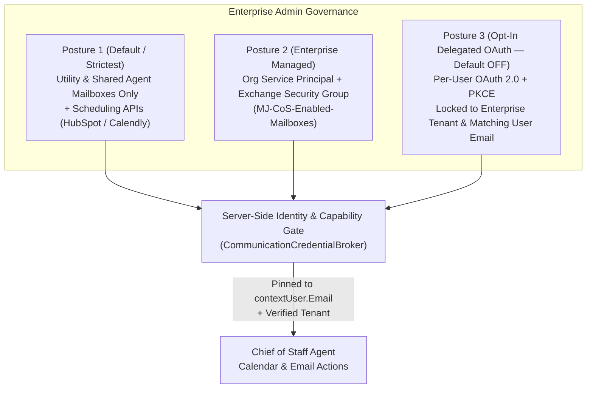
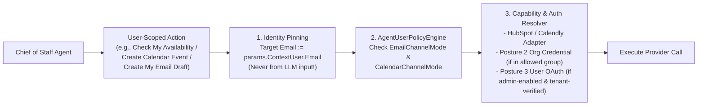

# Investigation & Architecture Plan: User-Scoped Email, Calendar, Availability & OAuth Governance

> **Status:** Investigation & Architectural Proposal (Fast-Follow to Chief of Staff Agent)  
> **Default Posture:** Enterprise-wide Per-User OAuth is **DISABLED by default** (`AllowUserDelegatedOAuth = false`).

---

## 1. Executive Summary & Problem Statement

MemberJunction's Communication Framework (`@memberjunction/communication-types`, `@memberjunction/communication-engine`, `@memberjunction/communication-ms-graph`, `@memberjunction/communication-gmail`) was originally architected around **system-driven and bulk communications**, where an enterprise service account or shared utility mailbox sends and receives messages.

With the introduction of personal, always-on agents like the **Chief of Staff (CoS)**, we need a clear, security-first architecture for how an agent acting on behalf of a specific user (`contextUser`) can:
1. Check the user's **calendar availability** and **propose or schedule meetings**.
2. Read, summarize, or **draft emails** where permitted by the organization and the user.
3. Leverage external scheduling systems (**HubSpot Meetings**, **Calendly**, **Microsoft Bookings**) to check availability or issue single-use booking links—even when direct access to the user's Exchange/Gmail inbox is restricted.

### Key Enterprise Security Findings
1. **Enterprise Service Principals Are Usually Scope-Limited to Utility Mailboxes:**  
   In most production deployments, the Microsoft Entra or Google Workspace credential configured for MJ Communication is restricted by IT (via Exchange RBAC for Applications / `ApplicationAccessPolicy`) to a handful of **utility or shared mailboxes** (e.g., `notifications@company.com`, `cos@company.com`), **not** individual employee mailboxes.
2. **Unrestricted Per-User OAuth Carries Severe DLP & Shadow-IT Risks:**  
   Allowing users to arbitrarily OAuth-connect personal accounts (e.g., a personal `@gmail.com` or `@outlook.com` address) or external company tenants to an enterprise MJ instance creates an immediate **data exfiltration vector** (an agent with access to internal MJ entities could draft or send company data through a personal email account, or ingest personal non-business emails into corporate storage).
3. **Mandatory Identity & Tenant Matching Gates:**  
   Whether an organization uses **Enterprise Auth** (Posture 2) or enables **Per-User Delegated OAuth** (Posture 3), MJ must enforce **strict principal and tenant matching**:
   - A logged-in user (`alice@company.com`) can **only** ever connect or query the mailbox/calendar matching `alice@company.com` within the organization's verified tenant (`TenantID` / domain).
   - If the enterprise token does not have permission for `alice@company.com` (and per-user OAuth is disabled), MJ must **not** offer personal inbox/calendar connection options during CoS onboarding.

---

## 2. Three Enterprise Deployment Postures

Organizations have very different security appetites for executive and employee mailboxes. Rather than assuming a single model, MJ should support three explicit postures controlled by administrators:

### Posture 1: Utility/Shared Agent Mailbox + Scheduling Link APIs *(Default & Lowest Risk)*
- **How IT Configures It:** The enterprise MS Graph / Google credential only has access to dedicated utility mailboxes (e.g., `cos@company.com` registered in `MJ: AI Bridge Agent Identities`) and/or read/book access to **HubSpot Meetings** or **Calendly**. It has **zero access** to employees' personal corporate inboxes.
- **How Chief of Staff Works:**
  - **Email:** Users CC or forward threads to `cos@company.com`. The CoS reads from its own utility mailbox, matches the sender to `contextUser.Email`, and replies or drafts responses from `cos@company.com` ("On behalf of Jordan Taylor...").
  - **Calendar & Availability:** Users either invite `cos@company.com` as an attendee on key meetings or let CoS query **HubSpot Meetings** / **Calendly** availability APIs to propose times and generate single-use booking links.
- **Why Enterprises Choose This (e.g., Blue Cypress):** Zero exposure of private executive/HR/legal emails to any service principal or OAuth token.

### Posture 2: Enterprise Service Principal + Exchange Security-Group Scope *(IT-Managed Personal Calendar/Mail)*
- **How IT Configures It:**
  - IT creates a mail-enabled security group in Entra/Exchange (e.g., `MJ-CoS-Calendar-Users` or `MJ-CoS-Mailbox-Users`) and binds the MJ Service Principal to that group via **Exchange RBAC for Applications** (`New-ManagementRoleAssignment -App <AppId> -Role "Application Calendars.ReadWrite" -CustomResourceScope <Group>`).
  - Note that IT can grant **`Calendars.ReadWrite` only** (without `Mail.Read` or `Mail.Send`) so CoS can manage calendars and check free/busy while keeping email completely off-limits!
- **How MJ Enforces Security:**
  1. **Zero LLM Mailbox Parameter:** User-scoped actions (`Get My Calendar Events`, `Check Meeting Availability`, `Create Calendar Event`, `Get My Inbox Messages`, `Create My Email Draft`) **do not accept a mailbox parameter from the agent**. The server injects `Identifier = params.ContextUser.Email`.
  2. **Preflight Capability Probe:** Before Chief of Staff offers calendar or inbox integration during onboarding, MJ executes a lightweight server-side probe against `/v1.0/users/{contextUser.Email}/calendar` and `/v1.0/users/{contextUser.Email}/mailFolders/inbox` using the enterprise credential:
     - If `403 ErrorAccessDenied` is returned by Graph, MJ knows this user is **not** in the Exchange security group for that capability and **hides/disables the option automatically**.

### Posture 3: Admin-Gated Per-User Delegated OAuth 2.0 *(Disabled by Default)*
- **When Considered:** For organizations where IT prefers 3-legged user-consented OAuth tokens (`/v1.0/me/...`) over app-only Exchange RBAC permissions, so each token cryptographically carries only the scopes that user consented to.
- **Strict Enterprise Guardrails (Mandatory if Enabled):**
  1. **Enterprise-Wide Master Switch (Default `false`):** Controlled by an admin setting (`AllowUserDelegatedOAuth = false` by default). Unless an administrator explicitly enables it, no user can initiate a personal OAuth flow.
  2. **Tenant & Domain Lock (`AllowedOAuthTenantIDs` / `AllowedEmailDomains`):** The OAuth authorization request includes Entra's `domain_hint` and specific `tenantId` endpoint (`https://login.microsoftonline.com/{enterpriseTenantId}/oauth2/v2.0/authorize` — **never** `/common` or `/consumers`!).
  3. **Strict Principal Matching on Callback:** During the `/api/v1/oauth/callback` token exchange, MJ verifies the ID token / `/me` profile before storing the token:
     - `token.tid === configuredEnterpriseTenantId` (or Google `token.hd === configuredWorkspaceDomain`).
     - `NormalizeEmail(token.email || token. preferred_username) === NormalizeEmail(contextUser.Email)`.
     - If a user attempts to sign into a personal Gmail/Outlook account or a different employee's account during the OAuth popup, the callback **aborts immediately, revokes the token, and logs a security audit event**.

---

## 3. Proposed Calendar, Meeting & Availability Verbs

### 3.1 Extending `BaseCommunicationProvider` (`@memberjunction/communication-types`)

Currently, [`BaseCommunicationProvider`](../packages/Communication/base-types/src/BaseProvider.ts) defines `GetEvents()` (implemented in [`MSGraphProvider`](../packages/Communication/providers/MSGraph/src/MSGraphProvider.ts)). To support full calendar coordination, we propose adding the following strongly-typed verbs to `BaseCommunicationProvider`:

| Verb | Purpose | MS Graph Endpoint | Google Calendar Endpoint |
| :--- | :--- | :--- | :--- |
| **`GetEvents`** *(Exists in MSGraph)* | List calendar events in a time window (`StartDateTime`..`EndDateTime`) with recurrence expansion | `GET /users/{id}/calendarView` | `GET /calendars/{id}/events` (`singleEvents=true`) |
| **`GetFreeBusy`** *(New)* | Check free/busy schedule blocks for the user and internal attendees without exposing private event bodies | `POST /users/{id}/calendar/getSchedule` | `POST /freeBusy` |
| **`FindMeetingTimes`** *(New)* | Ask the provider to suggest optimal meeting slots given attendees, duration, and time constraints | `POST /users/{id}/findMeetingTimes` | Computed over `POST /freeBusy` + working hours |
| **`CreateCalendarEvent`** *(New)* | Create a calendar event / send meeting invites (with optional Teams / Google Meet link generation and `DryRun` support) | `POST /users/{id}/events` (`isOnlineMeeting: true`) | `POST /calendars/{id}/events` (`conferenceDataVersion=1`) |
| **`UpdateCalendarEvent`** *(New)* | Reschedule or update attendees/agenda on an existing event | `PATCH /users/{id}/events/{eventId}` | `PATCH /calendars/{id}/events/{eventId}` |
| **`RespondToCalendarEvent`** *(New)* | Accept, tentatively accept, or decline an invitation with an optional message | `POST /users/{id}/events/{eventId}/accept\|tentativelyAccept\|decline` | `PATCH /calendars/{id}/events/{eventId}` (attendee `responseStatus`) |
| **`CancelCalendarEvent`** *(New)* | Cancel an event organized by the user | `POST /users/{id}/events/{eventId}/cancel` | `DELETE /calendars/{id}/events/{eventId}` |

---

## 4. Third-Party Scheduling & Availability APIs (HubSpot, Calendly, MS Bookings)

A major advantage of integrating **scheduling link providers** (HubSpot Meetings, Calendly, Microsoft Bookings) is that **they already enforce the user's booking rules, buffer times, and working hours**, and they can be queried via an org-level API key **without granting the agent raw access to the user's Exchange/Gmail inbox**!

### 4.1 API Capabilities Survey

| Platform | Availability & Free/Busy API | Booking / Link Generation API | Auth Model |
| :--- | :--- | :--- | :--- |
| **HubSpot Meetings** *(HubSpot Scheduler API v3)* | - `GET /scheduler/v3/meetings/meeting-links` (lookup link by `organizerUserId` / email) - `GET /scheduler/v3/meetings/meeting-links/book/availability-page/{slug}?timezone=...` (returns exact bookable time slots for `15`, `30`, `60` min durations based on the user's connected calendar!) | - `POST /scheduler/v3/meetings/meeting-links/book` (books a meeting directly on the user's HubSpot meeting link) - Or share the user's meeting link URL (`https://meetings.hubspot.com/{slug}`) | Org-level HubSpot Private App Token (`scheduler.meetings.meeting-link.read`, `scheduler.meetings.meeting-link.write`) — **no per-user OAuth required in MJ!** |
| **Calendly** *(Calendly API v2)* | - `GET /users/me` or `GET /organization_memberships` (resolve user URI by email) - `GET /user_busy_times?user={uri}&start_time=...&end_time=...` - `GET /event_type_available_times?event_type={uri}&start_time=...&end_time=...` | - `POST /scheduling_links` (`max_event_count: 1`, `owner: eventTypeUri`) — **generates a single-use booking link** that expires as soon as the recipient books! | Org-level Calendly Personal Access Token / OAuth App at the organization level — **no per-user mailbox access required!** |
| **Microsoft Bookings** *(MS Graph v1.0)* | - `POST /solutions/bookingBusinesses/{id}/getStaffAvailability` (returns staff free/busy slots) | - `POST /solutions/bookingBusinesses/{id}/appointments` | Standard MS Graph credential (`Bookings.Read.All` / `BookingsAppointment.ReadWrite.All`) |

### 4.2 Why Scheduling APIs Pair So Well with Posture 1
In an enterprise where IT locks down direct Exchange mailbox access (Posture 1), the Chief of Staff can still:
1. Call **`Check User Availability`** → which queries the user's **HubSpot Meetings** or **Calendly** availability endpoint (matched by `contextUser.Email`).
2. Call **`Generate Single-Use Scheduling Link`** (Calendly) or **`Propose Meeting Slots`** (HubSpot Meetings) → allowing the CoS to offer 3 concrete open slots or a one-time booking link to an external client or colleague without ever touching raw Exchange tokens.

---

## 5. Proposed User-Scoped Actions & Policy Guardrails

Instead of exposing raw provider parameters where an LLM could specify another person's email address, MJ should expose **User-Scoped Actions** that always bind to `params.ContextUser` and pass through `AgentUserPolicyEngine`:

### Proposed Action Catalog (Fast-Follow Implementation Wave)
1. **`Verify My Communication Capabilities`**
   - Runs during Chief of Staff onboarding (or Settings check).
   - Probes which channels are actually permitted for `contextUser.Email` under the enterprise's active posture (`UtilityMailboxOnly`, `SchedulingLinksOnly`, `EnterpriseCalendarRead`, `EnterpriseCalendarReadWrite`, `EnterpriseMailDraft`, etc.) so the CoS only offers options that the user and enterprise IT actually allow.
2. **`Get My Calendar Events & Availability`**
   - Reads `contextUser.Email`'s calendar events or free/busy slots across MS Graph, Google Calendar, HubSpot Meetings, or Calendly.
3. **`Propose Or Schedule Meeting`**
   - Finds mutual availability (`FindMeetingTimes` / HubSpot / Calendly), generates a single-use scheduling link or calendar invite, and respects `CalendarChannelMode` (`ReadOnly | ProposeWithApproval | Autonomous`).
4. **`Get My Inbox Messages` & `Create My Email Draft`**
   - Strictly pinned to `contextUser.Email` (or the user's `AIBridgeAgentIdentity` utility inbox in Posture 1) and gated by `EmailChannelMode` (`Disabled | DraftOnly | SendWithApproval | Autonomous`).

---

## 6. Phased Implementation Plan (When Approved)

| Phase | Scope | Key Deliverables |
| :--- | :--- | :--- |
| **Phase 1: Scheduling API Adapters & Calendar Verbs (Posture 1 & 2)** | Zero new OAuth surface; uses existing `CredentialEngine` org credentials | - Add `GetFreeBusy`, `FindMeetingTimes`, `CreateCalendarEvent`, `UpdateCalendarEvent`, `RespondToCalendarEvent` to `BaseCommunicationProvider` and `MSGraphProvider` / `GmailProvider`. - Add **HubSpot Meetings** and **Calendly** availability/booking actions. - Add `Verify My Communication Capabilities` preflight probe + user-scoped Calendar & Draft actions pinned to `contextUser.Email`. |
| **Phase 2: `AIAgentUserPolicy` Calendar Governance** | Metadata & policy engine | - Add `CalendarChannelMode` (`Disabled \| ReadOnly \| ProposeWithApproval \| Autonomous`) to `MJ: AI Agent User Policies` and `AgentUserPolicyEngine`. |
| **Phase 3: Optional Admin-Gated User OAuth (Posture 3 — Default OFF)** | Only if/when needed for customers that cannot use Posture 1 or 2 | - Add `AllowUserDelegatedOAuth` (default `0`), `AllowedOAuthTenantIDs`, and `AllowedEmailDomains` to provider configuration. - Add `OwnerUserID` to `MJ: Credentials` and generalize `OAuthCallbackHandler` with the 4-gate tenant + `contextUser.Email` identity matcher. |
