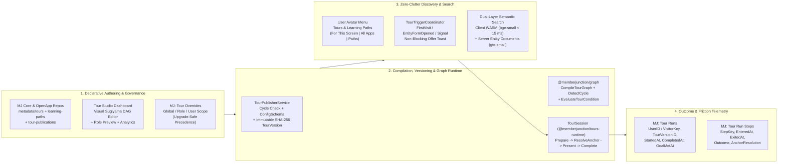
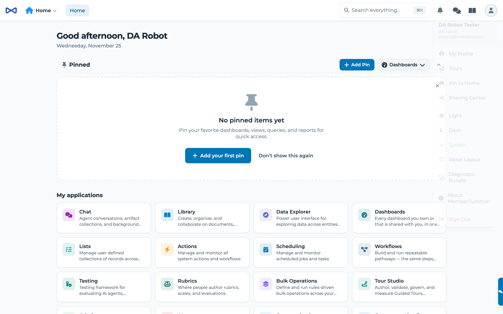
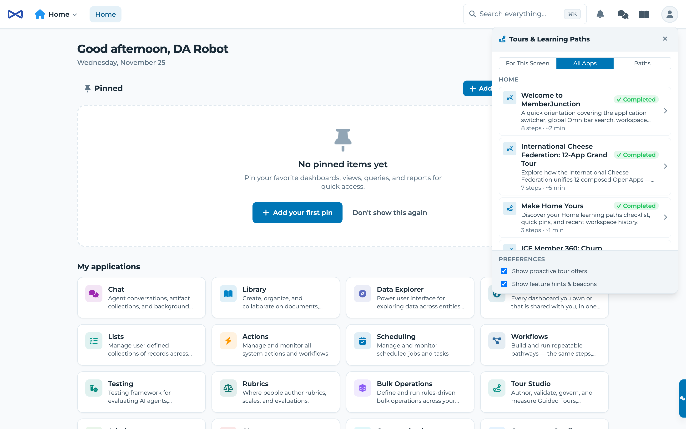
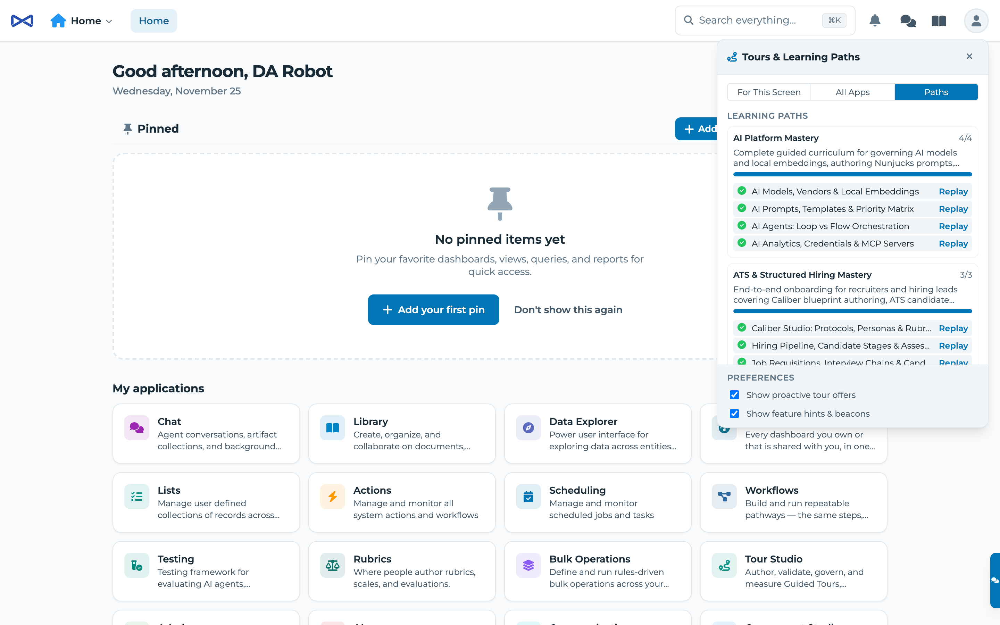
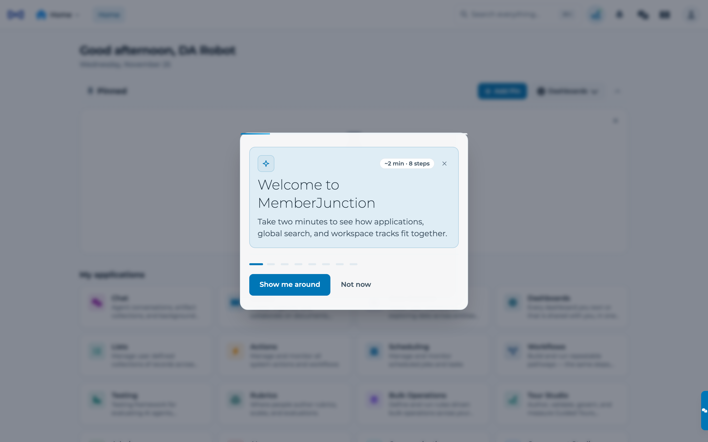
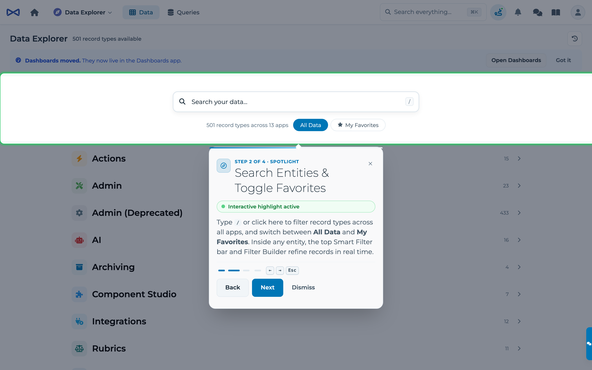
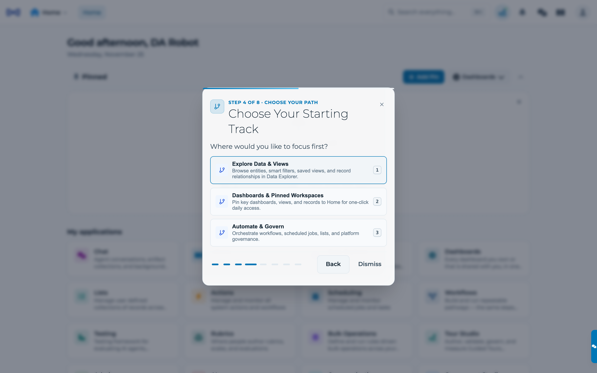
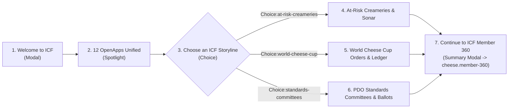
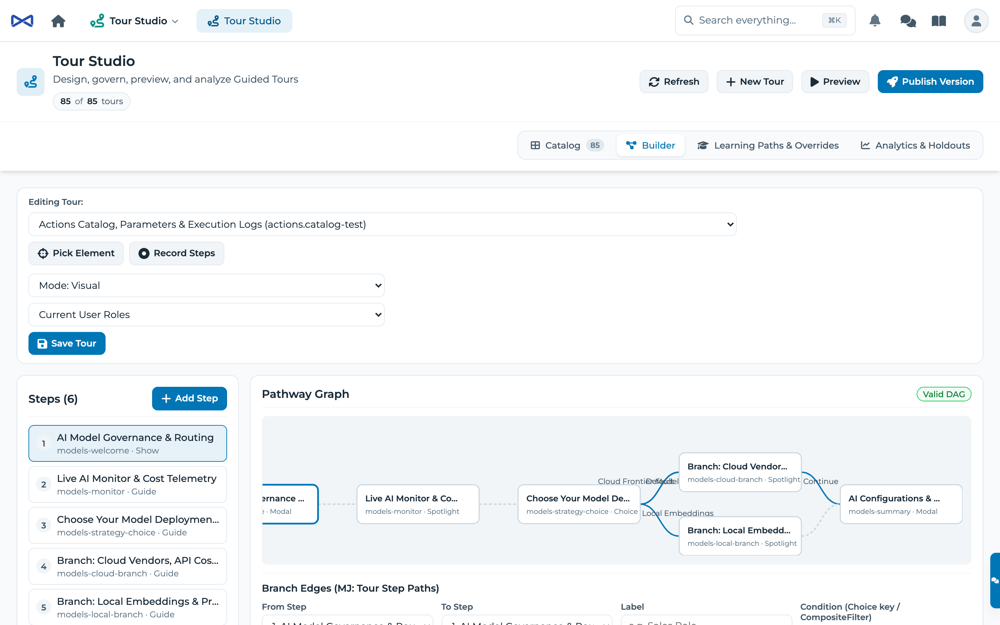

# MemberJunction Guided Tours & Learning Paths Guide

MemberJunction includes a first-class, metadata-driven **Guided Tours & Learning Paths** platform spanning framework core (`@memberjunction/tours-runtime`, `@memberjunction/ng-tours`, `@memberjunction/tours-server`, `TourEngine`, and `TourStudioDashboard`) and the entire **OpenApp (`bizapps-*` / federated host) ecosystem**.

Every MemberJunction application and OpenApp can ship declarative, upgrade-safe tours and multi-tour learning paths directly in `metadata/`, verify UI anchors statically in CI (`mj standards check --check tour-anchors`), execute multi-branch DAG pathways via `@memberjunction/graph`, link seamlessly across upstream and downstream applications, surface sub-15 ms semantic search results in the Omnibar, and record per-user step-level completion and duration telemetry.

---

## Table of Contents

1. [Architecture Overview](#1-architecture-overview)
2. [Discovery Surfaces: User Menu Launcher, First-Visit Offers & Omnibar](#2-discovery-surfaces-user-menu-launcher-first-visit-offers--omnibar)
3. [Package & Runtime Layering](#3-package--runtime-layering)
4. [Authoring Shipped Tours & Learning Paths in Metadata](#4-authoring-shipped-tours--learning-paths-in-metadata)
5. [Anchor Strategies & Static CI Verification (`tour-anchors`)](#5-anchor-strategies--static-ci-verification-tour-anchors)
6. [DAG Branching (`Choice` Steps & `@memberjunction/graph` Pathways)](#6-dag-branching-choice-steps--memberjunctiongraph-pathways)
7. [Cross-App Tour Linking Across OpenApps](#7-cross-app-tour-linking-across-openapps)
8. [Dual-Layer Semantic Vector Search (Zero API Keys Required)](#8-dual-layer-semantic-vector-search-zero-api-keys-required)
9. [Publishing, Immutable SHA-256 Snapshots & Upgrade-Safe Overrides](#9-publishing-immutable-sha-256-snapshots--upgrade-safe-overrides)
10. [Telemetry: Completion Tracking, Step Dwell Time & Outcome Lift](#10-telemetry-completion-tracking-step-dwell-time--outcome-lift)
11. [Embedding `<mj-tour-host>` in External Angular & Web Applications](#11-embedding-mj-tour-host-in-external-angular--web-applications)
12. [Sage Voice & Chat Guide Feature Flag (`Tours.SageVoiceGuide.Enabled`)](#12-sage-voice--chat-guide-feature-flag-tourssagevoiceguideenabled)
13. [Playwright End-to-End Verification Recipe](#13-playwright-end-to-end-verification-recipe)
14. [Shipped Ecosystem Tour Catalog Reference](#14-shipped-ecosystem-tour-catalog-reference)

---

## 1. Architecture Overview



### Core Design Principles

- **Clean Workspace Chrome**: Tours and Learning Paths live inside the **User Avatar Menu** (**Tours**) rather than occupying permanent real estate on the Home dashboard. While a tour is actively running, a compact route indicator pill appears in the header for one-click pause/resume/stop controls.
- **Immutable Version Snapshots**: Editing a draft tour never mutates in-flight runs or historical analytics. Publishing a tour computes a canonical SHA-256 content hash and writes an immutable `MJ: Tour Versions` snapshot (`v1`, `v2`, …) referenced by `Tour.CurrentVersionID` and `TourRun.TourVersionID`.
- **Semantic & Resilient Anchors**: Tours anchor to `data-mj-tour-anchor="<prefix>.<area>.<element>"` attributes, semantic entity form hooks (`FormField`, `FormSection`, `FormRailGroup`, `FormToolbarAction`), or `NavItem` driver classes — never brittle CSS class chains — and declare `OnMissing: "Center"` fallbacks so UI layout changes never strand a user mid-tour.
- **True Directed Acyclic Graph (DAG) Execution**: Every tour compiles into an `@memberjunction/graph` `IGraphRepository`, supporting `Choice` branching, `CompositeFilter` / `SafeExpressionEvaluator` edge conditions, convergence onto shared summary steps, and static cycle rejection via `DetectCycle`.
- **Self-Paced First, Optional AI Ready**: All shipped tours run 100% deterministically without requiring any LLM or voice model. Sage Voice/Chat guidance is governed globally by `Tours.SageVoiceGuide.Enabled` (default `false`).

---

## 2. Discovery Surfaces: User Menu Launcher, First-Visit Offers & Omnibar

### A. Clean Home & User Avatar Menu (`Tours`)

Opening the **User Avatar Menu** in the top-right shell header reveals **Tours** (`core.shell.tours-launcher`) directly beneath **My Profile**, keeping the Home workspace focused on pinned items and applications:



Clicking **Tours** opens the **Tours & Learning Paths** three-tab launcher popover:

1. **For This Screen**: Contextual tours matching the active application, dashboard `DriverClass`, or open entity record.
2. **All Apps**: Global catalog grouping every eligible active tour across MemberJunction Core and installed OpenApps (`Orders`, `Sales`, `Accounting`, `Sonar`, `AI`, `Knowledge Hub`, etc.) with live **`✓ Completed`** and **`In Progress`** status badges so users can launch or replay any tour from anywhere.
3. **Paths**: Structured multi-tour onboarding curricula (`MJ Essentials`, `AI Platform Mastery`, `Quote-to-Cash Revenue Chain`, `ICF Staff Federation Onboarding`) with completion progress bars and interactive per-tour checklists.





### B. Proactive Non-Blocking First-Visit Offers

When a user enters an application for the first time (for example, opening `AI`, `Orders`, `Accounting`, or `Sonar`), `ExplorerTourHost` evaluates `MJ: Tour Triggers` (`TriggerType = 'FirstVisit'`) through `TourTriggerCoordinator`:

- Respects the user's `OffersEnabled` preference stored in `UserInfoEngine` (`mj.tours.preferences.v1` in `MJ: User Settings` — never `localStorage`).
- Enforces `CooldownDays` and per-session interruption budgets so users are never spammed.
- Surfaces a polite bottom-right toast (`Start tour` / `Not now`) that never steals keyboard focus.

### C. Welcome Hero & Double-Halo Spotlight Presentation

Tours open with a clean, focused Welcome Hero modal (`Variant: "welcome"`) — suppressing any Back button on Step 1 — and step across live workbenches using an SVG spotlight mask with a double-halo focus ring and Light DOM design tokens (`--mj-*` for light/dark parity):





---

## 3. Package & Runtime Layering

| Package / Module | Layer | Responsibility |
| --- | --- | --- |
| `@memberjunction/graph` | Portable TS (`packages/Graph`) | Zero-MJ-core graph primitives: `DetectCycle`, `RankGraphNodes`, Sugiyama `LayoutGraphNodes`, `IGraphRepository`, `IConditionEvaluator`. |
| `@memberjunction/tours-runtime` | Portable TS (`packages/Tours/Runtime`) | Framework-agnostic `TourSession` state machine, `CompileTourGraph`, `EvaluateTourCondition`, `TourEligibilityEvaluator`, `TourTriggerCoordinator`, `TourSignals`, `TourAgentToolkit`. |
| `@memberjunction/ng-tours` | Generic Angular (`packages/Angular/Generic/tours`) | `<mj-tour-host>` (and `<mj-tour-host-element>` custom element), `Overlay` / `SidePanel` / `Embedded` presenters, step renderers (`Modal`, `Spotlight`, `Action`, `Beacon`, `Banner`, `Choice`, `Media`, `EmbeddedComponent`), `DomTourAnchorBridge`, `mjTourAnchor` directive, Light DOM `--mj-*` styles. Zero `@angular/router` or Explorer dependencies. |
| `@memberjunction/core-entities` (`TourEngine`) | Client + Server Metadata Engine | Loads and caches `Tour`, `TourStep`, `TourStepPath`, `TourVersion`, `TourTrigger`, `TourPrerequisite`, `TourOverride`, `LearningPath`, and `TourRun` metadata; resolves precedence overrides; exposes `IsSageVoiceGuideEnabled`. |
| `@memberjunction/tours-server` | Server (`packages/Tours/Server`) | `TourPublisherService` (DAG validation + canonical SHA-256 `TourVersion` snapshotting), `Tours.PublishTour` action, anonymous `VisitorKey` guest run claiming (`Tours.ClaimGuestRuns`). |
| `@memberjunction/ng-explorer-core` (`ExplorerTourHost`) | Explorer Host Adapter | Bridges `ApplicationManager`, `WorkspaceStateManager`, `NavigationService` (`Prepare` app/tab/record navigation), `OmnibarSemanticIndexService`, and the User Avatar Menu launcher. |
| `@memberjunction/ng-dashboards` (`TourStudioDashboard`) | Visual Authoring & Analytics | Sugiyama DAG visual pathway viewer/editor, role simulation preview, anchor health diagnostics, and completion/goal conversion analytics. |

---

## 4. Authoring Shipped Tours & Learning Paths in Metadata

Both MemberJunction Core and downstream OpenApps author tours declaratively in three metadata folders registered in `metadata/.mj-sync.json` (`directoryOrder`):

1. `metadata/tours/` (`MJ: Tours` + nested `MJ: Tour Steps`, `MJ: Tour Step Paths`, `MJ: Tour Prerequisites`, `MJ: Tour Triggers`) — authored with `"Status": "Draft"` so steps and paths insert cleanly before activation.
2. `metadata/learning-paths/` (`MJ: Learning Paths` + nested `MJ: Learning Path Tours`).
3. `metadata/tour-publications/` (`MJ: Tours` override setting `"Status": "Active"` after steps/paths exist).

### Required `.mj-sync.json` Files for OpenApp Repositories

When adding Guided Tours to any OpenApp repository:

1. Append `"tours"`, `"learning-paths"`, and `"tour-publications"` to `directoryOrder` in `metadata/.mj-sync.json`.
2. Add the three folder `.mj-sync.json` descriptors:

```json
// metadata/tours/.mj-sync.json
{
  "entity": "MJ: Tours",
  "filePattern": "**/.*.json",
  "relatedEntities": {
    "MJ: Tour Steps": { "entity": "MJ: Tour Steps", "foreignKey": "TourID" },
    "MJ: Tour Step Paths": { "entity": "MJ: Tour Step Paths", "foreignKey": "TourID" },
    "MJ: Tour Prerequisites": { "entity": "MJ: Tour Prerequisites", "foreignKey": "TourID" },
    "MJ: Tour Triggers": { "entity": "MJ: Tour Triggers", "foreignKey": "TourID" }
  }
}
```

```json
// metadata/learning-paths/.mj-sync.json
{
  "entity": "MJ: Learning Paths",
  "filePattern": "**/.*.json",
  "relatedEntities": {
    "MJ: Learning Path Tours": { "entity": "MJ: Learning Path Tours", "foreignKey": "LearningPathID" }
  }
}
```

```json
// metadata/tour-publications/.mj-sync.json
{
  "entity": "MJ: Tours",
  "filePattern": "**/.*.json",
  "overrides": [{ "folder": "tours", "fields": ["Status"] }]
}
```

> [!IMPORTANT]
> **UUID & Zero-Dependency Rules for OpenApps**
> - Mint every `primaryKey.ID` using genuine random v4 UUIDs (`crypto.randomUUID().toUpperCase()`) — never sequential suffixes (`...0001`, `...0002`), which distribution seed checks reject.
> - OpenApp Angular templates only need plain HTML `data-mj-tour-anchor="orders.header.summary"` attributes — **zero** TypeScript imports or `package.json` dependencies on `@memberjunction/ng-tours` are required in downstream packages!

---

## 5. Anchor Strategies & Static CI Verification (`tour-anchors`)

Every step's `Anchor` resolves through `DomTourAnchorBridge` using resilient, refactor-safe strategies:

| Strategy | Example JSON | How It Resolves |
| --- | --- | --- |
| `Registered` | `{ "Strategy": "Registered", "Key": "ai.models.toolbar" }` | Matches `[data-mj-tour-anchor="ai.models.toolbar"]`, `[mjTourAnchor]="'ai.models.toolbar'"`, or runtime `TourAnchorRegistry.RegisterAnchor(...)`. |
| `NavItem` | `{ "Strategy": "NavItem", "DriverClass": "OrdersSectionResource" }` | Locates the navigation item tab/button for the target resource `DriverClass`. |
| `FormField` | `{ "Strategy": "FormField", "Entity": "MJ: AI Agents", "Field": "Name" }` | Uses `FormAnchorNavigator` to expand any collapsed section and scroll to `[data-field-name="Name"]`. |
| `FormSection` | `{ "Strategy": "FormSection", "Entity": "{{Context.Record.EntityName}}", "Section": "Details" }` | Supports live `{{Context.*}}` interpolation for contextual record tours (`core.records`). |
| `FormRailGroup` / `FormToolbarAction` | `{ "Strategy": "FormRailGroup", "RailKey": "history" }` | Highlights standard record form rail tabs (`history`, `comments`, related entities) or toolbar actions (`favorite`). |

### Static CI Gate (`mj standards check --check tour-anchors`)

Adopted in `.mj-standards.json`, the `tour-anchors` check statically verifies all `metadata/tours/*.json` files in CI without needing a running browser:
1. Enforces `allowedPrefixes` namespace governance (`core.`, `ai.`, `kh.`, `testing.`, `ps.`, `video.`, `lists.`, `actions.`, `workflows.`, `scheduling.`, `comm.`, `admin.`, `builder.`) across `TourKey`, `Registered` anchor keys, and `Signal` names.
2. Verifies every non-templated `Registered` anchor key exists either in `@memberjunction/ng-tours`'s `core-anchor-manifest.json` (`core.shell.app-switcher`, `core.shell.omnibar`, `core.shell.user-menu`, `core.shell.notifications`, `core.shell.chat`, `core.shell.tab-strip`, `core.shell.home`, `core.shell.tours-launcher`) or in an `.html` / `.ts` template in the repository.
3. Validates literal `Entity` and `Field` names on `FormField` anchors against generated entity metadata.
4. Flags brittle raw CSS `Strategy: "Selector"` usage unless explicitly justified.

---

## 6. DAG Branching (`Choice` Steps & `@memberjunction/graph` Pathways)

Guided Tours are **directed acyclic graphs**, not rigid linear arrays. Any tour can include one or more `Choice` steps that let the user pick their role, deployment architecture, or operational task, route along conditional `MJ: Tour Step Paths` edges, and converge cleanly onto a shared summary step.



### How `CompileTourGraph` Synthesizes vs. Branches Edges

> [!WARNING]
> **Critical DAG Authoring Rule (`CompileTourGraph`)**
> `CompileTourGraph` (`packages/Tours/Runtime/src/tour-graph-compiler.ts`) automatically synthesizes a sequential edge `Steps[i] -> Steps[i + 1]` **for any step that has zero explicit outgoing `MJ: Tour Step Paths`**.
>
> Therefore, whenever a `Choice` step fans out to multiple branch steps (e.g., Step 4 Branch A and Step 5 Branch B) that converge onto Step 6 Summary:
> 1. Give the `Choice` step explicit outgoing `MJ: Tour Step Paths` to **each** branch (`Condition: "Choice:<optionKey>"`, `Priority: 100`, `IsDefault: false`) plus a fallback default edge (`Condition: null`, `Priority: 0`, `IsDefault: true`).
> 2. **Give every non-final branch step (e.g. Step 4 Branch A) an explicit outgoing `MJ: Tour Step Paths` row pointing directly to Step 6 Summary (`Condition: null, IsDefault: true, Priority: 10`)** — otherwise Step 4 would have zero outgoing paths and fall through sequentially into Step 5 Branch B!

### Real Shipped DAG Examples Across MJ & OpenApps



Shipped multi-branch DAG tours across the ecosystem include:
- **Core MJ**:
  - `core.welcome` (*Welcome to MemberJunction*): 3-way `Choice` (`explore-data`, `dashboards-pins`, `automate-admin`) converging on User Menu replay summary.
  - `ai.models-routing` (*AI Models, Vendors & Local Embeddings*): 2-way `Choice` contrasting Cloud Frontier Model Failover vs. Zero-Key Local ONNX/WASM Embeddings (`gte-small` / `bge-small`).
  - `ai.agents-orchestration` (*AI Agents: Loop vs Flow Orchestration*): 2-way `Choice` contrasting dynamic ReAct Loop Agents vs. deterministic Flow DAG Agents.
  - `testing.suites-cases` (*Test Suites, Cases & Evaluation Modes*): 2-way `Choice` contrasting Deterministic Schema/SQL Oracles vs. Multi-Criteria Rubric Scoring.
  - `scheduling.work-queue` (*Durable Work Queues & Dead-Letter Replay*): 2-way `Choice` for Dead-Letter Inspection/Replay vs. Partition Concurrency Tuning.
- **Downstream OpenApps**:
  - `orders.order-to-cash` (`bizapps-orders`): Standard Fulfillment & Invoicing vs. Instalment Schedules & Subscriptions.
  - `sales.close-won-forecasting` (`bizapps-sales`): Contracted Enterprise Deal Handoff vs. Direct Order & Forecast Snapshot.
  - `accounting.journal-batches` (`bizapps-accounting`): Automated Subledger Batch Dispatch vs. Manual Accruals & Reversing Entries.
  - `forms.builder-bindings` (`bizapps-forms`): Direct MJ Entity Field Bindings vs. Post-Submit Actions & Notifications.
  - `tasks.my-work-inbox` (`bizapps-tasks`): Prerequisite Dependencies & Blockers vs. Structured Decision Logs.
  - `sonar.model-builder` (`bizapps-sonar`): Deterministic Rolling-Window SQL Factors vs. Bounded Qualitative AI Factors.
  - `cheese.grand-tour-icf` (`more-cheese`): 3-way 12-OpenApp ICF federation storyline (`at-risk-creameries`, `world-cheese-cup`, `standards-committees`).



---

## 7. Cross-App Tour Linking Across OpenApps

Downstream OpenApps compose into multi-app business workflows (such as **Marketing → Sales → Contracts → Orders → Accounting → FP&A**, or **More-Cheese's 12-OpenApp federation**). Guided Tours provides three complementary mechanisms to link tours across repository boundaries safely:

### 1. Upstream `MJ: Tour Prerequisites` (`@lookup:MJ: Tours.TourKey=...`)
When an OpenApp declares a hard upstream dependency in `mj-app.json` (or references MJ Core), its tours can declare `Recommended` or `Required` prerequisites pointing to upstream `TourKey`s:

```json
// Example from bizapps-sales: sales.close-won-forecasting
"MJ: Tour Prerequisites": [
  {
    "fields": {
      "TourID": "@parent:ID",
      "PrerequisiteType": "Tour",
      "RequiredTourID": "@lookup:MJ: Tours.TourKey=contracts.lifecycle",
      "Strength": "Recommended",
      "Sequence": 1
    },
    "primaryKey": { "ID": "..." }
  },
  {
    "fields": {
      "TourID": "@parent:ID",
      "PrerequisiteType": "Tour",
      "RequiredTourID": "@lookup:MJ: Tours.TourKey=orders.order-to-cash",
      "Strength": "Recommended",
      "Sequence": 2
    },
    "primaryKey": { "ID": "..." }
  }
]
```

### 2. Resilient Cross-App `NextTourKey` Handoffs (Optional Sibling Apps)
When an app wants to hand off to a downstream or sibling app that **might or might not be installed** on a given customer host (for example, `marketing.programs-content` → `"NextTourKey": "sales.pipeline-deals"`, or `orders.order-to-cash` → `"NextTourKey": "accounting.journal-batches"`):
- Author `"NextTourKey": "accounting.journal-batches"` inside the final `Modal` step's `Configuration` JSON (no hard SQL FK required at sync time!).
- At runtime, `<mj-tour-host>` passes `AvailableTourKeys` (`ReadonlySet<string>`) into `ModalStepRenderer.ShowNextTourButton`. If `bizapps-accounting` is installed and eligible, the **"Start next tour"** CTA renders automatically; if not installed, the button hides cleanly with zero broken links!

### 3. Cross-App Federation Learning Paths
Higher-level apps and federated hosts assemble multi-app onboarding curricula in `MJ: Learning Paths`:
- **`sales.revenue-chain`** (`bizapps-sales` — *Quote-to-Cash Revenue Chain*): Chains `core.welcome` → `sales.pipeline-deals` → `sales.accounts-buying-roles` → `sales.close-won-forecasting` → `contracts.lifecycle` → `orders.order-to-cash`.
- **`cheese.icf-onboarding`** (`more-cheese` — *ICF Staff Federation Onboarding*): Chains `core.welcome` → `sonar.overview-portfolio` → `cheese.grand-tour-icf` → `cheese.member-360`.

---

## 8. Dual-Layer Semantic Vector Search (Zero API Keys Required)

Users never have to remember which app or tour explains a concept — natural-language queries work out of the box across **both** client and server vector layers with zero external API keys:

1. **Client-Side `< 15 ms` Browser WASM Embeddings (`OmnibarSemanticIndexService`)**:
   - Uses Explorer's in-browser `bge-small-en-v1.5` float32 Web Worker (`SimpleVectorService`) to embed both **whole tours** (`tour:<TourKey>`) and **individual tour steps** (`tour-step:<TourKey>:<StepKey>`).
   - Pressing `Cmd+K` (or clicking `<kbd>?</kbd> Search` inside the `Tours & Learning Paths` header) and typing *"replay dead letter queue"* or *"close fiscal period"* ranks matching tours and deep-links straight into the matching step via `StartTour(tourKey, { StartAtStepKey: stepKey })`.
2. **Server-Side `MJ: Entity Documents` Embeddings (`Tours Search` & `Tour Steps Search`)**:
   - Configured in `metadata/entity-documents/.entity-documents.json` using MJ's local **`Simple Vector Service Provider`** + **`gte-small (Local)`** model.
   - Makes every active tour and step discoverable through `SearchEngine` hybrid Reciprocal Rank Fusion (RRF), Knowledge Hub, and server-side AI agents.

---

## 9. Publishing, Immutable SHA-256 Snapshots & Upgrade-Safe Overrides

### Publishing Flow (`TourPublisherService`)
When a builder clicks **Publish** in `TourStudioDashboard` (or invokes the `Tours.PublishTour` action):
1. Validates the tour pathway via `ValidateTourGraph` (rejects cycles, duplicate `StepKey`s, and dangling `FromStepID`/`ToStepID` references).
2. Validates step `Configuration` JSON against each `TourStepType.ConfigSchema`.
3. Computes a deterministic SHA-256 hash over the canonicalized tour + steps + paths projection. If identical to the latest `MJ: Tour Versions` row, reuses it idempotently; otherwise inserts `VersionNumber = max + 1`, sets `Tour.CurrentVersionID`, and flips `Tour.Status = 'Active'`.

### Upgrade-Safe Customer Customization (`MJ: Tour Overrides`)
Organizations should **never** edit MJ-shipped or OpenApp-shipped rows in `MJ: Tours` directly (since the next release `Metadata_Sync` migration owns upstream rows). Instead, create rows in **`MJ: Tour Overrides`** scoped to `Global`, `Role`, or `User`:
- Suppress or snooze specific shipped tours (`IsDisabled = true`)
- Narrow `AudienceFilter` (e.g., restrict an accounting tour to a custom `Controller` role)
- Adjust `CooldownDays` or `TriggerDelivery` (`Auto`, `Offer`, `Beacon`, `LauncherOnly`)

`TourEngine` merges overrides deterministically (`User` > `Role` > `Global` > shipped `TourVersion` snapshot) so customizations survive every MJ and OpenApp upgrade untouched.

---

## 10. Telemetry: Completion Tracking, Step Dwell Time & Outcome Lift

Every tour execution streams batched telemetry events (`50 ms` debounced via `TourEngine.RecordEvents`) into two core entities surfaced in **Tour Studio → Analytics**:

- **`MJ: Tour Runs` (`__mj.TourRun`)**:
  - `UserID` (authenticated user) or `VisitorKey` (anonymous guest session, claimable post-login via `Tours.ClaimGuestRuns`)
  - `TourID` and `TourVersionID` (exact immutable SHA-256 version snapshot taken)
  - `Status`: `'In Progress' | 'Completed' | 'Dismissed' | 'Snoozed' | 'Abandoned'`
  - `LaunchSource`: `'Trigger' | 'Launcher' | 'Omnibar' | 'Agent' | 'Learning Path' | 'Link'`
  - `GuideMode`: `'Visual' | 'Chat' | 'Voice'`
  - `StartedAt`, `CompletedAt` (wall-clock duration = `CompletedAt - StartedAt`), `GoalMetAt` (outcome lift), and `PathTaken` JSON array recording exact DAG branch choices!
- **`MJ: Tour Run Steps` (`__mj.TourRunStep`)**:
  - `StepKey`, `Sequence`, `EnteredAt`, `ExitedAt` (exact per-step dwell time)
  - `Outcome`: `'Completed' | 'Skipped' | 'Already Known' | 'Done By Agent' | 'Anchor Missing' | 'Dismissed'`
  - `AnchorResolution`: `'Registered' | 'Semantic' | 'Role' | 'Selector' | 'Failed'` (surfaces broken/drifted anchors immediately in Tour Studio!)

---

## 11. Embedding `<mj-tour-host>` in External Angular & Web Applications

Because `@memberjunction/tours-runtime` and `@memberjunction/ng-tours` have zero dependencies on `@angular/router` or MJ Explorer, any standalone Angular portal, customer-facing hub, or vanilla web app can host MJ Guided Tours:

```typescript
// Standalone Angular host using WebTourHost + mountTours()
import { WebTourHost, mountTours } from '@memberjunction/ng-tours';

const host = new WebTourHost({
  SurfaceUrl: 'https://api.example.com/tours-surface',
  VisitorKeyStorage: customSessionAdapter,
});

const handle = await mountTours(document.body, { Host: host });
await handle.Start('orders.catalog-checkout');
```

Or mount declaratively as a W3C Custom Element (`<mj-tour-host-element>`) in React, Vue, WordPress, or static documentation portals.

---

## 12. Sage Voice & Chat Guide Feature Flag (`Tours.SageVoiceGuide.Enabled`)

MemberJunction includes full plumbing for **Sage** realtime voice and chat tour guidance (`TourChannel`, `TourAgentToolkit`, `TourVoiceDockComponent`, and `ExplorerTourHost.RequestVoiceGuide`).

By default, Sage Voice/Chat tour controls are **globally disabled** (`Tours.SageVoiceGuide.Enabled = false` in `MJ: Instance Configurations`) so every deployment gets the crisp, zero-latency self-paced Guided Tours experience out of the box:
- Welcome Hero modals omit the `Self-Paced` vs. `Walk through with Sage` mode cards.
- Active tour footers omit the `"Walk through with Sage"` voice dock button.
- The `Tours & Learning Paths` launcher hides the `[Visual | Chat | Voice]` guide mode pills and clamps sessions to `'Visual'`.

### Enabling Sage Voice Guide for Testing or Production Rollout

Administrators or developers testing Sage voice-guided tours can enable it globally with zero code changes:
1. **Database Instance Configuration**: Update `MJ: Instance Configurations` where `FeatureKey = 'Tours.SageVoiceGuide.Enabled'` to `Value = 'true'`, **or**
2. **Environment Variable Override**: Set `MJ_TOURS_SAGE_VOICE_GUIDE_ENABLED=true`.

---

## 13. Playwright End-to-End Verification Recipe

Every shipped tour and every `Choice` DAG branch across MJ Core (36 tours / 43 branch runs) and all 23 downstream OpenApps (47 tours) can be verified end-to-end against a live Explorer + MJAPI instance:

1. **Static Anchor & Graph Check**:
   ```bash
   npx mj standards check --check tour-anchors
   ```
2. **Playwright Branch Enumeration Pattern**:
   - Enumerate the Cartesian product of `Options` across any `StepTypeName === 'Choice'` steps in `TourVersion.Definition`.
   - Open `User Menu` (`[data-mj-tour-anchor="core.shell.user-menu"]`) → `Tours & Learning Paths` (`[data-mj-tour-anchor="core.shell.tours-launcher"]`) → `All Apps` → click the tour row.
   - Assert `0` `.mjt-mode-card` and `0` `.mjt-sage-launch-btn` elements when `Tours.SageVoiceGuide.Enabled = false`, and assert Step 1 renders no `Back` button.
   - Step through every branch to completion, assert `0` uncaught `pageerror` events, and verify `SELECT COUNT(*) FROM __mj.TourRun WHERE TourID = @TID AND Status = 'Completed'` increments after every branch run!

---

## 14. Shipped Ecosystem Tour Catalog Reference

### A. MemberJunction Core Applications (36 Tours · 11 Learning Paths)

| Domain / Application | Learning Path (`PathKey`) | Shipped Tours (`TourKey`) |
| --- | --- | --- |
| **Core Workspace, Data & Dashboards** | `core.essentials` | `core.welcome` *(3-way DAG)*, `core.home`, `core.records`, `core.chat` *(KnowledgeCheck)*, `core.views-filters`, `core.dashboards-pins`, `core.integrations`, `core.files-library` |
| **Lists** | `lists.essentials` | `lists.create-refresh`, `lists.set-operations` |
| **AI Platform** | `ai.mastery` | `ai.models-routing` *(2-way DAG)*, `ai.prompts-templates`, `ai.agents-orchestration` *(2-way DAG)*, `ai.analytics-mcp` |
| **Knowledge Hub & Vectors** | `kh.mastery` | `kh.search-discovery`, `kh.entity-vectors`, `kh.autotagging-clusters`, `kh.duplicate-detection` |
| **Testing & Rubrics** | `testing.mastery` | `testing.suites-cases` *(2-way DAG)*, `testing.rubrics-calibration`, `testing.analytics-gates` |
| **Predictive Studio** | `ps.mastery` | `ps.problem-pipelines`, `ps.training-compare`, `ps.serving-explainability` |
| **Video Studio** | `video.mastery` | `video.brand-kits`, `video.productions-render` |
| **Admin, Tour Studio & Studios** | `admin.essentials`, `admin.platform-ops`, `builder.essentials` | `admin.tours`, `builder.tour-authoring` *(Custom Component StepType)*, `admin.identity-permissions`, `admin.health-diagnostics`, `admin.studios` |
| **Actions, Workflows, Queues & Comms** | `workflows.automation-essentials` | `actions.catalog-test`, `workflows.builder-runs`, `scheduling.jobs-activity`, `scheduling.work-queue` *(2-way DAG)*, `comm.providers-templates` |

### B. Downstream OpenApps (`bizapps-*` & `more-cheese` — 23 Repositories · 47 Tours · 23 Learning Paths)

| Repository | Learning Path | Shipped Tours (`TourKey`) & Cross-App / DAG Highlights |
| --- | --- | --- |
| `bizapps-common` | `common.essentials` | `common.directory`, `common.relationships-activities` (upstream foundation for CRM/ERP/Association apps) |
| `bizapps-tasks` | `tasks.essentials` | `tasks.my-work-inbox` *(2-way DAG + prereq `common.directory`)*, `tasks.approvals-templates-time`, `meetings.agendas-series` |
| `bizapps-issues` | `issues.essentials` | `issues.intake-my-issues` *(prereq `common.directory`)*, `issues.triage-workflows` |
| `bizapps-planning` | `planning.essentials` | `planning.plan-align`, `planning.accountability-alerts` |
| `bizapps-orders` | `orders.essentials` | `orders.order-to-cash` *(2-way DAG + prereq `core.welcome` + `NextTourKey: accounting.journal-batches`)*, `orders.payments-receivables`, `orders.catalog-checkout` |
| `bizapps-contracts` | `contracts.essentials` | `contracts.lifecycle`, `contracts.templates-provisions` *(`NextTourKey: orders.order-to-cash`)* |
| `bizapps-sales` | `sales.revenue-chain` | `sales.pipeline-deals`, `sales.accounts-buying-roles`, `sales.close-won-forecasting` *(2-way DAG + prereqs `contracts.lifecycle` & `orders.order-to-cash` + 6-tour cross-app LP)* |
| `bizapps-accounting` | `accounting.essentials` | `accounting.setup-coa`, `accounting.journal-batches` *(2-way DAG)*, `accounting.periods-exceptions` *(`NextTourKey: fpna.cash-flow-forecasts`)* |
| `bizapps-fpna` | `fpna.essentials` | `fpna.cash-flow-forecasts` *(prereq `accounting.setup-coa`)*, `fpna.plans-bridges` |
| `bizapps-marketing` | `marketing.essentials` | `marketing.brand-strategy`, `marketing.programs-content` *(`NextTourKey: sales.pipeline-deals`)* |
| `bizapps-forms` | `forms.essentials` | `forms.builder-bindings` *(2-way DAG)*, `forms.distribution-analytics` |
| `bizapps-caliber` | `caliber.essentials` | `caliber.studio-blueprints`, `caliber.review-assessments` *(`NextTourKey: ats.pipeline-candidates`)* |
| `bizapps-ats` | `ats.essentials` | `ats.pipeline-candidates` *(prereq `caliber.review-assessments`)*, `ats.jobs-interviews` |
| `bizapps-collaboration` | `collab.essentials` | `collab.spaces-anchors`, `collab.grants-activity` |
| `bizapps-secure-messaging` | `secmsg.essentials` | `secmsg.threads-portal` |
| `bizapps-committees` | `committees.essentials` | `committees.member-home`, `committees.motions-ballots`, `committees.command-governance` |
| `bizapps-voting` | `voting.cast-ballot` / `voting.essentials` | `voting.cast-ballot`, `voting.elections-admin` |
| `bizapps-community` | `community.essentials` | `community.hub-forums`, `community.ideas-moderation` |
| `bizapps-credentialing` | `cred.essentials` | `cred.workspace-overview` *(prereq `committees.member-home`)* |
| `bizapps-contact-center` | `cc.essentials` | `cc.agent-console`, `cc.wallboard-ops` |
| `bizapps-referrals` | `referrals.essentials` | `referrals.intake-matching`, `referrals.directory-reciprocity` |
| `bizapps-sonar` | `sonar.essentials` | `sonar.overview-portfolio`, `sonar.model-builder` *(2-way DAG)* |
| `more-cheese` | `cheese.icf-onboarding` | `cheese.grand-tour-icf` *(3-way ICF DAG + prereqs `core.welcome` & `sonar.overview-portfolio`)*, `cheese.member-360` |
