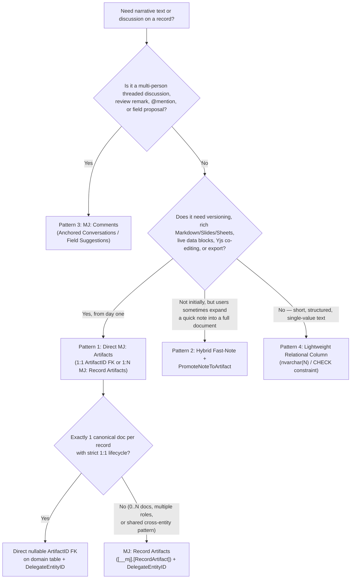

# MemberJunction Docs, Comments & Quick Notes Guide

> **Canonical Decision Rubric, Data Model, Permission Delegation, Migration Playbook & Copy-Paste Recipes**
>
> **Applies to:** MemberJunction Core (`MJ`) and every Open App (`bizapps-*`, customer apps) storing narrative content, collaborative documents, record notes, or anchored discussions.
>
> **Related Guides:** [Docs, Slides, Sheets, Version Compare & Library Architecture](DOCS_SLIDES_SHEETS_ARCHITECTURE.md) · [Anchored Conversations & Record Comments](ANCHORED_CONVERSATIONS_AND_RECORD_COMMENTS_GUIDE.md) · [Unified Permissions](UNIFIED_PERMISSIONS_GUIDE.md) · [Field-Level Security](FIELD_LEVEL_SECURITY_GUIDE.md) · [UI Layering](UI_LAYERING_GUIDE.md) · [Publish-Then-No-Breaking-Changes Policy](../packages/OpenApp/PUBLISH_NO_BREAK_POLICY.md)

---

## 1. Why One Unification Standard Exists

Every business application eventually needs narrative text: deal briefs, meeting minutes, project specifications, clinical notes, quick scratchpad remarks, and inline discussions on a record or field. Without a single platform rubric, apps proliferate bespoke `*Document`, `*Note`, and `*Comment` tables that re-invent versioning, permissions, rich editing, export, search indexing, and AI citations — poorly and incompatibly.

MemberJunction already ships the complete collaborative document and discussion substrate:

- **MJ Docs, Slides & Sheets (`MJ: Artifacts` + `MJ: Artifact Versions` + `MJ: Artifact Working States`)**: Full versioned collaborative documents (`Markdown Document`), 16:9 presentations (`Presentation`), multi-sheet workbooks (`Excel Spreadsheet`), live viewer-scoped MJ Blocks (`DocumentLiveBlockEngine`), Yjs CRDT co-editing (`ArtifactCollaborationServer`), word-level Suggesting redlines, Git-style visual version diffing, server-side export, Semantic Graph indexing, and Magic-Link guest sharing.
- **Anchored Record Comments (`MJ: Comments` IS-A `MJ: Conversations` + `MJ: Field Suggestions`)**: Threaded discussions anchored to any record, field, section, nav group, or document block — with `@mentions`, resolution tracking, RLS, and two-stage FLS enforcement.
- **Polymorphic Record-to-Artifact Linking (`MJ: Record Artifacts`, `[__mj].[RecordArtifact]`)**: A single governed junction table attaching 1..N artifacts to any MJ entity record with semantic roles, ordering, optional version pinning, and hard polymorphic FK metadata (`EntityIDFieldName = 'EntityID'`).
- **Delegated Artifact Permissions (`Artifact.DelegateEntityID` / `DelegateRecordID` + `ArtifactPermissionEngine`)**: Artifacts linked to a business record inherit access control directly from that host record — automatically via entity-level Read/Update fallback or via a custom `IArtifactPermissionDelegate`.

---

## 2. The 4-Way Decision Rubric

Choose the **simplest pattern that satisfies the workflow's real lifecycle**, and use the promotion bridge (`PromoteNoteToArtifact`) whenever a lightweight note outgrows a plain column.

### 2.1 Decision Flowchart



### 2.2 Side-by-Side Comparison Matrix

| Dimension | 1. Direct `MJ: Artifacts` | 2. Hybrid Fast-Note + Promotable Doc | 3. `MJ: Comments` (Anchored Threads) | 4. Lightweight Relational Column |
| :--- | :--- | :--- | :--- | :--- |
| **Primary Storage** | `MJ: Artifacts` + `MJ: Artifact Versions` (+ optional `MJ: Record Artifacts`) | Domain `nvarchar(MAX)` column **plus** optional `ArtifactID` FK or `MJ: Record Artifacts` link once promoted | `MJ: Conversations` → IS-A `MJ: Comments` → `MJ: Conversation Details` (and IS-A `MJ: Field Suggestions`) | Column directly on domain table (`nvarchar(N)` or `nvarchar(MAX)`) |
| **Versioning & Diff** | Full immutable `MJ: Artifact Versions` + Git-style `<mj-artifact-version-compare>` | `MJ: Record Changes` while plain text; full `MJ: Artifact Versions` after promotion | Message timeline + `IsResolved` / `ResolvedByUserID` / `ResolvedAt` | `MJ: Record Changes` audit history only |
| **Real-Time Co-Editing** | Yjs CRDT (`ArtifactCollaborationServer` + `MJ: Artifact Working States`) | None before promotion; full Yjs CRDT after promotion | Multi-user threaded replies + `@mention` notifications | Last-writer-wins on entity `Save()` |
| **Rich Formats & Live Data** | `Markdown Document`, `Presentation` (Slides), `Excel Spreadsheet` (Sheets), Live MJ Blocks, inline OLE Whiteboards | Plain text / simple Markdown before promotion; full MJ Docs after promotion | Markdown messages + `[[Entity|ID|Label]]` citations + structured `MJ: Field Suggestions` | Plain string or controlled value list |
| **Permissions & Security** | `ArtifactPermissionEngine` (`DelegateEntityID`/`DelegateRecordID`, custom delegate or default entity Read/Update fallback, direct & collection grants) | Domain entity RLS/FLS while plain text; `DelegateEntityID` inherits host record permissions after promotion | Automatic RLS (`UserCanReadLinkedRecord`) + 2-stage FLS (`AnchoredConversationPostRunViewHook`) | Domain entity RLS & Field-Level Security (FLS) |
| **AI Agent Tooling** | 13 registered `BaseArtifactToolLibrary` classes (`DocumentToolLibrary`, `SlideDeckToolLibrary`, `SpreadsheetToolLibrary`, etc.) | Entity field read/write before promotion; full `DocumentToolLibrary` after promotion | Agent comment/suggestion tools + `FieldSuggestionCommentDriver` | Standard entity CRUD / `RunView` |
| **Search, RAG & Graph** | Content Pipeline + `"Library Knowledge"` Semantic Graph + batched `DelegateEntityID` permission filter | Standard entity search before promotion; full artifact semantic graph after promotion | Scoped to linked record; FLS-gated | Standard entity FTS / hybrid search |
| **Canonical UI Primitive** | `<mj-artifact-viewer-panel>`, `<mj-artifact-slideover>`, `<mj-record-docs-list>`, `<mj-embedded-doc-panel>` | Textarea / compact editor + **Promote to Doc** (`PromoteNoteToArtifact`) → `<mj-embedded-doc-panel>` / `<mj-artifact-slideover>` | `<mj-record-comments>` (built into `<mj-record-form-container>` & `<mj-form-field>`) | Standard `<mj-form-field>` |
| **Choose When** | Proposals, PRDs, meeting decks, financial models, SOPs, living reports, executive briefs | CRM call notes, task scratchpads, case intake notes that occasionally grow into full specs | Review threads, field-level Q&A, approval chatter, AI field suggestions, `@mention` handoffs | Short titles, status notes, codes, single-paragraph descriptions (`<= 500` chars) |
| **Do NOT Choose When** | The field is a short label or simple status summary | Every record always starts as a rich multi-section doc (use Pattern 1 directly) | You need a living, collaboratively edited document with versions (use Pattern 1) | Users need version history diffs, co-editing, slide synthesis, or live query blocks |

---

## 3. Direct `ArtifactID` FK vs. `MJ: Record Artifacts` (`[__mj].[RecordArtifact]`)

Once you pick Pattern 1 (Direct `MJ: Artifacts`) or promote a note in Pattern 2, choose how the business record points to the artifact:

### 3.1 When to Use a Direct `ArtifactID` FK on the Domain Table

Use a nullable `ArtifactID uniqueidentifier NULL REFERENCES [__mj].[Artifact] (ID)` column directly on your domain table **only when ALL of the following hold**:

1. **Strict 1:1 cardinality**: The domain record has at most **one** canonical artifact in that slot (for example, `Proposal.PrimaryBriefArtifactID` or `Meeting.AgendaArtifactID`).
2. **Same schema ownership**: You own the domain table and can add an optional nullable column cleanly under [`PUBLISH_NO_BREAK_POLICY.md`](../packages/OpenApp/PUBLISH_NO_BREAK_POLICY.md).
3. **No multi-role or ordering semantics**: You do not need to attach multiple documents with distinct roles, display order (`Sequence`), or per-link version pinning (`PinnedArtifactVersionID`).

Even with a direct `ArtifactID` FK, **always set `Artifact.DelegateEntityID` and `Artifact.DelegateRecordID`** pointing back to the owning domain record so permissions stay anchored to the host record.

### 3.2 When to Use `MJ: Record Artifacts` (`[__mj].[RecordArtifact]`)

Use the core polymorphic junction entity **`MJ: Record Artifacts`** (`[__mj].[RecordArtifact]`) whenever **ANY** of the following hold:

- A record can have **0..N attached documents** (briefs, meeting notes, slide decks, spreadsheets, deliverables).
- Attachments carry **semantic roles** (`Role`, e.g., `'General'`, `'Brief'`, `'Meeting Notes'`, `'Deliverable'`, `'Slide Deck'`, `'Supporting Analysis'`).
- A record must **pin a specific immutable version** (`PinnedArtifactVersionID`) — for example, a compliance sign-off pointing to `v3` while editors continue drafting `v4`.
- You are attaching documents to **an entity you do not own** (for example, attaching docs to core `MJ: Users` or another Open App's `People` / `Organizations` table without modifying its schema).
- You want drop-in UI support from `<mj-record-docs-list>` with zero custom schema migrations.

### 3.3 `[__mj].[RecordArtifact]` Schema & Metadata Contract

`[__mj].[RecordArtifact]` (`MJ: Record Artifacts`, generated class `MJRecordArtifactEntity`) is an additive MJ Core table with the following canonical structure:

| Column | SQL Type (SQL Server) | Nullable / Default | Purpose & Constraint |
| :--- | :--- | :--- | :--- |
| `ID` | `uniqueidentifier` | `NOT NULL DEFAULT newsequentialid()` | Primary key (`PK_RecordArtifact`) |
| `EntityID` | `uniqueidentifier` | `NOT NULL` | FK → `[__mj].[Entity].ID` identifying the host entity |
| `RecordID` | `nvarchar(700)` | `NOT NULL` | Host record primary key (UUID or composite key URL segment); decorated with `EntityIDFieldName = 'EntityID'` |
| `ArtifactID` | `uniqueidentifier` | `NOT NULL` | FK → `[__mj].[Artifact].ID` |
| `PinnedArtifactVersionID` | `uniqueidentifier` | `NULL` | Optional FK → `[__mj].[ArtifactVersion].ID` pinning a specific version snapshot |
| `Role` | `nvarchar(100)` | `NOT NULL DEFAULT 'General'` | Semantic attachment role; `NOT NULL` guarantees identical uniqueness semantics across SQL Server and PostgreSQL |
| `Sequence` | `int` | `NOT NULL DEFAULT 0` | Explicit display ordering within `(EntityID, RecordID)` |
| `ContextDescription` | `nvarchar(max)` | `NULL` | Human-readable note explaining why this artifact is attached to the record |
| `LinkedByUserID` | `uniqueidentifier` | `NULL` | Optional FK → `[__mj].[User].ID` recording who created the link |
| `__mj_CreatedAt` / `__mj_UpdatedAt` | `datetimeoffset` | CodeGen-managed | Standard MJ audit timestamps |

**Key Constraints, Indexes & Metadata Governance:**

1. **`UQ_RecordArtifact_Record_Artifact_Role (EntityID, RecordID, ArtifactID, Role)`**: Prevents duplicate links of the same artifact under the same role on the same record while allowing the same artifact to serve distinct roles (or link across multiple records). Making `Role NOT NULL DEFAULT 'General'` eliminates SQL Server vs. PostgreSQL `NULL` uniqueness divergence (SQL Server treats `NULL`s as equal in `UNIQUE` constraints; PostgreSQL treats `NULL`s as distinct unless `NULLS NOT DISTINCT` or `NOT NULL` is used).
2. **`IDX_RecordArtifact_Entity_Record`**: Composite index on `(EntityID, RecordID, Sequence)` (paired with an index on `ArtifactID`) for sub-millisecond `<mj-record-docs-list>` loading and reverse artifact-to-record lookups.
3. **`spDeleteEntityWithCoreDependencies`**: Cleans up `RecordArtifact` rows referencing a deleted entity metadata record so entity teardown never fails with FK violations.
4. **Polymorphic FK Metadata (`metadata/entities/.polymorphic-fk-entity-fields.json`)**: Per `AGENTS.md` and `metadata/CLAUDE.md`, `MJ: Record Artifacts.RecordID` MUST declare `EntityIDFieldName = "EntityID"` so MJ Explorer forms, grids, cards, and record detail panels resolve clickable host record links strictly via metadata (never column-name heuristics):

```json
{
  "fields": {
    "Name": "MJ: Record Artifacts"
  },
  "relatedEntities": {
    "MJ: Entity Fields": [
      {
        "fields": {
          "EntityIDFieldName": "EntityID"
        },
        "primaryKey": {
          "ID": "@lookup:MJ: Entity Fields.EntityID=@lookup:MJ: Entities.Name=MJ: Record Artifacts&Name=RecordID"
        }
      }
    ]
  },
  "primaryKey": {
    "ID": "@lookup:MJ: Entities.Name=MJ: Record Artifacts"
  }
}
```

5. **Dual Form Registration Parity**: Running `mj codegen` emits both `MJRecordArtifactEntity` (`@memberjunction/core-entities`) and the generated `@RegisterClass(BaseFormComponent, 'MJ: Record Artifacts')` form (`@memberjunction/ng-core-entity-forms`), verifiable via `MJGlobal.Instance.ClassFactory.GetRegistration(BaseFormComponent, 'MJ: Record Artifacts')`.

---

## 4. Permission Delegation Contract (`DelegateEntityID` & `ArtifactPermissionEngine`)

Located in `packages/MJCoreEntities/src/custom/ArtifactPermissionDelegate.ts`, `ArtifactPermissionEngine.Instance` is the single authority for resolving `{ CanRead, CanEdit, CanDelete, CanShare, Source, Reason }` on any `MJ: Artifacts` record.

### 4.1 Resolution Precedence

When `ArtifactPermissionEngine.Instance.ResolvePermissions(provider, artifactId, user)` (or `ResolvePermissionsBatch`) evaluates an artifact:

1. **Principal & Input Validation (Fail-Closed)**: Rejects missing `user`, invalid UUIDs, anonymous/scoped magic-link principals (`user.IsMagicLinkAnonymous || user.MagicLinkScope`), missing `provider`, recursion depth `> 8` (`MAX_DELEGATE_DEPTH`), or cyclic delegation chains (`VisitedArtifactIDs`).
2. **Delegated Artifacts (`DelegateEntityID` AND `DelegateRecordID` populated — enforced by `CK_Artifact_DelegateBinding`)**:
   - **Path A — Built-in Parent Artifact Delegate (`DelegateEntityID -> 'MJ: Artifacts'`)**: `ParentArtifactPermissionDelegate` recursively resolves permissions against the parent host artifact (used by inline OLE Whiteboards and embedded artifact blocks).
   - **Path B — Registered Custom Delegate (`IArtifactPermissionDelegate`)**: Resolved via programmatic `ArtifactPermissionEngine.Instance.RegisterDelegate(entityNameOrId, delegate)` or `@RegisterClass(BaseArtifactPermissionDelegate, '<EntityName>')`. Each method (`CanRead`, `CanEdit`, optional `CanDelete`, optional `CanShare`) returns a tri-state `DelegatePermissionDecision` (`true | 'Allow'`, `false | 'Deny'`, or `'Defer'`).
     - An explicit `'Deny'` on `CanRead` immediately denies all four actions (even for the artifact creator).
     - Any individual action returning `'Defer'` falls through to ownership + `MJ: Artifact Permissions` + `MJ: Collection Permissions` ancestry.
   - **Path C — Default Entity-Level Read/Update Fallback (No Custom Delegate Registered)**: When `DelegateEntityID` + `DelegateRecordID` are set on an artifact and **no custom `IArtifactPermissionDelegate` is registered** for that entity, `ArtifactPermissionEngine` resolves permissions directly against the host entity's MJ metadata & row-level permissions instead of requiring every entity to write boilerplate:
     - Looks up `EntityInfo` via `provider.EntityByID(artifact.DelegateEntityID)`. **Fails closed (`Denied`)** if the entity is unknown.
     - Checks `const perms = entityInfo.GetUserPermisions(user)`.
     - Verifies the target record `DelegateRecordID` is readable by `user` under RLS (a narrow primary-key-only `RunView` using `ResultType: 'simple'`). **Fails closed (`Denied`)** if the record does not exist or is hidden by RLS.
     - Maps entity permissions conservatively:
       - `CanRead = Boolean(perms?.CanRead)` (and target record passed RLS check)
       - `CanEdit = CanRead && Boolean(perms?.CanUpdate)`
       - `CanDelete = CanRead && Boolean(perms?.CanDelete)` (or falls back to owner if owner can edit)
       - `CanShare = CanEdit` (or owner when `CanRead` is true)
       - `Source = 'Delegate'`
3. **Non-Delegated Artifacts (`DelegateEntityID IS NULL`)**:
   - **Owner**: `UUIDsEqual(artifact.UserID, user.ID)` → full `CanRead / CanEdit / CanDelete / CanShare` (`Source: 'Owner'`).
   - **Direct Grants**: `MJ: Artifact Permissions` rows for `(ArtifactID, UserID)`.
   - **Collection Ancestry Grants**: `MJ: Collection Artifacts` → `MJ: Collections` (`ParentID` walked up to `MAX_COLLECTION_ANCESTRY_DEPTH = 16`, cycle-guarded) → `MJ: Collection Permissions`.

### 4.2 Explicit `contextUser` & Server-Side Fail-Closed Contract

- **Browser callers** may omit `contextUser` only when the active GraphQL provider already carries the signed-in `Metadata.Provider.CurrentUser`.
- **Server-side callers** (vector/search retrieval, actions, resolvers, scheduled jobs, `PromoteNoteToArtifact`, `ArtifactPermissionEngine`) **MUST** pass an explicit `contextUser: UserInfo` and scoped `provider: IMetadataProvider`.
- **Never fall back to `SystemUser`** to satisfy a user's permission check. If `contextUser` is missing, inactive, or magic-link-scoped, or if `DelegateEntityID` points to an unknown entity or an RLS-hidden/missing record, permission resolution **must fail closed** (`CanRead: false`).

### 4.3 Batched Permission Filtering for Vector & Search Retrieval

When a vector store, full-text search engine, or RAG+ pipeline returns candidate `ArtifactID`s (often 50–500 hits across multiple entities):

- **NEVER** loop `await md.GetEntityObject('MJ: Artifacts', user)` or invoke `ResolvePermissions` one-by-one inside a `for` loop.
- Use `ArtifactPermissionEngine.Instance.FilterArtifactsByPermissionBatch` (for candidate hit objects) or `ArtifactPermissionEngine.Instance.FilterReadableArtifactIDsBatch` (for ID lists), which:
  1. Fails closed with zero DB queries whenever `contextUser` is null/missing, inactive, magic-link-scoped, or carries an invalid UUID.
  2. Deduplicates and validates candidate UUIDs and queries `MJ: Artifacts` headers (`ID`, `UserID`, `DelegateEntityID`, `DelegateRecordID`) in **bounded SQL `IN`-clause chunks of `<= 200` IDs** (`ARTIFACT_PERMISSION_IN_CLAUSE_CHUNK_SIZE = 200`).
  3. Groups default-fallback delegated artifacts by `DelegateEntityID` and runs **one batched primary-key-only `RunView` (`ResultType: 'simple'`) per entity per `<= 200`-ID chunk** under `contextUser` (preserving RLS without leaking titles/fields).
  4. Runs custom `IArtifactPermissionDelegate` checks with a shared per-request memo (`Map<string, Promise<ResolvedArtifactPermissions>>`) alongside standalone ownership/share/collection resolution in one mixed pass.
  5. Returns deterministic ordered `Allowed`, `Denied`, `Outcomes`, and `PermissionsByArtifactID` without mutating inputs, failing closed on any query error, unknown entity, or missing/RLS-hidden host record.

---

## 5. `PUBLISH_NO_BREAK_POLICY.md` 4-Step Additive Migration Playbook

Per [`packages/OpenApp/PUBLISH_NO_BREAK_POLICY.md`](../packages/OpenApp/PUBLISH_NO_BREAK_POLICY.md), once an Open App is published in a platform era (e.g., MJ `6.x`), its schema is **strictly additive** — no dropping tables/columns, no renaming columns, no narrowing types, and no removing stored-procedure parameters until the next platform era bump.

Follow this 4-step **Expand → Bridge → Deprecate → Era Bump** playbook to migrate an existing app's bespoke notes or document tables onto `MJ: Artifacts` + `MJ: Record Artifacts` across Phase 1+:

| Step | Schema / Code Changes | Rollout & Safety Guarantee |
| :--- | :--- | :--- |
| **1. Expand** *(additive minor)* | Keep all legacy note/document tables and columns untouched. Add an optional nullable `ArtifactID uniqueidentifier NULL` FK (only for strict 1:1 slots) **or** adopt core `[__mj].[RecordArtifact]` with zero schema changes on your app. Register any domain-specific `BaseArtifactPermissionDelegate` if entity-level Read/Update fallback is not granular enough. | 100% backward compatible with historical `EXEC spCreate*` / `spUpdate*` calls and downstream Open Apps. |
| **2. Bridge** *(dual-read + promote)* | Update Angular forms to mount `<mj-record-docs-list>` or `<mj-embedded-doc-panel Mode="compact">`. For legacy plain-text note columns, render existing text seamlessly alongside a **Promote to Doc** button invoking `PromoteNoteToArtifact`, which creates a `Markdown Document` `MJ: Artifacts` + v1 `MJ: Artifact Versions` + `DelegateEntityID`/`DelegateRecordID` + `MJ: Record Artifacts` link. Optionally run an idempotent backfill script for high-value legacy doc tables. | Zero-downtime transition; users never lose existing notes, and promoted docs immediately gain Yjs co-editing, versioning, and search/graph indexing. |
| **3. Deprecate** *(metadata-only)* | Once all active writers use `MJ: Artifacts` / `MJ: Record Artifacts`, mark the legacy table or columns as **deprecated** in MJ entity/field metadata and documentation. Keep physical columns and SP parameters intact so existing reports, downstream FKs, and historical migrations continue working indefinitely. | Zero breaking changes within the published era; deprecated columns remain harmless dead weight. |
| **4. Era Bump** *(next MJ major, e.g. `6.x → 7.x`)* | Only when the app moves with MemberJunction to the next platform era, ship the explicit opt-in upgrade migration that verifies backfill completion and physically drops deprecated legacy tables/columns. | Breaking schema cleanup rides the planned manual era upgrade boundary with zero mid-era churn. |

---

## 6. Explicit Anti-Goals (Hard Platform Rules)

Violating any rule below blocks PR approval or fails automated CI gates (`check:guards`, `check:standards`, `check:ui`, `check:claude-md`):

| Anti-Goal | Why It Is Forbidden | Required Pattern Instead |
| :--- | :--- | :--- |
| **Bespoke document tables** (`*Document`, `*NoteDoc`, `*WikiPage`) | Duplicates versioning, Yjs CRDT, permissions, exports, AI tools, and semantic graph indexing | Use `MJ: Artifacts` + `MJ: Artifact Versions` linked via `MJ: Record Artifacts` (or 1:1 `ArtifactID` FK) |
| **Storing artifact/record links in JSON columns** | Destroys relational integrity, prevents indexed `(EntityID, RecordID)` reverse lookups, breaks `EntityIDFieldName` metadata | Store links in `[__mj].[RecordArtifact]` with `UQ_RecordArtifact_Record_Artifact_Role` |
| **`window.localStorage` / `window.sessionStorage`** for user preferences | Lost across devices/browsers, breaks multi-user workstations, fails `check:standards` | Persist preferences via `UserInfoEngine.Instance.GetSetting()` / `SetSetting()` / `SetSettingDebounced()` |
| **`window.print()`** in Angular components | Produces broken unstyled printouts and fails headless/OpenApp readiness checks | Use server-side PDF actions (`@RegisterClass(BaseAction, ...)`) or `DocumentImportExportService` |
| **`any` or lazy `unknown` casts** (`as any`, `as unknown as Record<string, unknown>`) | Erodes compile-time safety across entity/UI boundaries | Define explicit TypeScript interfaces and derive value-list unions via `Entity['Field']` (e.g., `MJArtifactUseEntity['UsageType']`) |
| **`.Get()` / `.Set()` on generated entities** | Bypasses compile-time field checking and hides renames | Use generated entity getters/setters (`artifact.DelegateEntityID`, `link.Role`) |
| **N+1 `GetEntityObject` loops** | Severe latency and DB pool exhaustion under load | Batch with `RunView` / `RunViews`, `ResultType: 'simple'`, explicit `Fields`, and `<= 200`-ID `IN`-clause chunks |
| **Cross-package re-exports** (`export { X } from '@memberjunction/other'`) | Bloats bundles and creates circular/duplicate symbol ownership | Import directly from the owning package (`@memberjunction/core-entities`, `@memberjunction/ai-core-plus`, `@memberjunction/ng-artifacts`) |
| **Raw `#hex`, `rgb()`, `rgba()`, `hsl()` CSS literals** in Angular styles/templates | Breaks dark/light themes and fails `ci-ui-tokens.yml` | Use semantic `--mj-*` CSS design tokens exclusively |
| **Freehand-authored `.pg.sql` migrations** | Causes SQL Server ↔ PostgreSQL schema/CodeGen drift | Generate strictly via `mj migrate convert --split --bake-codegen` (and `mj migrate rebake --file ... --capture-only` for `.needs-hand`) stamped with `-- @mj-pg-provenance: split-bake v1` |
| **Calling `MJArtifactWorkingStateEntity.Save()` from the browser** | `MJ: Artifact Working States` has `AllowCreateAPI = 0` and `AllowUpdateAPI = 0` by security design; client `Save()` always throws | Persist live editing state via `DocumentCollaborationService` (`/collaboration/yjs` WebSocket) or explicit version checkpoints |

---

## 7. Copy-Paste Angular & Server Recipes

All Angular recipes below follow MemberJunction standards: `ChangeDetectionStrategy.OnPush`, modern `@if` / `@for` template syntax, `inject()` dependency injection, `--mj-*` CSS tokens exclusively, `UserInfoEngine.Instance` for preferences, zero `any`, zero `.Get()`/`.Set()`, and zero `@angular/router` imports in L2 generic widgets.

### Recipe 1: Opening Any Document in `<mj-artifact-slideover>` via `MJArtifactSlideoverService`

Mount `<mj-artifact-slideover>` once inside your app shell or host surface, and open artifacts imperatively from any child component with automatic `Escape`-to-close, maximize persistence via `UserInfoEngine.Instance`, and `NavigateToLink` chaining for `[[...]]` links.

```typescript
import { ChangeDetectionStrategy, Component, Input, inject } from '@angular/core';
import { UserInfo } from '@memberjunction/core';
import {
  ArtifactVersionSavedEvent,
  MJArtifactSlideoverService,
} from '@memberjunction/ng-artifacts';

@Component({
  selector: 'app-deal-brief-button',
  standalone: true,
  changeDetection: ChangeDetectionStrategy.OnPush,
  template: `
    @if (ArtifactID) {
      <button
        type="button"
        mjButton
        variant="outline"
        (click)="OpenBrief()">
        <i class="fa-solid fa-file-lines" aria-hidden="true"></i>
        View Brief
      </button>
    }
  `,
})
export class DealBriefButtonComponent {
  private readonly slideover = inject(MJArtifactSlideoverService);

  @Input() ArtifactID: string | null = null;
  @Input() CurrentUser!: UserInfo;
  @Input() CanEdit = false;
  @Input() CanShare = false;

  public OpenBrief(): void {
    if (!this.ArtifactID) {
      return;
    }
    this.slideover.Open({
      ArtifactID: this.ArtifactID,
      CurrentUser: this.CurrentUser,
      CanEdit: this.CanEdit,
      CanShare: this.CanShare,
      OnVersionSaved: (event: ArtifactVersionSavedEvent) => {
        this.handleVersionSaved(event);
      },
    });
  }

  private handleVersionSaved(event: ArtifactVersionSavedEvent): void {
    // Refresh summary metadata using strongly-typed event.VersionNumber / event.UpdatedAt
    void event;
  }
}
```

In the host container template:

```html
<mj-artifact-slideover
  [FallbackCurrentUser]="CurrentUser"
  (OpenEntityRecord)="OnOpenEntityRecord($event)"
  (ExternalNavigate)="OnExternalNavigate($event)">
</mj-artifact-slideover>
```

### Recipe 2: Attaching `<mj-record-docs-list>` to Any Entity Form

Drop `<mj-record-docs-list>` into a form tab or panel to list, filter, create, open, or synthesize slides from artifacts linked via `[__mj].[RecordArtifact]`.

```typescript
import { ChangeDetectionStrategy, Component, Input, inject } from '@angular/core';
import { UserInfo } from '@memberjunction/core';
import {
  MJArtifactSlideoverService,
  RecordDocOpenedEvent,
} from '@memberjunction/ng-artifacts';

@Component({
  selector: 'app-project-documents-panel',
  standalone: false,
  changeDetection: ChangeDetectionStrategy.OnPush,
  template: `
    @if (ProjectID) {
      <mj-record-docs-list
        [EntityName]="'Projects'"
        [RecordID]="ProjectID"
        [CurrentUser]="CurrentUser"
        [AllowedRoles]="['Brief', 'Meeting Notes', 'Deliverable', 'Slide Deck']"
        [DefaultArtifactType]="'Markdown Document'"
        [AllowCreate]="CanEditProject"
        [AllowSynthesizeSlides]="CanEditProject"
        (ArtifactOpened)="OnArtifactOpened($event)">
      </mj-record-docs-list>
    }
  `,
})
export class ProjectDocumentsPanelComponent {
  private readonly slideover = inject(MJArtifactSlideoverService);

  @Input() ProjectID: string | null = null;
  @Input() CurrentUser!: UserInfo;
  @Input() CanEditProject = false;

  public OnArtifactOpened(event: RecordDocOpenedEvent): void {
    this.slideover.Open({
      ArtifactID: event.ArtifactID,
      VersionNumber: event.VersionNumber,
      CurrentUser: this.CurrentUser,
      CanEdit: event.CanEdit,
      CanShare: event.CanShare,
    });
  }
}
```

### Recipe 3: Inline Compact Document Editor with `<mj-embedded-doc-panel Mode="compact" | "full">`

Use `Mode="compact"` inside record forms and sidebars to hide the outline rail and secondary studio toolbars while retaining debounced autosave (`>= 1000ms`), an explicit **Save Version** button, read-only delegated-permission enforcement, and an **Open Full Studio** expand action.

```html
@if (BriefArtifactID) {
  <mj-embedded-doc-panel
    [ArtifactID]="BriefArtifactID"
    [CurrentUser]="CurrentUser"
    [Mode]="'compact'"
    [AutosaveDebounceMs]="1500"
    (VersionSaved)="OnBriefVersionSaved($event)"
    (OpenFullStudioRequested)="OnOpenFullStudio($event)">
  </mj-embedded-doc-panel>
}
```

Minimal host styling using semantic `--mj-*` tokens exclusively (zero raw hex/rgb/hsl literals):

```css
.record-brief-section {
  background: var(--mj-bg-surface);
  border: 1px solid var(--mj-border-default);
  border-radius: 8px;
  color: var(--mj-text-primary);
  padding: 12px;
}
```

### Recipe 4: Promoting a Quick Note to a Versioned Artifact (`PromoteNoteToArtifact`)

Works identically in browser and server runtimes. Always pass `ContextUser` on the server; `PromoteNoteToArtifact` sets `DelegateEntityID` + `DelegateRecordID`, creates v1 of `MJ: Artifact Versions`, optionally attaches an idempotent `MJ: Record Artifacts` row (handling `UQ_RecordArtifact_Record_Artifact_Role` cleanly), and performs compensating cleanup if an intermediate save fails.

```typescript
import { Metadata, UserInfo } from '@memberjunction/core';
import {
  PromoteNoteToArtifact,
  type PromoteNoteToArtifactResult,
} from '@memberjunction/core-entities';

export async function PromoteDealCallNote(
  dealId: string,
  noteTitle: string,
  noteMarkdown: string,
  contextUser: UserInfo
): Promise<PromoteNoteToArtifactResult> {
  const provider = Metadata.Provider;
  const result = await PromoteNoteToArtifact(
    {
      Title: noteTitle,
      MarkdownContent: noteMarkdown,
      HostEntityName: 'Deals',
      HostRecordID: dealId,
      LinkRole: 'Meeting Notes',
      ContextDescription: 'Promoted from Deal quick call note',
      CreateRecordArtifactLink: true,
    },
    contextUser,
    provider
  );

  if (!result.Success) {
    throw new Error(result.ErrorMessage ?? 'Failed to promote note to artifact.');
  }
  return result;
}
```

### Recipe 5: Server-Side Batched `DelegateEntityID` Filter & Custom Delegate

#### 5a. Filtering Vector/Search Retrieval Candidates (Zero N+1, Bounded `<= 200` Chunks, Fail-Closed)

```typescript
import { IMetadataProvider, UserInfo } from '@memberjunction/core';
import { ArtifactPermissionEngine } from '@memberjunction/core-entities';

export interface VectorSearchHit {
  ArtifactID: string;
  Score: number;
  Snippet: string;
}

export async function FilterAuthorizedArtifactHits(
  hits: ReadonlyArray<VectorSearchHit>,
  contextUser: UserInfo,
  provider: IMetadataProvider
): Promise<VectorSearchHit[]> {
  if (hits.length === 0) {
    return [];
  }

  // Server-side batch filter chunks SQL IN-clauses at <= 200 IDs, handles mixed
  // custom delegates + default entity fallback + standalone artifacts, preserves
  // original order without mutating input, and fails closed on missing/inactive
  // contextUser, unknown DelegateEntityID, or RLS-hidden records.
  const filtered = await ArtifactPermissionEngine.Instance.FilterArtifactsByPermissionBatch(
    provider,
    hits,
    (hit) => hit.ArtifactID,
    contextUser,
    { RequiredAction: 'Read' }
  );

  return filtered.Allowed;
}
```

#### 5b. Registering a Custom `BaseArtifactPermissionDelegate` (Only When Entity-Level Fallback Is Not Enough)

If entity-level `CanRead` / `CanUpdate` + RLS already expresses who can view and edit your host record, **do not write a custom delegate** — `ArtifactPermissionEngine` handles it automatically. Register a custom subclass only for richer domain rules (such as project-membership tables or frozen-status locks):

```typescript
import { EscapeSQLString, RegisterClass } from '@memberjunction/global';
import { RunView, UserInfo } from '@memberjunction/core';
import {
  ArtifactDelegateContext,
  BaseArtifactPermissionDelegate,
  DelegatePermissionDecision,
} from '@memberjunction/core-entities';

interface ProjectMemberRoleRow {
  Role: 'Viewer' | 'Editor' | 'Owner';
}

@RegisterClass(BaseArtifactPermissionDelegate, 'MJ: Projects')
export class ProjectArtifactPermissionDelegate extends BaseArtifactPermissionDelegate {
  public override async CanRead(
    context: ArtifactDelegateContext,
    user: UserInfo
  ): Promise<DelegatePermissionDecision> {
    const role = await this.loadMemberRole(context, user);
    return role !== null ? 'Allow' : 'Deny';
  }

  public override async CanEdit(
    context: ArtifactDelegateContext,
    user: UserInfo
  ): Promise<DelegatePermissionDecision> {
    const role = await this.loadMemberRole(context, user);
    return role === 'Editor' || role === 'Owner' ? 'Allow' : 'Deny';
  }

  private async loadMemberRole(
    context: ArtifactDelegateContext,
    user: UserInfo
  ): Promise<ProjectMemberRoleRow['Role'] | null> {
    const rv = RunView.FromMetadataProvider(context.Provider);
    const res = await rv.RunView<ProjectMemberRoleRow>(
      {
        EntityName: 'Project Members',
        ExtraFilter: `ProjectID='${EscapeSQLString(context.DelegateRecordID)}' AND UserID='${EscapeSQLString(user.ID)}'`,
        Fields: ['Role'],
        MaxRows: 1,
        SkipTotalRowCount: true,
        ResultType: 'simple',
      },
      user
    );
    return res.Success && res.Results.length > 0 ? res.Results[0].Role : null;
  }
}
```

### Recipe 6: Bridging `DocRecordLink` (`[[...]]`) with `MessageCitation` & `MJ: Artifact Uses`

Documents store durable record references (`@{"_mode":"mention","type":"record",...}` inserted via `[[` autocomplete, plus wiki tokens `[[EntityName|RecordID|DisplayName]]`, `[[MJ: Artifacts|ArtifactID@v2|Label]]`, and `[[MJ: Artifacts|ArtifactID@VersionUUID|Label]]`). Use the `@memberjunction/ai-core-plus` citation unification bridge (`doc-citation-bridge.ts`) to parse, deduplicate, convert to `MessageCitation`, round-trip format back to canonical `[[...]]`, and record provenance in `MJ: Artifact Uses`:

```typescript
import { IMetadataProvider, UserInfo } from '@memberjunction/core';
import {
  BridgeDocLinksToCitationsAndArtifactUses,
  FormatMessageCitationAsDocLink,
  RecordCitedArtifactUse,
  type DocCitationBridgeResult,
} from '@memberjunction/ai-core-plus';

export async function ProcessDocumentAndConversationCitations(
  markdownOrMessage: string,
  conversationId: string,
  contextUser: UserInfo,
  provider: IMetadataProvider,
  activeVersionByArtifactId: ReadonlyMap<string, string>
): Promise<DocCitationBridgeResult> {
  const bridged = BridgeDocLinksToCitationsAndArtifactUses(markdownOrMessage, {
    UserID: contextUser.ID,
    UsageType: 'Viewed',
    ConversationID: conversationId,
    ResolveArtifactVersionID: (link) =>
      link.ArtifactID ? activeVersionByArtifactId.get(link.ArtifactID.toLowerCase()) : undefined,
  });

  for (const usePayload of bridged.ArtifactUses) {
    const saved = await RecordCitedArtifactUse(usePayload, contextUser, provider);
    if (!saved.Success) {
      throw new Error(saved.ErrorMessage ?? 'Failed to record cited artifact usage.');
    }
  }

  // Lossless reverse formatting from MessageCitation back to canonical [[...]] links
  const canonicalLinks = bridged.Citations
    .map((citation) => FormatMessageCitationAsDocLink(citation))
    .filter((token): token is string => token !== null);
  void canonicalLinks;

  return bridged;
}
```

---

## 8. Quick Verification Checklist for New Features

Before opening a PR that introduces document storage, record notes, or embedded artifact UI:

1. **Data Model**: Verified the 4-way rubric — no bespoke document tables, no links in JSON columns, `EntityIDFieldName = 'EntityID'` declared for any polymorphic FK.
2. **Permissions**: Every record-attached `MJ: Artifacts` row sets `DelegateEntityID` + `DelegateRecordID`; server code passes explicit `contextUser: UserInfo` and fails closed.
3. **UI Hygiene**: Angular components use `ChangeDetectionStrategy.OnPush`, `@if`/`@for`, `inject()`, semantic `--mj-*` tokens (zero raw hex/rgb/hsl), `UserInfoEngine.Instance` (zero `localStorage`), and zero `window.print()`.
4. **Query Efficiency**: List and filter paths use batched `RunView` / `RunViews` with `ResultType: 'simple'`, narrow `Fields`, and `<= 200`-ID `IN`-clause chunks.
5. **Type Safety**: Zero `any`, zero lazy `unknown` casts, zero `.Get()`/`.Set()`, value-list unions derived from generated entity types, and zero cross-package re-exports.
