# Predictive Studio Guide

> **When to read this**: Before you touch anything under `packages/AI/PredictiveStudio/**`, the Predictive Studio dashboard (`packages/Angular/Explorer/dashboards/src/PredictiveStudio/`), the Knowledge Hub Feature Pipelines panel, the `MJ: ML *` / `MJ: Experiment*` entities, the model predictions stored in `MJ: Feature Values`, the 12 `PredictiveStudio.*` Remote Operations, the Model Development Agent, or before you add a *trained-model* capability (feature assembly, training, the lifecycle gate, scoring, monitoring, experiment search). This is the canonical reference for how MJ trains predictive models on a client's own data and scores records with them.

MJ already runs *off-the-shelf* models well — embeddings, LLMs, image/audio inference via `MJ: AI Models`. It does **not** train models on a client's own data. **Predictive Studio** closes that gap: a reasonably technical business user (not a career data scientist) can assemble features from across MJ's entire data surface, train a genuinely useful predictive model (member retention, renewal, lapse risk, lead scoring, attendee-return), and score who is likely to renew/lapse/return — and the **Model Development Agent drives the same object model end to end**.

It is **core MJ, not an OpenApp**. It composes on substrates MJ already has — entities, `MJ: Queries`, vectors, **Record Set Processing**, **Remote Operations**, **Actions**, **Agents**, **Artifacts** — and adds a small, opinionated set of objects + a self-managing Python ML sidecar + a world-class Studio UI + an agent. The differentiation is **data assembly + agentic search over MJ's entire data surface**, not algorithmic innovation.

---

## At a glance

| | |
|---|---|
| **What it is** | A core MJ capability for **training predictive models on a client's own data** and **scoring records** with them — feature assembly, training, a lifecycle gate that is the only writer of a model's status, scoring that stores every prediction as a Feature Value, and per-model monitoring that retrains and rolls back on realised outcomes. A budgeted agentic experiment search exists in code and is switched off (§7). |
| **Who it's for** | A reasonably technical business user (renewal / retention / lead-scoring analyst) **and** an agent — the same object model + the same Remote Operations drive both. |
| **What it is *not*** | SageMaker / Databricks. No GPU. No training embeddings from scratch (it *uses* pre-trained embeddings as features). Deliberately rigid about algorithms (a fixed 6-catalog), flexible about data. |
| **Compute** | **CPU-bound, no GPU.** Gradient boosting / logistic / random forest / small MLP on tabular data train in seconds-to-minutes — matches MJ's API-runtime infra. |
| **Invocation** | **12 typed Remote Operations** (`predictive:execute` scope) + **6 Actions**, delegating to one shared engine layer. The browser, Skip, and the agent all call the same code. |
| **Status** | **End-to-end shipped** — sidecar, FeatureAssembly, training under a Prediction Unit and an Evaluation Protocol with a stored three-outcome gate decision, the lifecycle gate with its publish records and sign-offs, automated publishing and rollback, the Scoring Service with predictions stored as Feature Values behind a view gate, per-model monitoring and the hourly registry check, the 12 Remote Ops + 6 Actions, Feature Pipelines, the Model Development Agent + artifact + viewer, multimodal vision-as-feature, the Studio UI, the record panel, and a live integration test. Experiment sessions are switched off (§7). Nothing is deferred to another PR: population-wide prediction storage is the generic Feature Value path (§6.5). |

**Proof it works — the live integration test** (`live-train-score.integration.test.ts`, real managed sidecar, generated yearly membership rows with a learnable signal, no DB): a Prediction Unit pipeline trains through the real sidecar trainer under its Evaluation Protocol and the test asserts that

- the run completes and stores a gate record, counting the **400 locked-holdout rows** the protocol carved;
- a decision that ships creates the `MJ: ML Models` row from the shipped artifact (`ps-predictor/v2`, with the Training Snapshot's ID in its lineage), and a `no-signal` decision creates none.

The statistical claims (a planted signal is found, a planted null ships nothing) are made by the planted-truth gates ([§19.5](#195-planted-truth-suite-packagesaipredictivestudiotruthsuite)), not by thresholds in this test.

This guide ties together the packages that each document one layer:

| Layer | Package | What it is |
|---|---|---|
| Type contracts | [`@memberjunction/predictive-studio-core`](../packages/AI/PredictiveStudio/Core/README.md) | sidecar and trainer contracts, pipeline spec, **Prediction Unit** and **Evaluation Protocol** shapes, the **gate** and **trust verdict**, feature-step DAG, modeling plan, **Zod plan/budget validators**, **shared metric-direction util** |
| Python sidecar | [`@memberjunction/predictive-studio-sidecar`](../packages/AI/PredictiveStudio/Sidecar/README.md) | `MLSidecar` — self-managing, bundled FastAPI ML service (managed-spawn default; no Docker) |
| Server engine | [`@memberjunction/predictive-studio`](../packages/AI/PredictiveStudio/Engine/README.md) | `AsOfFeatureAssembler`, `FeatureAssemblyExecutor`, `TrainingEngine`, `LifecycleGate`, `AutomatedPublisher`, `ScoringService`, `MLModelInferenceProcessor`, the monitoring, registry-check and prediction-retention job drivers, `ExperimentOrchestrator`, `FeaturePipelineEngine`, the 12 Remote Ops + 6 Actions |
| Studio UI | `@memberjunction/ng-dashboards` (`PredictiveStudio/`) | the lazy-loaded Explorer dashboard + embedded copilot; the Knowledge Hub Feature Pipelines panel |
| Record forms | `@memberjunction/ng-core-entity-forms` | the `MJ: ML Models` form (publish history, sign-off, scoring runs, monitoring, output and scoring bindings) and the `'*'` Model Prediction panel |
| Artifact viewer | `@memberjunction/ng-artifacts` | `MLExperimentResultsViewerComponent` — leaderboard / metrics / importance + drill-through |

---

## Table of contents

1. [The four-layer architecture](#1-the-four-layer-architecture)
2. [The self-managing Python sidecar](#2-the-self-managing-python-sidecar)
3. [The type contracts (`predictive-studio-core`)](#3-the-type-contracts-memberjunctionpredictive-studio-core)
4. [The FeatureAssembly executor — the correctness backbone](#4-the-featureassembly-executor--the-correctness-backbone)
5. [Training — immutable versioned models judged under an Evaluation Protocol](#5-training--immutable-versioned-models-judged-under-an-evaluation-protocol)
6. [Scoring — a Record Set Processing work type](#6-scoring--a-record-set-processing-work-type)
7. [The experiment engine — a generic agentic-search primitive](#7-the-experiment-engine--a-generic-agentic-search-primitive)
8. [The data model — entities and relationships](#8-the-data-model--entities-and-relationships)
9. [The guidance layer — algorithm catalog + the 6×7 matrix](#9-the-guidance-layer--algorithm-catalog--the-67-matrix)
10. [The invocation surface — Actions vs Remote Operations](#10-the-invocation-surface--actions-vs-remote-operations)
11. [Feature Pipelines — the category route (no new entity)](#11-feature-pipelines--the-category-route-no-new-entity)
12. [The Model Development Agent + artifact + viewer](#12-the-model-development-agent--artifact--viewer)
13. [The security model and the lifecycle gate](#13-the-security-model-and-the-lifecycle-gate)
14. [Monitoring — outcome joins, triggers, rollback and the registry job](#14-monitoring--outcome-joins-triggers-rollback-and-the-registry-job)
15. [Phase 2 — Model as a First-Class Primitive (Reach)](#15-phase-2--model-as-a-first-class-primitive-reach)
16. [The Business-User Experience](#16-the-business-user-experience)
17. [Roadmap / future phases](#17-roadmap--future-phases)
18. [The Studio UI](#18-the-studio-ui)
19. [Getting started — train and score a model](#19-getting-started--train-and-score-a-model)
20. [Quick reference — what's built](#20-quick-reference--whats-built)

> **The six invariants** this system is built to protect. Each is enforced by code, not convention — they recur throughout the guide:
> 1. **Anti train/serve skew** — one assembly code path for train and score; preprocessing is *fit once, applied everywhere*, and every fit during training (each inner fold, the finalist refit, each baseline) **fits its encoders on that fit's own training rows only** (§4.2, §5.1).
> 2. **Locked holdout** — the protocol's date-carved (or rolling-origin) holdout, frozen into the Training Snapshot before any candidate trains and read once, for the finalist (§5.1).
> 3. **Leakage gate** — deny-list at assembly + the leakage audit's flags post-train; the lifecycle gate refuses to publish a flagged model unless a person's sign-off acknowledges each flag by name (§4.4, §13).
> 4. **Point-in-time guard** — a Prediction Unit decides each row's decision date and features are read as of it; a source whose history does not cover the date is refused, and the retired `AsOfStrategy` modes and `asOf` input are refused by name (§4.3).
> 5. **Model immutability** — every run whose decision ships an artifact yields a new versioned `MJ: ML Models` row, never a mutation; its status changes only through the lifecycle gate (§5.2, §13).
> 6. **One engine, thin surfaces** — every server capability lives in an engine; the 12 Remote Operations and 6 Actions delegate to the shared engine layer (§10).

---

## 1. The four-layer architecture

Four layers, the first of which already existed in MJ. Data flows down; the agent drives across.

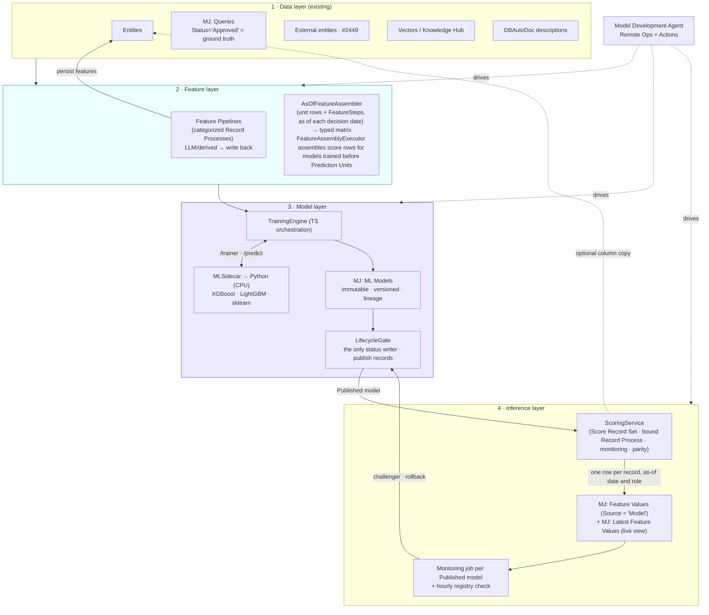

The differentiation is **data assembly + agentic search over MJ's entire data surface**, not algorithmic innovation. We are deliberately rigid about algorithms (a fixed 6-algorithm catalog) and flexible about data. This is **CPU-bound, no GPU** — gradient boosting / logistic regression / random forest / small MLP on tabular data train in seconds-to-minutes on CPU, matching MJ's API-runtime infra.

| Layer | Owns | §|
|---|---|---|
| **1 · Data** (existing) | Entities, `MJ: Queries`, external entities (#2449), vectors, DBAutoDoc — all become feed-ins via `RunView`/`RunQuery` | — |
| **2 · Feature** | `AsOfFeatureAssembler` (training and unit-model scoring read every row as of its decision date) + `FeatureAssemblyExecutor` (scoring of models trained before Prediction Units) + Feature Pipelines (persisted derived features) | §4, §11 |
| **3 · Model** | `MLSidecar` + `TrainingEngine` (trains under a Prediction Unit and an Evaluation Protocol) → immutable versioned `MJ: ML Models` (`Draft`) when the decision ships one; `LifecycleGate` moves it on | §2, §5, §13 |
| **4 · Inference** | `ScoringService` (every scoring path; the bound path writes Feature Values) behind `MLModelInferenceProcessor` (the `'ML Model'` RSP work type), Score Record Set and the scored-query enricher; per-model monitoring and the registry check | §6, §14 |

---

## 2. The self-managing Python sidecar

**Node is poor for ML training; Python is excellent.** So MJ (TypeScript) assembles the matrix and orchestrates, and a Python sidecar does the CPU-bound fitting and inference. The key engineering choice: the sidecar is **self-managing and Docker-free by default**.

### 2.1 `MLSidecar` — managed-spawn is the default

`MLSidecar` (`packages/AI/PredictiveStudio/Sidecar/src/ml-sidecar.ts`) follows the **`@memberjunction/sqlglot-ts` pattern**: the Python microservice is *bundled* inside the npm package (`src/python/`) and the TypeScript class spawns it as a child process on demand. **No Docker is required for local or embedded use.**

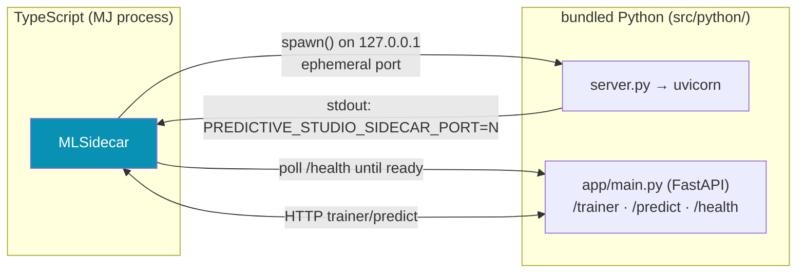

Two topologies, chosen automatically:

| Mode | When | What `Start()` does |
|------|------|---------------------|
| **Managed** (default) | nothing configured | Spawns the bundled FastAPI service on `127.0.0.1` with an **OS-assigned ephemeral port**, reads `PREDICTIVE_STUDIO_SIDECAR_PORT=<n>` from its stdout, polls `/health` until ready, and registers SIGINT/SIGTERM/exit cleanup so the child dies with the parent. |
| **Remote** | `url` option **or** `PREDICTIVE_STUDIO_SIDECAR_URL` env set | Connects only — no child process — and just verifies `/health`. Use for a containerized/horizontally-scaled sidecar. `Stop()` is then a no-op (this client never owned the process). |

The public surface (`Sidecar/src/index.ts`): `MLSidecar`, `SidecarError`, `TrainerResultMalformedError`, plus the `MLSidecarOptions` and `SidecarHealthResponse` types.

```typescript
import { MLSidecar } from '@memberjunction/predictive-studio-sidecar';

const s = new MLSidecar();   // managed mode by default
await s.Start();             // spawns the bundled Python service

const trained = await s.RunTrainer({ /* TrainerRequest */ });   // POST /trainer
const { predictions } = await s.Predict({ /* PredictRequest */ });

await s.Stop();              // SIGTERM the child (no-op in remote mode)
```

`MLSidecar` exposes `IsRemote`, `IsRunning` (remote always `true`; managed needs a live child), and `Port` (ephemeral in managed, `null` in remote). On macOS it automatically appends `DYLD_LIBRARY_PATH=/opt/homebrew/opt/libomp/lib` to the spawn environment so XGBoost/LightGBM find the OpenMP runtime.

### 2.2 `npm run setup:python` — the one-time bootstrap

**One-time setup (fresh clone).** Predictive Studio's packages depend on other workspace packages, so build them
together, never one by one (a per-package `tsc` on a fresh clone fails with `TS2307 Cannot find module
'@memberjunction/core'`):

```bash
pnpm install        # repo root
pnpm run build      # repo root: builds PS and everything it depends on, in dependency order
pnpm --filter @memberjunction/predictive-studio-sidecar run setup:python
```

`setup:python` needs CPython 3.11 or 3.12 (numpy 1.26.4 has no wheels for 3.13+); it tries `python3.11`, `python3.12`,
`python3`, `python` and stops with the list it probed if none fits. Pass `-- --python <path>` after the `setup:python` command to choose one. On macOS
also `brew install libomp` (XGBoost/LightGBM). To run the sidecar or its tests on another interpreter, set
`PREDICTIVE_STUDIO_PYTHON=<path to python>`.

The pinned `requirements.txt` includes FastAPI + uvicorn, `xgboost`, `lightgbm`, `scikit-learn`, `numpy`, `scipy`, `pandas`, `joblib`, and the test deps. The setup script (`scripts/setup-python.mjs`) creates the venv, upgrades pip, and installs requirements; `MLSidecar` picks its interpreter in this order: an explicit `pythonPath` option, then `PREDICTIVE_STUDIO_PYTHON`, then that bundled `.venv`, then `python3`.

### 2.3 The HTTP contract

The contract is defined **once** in `@memberjunction/predictive-studio-core` (`trainer-contract.ts` for training, `sidecar-contract.ts` for scoring) and mirrored by the Python Pydantic models (`app/trainer_schemas.py`, `app/schemas.py`). MJ freezes the matrix into a Training Snapshot and orchestrates; the sidecar selects, scores and serves.

| Endpoint | Request → Response | Role |
|---|---|---|
| `GET /health` | → `SidecarHealthResponse` (`status`, `algorithms[]`, `cached_models`) | liveness + registered driver keys + warm-cache depth |
| `POST /trainer` | `TrainerRequest` → `TrainerResult` (`completed`, or `failed` with its stage) | one **protocol-driven training**: downloads the snapshot's matrix and row manifest (SHA-256 verified), selects a finalist on the inner folds of the development rows, scores the locked holdout once, fits the baselines, and returns the scores with intervals, calibration, leakage-audit flags, permutation importance and the artifacts. A request that must not run (for example a primary score of another task family) is a 400 |
| `POST /predict` | `PredictRequest` → `PredictResponse` | **applies** a stored predictor to aligned rows and returns `predictions[]`: a `ps-predictor/v2` artifact applies its own in-fold encoding; a model trained before Prediction Units applies its frozen `fitted_preprocessing`. Never re-fits |

The retired `/train` route (and `MLSidecar.Train`) are gone: nothing trains outside the trainer, and models already trained keep scoring through `/predict`.

The Python side: `server.py` resolves the port (0 → OS picks free), prints `PREDICTIVE_STUDIO_SIDECAR_PORT=<n>` to stdout, and runs uvicorn; `app/main.py` is the FastAPI app; `app/trainer.py`, `app/selection.py`, `app/evaluation.py`, `app/baselines.py`, `app/calibration.py`, `app/intervals.py` and `app/gate.py` are the trainer's stages; `app/encoding.py` is the typed in-fold encoder (§4.2); `app/algorithms.py` is the driver registry (the `DriverClass` values seeded in `MJ: ML Algorithms`: `xgboost`, `lightgbm`, `logistic_regression`, `random_forest`, `ridge`, `mlp`); `app/preprocessing.py` is the fit/transform core that models trained before Prediction Units still score through (§4.2); `app/artifacts.py` loads the legacy envelope and runs the **warm LRU model cache** (max 32, SHA-256 keyed) that keeps single-record interactive scoring fast, and `app/artifacts_v2.py` is the `ps-predictor/v2` envelope.

**Model artifact envelopes** (base64 on the wire, stored in MJStorage). A model trained under a Prediction Unit is a `ps-predictor/v2` envelope: `{ format: "ps-predictor/v2", version: 2, payloadB64, featureColumns, taskKind, classOrder, featureSchemaHash, driverBaseline, transformedColumns }`, where the payload is one fitted trainer predictor (in-fold encoding, estimator and optional calibration map), so the encoding travels *with* the model. A model trained before Prediction Units keeps its `{ format: "joblib", version, payload_b64, fitted_preprocessing, feature_schema }` envelope; its fitted preprocessing is the anti-skew payload (§4.2).

---

## 3. The type contracts (`@memberjunction/predictive-studio-core`)

The shared vocabulary across the sidecar, the engine, the UI, and the agent. The package has more than thirty modules (its [README](../packages/AI/PredictiveStudio/Core/README.md) lists them all); these are the ones the rest of this guide leans on:

| File | Defines |
|---|---|
| `sidecar-contract.ts` | the `/predict` contract: `PredictRequest`/`PredictResponse`, `Prediction`, `PredictionContribution`, `FeatureSchemaEntry`, `PreprocessingOp`, `MatrixData`; scalars `FeatureKind`, `ProblemType`, `ModelMetrics`, `FeatureImportance`, `ImportanceKind`, `FittedPreprocessing` (the parameters a model trained before Prediction Units carries) |
| `trainer-contract.ts` | the `/trainer` contract: `TrainerRequest`, `TrainerResult` (`completed` / `failed`), `CandidateSpec`, `PreAuthDownload`, the returned artifacts, `PREDICTOR_ARTIFACT_FORMAT` |
| `prediction-unit.ts`, `task-type.ts`, `unit-edit.ts` | the **Prediction Unit** shapes (unit rows, decision date rule, label rule, censoring, change-history policy, task type) with their parser (`PredictionUnit.ParsePredictionUnitRow`), and the version-saving edit rules |
| `assembly-contract.ts` | the **as-of assembly** contract: the dated sources a feature reads (`DatedSource`: `record-changes`, `immutable-field`, `feature-value`, `windowed-aggregate`, `series`), how each column is encoded (`ColumnEncoding`), the change-history coverage report (`ChangeHistoryCoverage`), every assembly refusal (`AssemblyRefusal`), per-column and per-value provenance, and the snapshot's row manifest (`SnapshotRowKey`) |
| `snapshot-format.ts`, `holdout-carve.ts` | the Training Snapshot file shapes (matrix header and cells, provenance line, reserved columns) and the locked-holdout carve each protocol declares (date-carved, seeded-random, rolling-origin) |
| `evaluation-protocol.ts`, `evaluation-protocol-rules.ts`, `protocol-edit.ts` | the **Evaluation Protocol** shapes (holdout, inner validation, primary proper score, baselines, calibration, intervals, promotion rule, leakage audit, exclusions, budgets) and their guard-field rules |
| `selection.ts` | `InnerScoreSelection`: the check of the trainer's selection report (every candidate scored on the inner folds, the holdout read once, for the finalist) and the leaderboard rows built from the inner-fold scores |
| `gate.ts`, `run-evaluation.ts`, `training-run-results.ts` | the three-outcome **gate** (`GateRules`, `GateRecords`), the stored gate record, and the `ps-run-results/v2` envelope a training run stores |
| `trust.ts` | `TrustVerdicts.DeriveTrustVerdict`: the stored gate decision rendered as plain copy, with the `CanAct` gate the catalog and the agent's builder share |
| `registry-contracts.ts`, `governance-contracts.ts` | the model registry: `ModelRegistryEntry`, `Delivery` / `RegisteredDelivery`, `PublishRules.ReverifyPublish` (the publish re-derived from stored rows), `StatusWriteRules` (the lifecycle table the status guard enforces), `TransitionRefusal`, `PublishRecord`, `SignOff`, `EvidenceSnapshot` (§13) |
| `scoring-contracts.ts`, `stored-prediction.ts`, `prediction-panel-queries.ts` | the Scoring Service: `ScoringScope`, `ScoringRequest`, `ScoringRefusal`, `ScoredRow`, `ScoringResult` (§6); `StoredPrediction`, the one reader of a `Model` Feature Value's `ValueJSON`; the record panel's batched reads and `PredictionViewAuthorization` |
| `monitoring-contracts.ts`, `monitoring-job-specs.ts`, `monitoring-rules.ts`, `monitoring-result-schemas.ts`, `registry-check-details.ts` | monitoring: `MonitoringJobSpec`, `DriftSpec`, the trigger and rollback rules, the stored JSON of `MJ: ML Monitoring Results`, and the registry check's run `Details` (§14) |
| `refusal-codes.ts` | `PredictiveStudioRefusalCodes`: the typed `ResultCode`s a refused Train, Score or sign-off request returns (§10.4) |
| `pipeline-spec.ts` | `SourceBinding`, `LeakageGuard`, `ValidationStrategy` (the declarative shape of a training pipeline) and the retired `AsOfStrategy` (the unit decides decision dates now) |
| `feature-steps.ts` | the visual **FeatureStep DAG** — a discriminated union on `Kind` (**11 kinds**: `select`/`windowed-aggregate`/`series`/`impute`/`standardize`/`onehot`/`bin`/`embedding`/`llm-derived`/`flow-agent`/`vision-llm`) + `FeatureStepGraph` |
| `modeling-plan-spec.ts` | `ModelingPlanSpec` (the Model Development Agent's strongly-typed payload), `Budget`, `LeaderboardEntry` |
| `modeling-plan-schema.ts` | **Zod** `ModelingPlanSpecSchema` / `BudgetSchema` + `ValidateModelingPlanSpec()` / `ValidateBudget()` — the **runtime** plan/budget validators the Start-Experiment op and Run-Experiment action call before any iteration runs |
| `metrics-util.ts` | `MetricDirections.IsErrorMetric(metricKey)` / `MetricDirections.MetricDirectionOf(metricKey)` — the lower-is-better set is read from Core's `METRIC_DIRECTION` declaration (plus the legacy spellings such as `mse`/`loss`/`logloss`/`log_loss`) — lifted to Core so the leaderboard (§7) and the challenger-vs-incumbent comparison (§14) **cannot drift** on metric direction |

```typescript
import type { ModelingPlanSpec, TrainerRequest, FeatureStepGraph } from '@memberjunction/predictive-studio-core';
import { ValidateModelingPlanSpec, MetricDirections } from '@memberjunction/predictive-studio-core';
```

> **Note on dependencies:** Core holds the contracts and the browser-safe runtime logic every layer must agree on (the gate, the trust verdict, the protocol and unit parsers and edit rules, the holdout carve, the metric directions, the validators). Its two runtime dependencies are `zod` (the validators of stored and wire JSON and of the modeling plan) and `@memberjunction/global` (UUID comparison, ordinal ordering, canonical JSON); it has no server or database dependency.
>
> **Import the sidecar contract types from *here*, not from the Sidecar package** (which only re-uses them). MJ's TypeScript rules (`.claude/rules/typescript-style.md`) forbid re-exporting another package's shapes.

---

## 4. The FeatureAssembly executor — the correctness backbone

Two classes assemble features, one per generation of model, and each is the single code path of its generation:

- **`AsOfFeatureAssembler`** (`Engine/src/feature-assembly/as-of/as-of-assembler.ts`) assembles the training matrix of every Prediction Unit pipeline (`Context: 'train'`) and the score rows of the models trained that way (`Context: 'score'`). It reads every feature as of each unit row's decision date (§4.3).
- **`FeatureAssemblyExecutor`** (`Engine/src/feature-assembly/feature-assembly-executor.ts`) assembles the score rows of models trained before Prediction Units, from the recipe those models stored. Training no longer calls it. Its one public method —

```typescript
public async assemble(params: FeatureAssemblyParams): Promise<FeatureAssemblyResult>
```

— turns `(record set, frozen FeatureSteps spec) → feature matrix`. It refuses `windowed-aggregate` and `series` steps, which need a Prediction Unit pipeline.

A model's own `Lineage` decides which generation it belongs to: a Lineage that carries `predictionUnitId` (written only by Prediction Unit training) takes the unit path, and every other readable Lineage keeps scoring on the executor path, even after its pipeline has been migrated to a unit. That single-path-per-generation property is what prevents train/serve skew by construction.

### 4.1 One path for training and scoring

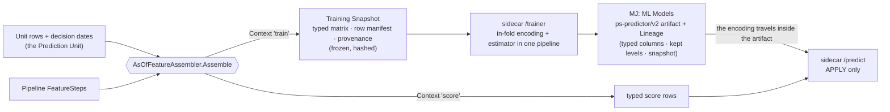

Scoring runs the same assembler with the typed columns and kept categorical levels that training stored in the model's Lineage (`UnitModelLineage`), so a feature is computed *identically* at training and at scoring time. For models trained before Prediction Units, `FeatureAssemblyExecutor.AssemblyContext` is `'train' | 'materialize' | 'on-demand'` and scoring uses `'on-demand'`.

### 4.2 In-fold encoding (anti train/serve skew)

For a Prediction Unit pipeline the assembler emits **typed columns** (numeric, one-hot categorical with at most 50 levels and the rest folded into one `__other` level, plus a missing-value indicator beside every imputed column). The sidecar's `app/encoding.py` turns the snapshot's per-column encodings into one *unfitted* `ColumnTransformer` that is always placed **inside** one sklearn `Pipeline` with the estimator. Every fit during training (each inner fold, the calibration fold, the finalist refit, each baseline) therefore fits its imputers, scalers, vocabularies and target encodings on that fit's own training rows only, so no statistic is learned from rows the fit is later judged on. A non-numeric value in a numeric column is refused rather than mapped to 0. The whole fitted predictor is the artifact (`ps-predictor/v2`), so `/predict` applies the same encoding to a score row and never re-fits; `MLModel.FittedPreprocessing` is `{}` for these models. `src/python/tests/test_encoding.py` locks the in-fold rule down.

**Models trained before Prediction Units** keep the earlier split, because they keep scoring. `FeatureAssemblyExecutor` (`partitionSteps`) partitions the FeatureStep graph into two kinds of step:

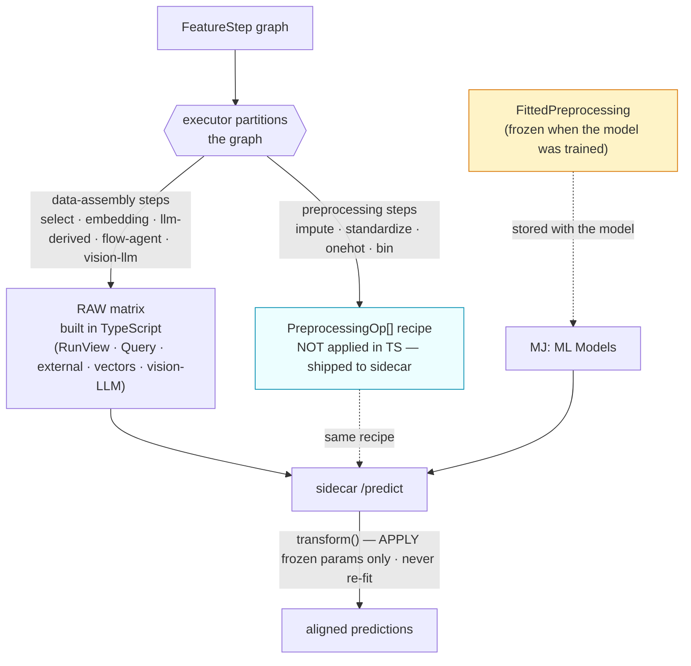

- **Data-assembly steps** (`select`, `embedding`, `llm-derived`, `flow-agent`, **`vision-llm`**) → produce the **raw matrix** in TypeScript, drawing from `RunView`/`RunViews`, Query bindings, external entities, persisted vectors, and (for `vision-llm`) a per-row vision prompt (§12 note: it's a *dedicated* kind, distinct from `llm-derived`). For `llm-derived` steps, assembly reads the live column value on the source record without pinning a `MJ: Feature Pipeline Versions` row.
- **Preprocessing steps** (`impute`, `standardize`, `onehot`, `bin`) → are **NOT applied in TypeScript**. They are emitted as a `PreprocessingOp[]` recipe and shipped to the sidecar.

> **Why:** Stateful transforms (normalization mean/std, one-hot vocabulary, bin edges, imputation fill values) must be **fit once on the training data** and then *only applied* — never re-fit — at inference. For these models the sidecar (`app/preprocessing.py`) did exactly this: `fit_transform()` at the retired `/train` route learned the params and returned them as `fitted_preprocessing`; `transform()` at `/predict` only applies those frozen params ("APPLY ONLY, never re-fit"). The fitted preprocessing was serialized into `MLModel.FittedPreprocessing` alongside the weights and **travels with the model**. This is why `FeatureSchema` alone is insufficient: the fitted pipeline is part of the model's identity. The Python golden test (`src/python/tests/test_preprocessing_golden.py`) locks this down — the same raw row produces an identical transformed vector at train and at predict.

> **Required raw columns are guaranteed present at score time (anti-skew, the *data* half; `FeatureAssemblyExecutor` path).** The preprocessing split above guarantees the *transforms* match at train and score. A second skew vector is the *raw data* itself: on-demand / scheduled scoring receives its records from an upstream Record-Set-Processing **scope**, which may have loaded them with a **narrow field projection** that dropped a virtual / denormalized column (e.g. a value-list field joined into the entity view but absent from the base table). The model trained on that column; missing it at score time silently degrades every prediction toward a constant. `assemble()` now closes this at the single seam where it can enter: after building the column plan, **`hydrateMissingFeatureColumns`** re-reads any *absent* required column from the **same entity view the model's training read** (`dataAccess.fetchRows`, keyed by primary key) — columns already present are untouched, so full `entity_object` loads pay no second read and no blob tax. Then **`assertRequiredColumnsPresent`** **hard-fails** if a required column is *still* absent: `MLModelInferenceProcessor`'s per-record `try/catch` marks that run **Failed** with a precise message that bubbles to the run history + Production-tab UI — *no silent "Succeeded" with degenerate output*. Locked down by a **train/serve parity** unit test (same rows inline-vs-hydrated → byte-identical matrix) and an integration assertion that on-demand predictions **vary** across a multi-type scope (`COUNT(DISTINCT score) > 1`). See [`plans/predictive-studio-scoring-virtualfield-skew.md`](../plans/predictive-studio-scoring-virtualfield-skew.md) for the full find→fix write-up.

### 4.3 Point-in-time / "as-of" assembly

For forward prediction, features are read as they were at the decision point rather than as they stand today. The **Prediction Unit** owns the decision date. Its `DecisionDateRule` is a `column` on the unit row, a `column-offset` (that column plus an offset in days), or a `fixed` date, which with `advance: 'each-run'` moves to the run's UTC day before each training run by saving the next unit version (a second run on the same day saves nothing); scoring dates such a unit's rows at the scoring run's own UTC day. `AsOfFeatureAssembler` (`feature-assembly/as-of/as-of-assembler.ts`) then reads each feature for each unit row as of that row's date:

| Source of a column | Read as of the decision date from |
|---|---|
| a field the entity does not allow to be updated through the API (`AllowUpdateAPI = false`) | the stored value (it cannot change) |
| any other field, and every `__mj_` system column (MJ declares them not updatable, but `__mj_UpdatedAt` changes on every save) | the `MJ: Record Changes` history of the record |
| a virtual field (a value the entity's view joins from a related record) | the stored value, only when every row is decided on the assembly's day or later (a fixed decision date that advances each run, as the Pipeline Builder and the migration create); otherwise the read is refused (`virtual-field`), since the stored value is the related record's value today; select the field from the related entity through its key (a `select` with `Entity` and `KeyField`) |

Every column has a **dated source** (`DatedSource`, `assembly-contract.ts`): a field of the row's entity or of an entity it joins to (`record-changes` or `immutable-field`, from the table above), a child table aggregated over a window that ends on the decision date (`windowed-aggregate`), a pinned Feature Value (`feature-value`), or a declared lag or rolling value of a forecast series (`series`). There is no "today's value" source. Each column is typed from its field (`ColumnEncoding`: numeric, categorical, date parts, boolean, or an identifier that is excluded), and every column gets an imputer with a missing-value indicator (§4.2). The `embedding`, `flow-agent` and `vision-llm` steps have no as-of reading and are refused (`unsupported-step-kind`), an `llm-derived` step without a pinned Feature Pipeline version is refused (`unpinned-feature-version`), and a read that returns fewer rows than it counted is refused (`truncated-read`): there is never a partial matrix.

**Coverage.** Every Record Changes history the assembly reads is reported in its result's `Coverage`, one entry per entity and field: where the history starts and how many records its continuity check replayed and found mismatched. A unit row whose replayed value cannot be read (the history does not reach its decision date, or reaches it but cannot be replayed) is uncovered, and the unit's `ChangeHistoryPolicy.onUncoveredRow` decides what happens to it: `refuse` refuses the whole assembly, and `exclude-and-count` leaves the row out and counts it per entity and field on the Training Snapshot (`UncoveredHistoryRowsExcluded`). A stored value read directly that the history cannot vouch for is refused whatever the policy (below).

A feature the assembler cannot read as of a date is **refused**, never approximated: `AS_OF_SOURCE_UNDATED` carries `decision-date-before-change-history` (the history does not reach back to the date) or `select-changes-after-decision-date` (a stored value changed after the date). On a tracked entity, a read for a decision day on or after the assembly day uses the history whenever it covers that day, and the stored value only where there is no covering history.

`AsOfStrategy` (`none` / `column` / `offset`) is the retired pipeline-level form of the same idea. Training refuses a pipeline whose stored `AsOfStrategy.Mode` is not `none` (`input-not-accepted`, because the unit decides decision dates), and `PredictiveStudio.TrainModel` refuses any `asOf` input, whatever its mode (`AS_OF_NO_EFFECT`, §10.4). The "Migrate Pipelines to Prediction Units and Evaluation Protocols" Action (§10.2) moves a `column` as-of into the unit's decision date and resets the pipeline's `AsOfStrategy` to `none`; it archives a pipeline whose as-of is an `offset`.

### 4.4 The leakage guard

An automated feature-search agent will relentlessly exploit target leakage (a field that's a proxy for the label → AUC ~0.99 garbage). Complementary defenses (the first two live in `feature-assembly/leakage-guard.ts`):

1. **Deny-list enforcement (assembly-time).** On the unit path the union of the pipeline's `LeakageGuard` deny lists and the bound protocol's `exclusions` keeps fields and sources out of the matrix (`TrainingEngine.EffectiveExclusions`), so neither list can bring back a column the other keeps out. `LeakageGuardEnforcer` normalizes the `LeakageGuard.DenyFields` / `DenySources` into case-insensitive sets; deny-listed fields/sources are filtered out of the matrix **before any column is produced** (`IsFieldAllowed`, `IsSourceAllowed`, `PartitionColumns`).
2. **Single-feature-dominance detection (post-train).** `DetectSingleFeatureDominance(featureImportance, threshold)` normalizes the finalist's held-out permutation importance to shares of total importance (using magnitudes, so signed coefficients work) and flags when the top feature's share exceeds `SingleFeatureDominanceThreshold` (e.g. `0.6`). The flagged run carries a `LEAKAGE WARNING` note and the Train output's `leakageFlagged`. The same test is re-run on the stored importance of a pre-change model before it may keep serving (§6.2).
3. **The protocol's leakage audit (in the trainer).** The Evaluation Protocol's `LeakageAudit` (a single-feature held-out AUC ceiling, a time-shifted-label test, a drop-column test, per-source-column importance, a high-cardinality-identifier check) runs inside `/trainer`; its flags come back in the trainer result, are stored on the run, and the Studio's evaluation panel lists them. These flags are what the lifecycle gate reads at publish (§13.2).

> When a run is flagged, the system does **not** silently proceed and does **not** publish automatically. It surfaces a clear, **business-person-friendly** warning — *"One field is doing almost all the predicting — this often means we're accidentally peeking at the answer."* — and the lifecycle gate refuses to publish a model whose run carries leakage-audit flags (`unacknowledged-leakage-flags`) until a person's sign-off names each flag it overrides, with a reason (§13.3). An automated publisher never gets past it.

---

## 5. Training — immutable versioned models judged under an Evaluation Protocol

`TrainingEngine` (`Engine/src/training/training-engine.ts`) orchestrates the whole train path:

```typescript
public async trainModel(input: TrainModelInput, deps: TrainingDeps): Promise<TrainModelResult>
```

`TrainModelInput` is `{ pipelineId, experimentSessionIterationId?, sidecarVersion?, candidates?, timeoutSeconds? }`; the result is `{ model, run }`, and `model` is `null` when the stored gate decision ships no artifact.

A run passes through six objects in order: the **Prediction Unit** decides which rows exist, their decision dates and their labels; the **as-of assembler** reads every feature of every row as of its decision date (§4.3); the **Training Snapshot** freezes the assembled rows into fingerprinted files; the **Evaluation Protocol** decides the locked holdout carved into that snapshot and how candidates are judged; the **trainer** (the sidecar's `/trainer`) selects a finalist on the development rows and scores it once on the holdout; and the **gate** turns the stored scores into one of three outcomes. The steps:

1. **Resolve the pipeline and refuse before any row is written** — a pipeline without a Prediction Unit (`unit-required`) or without a readable Evaluation Protocol (`protocol-required`), more candidates than the protocol's budget allows, a pipeline that declares a time index (`ValidationStrategy.TimeIndexColumn`) under a protocol whose holdout does not respect time (`time-index-needs-time-holdout`), and a stored `AsOfStrategy` that is not `none` (`input-not-accepted`) all stop here, and so do deps without a snapshot file store or a trainer. No run row and no unit version exists yet.
2. **Advance the decision date and create the run row** — a pipeline that passed step 1 first moves a fixed decision date with `advance: 'each-run'` to the run's UTC day (a new unit version), then creates the `MJ: ML Training Runs` row (`Status='Running'`). The protocol row must predate the run row, and a protocol that does not fit the unit is refused on the run.
3. **Read the unit rows** — every row of the Prediction Unit; censored and label-known rows are excluded and counted, and the target is validated (a single-valued target is refused).
4. **Assemble as of each decision date** — `AsOfFeatureAssembler` (`Context: 'train'`) builds the typed matrix (§4).
5. **Freeze a Training Snapshot** — the matrix, the row manifest and the provenance are stored as files and hashed into an immutable `MJ: ML Training Snapshots` row; the locked holdout is the one the protocol declares, carved on the protocol's cutoff before anything is fitted; identical content reuses the existing snapshot.
6. **Call the sidecar trainer (`/trainer`)** — it is sent pre-authorised downloads of the snapshot files and returns the inner-fold scores, the baselines, the finalist's single read of the holdout, calibration, leakage flags and the artifacts.
7. **Decide the gate in TypeScript** (`GateRecords.BuildStoredGateRecord`) — a sidecar decision that differs from the transcription refuses the run (`sidecar-gate-mismatch`).
8. **Persist what ships** — each returned artifact goes to MJStorage (`MJ: Files`) via an injected store, and the immutable `MJ: ML Models` row (`Status='Draft'`) is created from the artifact the decision ships only: the finalist's for `model`, the kept simple baseline's for `keep-simple-baseline`, none for `no-signal` or a kept heuristic rule. Its `Lineage` names the unit version, the typed feature columns, the kept categorical levels scoring reuses, the snapshot's ID and content hash, and the protocol; the same lineage is written to the row's registry columns (`PredictionUnitID`, `EvaluationProtocolID`, `TrainingSnapshotID`, `TrainingRunID`, `SnapshotHash`, `CodeVersion`, `FeatureSchemaHash`, `OutputSemantics`), with the stored file's SHA-256 in `ArtifactSha256` and the registered delivery (the gate decision and the stored file it ships) in `Delivery`.
9. **Leakage check** — a single feature dominating the finalist's importance flags the run (a `LEAKAGE WARNING` note). Training never publishes: every model it creates is `Draft`, and the lifecycle gate (§13) evaluates and publishes it.
10. **Finalize the run** (`Completed`, or `Failed` with the refusal or failure recorded) — `ValidationResults` holds the `ps-run-results/v2` envelope (§8); `ComputeSeconds` and `CodeVersion` are recorded.

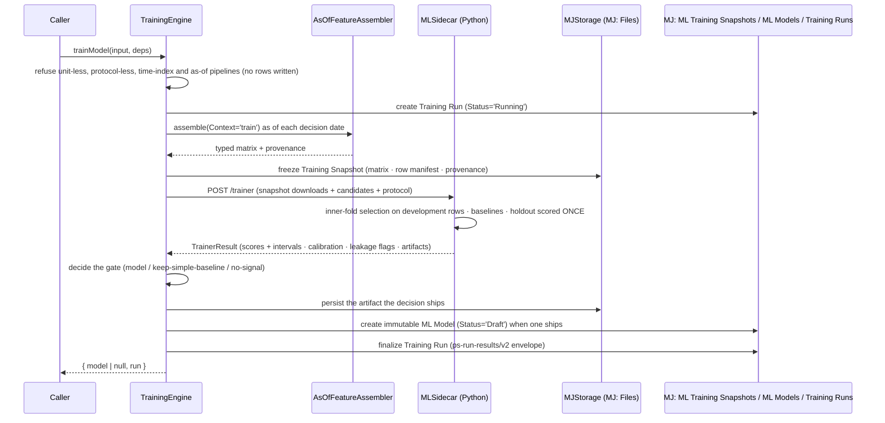

The engine is built on **dependency-injection seams** (`src/training/types.ts` + `src/training/seams.ts`): `IEntityFactory`, `IRecordLoader`, `IArtifactStore`, and on the unit path the snapshot file store, `ITrainerEvaluator`, and the Prediction Unit, Evaluation Protocol and Training Snapshot stores. Production wires `MetadataEntityFactory`, `RunViewRecordLoader`, `StorageProviderArtifactStore` and `MJSidecarTrainer`; tests substitute in-memory fakes (which is what makes the engine unit-testable with no DB and no live sidecar — see the live integration test in §19.4).

### 5.1 Evaluation Protocol and the locked holdout

Every training run uses the **Prediction Unit** and the **Evaluation Protocol** its pipeline binds; a pipeline without either is refused. Both are versioned as immutable rows: "editing" saves the next version, and a run, its snapshot and its model point at the exact version rows they used. The protocol, saved before the first candidate trains, declares the locked holdout (**date-carved**: every row whose date is on or after the cutoff, optionally before an end date; or **rolling-origin** for forecasts, at least five origins; or, for a unit with one fixed decision date, a **seeded-random** row-hash fraction, which a pipeline that declares a time index is refused under), the inner validation over development rows (repeated or grouped folds; blocked in time with a gap of at least the horizon for series), the primary proper score of the unit's task family (log loss, multiclass log loss, RMSE/MAE, Poisson or Tweedie deviance, MASE), the baselines, calibration, intervals, the leakage audit and the columns that never become inputs, slices, the promotion margin and hard-stopping budgets. The promotion rule, leakage audit, holdout, exclusions and budgets are guard fields: they are set in protocol configuration — the UI, a non-agent API caller, a scheduled job, the defaults or shipped metadata — and never by an agent tool call; a protocol can optionally restrict them to users (`GuardFieldsEditableBy: human-only`). The rule reads each version's `AuthoredBy`, so the server refuses a version whose `AuthoredBy` names a user other than the one saving it, and a pipeline rebound to a protocol of another lineage, or back to an earlier version of its own lineage, is held to the same rule: when the guard fields differ, both the new protocol's author and whoever rebinds (the saving user; the system when there is none) must be ones the previous protocol's setting allows. Moving a pipeline forward within its lineage needs no check, because each later version's save applied the rule. Protocol, unit and snapshot rows also refuse a `ReplayOnly` save once saved, since that option skips validation but still writes.

Candidates are ranked by their inner-fold mean with a 95% interval; the winner's inner score is optimistic and labelled so. The locked holdout is read once, for the finalist, and the run stores the paired intervals against the flat guess (the dummy baseline) and the simple baselines, then the **three-outcome gate**: `model` (the model beats the flat guess and the best simple baseline), `keep-simple-baseline` (a simple baseline carries the signal), or `no-signal`. Nothing ships when the rarest class has fewer test rows than the protocol's minimum (20 by default) or a binary model's AUC interval contains 0.5. The decision and its reason are stored on the training run; publishing is a separate, automated step that reads that stored decision.

The seed in the protocol fixes every random state and the run uses one thread, so the same rows and settings give the same model. The pipeline's `ValidationStrategy.MajorityBaselineRule` (`"enforce"` or `"warn"`) is still checked before training (an unknown value is refused with `INVALID_EVALUATION_SETTING`) and recorded in the model's `Lineage.evaluation`, but the stored gate decision does not read it. Training also records which kind of feature importance the trainer produced (`ImportanceKind`); a model's global drivers are shown only for coefficient and held-out permutation importances, never for split or impurity counts.

> The integration test (§19.4) exercises this end to end through the real sidecar trainer: the protocol's holdout is carved into the Training Snapshot before training, and the run stores its gate decision with the holdout row count.

### 5.2 `MJ: ML Models` is distinct from `MJ: AI Models`

| | `MJ: AI Models` | `MJ: ML Models` |
|---|---|---|
| What | off-the-shelf foundation models we **call** (LLMs, embeddings, image-gen) | predictive models we **train** from client data |
| Inference path | vendor API + driver class | the **Python sidecar** |
| Produced by | seeded vendor metadata | a `TrainingEngine` run whose gate decision ships an artifact |

An ML Model is **immutable + versioned** — each run that ships an artifact yields a new row, never a mutation (a `no-signal` run yields none). It may *reference* an AI Model in its `Lineage` (e.g. the embedding model used to build features) — a pointer, not membership. The generated entity classes are `MJMLModelEntity` / `MJMLTrainingPipelineEntity` in `@memberjunction/core-entities`. Its status (`Draft`, `Validated`, `KeepBaseline`, `Published`, `Archived`, `Unevaluated`) is written only by the lifecycle gate (§13); at most one model per pipeline is `Published` (a unique index), and `(PipelineID, Version)` is unique.

---

## 6. Scoring — one Scoring Service behind every path

Every scoring call goes through one `ScoringService` (`Engine/src/scoring/scoring-service.ts`), constructed per call with the caller's provider and user. It has two entry points:

- **`Score(binding, scope, asOf, dryRun)` — the binding path, the only one that writes.** It scores the scope with the binding's pipeline's `Published` model as of a date and stores each record's prediction as one `MJ: Feature Values` row (§6.5). The bound Record Process and Score Record Set with a `bindingId` use it.
- **`Predict(request)` — the model path; it writes no Feature Value and no column.** Score Record Set without a binding, the scored-query enricher, monitoring's shadow scoring and the parity check use it, and get the scored rows back.

Both write one `MJ: ML Scoring Runs` row per call — dry runs and refusals included — before the first record is read, so a crash leaves a visible `running` row (the registry check fails one left `running` for 6 hours, §14.4).

### 6.1 The `'ML Model'` Record Set Processing work type

Scoring a saved scope runs on **Record Set Processing** (see the [Record Set Processing Guide](RECORD_SET_PROCESSING_GUIDE.md)) as the `'ML Model'` work type, so batching, concurrency, pause/resume and audit come from the substrate. `MLModelInferenceProcessor` (`Engine/src/scoring/ml-model-inference-processor.ts`) is registered on the MJGlobal ClassFactory — primary key `'ML Model'` (on the decorator) and alias `'MLModelInference'` — and installed into `RecordProcessorRegistry` at MJAPI boot by `PredictiveStudioScoringStartup` (§15.2), so the `record-set-processor` base package never depends on Predictive Studio.

> **⚠️ Disambiguation:** the existing **`Infer`** work type runs an **AI Prompt** per record — that is LLM inference, **not** ML inference. The **`ML Model`** work type runs a **trained ML model** through the sidecar. (The [Record Set Processing Guide](RECORD_SET_PROCESSING_GUIDE.md) §4 carries the same note.)

- **A Record Process that a scoring binding names** is admitted once, before the first batch, through `ScoringService.Admit` (the binding's refusals, its pipeline's Published model, checks 1–3 below); a refusal writes a refused scoring-run row and refuses the Process Run. Each batch is then one `ScoringService.Score` call over the batch's records: one scoring-run row per batch, its Feature Values and the binding's column copy. A failed or refused batch fails the Process Run, and later batches are not scored.
- **A Record Process that no binding names** scores with its `Configuration.modelId`, which must be `Published` (`MODEL_NOT_SCORABLE` otherwise), and writes only `MJ: Process Run Details`. Its `OutputMapping` is ignored: a prediction reaches a column only through a binding's column copy.

The processor assembles features with the same code training used, in transform-only mode (frozen `FeatureSchema` and `FittedPreprocessing`, never re-fit); a model trained on a Prediction Unit is assembled by `AsOfFeatureAssembler`, each record dated by the unit's decision-date rule.

### 6.2 Checks before and after assembly

The service runs six checks on every path, three before assembly and three after; each refusal writes the refused run row and nothing else:

1. **Status and flags** — the model is admitted as the pipeline's `Published` model, as a pre-change model kept serving while `Unevaluated` (its stored feature importance re-run through the dominance test), as the binding's live challenger (`Validated` or `Published`), or, on the monitoring path only, as the predecessor its `Published` successor replaced (`Archived`). A model without a Prediction Unit scores only the run date (`as-of-unsupported`).
2. **A verified artifact** — the artifact bytes are loaded through the artifact registry and must hash to the model's `ArtifactSha256`; what the load found is recorded on the model's `ArtifactStatus`.
3. **The scope entity** — the model's entity (its unit's row entity, else its target entity) and, on the binding path, the binding's target entity.
4. **The assembly** — a refused or truncated read refuses the call (`assembly-refused`, carrying the assembly's refusal).
5. **The feature schema** — the assembled columns hash to the model's `FeatureSchemaHash`; the refusal lists the missing, extra and retyped columns.
6. **No empty column** — every feature column holds a value on at least one scored row.

A batch in which any record fails writes nothing; the run stops there and ends `failed` with its counts and first errors (at most 20), and the batches before it stay.

### 6.3 Score Record Set, single, batch, on-demand, scheduled

`PredictiveStudio.ScoreRecordSet` (and the Score Record Set Action) takes a `modelId`, an optional `bindingId` (the model must then be of the binding's pipeline), one scope selector (`records`, `viewId`, `listId`, `filter`, `single`), an optional `asOfDate` (the run date when omitted; only a model trained on a Prediction Unit scores an earlier date) and `dryRun`. Record keys are the entity's bare single-column key value — the form `MJ: Feature Values.RecordID` carries. The output is the completed run: `scoringRunId`, `modelId`, `modelVersion`, `artifactSha256`, `total`, `written` (0 without a binding and on a dry run), and the `predictions` when nothing was written (`recordId`, `score`, `class`, `adverseProbability`, `inTraining`). A refused or failed run returns `Success = false` with the refusal's `ResultCode` (§10.4).

**On-demand** scoring of a saved scope is `RecordProcess.RunNow` or the generic "Run Record Process" operation; **scheduled** scoring is the Record Process's cron (§15.6). `CreateScoringProcess` and `CreateScheduledModelScoring` create the Record Process and its scoring binding together.

### 6.4 Dry runs

A dry run (`dryRun: true`) scores, records its scoring-run row with `DryRun = 1`, and writes no Feature Value and no column; on the binding path the service keeps the column changes the run would make (`DryRunPreview`). A dry run does not need write permission on `MJ: Feature Values`.

### 6.5 Where predictions go — Feature Values, the store of record

A model's prediction is a **`MJ: Feature Values` row with `Source = 'Model'`** — the same table Feature Pipelines and people write (§11), so a prediction is a feature of the record like any other. The scoring binding (`MJ: ML Model Scoring Bindings`, §16.6) defines the feature: the entity it scores, the feature name its rows carry and the training pipeline whose Published model scores it.

| Column | What a `Model` row stores |
|---|---|
| `EntityID`, `RecordID`, `FeatureName` | the scored record and the binding's feature name |
| `MLModelScoringBindingID` | the binding that defines the feature |
| `MLModelID` | the exact model version that scored |
| `MLScoringRunID` | the scoring run that wrote it |
| `EffectiveAsOf` | the as-of date the record was scored at (00:00 UTC of the date) |
| `InTraining` | the record was in the model's training snapshot |
| `Role` | `Champion` (the Published model) or `Challenger` (the binding's live challenger, written beside it under its own scoring run) |
| `ValueNumeric` | a classification's adverse-class probability, or a regression's predicted value |
| `ValueText` | a classification's predicted class |
| `ValueJSON` | `{ Probabilities, Drivers, Interval }` with the members the task has (read by Core's `StoredPrediction`) |
| `Confidence` | the predicted class's probability |

One row per binding, record, as-of date and role (a unique index): a re-run of the same as-of date replaces its rows, a new as-of date adds rows, so the table is the prediction history. A `Model` row must carry its binding, model, scoring run, as-of date and in-training flag (`CK_FeatureValue_SourceLineage`). Rows are written per batch, in one transaction each.

- **The latest value** is `MJ: Latest Feature Values` (`vwLatestFeatureValues`), a read-only virtual entity over a live view: one row per entity, record and feature name, the newest `Champion` row by `EffectiveAsOf` then `ComputedAt`, with the lineage columns. Nothing refreshes it after a run.
- **The optional column copy.** A binding that names a `TargetColumn` also copies the newest value into that existing column of the target entity, resolved from the scored value by `TargetColumnSource` (`$.AdverseProbability`, `$.Value`, …), only when the run's as-of date is the binding's newest. The copy never overwrites a value a person entered: a `Human` Feature Value of the binding's feature, or a column value that is not the binding's last copy, is kept and counted `Skipped`.
- **The per-run audit.** A Record Process run also writes its `MJ: Process Run Details` rows (the per-record result payload), and the scoring-run row records the model version, artifact hash, feature-schema hash, scope, as-of date, read policy, requester and counts.
- **Retention.** A binding's `RetentionDays`, when set, bounds its history: the daily **Predictive Studio Prediction Retention** job (02:00 UTC) deletes its `Model` rows older than that, for active and withdrawn bindings alike, one `BaseEntity.Delete()` each so Record Changes records it. It first gives every binding without a view authorization the seeded **View Model Predictions** one.
- **Withdrawal.** `PredictiveStudio.WithdrawScoringBinding` sets the binding `Withdrawn` and, in the same transaction, clears every target-column value that is still its copy (a person's value is kept); the binding's Feature Values stay. A withdrawn binding refuses scoring (`binding-withdrawn`) and its predictions leave the record panel.

Population-wide, indexed querying of predictions needs nothing more: the Feature Value rows are queryable like any table, and the column copy puts the newest value on the record itself.

### 6.6 The view gate: who sees a prediction

Each binding names a `ViewAuthorizationID` (the seeded **View Model Predictions** authorization by default, granted to the Developer and Integration roles). The **Model Predictions View Gate** row-level security filter is attached to every role's read permission on `MJ: Feature Values` and `MJ: Latest Feature Values`: a `Pipeline` or `Human` value stays visible to every reader, and a `Model` row is visible only to a user who holds its binding's view authorization, as `vwUserHeldAuthorizations` states MJ's authorization rule in SQL (an Owner holds every authorization; otherwise an active authorization, or an active ancestor, granted `Allow` to one of the user's roles and denied to none). A binding with no view authorization is visible to nobody. The registry check re-attaches the filter to a read permission that lost it (§14.4).

The service applies the same rule before reading anything: a caller who does not hold the binding's authorization is refused `binding-not-authorized`, and a writing run's caller who may not create and update `MJ: Feature Values` is refused `feature-values-not-writable`. Withdrawal applies the authorization check too.

### 6.7 Scoring refusals

Every refusal is stored as the run row's `Refusal` JSON and returned as the operation's typed `ResultCode` (§10.4). The binding path refuses in this order: `binding-not-authorized`, `feature-values-not-writable` (not on a dry run), `binding-withdrawn`, `no-published-model` — all before any record or Feature Value is read and before a model is resolved, so the run row names no model — then checks 1–6.

| Refusal (`ScoringRefusal.kind`) | When |
|---|---|
| `binding-not-authorized` | the caller does not hold the binding's view authorization |
| `feature-values-not-writable` | a writing run's caller lacks create and update on `MJ: Feature Values` |
| `binding-withdrawn` | the binding is `Withdrawn` |
| `no-published-model` | the binding's pipeline has no `Published` model (and no pre-change model kept serving) |
| `model-not-published` | the named model's status may not score on this path (the status is named) |
| `model-flagged` | the model carries leakage flags, or a pre-change serving model's dominance re-run flags a feature (named with its share and the threshold) |
| `leakage-unknown` | a pre-change serving model has no stored feature importance to run the dominance test on |
| `as-of-unsupported` | a model without a Prediction Unit is asked for a date other than the run date |
| `artifact-missing` / `artifact-hash-mismatch` / `artifact-unverified` | the artifact has no stored object, its bytes hash differently, or the model has no registered `ArtifactSha256` |
| `scope-entity-mismatch` | the scope's entity is not the model's (or, on the binding path, the binding's) entity |
| `assembly-refused` | feature assembly refused the scope; it carries the assembly's refusal, for example `truncated-read`, `decision-date-before-change-history`, or `series-without-key` (a Temporal Spec lag or rolling window asked of a unit whose rows carry no series key, so every value would be empty) |
| `feature-schema-mismatch` | the assembled columns do not hash to the model's schema |
| `nan-or-empty-feature-column` | a feature column holds no value on any scored row |

A model ID that names no model, or a Record Process admitted on a model with no artifact file, is `MODEL_NEEDS_TRAINING` (§6.8); a forecast whose shipped artifact is a series forecaster, which the sidecar's `/predict` does not serve, is `MODEL_NOT_SERVABLE`.

### 6.8 "Needs training" and opt-in auto-train

A model row can exist without a trained artifact — most often because an app **seeds** model metadata but the serialized model only ever lived on the machine that trained it. Training always creates a **new** immutable model row, so a shipped model id can never be made scoreable in place.

- **Refuse up front, clearly.** Record Set Processing's run-level `IRecordProcessor.Preflight(context)` seam runs once before the first batch; a model that is missing, has no `ArtifactFileID`, or whose artifact does not load throws `ModelNeedsTrainingError`, the run is recorded `Failed` with that message and **no record is processed**.
- **Never publish an untrained or unservable model.** The lifecycle gate refuses to publish a model with no artifact file, or a forecast whose shipped artifact is a series forecaster (`ar1_const` / `trend_season_ols` / `trend_season_ar1`, or a series baseline `naive` / `seasonal-naive` / `mean`, named by the model Lineage's `shippedDriver`): `not-servable` (Actions return `MODEL_NOT_SERVABLE`). A forecast unit's tabular finalist is served.
- **Studio shows it.** The Production panel marks such a model **Needs training** (amber) and disables **Operate**.
- **Opt-in auto-train.** An `'ML Model'` Record Process can declare, in its `Configuration`:

  ```json
  { "primaryKeyField": "ID",
    "autoTrain": { "pipelineId": "<ML Training Pipeline id>",
                   "binding": { "featureName": "Renewal Risk", "targetColumn": "RenewalProbability",
                                "targetColumnSource": "$.AdverseProbability", "mode": "Scheduled" },
                   "retryAfterHours": 24, "notifyOnWithheld": true } }
  ```

  (`modelId` may then be omitted.) When a run finds its model needs training (never trained, its artifact lost, or not Published), `PipelineAutoTrainer` serves the pipeline's Published model in this order: **reuse** the newest Published model whose artifact `/predict` serves and loads verified; **resume** a transient refusal this Record Process got on its newest Draft, Validated or KeepBaseline model (published again without retraining); wait out the **retry window** (`retryAfterHours`, default 24, 0 retrains on the next run) after a non-transient refusal of the pipeline's last attempt; otherwise **train** (one training per pipeline at a time) and publish the run through `AutomatedPublisher` (§13.4). The gate decides every publish — a kept baseline, a flagged run or a caller without the publish grants is withheld and recorded, never pre-judged by auto-train. A publish that does not happen fails the Process Run with the recorded refusal, unless a Published model of the pipeline is left to score with. The process is then repointed at the served model; its bindings name the pipeline, so they follow it unchanged, and `binding` creates or updates the declared binding. `notifyOnWithheld: false` suppresses only the withheld notices. Processes that do not declare `autoTrain` keep the plain "needs training" refusal. This is how an Open App ships a scoring process that works on a fresh install with no hand steps — ship the **pipeline + Record Process**, not model rows.

> Training has no row-cap input: the unit's rows are read through a data access that sets `IgnoreMaxRows` unless a cap is given, so a read is never silently capped at the entity's `UserViewMaxRows` (1000 by default).

---

## 7. The experiment engine — a generic agentic-search primitive

> **Switched off.** Experiment sessions do not run: the production session runner has no
> `IPipelineResolver`, so it cannot turn a proposed experiment into a training pipeline, and every session it ran
> trained nothing while reporting `Completed`. The `Run Experiment Session` Action and
> `PredictiveStudio.StartExperimentSession` refuse with "Experiment sessions are switched off…", the Studio shows past
> sessions read-only, and the Model Development Agent trains through its Pipeline Builder (§12.4). The description
> below is the design the orchestrator code implements.

`Experiment` → `ExperimentSession` → `ExperimentSessionIteration` are deliberately **GENERIC, ML-agnostic, reusable** primitives: a budgeted, plan-then-execute-then-refine agentic search that groups N iterations with a leaderboard and an owning agent run. **Predictive Studio is the first consumer** (the ML leaf is `MJ: ML Training Runs`, which FKs into an iteration), but the same three tables are intended to back prompt-optimization, agent-config search, and eval sweeps — each with its own leaf run table.

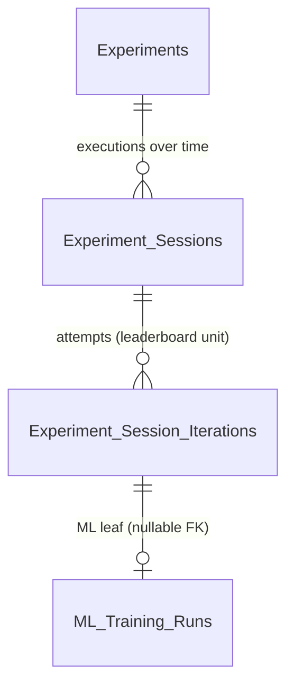

- **`MJ: Experiments`** — the durable "what we're optimizing," independent of any execution. `ExperimentType` is an **open NVARCHAR** (no CHECK) so new consumers add types without a migration. Re-running monthly creates new sessions under the same Experiment for comparison over time.
- **`MJ: Experiment Sessions`** — one execution. Carries the `Budget` (JSON), the approved `PlanSpec` (for PS, the `ModelingPlanSpec`), a `Leaderboard` snapshot, and `AgentRunID`.
- **`MJ: Experiment Session Iterations`** — one attempt, the **leaderboard unit**. Carries `Sequence`, `Status`, the normalized `Score` (the Experiment's `TargetMetric`), `ComputeCost`/`TokensUsed`, `Rationale`, and the driving `AIAgentRunID`.

### 7.1 The wave orchestrator

`ExperimentOrchestrator` (`Engine/src/experiment/experiment-orchestrator.ts`) is **deterministic** TS that executes an *already-approved* `ModelingPlanSpec`:

```typescript
public async runSession(plan: ModelingPlanSpec, deps: ExperimentDeps, options?: ExperimentRunOptions): Promise<ExperimentSessionResult>
```

It asserts `plan.Approved === true` (the approval gate is the agent's job, not the orchestrator's) and runs iterations in **waves in an in-process bounded pool** (`runBounded`, `experiment/concurrency.ts`) — no Record Set Processing run is created:

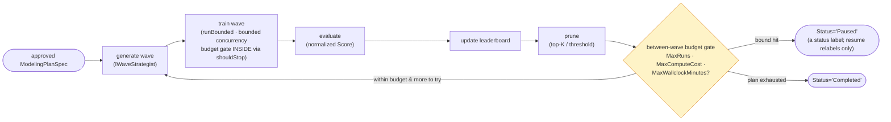

| Concern | How |
|---|---|
| **Wave generation** | the `IWaveStrategist` seam — default `PlanOrderWaveStrategist` (priority order); swap in an LLM-backed strategist for adaptive "what next" without touching the orchestrator |
| **Leaderboard** (`src/experiment/leaderboard.ts`) | `LeaderboardEntry[]` ranked by a **normalized** score (prefers `HoldoutMetrics`, falls back to training metrics; error metrics negated via Core's `MetricDirections.IsErrorMetric` so higher always = better) |
| **Pruning** | `selectPrunedIterationIds()` — top-K / relative-threshold rules; pruned iterations marked `Pruned` + removed from the leaderboard |
| **Budget gate** | `MaxRuns` / `MaxComputeCost` / `MaxWallclockMinutes` checked **both** between waves *and inside the bounded runner* (see below) |
| **Concurrency** | `runBounded()` (`src/experiment/concurrency.ts`) with a configurable max |

> **The budget gate is enforced *inside* the bounded runner, not just between waves.** As each iteration completes within a wave, `foldOutcome` folds its cost into `budgetState` immediately and re-checks `checkBudget(...)`; if a bound trips it sets `stopReason`, which feeds `runBounded`'s `shouldStop` predicate (each worker calls `if (shouldStop && shouldStop()) return;` before claiming its next task). The compute of every attempt counts: an attempt that fails after its run row exists still charges the compute that run recorded against the session (`TrainingAttemptFailedError` carries its seconds and cost). Each completed run records `ComputeSeconds` (wall-clock seconds) and, only when `PS_COMPUTE_USD_PER_SECOND` is set, a `ComputeCost` priced from them (NULL otherwise, folded in as 0). So `MaxComputeSeconds` always bounds a session, while `MaxComputeCost` bounds it only when that rate is configured. Under an Evaluation Protocol the protocol's `maxCandidates` and `maxComputeSeconds` tighten `MaxRuns` and `MaxComputeSeconds`. Either compute bound stops the session as `budget-maxComputeCost`.

A session creates no Process Run; waves run in the in-process pool above. Like the other engines, the orchestrator is built on injectable seams (`IExperimentEntityFactory`, `IClock`, `IExperimentTrainer`, `IWaveStrategist` — `src/experiment/types.ts` / `seams.ts`).

---

## 8. The data model — entities and relationships

17 entities and one read-only view entity. CodeGen generates timestamps, FK indexes, sprocs, views, and the strongly-typed entity classes (`MJMLModelEntity`, `MJMLTrainingPipelineEntity`, …) in `@memberjunction/core-entities`. Names follow the MJ "MJ: " prefix convention. The three `Experiment*` tables are **generic** (ML-agnostic); everything `ML *` is the Predictive Studio leaf. Predictions are stored in Feature Pipelines' `MJ: Feature Values` (§6.5, §11), read through the `MJ: Latest Feature Values` view entity.

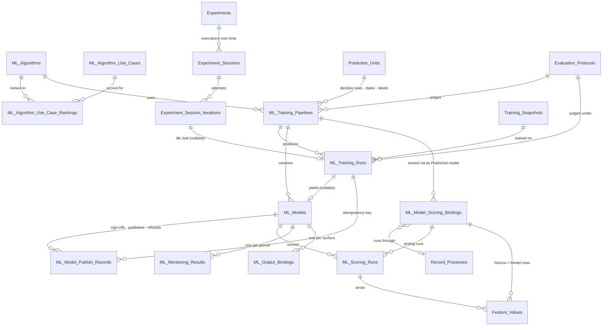

_(Entity names shown without the "MJ: " prefix for diagram clarity. `Record_Processes` is the existing Record Set Processing entity — Feature Pipelines are categorized rows of it (§11), not a separate entity. `Feature_Values` is Feature Pipelines' `MJ: Feature Values`.)_

| Entity | Role | Key fields |
|---|---|---|
| `MJ: ML Algorithms` | the fixed 6-algorithm catalog | `ProblemTypes`, `DriverClass` (sidecar key), `HyperparameterSchema`, `DefaultHyperparameters`, `SupportsFeatureImportance` |
| `MJ: ML Algorithm Use Cases` | 7 decision-relevant scenarios | `ProblemTypeScope`, `Guidance`, `DisplayOrder` |
| `MJ: ML Algorithm Use Case Rankings` | the 6×7 join (42 rows) | `SuitabilityScore` (1–5), `RecommendationLevel`, `Rationale`; UNIQUE(Algorithm, UseCase) |
| `MJ: ML Training Pipelines` | declarative training definition | `TargetEntityID`, `TargetVariable`, `ProblemType`, `AlgorithmID`, `SourceBindings`, `FeatureSteps`, `LeakageGuard`, `ValidationStrategy`, **`PredictionUnitID`**, **`EvaluationProtocolID`** (the exact versions it trains under); the `AsOfStrategy` column is retired (the unit decides decision dates) |
| `MJ: ML Models` | **immutable, versioned** trained model and its registry entry | `FittedPreprocessing`, `FeatureSchema`, `Metrics`, `HoldoutMetrics`, `FeatureImportance`, `Lineage`, `ArtifactFileID`; the registry entry `PredictionUnitID`, `EvaluationProtocolID`, `TrainingSnapshotID`, `TrainingRunID`, `ArtifactSha256`, `SnapshotHash`, `CodeVersion`, `FeatureSchemaHash`, `OutputSemantics` (the task type), `Delivery` (the registered gate decision and stored file); `Status` (`Draft`, `Validated`, `KeepBaseline`, `Published`, `Archived`, `Unevaluated`; written only by the lifecycle gate) with `StatusReason`; `ArtifactStatus` (`unverified`, `verified`, `missing`, `hash-mismatch`, `legacy-local`) and `ArtifactCheckedAt`; `ServingWhileUnevaluated`. Unique `(PipelineID, Version)`; at most one `Published` per pipeline |
| `MJ: ML Training Runs` | one training attempt (iteration leaf) | `PipelineID`, `ResultingModelID` (nullable), `ExperimentSessionIterationID` (nullable), **`TrainingSnapshotID`**, **`EvaluationProtocolID`**, `ValidationResults` (the `ps-run-results/v2` envelope), **`CodeVersion`**, **`ComputeSeconds`**, `ComputeCost`, `TokensUsed` |
| `MJ: ML Prediction Units` | what one training row is: the unit rows and their decision date, the outcome rule, window and censoring, the declared task. **Immutable version rows** (a new version is a new row under the same `LineageRootID`) | `LineageRootID`, `Version`, `UnitRows`, `LabelRule`, `LabelWindowDays`, `LabelGapDays`, `Censoring`, `TaskType`, `LabelVersion`, `ChangeHistoryPolicy`, `GroupKey`, `TemporalSpec`, `DecisionSpec`, `IncumbentHeuristic`, `AuthoredBy` |
| `MJ: ML Evaluation Protocols` | how a run is judged (§5.1). **Immutable version rows**, saved before the first candidate trains | `LineageRootID`, `Version`, `Holdout`, `InnerValidation`, `Seed`, `PrimaryScore`, `Baselines`, `Calibration`, `Intervals`, `Promotion`, `LeakageAudit`, `Exclusions`, `Slices`, `Budgets`, `MinMinorityClassRows`, `GuardFieldsEditableBy`, `AuthoredBy` |
| `MJ: ML Training Snapshots` | the frozen, fingerprinted rows and values a run learned from: the matrix, the row manifest and the provenance, as files in MJ storage | `ContentHash`, `PipelineID`, `PredictionUnitID`, `EvaluationProtocolID`, `MatrixFileID`, `RowManifestFileID`, `ProvenanceFileID`, `ManifestRowCount`, `HoldoutRowCount`, `FeatureSpec`, `FeatureSchemaHash`, `ClassBalance`, `DataCutoff` |
| `MJ: Experiments` | durable "what we optimize" (generic) | `ExperimentType` (open NVARCHAR), `Goal`, `TargetMetric`, `PlanSpecTemplate` |
| `MJ: Experiment Sessions` | one execution (generic) | `ExperimentID`, `Budget`, `PlanSpec`, `Leaderboard`, `AgentRunID` |
| `MJ: Experiment Session Iterations` | one attempt / leaderboard unit (generic) | `Sequence`, `Status`, `Score`, `ComputeCost`, `TokensUsed`, `Rationale`, `AIAgentRunID` |
| `MJ: ML Model Scoring Bindings` | defines one prediction feature (§6.5, §16.6) | `MLTrainingPipelineID` (its Published model scores), `TargetEntityID`, `FeatureName` (unique per entity), `ViewAuthorizationID` (who sees the predictions), `RecordProcessID` (nullable), `TargetColumn` + `TargetColumnSource` (the optional column copy), `Mode` (`OnDemand` / `Scheduled`), `Status` (`Active` / `Withdrawn`), `RetentionDays`, `LastScoredAt`, `LastRowCount` |
| `MJ: ML Model Publish Records` | the publish ledger (§13.3): every sign-off, applied publish (rollbacks and adoptions included) and refused attempt; rows are never updated | `ModelID` (null only on a run-level refusal), `TrainingRunID`, `Kind` (`sign-off` / `publish` / `refusal`), `Purpose` (`publish` / `rollback` / `evaluate` / `adopt`), `ApproverKind` (`automated-gate` / `user`) + `UserID`, `Initiator`, `Decision`, `Reason`, `GateDecision`, `Evidence` + `EvidenceSha256`, `OverridesFlags`, `SignOffID`, `ReplacesModelID`, `Refusal`, `Transient`, `RecordedAt`. One applied publish or adoption per training run, one run-level outcome per run (unique indexes) |
| `MJ: ML Scoring Runs` | one row per scoring call, dry runs and refusals included (§6) | `ModelID`, `ModelVersion`, `MLModelScoringBindingID`, `ArtifactSha256`, `FeatureSchemaHash`, `Path` (`score-record-set` / `record-process` / `monitoring` / `parity` / `predict`), `ScopeKind` + `ScopeEntityID` + `Scope`, `AsOfDate`, `ReadPolicy`, `DryRun`, `RequestedBy` + `RequestedByUserID`, `ProcessRunID`, `ScheduledJobRunID`, `Status` (`running` / `refused` / `failed` / `completed`), `Refusal`, `Total`, `Written`, `Failed`, `Skipped`, `FirstErrors`, `StartedAt`, `EndedAt` |
| `MJ: ML Monitoring Results` | one row per Published model per monitoring period (§14) | `ModelID`, `ScheduledJobRunID`, `Period` + `PeriodGrain` (`week` / `month` / `quarter` / `year`), `State` (`window-open` / `evaluated` / `insufficient-rows` / `failed`), `ScoredRows`, `JoinedRows`, `ExcludedInTrainingRows`, `PrimaryScore` + `PrimaryValue` / `PrimaryLower` / `PrimaryUpper`, `TrackedMetrics`, `Calibration`, `DriftLook`, `DriftAlarms`, `Parity`, `TriggersFired`, `ChallengerRunID`, `ChallengerResult`, `RollbackCheck`, `ErrorMessage`; unique `(ModelID, PeriodGrain, Period)` |
| `MJ: ML Output Bindings` | how one surface shows a model's output (§13.5) | `ModelID`, `Surface` (`at-risk-list` / `why-badge` / `predictions-grid` / `record-panel`), `SortsBy`, `DriverDirectionRelativeTo` (`adverse-class` / `raw-contribution`), `Label`; unique `(ModelID, Surface)` |
| `MJ: Latest Feature Values` | read-only virtual entity over `vwLatestFeatureValues` (§6.5) | one row per `EntityID`, `RecordID`, `FeatureName`: the newest `Champion` Feature Value, with `Source`, `Role`, `EffectiveAsOf`, `ComputedAt`, the lineage (`MLModelScoringBindingID`, `MLModelID`, `MLScoringRunID`, `InTraining`, `RecordProcessID`) and the value columns |

`MJ: ML Training Runs.ValidationResults` holds the `ps-run-results/v2` envelope (`TrainingRunResults`, `Core/src/training-run-results.ts`). A finished run stores `status: 'completed'` with `unitResolution` (the counts of unit rows read and excluded), `trainer` (the stored trainer result, its artifacts as file references, never their bytes), `trainerRequest` (the settings a retrain replays), `carve` (the holdout carve summary) and `gate` (the stored gate record: outcome, branch, reason, intervals and guards); a refused run stores `status: 'refused'` with the `refusal`. The Studio's results widget, the trust verdict and the TrainModel output all read this one envelope.

`MJ: Feature Values` (Feature Pipelines' table, §11) carries the prediction columns `MLModelScoringBindingID`, `MLScoringRunID` and `InTraining` beside `MLModelID` and `Role`; `Source` is `Pipeline`, `Human` or `Model`, and `RecordProcessID` is null on a `Model` row.

Removing an entity with `spDeleteEntityWithCoreDependencies` also removes its pipelines' publish records, scoring runs (and the Feature Values they wrote), monitoring results, output bindings and scoring bindings, and clears the references surviving rows hold to them.

> **Reminder:** don't write code against new fields until the migration + CodeGen have run. All ML reference data (`ml-algorithms/`, `ml-algorithm-use-cases/`, `ml-algorithm-use-case-rankings/`) is seeded via **metadata files + `mj sync push`**, never SQL INSERTs.

---

## 9. The guidance layer — algorithm catalog + the 6×7 matrix

Neither the agent nor a non-expert user should have to guess which algorithm fits. Three seeded metadata entities encode evidence-based defaults:

- **`MJ: ML Algorithms`** — the fixed, curated catalog (6 algorithms): XGBoost, LightGBM, Logistic Regression, Random Forest, Linear/Ridge Regression, MLP. Each row declares `ProblemTypes`, `DriverClass` (the sidecar key), `HyperparameterSchema`, `DefaultHyperparameters`, and `SupportsFeatureImportance`.
- **`MJ: ML Algorithm Use Cases`** — **decision-relevant** scenarios that genuinely differentiate algorithms (7 of them), NOT business labels (churn/renewal/attendee-return are all the same *binary classification* shape and so don't differentiate). E.g. "Binary classification", "Regression", "Interpretability required", "Minimal tuning (business-user)", "Large/wide dataset (speed)", "Embedding/LLM-feature-heavy", "Small dataset".
- **`MJ: ML Algorithm Use Case Rankings`** — the **6×7 join** (42 rows). Each cell carries a `SuitabilityScore` (1–5), a `RecommendationLevel` (`Primary` / `Strong` / `Viable` / `Weak` / `NotRecommended`), and the real payoff: a **`Rationale`** (agent- and human-readable, e.g. *"Gives feature importances but not simple coefficients — if a stakeholder needs to see exactly why each prediction was made, prefer Logistic/Ridge."*).

The seeded recommendation matrix (the per-cell `Rationale` is the real payoff):

| Use case ↓ / Algo → | XGBoost | LightGBM | Logistic Reg | Random Forest | Linear/Ridge | MLP |
|---|---|---|---|---|---|---|
| Binary classification | **Primary** | Strong | Viable | Strong | NotRec | Viable |
| Regression | **Primary** | Strong | NotRec | Strong | Strong | Viable |
| Interpretability required | Weak | Weak | **Primary** | Viable | **Primary** | NotRec |
| Minimal tuning (business-user) | Viable | Viable | Strong | **Primary** | Strong | Weak |
| Large/wide dataset (speed) | Strong | **Primary** | Strong | Viable | Strong | Viable |
| Embedding/LLM-feature-heavy | Strong | Strong | Viable | Viable | Viable | **Primary** |
| Small dataset | Viable | Viable | **Primary** | Strong | **Primary** | Weak |

All three are seeded via **metadata files** (`metadata/ml-algorithms/`, `metadata/ml-algorithm-use-cases/`, `metadata/ml-algorithm-use-case-rankings/`) with `@lookup:` refs and `mj sync push` — **never SQL INSERTs**. The dashboard's catalog panel queries this matrix for ranked, rationale-bearing recommendations per scenario (the UI computes "best level across selected scenarios" via `PredictiveStudioEngine.BestLevelsForScenarios`; no agent reads the matrix directly).

---

## 10. The invocation surface — Actions vs Remote Operations

Every server-side capability is a **Remote Operation** (Manual mode) + (for the five agent-facing ones) a thin **Action**, plus one Action with no operation (the pipeline migration, §10.2), so the browser, Skip, Query Builder, and agents all inherit it. See the [Remote Operations Guide](REMOTE_OPERATIONS_GUIDE.md) and [Transport-Layer Architecture Guide](TRANSPORT_LAYER_ARCHITECTURE_GUIDE.md). **Crucially, both surfaces delegate through one shared path** (`operations/delegation.ts`) — the production deps/seams wiring exists exactly once, so an Action and its sibling Remote Op can't diverge.

### 10.1 The 12 Remote Operations

All are `@RegisterClass(BaseRemotableOperation, '<key>')` Manual-mode subclasses of CodeGen-emitted bases in `MJCoreEntities/src/generated/remote_operations.ts`; the subclass bodies live in `Engine/src/operations/`. Every one carries `RequiredScope = 'predictive:execute'` and is seeded as an `MJ: Remote Operations` row (`metadata/remote-operations/.remote-operations.json`, category "Predictive Studio", `GenerationType='Manual'`, `CodeApprovalStatus='Approved'`).

| Operation key | Mode | What it does |
|---|---|---|
| `PredictiveStudio.TrainModel` | `LongRunning` | `TrainingDelegation.TrainModelViaEngine` → `TrainingEngine.trainModel`; returns the run's stored gate decision and the `Draft` model, if one ships |
| `PredictiveStudio.ScoreRecordSet` | `LongRunning` | `ScoringService.Score` through a `bindingId` (writes Feature Values), else `ScoringService.Predict` (returns the predictions) (§6.3) |
| `PredictiveStudio.RunFeaturePipeline` | `LongRunning` | `RecordProcessExecutor.RunByID` (the RSP substrate — §11) |
| `PredictiveStudio.StartExperimentSession` | `LongRunning` | refused: experiment sessions are switched off (§7) |
| `PredictiveStudio.ControlExperimentSession` | `Sync` | a lifecycle `Status` write on the `MJ: Experiment Sessions` row (pause/resume/cancel) |
| `PredictiveStudio.PromoteModel` | `Sync` | one lifecycle `transition` through the `LifecycleGate` (§13.2): `evaluate`, `publish` (with an optional `signOffId`), `archive` or `rollback` (both need a `reason`); returns `applied`, `status` and the typed `refusal` |
| `PredictiveStudio.GetModelEvidence` | `Sync` | the evidence a sign-off is made over, built from stored rows only, and its `evidenceSha256` |
| `PredictiveStudio.SignOffModel` | `Sync` | records a person's sign-off (`purpose` `publish` or `rollback`, `decision` `approve` or `reject`, `reason`, `overridesFlags`); returns the `signOffRecordId` a publish consumes (§13.3) |
| `PredictiveStudio.CreateScoringProcess` | `Sync` | `CreateScoringProcess`: an on-demand `'ML Model'` Record Process and its scoring binding (`featureName`, `viewAuthorizationId` optional) |
| `PredictiveStudio.WithdrawScoringBinding` | `Sync` | `ScoringBindings.Withdraw`: the binding `Withdrawn` and its column copies cleared; returns `cleared` and `keptHuman` (§6.5) |
| `PredictiveStudio.RunModelMonitoring` | `Sync` | runs a Published model's monitoring now for the last complete period, or the period starting `periodStart` (§14) |
| `PredictiveStudio.MigratePreGateModels` | `Sync` | the registry check's pre-change migration step (§14.5) run on demand, `dryRun` by default |

The four `LongRunning` ops emit `context.emitProgress({ OperationKey, Processed, Total?, Status, Message })`. **RunFeaturePipeline is the richest** — it forwards the RSP executor's per-batch `onProgress` as typed progress, so attached *and* over-the-wire callers see live progress (mirroring `RecordProcess.RunNow`); Train and Score emit coarse start/finish phases. The wire input/output types are defined inline in the generated `remote_operations.ts` (their sources are `metadata/remote-operations/types/`); `Budget` and `ModelingPlanSpec` come from Core and are runtime-validated by `ValidateBudget` / `ValidateModelingPlanSpec` before any work runs. Tree-shaking anchor: `LoadPredictiveStudioOperations()`.

**`PredictiveStudio.TrainModel`** trains under the pipeline's Prediction Unit and Evaluation Protocol and returns the run's stored gate decision. Its input (`PredictiveStudioTrainModelInput`) is `pipelineId`, `experimentSessionIterationId?` and `sidecarVersion?`. Its output (`PredictiveStudioTrainModelOutput`) carries `trainingRunId`, `status`, `leakageFlagged` and `holdoutMetrics?`, and from the stored decision `gateOutcome` (`model` | `keep-simple-baseline` | `no-signal`), `gateBranch`, `gateReason` and `shipped`, plus the `trainingSnapshotId`, `evaluationProtocolId` and `evaluationProtocolVersion` the run used. `modelId` and `version` are optional: they are absent when the decision ships no model, and `status` is then `NoSignal`, or `KeptExistingRule` when the shipped member is the unit's existing heuristic rule; otherwise `status` is the model's own (`Draft`). A run whose stored results cannot be read fails rather than returning a guessed status. `holdoutMetrics` is the produced model's stored test-set scores, or the finalist's when no model is produced.

The operation refuses the retired `asOf`, `labelEventDates`, `maxRows` and `primaryKeyField` inputs **by presence**, before any progress is emitted or the engine is called: a key sent as `{}` or `undefined`, or `asOf: { "Mode": "none" }`, is refused too. `asOf` returns `AS_OF_NO_EFFECT`; the others return `EXECUTION_ERROR` with a message naming every retired key the call sent (§10.4). `RetiredTrainModelInputs` types a payload that still sends them.

### 10.2 The 6 Actions

For the agent / workflow / low-code boundary, six capabilities have thin Actions in `Engine/src/actions/` (all extend `BasePredictiveStudioAction` → `BaseAction`, registered via `@RegisterClass(BaseAction, '<DriverClass>')`, seeded in `metadata/actions/predictive-studio/`):

| Action (`MJ: Actions`) | DriverClass | Delegates to |
|---|---|---|
| Train ML Model | `PredictiveStudioTrainModelAction` | `TrainingEngine.trainModel`, then `TrainModelMapping` (the same output mapping the operation uses) |
| Score Record Set | `PredictiveStudioScoreRecordSetAction` | `ProductionScoreRecordSetRunner` → `ScoringService` |
| Run Experiment Session | `PredictiveStudioRunExperimentAction` | refused, and the Action row is `Disabled` (§7) |
| Promote ML Model | `PredictiveStudioPromoteModelAction` | `LifecycleGate`, through `ModelTransitionDelegation` (shared with `PredictiveStudio.PromoteModel`) |
| Schedule Model Scoring | `PredictiveStudioScheduleModelScoringAction` | `CreateScheduledModelScoring` (§15.6) |
| Migrate Pipelines to Prediction Units and Evaluation Protocols | `PredictiveStudioMigratePipelinesAction` | `PipelineMigration.MigratePipelines` |

**Train ML Model** takes `PipelineID` only. A supplied `MaxRows` is refused by name (`TRAINING_FAILED`: the row cap is a retired input). Its outputs are `ModelID` (null when no model ships), `HoldoutMetrics`, `LeakageFlagged`, `GateOutcome`, `GateReason`, `TrainingSnapshotID` and `EvaluationProtocolID`; a run whose decision ships no model succeeds with its stored reason as the message.

**Promote ML Model** takes `ModelID`, `Transition` (`evaluate`, `publish`, `archive` or `rollback`) and `Reason` (required for `archive` and `rollback`), applies it through the lifecycle gate with the context user as the initiator, and returns the model's new `Status`. A leakage flag is acknowledged only by a person's sign-off record, which an Action cannot make, so a flagged model is refused `LEAKAGE_FLAGGED`; the other refusals map to `ILLEGAL_TRANSITION`, `REASON_REQUIRED`, `MODEL_NOT_FOUND`, `CALIBRATION_HOLD`, `MODEL_NOT_SERVABLE` or, for every other kind, `TRANSITION_REFUSED`.

**Score Record Set** takes `ModelID`, `Scope`, and optionally `BindingID` and `AsOfDate` (the `WriteBack` parameter is retired: it writes only through a binding); it returns `ScoringRunID`, `Status`, `Total`, `Written`, `Failed` and, when nothing was written, `Predictions`. Each scoring refusal has its own result code (§10.4).

**Migrate Pipelines to Prediction Units and Evaluation Protocols** is a dry run by default (`DryRun` defaults to true; `PipelineIDs` narrows it). It binds every pipeline that lacks them to a version-1 Prediction Unit and a version-1 Evaluation Protocol mapped from its legacy settings, archives a pipeline that cannot be expressed (an `offset` as-of, a single-valued target, a sequence model) with the reason in its description, or holds it with the reason: a binary pipeline whose outcome polarity is not declared stays held until a later run finds it declared, and a pipeline that declares a time index stays held until a forecast unit with a rolling-origin protocol is bound. A held pipeline is refused by training. It reports `Report`, `MigratedCount`, `ArchivedCount`, `HeldCount`, `SkippedCount` and `FailedCount`; the release procedure, a documented step the release engineer executes after deploying, runs it (dry run first, then the real run). No MJ code invokes it, so an admin can also run the Action themselves, dry run first. Until a pipeline is migrated, training it is refused with `UNIT_REQUIRED`. It has no Remote Operation.

There is **no** "Control Experiment Session" or "Run Feature Pipeline" Action — those two exist only as Remote Operations (control is a UI/host concern; feature-pipeline running is the RSP facade) — and the migration Action is the one Action with no Remote Operation. Tree-shaking anchor: `LoadPredictiveStudioActions()`.

### 10.3 Decision table — which surface do I reach for?

| You want to… | Use | Why |
|---|---|---|
| Have an **agent** train / score / evaluate, publish, archive or roll back a model | an **Action** | Actions are the metadata-discoverable code→agent boundary (see root `CLAUDE.md` Actions philosophy) |
| Have the **browser, Skip, or Query Builder** invoke a capability with typed I/O + `LongRunning` progress | a **Remote Operation** | typed, scope-gated (`predictive:execute`), marshalled identically client + server |
| **Read** ML models / runs / leaderboards / rankings for display | `RunView` / `RunViews` (or `PredictiveStudioEngine` in Angular) | plain reads — no need for an op; the engine caches reference data |
| **Score a set of records** as a saved, scheduled, audited job | a **Record Process** (`'ML Model'` work type) named by a scoring binding, via `RecordProcess.RunNow` or its schedule | inherits batching/concurrency/budget/pause/resume/audit (§6) |
| Run a **derived-feature pipeline** that writes attributes back | a **Feature Pipeline** = categorized Record Process, run via `RunFeaturePipeline` | reuses the whole RSP substrate (§11) |
| Call training/scoring/publishing **from other server-side code** | the **engine class directly** (`TrainingEngine`, `ScoringService`, `LifecycleGate`, `AutomatedPublisher`) | never call an Action from code (root `CLAUDE.md`) — import the engine |

### 10.4 Refusals

When Predictive Studio refuses a Train, Score, sign-off or experiment request, the Action and its sibling Remote Operation return
the same typed `ResultCode` (`Core/src/refusal-codes.ts`, mapped in `Engine/src/operations/refusals.ts`). Callers
branch on the code, never on the message text.

| `ResultCode` | Fires when |
|---|---|
| `READ_CAP_EXCEEDED` | A caller-supplied row cap (`maxRows` in a Score `filter` scope) is smaller than the rows in scope. Reads are uncapped by default: filter-scoped scoring reads every matching row, so a cap that would cut the scope short is refused instead of scoring on a sample. Training takes no row cap (a `maxRows` on Train is a retired input, below). |
| `AS_OF_NO_EFFECT` | The Train request carries an `asOf` input (any mode, `{ "Mode": "none" }` included), the pipeline's stored `AsOfStrategy.Mode` is not `none`, or a modeling plan asks for point-in-time assembly. Decision dates come from the pipeline's Prediction Unit, so the input is refused by name (`input-not-accepted`) instead of being ignored (§4.3). The other retired Train keys (`labelEventDates`, `maxRows`, `primaryKeyField`) return `EXECUTION_ERROR` with a message naming every key the call sent. |
| `UNIT_REQUIRED` | Training a pipeline with no Prediction Unit. Every pipeline trains under a unit: run the "Migrate Pipelines to Prediction Units and Evaluation Protocols" Action or bind one (a held pipeline's description names what to declare). Refused before any run row is written. |
| `PROTOCOL_REQUIRED` | Training a pipeline that names no Evaluation Protocol, or one that cannot be found. Refused before any run row is written. |
| `TIME_HOLDOUT_REQUIRED` | A pipeline that declares a time index (`ValidationStrategy.TimeIndexColumn`) is bound to a protocol whose holdout is seeded-random (`time-index-needs-time-holdout`): that holdout would test it on rows interleaved in time with its training rows. Bind a forecast unit with a rolling-origin (or date-carved) protocol. Refused before any run row is written. |
| `BUDGET_EXCEEDED` | The trainer stopped because the run reached its protocol's compute budget. |
| `AS_OF_SOURCE_UNDATED` | A unit pipeline's feature cannot be read as of a decision date: its Record Changes history does not cover the date (`decision-date-before-change-history`), or its stored value changed after it (`select-changes-after-decision-date`). |
| `INVALID_EVALUATION_SETTING` | Training a pipeline whose `ValidationStrategy.MajorityBaselineRule` is not `"enforce"` or `"warn"` (§5.1); it is refused before any training row is written. |
| `MODEL_NEEDS_TRAINING` | Scoring with a model ID that names no model, or a model with no trained artifact (§6.8). |
| `MODEL_NOT_SCORABLE` | A Record Process that no binding names, whose `Configuration.modelId` is not `Published`. |
| `MODEL_NOT_SERVABLE` | Scoring a model whose artifact is a forecast's series forecaster, which the sidecar's `/predict` does not serve (§6.8). Never retrained by auto-train: a retrain would ship the same kind of artifact. |
| `MODEL_NOT_PUBLISHED`, `MODEL_FLAGGED`, `LEAKAGE_UNKNOWN`, `AS_OF_UNSUPPORTED`, `ARTIFACT_MISSING`, `ARTIFACT_HASH_MISMATCH`, `ARTIFACT_UNVERIFIED`, `SCOPE_ENTITY_MISMATCH`, `ASSEMBLY_REFUSED`, `FEATURE_SCHEMA_MISMATCH`, `EMPTY_FEATURE_COLUMN`, `NO_PUBLISHED_MODEL`, `BINDING_WITHDRAWN`, `BINDING_NOT_AUTHORIZED`, `FEATURE_VALUES_NOT_WRITABLE` | One per scoring refusal kind (§6.7); the message names the refusal and the scoring run. |
| `SCORING_RUN_FAILED` | A scoring run stopped at a batch in which a record failed; the run row names the first errors. |
| `NOT_HUMAN`, `INVALID_INPUT`, `OVERRIDES_WITHOUT_REASON`, `MODEL_ARCHIVED` | `PredictiveStudio.SignOffModel` refused: an API-key caller or the system user (only a person signs off), a malformed input, flags overridden with a blank reason, or an Archived model. Nothing is written. |
| `EXPERIMENT_SESSIONS_UNAVAILABLE` | Any Run Experiment Session Action or `StartExperimentSession` call: experiment sessions are switched off (§7). |

A training refusal without a code of its own (for example `series-without-key`: a Temporal Spec lag or rolling window asked of a unit whose rows carry no series key) returns `EXECUTION_ERROR` with a message naming the refusal; the run's `ValidationResults.refusal` keeps the kind. A refused lifecycle transition is not an error code: `PredictiveStudio.PromoteModel` returns `applied: false` with the typed `TransitionRefusal` (§13.2).

---

## 11. Feature Pipelines — the category route (no new entity)

A **Feature Pipeline** generalizes Content Autotagging (LLM classify → persisted tags): chain `LLM prompt / Action / Agent / vision → transform → write an attribute back to the row`. They have **standalone analytics value**, independent of any model, which is why they live in **Knowledge Hub** as well as feeding Predictive Studio.

**The key shipped decision: a Feature Pipeline IS a *categorized* `MJ: Record Processes` row — there is NO standalone `MJ: Feature Pipelines` entity.** (Verified: zero `MJ: Feature Pipelines` / `FeaturePipelineEntity` in generated code or migrations.) Reusing the Record Set Processing substrate means batching, resume, audit, and write-back all come for free; the only new thing is a category that marks a Record Process as a feature pipeline.

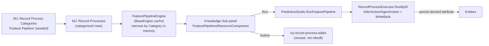

- **`FeaturePipelineEngine`** (`Engine/src/feature-pipelines/feature-pipeline-engine.ts`) — a `BaseEngine` singleton that caches all `MJ: Record Processes` + recent `MJ: Process Runs`, then narrows **in memory** to feature pipelines by matching the denormalized `Category` view field against `FEATURE_PIPELINE_CATEGORY_NAME = 'Feature Pipeline'` (case-insensitive, `isFeaturePipeline()`). It projects `FeaturePipelineSummary[]` (target entity, the written `OutputAttribute` parsed from `OutputMapping`, last-run freshness). It's a discovery/monitoring cache, not a registry.
- **Category seed** — `metadata/record-process-categories/.record-process-categories.json` seeds the one `MJ: Record Process Categories` row named "Feature Pipeline".
- **Run path** — `RunFeaturePipeline` (the only op with no PS-specific logic) delegates straight to `RecordProcessExecutor.RunByID(featurePipelineID, …)`. Running a feature pipeline is *exactly* running the underlying Record Process — full batching/resume/audit + true forwarded per-batch progress.
- **Knowledge Hub UI** — `FeaturePipelinesResourceComponent` (`@RegisterClass(BaseResourceComponent, 'FeaturePipelinesResource')`, `packages/Angular/Explorer/dashboards/src/KnowledgeHub/components/feature-pipelines/`) lists pipelines from the engine, shows target/written-attribute/freshness, offers **Run** (via the provider's `RouteOperation` seam → `RunFeaturePipeline`), and an **authoring** entry that opens the reusable `mj-record-process-editor` rather than rebuilding authoring.

### Feature Value key and versions

**The key.** A `MJ: Feature Values` row is upserted on its key: the record, the feature name, the pipeline version, the
prompt version hash (template text, outputs, constraint block, pipeline type, escalation settings), the primary AI
model, the parameters hash and the input hash. `ValueKeyHash` (SHA-256 of the key) is unique per pipeline. A re-run
with the same key leaves the row `Unchanged`; a changed value updates it; a changed key is a new row. The latest value
of a feature for a record is the row with the newest `ComputedAt`.

**Human values.** `Source` is `Pipeline` or `Human` (a value a person entered on the target record). Write-back never
overwrites a `Human` value unless the run sets `overwriteHumanValues`; `HumanValuesPreserved` counts the ones it kept.

- **Versions.** Each distinct pin (prompt version hash, primary model, parameters hash, spec hash) is the next numbered
  `MJ: Feature Pipeline Versions` row: Candidate, Active, Retired or Refused.
- Without an `Activation` block, an on-demand or manual run activates a changed pin; a scheduled or on-change run of a
  changed pipeline is refused until then, so a prompt edit never silently changes what an unattended job writes.
- With `Activation` (`GoldenSetTestID`, `Metric: 'accuracy'`, `Threshold`), a version runs only when its golden-set
  result meets the threshold; a failing result marks it Refused. Dry runs report this (`WouldRefuse`) and never
  register or activate.
- The **Feature Pipeline Version Steward** (`FeaturePipelineVersionSteward` in `@memberjunction/feature-pipelines-engine`,
  exposed as the **`Steward Feature Pipeline Version`** Action and run per pipeline by the **`Feature Pipeline Version Steward`**
  `MJ: Record Processes` row of `WorkType: 'Action'` over `WorkType='Infer' AND Status='Active'`, dispatched every 15 minutes
  by `RecordProcessScheduledJobDriver`) evaluates a gated pipeline's unevaluated version and runs the one backfill of a
  changed version (the records whose latest value is under another version or none), returning each decision in
  `Outcomes` / `Version` / `LastAction` / `Detail`. A pipeline opts out per step with
  `Unattended: { AutoEvaluate: false }` / `{ AutoBackfill: false }`.

**Golden sets.** A `Feature Pipeline Golden Set` test (`FeaturePipelineGoldenSetDriver`, `GoldenSetScorer`, and
`GoldenLabelQualityCheck` in `@memberjunction/feature-pipelines-engine`) scores a pipeline's answers against labelled cases. Model-made
labels carry a stored **label-quality record**: two labelers from two vendors label every case under the same guide,
each must agree with the existing labels at a Wilson 95% lower bound of at least 0.70, one adjudicates the other's
disagreements, and at most 5 of 52 cases may be excluded. The record is tied to the cases by hash, and the driver
refuses a set that fails it before any model call. A case marked `Required: true` that is answered wrong fails the set
whatever its accuracy (gate value 0, the cases listed in `RequiredFailures`). A case can expect an abstention for some
outputs (`ExpectAbstain`). `LabelSource: "specification"` cases (prompt-injection attempts, non-titles) are fixed by
the guide's rule rather than labelled, must be `Required`, and stay outside the label-quality record.

**Output constraints.** A `lookup` constraint reads its entity's rows (`DisplayFields`, `Filter`) and renders them into
the prompt as the taxonomy; `ItemRef` checks an array output item by item. A violating answer is `RejectedInvalid`,
nothing is written for it, and the run ends `Failed`.

**Confidence floors.** An output can declare `MinConfidence` with `OnLowConfidence: 'null'` (an LLM pipeline also
needs `ConfidenceRef`). Below the floor the output is withheld: its Feature Value records the abstention with no value,
write-back clears a value the pipeline wrote and keeps a person's, and the result lists it in `BelowConfidenceOutputs`.
The floor is part of the spec hash, so changing it is a new version.

**The record as the user turn.** An LLM pipeline that sets `Context.RecordAsUserMessage: true` sends the template as
the system turn and the record's context fields, as one JSON object, as the user turn, so a field value cannot pose as
an instruction.

### Feature Pipeline dry runs and run results

An `Infer` (`InferProcessor` in `@memberjunction/feature-pipelines-engine`, registered into `RecordProcessorRegistry` by
`FeaturePipelineStartup` / `RegisterInferRecordProcessor()`) dry run writes nothing (no Dedup Cache entry, Feature Value, watermark, target or child
row) but still calls the model, so its `MJ: AI Prompt Runs` are recorded and cost what a real run of those records would.

- Without a scope or a single record it previews at most **25** records (`DryRunSampleSize` overrides it).
- A record whose real write would fail is reported `Failed` with the write-back's reason (`PreviewErrors`).
- It reports, in `WouldRefuse` (via `InferProcessor.BuildRunSummary`), why a real run would be refused (a version that has
  not passed its golden set), and never registers or activates a version. `RecordProcess.RunNow` /
  `PredictiveStudio.RunFeaturePipeline` return it as `wouldRefuse`; the Bulk Operations dialog then offers no Apply.
- Each record's `previewFields` / `previewChildren` / `previewTags` hold only what the real write would change, so the
  dialog's change count is what the following real run writes. Outputs withheld below their confidence floor are listed
  in `withheldFields` (and `withheldKeptFields` when the column does not allow null) and `withheldChildEntities`.
- An output with no `Target` ("Feature value only") writes nothing to the record; its dry-run result is
  `previewFeatureValues` (`FeatureName`, `Previous`, `Proposed`), listing the Feature Values a real run would store.
  The dialog shows one `<Feature> (feature value)` row per item, counted as a change like any other row; a record
  with no such rows counts as unchanged.
- On every Feature Pipeline run, `MJ: Process Runs.ResultSummary` holds the `FeaturePipelineRunResult` JSON built by
  `FeaturePipelineRunResults.Build`: the pin the run used and the tallies `Attempted`, `Upserted`, `Unchanged`,
  `Previewed`, `RejectedInvalid`, `BelowConfidence`, `Failed`, `Skipped`, `HumanValuesPreserved`. Because `InferProcessor`
  sets `FailRunOnRecordError = true`, **a Feature Pipeline run with any failed or rejected record ends `Failed`**.

---

## 12. The Model Development Agent + artifact + viewer

A **Loop** agent (conversational) mirroring **Agent Manager**: collaborate with the user to build a strongly-typed `ModelingPlanSpec`, get approval, then execute with deterministic code (the **Pipeline Builder**, §12.4: one pipeline, one Prediction Unit, one Evaluation Protocol, one search over every approved experiment), then report with an LLM-authored rich artifact. **Seeded and shipped** — `metadata/agents/.model-development-agent.json`.

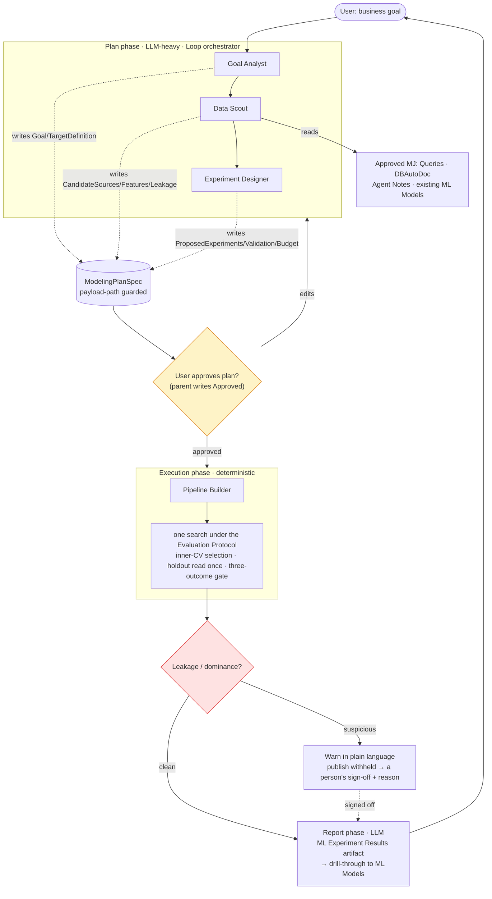

### 12.1 Topology — the agent and its three sub-agents

The parent **Model Development Agent** is a `Loop` agent (`ModelSelectionMode='Agent'`, `ArtifactCreationMode='Always'`, `DefaultArtifactTypeID → ML Experiment Results`, `InjectNotes=true`, `MaxNotesToInject=10`, `ExposeAsAction=true`). Its six wired Actions are five Predictive Studio Actions (Run Experiment Session, Train ML Model, Score Record Set, Promote ML Model, Schedule Model Scoring) plus `Write Entity Field(s)`. Three sub-agents (all `Loop`, `InvocationMode='Sub-Agent'`) refine the plan:

| Sub-agent | ExecOrder | Writes (its payload slice) |
|---|---|---|
| **Goal Analyst** | 1 | refines the business goal → `Goal`, `TargetDefinition` (target + problem type + success metric) |
| **Data Scout** | 2 | studies the data → `CandidateSources`, `CandidateFeatures`, `LeakageNotes`; flags leakage risks |
| **Experiment Designer** | 3 | proposes ranked experiments + validation + budget → `ProposedExperiments`, `ValidationStrategy`, `ProposedBudget` |

**Sequencing is declarative, not hardcoded control flow** — it's enforced by metadata **payload-path guards**. Each sub-agent has `PayloadDownstreamPaths: ["*"]` (it can *read* the whole plan) and an `PayloadUpstreamPaths` list scoped to exactly the slice it's allowed to *write back* (e.g. Goal Analyst → `["Goal", "TargetDefinition", "TargetDefinition.*"]`). The parent holds `PayloadSelfWritePaths: ["*"]`: it may write any part of the plan, and it is the one that stamps the approval gate (`Approved`).

### 12.2 Ground truth, drafted queries, memory

The **Data Scout** reads **ground truth only from approved sources**, wired via `MJ: AI Agent Data Sources`:
- `APPROVED_QUERIES` — `RunView` over `MJ: Queries` where `Status = 'Approved'` (the trusted semantic layer; *"Never hand-write raw SQL for feature extraction"*).
- `EXISTING_APPROVED_MODELS` — `MJ: ML Models` where `Status IN ('Published','Validated')`.
- **Agent Notes** — prior learnings (what worked, what leaked), auto-injected (`InjectNotes`).

When the Scout needs a query that doesn't exist, it may **draft a new `MJ: Query` as `Status='Pending'`** — usable for *this* exploration but **not** trusted ground truth until a human approves it into the shared semantic layer.

### 12.3 The artifact + the Angular viewer

The agent emits an **ML Experiment Results** artifact — content type **`application/vnd.mj.ml-experiment-results`** (`metadata/artifact-types/.ml-experiment-results-artifact-type.json`, `ParentID → JSON`, `DriverClass='MLExperimentResultsViewerPlugin'`, with `ExtractRules` for `name`/`description`/`displayMarkdown`/`bestModelId`/`leaderboardSize`).

The viewer is **`MLExperimentResultsViewerComponent`** (`@RegisterClass(BaseArtifactViewerPluginComponent, 'MLExperimentResultsViewerPlugin')`, `packages/Angular/Generic/artifacts/src/lib/components/plugins/ml-experiment-results-viewer.component.ts`, package `@memberjunction/ng-artifacts`). It renders the experiment **Goal** + headline best score, a ranked **leaderboard** (rank / algorithm / feature-set / score / modelId — the score column is the out-of-sample headline metric, shown as "not measured" when a run has none), normalized **feature-importance** bars, a **winning-model card**, and an extra "Report" tab for the agent-authored markdown. **Drill-through** to a model emits a `NavigationRequest`:

```typescript
// OnDrillThroughToModel() / OnOpenRowModel(row)
{ appName: 'Predictive Studio', navItemName: 'Models', queryParams: { modelId } }
```

> **Stale-prose caveat:** the artifact-type **Description** field still says the Angular viewer "is a follow-up; falls back to the parent JSON viewer." That prose is out of date — the viewer is fully built, registered, and module-declared, and the `DriverClass` correctly points at it. Treat the description text as lagging reality.

### 12.4 The deterministic Pipeline Builder (publish-gated-on-trust)

The Model Development Agent is elevated to the **Database-Designer / Agent-Manager domain-builder pattern**: the conversation reasons in plain language, but the structure it commits to metadata is **deterministic + type-safe, never LLM-emitted**. Three pieces (in `packages/AI/PredictiveStudio/Engine/src/agent/`):

- **`PredictiveStudioModelDevAgent`** (the parent's `DriverClass`) — overrides `determineNextStep`: when `shouldForceBuild` matches (a payload with `ProposedExperiments` and either `Approved: true` or an approval phrase in the latest user message, provided no `Pipeline Builder` sub-agent step has already run), the orchestrator forces routing to the builder sub-agent with `Approved: true`. Every other decision stays LLM-driven via `super`.
- **`PredictiveStudioPipelineBuilderAgent`** (the **Pipeline Builder** code sub-agent, `executeAgentInternal`, no LLM) — wraps:
- **`PredictiveStudioPipelineBuilder`** (`pipeline-builder.ts`) maps the approved `ModelingPlanSpec` to one `MJ: ML Training Pipelines` row (`ModelingPlanToPipelineConfig`), binds it to a version-1 Prediction Unit mapped from the pipeline's columns the way the pipeline migration maps one (`PipelineMigration.BindMigratedUnit`; a pipeline the mapping would archive or hold is deleted and the build fails with the reason) and to a version-1 Evaluation Protocol created from the defaults (`EvaluationProtocolRules.DefaultEvaluationProtocolDraft`) before anything trains, turns **every** approved experiment into a candidate of a single search, and trains through `TrainingDelegation.TrainModelViaEngine`. The leaderboard shows each candidate's inner-fold mean with its 95% interval; the winner's is marked optimistic. The build then takes the model as far as it may through the lifecycle gate. **Publishing is off unless the agent run asks for it**: only a run whose `data` holds `PredictiveStudioAutoPublish: true` publishes (a reserved run-data key, honoured only when the caller set `ExecuteAgentParams.TrustReservedRunData` — MJServer's agent-run resolvers do for the system user and an API key holding `agent:trusted`), and `PredictiveStudioProtocolPromotion: { "autoPublishKeepBaseline": true }` lets the build's protocol publish a kept simple baseline. With publishing on, the run goes through `AutomatedPublisher.EvaluateAndPublish` with the agent run as initiator (§13.4): the stored gate decision, the leakage audit, the calibration hold and the protocol's publish rules decide, and the build reports "published" or "withheld: <the recorded refusal>". With publishing off the model is only evaluated (Draft → Validated or KeepBaseline), and a person publishes it from the model form. A run that ends `no-signal` — including a binary model whose test-set AUC interval contains 0.5 — has no model row, and Evaluate records the run's one run-level refusal with the stored reason. A model published through the gate gets its per-model scoring Action (§15.3).

Proven by: unit tests (mapper, gate logic, projection helpers), an in-process integration test (`ps-inproc-agent-builder.ts` — builds + trains + asserts the publish gate), and an **agent-loop test through the real `AgentRunner`** (`ps-inproc-agent-run.ts` — the sub-agent runs end-to-end and the gate fires). "+ New prediction" on the business surface opens this agent as a docked `mj-conversation-chat-area` co-pilot.

---

## 13. The security model and the lifecycle gate

Predictive Studio touches client data, runs trained models against record sets, publishes models without a person in the loop, and lets an agent draft queries — so its guarantees are enforced at code boundaries, not by convention.

**API scope gating (`predictive:execute`).** Every one of the 12 Remote Operations declares `RequiredScope = 'predictive:execute'` (on the generated base and on the seeded `MJ: Remote Operations` row). The scope is an APIScope (`metadata/api-scopes/.predictive-scopes.json`, `FullPath: 'predictive:execute'`). An API key without it can't train, score, publish, sign off or monitor. (Actions carry no scope — they run under the agent's own permissions.)

**Primary-key field-name validation at the scoring boundary.** When `ProductionScoreRecordSetRunner` builds a SQL filter from caller-supplied primary keys, it validates each **key name** against the entity's real field list before interpolation and uses the canonical `field.Name` from metadata; the value is single-quote-escaped. An unknown or forged key name is refused rather than concatenated.

**UUID-gated ids.** A model or run ID that is not a UUID is refused before any read (`model-not-found` from the gate); every ID comparison goes through `UUIDsEqual`.

**The view gate** on predictions is §6.6.

### 13.1 One status writer: the lifecycle gate and the status guard

`LifecycleGate` (`Engine/src/registry/lifecycle-gate.ts`) is the only writer of `MJ: ML Models.Status`. Its transitions are a table, by persisted status:

| From | To |
|---|---|
| `Draft` | `Validated` (the stored decision is `model`) or `KeepBaseline` (`keep-simple-baseline`) |
| `Validated`, `KeepBaseline` | `Published`, `Archived` |
| `Published` | `Archived`, or `Unevaluated` (only the registry check's pre-change migration, §14.5) |
| `Archived` | `Published` (a rollback) |
| `Unevaluated` | `Archived` (never `Published`) |

The **status guard** (`PredictiveStudioStatusGuard`, a `PreSave` data hook registered from the Engine entry point) runs on every save of the entity from any caller — GraphQL, an agent, an Action, the gate itself. It reads the persisted `Status` itself (never `OldValue`) and allows a create only as `Draft`, an unchanged status, or exactly the `From → To` the gate authorised for that save; a move into `Published` is re-derived from the stored rows again inside the hook. Anything else is refused (`status-written-outside-gate`), failing closed when the stored row cannot be read; a save outside the gate inside a `TransactionGroup` is refused too. A second hook (`PredictiveStudioEvidenceGuard`) keeps stored evidence write-once: a finished run's `ValidationResults`, and a model's `Delivery`, `Lineage` and `ArtifactSha256` once non-null.

The gate's composers, each a short composer over protected steps:

- **`Evaluate`** — `Draft` → `Validated` or `KeepBaseline` from the run's stored gate decision (the decision's reason becomes a KeepBaseline model's `StatusReason`), creating the model's `MJ: ML Output Bindings` from its `OutputSemantics`. A run whose decision shipped no model row (`no-signal`, or the unit's existing rule kept) changes no status and gets one run-level `refusal` record (`ModelID` null, `Purpose = 'evaluate'`). A calibration hold refuses `calibration-held`; a model without parseable `OutputSemantics` is `not-servable` and stays `Draft`; a caller without the permissions the change writes with is refused `actor-not-permitted`.
- **`Publish`** — `Validated` / `KeepBaseline` → `Published` (`purpose: 'publish'`) or `Archived` → `Published` (`purpose: 'rollback'`, a reason required), in one provider transaction holding the pipeline lock then the model lock (the stored queries "Predictive Studio: Lock Pipeline For Publish" and "… Lock Model For Publish"; a lock not free within 30 s is the transient `publish-in-progress`). It checks who started it, idempotency (a retry of an applied run is `already-published`), the persisted status, then re-derives the publish from stored rows (`PublishRules.ReverifyPublish`: the run's pinned protocol version, the gate decision recomputed from the stored intervals and guards, the delivery recomputed from the run's registered artifacts and compared by candidate and SHA-256, the keep-baseline rule, and the incumbent comparison against the model Published now), the leakage flags, the calibration hold and servability, the semantics check, the artifact verified in the transaction, the evidence and sign-off. A pass archives the replaced model, archives a pre-change model serving the pipeline while `Unevaluated`, writes the `publish` record and creates the model's `Active` monitoring job (§14). A refusal rolls everything back and, in a second short transaction, writes the `refusal` record and the model's `StatusReason`.
- **`Archive`** — any of `Validated`, `KeepBaseline`, `Unevaluated` or `Published` → `Archived` with a reason and no sign-off; the reason becomes `StatusReason` and the model's monitoring job is disabled.
- **`AdoptPublished`** — re-verifies a pre-change `Published` model on its stored gate record with no status change (registry check only, §14.5); a pass writes a `publish` record with `Purpose = 'adopt'`, a failure demotes the model to `Unevaluated` and rolls the pipeline back to its incumbent.

After a transition commits, the per-model scoring Action follows the status (generated on a move into `Published`, disabled on a move out, §15.3); this never runs inside the transaction, so it can never roll a publish back.

### 13.2 Transitions and refusals

`PredictiveStudio.PromoteModel` (and the Promote ML Model Action) apply one `transition` — `evaluate`, `publish`, `archive`, `rollback` — with an optional `signOffId` (a publish or rollback) and `reason`. A refused transition is a typed `TransitionRefusal`, stored as the refusal record's `Refusal` JSON and returned as the operation's `refusal`:

| `TransitionRefusal.kind` | When |
|---|---|
| `illegal-transition` | the lifecycle table has no row from the persisted status (named, `keep-baseline` and `unevaluated` included) to the target |
| `model-not-found` | the ID is not a UUID or names no model |
| `reason-required` | an archive or rollback without a reason |
| `actor-not-permitted` | the caller lacks a permission the publish writes with; an `agent` or `system` initiator starts a rollback; a `human` initiator names another user; a `Published → Unevaluated` not started by a registry-check run |
| `no-sign-off` | the pinned protocol sets `requiresHumanSignOff` and the request names no approving sign-off over the current evidence |
| `unacknowledged-leakage-flags` | the run's leakage audit raised flags that no approving sign-off overrides by name |
| `gate-no-signal` | the decision recomputed from the stored intervals ships nothing (also the run-level record of a no-signal run) |
| `kept-existing-rule` | the run kept the unit's existing heuristic rule (run-level record; no model row) |
| `keep-baseline-not-auto-published` | a kept simple baseline started by an automated initiator under a protocol without `autoPublishKeepBaseline` (a person may publish it) |
| `does-not-beat-incumbent` | the stored paired comparison with the Published model does not clear the protocol's margin at its lower bound |
| `incumbent-not-current` | the run was compared with a model other than the one Published now (another publish replaced it) |
| `calibration-held` | the shipped finalist's holdout calibration slope is outside 0.8–1.2 or unmeasured (training records `calibrationHold` on the Lineage); no sign-off lifts it |
| `not-servable` | no artifact file, a delivery that ships nothing, unparseable `OutputSemantics`, a series forecaster `/predict` does not serve, or no stored comparison with the model Published now |
| `semantics-check-failed` | a stored `MJ: ML Output Bindings` row contradicts the model's `OutputSemantics` |
| `artifact-unverifiable` | the artifact did not load verified (transient when storage was unreachable) |
| `publish-in-progress` | the publish lock timed out (transient) |
| `sign-off-wait-closed` | the registry check closed a sign-off wait: a newer run was evaluated, or `signOffExpiryDays` passed |
| `status-written-outside-gate` | the status guard refused the save |

### 13.3 Publish records and sign-offs

`MJ: ML Model Publish Records` is the audit ledger of the registry: one row per **sign-off** (a person approved or rejected), per **applied publish** (`Purpose` `publish`, `rollback` or `adopt`; with the gate decision as re-derived at the publish, the evidence snapshot and its SHA-256, the sign-off it consumed and the model it replaced) and per **refused attempt** (the `Refusal` JSON and whether it is `Transient`). `ApproverKind` is `automated-gate` when no person approved and `user` when a person published or the publish consumed a person's approving sign-off; `Initiator` is who started the attempt (a user, an agent run, a Record Process run or a scheduled job run). Rows are immutable once saved; unique indexes allow one applied publish or adoption per training run and one run-level outcome per run, so a retried job cannot publish a run twice. The ledger is an audit trail only: every publish re-derives its decision from the stored evaluation and the model's `Delivery`. The model form's **Publish history** tab lists it (§16.3).

A **sign-off** is optional. A protocol whose `Promotion.requiresHumanSignOff` is set needs one for every publish; a publish of a model the leakage audit flagged needs one that names each flag in `OverridesFlags` with a non-blank reason. The flow: `PredictiveStudio.GetModelEvidence` builds the evidence from stored rows (the holdout primary score with its interval, the paired comparisons, the gate decision, the leakage flags, the data window, the snapshot hash) and its SHA-256; `PredictiveStudio.SignOffModel` records the person's decision over it (`SignOffService`; only a person — an API-key caller and the system user are refused `NOT_HUMAN`, and no Action wraps it, so an agent cannot sign off); `PredictiveStudio.PromoteModel` with `transition: 'publish'` and that `signOffId` consumes it. A sign-off authorises a publish only while its `EvidenceSha256` equals a fresh recomputation, so new evidence voids it. A Reject records the decision and its reason. The model form's sign-off panel runs this flow.

While a required sign-off is missing the model waits `Validated` (or `KeepBaseline`) with the `no-sign-off` refusal as its `StatusReason`. The wait closes when a newer run of the pipeline is evaluated or when the protocol's `signOffExpiryDays` (default 30) pass: the hourly registry check archives the model through the gate and records `sign-off-wait-closed` (§14.4); the incumbent is untouched.

### 13.4 Automated publishing

`AutomatedPublisher.EvaluateAndPublish` (`Engine/src/registry/automated-publisher.ts`) is the one unattended publish path: auto-train (§6.8), the agent's Pipeline Builder with publishing on (§12.4), monitoring's challengers (§14.2) and the registry check's re-evaluations (§14.5) all publish a freshly trained run through it. It runs `Evaluate` on the run and then `Publish`; it never writes a status or a record itself — the gate writes the `publish` record, the `refusal` record of a withheld publish, and the run-level `refusal` of a run with no model row. A model that Evaluate finds already `Validated` or `KeepBaseline` (a resume) is published; a re-run of an already Published model does nothing.

**When the gate publishes on its own:** an automated initiator (`agent`, `scheduled-job`, `system`) publishes a `model` outcome that passes every check above, under a protocol that does not set `requiresHumanSignOff`; a `keep-simple-baseline` outcome only under `autoPublishKeepBaseline`. A leakage-flagged model is always withheld for a person. **Where a withheld publish shows up:** the `refusal` publish record, the model's `StatusReason` and lifecycle chip, a `MJ: User Notifications` row to the user behind the initiator (the Process Run's starter for auto-train, the agent run's user, the scheduled job's owner; at most one per recipient, subject, outcome and day), and, for auto-train, the failed Process Run. Published outcomes (rollbacks and restores included) are notified the same way. An interactive publish answers its user directly and is not notified.

**Rollback** is a publish with `purpose: 'rollback'` of an `Archived` model that was published before. Monitoring rolls back by default on evidence (§14.3) and the registry check rolls back a pipeline left with no Published model (§14.4); a person rolls back from the model form with a reason.

### 13.5 Output meaning

A model's `OutputSemantics` stores its task type; the scored class and adverse direction derive from it. Each surface that shows a model's output reads its `MJ: ML Output Bindings` row (what it sorts by, which way driver directions point, the label): `at-risk-list`, `why-badge`, `predictions-grid`, `record-panel`. Evaluate creates the missing rows from the semantics; a publish refuses a stored row that contradicts them (`semantics-check-failed`). The model form's **Output bindings** tab edits the labels.

---

## 14. Monitoring — outcome joins, triggers, rollback and the registry job

Every Published model is monitored by its own scheduled job, and one hourly job checks the whole registry. Monitoring writes no model status: every status change goes through the lifecycle gate (§13).

### 14.1 The monitoring job

The publish transaction creates one `MJ: Scheduled Jobs` row per Published model, of the **Predictive Studio Model Monitoring** type (`PredictiveStudioModelMonitoringJobDriver`), owned by the user the publish ran under and `Active`; archiving the model, or a publish that supersedes it, disables it. Its `Configuration` is the model's `MonitoringJobSpec`, built from the protocol the model was evaluated under: by default monthly periods on the cron `0 3 1 * *` (UTC), the protocol's primary score and interval spec, procedure-M drift (`z-mean`, Benjamini–Hochberg at q = 0.0095 over 12 looks, an empirical no-drift replay), the protocol's retrain triggers and rollback rule, a parity sample of 100 rows, and at least 10 scored rows per period. Every read runs as the job's owner. `PredictiveStudio.RunModelMonitoring` runs a named period (or the last complete one) now.

Each run monitors the last complete period (and re-runs any earlier period stored `window-open`). **Periods** are UTC calendar `week` (from Monday), `month`, `quarter` or `year`; `year` pools a series with one row per month into windows large enough to judge. Per period the driver:

1. **Joins outcomes** — the period's predictions (the binding's `Champion` `Model` rows whose `EffectiveAsOf` falls in the period, or, when no binding is active, a shadow `Predict` of the period's unit rows, each assembled as of its own decision date; `Path = 'monitoring'`, nothing written) joined to realised outcomes from the unit's label rule once its label window has closed (until then the period is `window-open`). Rows in the model's training snapshot (`InTraining`) are counted and excluded.
2. **Checks there are enough rows** — a period with fewer scored rows than the spec's minimum is recorded `insufficient-rows` with the reason naming both counts: not scored against the reference and never a trigger input, so it starts no challenger and no rollback; its drift look is still taken.
3. **Evaluates the period** — the primary score, tracked metrics (positive or class rates, mean prediction) and calibration, each with its 95% interval, and the interval of (period − reference) loss, the reference being the model's stored holdout score.
4. **Looks for drift** — procedure M through the sidecar's `/monitor/drift`; an alarm is recorded and notified and starts nothing.
5. **Fires triggers** — the protocol's retrain triggers on realised performance only: `outcome-degradation` (the degradation interval's lower bound above the trigger's margin for `consecutivePeriods` periods) and `calibration-drift` (the calibration slope outside `slopeOutside` for `consecutivePeriods` periods).
6. **Runs a challenger** (§14.2), **checks rollback** (§14.3), **measures the live mirror's divergence** when the binding has a challenger, and **checks parity**: a seeded sample of stored values re-scored as of their own dates (`Path = 'parity'`) must match to 1e-9; a failure is re-sampled once, and a confirmed failure starts a training run.
7. **Writes** the period's one `MJ: ML Monitoring Results` row (a re-run updates it): `evaluated`, `insufficient-rows`, `window-open` or `failed` with the step that failed.

### 14.2 Challengers

A trigger that fires in a period where it did not fire the period before starts one challenger: the pipeline's protocol is prepared, then one training run on a fresh snapshot is published unattended through `AutomatedPublisher` with the scheduled-job initiator. The trainer compares the challenger with the incumbent on the incumbent's holdout rows, and the gate publishes it only when its paired lower bound beats the margin. A trigger still fired the following period records `waiting` and starts nothing until it has been clear for a period. The outcome — `published`, `withheld` (with the gate's refusal record), `stopped` (Evaluate shipped no model), `failed`, `waiting` or `none` — is the period's `ChallengerResult`.

**The holdout rolls forward.** A dated unit's protocol carves its holdout at an absolute cutoff, so retraining on it again could never learn a later period. Before a challenger trains, the cutoff is re-derived by the protocol's own default rule over the unit's current rows and, when it moved, saved as the protocol's next version authored by the monitoring job, with the pipeline pointed at it; the incumbent's evidence stays pinned to its own version. Under `GuardFieldsEditableBy: 'human-only'` the job may not change the holdout and the challenger is `stopped` with that reason; a challenger whose training fails points the pipeline back at the version before the re-carve.

### 14.3 Rollback

Each evaluated period the Published model is compared with its **predecessor** — the model its `publish` record replaced — on the same realised rows: the period's joined rows outside either model's training snapshot, the predecessor shadow-scored on exactly those rows. When the lower bound of the paired (current − predecessor) loss interval is strictly above the rule's margin in `consecutivePeriods` evaluated periods in a row, the predecessor is published back through `LifecycleGate.Publish({ purpose: 'rollback' })`. The rule is the protocol's `Promotion.rollbackOn`: absent, it is `previous-beats-current` at the promotion margin over 2 consecutive periods; `null` turns automated rollback off. A deleted predecessor, or one whose artifact does not load verified, is `not-eligible`. The period's `RollbackCheck` records `off`, `no-predecessor`, `not-eligible`, `checked`, `rolled-back` or `rollback-withheld` with the comparisons and the record.

### 14.4 The registry check

The **Predictive Studio Registry Check** job (`PredictiveStudioRegistryCheckJobDriver`, hourly, `Active`) remediates every registry finding through the lifecycle gate, with the job run as initiator, and writes each finding and the action taken to the run's `Details` and a notification (to the job's owner, else to the owner of the model's monitoring job; one with neither is listed under `Unnotified`). A finding it cannot remediate in one run (a lock not free, a gate refusal) is recorded `retry` and found again next run. The steps, in order:

| Step | Finding | Action |
|---|---|---|
| (g), first | a pre-change model (no `Delivery`) | the pre-change migration (§14.5) |
| (a) | a Published model with no publish record; surplus Published models of one pipeline | archived (`status-written-outside-gate`; of two with records, the newest stays), then the rollback rule |
| (b) | a model moved off Published outside the gate while holding a publish record | restored by the gate; if refused, archived, then the rollback rule |
| (c) | a Published model whose stored artifact is `missing` or `hash-mismatch` | archived, the rollback rule, then one training run through `AutomatedPublisher` |
| (d) | a Published model without an active scoring Action | re-synced |
| (e) | a scoring run `running` past `StaleScoringRunHours` (6) | `failed` with the reason |
| (f) | a sign-off wait whose newer run was evaluated or whose `signOffExpiryDays` passed | archived through the gate, then a `sign-off-wait-closed` refusal record; the incumbent untouched |
| (h) | a publish record with no matching status change | recorded only |
| (i) | a read permission on `MJ: Feature Values` or `MJ: Latest Feature Values` without the view gate | the filter attached where the permission has none; a different filter is recorded, never overwritten |

**The rollback rule:** when a pipeline is left with no Published model, the newest `Archived` model with an applied backing record (`publish`, `rollback` or `adopt`), a `Delivery` and a verified artifact is published back (`purpose: 'rollback'`); with none, the pipeline serves nothing and scoring refuses `no-published-model`. The job's `Configuration` holds the invariant check (the stored query "Predictive Studio: Pipelines With More Than One Published Model"), `ArtifactHealth.Enabled` (false skips (c)), `AuditComparison.Enabled` (false skips (a)'s missing-record check, (b) and (h)), `StaleScoringRunHours` and `Migration: { BatchSize: 50, RetrainPerRun: 3 }`.

### 14.5 Models trained before the lifecycle gate

The release migration marks every model registered before the gate. A model whose training run stored a gate record takes that run as its `TrainingRunID` (a `Validated` one returns to `Draft`; of several Published models of one pipeline all but the newest are archived); every other non-archived model becomes `Unevaluated`, and the newest formerly Published one of a pipeline left with no Published model keeps serving it, flagged `ServingWhileUnevaluated`, until a model published through the gate replaces it. Then step (g) of the registry check finishes the work on every run while some remains, so no environment depends on anyone running a command (`PreGateModelMigration`, at most 50 models per step and 3 retrains per run):

1. **Re-verify** each evidence-bearing model on its stored record: `AdoptPublished` for a Published one (a pass keeps it Published with an `adopt` record; a failure demotes it to `Unevaluated` and rolls the pipeline back), `Evaluate` for a Draft one.
2. **Check artifacts** of every other pre-change model once: a file in provider storage is verified in place; a file with no provider key whose bytes are on this host's legacy directory (`PS_ARTIFACT_DIR`, §19.1) is stored write-once through the artifact registry; bytes on another host are `legacy-local`; a gone file is `missing`.
3. **Disable** the scoring Actions of non-serving `Unevaluated` models and the schedule of a Record Process without `autoTrain` bound to one.
4. **Re-evaluate**: each pipeline left without a Published model and not covered by auto-train is retrained once under its protocol through `AutomatedPublisher`; a publish repoints and re-enables the processes step 3 disabled.

A pre-change model kept serving scores only after its stored feature importance passes the dominance test (§6.7, `model-flagged` / `leakage-unknown`) and only the run date when it has no Prediction Unit. `PredictiveStudio.MigratePreGateModels` runs the step on demand (`dryRun` by default) and reports what remains.

---

## 15. Phase 2 — Model as a First-Class Primitive (Reach)

Phase 1 (§1–§14) shipped the model *entity* and its core invocation surfaces — Actions, Remote Operations, and predictions stored on the scored records — proven live end-to-end. **Phase 2 extends the model's *reach*: the *same* trained scorer, plumbed into every MJ surface where a prediction is useful.** None of this is new ML. There is exactly **one** scorer (`ScoringService`, §6) behind every surface; Phase 2 is the plumbing that exposes it as a saved/scheduled Record Process, a discoverable per-model Action, a query column, and an interactive-component capability — and turns its output into ordinary entity data through a scoring binding's Feature Values and optional column copy.

### 15.1 The unifying picture — one scorer, many surfaces

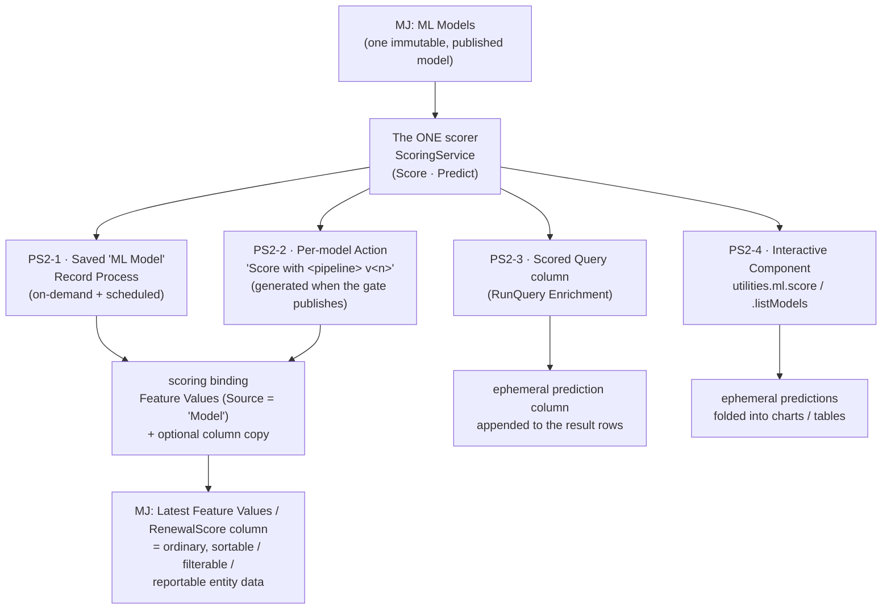

**Decoupling is the discipline that makes this safe.** No base/types package gains a dependency on Predictive Studio. Every surface plugs in through a *registry* or the *MJGlobal ClassFactory*, resolved by string key at runtime, no-op when the providing package isn't loaded:

| Surface | Seam | Lives in (PS-free) | Provided by (PS) |
|---|---|---|---|
| Record Process | `RecordProcessorRegistry` | `@memberjunction/record-set-processor-base` | `registerMLScoringProcessor()` at startup |
| Scored Query | `QueryResultEnricherBase` + ClassFactory | `@memberjunction/core` (`queryResultEnricher.ts`) | `@RegisterClass(QueryResultEnricherBase, 'ML Model Score')` |
| Interactive Component | `ComponentUtilities.ml?` (optional) | `@memberjunction/interactive-component-types` | `RuntimeUtilities.CreateSimpleMLTools()` (ng-react) |
| Per-model Action | `MJ: Actions` metadata + `ParentID` | — (pure metadata) | `ModelScoringActionGenerator`, called by the lifecycle gate after a publish |

### 15.2 PS2-1 — Scoring as a saved (and scheduled) Record Process

**What it is.** Phase 1's `MLModelInferenceProcessor` is a Record Set Processing **work type** (`'ML Model'`, §6), but a `@RegisterClass` decoration only makes it *resolvable* through the ClassFactory — it does not make the substrate *route* a saved `MJ: Record Processes` row with `WorkType='ML Model'` to it. PS2-1 closes that gap so a **saved, replayable, schedulable** Record Process scores a scope and writes a prediction column.

**Key entry points.**

- `registerMLScoringProcessor(deps: MLInferenceDeps): void` (`Engine/src/scoring/register.ts`) — installs a factory into `RecordProcessorRegistry.Instance` for both `'ML Model'` and the `'MLModelInference'` alias. The factory reads the per-run `MLScoringConfiguration` (`{ modelId, primaryKeyField?, datedSources?, autoTrain? }`) off the Record Process's `Configuration` JSON and closes over the injected `MLInferenceDeps` (model loader / artifact loader / sidecar). A process that a scoring binding names scores through `ScoringService` per batch (§6.1).
- `PredictiveStudioScoringStartup` (`Engine/src/scoring/startup-register.ts`) — a `@RegisterForStartup`-decorated `IStartupSink` (a `BaseSingleton`) whose `HandleStartup()` calls `registerMLScoringProcessor(BuildProductionMLInferenceDeps())` **once at MJAPI boot**. It warms no `BaseEngine` cache and touches no DB — the injected seams take their `provider` + `user` per call — so the registration is a cheap synchronous map write (not `deferred`). Mirrors `RemoteBrowserEngine`'s startup pattern.
- The **migration** `migrations/v5/V202606280215__v5.44.x__RecordProcess_WorkType_AddMLModel.sql` adds `'ML Model'` to the `CK_RecordProcess_WorkType` CHECK constraint — **drop the old constraint + add the new one** (`'Action' | 'Agent' | 'Infer' | 'FieldRules' | 'ML Model'`) **in a single migration**. The CHECK is the **source of truth**: CodeGen derives the field's value list, its `ValueListType`, and the generated TypeScript union from it, and the value validates at SAVE time (a typo'd work type is rejected up front). Work-type **resolution** still happens at execution time via `RecordProcessExecutor.buildProcessor() → RecordProcessorRegistry.Resolve()` (the registry is the pluggable seam) — the CHECK just guarantees the stored value is a known work type. To add further work types, extend the CHECK the same way + re-run `mj codegen`. *(Never hand-edit `EntityFieldValue` / `ValueListType` to do this — that metadata is CodeGen-derived from the CHECK; see [`migrations/CLAUDE.md`](../migrations/CLAUDE.md).)*

**Dry-run write-back fix.** PS2-1 also hardened the substrate's write-back so a **dry-run** of any work type that writes through an `OutputMapping` (Action / Agent / Infer) computes its effect without mutating data (an `'ML Model'` dry run writes nothing through `ScoringService`, §6.4). `applyOutputMapping(... dryRun: true)` (`packages/RecordSetProcessor/engine/src/writeBack.ts`) now still resolves the mapped values and validates the target entity/field metadata, but saves nothing — returning the would-be values in `previewFields` / `previewChild` (`WriteBackResult.dryRun`). This mirrors the first-class `ProcessRun.DryRun` flag threaded through `WriteBackProcessor.ts` and `RecordProcessExecutor.ts`.

**Usage** — score a view on demand and store the predictions:

```typescript
// A saved MJ: Record Processes row (created once, then runnable / schedulable):
//   WorkType      = 'ML Model'                         // set via rp.Set('WorkType', …) — see 15.6
//   ScopeType     = 'Filter'  ScopeFilter = "IsActive = 1"
//   Configuration = { "modelId": "<MJ: ML Models id>", "primaryKeyField": "ID" }
// and an MJ: ML Model Scoring Bindings row naming it (CreateScoringProcess creates both):
//   MLTrainingPipelineID, TargetEntityID, FeatureName = 'Renewal Risk',
//   TargetColumn = 'RenewalScore', TargetColumnSource = '$.AdverseProbability'   // optional column copy
// Run it (same path the scheduled job driver uses):
await RecordProcessExecutor.RunByID(recordProcessId, { contextUser, provider });
// → each row scored by the pipeline's Published model → one 'Renewal Risk' Feature Value per record,
//   and the newest value copied into RenewalScore.
```

**Proven live by** `ps-live-recordprocess-scoring.ts` — a SAVED Record Process scoring over GraphQL against a running MJAPI, relying on the **startup-registered** scorer (it does *not* register the work type itself).

### 15.3 PS2-2 — A per-model Action generated on publish

**What it is.** When the lifecycle gate moves a model into **Published**, it generates an idempotent child Action **`Score with <pipeline> v<n>`**, so every model published through the gate becomes a first-class, discoverable Action — ActionSmith / CodeSmith pick it up for free, with zero per-model code or AI codegen. Only the gate creates one: a model whose status reached `Published` any other way has none, and the registry check archives such a model (§14.4).

**Key entry points.**

- `ModelScoringActionGenerator` (`Engine/src/actions/model-scoring-action-generator.ts`):
  - `GenerateForModel(model, contextUser, provider)` — find-or-create the Action by its `ModelID` input param's default (never by name, which carries the pipeline's name), then rewrite its name, fields and params to stay in sync with the model and the parent's contract.
  - `DisableForModel(model, contextUser, provider)` — flip `Status` to `'Disabled'` when the model leaves Published.
- The hook is `LifecycleGate.SyncScoringAction`, run after a transition commits: generate on a move into `Published`, disable on a move out. It never runs inside the publish transaction, so a failure is logged and can never roll a publish back; the registry check's step (d) re-syncs a Published model whose Action is missing.

**Composition, not inheritance** (CLAUDE.md Actions rule). The generated row is a *child* of the canonical **Score Record Set** parent — it carries the parent's `ParentID` (metadata link only) and reuses the **same** `DriverClass` (`SCORE_RECORD_SET_DRIVER_CLASS = 'PredictiveStudioScoreRecordSetAction'`). That driver already reads `ModelID` / `Scope` / `WriteBack`, so the child needs no new implementation. The only thing model-specific is the `ModelID` input param's `DefaultValue`, **baked to `model.ID`** — ActionEngine seeds each param from its `DefaultValue` before invoke, so omitting `ModelID` scores with *this* model. The Action is named from the model's denormalized `Pipeline` view field (the model has no `Name` column) and `Version`, and grouped under a find-or-create `Predictive Studio Models` Action Category.

**Proven live by** `ps-live-modelaction-generation.ts` — publishes a model through the gate over GraphQL, then reads `MJ: Actions` / `MJ: Action Params` back and asserts the generated Action name + the baked `ModelID` default.

### 15.4 PS2-3 — Scored-query enrichment

**What it is.** A `RunQuery` post-query enrichment seam: a query run with an `Enrichment` directive has its result rows scored by the existing scorer and the prediction **appended as a new column** — post-query, **not** SQL-inline, so the model stays in the engine (portable, no DB-side model dependency).

**Key types/entry points (all decoupled from PS).**

- `QueryResultEnricherBase` (abstract) + `RunQueryEnrichment` (`{ EnricherKey: string; Config: Record<string, unknown> }`) + `resolveQueryResultEnricher(key)` live in **`@memberjunction/core`** (`src/generic/queryResultEnricher.ts`). `RunQueryParams.Enrichment?: RunQueryEnrichment` is a **runtime-only** directive — there is intentionally **no** persisted per-query column (a saved annotation is a deliberate follow-up), so the feature is purely additive: no schema change, no CodeGen.
- The hook is in `GenericDatabaseProvider.InternalRunQuery` → `enrichQueryResults(...)`: after paging, if `params.Enrichment?.EnricherKey` is set, it resolves the enricher via the ClassFactory and awaits `EnrichResults(...)`. **Resolution checks `GetRegistration` before constructing** (so it never instantiates the abstract base) and the whole call is wrapped in try/catch — when no enricher is registered (providing package not loaded) or anything fails, it **returns the original rows**. A scoring problem can never break the query.
- `MLModelScoreEnricher` (`Engine/src/scoring/ml-model-score-enricher.ts`, `@RegisterClass(QueryResultEnricherBase, 'ML Model Score')`) is the PS half. Its `MLModelScoreEnricherConfig` is `{ modelId, outputField, primaryKeyField?, valueKind?: 'score' | 'class' }`. Because the **model** determines the target entity, the enricher only needs each row's primary key: it collects the PKs, scores them **without write-back** (ephemeral), and joins predictions back onto rows by id (`O(1)` map). `LoadMLModelScoreEnricher()` anchors the registration against tree-shaking.

**Usage:**

```typescript
const result = await new RunQuery().RunQuery({
  QueryName: 'Active Members',
  Enrichment: {
    EnricherKey: 'ML Model Score',
    Config: { modelId: '<MJ: ML Models id>', outputField: 'RenewalScore', primaryKeyField: 'ID' },
  },
});
// → each result row now carries a `RenewalScore` column (the model's numeric score).
```

**Proven live by** `ps-inproc-scored-query.ts` — runs in-process (the `Enrichment` param is not marshaled over GraphQL yet, by design), exercising the full path: `RunQuery → resolveQueryResultEnricher('ML Model Score') → MLModelScoreEnricher → MLModelInferenceProcessor → DB + sidecar → new column`.

### 15.5 PS2-4 — An `ml` capability on Interactive Components

**What it is.** An optional `ml` capability on the Interactive Components `utilities` surface, so Skip's components can **list trained models** and **score records** and weave predictions (renewal likelihood, lead scores, churn risk) into charts / tables / dashboards. Push-to-generic: every interactive component gains it.

**Key types/entry points.**

- `SimpleMLTools` (`packages/InteractiveComponents/src/shared.ts`) — the capability interface:
  - `listModels(filter?: SimpleMLListModelsFilter, contextUser?): Promise<SimpleMLModelInfo[]>` — newest version first; resilient (returns `[]` on failure).
  - `score(modelId, records: Array<Record<string,unknown> | string>, options?): Promise<SimpleMLScoreResult>` — ephemeral predictions (nothing written back).
  - Supporting shapes: `SimpleMLModelInfo`, `SimpleMLPrediction`, `SimpleMLScoreResult`, `SimpleMLListModelsFilter`.
- `ComponentUtilities.ml?: SimpleMLTools` (`runtime-types.ts`) is **optional** — it can be `undefined` when the capability isn't available in the current environment/security context, so component code **must guard** for that.
- `RuntimeUtilities.CreateSimpleMLTools()` (`packages/Angular/Generic/react/src/lib/utilities/runtime-utilities.ts`) builds it: `listModels` reads the `MJ: ML Models` catalog via `RunView` (defaulting `Status='Published'`); `score` marshals the `PredictiveStudioScoreRecordSetOperation` (the `PredictiveStudio.ScoreRecordSet` Remote Op) **over GraphQL** to the server engine — because the Python sidecar lives server-side and cannot run in the browser. Returns `undefined` when there is no `GraphQLDataProvider`, so the `ml` capability degrades cleanly.

**Usage (inside an interactive component):**

```typescript
if (utilities.ml) {
  const models = await utilities.ml.listModels({ targetVariable: 'Renewed' });
  const { predictions } = await utilities.ml.score(models[0].id, memberRows /* objects or pk strings */);
  // fold predictions (by recordId) into the chart/table…
}
```

### 15.6 PS2-6 — The north-star: scheduled model scoring

**What it is.** The end-to-end composition Phase 2 builds toward: *"build a model, write the renewal probability back into the member record, and re-score it on the 1st of every month"* — as a **single call**, with **no new scheduling, dispatch, or write-back code**. Everything underneath already exists (PS2-1 + the scheduled-job machinery); the helper just assembles one `MJ: Record Processes` row.

**Key entry point.** `CreateScheduledModelScoring(opts: ScheduleModelScoringOptions): Promise<ScheduledModelScoringResult>` (`Engine/src/scheduling/scheduled-model-scoring.ts`). Required quartet: `modelId`, `targetEntityName`, `outputField`, and exactly one `scope` selector (`filter` | `viewId` | `listId`); sensible defaults otherwise (`'Monthly'` cadence = `0 0 1 * *`, `ID` primary key, numeric `'score'`, UTC). It validates, maps the `ScoringCadence` to a cron (`CadenceToCron`), and populates the row:

- `WorkType='ML Model'` — set via `rp.Set('WorkType', 'ML Model')`, the **documented legitimate exception** to the no-`.Set()` rule: the CodeGen'd `WorkType` union (`'Action' | 'Agent' | 'FieldRules' | 'Infer'`) cannot represent a runtime-registered extension work type. (Same exception PS2-1's path uses.)
- `Configuration = { modelId, primaryKeyField }` and no `OutputMapping`; then a scoring binding (`Mode='Scheduled'`) naming the model's pipeline, the Record Process, the target entity, the feature name (default: the pipeline's name) and, when `outputField` is given, that column with its copy source (`$.AdverseProbability` for a classification, `$.Value` for a regression, `$.Class` with `valueKind: 'class'`).
- `Status='Active'`, `ScheduleEnabled=true`, `CronExpression`, `Timezone`, `OnDemandEnabled=true`.

Saving that row auto-creates an **owned `MJ: Scheduled Jobs`** row via `MJRecordProcessEntityServer.Save → reconcileScheduledJob`; `SchedulingEngine` then dispatches it on its cron through `RecordProcessScheduledJobDriver → RecordProcessExecutor.RunByID(...)` — which resolves the scope and scores it through `ScoringService` per batch: the binding's Feature Values, and its column copy when it names a column. The `schedule-model-scoring.action.ts` Action wraps the helper for agent/workflow invocation.

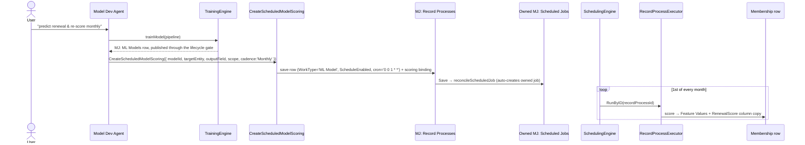

**Proven live by** `ps-inproc-scheduled-scoring.ts` — one `CreateScheduledModelScoring(...)` call, then it verifies the owned Scheduled Job the scheduler *would* dispatch and runs the Record Process now via `RecordProcessExecutor.RunByID` (the same path the job driver uses), asserting the predictions landed.

### 15.7 Integration-test proofs

Each Phase 2 capability ships with an MJServer integration script that exercises the real path (no mocked ML). The `ps-live-*` scripts drive an already-running MJAPI over GraphQL (system API key); the `ps-inproc-*` scripts bootstrap a real `SQLServerDataProvider` in-process (used where the path isn't marshaled over GraphQL yet). All gate the sidecar legs behind `PS_INTEGRATION=1` and skip gracefully without it.

| Capability | Script | Harness | Proves |
|---|---|---|---|
| PS2-1 — saved Record Process scoring | `ps-live-recordprocess-scoring.ts` | live / GraphQL | a saved `WorkType='ML Model'` Record Process scores a view + writes columns, via the **startup-registered** scorer |
| PS2-2 — per-model Action on publish | `ps-live-modelaction-generation.ts` | live / GraphQL | publishing through the gate generates `Score with <pipeline> v<n>` with `ModelID` `DefaultValue` baked in |
| PS2-3 — scored-query enrichment | `ps-inproc-scored-query.ts` | in-process | `RunQuery` + `Enrichment` appends the model's prediction column |
| PS2-6 — scheduled model scoring | `ps-inproc-scheduled-scoring.ts` | in-process | one `CreateScheduledModelScoring(...)` call → owned Scheduled Job + the binding's stored predictions |

> PS2-5 (catalog awareness for agents) is delivered *through* PS2-2: every published model is a discoverable Action, which ActionSmith / CodeSmith see for free — no separate code.

---

## 16. The Business-User Experience

Phases 1–2 built the platform and gave the *model* reach. **This** is the layer that makes the whole thing usable, visible, and trustworthy for a **non-technical business user** — the conversational north-star made real, end to end, with **every surface generic** (binding-driven, entity-agnostic; "members/renewal" is throwaway test data, never a build target). Full plan + commit lineage: [`plans/predictive-studio-business-experience.md`](../plans/predictive-studio-business-experience.md).

### 16.1 The Predictions surface (the front door)

The default Predictive Studio nav item is **Predictions** (`PSPredictionsResourceComponent`, in `ng-dashboards`) — the business front door, modeled on the locked [`plans/predictive-studio-business-ux/option-b-refined.html`](../plans/predictive-studio-business-ux/option-b-refined.html):

- **Catalog** — every **published** model reframed as a plain-language prediction card with an **outcome badge** (`TrustVerdicts.DeriveTrustVerdict`, a rendering of the gate decision stored on the model's training run): "Ships — the model beats the flat guess", "Ships — a simple baseline", "No signal — not usable" or "Not evaluated yet". A card that can act shows the headline ("Beats the flat guess by X [lo, hi]"); a prediction that cannot (no signal, or never evaluated under an Evaluation Protocol) shows the stored reason with Open disabled: the trust gate at the catalog level. Cards sort shipped models first, then kept simple baselines, no-signal, and not evaluated.
- **Workspace** (open a card) — a trust verdict banner that **gates the action bar**; a ranked **at-risk list** (the embedded `ps-predictions-grid` reads the latest values of the model pipeline's scoring binding from `MJ: Latest Feature Values` — the view gate decides which rows the user sees — and hands the parsed rows to the workspace through its `RowsLoaded` output; sorted and labelled by the model's `at-risk-list` output binding; highest-risk first, high/medium/low risk tiers for classification, outcome-band tiers for regression) with the features **weighted most by the model** (`AtRiskRules.TopGlobalDrivers` over the model's global feature importance — global, not per-record SHAP; shown only when the model's Lineage says the importance is coefficients or held-out permutation importance (`ImportanceDisplay.GlobalDriversShowable`), hidden for split or impurity counts, which models trained before Prediction Units carry until they are retrained); and four trust-gated actions — Review the call list · Save scores (opens the docked Model Dev Agent co-pilot seeded with the request) · Send to a list (creates an MJ List of the highest-risk records at or above `AT_RISK_LIST_MIN_RISK_PCT`, at most 200, and reports how many of the qualifying records it added) · Share/export (CSV).
- **"+ New prediction"** opens the deterministic-builder agent (§12.4) as a docked `mj-conversation-chat-area` co-pilot. **Embedding the chat correctly requires the conversation lifecycle wiring** — bind `[isNewConversation]` (start `true`), `[conversation]`/`[conversationId]`, and handle `(conversationCreated)` to capture the new conversation + flip out of new-mode (mirror `(pendingMessageConsumed)` to clear the seed). Without it, the suppressed empty-state input has no conversation to write into and the first send silently no-ops. Both the Predictions co-pilot and the Studio co-pilot use this pattern; copy it for any new embedded PS chat.

**Nav structure — three doors.** The Predictive Studio app exposes exactly **three** top-level nav items (`metadata/applications/.predictive-studio-application.json`), consolidated from an earlier eight-flat-item layout so business users see one door and analysts opt into depth:
- **Predictions** (`PredictiveStudioPredictionsResource`) — the business front door above.
- **Studio** (`PredictiveStudioStudioResource`) — the build/run workbench: an internal left-nav grouped Overview · Define (Prediction Units, Evaluation Protocols) · Build (Training Pipelines, Algorithm Catalog) · Run (Experiments, Compare Runs), plus the shared docked Model Dev Agent co-pilot. The two Define sections list version lineages (`mj-ps-versioned-list`) and open the latest version of one on its record form.
- **Models** (`PredictiveStudioModelsResource`) — the trained-model lifecycle: an internal left-nav over Model Registry · Models in Production.

The two workbench doors are single `BaseResourceComponent`s that host the **same** standalone section panels (`ps-home`, `ps-pipelines`, …) the old per-section resources hosted — only the wrapping changed. The active section round-trips through a `section` query param (deep links + back/forward), and the Overview panel's cross-door links route via `RouteHomeNavigate` (pure, unit-tested in `predictive-studio.nav.ts`). The trust translator (`@memberjunction/predictive-studio-core`) is the single shared rule behind the catalog badges/gate **and** the agent's publish gate. **Record-form panels.** Four panels register with the Studio chunk (`record-panels/ps-protocol-panels.ts`, `BaseFormPanel` via `@RegisterClassEx`) and mount the Studio widgets on the generated record forms: the **versions** panels on `MJ: ML Evaluation Protocols` and `MJ: ML Prediction Units` (the editors save the next version, they never change a row; protocol guard fields follow the protocol's `GuardFieldsEditableBy`), the **bindings** panel on `MJ: ML Training Pipelines` (bind the pipeline to the unit and protocol versions it trains under), and the **evaluation** panel on `MJ: ML Models`, which shows the training run's protocol results: scores with intervals, the baselines, the improvement over the flat guess, the gate outcome and its reason, calibration and leakage flags, with the winner's inner score labelled optimistic. For a model trained before Prediction Units the panel reads "This run was not evaluated under an Evaluation Protocol." (the catalog badge for the same model reads "Not evaluated yet"). The wizard binds the version-1 unit and protocol it creates with a new pipeline; a binary target whose outcome polarity is not declared is refused.

The pure VMs (`business-predictions.view-models.ts`, `predictive-studio.nav.ts`), the at-risk rules (`AtRiskRules`, Core `at-risk-rules.ts`) and the trust translator are unit-tested. Full design-driven lineage (brief → 3 divergent mockups → locked direction → plan): [`plans/predictive-studio-business-ux/`](../plans/predictive-studio-business-ux/).

The one-sentence goal: *a membership director, in chat, asks "which members are likely to lapse?" — and minutes later every member record shows a renewal-risk score that refreshes monthly, driven and explained conversationally, with the deployed model visible in a control-tower view.*

#### 16.1.1 The end-to-end flow

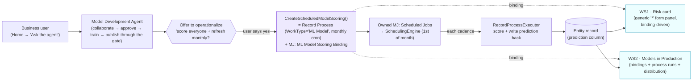

The whole loop never leaves the conversation: the agent trains, publishes through the gate (when the run asks it to, §12.4), **proactively offers** to operationalize, and on a yes wires up scheduled scoring; the binding it records is what lights up the risk card and the production view.

### 16.2 The Model Development Agent's conversational flow

The agent (§12) now closes the loop. Its prompt (`metadata/prompts/templates/model-development-agent/model-development-agent.template.md`, §5 *"Operationalize — proactively offer"*) teaches it that *a trained, published model is only useful once its predictions are on the records, kept current.* So after a publish, it **proactively offers** — not waiting to be asked — in plain business language tied to the user's goal:

> *"This model's ready to go. Want me to score every active member right now, write each one's renewal-risk onto their record, and then refresh it every month so it always stays current?"*

It offers clear `suggestedResponses` (*Yes, score & schedule monthly* / *Just score once now* / *Not yet*). On a **yes**, it calls the **Schedule Model Scoring** action — now in its `MJ: AI Agent Actions` toolkit (`metadata/agents/.model-development-agent.json`) and fully metadata-synced (`metadata/actions/predictive-studio/.predictive-studio-actions.json`: `ModelID`, `TargetEntityName`, `OutputField`, `ScopeFilter`, optional `Cadence` (default `Monthly`) / `PrimaryKeyField` / `ValueKind`; result codes `SUCCESS` / `VALIDATION_ERROR` / `SCHEDULE_FAILED`). It proposes a column name if the user hasn't named one, confirms the population (`ScopeFilter`), then reports back in plain English what it scheduled. Keeps it **generic** — "this works for any entity and any prediction target, not just members or renewal."

The Action wraps `CreateScheduledModelScoring` (§15.6); the helper now **also records the scoring binding** (§16.6), which is the seam that makes the next two surfaces light up.

### 16.3 The record panel: a record's predictions, with authorization and lineage

The payoff renders on **any** entity a model scores, with **no per-entity code**:

- **Component** — `ModelPredictionPanel` (`packages/Angular/Explorer/core-entity-forms/src/lib/panels/model-predictions/`), a `BaseFormPanel` registered under the **`'*'` wildcard entity**:
  ```typescript
  @RegisterClassEx(BaseFormPanel, {
      key: 'model-predictions:model-prediction',
      skipNullKeyWarning: true,
      metadata: { entity: '*', slot: 'after-fields', sortKey: 40 },
  })
  ```
- **The `'*'` slot wildcard** — the slot host (`packages/Angular/Generic/base-forms/src/lib/panel-slot/`) treats `'*'` as "mount on **every** entity's form"; such panels self-hide when they don't apply.
- **Binding-driven, one batch** — the panel sends one `RunViews` batch built by Core's `PredictionPanelQueries.For` (the same builder the scoring gate tests use): the entity's `Active` scoring bindings, the record's latest values from `MJ: Latest Feature Values`, its `Champion` `Model` history from `MJ: Feature Values`, and its pipeline features; then one lineage batch (`PredictionPanelQueries.Lineage`) for the scoring models' `record-panel` output bindings and the scoring runs. It shows one card per `Active` binding whose view authorization the user holds and that has a value for the record, and renders nothing when there is none.
- **Authorization** — the view gate (§6.6) is the guarantee: a user without a binding's authorization reads none of its rows, from the panel or anywhere else. The panel's own check only keeps it from rendering a card the filter would leave empty. A withdrawn binding shows no card.
- **What a card shows** — the value (a classification's class and probability, a regression's value), the per-record drivers measured from the training mean and signed relative to the adverse class, a history sparkline of earlier as-of dates, the label from the model's `record-panel` output binding, and the **lineage**: model and version, scoring run, as-of date and whether the record was in the model's training set.

A sibling panel, `FeatureValuesPanel` (`packages/Angular/Explorer/core-entity-forms/src/lib/panels/feature-values/`, `'*'` wildcard, `sortKey` 41), shows the record's Feature Pipeline values in `MJ: Feature Values`: the latest answer per pipeline and feature with Source, Confidence, pipeline version, Computed, Reasoning and older values, plus a Refresh button. A latest answer that withheld the value (an abstention, or a value a person cleared) reads "no value" and supersedes any older value. It is read-only, renders nothing when the record has no Feature Values, and is where a feature pipeline with no write target ("Feature value only") is visible.

### 16.4 "Models in Production" — the control tower

`PSProductionComponent` (the Models door's "Models in Production" section, `packages/Angular/Explorer/dashboards/src/PredictiveStudio/`) lists every **Published** model whether it is idle, scheduled or bound: model label + algorithm + problem type + status, **what it scores** (the bindings of its pipeline: target entity, feature name, column copy), the **mode + schedule phrase** (`humanizeCron`), the **last run** (the latest `MJ: Process Runs` row for a binding's Record Process — status, time, success/error counts) or the binding's own `LastScoredAt` / `LastRowCount`, and a **prediction-distribution mini-viz** (`production-distribution.ts`: numeric → terciles, categorical → top-8 + "Other"). **Operate** opens the dialog that runs, schedules or binds the model; clicking a run drills into its per-record results (`MJ: Process Run Details`) through the shared predictions grid. Everything reads through `RunView.FromMetadataProvider(this.ProviderToUse)` and the `PredictiveStudioEngine` caches — **zero entity-specific code**.

### 16.5 The model form, the live Studio and conversational entry

**The `MJ: ML Models` form** (`MLModelFormComponentExtended`, `core-entity-forms/src/lib/custom/MLModels/`) leads with `ps-model-detail` — the header with the lifecycle chip (status, `StatusReason`, and "serving while unevaluated" for a pre-change model) and five tabs:

| Tab | Component | What it shows or does |
|---|---|---|
| Overview | `ps-model-detail` | the lifecycle stepper, metrics, feature importance, lineage; the action bar (**Evaluate**, **Archive** and **Roll back to this model**, the last two with a required reason, through `PredictiveStudio.PromoteModel`); the **sign-off panel** (`ps-sign-off-panel`: the evidence from `GetModelEvidence`, the leakage flags to override, Approve or Reject with a reason through `SignOffModel`, then the publish through `PromoteModel` with the recorded `signOffId`); the **scoring bindings editor** (`ps-scoring-binding-editor`: create, edit and withdraw the bindings of the model's pipeline — feature name, view authorization, column copy, mode, retention) |
| Publish history | `ps-publish-history` | the model's publish records — sign-offs, publishes, rollbacks, adoptions and refusals — with approver, initiator, reason and refusal in words |
| Scoring runs | `ps-scoring-runs` | the model's `MJ: ML Scoring Runs`: path, scope, as-of date, status, counts, the refusal in words and the first errors |
| Monitoring | `ps-model-monitoring` | the model's `MJ: ML Monitoring Results` periods (state, primary score with its interval, drift alarms, triggers, challenger and rollback outcome) and the registry check's findings about the model |
| Output bindings | `ps-output-bindings-editor` | the labels of the model's `MJ: ML Output Bindings` per surface |

**The Studio** (§18) feeds each panel from live engine data through pure view-models (`predictive-studio.view-models.ts`): Registry from `engine.Models`, Experiments from `engine.Sessions` / `engine.Iterations`, Home KPIs and the activity feed from `engine.Models` / `engine.Sessions` + recent `MJ: Process Runs`, Compare from a session leaderboard. The Model Registry opens the same model detail; **Pause / Resume / Cancel** of an experiment session → `PredictiveStudioControlExperimentSessionOperation` (`{ sessionId, action }`). Each mutation force-refreshes the engine (`Config(true, …)`) and reports success/failure. Home's **"Ask the agent"** CTA opens the docked `<mj-conversation-chat-area>` pinned to the Model Dev Agent with a seeded starter prompt (`[pendingMessage]` auto-sends).

### 16.6 The scoring binding (the seam that lights it all up)

Every surface that shows predictions reads `MJ: ML Model Scoring Bindings`, so operationalizing a model always **records a binding**. A binding defines one prediction feature:

| Field | Meaning |
|---|---|
| `MLTrainingPipelineID` | the pipeline whose `Published` model scores — publishing a new version needs no binding change |
| `TargetEntityID`, `FeatureName` | the entity whose records are scored and the feature name its Feature Values carry (unique per entity) |
| `ViewAuthorizationID` | who may see the predictions (default: the seeded "View Model Predictions") (§6.6) |
| `RecordProcessID` | the `'ML Model'` Record Process that runs it (nullable: Score Record Set can score a binding directly) |
| `TargetColumn`, `TargetColumnSource` | the optional column copy of the newest value and the scored value it receives (`$.AdverseProbability`, `$.Value`, `$.Class`) |
| `Mode` | `OnDemand` or `Scheduled` |
| `Status` | `Active` or `Withdrawn` (`PredictiveStudio.WithdrawScoringBinding`) |
| `RetentionDays` | the age past which the daily retention job deletes its predictions; null keeps them all |
| `LastScoredAt`, `LastRowCount` | the last run's time and row count |

`CreateScoringProcess` (on-demand) and `CreateScheduledModelScoring` (scheduled) create the Record Process and then the binding (`ScoringBindings.Upsert`: the model's pipeline, the feature name — default the pipeline's name — the view authorization and the optional column); auto-train's `binding` declaration ensures one (§6.8); the model form's bindings editor creates, edits and withdraws them. Without a binding a scoring run writes nothing that the record panel or the at-risk list can show.

### 16.7 The enablers

- **`'ML Model'` WorkType dropdown** — migration `V202606280215__v5.44.x__RecordProcess_WorkType_AddMLModel.sql` adds `'ML Model'` to the `CK_RecordProcess_WorkType` CHECK (drop + re-add the constraint with the five values in one migration). The CHECK is the source of truth — CodeGen derives the value list, `ValueListType`, and the generated union from it, so after the next CodeGen the union becomes `'Action' | 'Agent' | 'FieldRules' | 'Infer' | 'ML Model'` and `'ML Model'` is a real dropdown option in the Bulk-Operations / Record-Process studio. **Requires CodeGen** to regenerate. *(This supersedes an earlier two-migration approach — one dropping the CHECK, one hand-seeding `EntityFieldValue` rows — which was wrong: value lists are CodeGen-derived from the CHECK, never hand-written. See [`migrations/CLAUDE.md`](../migrations/CLAUDE.md).)*
- **Enrichment over GraphQL RunQuery** (PS2-3 follow-up) — the RunQuery resolver (`packages/MJServer/src/resolvers/QueryResolver.ts`) accepts `@Arg('Enrichment', () => GraphQLJSONObject, { nullable: true })` and threads it into `RunQuery({ …, Enrichment })`; the `GraphQLDataProvider` client carries the same `Enrichment?: RunQueryEnrichment` (`{ EnricherKey, Config }`). So browser / Query-Builder callers — not just server-side Skip — can request a scored query via the `'ML Model Score'` enricher.

### 16.8 Capability → file(s) → proof

| Capability | Key file(s) | Proof |
|---|---|---|
| Agent offers to operationalize, schedules monthly | `metadata/agents/.model-development-agent.json` · `metadata/actions/predictive-studio/.predictive-studio-actions.json` · `…/model-development-agent.template.md` (§5) | conversational (live agent run); the scheduling path → `ps-inproc-scheduled-scoring.ts` |
| Record panel (`'*'` form panel) | `core-entity-forms/.../panels/model-predictions/` · Core `prediction-panel-queries.ts` · `Generic/base-forms/.../panel-slot/` (`'*'` wildcard) | the Scoring gate suite's panel batch under the view gate; `e2e/specs/ps-honest-serving-record-panel.spec.ts` |
| Model form: sign-off, publish history, scoring runs, monitoring, bindings | `core-entity-forms/.../custom/MLModels/` | `e2e/specs/ps-honest-serving-publish-flow.spec.ts` |
| Models in Production section | `dashboards/.../PredictiveStudio/components/ps-production.component.*` · `resources/ps-production-resource.component.ts` · `production-distribution.ts` | reads bindings + `MJ: Process Runs` (live) |
| De-mocked Studio + ops wired | `dashboards/.../PredictiveStudio/predictive-studio.view-models.ts` (+ Registry / Experiments components) | `PredictiveStudioControlExperimentSessionOperation` |
| Scoring-binding on operationalize | `PredictiveStudio/Engine/src/scheduling/scheduled-model-scoring.ts` (`ScoringBindings.Upsert`) | `ps-inproc-scheduled-scoring.ts` (binding asserted) |
| `'ML Model'` WorkType dropdown | `migrations/v5/V202606280215__…RecordProcess_WorkType_AddMLModel.sql` (CHECK drop+add) | (needs CodeGen) |
| Enrichment over GraphQL | `MJServer/src/resolvers/QueryResolver.ts` · `GraphQLDataProvider` | `ps-inproc-scored-query.ts` |

---

## 17. Roadmap / future phases

Predictive Studio ships end-to-end; no capability waits on another PR.

| Item | Status | Detail |
|---|---|---|
| **Prediction storage** | **Shipped — the generic Feature Value path** | Every prediction is a `MJ: Feature Values` row (`Source = 'Model'`) defined by a scoring binding, with `MJ: Latest Feature Values` as the live latest-value view, an optional copy into an existing column, `MJ: ML Scoring Runs` and `MJ: Process Run Details` as the per-run audit, and the view gate deciding who sees it (§6.5, §6.6). It needs no materialization primitive and no per-model column or migration. |
| **Experiment sessions** | **Switched off** | The orchestrator code exists; the production session runner has no pipeline resolver (§7). |

Other open questions carried forward (none block the shipped feature): model serialization native-vs-ONNX for cross-platform portability; reserving algorithm slots (k-NN / Naive Bayes); sidecar multi-tenancy / per-session resource limits for long agentic searches; and detached fire-and-forget Remote-Op progress (poll-via-status today, full background execution later).

---

## 18. The Studio UI

Predictive Studio is an MJ Explorer dashboard built to the ng-dashboards world-class standards (see [Dashboard Best Practices](DASHBOARD_BEST_PRACTICES.md)) and **lazy-loaded** (see [Lazy Loading Guide](LAZY_LOADING_GUIDE.md)). It lives at `packages/Angular/Explorer/dashboards/src/PredictiveStudio/`.

- **Shell**: three `BaseResourceComponent`s — `PredictiveStudioPredictionsResource`, `PredictiveStudioStudioResource` and `PredictiveStudioModelsResource` (§16.1) — each with an internal left-nav, a `section` query-param round-trip (deep links survive back/forward).
- **Data layer**: `PredictiveStudioEngine` (`engine/predictive-studio.engine.ts`) — a `BaseEngine` singleton that caches the PS reference entities via `RunView` (`Algorithms`, `UseCases`, `Rankings`, `Models`, `Pipelines`, `TrainingRuns`, `Experiments`, `Sessions`, `Iterations`) and exposes domain helpers (`BestLevelsForScenarios`, `RankingsForUseCase`, `IterationsForSession`). No Angular services for data — the canonical MJ pattern.
- **Panels** (standalone components in `components/`, each receiving the engine via `@Input()`):

  | Panel | Component | Door |
  |---|---|---|
  | Overview | `PSHomeComponent` | Studio — hero band + entry paths + activity timeline |
  | Prediction Units, Evaluation Protocols | `PSVersionedListComponent` (`mj-ps-versioned-list`) | Studio (Define) — version lineages that open on their record forms |
  | Training Pipelines | `PSPipelinesComponent` | Studio (Build) — SVG feature-assembly graph + node inspector + leakage/validation config; Train notifies the stored gate decision |
  | Algorithm Catalog | `PSCatalogComponent` | Studio (Build) — card-gallery + Guide-me scenario picker |
  | Experiments | `PSExperimentsComponent` | Studio (Run) — Running/Completed/Pruned columns + leaderboard strip + budget gauges |
  | Compare Runs | `PSCompareComponent` | Studio (Run) — side-by-side / overlay charts / champion-vs-challenger |
  | Model Registry | `PSRegistryComponent` | Models — master-detail over the model detail of §16.5 (lifecycle, sign-off panel, publish history, scoring runs, monitoring, bindings) |
  | Models in Production | `PSProductionComponent` | Models — the control tower (§16.4) |

- **Embedded copilot**: an `<mj-conversation-chat-area>` (from `@memberjunction/ng-conversations`, see [Conversations UX Stack Guide](CONVERSATIONS_UX_STACK_GUIDE.md)) docked across **all** panels — agent picker hidden, pinned to the Model Development Agent, with an `appContext` carrying the active panel + published-model / running-session counts so the agent can act on the current context.
- **Knowledge Hub side**: the **Feature Pipelines** panel (`FeaturePipelinesResourceComponent`, §11) lives in the Knowledge Hub dashboard — list / run / author derived-feature pipelines.
- **Lazy load**: `PredictiveStudioDashboardsModule` is exported via the `./predictive-studio-dashboards.module` subpath in the dashboards `package.json`; `LoadPSPredictionsResource()`, `LoadPSStudioResource()` and `LoadPSModelsResource()` are the tree-shaking anchors; the ClassFactory resolves the three resource drivers to the code-split chunk on demand.

The HTML option mockups that informed the pinned designs are at [`plans/predictive-studio/mockups/`](../plans/predictive-studio/mockups/).

---

## 19. Getting started — train and score a model

### 19.1 One-time setup

```bash
# 1. Install and build from the repo root (Predictive Studio depends on other workspace packages)
pnpm install
pnpm run build

# 2. Set up the bundled Python sidecar environment (once)
pnpm --filter @memberjunction/predictive-studio-sidecar run setup:python
brew install libomp          # macOS only (Linux: install libgomp1)
```

**Where Predictive Studio files are stored.** One setting decides it: `PS_STORAGE_PROVIDER` names the `MJ: File Storage Providers` row (default `Local File System`, the `Local File System Storage` driver, rooted at `STORAGE_LOCAL_ROOT`) that every training run writes its Training Snapshot files **and** its trained model files to, each recorded as an `MJ: Files` row with that provider's `ProviderID` and the object's `ProviderKey` (model files under `predictive-studio/model-artifacts/<uuid>/<name>`). The provider is selected by name whatever its `IsActive` flag, and a provider that cannot write here refuses every run before training: one whose driver is not configured on the server (for example `Local File System` without `STORAGE_LOCAL_ROOT`), or one that is configured but whose write probe fails (a small object put under `predictive-studio/model-artifacts/<uuid>/.probe` and then deleted, which catches wrong credentials or an unwritable root; a probe that is written but cannot be deleted is logged as a warning and does not refuse). The refusal happens before any run row or snapshot file is written and before the sidecar is called, whether the run would write a new snapshot or reuse one. A stored file is always read through the provider its own `MJ: Files` row names, so changing `PS_STORAGE_PROVIDER` later never strands an existing model. The local driver hands the sidecar `file://` URLs and keeps files on one host's disk, so it works only when MJAPI and the sidecar share one host and disk; a cloud container or multi-host install (more than one MJAPI host, or a remote sidecar) must point `PS_STORAGE_PROVIDER` at a cloud provider (S3, Azure Blob, Google Cloud Storage…): files on one host's disk are unreadable from the others and are lost with that disk. Model files trained before 6.3 have an empty `ProviderKey`; their bytes are read from `PS_ARTIFACT_DIR` (default `<os tmpdir>/mj-ps-artifacts`, at `<dir>/<file id>.bin`), and the registry check's pre-change migration stores the ones it finds there write-once through the configured provider and registers their SHA-256; a file not on that host is recorded `legacy-local` and does not serve (§14.5).

### 19.2 Train

A model is trained from a pipeline bound to a **Prediction Unit** and an **Evaluation Protocol**:

1. **Define the unit and the protocol.** In the Studio's Define group (Prediction Units, Evaluation Protocols), or let the pipeline wizard create version 1 of each when it creates a pipeline (it maps them from the target; a binary target whose outcome polarity is not declared is refused). An existing pipeline without them is bound by the "Migrate Pipelines to Prediction Units and Evaluation Protocols" Action (§10.2), or bound by hand in the pipeline's bindings panel.
2. **Train.** Invoke the `PredictiveStudio.TrainModel` Remote Op (browser/Skip) or the `Train ML Model` Action (agent). Both delegate to `TrainingEngine.trainModel` and return the run's stored gate decision and, when one ships, a `Draft` model. A pipeline with no unit is refused `UNIT_REQUIRED` and one with no protocol `PROTOCOL_REQUIRED` (§10.4).
3. **Read the outcome.** The run stores `model`, `keep-simple-baseline` or `no-signal` with its reason; the model form's evaluation panel shows the protocol's results (§16.1).
4. **Publish.** `PredictiveStudio.PromoteModel` with `transition: 'evaluate'` (Draft → Validated or KeepBaseline), then `transition: 'publish'` — with a `signOffId` from `PredictiveStudio.SignOffModel` when the protocol requires a sign-off or the model is leakage-flagged (§13.3). Auto-train, the agent with publishing on and monitoring publish through `AutomatedPublisher` instead (§13.4).

Directly, the shape is:

```typescript
import { TrainingEngine, TrainingDelegation } from '@memberjunction/predictive-studio';
// productionDeps = await TrainingDelegation.BuildTrainingDeps(provider, contextUser): MetadataEntityFactory,
// RunViewRecordLoader, MJSidecarTrainer (over MLSidecar), the artifact store, and the unit, protocol and
// snapshot stores.

const engine = new TrainingEngine();
const result = await engine.trainModel(
  { pipelineId: retentionPipelineId },
  productionDeps,
);
// → result.model: a new immutable MJ: ML Models row (Status='Draft') with the shipped
//   artifact, HoldoutMetrics, FeatureImportance and Lineage, or null when the stored gate
//   decision ships none (no-signal); result.run: the training run, whose ValidationResults
//   holds the ps-run-results/v2 envelope (the gate record, the snapshot and protocol IDs).
```

A pipeline (`MJ: ML Training Pipelines`) declares the target entity, target variable, problem type, algorithm, `SourceBindings`, `FeatureSteps` DAG, `LeakageGuard` and `ValidationStrategy`, and binds the **Prediction Unit** and **Evaluation Protocol** versions that decide its rows, decision dates and labels (the unit) and its locked holdout, validation and gate (the protocol). A pipeline without a unit or a protocol is refused; the retired `AsOfStrategy` column no longer drives anything.

### 19.3 Score

Scoring needs a `Published` model. Create a scoring binding and its Record Process with `PredictiveStudio.CreateScoringProcess` (on demand) or the Schedule Model Scoring Action / `CreateScheduledModelScoring` (on a cron), or from the model form's bindings editor; then run the Record Process (`RecordProcess.RunNow`, the generic "Run Record Process" operation, or its schedule), or call `PredictiveStudio.ScoreRecordSet` with the `bindingId`. Each record's prediction is stored as a Feature Value of the binding's feature (and copied into the binding's column, when it names one); read the latest values from `MJ: Latest Feature Values`. `PredictiveStudio.ScoreRecordSet` without a binding returns the predictions and stores nothing (§6). See the [Record Set Processing Guide](RECORD_SET_PROCESSING_GUIDE.md) for the substrate mechanics.

### 19.4 Run the live integration test (`PS_INTEGRATION=1`)

The engine ships an opt-in end-to-end test that spawns the **real** managed sidecar and trains a Prediction Unit pipeline through its trainer (`Engine/src/__tests__/integration/live-train-score.integration.test.ts`):

```bash
# Prerequisite: the sidecar venv must exist
pnpm --filter @memberjunction/predictive-studio-sidecar run setup:python

# Run the live integration suite (sets PS_INTEGRATION=1 via vitest.integration.config.ts)
pnpm --filter @memberjunction/predictive-studio run test:integration
```

It exercises the real unit row reader, `AsOfFeatureAssembler`, `TrainingEngine`, `MJSidecarTrainer` and `MLSidecar` (managed spawn of the bundled Python), faking only the persistence seams (entity factory, record loader, artifact and snapshot stores; no DB needed). The snapshot files are served to the trainer as `file://` URLs, because the trainer opens only http, https and file URLs. It asserts what is in the [at-a-glance](#at-a-glance) list: the run completes, the stored gate record counts the 400 holdout rows, and a decision that ships creates the model row from the shipped artifact (`no-signal` creates none). It **skips gracefully** with a clear console note when the venv or Python is unavailable, so it is CI-safe by default — the standard `npm run test` (mocked) always runs; the live suite is explicit opt-in.

### 19.5 Planted-truth suite (`packages/AI/PredictiveStudio/TruthSuite`)

The planted-truth suite (`@memberjunction/predictive-studio-truth-suite`) holds 68 seeded datasets (worlds `W1`–`W9` and scenarios such as `C2`, `R1`, `T1p`–`T4`, `D1c`, `D1r`, `D2`) whose ground truth (`TrueP`, structural coefficients, censoring dates, regime shifts) is known before any model is fit. It loads them into an isolated `pstruth` SQL Server schema and provides the harness the Predictive Studio gates run on. See [`packages/AI/PredictiveStudio/TruthSuite/README.md`](../packages/AI/PredictiveStudio/TruthSuite/README.md) for the environment it needs (a private database; `.env` with the database, CodeGen and MJAPI settings).

The setup, in order, from `packages/AI/PredictiveStudio/TruthSuite`:

```bash
pnpm run build
pnpm run truth:loom        # the Loom pin under .loom/
pnpm run setup:python      # .venv from python/requirements.txt
pnpm run truth:provision   # the pstruth schema, its entities and their direct-SQL opt-ins (restart MJAPI afterwards)
pnpm run truth:sidecar     # the single-threaded sidecar; its URL in .run/sidecar.url (start MJAPI with PREDICTIVE_STUDIO_SIDECAR_URL)
pnpm run truth:load-c1     # with MJAPI running: the C1 corpus, then the truth suite's immutable-field declarations
                           # (restart MJAPI afterwards so it reads the changed field metadata)
```

`truth:load-c1` must follow `truth:provision` on a fresh database: the gates that read a field's history as of a date need its declarations. The gates are MJ Tests in the integration test suites, one suite per area — `mj test suite "Predictive Studio Gates — <suite>"` with `Containment`, `Prediction Units`, `Training`, `Training (statistical)`, `Feature Pipelines`, `Registry and Gate`, `Scoring`, `Monitoring` and `Monitoring (statistical)`; `Pending` holds the gates that do not block a merge. `pnpm run test:db` runs the package's database tests, including the adversarial harnesses (`src/__tests__/*.adversarial.db.test.ts`) that try to break a named claim with the production readers and writers.

---

## 20. Quick reference — what's built

| Area | Status |
|---|---|
| 17-entity data model + CodeGen (the 10 original entities, Prediction Units, Evaluation Protocols, Training Snapshots, Publish Records, Scoring Runs, Monitoring Results, Output Bindings) + the `MJ: Latest Feature Values` view entity | ✅ built |
| Algorithm catalog + use cases + 6×7 rankings (metadata) | ✅ built |
| `MLSidecar` self-managing Python sidecar (managed + remote) | ✅ built |
| `AsOfFeatureAssembler` (rows as of each decision date, typed columns) + `FeatureAssemblyExecutor` (raw/preprocessing split for models trained before Prediction Units, leakage guard) | ✅ built |
| `TrainingEngine` (Prediction Unit + Evaluation Protocol, Training Snapshot, protocol trainer, three-outcome gate, immutable models, lineage) | ✅ built |
| `LifecycleGate` (the only status writer, the status and evidence guards, publish locks, publish records, sign-offs, rollback) + `AutomatedPublisher` | ✅ built |
| `ScoringService` (one service behind every scoring path, checks 1–6, scoring runs) + `MLModelInferenceProcessor` (the 'ML Model' RSP work type) | ✅ built |
| Prediction store (`Source = 'Model'` Feature Values, `MJ: Latest Feature Values`, the column copy, the view gate, withdrawal, retention) | ✅ built |
| `ExperimentOrchestrator` (waves, leaderboard, pruning, budget-in-runner) | switched off (§7) |
| **12 Remote Operations** (Train, Score, RunFeaturePipeline, Start + Control Experiment, Promote, GetModelEvidence, SignOff, CreateScoringProcess, WithdrawScoringBinding, RunModelMonitoring, MigratePreGateModels) + **6 Actions** | ✅ built |
| **Feature Pipelines** (category route — `FeaturePipelineEngine` + KH panel; no new entity) | ✅ built |
| **Model Development Agent** + 3 sub-agents + **ML Experiment Results artifact** + Angular viewer | ✅ built |
| **Security model** (scope gate, PK field-name guard, UUID gate, the lifecycle table enforced by a `PreSave` hook, evidence-bound sign-offs, the prediction view gate) | ✅ built |
| **Monitoring** (a job per Published model: outcome joins, periods week to year, insufficient-rows, drift, retrain triggers, challengers through the gate, evidence-based rollback, parity) + the hourly **registry check** (steps (a)–(i), the pre-change migration) | ✅ built |
| **Multimodal** vision-LLM-as-feature (`'vision-llm'` FeatureStep kind, additive) | ✅ built |
| Studio UI (three doors: Predictions, Studio with Define / Build / Run, Models; record-form panels for units, protocols, bindings and run results; engine; embedded copilot; lazy-load) | ✅ built |
| **Business-user experience** (§16) — agent offers + schedules monthly · the `'*'` record panel with authorization and lineage · the model form (sign-off, publish history, scoring runs, monitoring, bindings) · Models-in-Production section · de-mocked Studio · scoring bindings · WorkType value-list + Enrichment-over-GraphQL | ✅ built |
| Live integration test (`PS_INTEGRATION=1`) | ✅ built |

**Related guides**: [Record Set Processing](RECORD_SET_PROCESSING_GUIDE.md) (the scoring + wave + feature-pipeline substrate) · [Remote Operations](REMOTE_OPERATIONS_GUIDE.md) & [Transport-Layer Architecture](TRANSPORT_LAYER_ARCHITECTURE_GUIDE.md) (the invocation surface) · [Dashboard Best Practices](DASHBOARD_BEST_PRACTICES.md) & [Lazy Loading](LAZY_LOADING_GUIDE.md) (the Studio UI) · [Conversations UX Stack](CONVERSATIONS_UX_STACK_GUIDE.md) (the embedded copilot) · [Agent Memory](AGENT_MEMORY_GUIDE.md) (the Model Dev Agent's notes).

**Package READMEs**: [Core (types)](../packages/AI/PredictiveStudio/Core/README.md) · [Sidecar (`MLSidecar`)](../packages/AI/PredictiveStudio/Sidecar/README.md) · [Engine (assembly/training/registry/scoring/monitoring/experiments/ops/actions)](../packages/AI/PredictiveStudio/Engine/README.md).

For the authoritative, dependency-ordered task list, see [`plans/predictive-studio.md` §14](../plans/predictive-studio.md).
