# Predictive Studio Guide

> **When to read this**: Before you touch anything under `packages/AI/PredictiveStudio/**`, the Predictive Studio dashboard (`packages/Angular/Explorer/dashboards/src/PredictiveStudio/`), the Knowledge Hub Feature Pipelines panel, the `MJ: ML *` / `MJ: Experiment*` entities, the 7 `PredictiveStudio.*` Remote Operations, the Model Development Agent, or before you add a *trained-model* capability (feature assembly, training, scoring, experiment search, maintenance). This is the canonical reference for how MJ trains predictive models on a client's own data and scores records with them.

MJ already runs *off-the-shelf* models well — embeddings, LLMs, image/audio inference via `MJ: AI Models`. It does **not** train models on a client's own data. **Predictive Studio** closes that gap: a reasonably technical business user (not a career data scientist) can assemble features from across MJ's entire data surface, train a genuinely useful predictive model (member retention, renewal, lapse risk, lead scoring, attendee-return), and score who is likely to renew/lapse/return — and the **Model Development Agent drives the same object model end to end**.

It is **core MJ, not an OpenApp**. It composes on substrates MJ already has — entities, `MJ: Queries`, vectors, **Record Set Processing**, **Remote Operations**, **Actions**, **Agents**, **Artifacts** — and adds a small, opinionated set of objects + a self-managing Python ML sidecar + a world-class Studio UI + an agent. The differentiation is **data assembly + agentic search over MJ's entire data surface**, not algorithmic innovation.

---

## At a glance

| | |
|---|---|
| **What it is** | A core MJ capability for **training predictive models on a client's own data** and **scoring records** with them — feature assembly, training, scoring, a budgeted agentic experiment search (built, not wired), and a maintenance/retrain loop (built, not wired). |
| **Who it's for** | A reasonably technical business user (renewal / retention / lead-scoring analyst) **and** an agent — the same object model + the same 7 Remote Operations drive both. |
| **What it is *not*** | SageMaker / Databricks. No GPU. No training embeddings from scratch (it *uses* pre-trained embeddings as features). Deliberately rigid about algorithms (a fixed 6-catalog), flexible about data. |
| **Compute** | **CPU-bound, no GPU.** Gradient boosting / logistic / random forest / small MLP on tabular data train in seconds-to-minutes — matches MJ's API-runtime infra. |
| **Invocation** | **7 typed Remote Operations** (`predictive:execute` scope) + **5 Actions**, delegating to one shared engine layer. The browser, Skip, and the agent all call the same code. |
| **Status** | **End-to-end shipped** — sidecar, FeatureAssembly, training, scoring, the 7 Remote Ops + 5 Actions, Feature Pipelines, the Model Development Agent + artifact + viewer, multimodal vision-as-feature, the Studio UI, and a live integration test. Two pieces are **built, not wired**: experiment sessions and the maintenance/retrain loop (see the notes in the experiment-session and maintenance sections). The one explicitly-deferred item is **SP5 materialized prediction columns**, gated on PR #2770 (see [Roadmap](#17-roadmap--future-phases)). |

**Proof it works — real numbers from the live integration test** (`live-train-score.integration.test.ts`, real managed sidecar, 420-row synthetic dataset with a genuinely learnable signal, no DB):

- **XGBoost classifier** — **holdout AUC ≥ 0.70** on the trailing primary-key holdout slice.
- **Logistic Regression classifier** — **holdout AUC ≥ 0.70**.
- **Ridge regressor** — **holdout R² ≥ 0.40** on a continuous target.
- **Held-out directional accuracy > 0.60** — the model beats coin-flip on rows it never trained on.

These are asserted thresholds on a deterministically-seeded dataset, so they hold every run — floors the suite enforces, not best-case cherry-picks.

This guide ties together the packages that each document one layer:

| Layer | Package | What it is |
|---|---|---|
| Type contracts | [`@memberjunction/predictive-studio-core`](../packages/AI/PredictiveStudio/Core/README.md) | sidecar contract, pipeline spec, feature-step DAG, modeling plan, **Zod plan/budget validators**, **shared metric-direction util** |
| Python sidecar | [`@memberjunction/predictive-studio-sidecar`](../packages/AI/PredictiveStudio/Sidecar/README.md) | `MLSidecar` — self-managing, bundled FastAPI ML service (managed-spawn default; no Docker) |
| Server engine | [`@memberjunction/predictive-studio`](../packages/AI/PredictiveStudio/Engine/README.md) | `FeatureAssemblyExecutor`, `TrainingEngine`, `MLModelInferenceProcessor`, `ExperimentOrchestrator`, `FeaturePipelineEngine`, `MaintenanceEngine`, the 7 Remote Ops + 5 Actions |
| Studio UI | `@memberjunction/ng-dashboards` (`PredictiveStudio/`) | the lazy-loaded Explorer dashboard + embedded copilot; the Knowledge Hub Feature Pipelines panel |
| Artifact viewer | `@memberjunction/ng-artifacts` | `MLExperimentResultsViewerComponent` — leaderboard / metrics / importance + drill-through |

---

## Table of contents

1. [The four-layer architecture](#1-the-four-layer-architecture)
2. [The self-managing Python sidecar](#2-the-self-managing-python-sidecar)
3. [The type contracts (`predictive-studio-core`)](#3-the-type-contracts-memberjunctionpredictive-studio-core)
4. [The FeatureAssembly executor — the correctness backbone](#4-the-featureassembly-executor--the-correctness-backbone)
5. [Training — immutable versioned models with honest metrics](#5-training--immutable-versioned-models-with-honest-metrics)
6. [Scoring — a Record Set Processing work type](#6-scoring--a-record-set-processing-work-type)
7. [The experiment engine — a generic agentic-search primitive](#7-the-experiment-engine--a-generic-agentic-search-primitive)
8. [The data model — entities and relationships](#8-the-data-model--entities-and-relationships)
9. [The guidance layer — algorithm catalog + the 6×7 matrix](#9-the-guidance-layer--algorithm-catalog--the-67-matrix)
10. [The invocation surface — Actions vs Remote Operations](#10-the-invocation-surface--actions-vs-remote-operations)
11. [Feature Pipelines — the category route (no new entity)](#11-feature-pipelines--the-category-route-no-new-entity)
12. [The Model Development Agent + artifact + viewer](#12-the-model-development-agent--artifact--viewer)
13. [The security model](#13-the-security-model)
14. [The maintenance loop — staleness + challenger-vs-incumbent](#14-the-maintenance-loop--staleness--challenger-vs-incumbent)
15. [Phase 2 — Model as a First-Class Primitive (Reach)](#15-phase-2--model-as-a-first-class-primitive-reach)
16. [The Business-User Experience](#16-the-business-user-experience)
17. [Roadmap / future phases](#17-roadmap--future-phases)
18. [The Studio UI](#18-the-studio-ui)
19. [Getting started — train and score a model](#19-getting-started--train-and-score-a-model)
20. [Quick reference — what's built](#20-quick-reference--whats-built)

> **The six invariants** this system is built to protect. Each is enforced by code, not convention — they recur throughout the guide:
> 1. **Anti train/serve skew** — one assembly code path for train and score; preprocessing is *fit once, applied everywhere*, and the **validation fit happens inside the train/val split** (§4.2, §5.1).
> 2. **Locked holdout** — the trailing primary-key slice carved before training and scored through the frozen apply-only path (§5.1).
> 3. **Leakage gate** — deny-list at assembly + single-feature-dominance flag post-train, blocking gate promotion without sign-off (§4.4, §13).
> 4. **Point-in-time guard** — non-`none` `AsOfStrategy` modes that cannot change assembled features are refused up front (§4.3).
> 5. **Model immutability** — every successful run yields a new versioned `MJ: ML Models` row, never a mutation (§5.2).
> 6. **One engine, thin surfaces** — every server capability lives in an engine; the 7 Remote Operations and 5 Actions delegate to the shared engine layer (§10).

---

## 1. The four-layer architecture

Four layers, the first of which already existed in MJ. Data flows down; the agent drives across.

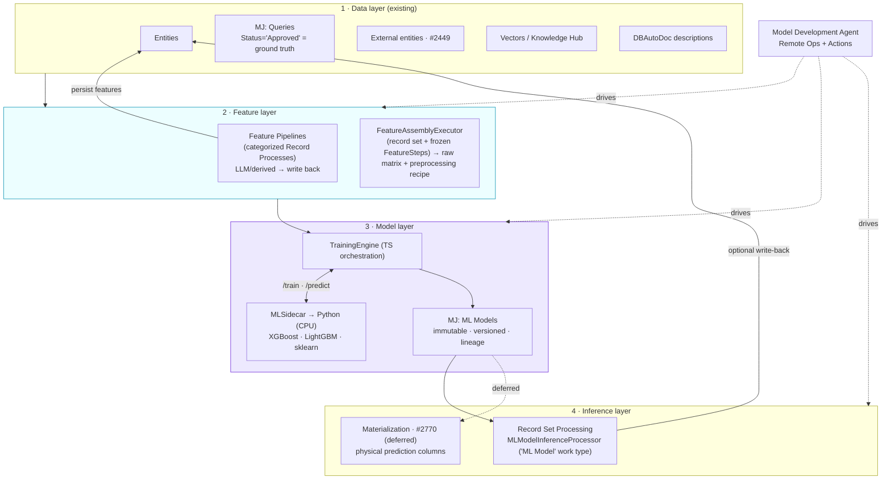

The differentiation is **data assembly + agentic search over MJ's entire data surface**, not algorithmic innovation. We are deliberately rigid about algorithms (a fixed 6-algorithm catalog) and flexible about data. This is **CPU-bound, no GPU** — gradient boosting / logistic regression / random forest / small MLP on tabular data train in seconds-to-minutes on CPU, matching MJ's API-runtime infra.

| Layer | Owns | §|
|---|---|---|
| **1 · Data** (existing) | Entities, `MJ: Queries`, external entities (#2449), vectors, DBAutoDoc — all become feed-ins via `RunView`/`RunQuery` | — |
| **2 · Feature** | `FeatureAssemblyExecutor` (the single correctness backbone) + Feature Pipelines (persisted derived features) | §4, §11 |
| **3 · Model** | `MLSidecar` + `TrainingEngine` → immutable versioned `MJ: ML Models` | §2, §5 |
| **4 · Inference** | `MLModelInferenceProcessor` (RSP work type); population-wide indexed columns are deferred to #2770 | §6, §17 |

---

## 2. The self-managing Python sidecar

**Node is poor for ML training; Python is excellent.** So MJ (TypeScript) assembles the matrix and orchestrates, and a Python sidecar does the CPU-bound fitting and inference. The key engineering choice: the sidecar is **self-managing and Docker-free by default**.

### 2.1 `MLSidecar` — managed-spawn is the default

`MLSidecar` (`packages/AI/PredictiveStudio/Sidecar/src/ml-sidecar.ts`) follows the **`@memberjunction/sqlglot-ts` pattern**: the Python microservice is *bundled* inside the npm package (`src/python/`) and the TypeScript class spawns it as a child process on demand. **No Docker is required for local or embedded use.**

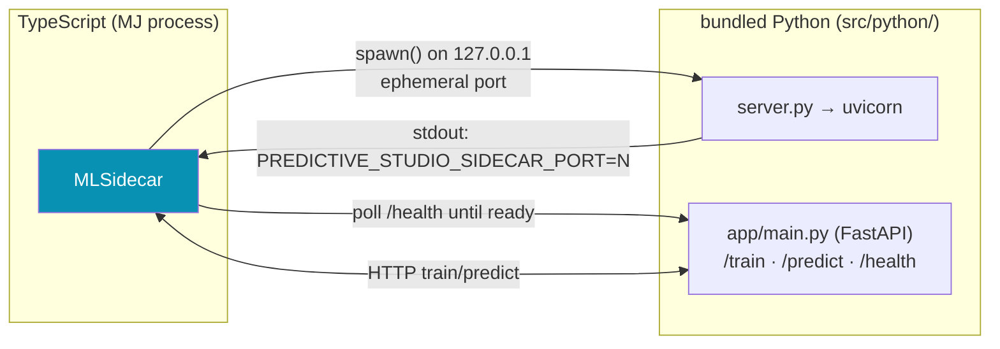

Two topologies, chosen automatically:

| Mode | When | What `start()` does |
|------|------|---------------------|
| **Managed** (default) | nothing configured | Spawns the bundled FastAPI service on `127.0.0.1` with an **OS-assigned ephemeral port**, reads `PREDICTIVE_STUDIO_SIDECAR_PORT=<n>` from its stdout, polls `/health` until ready, and registers SIGINT/SIGTERM/exit cleanup so the child dies with the parent. |
| **Remote** | `url` option **or** `PREDICTIVE_STUDIO_SIDECAR_URL` env set | Connects only — no child process — and just verifies `/health`. Use for a containerized/horizontally-scaled sidecar. `stop()` is then a no-op (this client never owned the process). |

The public surface (`Sidecar/src/index.ts`): `MLSidecar`, `SidecarError`, plus the `MLSidecarOptions` and `SidecarHealthResponse` types.

```typescript
import { MLSidecar } from '@memberjunction/predictive-studio-sidecar';

const s = new MLSidecar();   // managed mode by default
await s.start();             // spawns the bundled Python service

const trained = await s.train({ /* TrainRequest */ });
const { predictions } = await s.predict({ /* PredictRequest */ });

await s.stop();              // SIGTERM the child (no-op in remote mode)
```

`MLSidecar` exposes `IsRemote`, `IsRunning` (remote always `true`; managed needs a live child), and `Port` (ephemeral in managed, `null` in remote). On macOS it automatically appends `DYLD_LIBRARY_PATH=/opt/homebrew/opt/libomp/lib` to the spawn environment so XGBoost/LightGBM find the OpenMP runtime.

### 2.2 `npm run setup:python` — the one-time bootstrap

**One-time setup (fresh clone).** Predictive Studio's packages depend on other workspace packages, so build them
together, never one by one (a per-package `tsc` on a fresh clone fails with `TS2307 Cannot find module
'@memberjunction/core'`):

```bash
pnpm install        # repo root
pnpm run build      # repo root: builds PS and everything it depends on, in dependency order
pnpm --filter @memberjunction/predictive-studio-sidecar run setup:python
```

`setup:python` needs CPython 3.11 or 3.12 (numpy 1.26.4 has no wheels for 3.13+); it tries `python3.11`, `python3.12`,
`python3`, `python` and stops with the list it probed if none fits. Pass `-- --python <path>` after the `setup:python` command to choose one. On macOS
also `brew install libomp` (XGBoost/LightGBM). To run the sidecar or its tests on another interpreter, set
`PREDICTIVE_STUDIO_PYTHON=<path to python>`.

The pinned `requirements.txt` includes FastAPI + uvicorn, `xgboost`, `lightgbm`, `scikit-learn`, `numpy`, `scipy`, `pandas`, `joblib`, and the test deps. The setup script (`scripts/setup-python.mjs`) creates the venv, upgrades pip, and installs requirements; `MLSidecar` picks its interpreter in this order: an explicit `pythonPath` option, then `PREDICTIVE_STUDIO_PYTHON`, then that bundled `.venv`, then `python3`.

### 2.3 The HTTP contract

The contract is defined **once** in `@memberjunction/predictive-studio-core` (`sidecar-contract.ts`) and mirrored by the Python Pydantic models (`app/schemas.py`). MJ assembles the matrix; the sidecar fits and serves.

| Endpoint | Request → Response | Role |
|---|---|---|
| `GET /health` | → `SidecarHealthResponse` (`status`, `algorithms[]`, `cached_models`) | liveness + registered driver keys + warm-cache depth |
| `POST /train` | `TrainRequest` → `TrainResponse` | **fits** preprocessing + estimator; returns artifact + `fitted_preprocessing` + metrics + importance + holdout metrics |
| `POST /predict` | `PredictRequest` → `PredictResponse` | **applies** frozen preprocessing only; returns aligned `predictions[]` |

The Python side: `server.py` resolves the port (0 → OS picks free), prints `PREDICTIVE_STUDIO_SIDECAR_PORT=<n>` to stdout, and runs uvicorn; `app/main.py` is the FastAPI app and the train/score flow; `app/algorithms.py` is the driver registry (the `DriverClass` values seeded in `MJ: ML Algorithms`: `xgboost`, `lightgbm`, `logistic_regression`, `random_forest`, `ridge`, `mlp`); `app/preprocessing.py` is the fit/transform anti-skew core (§4.2); `app/artifacts.py` serializes the model envelope and runs the **warm LRU model cache** (max 32, SHA-256 keyed) that keeps single-record interactive scoring fast; `app/metrics.py` computes the deterministic metrics that drive the leaderboard.

**Model artifact envelope** (base64 on the wire, stored in MJStorage): `{ format: "joblib", version, payload_b64, fitted_preprocessing, feature_schema }`. The fitted preprocessing travels *with* the model — that is the anti-skew payload (§4.2).

---

## 3. The type contracts (`@memberjunction/predictive-studio-core`)

The shared vocabulary across the sidecar, the engine, the UI, and the agent. **Six modules:**

| File | Defines |
|---|---|
| `sidecar-contract.ts` | `TrainRequest`/`TrainResponse`, `PredictRequest`/`PredictResponse`, `FeatureSchemaEntry`, `PreprocessingOp`, `ValidationConfig`, `MatrixData`, `Prediction`; scalars `FeatureKind`, `ProblemType`, `ModelMetrics`, `FeatureImportance`, `FittedPreprocessing` |
| `pipeline-spec.ts` | `SourceBinding`, `AsOfStrategy`, `LeakageGuard`, `ValidationStrategy` (the declarative shape of a training pipeline) |
| `feature-steps.ts` | the visual **FeatureStep DAG** — a discriminated union on `Kind` (**8 kinds**: `select`/`impute`/`standardize`/`onehot`/`bin`/`embedding`/`llm-derived`/`flow-agent`/`vision-llm`) + `FeatureStepGraph` |
| `modeling-plan-spec.ts` | `ModelingPlanSpec` (the Model Development Agent's strongly-typed payload), `Budget`, `LeaderboardEntry` |
| `modeling-plan-schema.ts` | **Zod** `ModelingPlanSpecSchema` / `BudgetSchema` + `validateModelingPlanSpec()` / `validateBudget()` — the **runtime** plan/budget validators the Start-Experiment op and Run-Experiment action call before any iteration runs |
| `metrics-util.ts` | `isErrorMetric(metricKey)` + the canonical **lower-is-better** key set (`rmse`/`mae`/`mse`/`loss`/`logloss`/`log_loss`) — lifted to Core so the leaderboard (§7) and the challenger-vs-incumbent comparison (§14) **cannot drift** on metric direction |

```typescript
import type { ModelingPlanSpec, TrainRequest, FeatureStepGraph } from '@memberjunction/predictive-studio-core';
import { validateModelingPlanSpec, isErrorMetric } from '@memberjunction/predictive-studio-core';
```

> **Note on dependencies:** Core is *almost* pure types, but it carries **one** runtime dependency — `zod` — for `modeling-plan-schema.ts`. Plan/budget validation is a correctness invariant shared by every consumer, so it lives in Core (push-to-generic) rather than being re-implemented per call site. Everything else in the package is interfaces and union types.
>
> **Import the sidecar contract types from *here*, not from the Sidecar package** (which only re-uses them). Re-exporting cross-package shapes is forbidden by root `CLAUDE.md` rule 5.

---

## 4. The FeatureAssembly executor — the correctness backbone

`FeatureAssemblyExecutor` (`Engine/src/feature-assembly/feature-assembly-executor.ts`) is the single most important piece of the system. Its one public method —

```typescript
public async assemble(params: FeatureAssemblyParams): Promise<FeatureAssemblyResult>
```

— turns `(record set, frozen FeatureSteps spec) → feature matrix`, and it is the **single code path** for every context. That single-path property is what prevents train/serve skew *by construction*.

### 4.1 One executor, three contexts

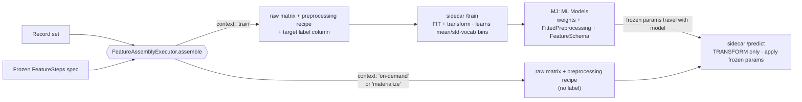

`AssemblyContext` is `'train' | 'materialize' | 'on-demand'`. The same code assembles features in all three, so a feature computed at training time is computed *identically* at scoring time.

### 4.2 The raw-vs-preprocessing split (anti train/serve skew)

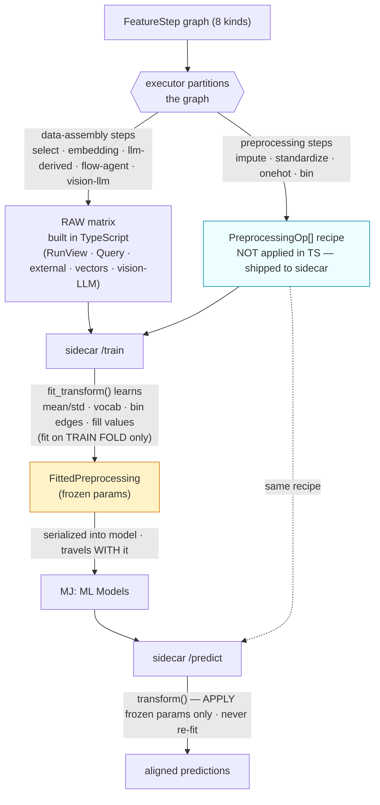

This is the subtle, critical design. The TypeScript executor (`partitionSteps`) partitions the FeatureStep graph into **two kinds of step**:

- **Data-assembly steps** (`select`, `embedding`, `llm-derived`, `flow-agent`, **`vision-llm`**) → produce the **raw matrix** in TypeScript, drawing from `RunView`/`RunViews`, Query bindings, external entities, persisted vectors, and (for `vision-llm`) a per-row vision prompt (§12 note: it's a *dedicated* kind, distinct from `llm-derived`). For `llm-derived` steps, assembly reads the live column value on the source record without pinning a `MJ: Feature Pipeline Versions` row.
- **Preprocessing steps** (`impute`, `standardize`, `onehot`, `bin`) → are **NOT applied in TypeScript**. They are emitted as a `PreprocessingOp[]` recipe and shipped to the sidecar.

> **Why:** Stateful transforms (normalization mean/std, one-hot vocabulary, bin edges, imputation fill values) must be **fit once on the training data** and then *only applied* — never re-fit — at inference. The sidecar (`app/preprocessing.py`) does exactly this: `fit_transform()` at `/train` learns the params and returns them as `fitted_preprocessing`; `transform()` at `/predict` only applies those frozen params ("APPLY ONLY, never re-fit"). The fitted preprocessing is serialized into `MLModel.FittedPreprocessing` alongside the weights and **travels with the model**. This is why `FeatureSchema` alone is insufficient: the fitted pipeline is part of the model's identity. The Python golden test (`src/python/tests/test_preprocessing_golden.py`) locks this down — the same raw row produces an identical transformed vector at train and at predict.

> **Recently hardened — the validation fit lives *inside* the split.** When the sidecar reports *validation* metrics, it does **not** fit preprocessing on the whole dataset and then split. `_fit_and_score` splits the dev rows by index *first*, then `_anti_skew_val_metrics` calls `preprocessing.fit_transform(...)` on the **train fold only** and `preprocessing.transform(...)` (apply-only) on the validation fold — *"so the validation fold never leaks into the fitted params."* The result is an **honest, non-optimistic** validation estimate. The production estimator and the frozen `fitted` payload that ships with the model are still fit on all dev data (that's correct — the shipped model should use every available row); the hardening is specifically that the *reported* validation number isn't inflated by fitting preprocessing across the split.

> **Recently hardened — required raw columns are guaranteed present at score time (anti-skew, the *data* half).** The preprocessing split above guarantees the *transforms* match at train and score. A second skew vector is the *raw data* itself: on-demand / scheduled scoring receives its records from an upstream Record-Set-Processing **scope**, which may have loaded them with a **narrow field projection** that dropped a virtual / denormalized column (e.g. a value-list field joined into the entity view but absent from the base table). The model trained on that column; missing it at score time silently degrades every prediction toward a constant. `assemble()` now closes this at the single seam where it can enter: after building the column plan, **`hydrateMissingFeatureColumns`** re-reads any *absent* required column from the **same entity view the training path reads** (`dataAccess.fetchRows`, keyed by primary key) — columns already present are untouched, so training / full `entity_object` loads / unit fixtures pay no second read and no blob tax. Then **`assertRequiredColumnsPresent`** **hard-fails** if a required column is *still* absent: `MLModelInferenceProcessor`'s per-record `try/catch` marks that run **Failed** with a precise message that bubbles to the run history + Production-tab UI — *no silent "Succeeded" with degenerate output*. The guardrail also protects **training** (a pipeline declaring a column the view doesn't expose fails loudly up front). Locked down by a **train/serve parity** unit test (same rows inline-vs-hydrated → byte-identical matrix) and an integration assertion that on-demand predictions **vary** across a multi-type scope (`COUNT(DISTINCT score) > 1`). See [`plans/predictive-studio-scoring-virtualfield-skew.md`](../plans/predictive-studio-scoring-virtualfield-skew.md) for the full find→fix write-up.

### 4.3 Point-in-time / "as-of" assembly

For forward prediction, features should be assembled as they were at the decision point rather than as they stand today (`feature-assembly/as-of.ts`).

`AsOfStrategy` (on the pipeline) has three modes:

| Mode | Behavior |
|---|---|
| `none` | features assembled as-of "now" (no time-relative correctness) |
| `column` | a decision-date column on each training unit defines that record's cutoff |
| `offset` | `OffsetDays` before the label event defines the cutoff |

The time-relative helpers (`daysSinceLastActivityAsOf`, `activityCountAsOf`) filter dated source rows to each record's
cutoff, but training passes no dated sources and reads every other feature as it stands today, so **an as-of mode
changes nothing in a trained model** (all three modes produced byte-identical models in the assessment). Training
therefore **refuses** `column` and `offset` before it starts, and so does `PredictiveStudio.TrainModel` when its `asOf`
input is not `none`. Use `{ "Mode": "none" }` and keep post-outcome columns out of the feature list until dated
feature assembly ships.

### 4.4 The leakage guard

An automated feature-search agent will relentlessly exploit target leakage (a field that's a proxy for the label → AUC ~0.99 garbage). Two complementary defenses live in `feature-assembly/leakage-guard.ts`:

1. **Deny-list enforcement (assembly-time).** `LeakageGuardEnforcer` normalizes the `LeakageGuard.DenyFields` / `DenySources` into case-insensitive sets; deny-listed fields/sources are filtered out of the matrix **before any column is produced** (`isFieldAllowed`, `isSourceAllowed`, `partitionColumns`).
2. **Single-feature-dominance detection (post-train).** `detectSingleFeatureDominance(featureImportance, threshold)` normalizes the importance map to shares of total importance (using magnitudes, so signed coefficients work) and flags when the top feature's share exceeds `SingleFeatureDominanceThreshold` (e.g. `0.6`).

> When a run is flagged, the system does **not** silently proceed and does **not** auto-promote. It surfaces a clear, **business-person-friendly** warning — *"One field is doing almost all the predicting — this often means we're accidentally peeking at the answer. The model is kept in Draft until a promote request records a sign-off with a reason."* — and **blocks promotion** until a promote request records a sign-off with an auditable reason (the promotion sign-off gate, §13).

---

## 5. Training — immutable versioned models with honest metrics

`TrainingEngine` (`Engine/src/training/training-engine.ts`) orchestrates the whole train path:

```typescript
public async trainModel(input: TrainModelInput, deps: TrainingDeps): Promise<TrainModelResult>
```

The flow:

1. **Resolve the pipeline** — parse the `MJ: ML Training Pipelines` JSON config (sources, feature steps, as-of, leakage guard, validation).
2. **Create the run row** — `MJ: ML Training Runs` (`Status='Running'`).
3. **Assemble** — call `FeatureAssemblyExecutor` with `context='train'` → raw matrix + schema + preprocessing recipe.
4. **Carve the locked holdout FIRST** — the trailing primary-key `LockedHoldoutFraction` slice carved before training and scored on the final model (§5.1).
5. **Call the sidecar `/train`** — get back the artifact, `fitted_preprocessing`, train+validation metrics, feature importance, and `holdout_metrics`.
6. **Persist the artifact** to MJStorage (`MJ: Files`) via an injected store.
7. **Create the immutable `MJ: ML Models` row** (`Status='Draft'`) carrying `FittedPreprocessing`, `FeatureSchema`, `Metrics`, `HoldoutMetrics`, `FeatureImportance`, and full `Lineage`.
8. **Leakage check** — run `detectSingleFeatureDominance`; a dominant feature flags the run and blocks auto-promotion.
9. **Finalize the run** (`Completed`/`Failed`, results, costs, notes).

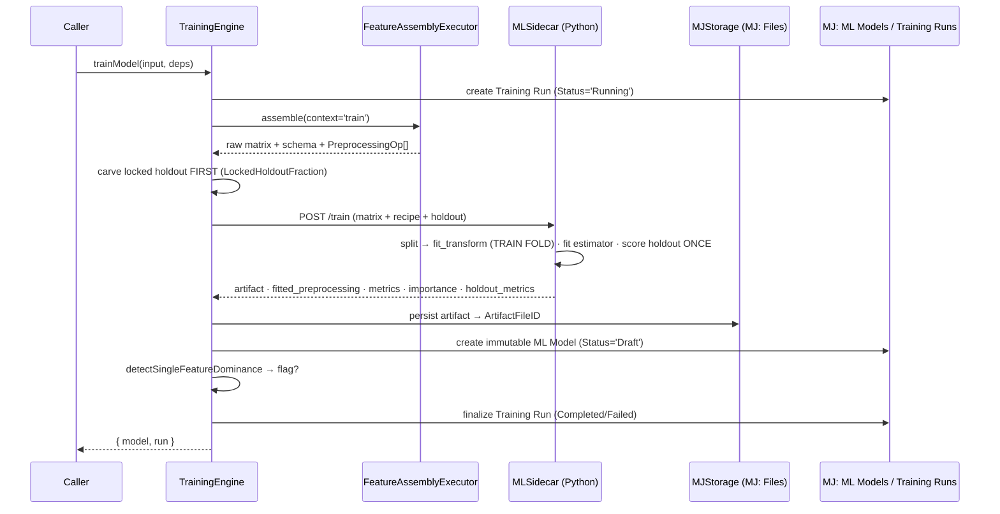

The engine is built on **dependency-injection seams** (`src/training/types.ts` + `src/training/seams.ts`): `IEntityFactory`, `IRecordLoader`, `ISidecarTrainer`, `IArtifactStore`. Production wires `MetadataEntityFactory`, `RunViewRecordLoader`, `MJSidecarTrainer`, and `MJFilesArtifactStore`; tests substitute in-memory fakes (which is what makes the engine unit-testable with no DB and no live sidecar — see the live integration test in §19.4).

### 5.1 Validation discipline + locked holdout

Be opinionated; don't ship broken models. Validation is a train/test split by default; `kfold` predicts every training row out of fold (`K` folds, stratified
for classification) and `holdout` uses the same out-of-sample split as `train_test_split`. There is no overfitting
detection. Training with fewer than 4 rows after the locked holdout is refused. The trust grade uses `HoldoutMetrics`,
or the validation metrics when the model's lineage records them as out-of-sample. A pipeline that declares
`ValidationStrategy.TimeIndexColumn` but was not tested on later periods ("not evaluated as a forecast") is graded
Poor with the reason stored. A classifier no better than always predicting the most common class (or one that predicts
a single class) is graded Poor while the pipeline's `ValidationStrategy.MajorityBaselineRule` is `"enforce"` (the
default); with `"warn"` the verdict keeps that finding and its numbers but is graded on AUC, and an accuracy-only
verdict is still graded Poor. Training records the rule in the model's lineage (`Lineage.evaluation`), so a model keeps
the rule it was trained under; an unknown value is refused before training. The Studio has no control for it yet: set
it in the pipeline's `ValidationStrategy` JSON (the `MJ: ML Training Pipelines` record form, or metadata), e.g.
`{ "Strategy": "train_test_split", "TestSize": 0.2, "LockedHoldoutFraction": 0.15, "MajorityBaselineRule": "warn" }`.
The Studio's pipeline editor keeps the value when other validation settings are edited; a pipeline created by the
wizard (including a clone) or by the Model Development Agent starts on `"enforce"`. Training carves a **locked holdout** (`carveLockedHoldout()`) as the trailing primary-key slice before fitting and scores it through the frozen apply-only path (`transform()`) into `MLModel.HoldoutMetrics`. Because the Pipeline Builder selects the winning candidate on `HoldoutMetrics` across the proposed experiments, that holdout number reflects selection across candidates rather than an untouched final test set. Deterministic scoring (AUC/F1/accuracy/RMSE) drives the loop. Training is reproducible: every estimator is built with a fixed random state, so the same rows and settings give the same model. Training also records which kind of feature importance the sidecar produced (`ImportanceKind` in the evaluation lineage); only `coefficient` importances are shown as drivers, so existing models, which have no stored kind, keep their driver lists hidden until they are retrained.

> The integration test (§19.4) asserts this end-to-end: the holdout is carved *before* training, scored *once* on the final model, and the resulting `HoldoutMetrics.auc` clears **0.70** for both XGBoost and Logistic Regression on a deliberately noisy synthetic signal.

### 5.2 `MJ: ML Models` is distinct from `MJ: AI Models`

| | `MJ: AI Models` | `MJ: ML Models` |
|---|---|---|
| What | off-the-shelf foundation models we **call** (LLMs, embeddings, image-gen) | predictive models we **train** from client data |
| Inference path | vendor API + driver class | the **Python sidecar** |
| Produced by | seeded vendor metadata | a `TrainingEngine` run |

An ML Model is **immutable + versioned** — each successful run yields a new row, never a mutation. It may *reference* an AI Model in its `Lineage` (e.g. the embedding model used to build features) — a pointer, not membership. The generated entity classes are `MJMLModelEntity` / `MJMLTrainingPipelineEntity` in `@memberjunction/core-entities`. Its lifecycle is the **Draft → Validated → Published → Archived** state machine enforced at promotion (§13).

---

## 6. Scoring — a Record Set Processing work type

Scoring composes onto **Record Set Processing** (see the [Record Set Processing Guide](RECORD_SET_PROCESSING_GUIDE.md)) rather than re-implementing batching/concurrency/audit. `MLModelInferenceProcessor` (`Engine/src/scoring/ml-model-inference-processor.ts`) is a new **work type** alongside the substrate's built-in `FieldRules` / `Action` / `Agent` / `Infer`:

```typescript
@RegisterClass(MLModelInferenceProcessor, 'ML Model')
export class MLModelInferenceProcessor implements IRecordProcessor {
  public async ProcessRecord(record: RecordRef, context: RecordProcessorContext): Promise<RecordResult>
  public async ProcessBatch(records: RecordRef[], context: RecordProcessorContext): Promise<RecordResult[]>
}
```

> **⚠️ Disambiguation:** the existing **`Infer`** work type runs an **AI Prompt** per record — that is LLM inference, **not** ML inference. The new **`ML Model`** work type (`MLModelInferenceProcessor`) runs a **trained ML model** through the sidecar. Don't confuse them. (The [Record Set Processing Guide](RECORD_SET_PROCESSING_GUIDE.md) §4 carries the same disambiguation note.)

### 6.1 How it plugs in without forking the substrate

The `record-set-processor` base package must **not** depend on Predictive Studio. So instead of editing `RecordProcessExecutor.buildProcessor()`, the processor registers itself on the **MJGlobal ClassFactory** via `@RegisterClass` — primary key `'ML Model'` (on the decorator) and alias `'MLModelInference'` (registered in `src/scoring/register.ts`). A thin `resolveMLInferenceProcessor(workType, options)` pulls it back out by work-type key; `isMLInferenceWorkType()` gates membership; `LoadMLModelInferenceProcessor()` is the tree-shaking anchor. A supervisor wires this into the executor seam — no change to the base substrate. This is the generic pluggable-processor registry working exactly as designed: a new work type ships as a registered class, not a fork.

### 6.2 Per-record flow + warm model cache

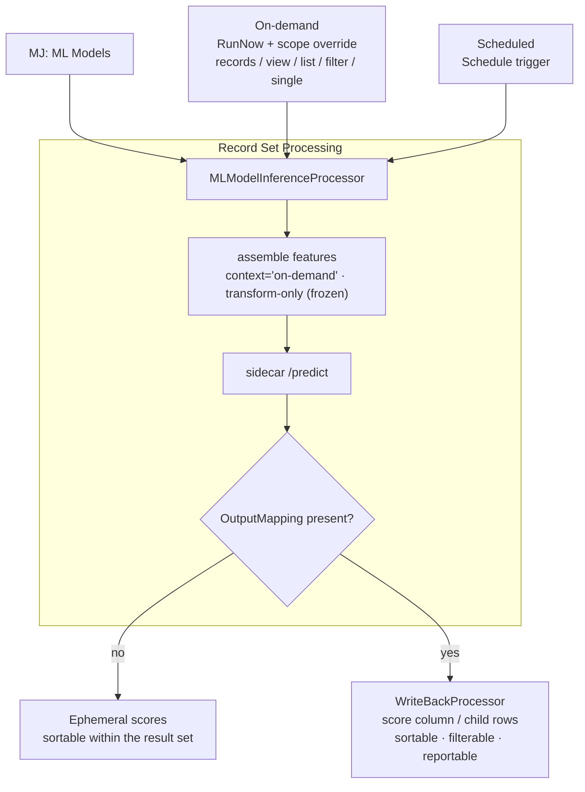

The processor **warm-loads the model once** and shares it across the batch (an in-flight `loadPromise` deduplicates concurrent records). It resolves the assembly config from the model's `Lineage` (or the related pipeline), assembles features in `'on-demand'` context (**transform-only — never re-fits**), calls the sidecar `/predict`, and returns a `RecordResult` with an `MLInferenceResultPayload`. Those payload fields are the refs available to an `OutputMapping` (read with `$.`):

| ref | meaning |
|---|---|
| `$.score` | numeric output — **probability** (classification) or value (regression) |
| `$.class` | predicted class label (classification only) |
| `$.scoredAt` | ISO-8601 UTC timestamp of when the prediction was produced |
| `$.modelId` / `$.target` / `$.problemType` | lineage (which model, its target, classification/regression) |

### 6.3 Ephemeral vs write-back

**Ephemeral by default; write-back when an `OutputMapping` is present.** The processor itself only produces the result payload (sortable within the result set). The substrate's shared `WriteBackProcessor` decorator — not the ML processor — applies the `OutputMapping` when configured, writing a prediction column to the entity (or a child record). Written-back predictions become sortable/filterable/reportable like any column. This is the same write-back mechanism every Action/Agent/Infer work type uses, so the ML scorer inherits it for free.

**Who may score.** Only `Validated` and `Published` models score. A `Draft` or `Archived` model is refused once, before the first record (`ModelNotScorableError` from `Preflight`), and nothing is written. **Dry runs:** `PredictiveStudio.ScoreRecordSet` with `dryRun: true` computes the predictions and returns them without writing back, even when a write-back mapping is supplied. The Score Record Set *Action* has no dry-run parameter.

### 6.4 Single, batch, on-demand, scheduled

The sidecar doesn't care about cardinality — single-record serves interactive/agent needs, batch serves bulk. **On-demand** = `RecordProcess.RunNow` + a runtime scope override (records/view/list/filter/single). **Scheduled** = the `Schedule` trigger, with an `MJ: ML Model Scoring Binding` (`upsertScoringBinding`) recording lineage (`LastScoredAt` / `LastRowCount`) for staleness detection and retraining (§14). **Materialized** prediction columns (population-wide, indexed) are the *deferred* later optimization gated on #2770 (§17); scoring + write-back ship with **zero dependency** on it.

### 6.5 Where predictions go — the four storage paths

These are **four distinct, orthogonal** things. The common confusion is to assume column write-back needs materialization (#2770), or that "Materialized Results" is an ML run-history store — **neither is true.** All "store a prediction" needs are met by paths A–C **today**; #2770 (D) is an optional future *auto-refresh* optimization, nothing more.

| | Path | What it is | Status | When to use |
|---|---|---|---|---|
| **A** | **Column write-back** — `OutputMapping.fields` | Writes the prediction into a real column on the **target entity**, **overwritten each run** (the *current* value). `fields` is a map, so one run can write several columns. | ✅ shipped | "Put each member's latest renewal probability on the member record." e.g. `{ "RenewalProbability": "$.score", "LastScoredAt": "$.scoredAt" }` |
| **B** | **`MJ: Process Run Details`** | Automatic per-record **transactional history** — every scoring run writes one detail row per record carrying the full prediction `ResultPayload` (score/class/scoredAt/lineage), `RecordID`, `Status`, `CompletedAt`. No config. | ✅ shipped (automatic) | Audit / replay / "what did the model say for this member on each run" — for free, even with no `OutputMapping`. |
| **C** | **`OutputMapping.childRecord`** — typed time-series | Creates a **child record per scored record per run** in an entity *you* define (e.g. `Member Renewal Scores` with `MemberID` + `Probability` + `ScoredAt`). A clean, queryable, append-only history of your own shape. | ✅ shipped | "Keep a typed history table / time-series of scores" (cleaner than the generic JSON in path B). |
| **D** | **#2770 Materialized Results** | A **generic**, not-yet-built primitive for materializing *any query/entity result set* as a cached, auto-refreshed physical table. **Not ML-specific, not run history.** ML can later ride it for population-wide *indexed* prediction columns. | ⏳ deferred (design-doc; gated on PR #2770) | A *future* optimization for indexed, population-wide querying — **never required** to store predictions. |

> **#2770 is NOT "ML Model Run Results."** It's view/entity-materialization infrastructure that ML could *optionally* use later. Per-run prediction history already lives in path B (`MJ: Process Run Details`) and, if you want a typed table, path C (`childRecord`). Writing a prediction into an entity column (path A) is a plain MJ column write — it needs nothing from #2770.

### 6.x "Needs training" and opt-in auto-train

A model row can exist without a trained artifact — most often because an app **seeds** model metadata but the serialized model only ever lived on the machine that trained it. Artifact bytes are per-host (§5) and training always creates a **new** immutable model row, so a shipped model id can never be made scoreable in place.

- **Refuse up front, clearly.** Record Set Processing has an optional run-level `IRecordProcessor.Preflight(context)` seam, called once before the first batch. `MLModelInferenceProcessor.Preflight` warm-loads the model; a model that is missing, has no `ArtifactFileID`, or whose artifact bytes aren't on this server throws a `ModelNeedsTrainingError` ("… needs training …"). The run is recorded as `Failed` with that message and **no record is processed** — instead of every record failing into the error-rate circuit breaker. `ScoreRecordSet` uses the same preflight.
- **Never publish an untrained model.** The promotion gate refuses `→ Published` for a model with no artifact (`needs-training` outcome; Actions return `MODEL_NEEDS_TRAINING`, Remote Ops throw the message).
- **Studio shows it.** The Production panel marks such a model **Needs training** (amber) instead of Bound/Scheduled and disables **Operate**.
- **Opt-in auto-train.** An `'ML Model'` Record Process can declare, in its `Configuration`:

  ```json
  { "primaryKeyField": "ID",
    "autoTrain": { "pipelineId": "<ML Training Pipeline id>",
                   "binding": { "targetColumn": "RenewalProbability", "mode": "Scheduled" } } }
  ```

  (`modelId` may then be omitted.) When a run's model needs training, `PipelineAutoTrainer` **reuses** the newest Published model of that pipeline whose artifact loads on this server, or **trains** the pipeline through the real `TrainingEngine` and publishes it through the promotion gate (Draft → Validated → Published — a leakage-flagged model is refused and stays Draft; the gate promotes it only on a request that records a sign-off with a reason). Auto-train does not read the trust verdict: only the promotion gate's leakage refusal stops it, so a trained model that is no better than chance is published when training did not flag leakage. It then writes the model id back into the process `Configuration`, repoints the process's bindings (and any still on the superseded model), creates the declared binding if none exists, archives the superseded Published model, and the same run goes on to score. Processes that don't declare `autoTrain` are unaffected. This is how an Open App ships a scoring process that works on a fresh install with no hand steps — ship the **pipeline + Record Process**, not model rows.

> Feature assembly reads **every** matching row when the caller sets no `MaxRows` (`IgnoreMaxRows`), so training is not silently capped at the entity's `UserViewMaxRows` (1000 by default).

---

## 7. The experiment engine — a generic agentic-search primitive

> **Built, not wired.** Experiment sessions are switched off: the production session runner has no
> `IPipelineResolver`, so it cannot turn a proposed experiment into a training pipeline, and every session it ran
> trained nothing while reporting `Completed`. The `Run Experiment Session` Action and
> `PredictiveStudio.StartExperimentSession` refuse with "Experiment sessions are switched off…", the Studio shows past
> sessions read-only, and the Model Development Agent trains through its Pipeline Builder (§12.4). The description
> below is the design the orchestrator code implements.

`Experiment` → `ExperimentSession` → `ExperimentSessionIteration` are deliberately **GENERIC, ML-agnostic, reusable** primitives: a budgeted, plan-then-execute-then-refine agentic search that groups N iterations with a leaderboard and an owning agent run. **Predictive Studio is the first consumer** (the ML leaf is `MJ: ML Training Runs`, which FKs into an iteration), but the same three tables are intended to back prompt-optimization, agent-config search, and eval sweeps — each with its own leaf run table.

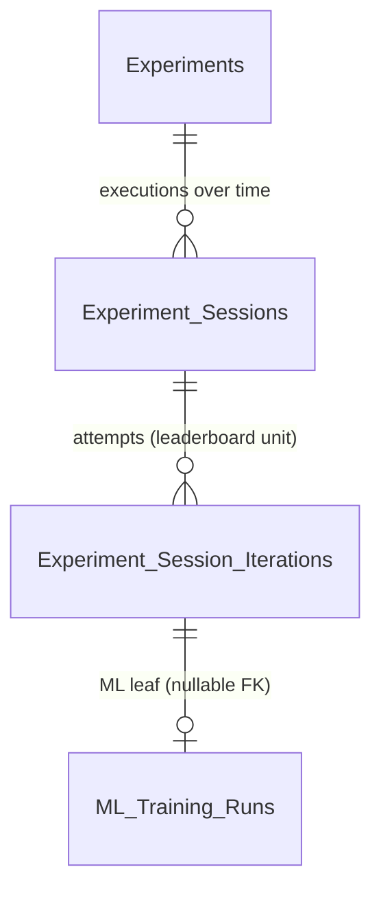

- **`MJ: Experiments`** — the durable "what we're optimizing," independent of any execution. `ExperimentType` is an **open NVARCHAR** (no CHECK) so new consumers add types without a migration. Re-running monthly creates new sessions under the same Experiment for comparison over time.
- **`MJ: Experiment Sessions`** — one execution. Carries the `Budget` (JSON), the approved `PlanSpec` (for PS, the `ModelingPlanSpec`), a `Leaderboard` snapshot, and `AgentRunID`.
- **`MJ: Experiment Session Iterations`** — one attempt, the **leaderboard unit**. Carries `Sequence`, `Status`, the normalized `Score` (the Experiment's `TargetMetric`), `ComputeCost`/`TokensUsed`, `Rationale`, and the driving `AIAgentRunID`.

### 7.1 The wave orchestrator

`ExperimentOrchestrator` (`Engine/src/experiment/experiment-orchestrator.ts`) is **deterministic** TS that executes an *already-approved* `ModelingPlanSpec`:

```typescript
public async runSession(plan: ModelingPlanSpec, deps: ExperimentDeps, options?: ExperimentRunOptions): Promise<ExperimentSessionResult>
```

It asserts `plan.Approved === true` (the approval gate is the agent's job, not the orchestrator's) and runs iterations in **waves in an in-process bounded pool** (`runBounded`, `experiment/concurrency.ts`) — no Record Set Processing run is created:

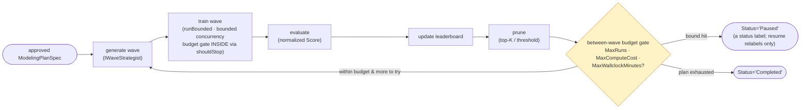

| Concern | How |
|---|---|
| **Wave generation** | the `IWaveStrategist` seam — default `PlanOrderWaveStrategist` (priority order); swap in an LLM-backed strategist for adaptive "what next" without touching the orchestrator |
| **Leaderboard** (`src/experiment/leaderboard.ts`) | `LeaderboardEntry[]` ranked by a **normalized** score (prefers `HoldoutMetrics`, falls back to training metrics; error metrics negated via Core's `isErrorMetric` so higher always = better) |
| **Pruning** | `selectPrunedIterationIds()` — top-K / relative-threshold rules; pruned iterations marked `Pruned` + removed from the leaderboard |
| **Budget gate** | `MaxRuns` / `MaxComputeCost` / `MaxWallclockMinutes` checked **both** between waves *and inside the bounded runner* (see below) |
| **Concurrency** | `runBounded()` (`src/experiment/concurrency.ts`) with a configurable max |

> **The budget gate is enforced *inside* the bounded runner, not just between waves.** As each iteration completes within a wave, `foldOutcome` folds its cost into `budgetState` immediately and re-checks `checkBudget(...)`; if a bound trips it sets `stopReason`, which feeds `runBounded`'s `shouldStop` predicate (each worker calls `if (shouldStop && shouldStop()) return;` before claiming its next task). Only iterations that produced a score count toward the budget, so failed iterations are never counted (a 3-run budget ran 4 failing iterations), and `MaxComputeCost` has no effect because training records a compute cost of 0.

A session creates no Process Run; waves run in the in-process pool above. Like the other engines, the orchestrator is built on injectable seams (`IExperimentEntityFactory`, `IClock`, `IExperimentTrainer`, `IWaveStrategist` — `src/experiment/types.ts` / `seams.ts`).

---

## 8. The data model — entities and relationships

10 core entities. CodeGen generates timestamps, FK indexes, sprocs, views, and the strongly-typed entity classes (`MJMLModelEntity`, `MJMLTrainingPipelineEntity`, …) in `@memberjunction/core-entities`. Names follow the MJ "MJ: " prefix convention. The three `Experiment*` tables are **generic** (ML-agnostic); everything `ML *` is the Predictive Studio leaf.

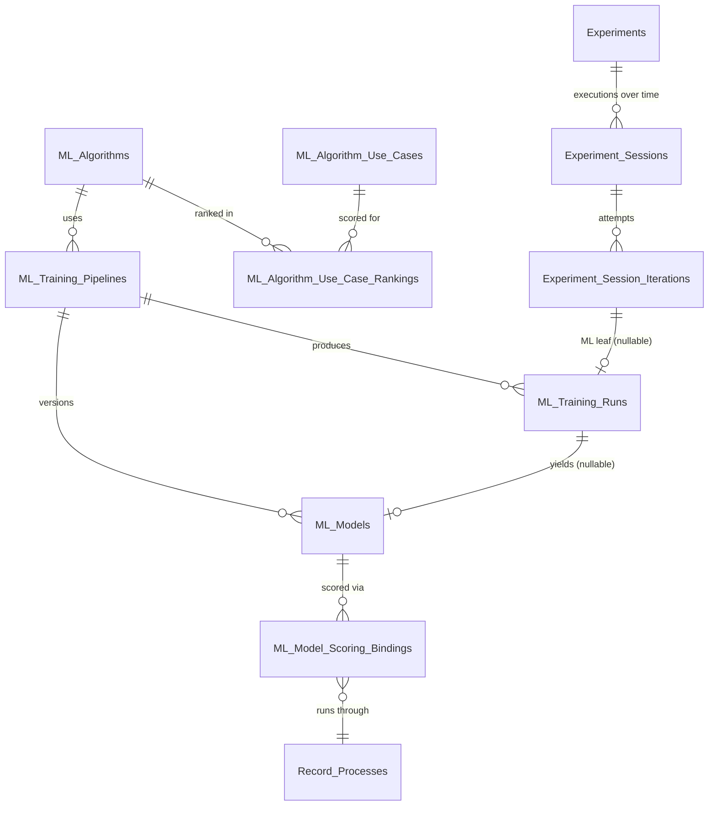

_(Entity names shown without the "MJ: " prefix for diagram clarity. `Record_Processes` is the existing Record Set Processing entity — Feature Pipelines are categorized rows of it (§11), not a separate entity. `MaterializedResultID` on a scoring binding is a **soft** reference to #2770's table — not a FK until that table exists.)_

| Entity | Role | Key fields |
|---|---|---|
| `MJ: ML Algorithms` | the fixed 6-algorithm catalog | `ProblemTypes`, `DriverClass` (sidecar key), `HyperparameterSchema`, `DefaultHyperparameters`, `SupportsFeatureImportance` |
| `MJ: ML Algorithm Use Cases` | 7 decision-relevant scenarios | `ProblemTypeScope`, `Guidance`, `DisplayOrder` |
| `MJ: ML Algorithm Use Case Rankings` | the 6×7 join (42 rows) | `SuitabilityScore` (1–5), `RecommendationLevel`, `Rationale`; UNIQUE(Algorithm, UseCase) |
| `MJ: ML Training Pipelines` | declarative training definition | `TargetEntityID`, `TargetVariable`, `ProblemType`, `AlgorithmID`, `SourceBindings`, `FeatureSteps`, `AsOfStrategy`, `LeakageGuard`, `ValidationStrategy` |
| `MJ: ML Models` | **immutable, versioned** trained model | `FittedPreprocessing`, `FeatureSchema`, `Metrics`, `HoldoutMetrics`, `FeatureImportance`, `Lineage`, `ArtifactFileID`, `Status` (Draft/Validated/Published/Archived) |
| `MJ: ML Training Runs` | one training attempt (iteration leaf) | `PipelineID`, `ResultingModelID`, `ExperimentSessionIterationID` (nullable), `ValidationResults`, `ComputeCost`, `TokensUsed` |
| `MJ: Experiments` | durable "what we optimize" (generic) | `ExperimentType` (open NVARCHAR), `Goal`, `TargetMetric`, `PlanSpecTemplate` |
| `MJ: Experiment Sessions` | one execution (generic) | `ExperimentID`, `Budget`, `PlanSpec`, `Leaderboard`, `AgentRunID` |
| `MJ: Experiment Session Iterations` | one attempt / leaderboard unit (generic) | `Sequence`, `Status`, `Score`, `ComputeCost`, `TokensUsed`, `Rationale`, `AIAgentRunID` |
| `MJ: ML Model Scoring Bindings` | lineage for scoring/retraining | `MLModelID`, `RecordProcessID`, `TargetEntityID`/`TargetColumn`, `Mode`, `MaterializedResultID` (soft), `LastScoredAt`, `LastRowCount` |

> **CLAUDE.md rule 2b reminder:** don't write code against new fields until the migration + CodeGen have run. All ML reference data (`ml-algorithms/`, `ml-algorithm-use-cases/`, `ml-algorithm-use-case-rankings/`) is seeded via **metadata files + `mj sync push`**, never SQL INSERTs.

---

## 9. The guidance layer — algorithm catalog + the 6×7 matrix

Neither the agent nor a non-expert user should have to guess which algorithm fits. Three seeded metadata entities encode evidence-based defaults:

- **`MJ: ML Algorithms`** — the fixed, curated catalog (6 algorithms): XGBoost, LightGBM, Logistic Regression, Random Forest, Linear/Ridge Regression, MLP. Each row declares `ProblemTypes`, `DriverClass` (the sidecar key), `HyperparameterSchema`, `DefaultHyperparameters`, and `SupportsFeatureImportance`.
- **`MJ: ML Algorithm Use Cases`** — **decision-relevant** scenarios that genuinely differentiate algorithms (7 of them), NOT business labels (churn/renewal/attendee-return are all the same *binary classification* shape and so don't differentiate). E.g. "Binary classification", "Regression", "Interpretability required", "Minimal tuning (business-user)", "Large/wide dataset (speed)", "Embedding/LLM-feature-heavy", "Small dataset".
- **`MJ: ML Algorithm Use Case Rankings`** — the **6×7 join** (42 rows). Each cell carries a `SuitabilityScore` (1–5), a `RecommendationLevel` (`Primary` / `Strong` / `Viable` / `Weak` / `NotRecommended`), and the real payoff: a **`Rationale`** (agent- and human-readable, e.g. *"Gives feature importances but not simple coefficients — if a stakeholder needs to see exactly why each prediction was made, prefer Logistic/Ridge."*).

The seeded recommendation matrix (the per-cell `Rationale` is the real payoff):

| Use case ↓ / Algo → | XGBoost | LightGBM | Logistic Reg | Random Forest | Linear/Ridge | MLP |
|---|---|---|---|---|---|---|
| Binary classification | **Primary** | Strong | Viable | Strong | NotRec | Viable |
| Regression | **Primary** | Strong | NotRec | Strong | Strong | Viable |
| Interpretability required | Weak | Weak | **Primary** | Viable | **Primary** | NotRec |
| Minimal tuning (business-user) | Viable | Viable | Strong | **Primary** | Strong | Weak |
| Large/wide dataset (speed) | Strong | **Primary** | Strong | Viable | Strong | Viable |
| Embedding/LLM-feature-heavy | Strong | Strong | Viable | Viable | Viable | **Primary** |
| Small dataset | Viable | Viable | **Primary** | Strong | **Primary** | Weak |

All three are seeded via **metadata files** (`metadata/ml-algorithms/`, `metadata/ml-algorithm-use-cases/`, `metadata/ml-algorithm-use-case-rankings/`) with `@lookup:` refs and `mj sync push` — **never SQL INSERTs**. The dashboard's catalog panel queries this matrix for ranked, rationale-bearing recommendations per scenario (the UI computes "best level across selected scenarios" via `PredictiveStudioEngine.BestLevelsForScenarios`; no agent reads the matrix directly).

---

## 10. The invocation surface — Actions vs Remote Operations

Every server-side capability is a **Remote Operation** (Manual mode) + (for the five agent-facing ones) a thin **Action**, so the browser, Skip, Query Builder, and agents all inherit it. See the [Remote Operations Guide](REMOTE_OPERATIONS_GUIDE.md) and [Transport-Layer Architecture Guide](TRANSPORT_LAYER_ARCHITECTURE_GUIDE.md). **Crucially, both surfaces delegate through one shared path** (`operations/delegation.ts`) — the production deps/seams wiring exists exactly once, so an Action and its sibling Remote Op can't diverge.

### 10.1 The 7 Remote Operations

All are `@RegisterClass(BaseRemotableOperation, '<key>')` Manual-mode subclasses of CodeGen-emitted bases in `MJCoreEntities/src/generated/remote_operations.ts`; the subclass bodies live in `Engine/src/operations/`. Every one carries `RequiredScope = 'predictive:execute'` and is seeded as an `MJ: Remote Operations` row (`metadata/remote-operations/.remote-operations.json`, category "Predictive Studio", `GenerationType='Manual'`, `CodeApprovalStatus='Approved'`).

| Operation key | Server class | Mode | Delegates to |
|---|---|---|---|
| `PredictiveStudio.TrainModel` | `PredictiveStudioTrainModelServerOperation` | `LongRunning` | `TrainModelViaEngine` → `TrainingEngine.trainModel` |
| `PredictiveStudio.ScoreRecordSet` | `PredictiveStudioScoreRecordSetServerOperation` | `LongRunning` | `ScoreRecordSetViaRunner` → `ProductionScoreRecordSetRunner` → `MLModelInferenceProcessor` |
| `PredictiveStudio.RunFeaturePipeline` | `PredictiveStudioRunFeaturePipelineServerOperation` | `LongRunning` | `RecordProcessExecutor.RunByID` (the RSP substrate — §11) |
| `PredictiveStudio.StartExperimentSession` | `PredictiveStudioStartExperimentSessionServerOperation` | `LongRunning` | `RunExperimentSessionViaOrchestrator` → `ExperimentOrchestrator.runSession` |
| `PredictiveStudio.ControlExperimentSession` | `PredictiveStudioControlExperimentSessionServerOperation` | `Sync` | a lifecycle `Status` write on the `MJ: Experiment Sessions` row (pause/resume/cancel) |
| `PredictiveStudio.PromoteModel` | `PredictiveStudioPromoteModelServerOperation` | `Sync` | `PromoteModelViaGate` → `ProductionModelPromotionGate` (§13) |
| `PredictiveStudio.CreateScoringProcess` | `PredictiveStudioCreateScoringProcessServerOperation` | `Sync` | `CreateScoringProcess` (creates an on-demand `'ML Model'` Record Process + scoring binding) |

The four `LongRunning` ops emit `context.emitProgress({ OperationKey, Processed, Total?, Status, Message })`. **RunFeaturePipeline is the richest** — it forwards the RSP executor's per-batch `onProgress` as typed progress, so attached *and* over-the-wire callers see live progress (mirroring `RecordProcess.RunNow`); Train/Score/StartExperiment emit coarse start/finish phases (the underlying engines expose no per-step hook). The wire input/output types are defined inline in the generated `remote_operations.ts`; `Budget` and `ModelingPlanSpec` come from Core and are runtime-validated by `validateBudget` / `validateModelingPlanSpec` before any work runs. Tree-shaking anchor: `LoadPredictiveStudioOperations()`.

### 10.2 The 5 Actions

For the agent / workflow / low-code boundary, five capabilities have thin Actions in `Engine/src/actions/` (all extend `BasePredictiveStudioAction` → `BaseAction`, registered via `@RegisterClass(BaseAction, '<DriverClass>')`, seeded in `metadata/actions/predictive-studio/`):

| Action (`MJ: Actions`) | DriverClass | Delegates to |
|---|---|---|
| Train ML Model | `PredictiveStudioTrainModelAction` | `TrainingEngine.trainModel` |
| Score Record Set | `PredictiveStudioScoreRecordSetAction` | `ProductionScoreRecordSetRunner` → `MLModelInferenceProcessor` |
| Run Experiment Session | `PredictiveStudioRunExperimentAction` | `ExperimentOrchestrator.runSession` |
| Promote ML Model | `PredictiveStudioPromoteModelAction` | `ProductionModelPromotionGate` |
| Schedule Model Scoring | `PredictiveStudioScheduleModelScoringAction` | `createScheduledModelScoring` (§15.6) |

There is **no** "Control Experiment Session" or "Run Feature Pipeline" Action — those two exist only as Remote Operations (control is a UI/host concern; feature-pipeline running is the RSP facade). Tree-shaking anchor: `LoadPredictiveStudioActions()`.

### 10.3 Decision table — which surface do I reach for?

| You want to… | Use | Why |
|---|---|---|
| Have an **agent** train / score / run an experiment / promote | an **Action** | Actions are the metadata-discoverable code→agent boundary (see root `CLAUDE.md` Actions philosophy) |
| Have the **browser, Skip, or Query Builder** invoke a capability with typed I/O + `LongRunning` progress | a **Remote Operation** | typed, scope-gated (`predictive:execute`), marshalled identically client + server |
| **Read** ML models / runs / leaderboards / rankings for display | `RunView` / `RunViews` (or `PredictiveStudioEngine` in Angular) | plain reads — no need for an op; the engine caches reference data |
| **Score a set of records** as a saved, scheduled, audited job | a **Record Process** (`'ML Model'` work type) via `RecordProcess.RunNow` | inherits batching/concurrency/budget/pause/resume/audit (§6) |
| Run a **derived-feature pipeline** that writes attributes back | a **Feature Pipeline** = categorized Record Process, run via `RunFeaturePipeline` | reuses the whole RSP substrate (§11) |
| Call training/scoring **from other server-side code** | the **engine class directly** (`TrainingEngine`, `MLModelInferenceProcessor`) | never call an Action from code (root `CLAUDE.md`) — import the engine |

### 10.4 Refusals

When Predictive Studio refuses a Train, Score or experiment request, the Action and its sibling Remote Operation return
the same typed `ResultCode` (`Core/src/refusal-codes.ts`, mapped in `Engine/src/operations/refusals.ts`). Callers
branch on the code, never on the message text.

| `ResultCode` | Fires when |
|---|---|
| `READ_CAP_EXCEEDED` | A caller-supplied row cap (`MaxRows` on Train, `maxRows` in a Score `filter` scope) is smaller than the rows in scope. Reads are uncapped by default: training reads every row of the target entity and filter-scoped scoring reads every matching row, so a cap that would cut the scope short is refused instead of training or scoring on a sample. |
| `AS_OF_NO_EFFECT` | Training is asked for point-in-time assembly (an `AsOfStrategy` mode other than `none`) that it cannot perform, so the model would be identical to `Mode: 'none'` (§4.3). |
| `INVALID_EVALUATION_SETTING` | Training a pipeline whose `ValidationStrategy.MajorityBaselineRule` is not `"enforce"` or `"warn"` (§5.1); it is refused before any training row is written. |
| `MODEL_NEEDS_TRAINING` | Scoring or promoting a model with no trained artifact, or whose artifact is not on this server (§6.x). |
| `MODEL_NOT_SCORABLE` | Scoring a trained model whose status does not allow it: only Validated and Published models score, so a trained Draft must be promoted first and an Archived model cannot score. |
| `EXPERIMENT_SESSIONS_UNAVAILABLE` | Any Run Experiment Session Action or `StartExperimentSession` call: experiment sessions are switched off (§7). |

---

## 11. Feature Pipelines — the category route (no new entity)

A **Feature Pipeline** generalizes Content Autotagging (LLM classify → persisted tags): chain `LLM prompt / Action / Agent / vision → transform → write an attribute back to the row`. They have **standalone analytics value**, independent of any model, which is why they live in **Knowledge Hub** as well as feeding Predictive Studio.

**The key shipped decision: a Feature Pipeline IS a *categorized* `MJ: Record Processes` row — there is NO standalone `MJ: Feature Pipelines` entity.** (Verified: zero `MJ: Feature Pipelines` / `FeaturePipelineEntity` in generated code or migrations.) Reusing the Record Set Processing substrate means batching, resume, audit, and write-back all come for free; the only new thing is a category that marks a Record Process as a feature pipeline.

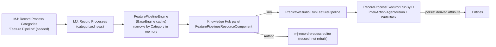

- **`FeaturePipelineEngine`** (`Engine/src/feature-pipelines/feature-pipeline-engine.ts`) — a `BaseEngine` singleton that caches all `MJ: Record Processes` + recent `MJ: Process Runs`, then narrows **in memory** to feature pipelines by matching the denormalized `Category` view field against `FEATURE_PIPELINE_CATEGORY_NAME = 'Feature Pipeline'` (case-insensitive, `isFeaturePipeline()`). It projects `FeaturePipelineSummary[]` (target entity, the written `OutputAttribute` parsed from `OutputMapping`, last-run freshness). It's a discovery/monitoring cache, not a registry.
- **Category seed** — `metadata/record-process-categories/.record-process-categories.json` seeds the one `MJ: Record Process Categories` row named "Feature Pipeline".
- **Run path** — `RunFeaturePipeline` (the only op with no PS-specific logic) delegates straight to `RecordProcessExecutor.RunByID(featurePipelineID, …)`. Running a feature pipeline is *exactly* running the underlying Record Process — full batching/resume/audit + true forwarded per-batch progress.
- **Knowledge Hub UI** — `FeaturePipelinesResourceComponent` (`@RegisterClass(BaseResourceComponent, 'FeaturePipelinesResource')`, `packages/Angular/Explorer/dashboards/src/KnowledgeHub/components/feature-pipelines/`) lists pipelines from the engine, shows target/written-attribute/freshness, offers **Run** (via the provider's `RouteOperation` seam → `RunFeaturePipeline`), and an **authoring** entry that opens the reusable `mj-record-process-editor` rather than rebuilding authoring.

### Feature Value key and versions

**The key.** A `MJ: Feature Values` row is upserted on its key: the record, the feature name, the pipeline version, the
prompt version hash (template text, outputs, constraint block, pipeline type, escalation settings), the primary AI
model, the parameters hash and the input hash. `ValueKeyHash` (SHA-256 of the key) is unique per pipeline. A re-run
with the same key leaves the row `Unchanged`; a changed value updates it; a changed key is a new row. The latest value
of a feature for a record is the row with the newest `ComputedAt`.

**Human values.** `Source` is `Pipeline` or `Human` (a value a person entered on the target record). Write-back never
overwrites a `Human` value unless the run sets `overwriteHumanValues`; `HumanValuesPreserved` counts the ones it kept.

- **Versions.** Each distinct pin (prompt version hash, primary model, parameters hash, spec hash) is the next numbered
  `MJ: Feature Pipeline Versions` row: Candidate, Active, Retired or Refused.
- Without an `Activation` block, an on-demand or manual run activates a changed pin; a scheduled or on-change run of a
  changed pipeline is refused until then, so a prompt edit never silently changes what an unattended job writes.
- With `Activation` (`GoldenSetTestID`, `Metric: 'accuracy'`, `Threshold`), a version runs only when its golden-set
  result meets the threshold; a failing result marks it Refused. Dry runs report this (`WouldRefuse`) and never
  register or activate.
- The **Feature Pipeline Version Steward** (`FeaturePipelineVersionSteward` in `@memberjunction/feature-pipelines-engine`,
  exposed as the **`Steward Feature Pipeline Version`** Action and run per pipeline by the **`Feature Pipeline Version Steward`**
  `MJ: Record Processes` row of `WorkType: 'Action'` over `WorkType='Infer' AND Status='Active'`, dispatched every 15 minutes
  by `RecordProcessScheduledJobDriver`) evaluates a gated pipeline's unevaluated version and runs the one backfill of a
  changed version (the records whose latest value is under another version or none), returning each decision in
  `Outcomes` / `Version` / `LastAction` / `Detail`. A pipeline opts out per step with
  `Unattended: { AutoEvaluate: false }` / `{ AutoBackfill: false }`.

**Golden sets.** A `Feature Pipeline Golden Set` test (`FeaturePipelineGoldenSetDriver`, `GoldenSetScorer`, and
`GoldenLabelQualityCheck` in `@memberjunction/feature-pipelines-engine`) scores a pipeline's answers against labelled cases. Model-made
labels carry a stored **label-quality record**: two labelers from two vendors label every case under the same guide,
each must agree with the existing labels at a Wilson 95% lower bound of at least 0.70, one adjudicates the other's
disagreements, and at most 5 of 52 cases may be excluded. The record is tied to the cases by hash, and the driver
refuses a set that fails it before any model call. A case marked `Required: true` that is answered wrong fails the set
whatever its accuracy (gate value 0, the cases listed in `RequiredFailures`). A case can expect an abstention for some
outputs (`ExpectAbstain`). `LabelSource: "specification"` cases (prompt-injection attempts, non-titles) are fixed by
the guide's rule rather than labelled, must be `Required`, and stay outside the label-quality record.

**Output constraints.** A `lookup` constraint reads its entity's rows (`DisplayFields`, `Filter`) and renders them into
the prompt as the taxonomy; `ItemRef` checks an array output item by item. A violating answer is `RejectedInvalid`,
nothing is written for it, and the run ends `Failed`.

**Confidence floors.** An output can declare `MinConfidence` with `OnLowConfidence: 'null'` (an LLM pipeline also
needs `ConfidenceRef`). Below the floor the output is withheld: its Feature Value records the abstention with no value,
write-back clears a value the pipeline wrote and keeps a person's, and the result lists it in `BelowConfidenceOutputs`.
The floor is part of the spec hash, so changing it is a new version.

**The record as the user turn.** An LLM pipeline that sets `Context.RecordAsUserMessage: true` sends the template as
the system turn and the record's context fields, as one JSON object, as the user turn, so a field value cannot pose as
an instruction.

### Feature Pipeline dry runs and run results

An `Infer` (`InferProcessor` in `@memberjunction/feature-pipelines-engine`, registered into `RecordProcessorRegistry` by
`FeaturePipelineStartup` / `RegisterInferRecordProcessor()`) dry run writes nothing (no Dedup Cache entry, Feature Value, watermark, target or child
row) but still calls the model, so its `MJ: AI Prompt Runs` are recorded and cost what a real run of those records would.

- Without a scope or a single record it previews at most **25** records (`DryRunSampleSize` overrides it).
- A record whose real write would fail is reported `Failed` with the write-back's reason (`PreviewErrors`).
- It reports, in `WouldRefuse` (via `InferProcessor.BuildRunSummary`), why a real run would be refused (a version that has
  not passed its golden set), and never registers or activates a version. `RecordProcess.RunNow` /
  `PredictiveStudio.RunFeaturePipeline` return it as `wouldRefuse`; the Bulk Operations dialog then offers no Apply.
- Each record's `previewFields` / `previewChildren` / `previewTags` hold only what the real write would change, so the
  dialog's change count is what the following real run writes. Outputs withheld below their confidence floor are listed
  in `withheldFields` (and `withheldKeptFields` when the column does not allow null) and `withheldChildEntities`.
- An output with no `Target` ("Feature value only") writes nothing to the record; its dry-run result is
  `previewFeatureValues` (`FeatureName`, `Previous`, `Proposed`), listing the Feature Values a real run would store.
  The dialog shows one `<Feature> (feature value)` row per item, counted as a change like any other row; a record
  with no such rows counts as unchanged.
- On every Feature Pipeline run, `MJ: Process Runs.ResultSummary` holds the `FeaturePipelineRunResult` JSON built by
  `FeaturePipelineRunResults.Build`: the pin the run used and the tallies `Attempted`, `Upserted`, `Unchanged`,
  `Previewed`, `RejectedInvalid`, `BelowConfidence`, `Failed`, `Skipped`, `HumanValuesPreserved`. Because `InferProcessor`
  sets `FailRunOnRecordError = true`, **a Feature Pipeline run with any failed or rejected record ends `Failed`**.

---

## 12. The Model Development Agent + artifact + viewer

A **Loop** agent (conversational) mirroring **Agent Manager**: collaborate with the user to build a strongly-typed `ModelingPlanSpec`, get approval, then execute with deterministic code (the Pipeline Builder, §12.4), then report with an LLM-authored rich artifact. **Seeded and shipped** — `metadata/agents/.model-development-agent.json`.

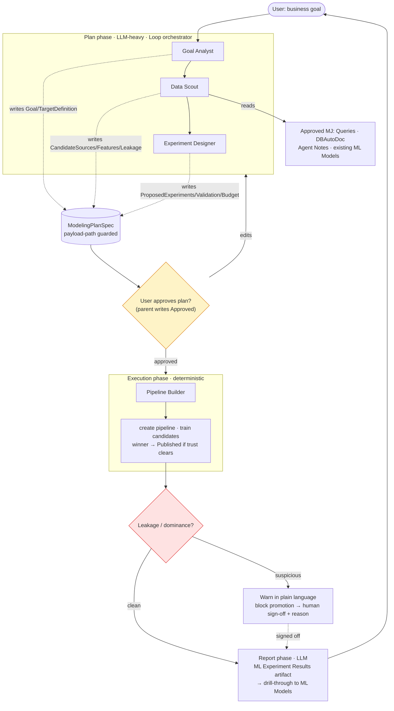

### 12.1 Topology — the agent and its three sub-agents

The parent **Model Development Agent** is a `Loop` agent (`ModelSelectionMode='Agent'`, `ArtifactCreationMode='Always'`, `DefaultArtifactTypeID → ML Experiment Results`, `InjectNotes=true`, `MaxNotesToInject=10`, `ExposeAsAction=true`). Its four wired Actions are the agent-facing PS Actions plus `Write Entity Field(s)`. Three sub-agents (all `Loop`, `InvocationMode='Sub-Agent'`) refine the plan:

| Sub-agent | ExecOrder | Writes (its payload slice) |
|---|---|---|
| **Goal Analyst** | 1 | refines the business goal → `Goal`, `TargetDefinition` (target + problem type + success metric) |
| **Data Scout** | 2 | studies the data → `CandidateSources`, `CandidateFeatures`, `LeakageNotes`; flags leakage risks |
| **Experiment Designer** | 3 | proposes ranked experiments + validation + budget → `ProposedExperiments`, `ValidationStrategy`, `ProposedBudget` |

**Sequencing is declarative, not hardcoded control flow** — it's enforced by metadata **payload-path guards**. Each sub-agent has `PayloadDownstreamPaths: ["*"]` (it can *read* the whole plan) and an `PayloadUpstreamPaths` list scoped to exactly the slice it's allowed to *write back* (e.g. Goal Analyst → `["Goal", "TargetDefinition", "TargetDefinition.*"]`). The parent holds `PayloadSelfWritePaths: ["Approved", "Leaderboard"]` — only the orchestrator stamps the approval gate and the execution-phase leaderboard.

### 12.2 Ground truth, drafted queries, memory

The **Data Scout** reads **ground truth only from approved sources**, wired via `MJ: AI Agent Data Sources`:
- `APPROVED_QUERIES` — `RunView` over `MJ: Queries` where `Status = 'Approved'` (the trusted semantic layer; *"Never hand-write raw SQL for feature extraction"*).
- `EXISTING_APPROVED_MODELS` — `MJ: ML Models` where `Status IN ('Published','Validated')`.
- **Agent Notes** — prior learnings (what worked, what leaked), auto-injected (`InjectNotes`).

When the Scout needs a query that doesn't exist, it may **draft a new `MJ: Query` as `Status='Pending'`** — usable for *this* exploration but **not** trusted ground truth until a human approves it into the shared semantic layer.

### 12.3 The artifact + the Angular viewer

The agent emits an **ML Experiment Results** artifact — content type **`application/vnd.mj.ml-experiment-results`** (`metadata/artifact-types/.ml-experiment-results-artifact-type.json`, `ParentID → JSON`, `DriverClass='MLExperimentResultsViewerPlugin'`, with `ExtractRules` for `name`/`description`/`displayMarkdown`/`bestModelId`/`leaderboardSize`).

The viewer is **`MLExperimentResultsViewerComponent`** (`@RegisterClass(BaseArtifactViewerPluginComponent, 'MLExperimentResultsViewerPlugin')`, `packages/Angular/Generic/artifacts/src/lib/components/plugins/ml-experiment-results-viewer.component.ts`, package `@memberjunction/ng-artifacts`). It renders the experiment **Goal** + headline best score, a ranked **leaderboard** (rank / algorithm / feature-set / score / modelId — the score column is the out-of-sample headline metric, shown as "not measured" when a run has none), normalized **feature-importance** bars, a **winning-model card**, and an extra "Report" tab for the agent-authored markdown. **Drill-through** to a model emits a `NavigationRequest`:

```typescript
// OnDrillThroughToModel() / OnOpenRowModel(row)
{ appName: 'Predictive Studio', navItemName: 'Models', queryParams: { modelId } }
```

> **Stale-prose caveat:** the artifact-type **Description** field still says the Angular viewer "is a follow-up; falls back to the parent JSON viewer." That prose is out of date — the viewer is fully built, registered, and module-declared, and the `DriverClass` correctly points at it. Treat the description text as lagging reality.

### 12.4 The deterministic Pipeline Builder (publish-gated-on-trust)

The Model Development Agent is elevated to the **Database-Designer / Agent-Manager domain-builder pattern**: the conversation reasons in plain language, but the structure it commits to metadata is **deterministic + type-safe, never LLM-emitted**. Three pieces (in `packages/AI/PredictiveStudio/Engine/src/agent/`):

- **`PredictiveStudioModelDevAgent`** (the parent's `DriverClass`) — overrides `determineNextStep`: when `shouldForceBuild` matches (a payload with `ProposedExperiments` and either `Approved: true` or an approval phrase in the latest user message, provided no `Pipeline Builder` sub-agent step has already run), the orchestrator forces routing to the builder sub-agent with `Approved: true`. Every other decision stays LLM-driven via `super`.
- **`PredictiveStudioPipelineBuilderAgent`** (the **Pipeline Builder** code sub-agent, `executeAgentInternal`, no LLM) — wraps:
- **`PredictiveStudioPipelineBuilder`** (`pipeline-builder.ts`) — the pure builder: `ModelingPlanToPipelineConfig(ModelingPlanSpec)` deterministically maps the plan → the exact `MJ: ML Training Pipelines` field shapes (SourceBindings, the FeatureStep DAG with one-hot for categoricals, AsOfStrategy, LeakageGuard from the plan's exclude-notes, ValidationStrategy); it creates the pipeline, trains via `TrainModelViaEngine`, then **publishes the model ONLY if `deriveTrustVerdict` clears the bar** (`@memberjunction/predictive-studio-core`) and training wasn't leakage-flagged — otherwise it stays Draft with a plain held-reason. The bar is the trust grade of one holdout number, not an interval, so a model whose holdout AUC interval contains 0.5 can clear it and be published (the assessment's agent runs published two). The builder sets `Status = 'Published'` itself, without the promotion gate: the model skips the gate's state machine and artifact check and gets no per-model scoring Action (§15.3).

Proven by: unit tests (mapper, gate logic, projection helpers), an in-process integration test (`ps-inproc-agent-builder.ts` — builds + trains + asserts the publish gate), and an **agent-loop test through the real `AgentRunner`** (`ps-inproc-agent-run.ts` — the sub-agent runs end-to-end and the gate fires). "+ New prediction" on the business surface opens this agent as a docked `mj-conversation-chat-area` co-pilot.

---

## 13. The security model

Predictive Studio touches client data, runs arbitrary trained models against record sets, and lets an agent draft queries — so security is treated as a first-class concern, enforced at code boundaries, not by convention.

**1 · API scope gating (`predictive:execute`).** Every one of the 7 Remote Operations declares `RequiredScope = 'predictive:execute'` (on the generated base and on the seeded `MJ: Remote Operations` row). The scope itself is defined as an APIScope (`metadata/api-scopes/.predictive-scopes.json`, `FullPath: 'predictive:execute'`). An API key without that scope can't invoke train / score / run-feature-pipeline / experiment / promote. (Scope is a Remote Operations concept; Actions carry no scope — they run under the agent's own permissions.)

**2 · Primary-key field-NAME validation (injection guard) at the scoring boundary.** When `ProductionScoreRecordSetRunner` builds a SQL filter from caller-supplied primary keys, it validates each **key name** (not just the value) against the entity's real field list before interpolation (`score-record-set.runner.ts → primaryKeyFilter`):

```typescript
const field = entity.Fields.find(f => f.Name.trim().toLowerCase() === k.trim().toLowerCase());
if (!field)
  throw new Error(`Score Record Set: '${k}' is not a field on entity '${entityName}'; refusing to build a filter from an unknown key.`);
return `${field.Name}='${String(v).replace(/'/g, "''")}'`;   // canonical field name + escaped value
```

An unknown/forged key name is refused outright rather than concatenated; the value is single-quote-escaped; and the **resolved canonical** `field.Name` (from metadata) is used, never the raw caller string.

**3 · UUID-gated ids.** Before any id is concatenated into SQL, it must match a strict UUID regex (`promote-model.gate.ts`):

```typescript
const UUID_RE = /^[0-9a-f]{8}-[0-9a-f]{4}-[0-9a-f]{4}-[0-9a-f]{4}-[0-9a-f]{12}$/i;
```

`loadModel` returns `null` for a non-UUID `modelId` (*"a non-UUID can't match a real row and is refused rather than concatenated"*); `resolveThreshold` falls back to the default for a non-UUID `pipelineId`. The id is interpolated only *after* the gate passes.

**4 · The promotion state machine (Draft → Validated → Published → Archived).** `ProductionModelPromotionGate` (`actions/promote-model.gate.ts`) is the single place that loads the model, detects leakage, enforces sign-off, and transitions status. One path bypasses it: the agent's Pipeline Builder sets `Published` directly (§12.4). The allowed transitions are an explicit table:

```typescript
static readonly ALLOWED_TRANSITIONS = {
    Draft:     ['Validated'],
    Validated: ['Published', 'Archived'],
    Published: ['Archived'],
    Archived:  ['Published'],
};
```

An illegal jump (e.g. Draft → Published) is rejected **before any mutation** with `{ kind: 'invalid-transition' }` → action error code `INVALID_TRANSITION`.

**5 · Leakage sign-off requires an auditable reason.** Promoting a model the leakage guard flagged (§4.4) is blocked unless the caller passes **both** `signOff: true` **and** a non-empty `reason`:

- no `signOff` → `{ kind: 'refused-leakage' }` → `LEAKAGE_SIGNOFF_REQUIRED`
- `signOff` but blank `reason` → `{ kind: 'signoff-reason-required' }` → `SIGNOFF_REASON_REQUIRED`
- valid sign-off → `recordSignOff()` writes an **auditable note** (who / when / what-was-overridden / reason) before the transition proceeds.

The Remote Op surfaces these as clean `EXECUTION_ERROR`s with the same plain-language messages; the Action returns `ActionResultSimple` failures with the codes above. The leakage guard is a single-feature dominance check that misses restated and one-hot leaks; promoting a flagged model through the gate needs sign-off with a reason, whereas a model the guard does not flag is published by the agent's Pipeline Builder or by opt-in auto-train with no sign-off.

---

## 14. The maintenance loop — staleness + challenger-vs-incumbent

> **Built, not wired.** Nothing runs the maintenance pass: no Action exists for it and its scheduled job ("Predictive Studio Maintenance") is Disabled. The design below is what the engine code implements.

`MaintenanceEngine` (`Engine/src/maintenance/maintenance-engine.ts`, entry `runMaintenancePass(...)`) drives staleness detection, scheduled re-scoring, and retraining-with-comparison off the `MJ: ML Model Scoring Bindings`.

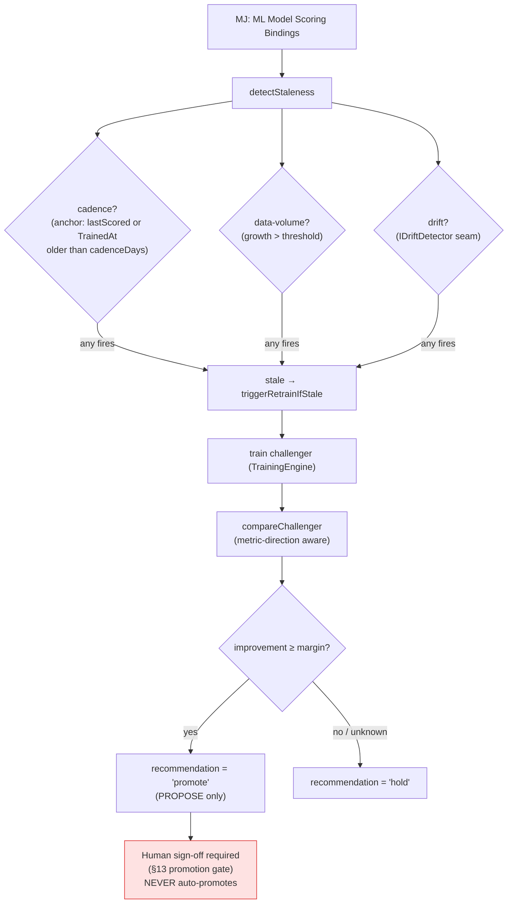

**Staleness — three triggers.** `detectStaleness` accumulates `StalenessReason[]`; the binding is stale if any fires:
- **Cadence** — anchor is `binding.LastScoredAt` (when `cadenceAnchor='lastScored'`) or `model.TrainedAt`; stale if older than `cadenceDays`. A never-scored/never-trained binding is treated as stale so it's picked up on the first pass.
- **Data-volume** — `growth = (currentRowCount − model.TrainingRowCount) / model.TrainingRowCount`; stale if `growth > dataVolumeGrowthThreshold` (current count via an injected `rowCounter`).
- **Drift** — gated by `policy.driftEnabled`, delegated to an injected `IDriftDetector` seam.

Scheduled re-scoring (`rescoreScheduledBinding`, for `Mode='Scheduled'` bindings) stamps `LastScoredAt = now` and `LastRowCount = scoredCount` after each pass.

**Challenger-vs-incumbent — respects metric direction, never auto-promotes.** When a binding is stale, a challenger is trained and compared. Direction is handled via Core's shared `isErrorMetric`:

```typescript
private metricImprovement(metric, incumbentValue, challengerValue): number | null {
    if (incumbentValue == null || challengerValue == null) return null;
    return isErrorMetric(metric) ? incumbentValue - challengerValue   // lower-is-better
                                 : challengerValue - incumbentValue;  // higher-is-better
}
private recommendPromotion(improvement, margin): PromotionRecommendation {
    if (improvement == null) return 'hold';                  // unknown → hold
    return improvement >= margin ? 'promote' : 'hold';
}
```

Positive `improvement` always means "better," whichever direction the metric runs. `compareChallenger` returns only a `recommendation` (`'promote' | 'hold'`) — it performs **no promotion**. The class doc is explicit: *"It NEVER auto-promotes — promotion is a separate signed-off Action,"* and the comparison detail always appends *"Promotion still requires explicit human sign-off — nothing has been promoted automatically."* Promotion only ever happens through the §13 gate with its sign-off.

> One nuance: the `'auto'` comparison-metric *selection* (`metrics.ts → resolveComparisonMetric`) only auto-picks higher-is-better keys; a **pinned** error metric is still compared direction-correctly via `metricImprovement`, but `'auto'` won't land on an error metric by itself.

---

## 15. Phase 2 — Model as a First-Class Primitive (Reach)

Phase 1 (§1–§14) shipped the model *entity* and its core invocation surfaces — Actions, Remote Operations, and write-back into entity fields — proven live end-to-end. **Phase 2 extends the model's *reach*: the *same* trained scorer, plumbed into every MJ surface where a prediction is useful.** None of this is new ML. There is exactly **one** scorer (`MLModelInferenceProcessor`, §6) and exactly **one** scoring entry point (`PredictiveStudioScoreRecordSetAction` / the `PredictiveStudio.ScoreRecordSet` Remote Op, which share one delegation path); Phase 2 is purely the plumbing that exposes that one scorer as a saved/scheduled Record Process, a discoverable per-model Action, a query column, and an interactive-component capability — and turns its output into ordinary entity data via write-back.

### 15.1 The unifying picture — one scorer, many surfaces

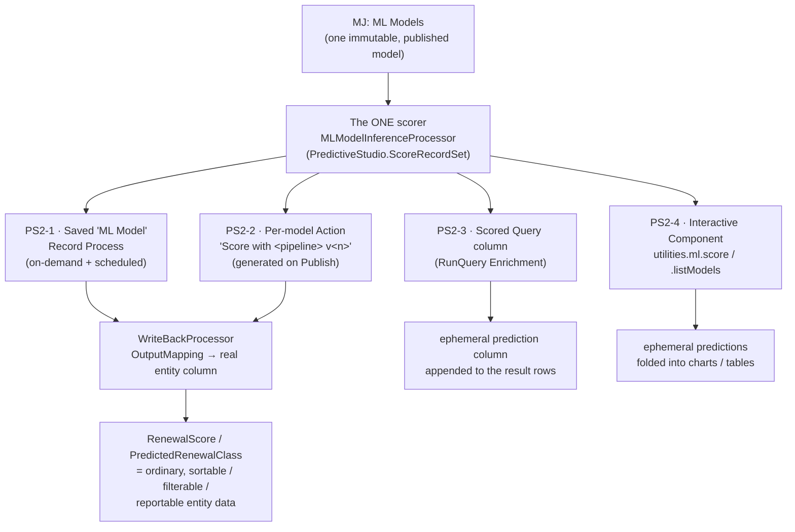

**Decoupling is the discipline that makes this safe.** No base/types package gains a dependency on Predictive Studio. Every surface plugs in through a *registry* or the *MJGlobal ClassFactory*, resolved by string key at runtime, no-op when the providing package isn't loaded:

| Surface | Seam | Lives in (PS-free) | Provided by (PS) |
|---|---|---|---|
| Record Process | `RecordProcessorRegistry` | `@memberjunction/record-set-processor-base` | `registerMLScoringProcessor()` at startup |
| Scored Query | `QueryResultEnricherBase` + ClassFactory | `@memberjunction/core` (`queryResultEnricher.ts`) | `@RegisterClass(QueryResultEnricherBase, 'ML Model Score')` |
| Interactive Component | `ComponentUtilities.ml?` (optional) | `@memberjunction/interactive-component-types` | `RuntimeUtilities.CreateSimpleMLTools()` (ng-react) |
| Per-model Action | `MJ: Actions` metadata + `ParentID` | — (pure metadata) | `ModelScoringActionGenerator` on Publish |

### 15.2 PS2-1 — Scoring as a saved (and scheduled) Record Process

**What it is.** Phase 1's `MLModelInferenceProcessor` is a Record Set Processing **work type** (`'ML Model'`, §6), but a `@RegisterClass` decoration only makes it *resolvable* through the ClassFactory — it does not make the substrate *route* a saved `MJ: Record Processes` row with `WorkType='ML Model'` to it. PS2-1 closes that gap so a **saved, replayable, schedulable** Record Process scores a scope and writes a prediction column.

**Key entry points.**

- `registerMLScoringProcessor(deps: MLInferenceDeps): void` (`Engine/src/scoring/register.ts`) — installs a factory into `RecordProcessorRegistry.Instance` for both `'ML Model'` and the `'MLModelInference'` alias. The factory reads the per-run `MLScoringConfiguration` (`{ modelId, primaryKeyField?, datedSources? }`) off the Record Process's `Configuration` JSON and closes over the injected `MLInferenceDeps` (model loader / artifact loader / sidecar).
- `PredictiveStudioScoringStartup` (`Engine/src/scoring/startup-register.ts`) — a `@RegisterForStartup`-decorated `IStartupSink` (a `BaseSingleton`) whose `HandleStartup()` calls `registerMLScoringProcessor(BuildProductionMLInferenceDeps())` **once at MJAPI boot**. It warms no `BaseEngine` cache and touches no DB — the injected seams take their `provider` + `user` per call — so the registration is a cheap synchronous map write (not `deferred`). Mirrors `RemoteBrowserEngine`'s startup pattern.
- The **migration** `migrations/v5/V202606280215__v5.44.x__RecordProcess_WorkType_AddMLModel.sql` adds `'ML Model'` to the `CK_RecordProcess_WorkType` CHECK constraint — **drop the old constraint + add the new one** (`'Action' | 'Agent' | 'Infer' | 'FieldRules' | 'ML Model'`) **in a single migration**. The CHECK is the **source of truth**: CodeGen derives the field's value list, its `ValueListType`, and the generated TypeScript union from it, and the value validates at SAVE time (a typo'd work type is rejected up front). Work-type **resolution** still happens at execution time via `RecordProcessExecutor.buildProcessor() → RecordProcessorRegistry.Resolve()` (the registry is the pluggable seam) — the CHECK just guarantees the stored value is a known work type. To add further work types, extend the CHECK the same way + re-run `mj codegen`. *(Never hand-edit `EntityFieldValue` / `ValueListType` to do this — that metadata is CodeGen-derived from the CHECK; see [`migrations/CLAUDE.md`](../migrations/CLAUDE.md).)*

**Dry-run write-back fix.** PS2-1 also hardened the substrate's write-back so a **dry-run** of any wrapped work type (Action / Agent / Infer / **ML Model**) computes its effect without mutating data. `applyOutputMapping(... dryRun: true)` (`packages/RecordSetProcessor/engine/src/writeBack.ts`) now still resolves the mapped values and validates the target entity/field metadata, but saves nothing — returning the would-be values in `previewFields` / `previewChild` (`WriteBackResult.dryRun`). This mirrors the first-class `ProcessRun.DryRun` flag threaded through `WriteBackProcessor.ts` and `RecordProcessExecutor.ts`, and through the action's `ScoreRecordSetRequest.dryRun`.

**Usage** — score a view and write a probability column on demand:

```typescript
// A saved MJ: Record Processes row (created once, then runnable / schedulable):
//   WorkType      = 'ML Model'                         // set via rp.Set('WorkType', …) — see 15.6
//   ScopeType     = 'Filter'  ScopeFilter = "IsActive = 1"
//   Configuration = { "modelId": "<MJ: ML Models id>", "primaryKeyField": "ID" }
//   OutputMapping = { "fields": { "RenewalScore": "$.score" } }   // write-back
// Run it (same path the scheduled job driver uses):
await RecordProcessExecutor.RunByID(recordProcessId, { contextUser, provider });
// → each row scored by the model → RenewalScore column written back.
```

**Proven live by** `ps-live-recordprocess-scoring.ts` — a SAVED Record Process scoring over GraphQL against a running MJAPI, relying on the **startup-registered** scorer (it does *not* register the work type itself).

### 15.3 PS2-2 — A per-model Action generated on Promote

**What it is.** When a model is promoted to **Published**, the promote gate auto-generates an idempotent child Action **`Score with <pipeline> v<n>`**, so every model published through the gate becomes a first-class, discoverable Action (a model the Pipeline Builder publishes directly gets none, §12.4) — ActionSmith / CodeSmith pick it up for free, with zero per-model code or AI codegen.

**Key entry points.**

- `ModelScoringActionGenerator` (`Engine/src/actions/model-scoring-action-generator.ts`):
  - `generateForModel(model, contextUser, provider): Promise<void>` — find-or-create the Action by its deterministic name; reconcile its params (delete + recreate to stay in sync with the parent contract).
  - `disableForModel(model, contextUser, provider): Promise<void>` — flip `Status` to `'Disabled'` when the model is Archived.
- The hook is in `ProductionModelPromotionGate.syncScoringAction()` (`Engine/src/actions/promote-model.gate.ts`), called from `transition()` after the lifecycle save: generate on `Published`, disable on `Archived`. It is a **pure enhancement** — any failure is logged and swallowed so it can never fail an otherwise-successful promotion.

**Composition, not inheritance** (CLAUDE.md Actions rule). The generated row is a *child* of the canonical **Score Record Set** parent — it carries the parent's `ParentID` (metadata link only) and reuses the **same** `DriverClass` (`SCORE_RECORD_SET_DRIVER_CLASS = 'PredictiveStudioScoreRecordSetAction'`). That driver already reads `ModelID` / `Scope` / `WriteBack`, so the child needs no new implementation. The only thing model-specific is the `ModelID` input param's `DefaultValue`, **baked to `model.ID`** — ActionEngine seeds each param from its `DefaultValue` before invoke, so omitting `ModelID` scores with *this* model. The Action is named from the model's denormalized `Pipeline` view field (the model has no `Name` column) and `Version`, and grouped under a find-or-create `Predictive Studio Models` Action Category.

**Proven live by** `ps-live-modelaction-generation.ts` — promotes a model to Published over GraphQL, then reads `MJ: Actions` / `MJ: Action Params` back and asserts the generated Action name + the baked `ModelID` default.

### 15.4 PS2-3 — Scored-query enrichment

**What it is.** A `RunQuery` post-query enrichment seam: a query run with an `Enrichment` directive has its result rows scored by the existing scorer and the prediction **appended as a new column** — post-query, **not** SQL-inline, so the model stays in the engine (portable, no DB-side model dependency).

**Key types/entry points (all decoupled from PS).**

- `QueryResultEnricherBase` (abstract) + `RunQueryEnrichment` (`{ EnricherKey: string; Config: Record<string, unknown> }`) + `resolveQueryResultEnricher(key)` live in **`@memberjunction/core`** (`src/generic/queryResultEnricher.ts`). `RunQueryParams.Enrichment?: RunQueryEnrichment` is a **runtime-only** directive — there is intentionally **no** persisted per-query column (a saved annotation is a deliberate follow-up), so the feature is purely additive: no schema change, no CodeGen.
- The hook is in `GenericDatabaseProvider.InternalRunQuery` → `enrichQueryResults(...)`: after paging, if `params.Enrichment?.EnricherKey` is set, it resolves the enricher via the ClassFactory and awaits `EnrichResults(...)`. **Resolution checks `GetRegistration` before constructing** (so it never instantiates the abstract base) and the whole call is wrapped in try/catch — when no enricher is registered (providing package not loaded) or anything fails, it **returns the original rows**. A scoring problem can never break the query.
- `MLModelScoreEnricher` (`Engine/src/scoring/ml-model-score-enricher.ts`, `@RegisterClass(QueryResultEnricherBase, 'ML Model Score')`) is the PS half. Its `MLModelScoreEnricherConfig` is `{ modelId, outputField, primaryKeyField?, valueKind?: 'score' | 'class' }`. Because the **model** determines the target entity, the enricher only needs each row's primary key: it collects the PKs, scores them **without write-back** (ephemeral), and joins predictions back onto rows by id (`O(1)` map). `LoadMLModelScoreEnricher()` anchors the registration against tree-shaking.

**Usage:**

```typescript
const result = await new RunQuery().RunQuery({
  QueryName: 'Active Members',
  Enrichment: {
    EnricherKey: 'ML Model Score',
    Config: { modelId: '<MJ: ML Models id>', outputField: 'RenewalScore', primaryKeyField: 'ID' },
  },
});
// → each result row now carries a `RenewalScore` column (the model's numeric score).
```

**Proven live by** `ps-inproc-scored-query.ts` — runs in-process (the `Enrichment` param is not marshaled over GraphQL yet, by design), exercising the full path: `RunQuery → resolveQueryResultEnricher('ML Model Score') → MLModelScoreEnricher → MLModelInferenceProcessor → DB + sidecar → new column`.

### 15.5 PS2-4 — An `ml` capability on Interactive Components

**What it is.** An optional `ml` capability on the Interactive Components `utilities` surface, so Skip's components can **list trained models** and **score records** and weave predictions (renewal likelihood, lead scores, churn risk) into charts / tables / dashboards. Push-to-generic: every interactive component gains it.

**Key types/entry points.**

- `SimpleMLTools` (`packages/InteractiveComponents/src/shared.ts`) — the capability interface:
  - `listModels(filter?: SimpleMLListModelsFilter, contextUser?): Promise<SimpleMLModelInfo[]>` — newest version first; resilient (returns `[]` on failure).
  - `score(modelId, records: Array<Record<string,unknown> | string>, options?): Promise<SimpleMLScoreResult>` — ephemeral predictions (nothing written back).
  - Supporting shapes: `SimpleMLModelInfo`, `SimpleMLPrediction`, `SimpleMLScoreResult`, `SimpleMLListModelsFilter`.
- `ComponentUtilities.ml?: SimpleMLTools` (`runtime-types.ts`) is **optional** — it can be `undefined` when the capability isn't available in the current environment/security context, so component code **must guard** for that.
- `RuntimeUtilities.CreateSimpleMLTools()` (`packages/Angular/Generic/react/src/lib/utilities/runtime-utilities.ts`) builds it: `listModels` reads the `MJ: ML Models` catalog via `RunView` (defaulting `Status='Published'`); `score` marshals the `PredictiveStudioScoreRecordSetOperation` (the `PredictiveStudio.ScoreRecordSet` Remote Op) **over GraphQL** to the server engine — because the Python sidecar lives server-side and cannot run in the browser. Returns `undefined` when there is no `GraphQLDataProvider`, so the `ml` capability degrades cleanly.

**Usage (inside an interactive component):**

```typescript
if (utilities.ml) {
  const models = await utilities.ml.listModels({ targetVariable: 'Renewed' });
  const { predictions } = await utilities.ml.score(models[0].id, memberRows /* objects or pk strings */);
  // fold predictions (by recordId) into the chart/table…
}
```

### 15.6 PS2-6 — The north-star: scheduled model scoring

**What it is.** The end-to-end composition Phase 2 builds toward: *"build a model, write the renewal probability back into the member record, and re-score it on the 1st of every month"* — as a **single call**, with **no new scheduling, dispatch, or write-back code**. Everything underneath already exists (PS2-1 + the scheduled-job machinery); the helper just assembles one `MJ: Record Processes` row.

**Key entry point.** `createScheduledModelScoring(opts: ScheduleModelScoringOptions): Promise<MJRecordProcessEntity>` (`Engine/src/scheduling/scheduled-model-scoring.ts`). Required quartet: `modelId`, `targetEntityName`, `outputField`, and exactly one `scope` selector (`filter` | `viewId` | `listId`); sensible defaults otherwise (`'Monthly'` cadence = `0 0 1 * *`, `ID` primary key, numeric `'score'`, UTC). It validates, maps the `ScoringCadence` to a cron (`cadenceToCron`), and populates the row:

- `WorkType='ML Model'` — set via `rp.Set('WorkType', 'ML Model')`, the **documented legitimate exception** to the no-`.Set()` rule: the CodeGen'd `WorkType` union (`'Action' | 'Agent' | 'FieldRules' | 'Infer'`) cannot represent a runtime-registered extension work type. (Same exception PS2-1's path uses.)
- `Configuration = { modelId, primaryKeyField }`, `OutputMapping = { fields: { <outputField>: '$.score' | '$.class' } }`.
- `Status='Active'`, `ScheduleEnabled=true`, `CronExpression`, `Timezone`, `OnDemandEnabled=true`.

Saving that row auto-creates an **owned `MJ: Scheduled Jobs`** row via `MJRecordProcessEntityServer.Save → reconcileScheduledJob`; `SchedulingEngine` then dispatches it on its cron through `RecordProcessScheduledJobDriver → RecordProcessExecutor.RunByID(...)` — which resolves the scope, scores each row, and writes the prediction back per the `OutputMapping`. The `schedule-model-scoring.action.ts` Action wraps the helper for agent/workflow invocation.

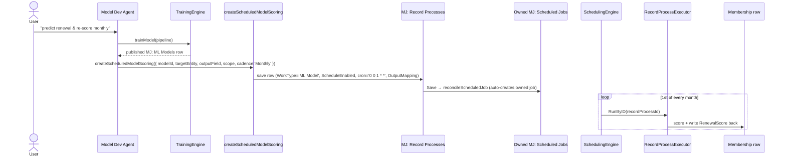

**Proven live by** `ps-inproc-scheduled-scoring.ts` — one `createScheduledModelScoring(...)` call, then it verifies the owned Scheduled Job the scheduler *would* dispatch and runs the Record Process now via `RecordProcessExecutor.RunByID` (the same path the job driver uses), asserting the write-back landed.

### 15.7 Integration-test proofs

Each Phase 2 capability ships with an MJServer integration script that exercises the real path (no mocked ML). The `ps-live-*` scripts drive an already-running MJAPI over GraphQL (system API key); the `ps-inproc-*` scripts bootstrap a real `SQLServerDataProvider` in-process (used where the path isn't marshaled over GraphQL yet). All gate the sidecar legs behind `PS_INTEGRATION=1` and skip gracefully without it.

| Capability | Script | Harness | Proves |
|---|---|---|---|
| PS2-1 — saved Record Process scoring | `ps-live-recordprocess-scoring.ts` | live / GraphQL | a saved `WorkType='ML Model'` Record Process scores a view + writes columns, via the **startup-registered** scorer |
| PS2-2 — per-model Action on Promote | `ps-live-modelaction-generation.ts` | live / GraphQL | promoting to Published generates `Score with <pipeline> v<n>` with `ModelID` `DefaultValue` baked in |
| PS2-3 — scored-query enrichment | `ps-inproc-scored-query.ts` | in-process | `RunQuery` + `Enrichment` appends the model's prediction column |
| PS2-6 — scheduled model scoring | `ps-inproc-scheduled-scoring.ts` | in-process | one `createScheduledModelScoring(...)` call → owned Scheduled Job + a real scored write-back |

> PS2-5 (catalog awareness for agents) is delivered *through* PS2-2: every published model is a discoverable Action, which ActionSmith / CodeSmith see for free — no separate code.

---

## 16. The Business-User Experience

Phases 1–2 built the platform and gave the *model* reach. **This** is the layer that makes the whole thing usable, visible, and trustworthy for a **non-technical business user** — the conversational north-star made real, end to end, with **every surface generic** (binding-driven, entity-agnostic; "members/renewal" is throwaway test data, never a build target). Full plan + commit lineage: [`plans/predictive-studio-business-experience.md`](../plans/predictive-studio-business-experience.md).

### 16.1 The Predictions surface (the front door)

The default Predictive Studio nav item is **Predictions** (`PSPredictionsResourceComponent`, in `ng-dashboards`) — the business front door, modeled on the locked [`plans/predictive-studio-business-ux/option-b-refined.html`](../plans/predictive-studio-business-ux/option-b-refined.html):

- **Catalog** — every **published** model reframed as a plain-language prediction card with a **trust badge** (`deriveTrustVerdict`). A Poor / unmeasured prediction shows "Not ready — Needs an analyst" with Open disabled: the trust gate at the catalog level.
- **Workspace** (open a card) — a trust verdict banner that **gates the action bar**; a ranked **at-risk list** (the embedded `ps-predictions-grid` reads the latest run's `MJ: Process Run Details` once, up to `PredictiveStudioEngine.MaxRunDetailRows`, and hands the parsed rows to the workspace through its `RowsLoaded` output; highest-risk first, high/medium/low risk tiers for classification, outcome-band tiers for regression) with the features **weighted most by the model** (`topGlobalDrivers` over the model's global feature importance — global, not per-record SHAP; coefficient models only; hidden for tree models and for models trained before this change, until they are retrained); and four trust-gated actions — Review the call list · Save scores (opens the docked Model Dev Agent co-pilot seeded with the request) · Send to a list (creates an MJ List of the highest-risk records at or above `AT_RISK_LIST_MIN_RISK_PCT`, at most 200, and reports how many of the qualifying records it added) · Share/export (CSV).
- **"+ New prediction"** opens the deterministic-builder agent (§12.4) as a docked `mj-conversation-chat-area` co-pilot. **Embedding the chat correctly requires the conversation lifecycle wiring** — bind `[isNewConversation]` (start `true`), `[conversation]`/`[conversationId]`, and handle `(conversationCreated)` to capture the new conversation + flip out of new-mode (mirror `(pendingMessageConsumed)` to clear the seed). Without it, the suppressed empty-state input has no conversation to write into and the first send silently no-ops. Both the Predictions co-pilot and the Studio co-pilot use this pattern; copy it for any new embedded PS chat.

**Nav structure — three doors.** The Predictive Studio app exposes exactly **three** top-level nav items (`metadata/applications/.predictive-studio-application.json`), consolidated from an earlier eight-flat-item layout so business users see one door and analysts opt into depth:
- **Predictions** (`PredictiveStudioPredictionsResource`) — the business front door above.
- **Studio** (`PredictiveStudioStudioResource`) — the build/run workbench: an internal left-nav grouped Overview · Build (Pipelines, Algorithm Catalog) · Run (Experiments, Compare Runs), plus the shared docked Model Dev Agent co-pilot.
- **Models** (`PredictiveStudioModelsResource`) — the trained-model lifecycle: an internal left-nav over Model Registry · Models in Production.

The two workbench doors are single `BaseResourceComponent`s that host the **same** standalone section panels (`ps-home`, `ps-pipelines`, …) the old per-section resources hosted — only the wrapping changed. The active section round-trips through a `section` query param (deep links + back/forward), and the Overview panel's cross-door links route via `routeHomeNavigate` (pure, unit-tested in `predictive-studio.nav.ts`). The trust translator (`@memberjunction/predictive-studio-core`) is the single shared rule behind the catalog badges/gate **and** the agent's publish gate. The pure VMs (`business-predictions.view-models.ts`, `at-risk.view-models.ts`, `predictive-studio.nav.ts`) + the trust translator are unit-tested. Full design-driven lineage (brief → 3 divergent mockups → locked direction → plan): [`plans/predictive-studio-business-ux/`](../plans/predictive-studio-business-ux/).

The one-sentence goal: *a membership director, in chat, asks "which members are likely to lapse?" — and minutes later every member record shows a renewal-risk score that refreshes monthly, driven and explained conversationally, with the deployed model visible in a control-tower view.*

### 16.1 The end-to-end flow

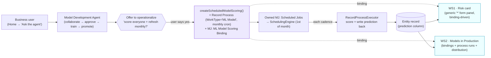

The whole loop never leaves the conversation: the agent trains, promotes, **proactively offers** to operationalize, and on a yes wires up scheduled scoring; the binding it records is what lights up the risk card and the production view.

### 16.2 The Model Development Agent's conversational flow

The agent (§12) now closes the loop. Its prompt (`metadata/prompts/templates/model-development-agent/model-development-agent.template.md`, §5 *"Operationalize — proactively offer"*) teaches it that *a trained, promoted model is only useful once its predictions are on the records, kept current.* So after a clean promote (or a signed-off leakage flag), it **proactively offers** — not waiting to be asked — in plain business language tied to the user's goal:

> *"This model's ready to go. Want me to score every active member right now, write each one's renewal-risk onto their record, and then refresh it every month so it always stays current?"*

It offers clear `suggestedResponses` (*Yes, score & schedule monthly* / *Just score once now* / *Not yet*). On a **yes**, it calls the **Schedule Model Scoring** action — now in its `MJ: AI Agent Actions` toolkit (`metadata/agents/.model-development-agent.json`) and fully metadata-synced (`metadata/actions/predictive-studio/.predictive-studio-actions.json`: `ModelID`, `TargetEntityName`, `OutputField`, `ScopeFilter`, optional `Cadence` (default `Monthly`) / `PrimaryKeyField` / `ValueKind`; result codes `SUCCESS` / `VALIDATION_ERROR` / `SCHEDULE_FAILED`). It proposes a column name if the user hasn't named one, confirms the population (`ScopeFilter`), then reports back in plain English what it scheduled. Keeps it **generic** — "this works for any entity and any prediction target, not just members or renewal."

The Action wraps `createScheduledModelScoring` (§15.6); the helper now **also records the scoring binding** (§16.6), which is the seam that makes the next two surfaces light up.

### 16.3 The generic model-prediction form panel (the risk card)

The payoff renders on **any** entity a model writes to, with **no per-entity code**:

- **Component** — `ModelPredictionPanel` (`packages/Angular/Explorer/core-entity-forms/src/lib/panels/model-predictions/`), a `BaseFormPanel` registered under the **`'*'` wildcard entity**:
  ```typescript
  @RegisterClassEx(BaseFormPanel, {
      key: 'model-predictions:model-prediction',
      skipNullKeyWarning: true,
      metadata: { entity: '*', slot: 'after-fields', sortKey: 40 },
  })
  ```
- **The `'*'` slot wildcard** — added to the slot host (`packages/Angular/Generic/base-forms/src/lib/panel-slot/`). `entityMatches()` now treats `'*'` as "mount on **every** entity's form"; such panels are expected to self-hide when they don't apply. This is the entity-agnostic-panel contract: one registration, cross-cutting, unobtrusive.
- **Binding-driven** — on any record the panel `RunView`s `MJ: ML Model Scoring Bindings` filtered to `TargetEntityID=<this entity> AND TargetColumn IS NOT NULL`. No binding → no cards → the panel **self-hides** (`@if (HasPredictions)`, i.e. `Cards.length > 0`). It's invisible on every form a model doesn't touch.
- **Entity-neutral band + format** — the bound value renders as a meaningful indicator: a low/mid/high band shaded with `--mj-brand-primary` opacity (no moral "risk" direction baked in — generic by construction); 0–1 values → "%", regression → grouped number, classification → class label, missing → "—". Plus the top 5 features **weighted most by the model** (parsed from the model's `FeatureImportance`; coefficient models only; hidden for tree models and for models trained before this change, until they are retrained), the **model + version** ("Pipeline v{n}"), and **last scored**.

A sibling panel, `FeatureValuesPanel` (`packages/Angular/Explorer/core-entity-forms/src/lib/panels/feature-values/`, `'*'` wildcard, `sortKey` 41, right after the Model Prediction panel), shows the Feature Values stored for the record in `MJ: Feature Values`: the latest answer per pipeline and feature with Source, Confidence, pipeline version, Computed, Reasoning and older values, plus a Refresh button. A latest answer that withheld the value (an abstention, or a value a person cleared) reads "no value" and supersedes any older value, which stays in the history. It is read-only and renders nothing when the record has no Feature Values. It is where the output of a feature pipeline with no write target ("Feature value only") is visible.

### 16.4 "Models in Production" — the control tower

A new Studio section (`PSProductionComponent` + `PSProductionResourceComponent`, `@RegisterClass(BaseResourceComponent, 'PredictiveStudioProductionResource')`; `packages/Angular/Explorer/dashboards/src/PredictiveStudio/`). For each deployed model it shows: model label + algorithm + problem type + status, **what it writes** (target entity / column), the **mode + schedule phrase** (`humanizeCron`), the **last run** (the latest `MJ: Process Runs` row for the binding's `RecordProcessID` — status, time, success/error counts) or the binding's own `LastScoredAt` / `LastRowCount`, and a **prediction-distribution mini-viz**. The distribution (`production-distribution.ts`, pure + unit-testable) samples up to 5,000 non-null values of the bound column and buckets them **entity-neutrally** — numeric → three terciles, categorical → top-8-by-frequency + "Other". Everything reads from `MJ: ML Model Scoring Bindings` + `MJ: Process Runs` + the target entity via metadata; **zero Member-specific code**, multi-provider-correct (`RunView.FromMetadataProvider(this.ProviderToUse)`).

### 16.5 The live Studio (de-mocked) + conversational entry

The Studio (§18) no longer ships sample arrays on screen — the `SAMPLE_*` arrays are gone (the only `SAMPLE_` token left is the `PRODUCTION_SAMPLE_CAP = 5000` constant). Pure, testable view-models (`predictive-studio.view-models.ts`) feed each panel from **live engine data**: Registry from `engine.Models` (metrics / holdout / feature-importance parsed live), Experiments from `engine.Sessions` / `engine.Iterations`, Home KPIs + activity feed from `engine.Models` / `engine.Sessions` + recent `MJ: Process Runs`, Compare from the session leaderboard. The previously-dead buttons are wired to **Remote Operations** behind a `ps-confirm-modal`:

- **Promote / Mark Validated / Archive** → `PredictiveStudioPromoteModelOperation` (`{ modelId, targetStatus, signOff?, reason? }` — a leakage sign-off reason is **required** when the model is flagged).
- **Pause / Resume / Cancel** → `PredictiveStudioControlExperimentSessionOperation` (`{ sessionId, action }`).

Each mutation force-refreshes the engine (`Config(true, …)`) and reports success/failure. And Home's **"Ask the agent"** CTA opens the docked `<mj-conversation-chat-area>` pinned to the Model Dev Agent with a seeded starter prompt (`[pendingMessage]` auto-sends) — one click from Home into a seeded conversation.

### 16.6 The scoring-binding lineage (the seam that lights it all up)

Both §16.3 and §16.4 read `MJ: ML Model Scoring Bindings` — so operationalizing must **record a binding**, not just create a scheduled Record Process. `createScheduledModelScoring` (`packages/AI/PredictiveStudio/Engine/src/scheduling/scheduled-model-scoring.ts`) now, after saving the Record Process, calls `upsertScoringBinding(...)` to create/update the binding row with `MLModelID`, `RecordProcessID`, `TargetEntityID`, `TargetColumn`, and `Mode='Scheduled'`. That binding is the lineage record — *"this model is in production, scoring these records into this column on this schedule"* — and the seam that connects the headless scoring loop to the human-facing surfaces. Without it the scheduled job would run silently and both surfaces would stay dark.

### 16.7 The enablers

- **`'ML Model'` WorkType dropdown** — migration `V202606280215__v5.44.x__RecordProcess_WorkType_AddMLModel.sql` adds `'ML Model'` to the `CK_RecordProcess_WorkType` CHECK (drop + re-add the constraint with the five values in one migration). The CHECK is the source of truth — CodeGen derives the value list, `ValueListType`, and the generated union from it, so after the next CodeGen the union becomes `'Action' | 'Agent' | 'FieldRules' | 'Infer' | 'ML Model'` and `'ML Model'` is a real dropdown option in the Bulk-Operations / Record-Process studio. **Requires CodeGen** to regenerate. *(This supersedes an earlier two-migration approach — one dropping the CHECK, one hand-seeding `EntityFieldValue` rows — which was wrong: value lists are CodeGen-derived from the CHECK, never hand-written. See [`migrations/CLAUDE.md`](../migrations/CLAUDE.md).)*
- **Enrichment over GraphQL RunQuery** (PS2-3 follow-up) — the RunQuery resolver (`packages/MJServer/src/resolvers/QueryResolver.ts`) accepts `@Arg('Enrichment', () => GraphQLJSONObject, { nullable: true })` and threads it into `RunQuery({ …, Enrichment })`; the `GraphQLDataProvider` client carries the same `Enrichment?: RunQueryEnrichment` (`{ EnricherKey, Config }`). So browser / Query-Builder callers — not just server-side Skip — can request a scored query via the `'ML Model Score'` enricher.

### 16.8 Capability → file(s) → proof

| Capability | Key file(s) | Proof |
|---|---|---|
| Agent offers to operationalize, schedules monthly | `metadata/agents/.model-development-agent.json` · `metadata/actions/predictive-studio/.predictive-studio-actions.json` · `…/model-development-agent.template.md` (§5) | conversational (live agent run); the scheduling path → `ps-inproc-scheduled-scoring.ts` |
| Generic risk card (`'*'` form panel) | `core-entity-forms/.../panels/model-predictions/` · `Generic/base-forms/.../panel-slot/` (`'*'` wildcard) | binding-driven render (lights up via the binding from `ps-inproc-scheduled-scoring.ts`) |
| Models in Production section | `dashboards/.../PredictiveStudio/components/ps-production.component.*` · `resources/ps-production-resource.component.ts` · `production-distribution.ts` | reads bindings + `MJ: Process Runs` (live) |
| De-mocked Studio + ops wired | `dashboards/.../PredictiveStudio/predictive-studio.view-models.ts` (+ Registry / Experiments components) | `PredictiveStudioPromoteModelOperation` / `…ControlExperimentSessionOperation` |
| Scoring-binding on operationalize | `PredictiveStudio/Engine/src/scheduling/scheduled-model-scoring.ts` (`upsertScoringBinding`) | `ps-inproc-scheduled-scoring.ts` (binding asserted) |
| `'ML Model'` WorkType dropdown | `migrations/v5/V202606280215__…RecordProcess_WorkType_AddMLModel.sql` (CHECK drop+add) | (needs CodeGen) |
| Enrichment over GraphQL | `MJServer/src/resolvers/QueryResolver.ts` · `GraphQLDataProvider` | `ps-inproc-scored-query.ts` |

---

## 17. Roadmap / future phases

Predictive Studio ships end-to-end. The one explicitly-deferred capability is honest here:

| Item | Status | Detail |
|---|---|---|
| **SP5 — Materialized prediction columns** | **Deferred, gated on PR #2770** | The "population-wide, indexed prediction column" optimization runs ML batch-scoring inside the offline **materialization** refresh and writes predictions as **physical columns** on a materialized `VirtualEntity` (Skip/reports/views query them like any table). It depends on PR #2770 landing the `MJ: Materialized Results` table. **The forward-compat seam is already in place**: `MJ: ML Model Scoring Bindings.MaterializedResultID` is a **soft reference** (not a FK) to that table, and the `ScoringBindingMode = 'OnDemand' \| 'Scheduled' \| 'Materialized'` already names the `Materialized` mode. On-demand + scheduled scoring (§6) ship with **zero dependency** on #2770 — when the table lands, materialization is additive. |

Other open questions carried forward (none block the shipped feature): model serialization native-vs-ONNX for cross-platform portability; reserving algorithm slots (k-NN / Naive Bayes); the precise drift-detection method behind the `IDriftDetector` seam; sidecar multi-tenancy / per-session resource limits for long agentic searches; and detached fire-and-forget Remote-Op progress (poll-via-status today, full background execution later).

---

## 18. The Studio UI

Predictive Studio is an MJ Explorer dashboard built to the ng-dashboards world-class standards (see [Dashboard Best Practices](DASHBOARD_BEST_PRACTICES.md)) and **lazy-loaded** (see [Lazy Loading Guide](LAZY_LOADING_GUIDE.md)). It lives at `packages/Angular/Explorer/dashboards/src/PredictiveStudio/`.

- **Shell**: `PredictiveStudioDashboardComponent` (`@RegisterClass(BaseDashboard, 'PredictiveStudioDashboard')`, NgModule-declared) — page-chrome trio, a left-nav across six panels, query-param round-trip (`activePanel` survives deep links / back-forward), and `BaseDashboard` auto-calls `NotifyLoadComplete()` after `loadData()`.
- **Data layer**: `PredictiveStudioEngine` (`engine/predictive-studio.engine.ts`) — a `BaseEngine` singleton that caches the PS reference entities via `RunView` (`Algorithms`, `UseCases`, `Rankings`, `Models`, `Pipelines`, `TrainingRuns`, `Experiments`, `Sessions`, `Iterations`) and exposes domain helpers (`BestLevelsForScenarios`, `RankingsForUseCase`, `IterationsForSession`). No Angular services for data — the canonical MJ pattern.
- **Six panels** (standalone components in `components/`, each receiving the engine via `@Input()`):

  | Panel | Component | Design |
  |---|---|---|
  | Home | `PSHomeComponent` | Action-Forward — hero band + entry paths + activity timeline |
  | Algorithm Catalog | `PSCatalogComponent` | Card-gallery + Guide-me — scenario picker drives recommendations from the rankings matrix |
  | Pipeline Builder | `PSPipelinesComponent` | Visual DAG — SVG feature-assembly graph + node inspector + leakage/validation config |
  | Experiments | `PSExperimentsComponent` | Kanban — Running/Completed/Pruned columns + leaderboard strip + budget gauges |
  | Model Registry | `PSRegistryComponent` | Master-detail — lifecycle stepper, train-vs-holdout, feature importance, lineage, sign-off gate |
  | Compare Runs | `PSCompareComponent` | switchable side-by-side / overlay charts / champion-vs-challenger |

- **Embedded copilot**: an `<mj-conversation-chat-area>` (from `@memberjunction/ng-conversations`, see [Conversations UX Stack Guide](CONVERSATIONS_UX_STACK_GUIDE.md)) docked across **all** panels — agent picker hidden, pinned to the Model Development Agent, with an `appContext` carrying the active panel + published-model / running-session counts so the agent can act on the current context.
- **Knowledge Hub side**: the **Feature Pipelines** panel (`FeaturePipelinesResourceComponent`, §11) lives in the Knowledge Hub dashboard — list / run / author derived-feature pipelines.
- **Lazy load**: `PredictiveStudioDashboardsModule` is exported via the `./predictive-studio-dashboards.module` subpath in the dashboards `package.json`; `LoadPredictiveStudioDashboard()` in `public-api.ts` is the tree-shaking anchor; the ClassFactory resolves the `'PredictiveStudioDashboard'` driver to the code-split chunk on demand.

The HTML option mockups that informed the pinned designs are at [`plans/predictive-studio/mockups/`](../plans/predictive-studio/mockups/).

---

## 19. Getting started — train and score a model

### 19.1 One-time setup

```bash
# 1. Set up the bundled Python sidecar environment (once)
cd packages/AI/PredictiveStudio/Sidecar
npm run setup:python
brew install libomp          # macOS only (Linux: install libgomp1)

# 2. Build the packages
cd packages/AI/PredictiveStudio/Core    && npm run build
cd ../Sidecar                            && npm run build
cd ../Engine                             && npm run build
```

### 19.2 Train

In production you invoke the `PredictiveStudio.TrainModel` Remote Op (browser/Skip) or the `Train ML Model` Action (agent). Both delegate to `TrainingEngine.trainModel`. Directly, the shape is:

```typescript
import { TrainingEngine } from '@memberjunction/predictive-studio';
// productionDeps wire the seams: MetadataEntityFactory, RunViewRecordLoader,
// MJSidecarTrainer (over MLSidecar), MJFilesArtifactStore.

const engine = new TrainingEngine();
const result = await engine.trainModel(
  { pipelineId: retentionPipelineId, /* maxRows?, asOf?, … */ },
  productionDeps,
);
// → a new immutable MJ: ML Models row (Status='Draft') with FittedPreprocessing,
//   FeatureSchema, Metrics, HoldoutMetrics, FeatureImportance, Lineage.
```

A pipeline (`MJ: ML Training Pipelines`) declares the target entity, target variable, problem type, algorithm, `SourceBindings`, `FeatureSteps` DAG, `AsOfStrategy`, `LeakageGuard`, and `ValidationStrategy` (including the locked-holdout fraction).

### 19.3 Score (Record Set Processing)

Scoring runs as the `'ML Model'` work type. On-demand against a view/list/selection via `RecordProcess.RunNow` with a scope override (or the `PredictiveStudio.ScoreRecordSet` op / `Score Record Set` Action); scheduled via the `Schedule` trigger (which also upserts an `MJ: ML Model Scoring Binding` for maintenance, §14). Attach an `OutputMapping` to write the prediction back as a sortable/filterable column; omit it for ephemeral scores. See the [Record Set Processing Guide](RECORD_SET_PROCESSING_GUIDE.md) for the substrate mechanics.

### 19.4 Run the live integration test (`PS_INTEGRATION=1`)

The engine ships an opt-in end-to-end test that spawns the **real** managed sidecar and trains + scores against it (`Engine/src/__tests__/integration/live-train-score.integration.test.ts`):

```bash
# Prerequisite: the sidecar venv must exist
cd packages/AI/PredictiveStudio/Sidecar && npm run setup:python

# Run the live integration suite (sets PS_INTEGRATION=1 via vitest.integration.config.ts)
cd packages/AI/PredictiveStudio/Engine && npm run test:integration
```

It exercises the real `FeatureAssemblyExecutor`, `TrainingEngine`, `MLSidecar` (managed-spawn of XGBoost / Logistic / Ridge), and `MLModelInferenceProcessor`, faking only the entity factory / record loader / artifact store (no DB needed). The thresholds it asserts are the [at-a-glance numbers](#at-a-glance): **holdout AUC ≥ 0.70** (XGBoost, Logistic), **holdout R² ≥ 0.40** (Ridge), **held-out directional accuracy > 0.60**. It **skips gracefully** with a clear console note when the venv or Python is unavailable, so it is CI-safe by default — the standard `npm run test` (mocked) always runs; the live suite is explicit opt-in.

### 19.5 Planted-truth suite (`packages/AI/PredictiveStudio/TruthSuite`)

The planted-truth suite (`@memberjunction/predictive-studio-truth-suite`) holds 68 seeded datasets (worlds `W1`–`W9` and scenarios such as `C2`, `R1`, `T1p`–`T4`) whose ground truth (`TrueP`, structural coefficients, censoring dates, regime shifts) is known before any model is fit. It loads them into an isolated `pstruth` SQL Server schema and provides the harness the Predictive Studio containment gates run on. The gates are MJ Tests in the integration test suite: run them with `mj test suite "Predictive Studio Gates — Containment"`. See [`packages/AI/PredictiveStudio/TruthSuite/README.md`](../packages/AI/PredictiveStudio/TruthSuite/README.md) for setup.

---

## 20. Quick reference — what's built

| Area | Status |
|---|---|
| 10-entity data model + CodeGen | ✅ built |
| Algorithm catalog + use cases + 6×7 rankings (metadata) | ✅ built |
| `MLSidecar` self-managing Python sidecar (managed + remote) | ✅ built |
| `FeatureAssemblyExecutor` (raw/preprocessing split, fit-in-split, as-of, leakage guard) | ✅ built |
| `TrainingEngine` (immutable models, locked holdout, lineage) | ✅ built |
| `MLModelInferenceProcessor` ('ML Model' RSP work type, ephemeral/write-back) | ✅ built |
| `ExperimentOrchestrator` (waves, leaderboard, pruning, budget-in-runner) | ✅ built |
| **7 Remote Operations** (Train/Score/RunFeaturePipeline/Start+Control Experiment/Promote/CreateScoringProcess) + **5 Actions** | ✅ built |
| **Feature Pipelines** (category route — `FeaturePipelineEngine` + KH panel; no new entity) | ✅ built |
| **Model Development Agent** + 3 sub-agents + **ML Experiment Results artifact** + Angular viewer | ✅ built |
| **Security model** (scope gate, PK field-name guard, UUID gate, promotion state machine, sign-off reason) | ✅ built |
| **Maintenance** (staleness + direction-aware challenger-vs-incumbent, never auto-promotes) | ✅ built |
| **Multimodal** vision-LLM-as-feature (`'vision-llm'` FeatureStep kind, additive) | ✅ built |
| Studio dashboard UI (6 panels, engine, embedded copilot, lazy-load) | ✅ built |
| **Business-user experience** (§16) — agent offers + schedules monthly · generic `'*'` risk-card panel · Models-in-Production section · de-mocked Studio + ops wired · scoring-binding lineage · WorkType value-list + Enrichment-over-GraphQL | ✅ built |
| Live integration test (`PS_INTEGRATION=1`) | ✅ built |
| Materialized prediction columns (#2770) | ⏳ **deferred — gated on PR #2770** (§17) |

**Related guides**: [Record Set Processing](RECORD_SET_PROCESSING_GUIDE.md) (the scoring + wave + feature-pipeline substrate) · [Remote Operations](REMOTE_OPERATIONS_GUIDE.md) & [Transport-Layer Architecture](TRANSPORT_LAYER_ARCHITECTURE_GUIDE.md) (the invocation surface) · [Dashboard Best Practices](DASHBOARD_BEST_PRACTICES.md) & [Lazy Loading](LAZY_LOADING_GUIDE.md) (the Studio UI) · [Conversations UX Stack](CONVERSATIONS_UX_STACK_GUIDE.md) (the embedded copilot) · [Agent Memory](AGENT_MEMORY_GUIDE.md) (the Model Dev Agent's notes).

**Package READMEs**: [Core (types)](../packages/AI/PredictiveStudio/Core/README.md) · [Sidecar (`MLSidecar`)](../packages/AI/PredictiveStudio/Sidecar/README.md) · [Engine (assembly/training/scoring/experiments/ops/actions/maintenance)](../packages/AI/PredictiveStudio/Engine/README.md).

For the authoritative, dependency-ordered task list, see [`plans/predictive-studio.md` §14](../plans/predictive-studio.md).
