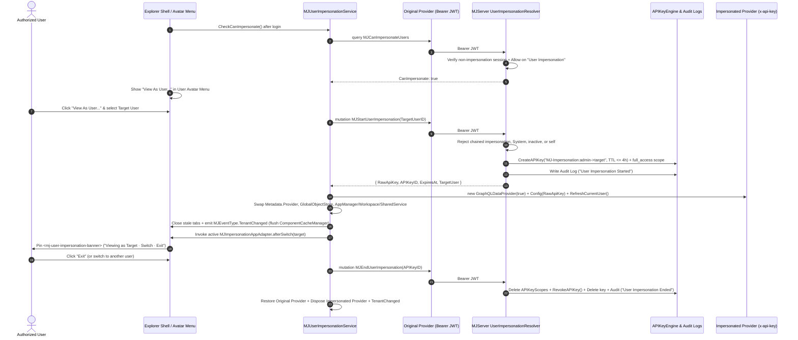

# User Impersonation Guide ("View As User...")

MemberJunction provides a built-in, authorization-gated **User Impersonation** mechanism that lets explicitly permitted administrators temporarily experience Explorer and its GraphQL APIs with another user's exact permissions, roles, Field-Level Security (FLS), and Row-Level Security (RLS) scope — without logging out of their Identity Provider (IdP) session and without storing passwords or long-lived tokens.

> [!IMPORTANT]
> **Locked down by default.** The `User Impersonation` authorization ships with **zero role assignments**. Nobody — not even `Owner`, `Administrator`, or `Developer` users — can list impersonatable users, mint an impersonation session, or see the `"View As User..."` avatar menu item until an administrator explicitly grants an `Allow` row in `MJ: Authorization Roles`.

---

## Architecture Overview

User impersonation spans three layers:

1. **Metadata (`metadata/authorizations/` & `metadata/audit-log-types/`)**
   - `MJ: Authorizations` row **`User Impersonation`** (`062370F4-DAEC-4E5E-BD0A-4AF2A28968EE`, `IsActive = true`, `UseAuditLog = true`), with **no** rows in `metadata/authorization-roles/`.
   - `MJ: Audit Log Types` rows: **`User Impersonation Started`**, **`User Impersonation Ended`**, and **`User Impersonation Denied`**.
2. **Server Control Plane (`@memberjunction/server` → `UserImpersonationResolver`)**
   - GraphQL operations `MJCanImpersonateUsers`, `MJListImpersonatableUsers`, `MJStartUserImpersonation`, and `MJEndUserImpersonation`.
   - Mints a short-lived (`2h` default, `4h` max) scoped `MJ: API Keys` token labeled `MJ-Impersonation:<ActorEmail>-><TargetEmail>` bound to the target user with `full_access` scope, and immediately revokes/deletes it on exit or switch.
3. **Explorer Shell & Extension Hook (`@memberjunction/ng-explorer-core`)**
   - `MJUserImpersonationService` preserves the real authenticated `GraphQLDataProvider` (Bearer JWT) for all control-plane calls while swapping the active provider to the impersonated API key provider.
   - `BaseUserMenu` conditionally displays **View As User...** (and **Switch Impersonated User...** / **Exit Impersonation** while active) under the User Avatar menu.
   - `<mj-user-impersonation-dialog>` provides a responsive searchable picker (centered modal on desktop, bottom sheet on mobile) and `<mj-user-impersonation-banner>` pins an always-visible indicator across the top of the shell while active.
   - `MJImpersonationAppAdapter` lets any downstream application enrich users, add one-click Quick Switch presets, add category filter pills, and run custom post-switch navigation.

### End-to-End Sequence



---

## Security Invariants (Fail-Closed)

| Invariant | Enforcement |
|---|---|
| **Zero default access** | `metadata/authorizations/.user-impersonation-authorizations.json` creates `User Impersonation` with zero `MJ: Authorization Roles` grants. `EvaluateUserImpersonationAuthorization()` **never** auto-allows `Owner`, `Administrator`, or `Developer` users without an explicit `Allow` grant. |
| **Deny overrides Allow** | If any role held by the caller has a `Deny` grant on `User Impersonation`, access is denied even if another role holds `Allow` on `User Impersonation` or a parent authorization. |
| **Anti-chaining** | Any request whose `context.userPayload.apiKeyId` resolves to an `MJ-Impersonation:` API key (or cannot be verified) is rejected fail-closed with `FORBIDDEN_IMPERSONATION_CHAIN`. An impersonated session can never list users or mint another impersonation key. |
| **Scope-limited refusal** | `UserImpersonationResolver` is decorated with `@RefuseScopeLimitedPrincipals()` and checks `IsScopeLimitedPrincipal(user)`, blocking anonymous or resource-scoped magic-link sessions. |
| **Forbidden targets** | `System` users (`Type = 'System'`, `Name = 'System'`, or the resolved well-known System user), inactive users (`IsActive = 0`), and self-impersonation are excluded from `MJListImpersonatableUsers` and rejected by `MJStartUserImpersonation`. |
| **Bounded short-lived keys** | Every minted key is clamped to **5–240 minutes** (default **120 minutes / 2 hours**), prefixed with `MJ-Impersonation:`, and immediately stripped of scopes, revoked via `APIKeyEngine.RevokeAPIKey()`, and deleted on exit or switch. `MJEndUserImpersonation` refuses to revoke keys without the `MJ-Impersonation:` prefix. |
| **No IdP credential storage** | Impersonation keys exist only in memory inside the active browser tab (`MJUserImpersonationService`) — never persisted to `localStorage`, `sessionStorage`, or cookies. Refreshing the browser tab cleanly returns to the real authenticated session. |
| **Full RLS / FLS fidelity** | Every GraphQL query and mutation executed by the impersonated `GraphQLDataProvider` authenticates over `X-API-Key` as the target user, passing through MJServer's real `UserCache`, `EntityPermissions`, `RowLevelSecurityFilters`, and `FieldLevelSecurity` pipelines. |

---

## Enabling User Impersonation for an Admin Role

Because nobody has access by default, an administrator must explicitly opt a role into the **`User Impersonation`** authorization.

### Option 1: Via MJ Explorer Admin UI

1. Open **Admin → Security → Authorizations** (or browse the `MJ: Authorizations` entity).
2. Locate **`User Impersonation`** (`IsActive = true`).
3. Under **Authorization Roles** (`MJ: Authorization Roles`), add a row:
   - **Role**: the dedicated role you want to permit (for example, `Administrator` or a dedicated `Support Impersonator` role)
   - **Type**: `Allow`
4. Save. Once metadata refreshes (or on next sign-in), users holding that role will see **View As User...** under the User Avatar menu.

### Option 2: Declarative Metadata (`mj sync push`)

In your deployment or application metadata repository, add a file under `metadata/authorization-roles/`:

```json
[
  {
    "fields": {
      "AuthorizationID": "@lookup:MJ: Authorizations.Name=User Impersonation",
      "RoleID": "@lookup:MJ: Roles.Name=Administrator",
      "Type": "Allow"
    },
    "primaryKey": {
      "ID": "<UUID generated via CLI uuidgen>"
    }
  }
]
```

Push via `mj sync push --dir=metadata --include="authorization-roles"`.

To explicitly block a specific role even if its members also hold a parent authorization, add a row with `"Type": "Deny"`.

---

## Auditing Impersonation Activity

Every impersonation lifecycle event is recorded in `MJ: Audit Logs` using the seeded audit log types:

- **`User Impersonation Started`** (`Status = 'Success'`) — `UserID` is the real actor, `RecordID` is the target user, and `Details` JSON contains `actorUserId`, `actorEmail`, `targetUserId`, `targetEmail`, `apiKeyId`, `ttlMinutes`, and `expiresAt`.
- **`User Impersonation Ended`** (`Status = 'Success'`) — `Details` JSON contains `actorUserId`, `targetUserId`, and `apiKeyId`.
- **`User Impersonation Denied`** (`Status = 'Failed'`) — written whenever an unauthorized list/start/end request, chained impersonation attempt, or forbidden target (`System`) is blocked.

Example audit query (SQL Server):

```sql
SELECT TOP 100
    al.__mj_CreatedAt AS OccurredAt,
    alt.Name          AS EventType,
    al.Status,
    actor.Email       AS ActorEmail,
    al.RecordID       AS TargetUserID,
    al.Description,
    al.Details
FROM [__mj].[vwAuditLogs] al
INNER JOIN [__mj].[vwAuditLogTypes] alt
    ON alt.ID = al.AuditLogTypeID
LEFT JOIN [__mj].[vwUsers] actor
    ON actor.ID = al.UserID
WHERE alt.Name IN (
    'User Impersonation Started',
    'User Impersonation Ended',
    'User Impersonation Denied'
)
ORDER BY al.__mj_CreatedAt DESC;
```

---

## Building App-Specific Extensions (`MJImpersonationAppAdapter`)

The core Explorer dialog works out of the box for any MemberJunction deployment with zero app code. Applications that want richer domain context — such as tenant/organization labels, entitlement badges, one-click persona presets, category filter pills, hiding domain service accounts, or landing on a specific dashboard after switching — can register an `MJImpersonationAppAdapter` with `MJUserImpersonationService`:

```typescript
import { Injectable, inject } from '@angular/core';
import {
  MJUserImpersonationService,
  type MJImpersonationAppAdapter,
  type MJImpersonationCandidate,
} from '@memberjunction/ng-explorer-core';
import { NavigationService } from '@memberjunction/ng-shared';

@Injectable({ providedIn: 'root' })
export class WorkspaceImpersonationExtension {
  private readonly impersonation = inject(MJUserImpersonationService);
  private readonly navigation = inject(NavigationService);

  public Initialize(): () => void {
    const adapter: MJImpersonationAppAdapter = {
      id: 'my-app-impersonation',
      // Scope to specific app path(s) or omit to apply globally across Explorer
      appPaths: ['my-app'],
      priority: 10,
      title: 'View Workspace As User',
      subtitle: 'Preview customer-facing workspaces and RLS policies as any active user.',
      categories: [
        { key: 'internal', label: 'Internal Team', icon: 'fa-solid fa-building' },
        { key: 'external', label: 'External Members', icon: 'fa-solid fa-user-group' },
      ],
      quickPresets: [
        {
          key: 'external-viewer',
          label: 'External Read-Only Member',
          description: 'Single-workspace external participant',
          icon: 'fa-solid fa-eye',
          badgeTone: 'info',
          resolveCandidate: (users) =>
            users.find((u) => u.categoryKey === 'external' && u.roleNames.includes('Viewer')),
        },
      ],
      enrichCandidates: async (users: readonly MJImpersonationCandidate[]) => {
        const memberships = await this.loadWorkspaceMemberships();
        return users.map((user) => {
          const info = memberships.get(user.userId);
          return {
            ...user,
            organization: info?.organizationName ?? null,
            categoryKey: info?.isExternal ? 'external' : 'internal',
            subtitle: info ? `${info.workspaceCount} workspaces` : null,
            badges: info
              ? [{ label: info.accessTier, tone: info.isExternal ? 'warning' : 'success' }]
              : [],
            hidden: Boolean(info?.isServicePrincipal),
          };
        });
      },
      afterSwitch: async (_activeTarget) => {
        await this.navigation.SwitchToAppByPath('my-app', 'Home');
      },
    };

    return this.impersonation.RegisterAppAdapter(adapter);
  }
}
```

Non-DI application drivers (such as class-factory UI drivers) can also look up the active service instance via `GetActiveUserImpersonationService()` from `@memberjunction/ng-explorer-core`.

### Provider Swap Implementation Notes

When switching into or out of an impersonated session, `MJUserImpersonationService` handles four subtle runtime details automatically:

1. **Refresh target identity after `Config()`**: `ProviderBase.Config()` fast-copies entity metadata from the active global provider, so `MJUserImpersonationService` explicitly calls `await provider.RefreshCurrentUser()` on the impersonated `GraphQLDataProvider` before installing it.
2. **In-place provider reference sync**: Updates `SetProvider(provider)`, the `GraphQLDataProvider` Global Object Store slot, `ApplicationManager` (and system apps), `WorkspaceStateManager`, and `SharedService.Instance`, and invalidates the `RunView` dedup cache — deliberately avoiding `UserInfoEngine.Instance.Config(true)` so Explorer's shell does not tear down or re-provision default apps as a restricted user.
3. **Cache flush**: Closes non-active tabs and raises `MJEventType.TenantChanged` on `MJGlobal.Instance`, causing `ComponentCacheManager` to destroy detached resource components so previous-user data never leaks across switches.
4. **Error rollback**: If connecting the new impersonated provider fails, `MJUserImpersonationService` immediately revokes the newly minted key over the preserved original provider and keeps the caller on their existing session.

---

## Related Guides

- [Unified Permissions Guide](UNIFIED_PERMISSIONS_GUIDE.md) — Authorizations (`AuthorizationEvaluator`), Entity Permissions / RLS, and per-record `PermissionEngine`.
- [Field-Level Security Guide](FIELD_LEVEL_SECURITY_GUIDE.md) — Role-based Read/Update/Create field masking enforced under impersonation.
- [Magic Link Access Guide](MAGIC_LINK_GUIDE.md) — App-scoped passwordless external sessions (refused from impersonating users).
