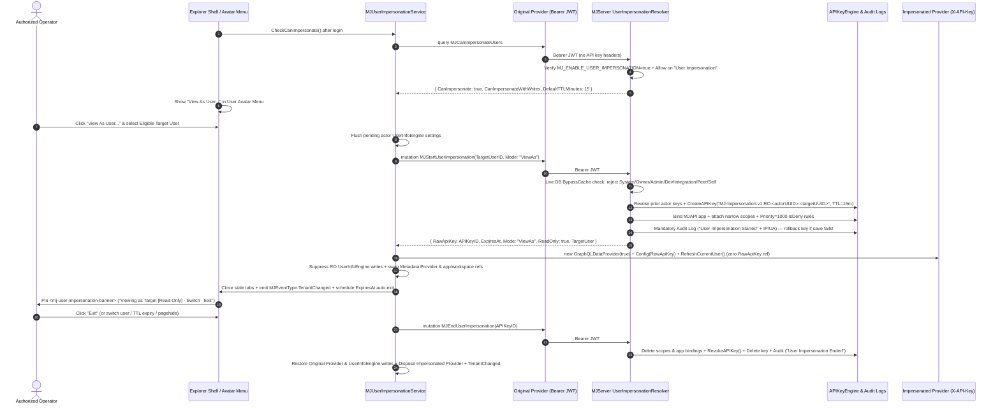

# User Impersonation Guide ("View As User...")

MemberJunction provides a built-in, defense-in-depth **User Impersonation** mechanism that lets explicitly permitted operators temporarily inspect Explorer and its APIs with an end user's exact permissions, roles, Field-Level Security (FLS), and Row-Level Security (RLS) scope — **server-enforced Read-Only (`ViewAs`) by default**, without signing out of their Identity Provider (IdP) session, and without storing passwords or long-lived tokens.

> [!IMPORTANT]
> **Dual-Key Locked Down by Default.** User impersonation is **completely disabled everywhere out of the box** (`MJ_ENABLE_USER_IMPERSONATION=false` AND **zero** role assignments on `User Impersonation`). Nobody — not even `Owner`, `Administrator`, or `Developer` users — can list impersonatable users, mint an impersonation session, or see `"View As User..."` in the avatar menu unless **BOTH** the server infrastructure opt-in flag (`MJ_ENABLE_USER_IMPERSONATION=true`) **AND** an explicit `Allow` row in `MJ: Authorization Roles` are configured.

---

## 6-Layer Security Architecture

User impersonation enforces six independent server + client security layers:

1. **Layer 1 — Dual-Key Infrastructure Kill Switch (Off by Default Everywhere)**
   - Requires **BOTH** `process.env.MJ_ENABLE_USER_IMPERSONATION === 'true'` (or `userImpersonation.enabled: true` in `mj.config.cjs`, default `false`) **AND** an active `Allow` grant on the **`User Impersonation`** `MJ: Authorizations` row (`0` roles granted by default).
   - Setting `MJ_ENABLE_USER_IMPERSONATION=false` acts as an instant emergency kill switch overriding `mj.config.cjs`: `MJCanImpersonateUsers`, `MJListImpersonatableUsers`, `MJStartUserImpersonation`, and active impersonation queries immediately fail closed (`FEATURE_DISABLED`), while `MJEndUserImpersonation` **remains operational** so operators and clients can still revoke and purge previously minted `MJ-Impersonation:` keys mid-incident.

2. **Layer 2 — Server-Enforced Read-Only (`ViewAs`) by Default + Optional Triple-Gated `ActAs`**
   - Default mode is **`ViewAs` (`ReadOnly: true`)**, eliminating non-repudiation and user-framing risk.
   - Enforced across **every transport and data path** in `MJServer`:
     - **Apollo Server (`CreateImpersonationApolloPlugin`)**: `didResolveOperation` rejects 100% of GraphQL `mutation` operations (except standalone `MJEndUserImpersonation` self-revocation, blocking batched-mutation smuggling) with `IMPERSONATION_READ_ONLY`.
     - **WebSocket `graphql-ws` (`ValidateImpersonationWebSocketSubscribe`)**: re-validates key revocation/expiry and rejects WebSocket mutations on `onSubscribe`, plus closes sockets automatically at `ExpiresAt`.
     - **Express Post-Auth HTTP Guard (`CreateImpersonationHttpGuardMiddleware`)**: blocks non-read REST `/api/v1/*` requests and blocks `/oauth/*`, `/magic-link/*`, and `/widget/*` capability routes.
     - **Core DataHooks (`ImpersonationPreSaveHook`, `ImpersonationPreDeleteHook`, `ImpersonationPreRunViewHook`)**: rejects client `BaseEntity.Save()` and `BaseEntity.Delete()` calls and forces `SaveViewResults = false`.
   - **Optional Write Mode (`Mode: 'ActAs'`)** for controlled QA/dev environments requires **ALL THREE**:
     1. `MJ_ENABLE_USER_IMPERSONATION=true` (`userImpersonation.enabled: true`),
     2. `MJ_USER_IMPERSONATION_ALLOW_WRITES=true` (`userImpersonation.allowWrites: true`, default `false`), **AND**
     3. A **direct** `Allow` grant (never inherited from parent `User Impersonation`!) on child authorization **`User Impersonation: Act As (Allow Writes)`** (`C0D0BBD6-74B8-4CE3-ADF6-4081358EE0B9`, `0` roles granted by default).

3. **Layer 3 — Strict Anti-Escalation & Live Target Privilege Ceiling**
   - Hard-blocks listing or impersonating any account that:
     - Is `System` (`Type = 'System'`, `Name = 'System'`, well-known system user, or synthetic anonymous guest),
     - Is `Owner` (`Type = 'Owner'`),
     - Is inactive (`IsActive = false`),
     - Is the caller themselves (`TargetUserID === ActorUserID`),
     - Holds any role in `userImpersonation.protectedTargetRoles` (default: `['Administrator', 'Developer', 'Integration']`),
     - Holds `Allow` on `User Impersonation` or `User Impersonation: Act As (Allow Writes)` (peer impersonators can never impersonate one another).
   - Verified **live against the database (`BypassCache: true`)**, cross-checked with `UserCache`, and re-verified on **every incoming request** in `context.ts` (`GetUserPayload`) to defeat mid-session promotion TOCTOU races.

4. **Layer 4 — Sensitive Entity, Secret & Private Conversation Isolation (Even in `ActAs` Mode)**
   - Impersonation keys **never** receive `full_access`, `apikey:*`, or `agent:trusted` scopes; they receive narrow scopes bound to the `MJAPI` application plus `Priority = 1000, IsDeny = true` scope rules.
   - Additionally enforced at `PreRunView`, `PostRunView`, `PreSave`, `PreDelete`, `ResolverBase` (`CheckUserReadPermissions`, `canMapEntityRecordForUser`, `ArrayMapFieldNamesToCodeNames`, `ExtraFilter` SQL subquery screening), `AdhocQueryResolver`, `QueryResolver`, `DatasetResolver`, `UserResolver`, and `EntityRecordNameResolver`:
     - **Blocked completely (`ViewAs` & `ActAs`)**: `MJ: API Keys*`, `MJ: Credentials*`, `MJ: AI *Credentials*`, `MJ: Encryption Keys*`, `MJ: O Auth*`, `MJ: Audit Logs*`, `MJ: Users` (except resolving own `CurrentUser` at session bootstrap via `AsyncLocalStorage`), `MJ: Roles`, `MJ: User Roles`, `MJ: Authorizations*`, `MJ: Entity *Permissions`, `MJ: Authentication Providers`, `MJ: Magic Link*`, and `MJ: Artifact Guest Share Links`.
     - **Private 1:1 Conversation Isolation**: Unanchored `MJ: Conversations` (`AnchorType IS NULL`) and their `MJ: Conversation Details` are restricted strictly to `UserID = targetUserId`.

5. **Layer 5 — Short Blast-Radius TTL, UUID Single-Active-Session & Fail-Closed Audit Trail**
   - **Short TTL**: Default **`15` minutes**, minimum **`5` minutes**, hard maximum **`60` minutes** (configurable downward via `userImpersonation.maxTtlMinutes` or `MJ_USER_IMPERSONATION_MAX_TTL_MINUTES`).
   - **Collision-Proof Label & Single Active Key per Actor**: Keys are labeled `MJ-Impersonation:v1:<RO|RW>:<actorUserUUID>:<targetUserUUID>` (fixed-width UUIDs immune to email changes or delimiter injection). Minting a new session serializes per actor and automatically revokes & deletes any prior `MJ-Impersonation:` key minted by that actor.
   - **Mandatory Fail-Closed Audit Logging**: `MJStartUserImpersonation` persists the `MJ: Audit Logs` (`User Impersonation Started`) record — capturing caller `ipAddress`, `userAgent`, `requestOrigin`, `mode`, `readOnly`, `ttlMinutes`, and `expiresAt` (never `RawApiKey`!) — **before** returning `RawApiKey`. If the audit write fails or throws, the newly minted key is immediately revoked and deleted and the mutation returns `ResultCode: 'AUDIT_LOG_FAILED'` (`Success: false`).

6. **Layer 6 — Header Anti-Smuggling & Client-Side Hygiene**
   - `context.ts` rejects duplicate conflicting auth headers (`HTTP 400`) and `UserImpersonationResolver` rejects any API-key principal or dual-header (`Authorization: Bearer` + `X-API-Key` / `x-mj-user-api-key`) request.
   - `MJUserImpersonationService` holds `rawApiKey` only in a transient local variable during `GraphQLDataProvider` initialization (never stored on service fields, observable state, DOM attributes, URLs, `UserInfoEngine`, or browser storage), flushes pending actor `UserInfoEngine` settings before switching, suppresses `UserInfoEngine.SetSetting*` mutations during Read-Only impersonation, auto-exits at `ExpiresAt`, and sends a best-effort `keepalive` revocation request on `window.pagehide`.

---

### End-to-End Sequence



---

## Enabling User Impersonation

Because both keys of the dual-key gate are **off by default**, enabling `"View As User..."` requires two explicit steps:

### Step 1: Server Infrastructure Opt-In

Set the environment variable on `MJAPI` (or configure `userImpersonation` in `mj.config.cjs`):

```bash
MJ_ENABLE_USER_IMPERSONATION=true
# Optional: cap TTL below the 60-minute hard ceiling (default is 15 minutes)
# MJ_USER_IMPERSONATION_MAX_TTL_MINUTES=30
```

Or in `mj.config.cjs`:

```javascript
module.exports = {
  // ...
  userImpersonation: {
    enabled: true,              // env override: MJ_ENABLE_USER_IMPERSONATION
    allowWrites: false,         // keep false in production! env override: MJ_USER_IMPERSONATION_ALLOW_WRITES
    defaultTtlMinutes: 15,      // 5..60
    maxTtlMinutes: 60,          // 5..60
    protectedTargetRoles: ['Administrator', 'Developer', 'Integration'],
  },
};
```

> [!WARNING]
> Leave `allowWrites: false` (`MJ_USER_IMPERSONATION_ALLOW_WRITES` unset or `false`) in production environments so every impersonation session is strictly Read-Only (`ViewAs`). Only enable `allowWrites: true` alongside a dedicated role granted **`User Impersonation: Act As (Allow Writes)`** in controlled QA/staging environments when interactive write testing is explicitly required.

### Step 2: Grant the `User Impersonation` Authorization to a Dedicated Operator Role

#### Option A: Via MJ Explorer Admin UI

1. Open **Admin → Security → Authorizations** (`MJ: Authorizations`).
2. Locate **`User Impersonation`** (`062370F4-DAEC-4E5E-BD0A-4AF2A28968EE`).
3. Under **Authorization Roles** (`MJ: Authorization Roles`), add a row:
   - **Role**: a dedicated operator role (for example, `Support Impersonator`)
   - **Type**: `Allow`
4. *(Note: Because peer impersonators and holders of `protectedTargetRoles` cannot be impersonated, granting `User Impersonation` to a narrow support/operator role keeps end-user accounts impersonatable while protecting all privileged accounts.)*

#### Option B: Declarative Metadata (`mj sync push`)

```json
[
  {
    "fields": {
      "AuthorizationID": "@lookup:MJ: Authorizations.Name=User Impersonation",
      "RoleID": "@lookup:MJ: Roles.Name=Support Impersonator",
      "Type": "Allow"
    },
    "primaryKey": {
      "ID": "<UUID generated via CLI uuidgen>"
    }
  }
]
```

Push via `mj sync push --dir=metadata --include="authorization-roles"`.

---

## Auditing Impersonation Activity

Every impersonation lifecycle event is recorded in `MJ: Audit Logs`:

- **`User Impersonation Started`** (`Status = 'Success'`, **mandatory fail-closed**): `UserID` is the real actor, `RecordID` is the target user, `AuthorizationID` links to `User Impersonation` (or `User Impersonation: Act As (Allow Writes)`), and `Details` JSON records `actorUserId`, `actorEmail`, `targetUserId`, `targetEmail`, `apiKeyId`, `mode`, `readOnly`, `ttlMinutes`, `expiresAt`, `ipAddress`, `userAgent`, and `requestOrigin`.
- **`User Impersonation Ended`** (`Status = 'Success'`): `Details` JSON records `actorUserId`, `invokedByUserId`, `targetUserId`, and `apiKeyId`.
- **`User Impersonation Denied`** (`Status = 'Failed'`): written whenever a disabled-feature probe, unauthorized list/start/end call, `ActAs` write-mode refusal, chained impersonation attempt, or forbidden target (`System`/`Owner`/`Administrator`/peer impersonator) is blocked.

Example audit query (SQL Server):

```sql
SELECT TOP 100
    al.__mj_CreatedAt AS OccurredAt,
    alt.Name          AS EventType,
    al.Status,
    actor.Email       AS ActorEmail,
    al.RecordID       AS TargetUserID,
    al.Description,
    al.Details
FROM [__mj].[vwAuditLogs] al
INNER JOIN [__mj].[vwAuditLogTypes] alt
    ON alt.ID = al.AuditLogTypeID
LEFT JOIN [__mj].[vwUsers] actor
    ON actor.ID = al.UserID
WHERE alt.Name IN (
    'User Impersonation Started',
    'User Impersonation Ended',
    'User Impersonation Denied'
)
ORDER BY al.__mj_CreatedAt DESC;
```

---

## Building App-Specific Extensions (`MJImpersonationAppAdapter`)

The core Explorer dialog works out of the box for any MemberJunction deployment with zero application code. Applications that want richer domain context — such as tenant/organization labels, entitlement badges, one-click persona presets, category filter pills, hiding domain service accounts, or landing on a specific dashboard after switching — can register an `MJImpersonationAppAdapter` with `MJUserImpersonationService`:

```typescript
import { Injectable, inject } from '@angular/core';
import {
  MJUserImpersonationService,
  type MJImpersonationAppAdapter,
  type MJImpersonationCandidate,
} from '@memberjunction/ng-explorer-core';
import { NavigationService } from '@memberjunction/ng-shared';

@Injectable({ providedIn: 'root' })
export class WorkspaceImpersonationExtension {
  private readonly impersonation = inject(MJUserImpersonationService);
  private readonly navigation = inject(NavigationService);

  public Initialize(): () => void {
    const adapter: MJImpersonationAppAdapter = {
      id: 'my-app-impersonation',
      appPaths: ['my-app'],
      priority: 10,
      title: 'View Workspace As User',
      subtitle: 'Preview customer-facing workspaces and RLS policies in Read-Only mode.',
      categories: [
        { key: 'internal', label: 'Internal Team', icon: 'fa-solid fa-building' },
        { key: 'external', label: 'External Members', icon: 'fa-solid fa-user-group' },
      ],
      quickPresets: [
        {
          key: 'external-viewer',
          label: 'External Read-Only Member',
          description: 'Single-workspace external participant',
          icon: 'fa-solid fa-eye',
          badgeTone: 'info',
          resolveCandidate: (users) =>
            users.find((u) => u.categoryKey === 'external' && u.roleNames.includes('Viewer')),
        },
      ],
      enrichCandidates: async (users: readonly MJImpersonationCandidate[]) => {
        const memberships = await this.loadWorkspaceMemberships();
        return users.map((user) => {
          const info = memberships.get(user.userId);
          return {
            ...user,
            organization: info?.organizationName ?? null,
            categoryKey: info?.isExternal ? 'external' : 'internal',
            subtitle: info ? `${info.workspaceCount} workspaces` : null,
            badges: info
              ? [{ label: info.accessTier, tone: info.isExternal ? 'warning' : 'success' }]
              : [],
            hidden: Boolean(info?.isServicePrincipal),
          };
        });
      },
      afterSwitch: async (_activeTarget) => {
        await this.navigation.SwitchToAppByPath('my-app', 'Home');
      },
    };

    return this.impersonation.RegisterAppAdapter(adapter);
  }
}
```

Non-DI application drivers can also look up the active service instance via `GetActiveUserImpersonationService()` from `@memberjunction/ng-explorer-core`.

---

## Related Guides

- [Unified Permissions Guide](UNIFIED_PERMISSIONS_GUIDE.md) — Authorizations (`AuthorizationEvaluator`), Entity Permissions / RLS, and per-record `PermissionEngine`.
- [Field-Level Security Guide](FIELD_LEVEL_SECURITY_GUIDE.md) — Role-based Read/Update/Create field masking enforced under impersonation.
- [Magic Link Access Guide](MAGIC_LINK_GUIDE.md) — App-scoped passwordless external sessions (refused from impersonating users).
