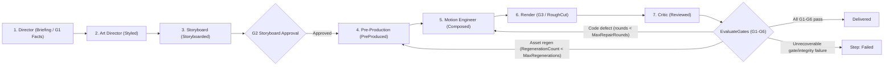

# Video Studio Guide

## 1. What it is

Video Studio turns a creative brief, an organization's Brand Kit (`MJ: Brand Kits` and `MJ: Brand Kit Assets`), and governed MemberJunction data (`MJ: Queries`, `RunView`, or `MJ: Artifact Versions`) into deterministic, broadcast-grade multi-aspect MP4 films (`16:9`, `9:16`, `1:1`), poster stills, WebVTT captions, contact sheets, and a versioned `Video Production` (`MJ: Artifacts`) deliverable. The entire production lifecycle — from creative brief to final delivery — is governed by a single typed `VideoGenerationSpec` JSON contract (`VIDEO_STUDIO_SPEC_VERSION = '1.0'`).

Video Studio separates **code-rendered motion** from **generated footage**. Every scene beat is authored as deterministic HTML/CSS/SVG/GSAP motion for [HyperFrames](https://github.com/heygen-com/hyperframes) (`0.8.134`) and rendered frame-accurately in headless Chromium + `ffmpeg`, ensuring that brand typography, color palettes, logos, product screenshots, and data charts (`MJChartKit`) are pixel-exact and never hallucinated. Generative AI (`FLUX 3 Image` via `AIImageGenerationRunner` and `FLUX 3 Video` via `AIVideoRunner`) is used only when a beat explicitly requests atmospheric B-roll, conceptual illustrations, or transition clips under `Assets.Generate`; every request is screened before spend against `EffectiveBrandGenerationPolicy` and `NeverInvent` (`ScreenGenerationRequest`) and disclosed with full provenance (`ModelID`, `PromptRunID`, `C2PA`, `Cost`, `TotalVideoSeconds`, `TotalCost`; the stored `MJ: Files` row's `Description` also records `job=<VendorJobID>`).

---

## 2. Architecture

### Workspace and UI packages

| Package | Path | Runtime boundary & key exports |
|---|---|---|
| `@memberjunction/video-studio-core` | [`packages/AI/VideoStudio/Core`](../packages/AI/VideoStudio/Core) | **Browser + Server** (zero Node/DB imports): `VideoGenerationSpec`, pure validator `ValidateVideoGenerationSpec`, `MJChartKit` (`CreateMJChartKit`, `WithChartKit`), data literal helpers (`BuildDataCheckInputs`, `FormatAsOfCardText`), `DescribeGeneratedAssets`, and the render worker wire contract (`RENDER_WORKER_ROUTES` in [`render-contract.ts`](../packages/AI/VideoStudio/Core/src/render-contract.ts)). |
| `@memberjunction/video-studio` | [`packages/AI/VideoStudio/Engine`](../packages/AI/VideoStudio/Engine) | **Server / MJAPI**: `VideoStudioAgent` and stage drivers (`VideoStudioArtDirectorAgent`, `VideoStudioPreProductionAgent`, `VideoStudioMotionEngineerAgent`, `VideoStudioRenderAgent`, `VideoStudioCriticAgent`, `VideoStudioAgentBase`), `ValidateVideoGenerationSpecAsync`, `EvaluateGates`, `CaptureDataSnapshot`, `RunNarrationPipeline`, `GenerateRequestedAssets`, `VideoRenderEngine` (`LocalWorkerRenderDriver`, `RemoteRenderDriver`, `DockerRenderDriver`), `StoreFile` / `ReadStoredFile`, and `ProduceVideoAction`. |
| `@memberjunction/video-studio-render-worker` | [`packages/AI/VideoStudio/RenderWorker`](../packages/AI/VideoStudio/RenderWorker) | **Isolated Node `>=22` worker / container**: `CreateRenderWorkerServer` ([`server.ts`](../packages/AI/VideoStudio/RenderWorker/src/server.ts)), one-shot CLI ([`one-shot.ts`](../packages/AI/VideoStudio/RenderWorker/src/one-shot.ts)), `StageRenderBundle` ([`bundle.ts`](../packages/AI/VideoStudio/RenderWorker/src/bundle.ts)), `InjectPreambleIntoHtml` ([`preamble.ts`](../packages/AI/VideoStudio/RenderWorker/src/preamble.ts)), `RunLintGate` ([`lint-gate.ts`](../packages/AI/VideoStudio/RenderWorker/src/lint-gate.ts)), and `HyperFramesRenderBackend` ([`hyperframes-backend.ts`](../packages/AI/VideoStudio/RenderWorker/src/hyperframes-backend.ts)). |
| `@memberjunction/core-entities` | [`packages/MJCoreEntities`](../packages/MJCoreEntities) | Metadata caches `BrandKitEngine` (`MJ: Brand Kits`, `MJ: Brand Kit Assets`) and `VideoStudioEngine` (`MJ: Video Archetypes`). |
| `@memberjunction/ng-brand-kits` & `@memberjunction/ng-media-player` | [`packages/Angular/Generic/brand-kits`](../packages/Angular/Generic/brand-kits), [`packages/Angular/Generic/media-player`](../packages/Angular/Generic/media-player) | Reusable Brand Kit editors (`<mj-brand-kit-assets-editor>`, `<mj-brand-kit-generation-policy-editor>`) and streaming video/audio player (`<mj-media-player>`, `<mj-storage-media-player>`). |
| `@memberjunction/ng-artifacts` & `@memberjunction/ng-dashboards` | [`packages/Angular/Generic/artifacts`](../packages/Angular/Generic/artifacts), [`packages/Angular/Explorer/dashboards/src/VideoStudio`](../packages/Angular/Explorer/dashboards/src/VideoStudio) | `VideoProductionViewerComponent` (`VideoProductionViewerPlugin`), `VideoProductionArtifactPreviewComponent`, and the 4-tab Explorer `Video Studio` application (`Productions`, `Studio`, `Brand Kits`, `Archetypes`). |

### Root orchestrator and seven stage sub-agents

`VideoStudioAgent` ([`packages/AI/VideoStudio/Engine/src/agents/video-studio-agent.ts`](../packages/AI/VideoStudio/Engine/src/agents/video-studio-agent.ts)) drives a seven-stage state machine defined in `VIDEO_STUDIO_STAGES` and seeded in [`metadata/agents/.video-studio-agent.json`](../metadata/agents/.video-studio-agent.json):

| Order | Stage Sub-Agent (`Name`) | `DriverClass` / execution mode | Spec `Status` transition & responsibility |
|---|---|---|---|
| `1` | `Video Studio - Director` | `LoopAgentType` (`Video Studio - Director` prompt) | `Briefing` → `Briefing`: Selects the archetype, target duration/formats (`Film`), `DataBindings`, and initial `Assets.Approved` / `Assets.Required` mapping (`G1` Facts gate is evaluated by `VideoStudioAgent`; a `'Blocked'` `G1` stops the run). |
| `2` | `Video Studio - Art Director` | `VideoStudioArtDirectorAgent` ([`art-director-agent.ts`](../packages/AI/VideoStudio/Engine/src/agents/art-director-agent.ts)) | `Briefing` → `Styled`: Inspects up to `MAX_REFERENCES = 6` reference media items via `Video Studio - Reference Analysis` (`PickReferences` / `BuildReferenceBlocks`, inlining video up to `MAX_INLINE_REFERENCE_VIDEO_BYTES = 20 * 1024 * 1024` when the primary model for `Video Studio - Reference Analysis` supports video input via `ResolvePromptPrimaryModelId`, or extracting up to `MAX_KEYFRAME_IMAGES = 4` keyframes via `ExtractKeyframes`), then runs `Video Studio - Art Director` to populate `Style` (`Palette`, `Typography`, `Composition`, `Pacing`, `MotionRules`, `References`). |
| `3` | `Video Studio - Storyboard` | `LoopAgentType` (`Video Studio - Storyboard` prompt) | `Styled` → `Storyboarded` (then `Approved` once `G2` Storyboard approval passes): Designs contiguous scene `Beats`, `NarrationScript`, `Captions` mode, `AudioMix`, and any `Assets.Generate` requests. |
| `4` | `Video Studio - Pre-Production` | `VideoStudioPreProductionAgent` ([`pre-production-agent.ts`](../packages/AI/VideoStudio/Engine/src/agents/pre-production-agent.ts)) | `Approved` → `PreProduced`: Deterministic 4-step `'Tool'` pipeline (`"Data Snapshot"`, `"Generate Assets"`, `"Narration"`, `"Stage Assets"`; Pre-Production records no gate). |
| `5` | `Video Studio - Motion Engineer` | `VideoStudioMotionEngineerAgent` ([`motion-engineer-agent.ts`](../packages/AI/VideoStudio/Engine/src/agents/motion-engineer-agent.ts)) | `PreProduced` → `Composed`: Runs `Video Studio - Motion Engineer` per deliverable format to author `Output.Source[fmt]`, runs static `CheckProductionRules` + `driver.Check(..., { StaticOnly: true })`, and repairs lint errors up to `MAX_LINT_ATTEMPTS = 3` via `Video Studio - Motion Engineer Lint Fix`. |
| `6` | `Video Studio - Render` | `VideoStudioRenderAgent` ([`render-agent.ts`](../packages/AI/VideoStudio/Engine/src/agents/render-agent.ts)) | `Composed` → `RoughCut`: Executes 4 steps per format (`"Check <fmt>"`, `"Stills <fmt>"`, `"Contact sheets <fmt>"`, `"Render <fmt>"`), uploads MP4/stills/sheets via `StoreFile`, and records gate `G3` once every deliverable format has contact sheets. |
| `7` | `Video Studio - Critic` | `VideoStudioCriticAgent` ([`critic-agent.ts`](../packages/AI/VideoStudio/Engine/src/agents/critic-agent.ts)) | `RoughCut` → `Reviewed`: Reviews contact sheets and transition strips (`PickSheetsForCall`) via `Video Studio - Critic`, scores the `Video Production Quality` rubric (`RubricScoring.Compute`, `MAX_DEFECTS_PER_FORMAT = 3`), and writes `Review.Rounds` and `Review.Scores` (the Critic records no gate; the root `VideoStudioAgent` evaluates all six gates `G1`–`G6` via `EvaluateGates` and sets `Status = 'Delivered'` only after all six pass). |



---

## 3. The `VideoGenerationSpec`

`VideoGenerationSpec` ([`packages/AI/VideoStudio/Core/src/video-generation-spec.ts`](../packages/AI/VideoStudio/Core/src/video-generation-spec.ts); see also [`packages/AI/VideoStudio/Core/README.md`](../packages/AI/VideoStudio/Core/README.md) and [`packages/AI/VideoStudio/Core/generated-for-prompt/video-generation-spec.ts.generated-for-prompt.md`](../packages/AI/VideoStudio/Core/generated-for-prompt/video-generation-spec.ts.generated-for-prompt.md)) is the single payload mutated across every stage of a production (`SpecVersion: '1.0'`).

### Facts vs. creative choices

The spec separates **caller/system facts** from **agent-authored creative choices**:
- **Authoritative facts (`CompanyID`, `BrandKitID`, `Archetype`, `Interaction`, `DataBindings`, `DataSnapshot`, `Assets.Approved`, `Assets.Required`, `Assets.NeverInvent`):** Seeded by the caller (`ProduceVideoAction`, Studio Start form, or `SubAgentInputMapping`) and resolved by deterministic Pre-Production tools (`CaptureDataSnapshot`, `BrandKitEngine`). Stage prompts cannot invent inline data or bypass brand policies.
- **Creative and runtime sections (`Film`, `Style`, `Beats`, `NarrationScript`, `Captions`, `AudioMix`, `Assets.Generate`, `PreProduction`, `Output`, `Review`):** Populated progressively by the seven stage sub-agents as `Status` advances through the 10 `VIDEO_PRODUCTION_STATUSES`:
  `'Briefing'` → `'Styled'` → `'Storyboarded'` → `'Approved'` → `'PreProduced'` → `'Composed'` → `'RoughCut'` → `'Reviewed'` → `'Delivered'` (or `'Blocked'`).

### Pure and async validation

1. **Stage-aware pure validator (`ValidateVideoGenerationSpec` in [`packages/AI/VideoStudio/Core/src/validate-spec.ts`](../packages/AI/VideoStudio/Core/src/validate-spec.ts)):**
   - Enforces `STAGE_REQUIRED_SECTIONS` for the current `Status`: requires `Film`, `Interaction`, `Assets`, and `DataBindings` from `'Briefing'`; adds `Style` at `'Styled'`; adds `Beats` and `NarrationScript` at `'Storyboarded'` (and `'Approved'`); adds `PreProduction` at `'PreProduced'` (through `'Reviewed'`); and adds `Output` only at `'Delivered'` (there is no `'Review'` entry in `STAGE_REQUIRED_SECTIONS`).
   - Validates contiguous beat timelines (`BEAT_TIMELINE_TOLERANCE_SECONDS = 0.05` via `BeatsMustStartAtZero`, `NonContiguousBeats`, `BeatsDurationMismatch`), asset and reference resolution (`UnmetMustUseRequirement`, `GeneratedAssetNotAllowedForRequirement`, `UnresolvedReferenceKey`), data binding integrity (`UnknownOnScreenPlaceholder`, `UnboundNumericOnScreenText`, `MissingDataSnapshot`), and deliverable storage (`MissingOutputManifest`, `MissingOutputVideoPayload`, `OutputVideoFormatKeyMismatch`) across all 33 `VIDEO_SPEC_ERROR_CODES`.
2. **Server-side async validator (`ValidateVideoGenerationSpecAsync` in [`packages/AI/VideoStudio/Engine/src/validate-spec-async.ts`](../packages/AI/VideoStudio/Engine/src/validate-spec-async.ts)):**
   - Runs `ValidateVideoGenerationSpec` first, then checks `BrandKitEngine` (`BrandKitNotFound`, `BrandKitNotInScope`), `VideoStudioEngine` (`ArchetypeNotFound`), and batched `MJ: Files` existence and `Status === 'Uploaded'` (`FILE_VALIDATION_BATCH_SIZE = 500`, `InvalidFileID`, `FileNotReadable`, `AsyncValidationFailed`).

---

## 4. Power levels

Video Studio ships three `MJ: AI Configurations` presets in [`metadata/ai-configurations/.video-studio-configurations.json`](../metadata/ai-configurations/.video-studio-configurations.json), parsed at runtime by `ResolveVideoStudioSettings` / `ParseVideoStudioSettings` ([`packages/AI/VideoStudio/Engine/src/settings.ts`](../packages/AI/VideoStudio/Engine/src/settings.ts), where `DEFAULT_VIDEO_STUDIO_SETTINGS` matches `Standard`):

| Setting / model | `Draft` (`Video Studio Draft`) | `Standard` (`Video Studio Standard`, default) | `High` (`Video Studio High`) |
|---|---|---|---|
| Parent `MJ: AI Configurations` | `Fast` | `Standard` | `High Power` |
| Primary creative/critic LLM | `Gemini 3.8 Flash` (`EffortLevel: 25`) | `Gemini 3.8 Flash` | `Claude Opus 5.5` |
| `VideoStudio.RenderQuality` & `FrameSizeFor` | `'draft'` (`1280×720`, `720×1280`, `720×720`) | `'standard'` (`1920×1080`, `1080×1920`, `1080×1080`) | `'high'` (`2560×1440`, `1440×2560`, `1440×1440`) |
| `VideoStudio.Fps` | `24` | `30` | `30` |
| `VideoStudio.Formats` | `'First'` (renders `Film.Formats[0]` only) | `'All'` | `'All'` |
| `VideoStudio.MaxRepairRounds` | `0` | `2` | `3` |
| `VideoStudio.GenerationQuality` | `'draft'` | `'standard'` | `'high'` |
| `VideoStudio.MaxGeneratedVideoSeconds` | `20` | `40` | `60` |
| `VideoStudio.MaxRegenerations` | `1` | `1` | `1` |

Callers select a power level via:
- The `@Video Studio` mention preset pin or conversation preset picker (saved in `MJ: User Settings` under `AgentModeSettingKey`),
- The `PowerLevel` input parameter (`'Draft' | 'Standard' | 'High'`) on `Produce Video`,
- `ConfigurationID` on `AgentScheduledJobDriver` or `ExecuteAgentParams.configurationId`, or
- `MJ: AI Agent Relationships.ConfigurationPresetID` (seeded to `Standard` for `Query Builder` and `Research Report Writer`).

---

## 5. Gates, critic, and the `Video Production Quality` rubric

### Gates `G1`–`G6` (`EvaluateGates`) and `Interaction.Mode`

`EvaluateGates` ([`packages/AI/VideoStudio/Engine/src/gates.ts`](../packages/AI/VideoStudio/Engine/src/gates.ts)) evaluates six production gates on `Review.Gates` (`Status = 'Delivered'` is set by `VideoStudioAgent` only after all six gates `G1`–`G6` pass):

| Gate | Name (`gates.ts`) | Pass requirements |
|---|---|---|
| `G1` | **Facts** (`evaluateGateG1`) | Required brief fields (`Film`, `Archetype`, `BrandKitID`, `CompanyID`) are present, the brand kit is in `CompanyID` scope, every `MustUse` requirement is satisfied by an approved non-generated asset in `Assets.Approved`, and every `DataBindings` source shape is valid (`'Query'` has `QueryID`, `'View'` has `EntityName` and non-empty `Fields`, `'Artifact'` has `ArtifactVersionID`, and `'Inline'` binding `Key` exists in `DataSnapshot.Inline`). A `'Blocked'` `G1` stops the run. |
| `G2` | **Storyboard / Plan approval** (`evaluateGateG2`) | `ValidateVideoGenerationSpec` passes at `'Storyboarded'` (`Beats`, `Style`, `NarrationScript`), then passes immediately when effective `Interaction.Mode === 'Autonomous'` or stays `'Pending'` (`Notes: 'AwaitingApproval'`) under `'ApproveStoryboard'` / `'ApproveStoryboardAndRoughCut'` until the `G2` `GateRecord` has `Notes === 'Approved'`. |
| `G3` | **Stills / Contact sheets** (`evaluateGateG3`) | Preserves `VideoStudioRenderAgent`'s recorded `G3`, or passes once every deliverable format in `DeliverableFormats` has `Output.ContactSheetFileIDs[fmt]`. |
| `G4` | **Rough cut** (`evaluateGateG4`) | Every deliverable format has `Output.Videos[fmt]` (`FileID` or `InlineBase64`) and at least one `Review.Rounds` entry was completed at or after `Output.RenderMetadata.RenderedAt`; stays `'Pending'` (`Notes: 'AwaitingApproval'`) under `'ApproveStoryboardAndRoughCut'` until the `G4` `GateRecord` has `Notes === 'Approved'`. |
| `G5` | **Repair** (`evaluateGateG5`) | At least one Critic round is present in `Review.Rounds` and there is no terminal failure (`Failed`), with either no open `'Major'`/`'Blocker'` defect, or the repair round cap (`MaxRepairRounds`) reached with zero open integrity defects (`shown-values-match-the-data-snapshot`, `generated-assets-are-honest-and-disclosed`). |
| `G6` | **Deliverables** (`evaluateGateG6`) | Every deliverable format has a video (`FileID` or `InlineBase64`), `Output.PosterFileID` is set, sidecar `CaptionsFileID` is set when `Captions.BurnIn === false`, `PreProduction.NarrationAudio.AudioFileID` is set when `NarrationScript` has lines, and `Output.RenderMetadata` is populated. |

#### Approval modes (`Interaction.Mode`)

`Interaction.Mode` (`VideoInteractionMode` in [`video-generation-spec.ts`](../packages/AI/VideoStudio/Core/src/video-generation-spec.ts)) supports three modes: `'Autonomous' | 'ApproveStoryboard' | 'ApproveStoryboardAndRoughCut'`. `VideoStudioAgent` resolves the effective interaction mode in priority order:
1. Caller-supplied `spec.Interaction?.Mode`, if set;
2. `'ApproveStoryboard'` when `ExecuteAgentParams.planMode === true`;
3. `'Autonomous'` when running below the root (`parentRunId` / sub-agent invocation, so `Query Builder` and `Research Report Writer` consult runs execute in `'Autonomous'` mode and never pause via `Consult`);
4. The resolved archetype's `DefaultInteractionMode`;
5. `'Autonomous'`.

`VideoStudioAgent` never writes a derived `Interaction.Mode` into the spec — it retains `Interaction.Mode` only when supplied by the caller and otherwise deletes `Interaction`. When an approval pause is required, `VideoStudioAgent` emits a `'Plan'` step (`MJ: AI Agent Requests`; see [Agent Skills & Plan Mode Guide](AGENT_SKILLS_AND_PLAN_MODE_GUIDE.md)) at `G2` before Pre-Production (`DescribeStoryboardForApproval` / `ReadApprovalDecision`) and, under `'ApproveStoryboardAndRoughCut'`, at `G4` before delivery.

### The `Video Production Quality` rubric

`VideoStudioCriticAgent` ([`packages/AI/VideoStudio/Engine/src/agents/critic-agent.ts`](../packages/AI/VideoStudio/Engine/src/agents/critic-agent.ts)) always sends contact sheets (`PickSheetsForCall` in [`review/critic-input.ts`](../packages/AI/VideoStudio/Engine/src/review/critic-input.ts): up to 4 grids plus the transition strip per deliverable format), runs one `Video Studio - Critic` prompt call per deliverable format (`MAX_DEFECTS_PER_FORMAT = 3`), keeps the worst level per criterion across formats, scores the nine criteria on the seeded `Video Production Quality` rubric (`ID: 9860024F-9B41-4A44-B0DA-39066BF0FEE2` in [`metadata/rubrics/.video-production-quality.json`](../metadata/rubrics/.video-production-quality.json), `PassThreshold: 0.7`, scale `"Meets / Partial / Miss"`) via `RubricScoring.Compute` (see the [Rubrics Guide](RUBRICS_GUIDE.md)), and writes `Review.Rounds` (`Review.Rounds[].Defects`) and `Review.Scores` (`Review.Scores.OverallScore`).

The rubric evaluates nine criteria:
1. `hook-lands-in-the-first-two-seconds` (`Weight: 1`)
2. `readable-at-phone-size` (`Weight: 1`)
3. `type-and-color-stay-consistent` (`Weight: 1`)
4. `motion-has-weight-and-a-clear-focus` (`Weight: 1`)
5. `sound-is-in-sync-with-the-picture` (`Weight: 1`)
6. `stays-on-brand` (`Weight: 1`)
7. `shown-values-match-the-data-snapshot` (`Weight: 1`, `IsGate: true`, `GateMinimumScore: 0.6`)
8. `final-frame-works-as-a-poster` (`Weight: 1`)
9. `generated-assets-are-honest-and-disclosed` (`Weight: 1`, `IsGate: true`, `GateMinimumScore: 0.6`)

### Bounded repair loop and evidence clearing

When `VideoStudioCriticAgent` reports defects (`Review.Rounds[].Defects`), `VideoStudioAgent` coordinates bounded repairs ([`packages/AI/VideoStudio/Engine/src/agents/video-studio-agent.ts`](../packages/AI/VideoStudio/Engine/src/agents/video-studio-agent.ts), [`packages/AI/VideoStudio/Engine/src/gates.ts`](../packages/AI/VideoStudio/Engine/src/gates.ts), and [`packages/AI/VideoStudio/Engine/src/review/human-review-notes.ts`](../packages/AI/VideoStudio/Engine/src/review/human-review-notes.ts)):
- **Code/layout repair (`BuildRepairBrief` → Motion Engineer → Render → Critic) and asset regeneration (`RequestRegeneration` → Pre-Production → Motion Engineer → Render → Critic):** Repair rounds are capped by the active preset's `MaxRepairRounds` (`0` in `Draft`, `2` in `Standard`, `3` in `High`), with a revision run counting only its own new rounds via `_initialRoundCount` (and per-asset regeneration capped at `MaxRegenerations = 1`).
- **Stale evidence invalidation (`ClearStaleEvidence(stageName, spec)`):** Before a stage re-runs, `ClearStaleEvidence(stageName, spec)` clears downstream artifacts and gate evidence so a run cannot reach `'Delivered'` on stale outputs: re-running `'Video Studio - Director'`, `'Video Studio - Art Director'`, or `'Video Studio - Storyboard'` clears `G2`–`G4`, `Output.Source`, and render evidence; re-running `'Video Studio - Pre-Production'` or `'Video Studio - Motion Engineer'` clears `Output.Videos`, `Output.ContactSheetFileIDs`, `Output.PosterFileID`, `Output.RenderMetadata`, and `G3`/`G4`.
- **Unrecoverable gate/integrity failure vs. deferred review notes (`FindIntegrityOrGateCriterionFailure`):** Before the `G4` pause, `FindIntegrityOrGateCriterionFailure` ends the run with step `'Failed'` (not `Status = 'Blocked'`) when a gate criterion fails (`shown-values-match-the-data-snapshot` or `generated-assets-are-honest-and-disclosed` below `GateMinimumScore`) and either no repairable defect remains or the round cap (`MaxRepairRounds`) is reached, or when an open integrity defect remains once `MaxRepairRounds` is reached. If only non-integrity defects remain when `MaxRepairRounds` is reached, remaining defects are marked `'Deferred'` and summarized in `Review.HumanReviewNotes` via `ComposeHumanReviewNotes`.

---

## 6. Render drivers and the isolated worker

`VideoRenderEngine` ([`packages/AI/VideoStudio/Engine/src/render/video-render-engine.ts`](../packages/AI/VideoStudio/Engine/src/render/video-render-engine.ts)) resolves a `VideoRenderDriverBase` implementation via MJ `ClassFactory` using the `videoStudio.render.driver` key in `mj.config.cjs`. Settings are parsed and validated by `ReadVideoRenderSettings` ([`packages/AI/VideoStudio/Engine/src/render/render-settings.ts`](../packages/AI/VideoStudio/Engine/src/render/render-settings.ts)).

### `mj.config.cjs` settings (`videoStudio.render`)

```javascript
// mj.config.cjs
module.exports = {
  videoStudio: {
    render: {
      // 'LocalWorker' (default) | 'Remote' | 'Docker'
      driver: 'LocalWorker',

      // Maximum bytes accepted for a rendered MP4 (shared by LocalWorker, Remote, and Docker; default: 536870912 = 512 MiB)
      maxOutputBytes: 536870912,

      // Operation timeouts in milliseconds
      timeouts: {
        startupMs: 60000,    // LocalWorker startup + /health readiness (default: 60,000 ms)
        renderMs: 2100000,   // Full /render operation timeout (default: 2,100,000 ms = 35 min)
        requestMs: 600000,   // /stills, /contact-sheet, /check, /keyframes timeout (default: 600,000 ms = 10 min)
      },

      // Used when driver === 'LocalWorker'
      local: {
        // Optional absolute path to @memberjunction/video-studio-render-worker/dist/main.js
        workerEntry: undefined,
        // Optional V8 --max-old-space-size=<N> limit in MiB for the child process
        maxOldSpaceMb: undefined,
      },

      // Used when driver === 'Remote'
      remote: {
        // Single worker base URL (falls back to process.env.VIDEO_STUDIO_RENDER_URL)
        url: undefined,
        // Optional round-robin pool of worker base URLs; when both urls and url are set, urls wins
        urls: undefined,
        // Shared bearer token sent as Authorization: Bearer <token>
        // (falls back to process.env.VIDEO_STUDIO_RENDER_TOKEN)
        token: undefined,
      },

      // Used when driver === 'Docker'
      docker: {
        image: 'mj-video-render-worker:local', // Default image tag
        workspaceRoot: undefined,              // Optional host directory for per-operation mounts
        cpus: 2,                               // --cpus (default: 2)
        memoryMb: 4096,                        // --memory in MiB (default: 4096)
        pidsLimit: 512,                        // --pids-limit (default: 512)
        shmSizeMb: 1024,                       // --shm-size in MiB for Chromium /dev/shm (default: 1024)
      },
    },
  },
};
```

| Setting key | Type | Default | Source constant / reader (`render-settings.ts`) |
|---|---|---|---|
| `videoStudio.render.driver` | `'LocalWorker' \| 'Remote' \| 'Docker'` | `'LocalWorker'` | `DEFAULT_VIDEO_RENDER_DRIVER` |
| `videoStudio.render.maxOutputBytes` | `number` | `536870912` (`512 MiB`) | `DEFAULT_RENDER_MAX_OUTPUT_BYTES` |
| `videoStudio.render.timeouts.startupMs` | `number` | `60000` (`60 s`) | `DEFAULT_RENDER_STARTUP_TIMEOUT_MS` |
| `videoStudio.render.timeouts.renderMs` | `number` | `2100000` (`35 min`) | `DEFAULT_RENDER_TIMEOUT_MS` |
| `videoStudio.render.timeouts.requestMs` | `number` | `600000` (`10 min`) | `DEFAULT_RENDER_REQUEST_TIMEOUT_MS` |
| `videoStudio.render.local.workerEntry` | `string \| undefined` | `undefined` (auto-resolved) | `LocalWorkerRenderDriver.resolveWorkerEntryPath` (`local-worker-render-driver.ts`) |
| `videoStudio.render.local.maxOldSpaceMb` | `number \| undefined` | `undefined` | `LocalWorkerRenderDriver.spawnAndWaitForReady` (`local-worker-render-driver.ts`) |
| `videoStudio.render.remote.url` | `string \| undefined` | `process.env.VIDEO_STUDIO_RENDER_URL` | `ReadVideoRenderSettings` |
| `videoStudio.render.remote.urls` | `string[] \| undefined` | `undefined` (`urls` wins over `url`) | `ReadVideoRenderSettings` / `RemoteRenderDriver` (`remote-render-driver.ts`) |
| `videoStudio.render.remote.token` | `string \| undefined` | `process.env.VIDEO_STUDIO_RENDER_TOKEN` | `ReadVideoRenderSettings` |
| `videoStudio.render.docker.image` | `string` | `'mj-video-render-worker:local'` | `DEFAULT_DOCKER_RENDER_IMAGE` |
| `videoStudio.render.docker.workspaceRoot` | `string \| undefined` | `undefined` (process-wide `0o700` temp dir) | `getOrCreateProcessWorkspaceRoot` (`docker-render-driver.ts`) |
| `videoStudio.render.docker.cpus` | `number` | `2` | `DEFAULT_DOCKER_CPUS` |
| `videoStudio.render.docker.memoryMb` | `number` | `4096` | `DEFAULT_DOCKER_MEMORY_MB` |
| `videoStudio.render.docker.pidsLimit` | `number` | `512` | `DEFAULT_DOCKER_PIDS_LIMIT` |
| `videoStudio.render.docker.shmSizeMb` | `number` | `1024` | `DEFAULT_DOCKER_SHM_SIZE_MB` |

### Driver comparison

| Driver | ClassFactory key & class | Isolation & lifecycle | When to use |
|---|---|---|---|
| **LocalWorker** | `'LocalWorker'` (`LocalWorkerRenderDriver` in [`local-worker-render-driver.ts`](../packages/AI/VideoStudio/Engine/src/render/local-worker-render-driver.ts)) | Spawns a local Node child process bound to `127.0.0.1:0` with a random 32-byte hex bearer token (`VIDEO_STUDIO_RENDER_TOKEN`) and a 12-key environment allowlist (`ALLOWED_WORKER_PARENT_ENV_KEYS`). Shares host network and filesystem permissions. | Local development and trusted compositions only. Logs `LOCAL_WORKER_NETWORK_WARNING` once per process when `VideoRenderEngine` first selects `LocalWorker`. |
| **Remote** | `'Remote'` (`RemoteRenderDriver` in [`remote-render-driver.ts`](../packages/AI/VideoStudio/Engine/src/render/remote-render-driver.ts)) | Sends HTTP requests (`RenderWorkerHttpClient`) to one `url` or a round-robin `urls` pool of pre-running `mj-video-render-worker` servers. | Dedicated render worker fleet, Kubernetes deployments, or Windows hosts (where `DockerRenderDriver` is unsupported). |
| **Docker** | `'Docker'` (`DockerRenderDriver` in [`docker-render-driver.ts`](../packages/AI/VideoStudio/Engine/src/render/docker-render-driver.ts)) | Provisions a fresh container per operation via `DockerSandboxProvider` (`--network none`, `--read-only`, `--cap-drop ALL`, `--security-opt no-new-privileges`), runs `node /app/dist/main.js run <op>`, and stops/kills the container in `finally`. | **Recommended production boundary** for untrusted or LLM-authored compositions on Linux and macOS hosts. |

### `DockerRenderDriver` execution and the three host rules

Build the local worker image from the repository root (`DOCKER_RENDER_IMAGE_BUILD_COMMAND` in `docker-render-driver.ts`):

```bash
docker build -f packages/AI/VideoStudio/RenderWorker/Dockerfile -t mj-video-render-worker:local .
```

For each operation (`'render' | 'stills' | 'contact-sheet' | 'check' | 'keyframes' | 'health'` in `ONE_SHOT_OPERATIONS`), `DockerRenderDriver` calls `DockerSandboxProvider.Provision` ([`packages/AI/AgentHarness/src/sandbox/DockerSandboxProvider.ts`](../packages/AI/AgentHarness/src/sandbox/DockerSandboxProvider.ts)), which starts a detached container:

```text
docker run --detach --rm --name mj-harness-<RunId> \
  --volume <hostPath>:/workspace --workdir /workspace \
  --network none --cpus 2 --memory 4096m --pids-limit 512 --shm-size 1024m \
  --read-only --tmpfs /tmp:rw,size=256m \
  [--user <uid>:<gid> on Linux] \
  --cap-drop ALL --security-opt no-new-privileges \
  mj-video-render-worker:local sleep infinity
```

It then writes `<hostPath>/request.json`, creates `<hostPath>/out`, `<hostPath>/tmp`, and `<hostPath>/home`, and runs the one-shot CLI inside the container via `DockerExecExecutor.Run`:

```text
docker exec --interactive \
  --env TMPDIR=/workspace/tmp --env HOME=/workspace/home \
  mj-harness-<RunId> \
  node /app/dist/main.js run <op> --request /workspace/request.json --out /workspace/out
```

Operators must account for three host rules enforced by `DockerRenderDriver`:

1. **Host OS rules (Windows refused; Linux `--user <uid>:<gid>`; macOS image user):**
   - **Windows (`process.platform === 'win32'`) is refused:** `DockerRenderDriver` throws `VideoRenderError('WorkerUnavailable')` directing operators to use `'Remote'`, because Windows lacks `O_NOFOLLOW` symlink-safe host file reads.
   - **Linux (`process.platform === 'linux'`):** `resolveLinuxDockerUser()` passes `--user ${process.getuid()}:${process.getgid()}` and `chmod 0o700` on `hostRoot`, so files written inside `/workspace/out` are owned by the host MJAPI process user rather than `node` (UID `1000` from the `node:24-bookworm-slim` base image, selected by `USER node` in `RenderWorker/Dockerfile`).
   - **macOS (`process.platform === 'darwin'`):** `--user` is omitted so the container runs as `USER node` while Docker Desktop's file sharing translates ownership back to the host user.
2. **Workspace root and sibling-container volume mounts (`videoStudio.render.docker.workspaceRoot`):**
   - When `workspaceRoot` is omitted, `getOrCreateProcessWorkspaceRoot` creates and reuses one process-wide `0o700` directory via `fs.mkdtemp(path.join(os.tmpdir(), 'mj-video-render-'))`, under which `DockerSandboxProvider` creates per-operation `<workspaceRoot>/run/<RunId>` folders.
   - When MJAPI itself runs inside a Docker container and talks to the host's Docker daemon socket (sibling containers), `--volume <hostPath>:/workspace` is resolved by the **host daemon**, not inside the MJAPI container's overlay filesystem. Mount a shared host directory or named volume at the **exact same absolute path** on both the host and the MJAPI container and set `videoStudio.render.docker.workspaceRoot` to that path.
3. **Safe output move, `O_NOFOLLOW` reads, and `Finalize` teardown:**
   - Before reading any container output, `moveAndVerifySafeOutDir` creates a `0o700` `<hostRoot>.out` directory (`safeOutRoot`), renames `/workspace/out` to `<hostRoot>.out/out` (`safeOutDir`), and verifies via `fs.lstat` that it is a real directory (`!outStat.isSymbolicLink() && outStat.isDirectory()`).
   - Every output file (`<out>/result.json`, `<out>/video.mp4`, `<out>/error.json`) is read via `readRegularFileNoFollow`, which opens the descriptor with `NOFOLLOW_OPEN_FLAGS` (`O_RDONLY | O_NOFOLLOW | O_NONBLOCK`) and checks `handle.stat()` (`isFile()`, `size <= maxBytes`, and `expectedBytes` for `<out>/video.mp4`).
   - On timeout or caller `AbortSignal`, the driver kills the `docker exec` child process (`proc.Kill()`). In `finally`, `provider.Finalize(handle, outcome)` runs `docker stop --time 5 mj-harness-<RunId>` (falling back to `docker kill mj-harness-<RunId>`) and removes `hostRoot`. The driver removes `<hostRoot>.out` **only** when `provider.IsContainerRunning(handle)` (`docker container inspect --format '{{.State.Running}}' mj-harness-<RunId>`) returns `false`, preventing cleanup races against a still-running container.

### `RemoteRenderDriver` transport security, routes, and size caps

`RemoteRenderDriver` (`packages/AI/VideoStudio/Engine/src/render/remote-render-driver.ts`) and `RenderWorkerHttpClient` (`packages/AI/VideoStudio/Engine/src/render/worker-http-client.ts`) communicate over the routes defined in `RENDER_WORKER_ROUTES` ([`packages/AI/VideoStudio/Core/src/render-contract.ts`](../packages/AI/VideoStudio/Core/src/render-contract.ts)):

- `GET /health` (`RENDER_WORKER_ROUTES.Health`) — Readiness probe returning `RenderHealth` (`{ Healthy, NodeVersion, HyperFramesVersion, ChromiumVersion?, FfmpegVersion?, Errors }`).
- `POST /render` (`RENDER_WORKER_ROUTES.Render`) — Streams `application/x-ndjson` (`RenderStreamEvent` lines: `Progress` and `Heartbeat`, followed by a terminal `Result` or `Error`).
- `GET /videos/<videoId>` (`RENDER_WORKER_ROUTES.Video` = `'/videos'`) — Streams the rendered `video/mp4` binary once, then deletes it on the worker (or expires it after 10 minutes via `DEFAULT_VIDEO_TTL_MS`).
- `POST /stills`, `POST /contact-sheet`, `POST /check`, `POST /keyframes` — JSON request/response endpoints.

**Transport and authentication rules:**
- **Client side (`RemoteRenderDriver`):** Accepts `http://` and `https://` URLs. When a worker URL uses plain `http://` to a non-loopback host, the `RemoteRenderDriver` constructor logs a one-time warning per distinct worker URL via `LogWarning`; TLS is not enforced by the client. `token` is optional on the client and, when set, is sent as `Authorization: Bearer <token>`.
- **Server side (`CreateRenderWorkerServer` in `packages/AI/VideoStudio/RenderWorker/src/server.ts`):** Refuses at startup to bind a non-loopback `VIDEO_STUDIO_RENDER_HOST` (such as `0.0.0.0` in Docker) unless `VIDEO_STUDIO_RENDER_TOKEN` is set to a non-empty secret, and requires `Authorization: Bearer <token>` (compared with `crypto.timingSafeEqual`) on every route whenever `VIDEO_STUDIO_RENDER_TOKEN` is set.

**Output size caps (enforced by both `RenderWorkerHttpClient` and `DockerRenderDriver`; response `Content-Length` is never trusted):**

| Stream / file | Cap | Source |
|---|---|---|
| `/health`, `/check`, and error JSON bodies (`<out>/error.json` in Docker), plus each HTTP `/render` NDJSON line (Docker reads `Progress` lines from `docker exec` stdout) | `1 MiB` (`1,048,576` bytes) | `MAX_RENDER_JSON_RESPONSE_BYTES` and HTTP-only `MAX_RENDER_NDJSON_LINE_BYTES` (`worker-http-client.ts`) |
| Rendered MP4 (`GET /videos/<videoId>` and `<out>/video.mp4`) | `videoStudio.render.maxOutputBytes` (default `536,870,912` bytes / `512 MiB`) + exact match against `VideoSizeBytes` on the `Result` event's `RenderResultMetadata` (`<out>/result.json` in Docker) | `DEFAULT_RENDER_MAX_OUTPUT_BYTES` (`render-settings.ts`) |
| Base64 image-carrying JSON responses (`/stills`, `/contact-sheet`, `/keyframes`, and `<out>/result.json` for image ops in Docker) | `Math.min(maxOutputBytes, buffer.constants.MAX_STRING_LENGTH)` | `RenderWorkerHttpClient.httpPostJson` (`worker-http-client.ts`) and `DockerRenderDriver.executeContainerOperation` (`docker-render-driver.ts`) |

### Security boundary and isolated worker defenses

> [!IMPORTANT]
> **Static checks are not the data-leak boundary — `DockerRenderDriver` (`--network none`) is.**
> Compositions require inline scripts (`script-src 'self' 'unsafe-inline'`), so `RunLintGate` (`packages/AI/VideoStudio/RenderWorker/src/lint-gate.ts`) cannot prevent obfuscated inline JS (`self["loc"+"ation"]`) or dynamically constructed `<script>` elements at runtime. In addition, `@hyperframes/producer` and `hyperframes check` make Node-side outbound `fetch()` requests (for example to `https://fonts.googleapis.com` and `https://cdnjs.cloudflare.com` for GSAP) outside Chromium, and `@hyperframes/engine` launches `chrome-headless-shell` with `--no-sandbox`. Always use `DockerRenderDriver` (`--network none`) or an egress-firewalled `Remote` worker for untrusted or LLM-authored compositions; use `LocalWorkerRenderDriver` only for trusted local development.

For the full defense-in-depth walkthrough, see [`packages/AI/VideoStudio/RenderWorker/README.md`](../packages/AI/VideoStudio/RenderWorker/README.md#security-model--defense-in-depth). Key worker facts:

- **Parent environment scrubbing (`BuildWorkerEnv` in `local-worker-render-driver.ts`):** Copies only the 12-key `ALLOWED_WORKER_PARENT_ENV_KEYS` allowlist (`PATH`, `HOME`, `TMPDIR`, `TMP`, `TEMP`, `LANG`, `LC_ALL`, `SystemRoot`, `CHROME_PATH`, `PUPPETEER_EXECUTABLE_PATH`, `PUPPETEER_CACHE_DIR`, `HYPERFRAMES_BROWSER_PATH`) plus `VIDEO_STUDIO_RENDER_HOST=127.0.0.1`, `VIDEO_STUDIO_RENDER_PORT=0`, and `VIDEO_STUDIO_RENDER_TOKEN=<token>`. Because `VIDEO_STUDIO_RENDER_ALLOW_ROOT` is not in the allowlist, `LocalWorkerRenderDriver` cannot spawn a worker when the parent process runs as `uid === 0` (`AssertNonRootUser` in `RenderWorker/src/main.ts` refuses `uid === 0` unless `VIDEO_STUDIO_RENDER_ALLOW_ROOT=1` is present in the worker environment).
- **Bundle staging (`StageRenderBundle` in `RenderWorker/src/bundle.ts`):** Stages files into a directory created with `fs.mkdtemp(path.join(parentDir, 'mj-video-bundle-'))`. `ValidateBundleRelativePath` rejects empty paths, null bytes, backslashes, leading `/`, Windows drive prefixes, and `.` / `..` segments before writing files inside the staged root directory with `fs.writeFile`.
- **Static URL scheme gate (`MJ_NON_BUNDLE_URL` in `RenderWorker/src/lint-gate.ts`):** Rejects every URL scheme in HTML attributes and CSS `url(...)` except `data:` and `blob:`.
- **Injected preamble and CSP (`InjectPreambleIntoHtml` in `RenderWorker/src/preamble.ts`):** Injects `<meta http-equiv="Content-Security-Policy" content="...">` immediately after `<!doctype ...>` (or at byte 0) with `COMPOSITION_CSP`:
  ```text
  default-src 'self' data: blob:; script-src 'self' 'unsafe-inline'; style-src 'self' 'unsafe-inline'; connect-src 'none'; frame-src 'none'; worker-src 'none'; object-src 'none'; base-uri 'none'; form-action 'none'
  ```
- **HyperFrames CLI flags (`RenderWorker/src/hyperframes-backend.ts`):** Invokes `hyperframes check --json --no-proxy --no-browser-gpu <bundleDir>`.
- **Runtime and container image (`RenderWorker/package.json` and `RenderWorker/Dockerfile`):** Requires Node `>=22` (`engines.node` in `RenderWorker/package.json`); the Dockerfile sets `DO_NOT_TRACK=1`, `HYPERFRAMES_NO_TELEMETRY=1`, `VIDEO_STUDIO_RENDER_HOST=0.0.0.0`, `VIDEO_STUDIO_RENDER_PORT=8080`, runs as `USER node` (UID `1000` from the `node:24-bookworm-slim` base image), `EXPOSE 8080`, and uses `CMD ["node", "/app/dist/main.js"]`.

---

## 7. File storage setup

Video Studio and all seven stage sub-agents inherit their target `MJ: File Storage Accounts` row from the `Content Creation` row in `MJ: AI Agent Categories` via `DefaultStorageAccountID` (`BaseAgent.ResolvedStorageAccountId`). During Pre-Production and Render, `StoreFile`, `ReadStoredFile`, and `ReadStoredFileWithType` ([`packages/AI/VideoStudio/Engine/src/storage.ts`](../packages/AI/VideoStudio/Engine/src/storage.ts)) upload and download narration audio, WebVTT captions, generated stills/clips, poster images, contact sheets, and rendered MP4s through `FileStorageEngine.Instance`, recording `MJ: Files` rows (`Status = 'Uploaded'`).

### Inline fallback (`videoStudio.outputs.inlineMaxBytes`)

`ReadVideoStudioOutputSettings` ([`packages/AI/VideoStudio/Engine/src/render/render-settings.ts`](../packages/AI/VideoStudio/Engine/src/render/render-settings.ts)) reads `videoStudio.outputs.inlineMaxBytes` (plural `outputs`; `videoStudio.output` is ignored) from `mj.config.cjs` (`VIDEO_STUDIO_INLINE_MAX_BYTES = 0` by default):
- **When `StoreFile` fails (`storage.ts` & `render-agent.ts`):** `StoreFile` fails only when no storage account exists at all (`FileStorageEngine` falls back to an existing account when the `Content Creation` category has no default) or when the storage upload throws. Poster stills and contact sheets always require `StoreFile` and fail the run before the MP4 step, so `videoStudio.outputs.inlineMaxBytes` covers only a failed MP4 upload in `"Render <fmt>"`.
- **Production default (`inlineMaxBytes: 0`):** If `StoreFile` returns `null` when uploading a rendered MP4, `VideoStudioRenderAgent` fails the run with `NO_STORAGE_ACCOUNT_ERROR_MESSAGE`:
  ```text
  No file storage account resolved for Video Studio. Set Default Storage Account on the 'Content Creation' category.
  ```
- **Local testing opt-in (`inlineMaxBytes > 0`):** When the MP4 upload returns `null` and the rendered MP4 byte length is `<= inlineMaxBytes`, `VideoStudioRenderAgent` stores the video inline on `Output.Videos[fmt].InlineBase64` (`MissingOutputVideoPayload` is only raised when neither `FileID` nor `InlineBase64` is present) and appends a storage warning to `Review.HumanReviewNotes` via `ComposeHumanReviewNotes` (an MP4 larger than `inlineMaxBytes` fails with its own size error). Because `Output.Videos[fmt].InlineBase64` lives inside the spec and is re-sent in every subsequent root prompt (~1.4M characters per MB), `videoStudio.outputs.inlineMaxBytes` is for local testing only.

---

## 8. Data stories

### `DataBindings` and permission-honoring `CaptureDataSnapshot`

A `VideoGenerationSpec` can bind named datasets in `DataBindings` across four `VideoDataSourceKind` values and four `VideoDataShape` values (`'Scalar' | 'Series' | 'Table' | 'Delta'`). `VideoDataSource` ([`video-generation-spec.ts`](../packages/AI/VideoStudio/Core/src/video-generation-spec.ts)) defines `Kind`, `QueryID`, `Parameters`, `EntityName`, `ExtraFilter`, `Fields`, and `ArtifactVersionID`:

| `Source.Kind` | `VideoDataSource` fields & gate `G1` check | How `CaptureDataSnapshot` ([`data-snapshot.ts`](../packages/AI/VideoStudio/Engine/src/data/data-snapshot.ts)) resolves it |
|---|---|---|
| `'Query'` | `QueryID` (required by `G1`), optional `Parameters` (`QueryName` is accepted only on `ProduceVideoAction`'s `DataRefs` input, which resolves `QueryName` to `QueryID` before seeding the spec) | Runs in a single batched `RunQuery.RunQueries` call as `ContextUser` (enforcing query permissions and Row-Level Security). |
| `'View'` | `EntityName` and non-empty `Fields` (both required by `G1`), optional `ExtraFilter` (there is no `OrderBy` or `MaxRows` on `VideoDataSource`) | Runs in a single batched `RunView.RunViews` call as `ContextUser` (`ResultType: 'simple'`, always capped at `MAX_ROWS_PER_BINDING = 500`). |
| `'Artifact'` | `ArtifactVersionID` (required by `G1`; there is no `Path` field) | Loaded in the same batched `RunView.RunViews` call as `'View'` bindings (`MJ: Artifact Versions` filtered by `ID`, `Fields: ['ID', 'Content', 'ContentMode', 'FileID']`) as `ContextUser`. |
| `'Inline'` | Binding `Key` must exist in caller-seeded `DataSnapshot.Inline` | Read-only from caller-seeded `DataSnapshot.Inline` (such as `Query Builder`'s `SubAgentInputMapping`). A missing `'Inline'` key blocks gate `G1` (`gates.ts`), while `MissingDataSnapshot` is the `'PreProduced'` check in `ValidateVideoGenerationSpec` requiring `DataSnapshot.AsOf` and inline/file data. |

When the serialized snapshot fits within `SNAPSHOT_INLINE_MAX_BYTES = 65536` (`64 KiB`), `CaptureDataSnapshot` stores the values directly on `DataSnapshot.Inline`; larger snapshots are uploaded to `MJ: Files` and referenced via `DataSnapshot.FileID` (loaded on demand by `LoadDataSnapshotValues`). Permission and RLS enforcement on `CaptureDataSnapshot` and `LoadDataSnapshotValues` is verified by `IT135` (`video-data-snapshot` checks `VDS1`–`VDS3` in [`video-data-snapshot.checks.ts`](../packages/TestingFramework/integration-test-suite/src/checks/video-data-snapshot.checks.ts)).

### No invented numbers, `MJChartKit`, and the `Data as of` card

1. **Bundle injection (`BuildRenderDataSnapshot` & `WithChartKit`):**
   - Before staging a composition bundle, `BuildRenderDataSnapshot` injects `AS_OF_DATA_KEY = '__asOf'` (`window.MJ_DATA.__asOf`) alongside every resolved binding key on `window.MJ_DATA`.
   - `WithChartKit` ([`packages/AI/VideoStudio/Core/src/chart-kit.ts`](../packages/AI/VideoStudio/Core/src/chart-kit.ts)) injects `<bundle>/mj/chart-kit.js` (`MJ_CHART_KIT_PATH`), exposing `CreateMJChartKit` (`window.MJChartKit`) with nine deterministic SVG/HTML chart primitives (`KpiTile`, `DeltaBadge`, `Bar`, `Line`, `Area`, `Donut`, `RankedList`, `Sparkline`, `TableReveal`) and number formatters (`FormatValue`, `FormatTableCell`).
2. **Deterministic DOM data check (`BuildDataCheckInputs` & `dom-rules.ts`):**
   - `BuildDataCheckInputs` ([`packages/AI/VideoStudio/Core/src/data-literals.ts`](../packages/AI/VideoStudio/Core/src/data-literals.ts)) computes `AllowedDataLiterals`, `BoundDataLiterals`, `SampleTimestampsSeconds`, `SettleTimestampsSeconds`, and `RequiredFinalFrameText` (`FormatAsOfCardText(asOf)` → `'Data as of YYYY-MM-DD'`).
   - During `driver.Check`, the render worker inspects the live Chromium DOM at beat midpoints, settle timestamps, and the final frame ([`dom-rules.ts`](../packages/AI/VideoStudio/RenderWorker/src/checks/dom-rules.ts)) and emits `'Error'` codes (`MJ_UNBOUND_LITERAL_RENDERED` for any on-screen numeric literal not traceable to `AllowedDataLiterals`, `MJ_ASOF_CARD_MISSING` when a data-bound film's final frame is missing `'Data as of YYYY-MM-DD'`, etc.), which fail `VideoStudioRenderAgent`'s `"Check <fmt>"` step before any video is rendered (`UnboundNumericOnScreenText` is the static spec check on `Beats[].OnScreenText` in `ValidateVideoGenerationSpec`).
3. **Artifact sharing boundary:**
   - Once a `Video Production` is rendered, the captured numbers are visible in the MP4 and `DataSnapshot`. Sharing a `Video Production` artifact via `ArtifactShareModal` is always an explicit, user-confirmed action, and the sharer is responsible for the audience they grant access to.

---

## 9. Brand kits and generation policy

Organization brand identity and generative AI guardrails are stored in `MJ: Brand Kits` (`MJBrandKitEntity`) and `MJ: Brand Kit Assets` (`MJBrandKitAssetEntity`), created by [`migrations/v6/V202610161600__v6.2.x__Brand_Kits_And_Video_Archetypes.sql`](../migrations/v6/V202610161600__v6.2.x__Brand_Kits_And_Video_Archetypes.sql).

### `BrandKitEngine` and `VideoStudioEngine` (`@memberjunction/core-entities`)

Both metadata cache engines live in `@memberjunction/core-entities`:

- **`BrandKitEngine`** ([`packages/MJCoreEntities/src/engines/BrandKitEngine.ts`](../packages/MJCoreEntities/src/engines/BrandKitEngine.ts)) — Caches `MJ: Brand Kits` and `MJ: Brand Kit Assets`.
  - `GetKitsForCompany(companyId: string | null)`: Returns `Active` kits matching `companyId` plus org-wide (`CompanyID == null`) `Active` kits, ordered with company-specific kits before org-wide kits, then alphabetically by `Name`.
  - `GetDefaultKit(companyId: string | null)`: Returns the `Active` default kit (`IsDefault === true`) for `companyId`, falling back to the org-wide (`CompanyID == null`) `Active` default kit, or `null` when none exists.
  - `GetAssets(brandKitId: string)`: Returns cached `MJBrandKitAssetEntity` rows for `brandKitId`, ordered by `Sequence` ascending, then `Name`.
  - `GetGenerationReferenceAssets(brandKitId: string)`: Returns cached assets for `brandKitId` where `IsGenerationReference === true`, ordered by `Sequence` ascending, then `Name`.
  - `GetEffectiveGenerationPolicy(kit: MJBrandKitEntity | null)`: Parses `kit.GenerationPolicyObject` into an `EffectiveBrandGenerationPolicy` object (`{ AllowGeneratedImages, AllowGeneratedVideo, AllowSyntheticPeople, AvoidSubjects, StylePrompt?, MaxGenerationCostPerRun? }`).
- **`VideoStudioEngine`** ([`packages/MJCoreEntities/src/engines/VideoStudioEngine.ts`](../packages/MJCoreEntities/src/engines/VideoStudioEngine.ts)) — Caches `MJ: Video Archetypes` (`GetArchetypesForCompany(companyId)`, `GetArchetypeByName(name, companyId)`) and ensures `BrandKitEngine.Instance` is configured alongside it.

### Default-uniqueness and asset reference invariants

1. **One default kit per `CompanyID` scope (`MJBrandKitEntityServer.ValidateAsync` in [`packages/MJCoreEntitiesServer/src/custom/MJBrandKitEntityServer.server.ts`](../packages/MJCoreEntitiesServer/src/custom/MJBrandKitEntityServer.server.ts)):**
   - When `IsDefault` is `true`, `ValidateAsync` runs a `RunView` over `MJ: Brand Kits` in the same `CompanyID` scope (`CompanyID = '<id>'` when set, or `CompanyID IS NULL` for org-wide kits, regardless of `Status`, excluding the current `ID` on update) and adds a validation error on `IsDefault` if another default kit already exists in that scope.
2. **Visual-only generation references (`CK_BrandKitAsset_GenerationReference` in `V202610161600__v6.2.x__Brand_Kits_And_Video_Archetypes.sql`):**
   - `BrandKitAsset` enforces `IsGenerationReference = 0 OR AssetType IN (N'Image', N'Screenshot', N'Logo', N'LogoMark', N'Video')` so non-visual assets (`Font`, `Music`, `SoundEffect`, `Other`) cannot be flagged as visual generation references.

### `GenerationPolicy` defaults and fail-closed parsing

`BrandKitEngine.GetEffectiveGenerationPolicy(kit)` applies two safety rules:

- **Null kit or blank `GenerationPolicy`:** Returns a copy of `DEFAULT_BRAND_GENERATION_POLICY`:
  ```json
  {
    "AllowGeneratedImages": true,
    "AllowGeneratedVideo": true,
    "AllowSyntheticPeople": false,
    "AvoidSubjects": []
  }
  ```
- **Malformed JSON or non-object `GenerationPolicy`:** Logs an error via `LogError` and **fails closed** with all three booleans set to `false`:
  ```json
  {
    "AllowGeneratedImages": false,
    "AllowGeneratedVideo": false,
    "AllowSyntheticPeople": false,
    "AvoidSubjects": []
  }
  ```

### Shipped sample brand kit (`metadata/brand-kits/.brand-kits.json`)

MemberJunction ships one sample brand kit in [`metadata/brand-kits/.brand-kits.json`](../metadata/brand-kits/.brand-kits.json):

- **`Name`:** `"MemberJunction"` (`ID: "DBBE8BC2-8FEF-4DA9-B24A-C6038129B696"`, `Status: "Active"`, `IsDefault: false`, `CompanyID: null`).
- **`GenerationPolicy`:**
  ```json
  {
    "AllowGeneratedImages": true,
    "AllowGeneratedVideo": true,
    "AllowSyntheticPeople": false,
    "StylePrompt": "flat illustration in the brand palette, no text, no logos",
    "AvoidSubjects": ["people", "faces", "logos", "on-screen text", "product screens"]
  }
  ```
- **`NeverInvent`:** `["product screens", "the MemberJunction logo", "metrics or statistics", "customer or member names", "quotes or testimonials"]`.

### Angular Brand Kit form panels

The `MJ: Brand Kits` entity form is extended with two `after-fields` form panels registered via `@RegisterClassEx(BaseFormPanel, { key, metadata: { entity: 'MJ: Brand Kits', slot: 'after-fields', sortKey } })` in `packages/Angular/Explorer/core-entity-forms/src/lib/panels/brand-kits/` that wrap the reusable editors from `@memberjunction/ng-brand-kits` (`packages/Angular/Generic/brand-kits`):

| Panel component | `RegisterClassEx` `key` | `sortKey` | Wrapped editor selector |
|---|---|---|---|
| `BrandKitAssetsPanelComponent` ([`brand-kit-assets.panel.ts`](../packages/Angular/Explorer/core-entity-forms/src/lib/panels/brand-kits/brand-kit-assets.panel.ts)) | `'MJBrandKitAssetsPanel'` | `20` | `<mj-brand-kit-assets-editor>` |
| `BrandKitGenerationPolicyPanelComponent` ([`brand-kit-generation-policy.panel.ts`](../packages/Angular/Explorer/core-entity-forms/src/lib/panels/brand-kits/brand-kit-generation-policy.panel.ts)) | `'MJBrandKitGenerationPolicyPanel'` | `30` | `<mj-brand-kit-generation-policy-editor>` |

---

## 10. Generated footage

### `Generate Video` (`GenerateVideoAction`) vs. `Produce Video`

- **`Generate Video`** (`@RegisterClass(BaseAction, "Generate Video")`, `GenerateVideoAction` in [`packages/Actions/CoreActions/src/custom/ai/generate-video.action.ts`](../packages/Actions/CoreActions/src/custom/ai/generate-video.action.ts), seeded in [`metadata/actions/.generate-video.json`](../metadata/actions/.generate-video.json)) is the single-clip primitive. It invokes `AIVideoRunner.RunGenerateVideo` ([`packages/AI/Prompts/src/video/AIVideoRunner.ts`](../packages/AI/Prompts/src/video/AIVideoRunner.ts)) across `'TextToVideo' | 'ImageToVideo' | 'Continuation' | 'VideoToVideo'` and saves the resulting MP4 to `MJ: Files` (falling back to `VIDEO_GENERATED_INLINE` when file storage fails after vendor spend so a paid clip is never lost).
- **`Produce Video`** (`ProduceVideoAction`) orchestrates a full multi-beat `Video Studio` production where generated clips (`Assets.Generate`) are composited as scene assets inside code-rendered HyperFrames compositions.

### Pre-spend policy screening (`ScreenGenerationRequest`) and spend backstop

During Pre-Production (`GenerateRequestedAssets` in [`packages/AI/VideoStudio/Engine/src/generation/generate-assets.ts`](../packages/AI/VideoStudio/Engine/src/generation/generate-assets.ts)), every `Assets.Generate` item is screened before any model call by `ScreenGenerationRequest` ([`packages/AI/VideoStudio/Engine/src/generation/generation-screen.ts`](../packages/AI/VideoStudio/Engine/src/generation/generation-screen.ts)) against `EffectiveBrandGenerationPolicy`, the union of brand kit `NeverInvent` and spec `Assets.NeverInvent`, power-level caps, and `EstimateGenerationCallCost`. Any policy violation blocks the item with one of the 8 `GENERATION_BLOCK_CODES`:
- `GenerationDisabled` (`Assets.AllowGenerated !== true` on the spec, or `AllowGeneratedImages === false` / `AllowGeneratedVideo === false` on `EffectiveBrandGenerationPolicy`)
- `FillsFactRequirement` (attempts to satisfy a `MustUse` / factual requirement with generated media)
- `NeverInventMatch` (prompt matches a term in the union of brand kit `NeverInvent` and spec `Assets.NeverInvent`)
- `PolicySubjectMatch` (prompt matches a term in `AvoidSubjects`)
- `SyntheticPersonDisallowed` (`AllowSyntheticPeople === false` and prompt matches person/face terms)
- `ExceedsGeneratedVideoSecondsCap` (cumulative generated video seconds exceed `MaxGeneratedVideoSeconds`: `20`s / `40`s / `60`s; default clip duration `DEFAULT_GENERATED_VIDEO_DURATION_SECONDS = 5`)
- `SpendCapReached` (estimated cumulative spend exceeds `MaxGenerationCostPerRun` when set on `EffectiveBrandGenerationPolicy`; `MaxGenerationCostPerRun` is optional and unset on the sample `"MemberJunction"` brand kit, so by default the only spend cap is the root `Video Studio` agent's `MaxCostPerRun: 50` in `metadata/agents/.video-studio-agent.json`)
- `NoStorage` (no resolved storage account ID)

Before calling a model, `EstimateGenerationCallCost` prices the request (for a `ReferenceKeys` video, the `<key>-still` anchor image and the video clip are priced together before the still is made). If a model has no active price row in `MJ: AI Model Costs`, `GenerateRequestedAssets` blocks the item fail-closed with `BlockedReason = 'GenerationFailed: ...'` (outside the 8 `GENERATION_BLOCK_CODES`).

### Execution, C2PA inspection, provenance, and data boundary

1. **Prompt composition and model routing:**
   - `ComposeGenerationPrompt` appends `" Style: " + StylePrompt` when `StylePrompt` is non-empty on `EffectiveBrandGenerationPolicy`.
   - Still images (`Kind === 'Image'`) run through `AIImageGenerationRunner` (`FLUX 3 Image`).
   - Video clips (`Kind === 'Video'`) run through `AIVideoRunner.RunGenerateVideo` using the carrier prompt `Default Generative Video` (`AIVideoRunner.GENERATIVE_PROMPT_NAME`, seeded in [`metadata/prompts/.default-generative-video-prompt.json`](../metadata/prompts/.default-generative-video-prompt.json) and bound to `FLUX 3 Video`, polling up to `MAX_POLL_ATTEMPTS = 360` at `DEFAULT_POLL_INTERVAL_MS = 5000`). Video generation supports three paths: explicit `Keyframes` (`ImageToVideo`), `ReferenceKeys` (first generates a `<key>-still` anchor image via `AIImageGenerationRunner`, then animates it via `ImageToVideo`), or `TextToVideo`. Per-second vendor cost accounting is verified by `IT136` (`video-generation-cost` checks `VGC1`–`VGC2` in [`video-generation-cost.checks.ts`](../packages/TestingFramework/integration-test-suite/src/checks/video-generation-cost.checks.ts)).
2. **C2PA manifest detection and disclosure:**
   - `HasC2PAManifest` ([`packages/AI/Providers/BlackForestLabs/src/c2pa.ts`](../packages/AI/Providers/BlackForestLabs/src/c2pa.ts)) scans top-level ISO-BMFF `uuid` boxes for the C2PA JUMBF UUID and stamps `C2PA: boolean` on the generated asset.
   - `BuildGenerationProvenanceSummary` and `DescribeGeneratedAssets` ([`packages/AI/VideoStudio/Core/src/generated-asset-disclosure.ts`](../packages/AI/VideoStudio/Core/src/generated-asset-disclosure.ts)) populate `Output.GenerationProvenance` (`{ Assets: [{ AssetKey, Kind, ModelID, PromptRunID, DurationSeconds?, Cost?, C2PA }], TotalVideoSeconds, TotalCost }`; the stored `MJ: Files` row's `Description` also records `job=<VendorJobID>`) and format the human-readable disclosure rendered in the artifact viewer (honesty and disclosure are enforced by the `generated-assets-are-honest-and-disclosed` gate criterion via `G5` and `FindIntegrityOrGateCriterionFailure`).
3. **Strict vendor reference and data boundary (`generate-assets.ts`):**
   - Only the composed visual prompt string and approved non-generated `Image` assets named in `ReferenceKeys` (`Assets.Approved` entries with `Source: 'BrandKit'` where `IsGenerationReference === true`, `'Supplied'`, or `'Captured'`, plus generated `<key>-still` anchor frames) are transmitted to the media vendor. Unflagged `BrandKit` assets (`IsGenerationReference === false`), `Generated` assets, `DataSnapshot` rows, and SQL queries are refused and never sent to external image/video providers.

---

## 11. Invoking Video Studio

The root `Video Studio` agent (`ID: 00151C2D-3284-4F43-973E-947A7222DC24`, `TypeID: Loop`, `DriverClass: VideoStudioAgent`, `InvocationMode: Any`, `ExposeAsAction: true`, `ChatHandlingOption: Consult` in [`metadata/agents/.video-studio-agent.json`](../metadata/agents/.video-studio-agent.json)) orchestrates seven direct child Loop sub-agents (`ParentID = 00151C2D-3284-4F43-973E-947A7222DC24`, all with `InvocationMode: 'Sub-Agent'`):

1. `Video Studio - Director` (`ExecutionOrder: 1`)
2. `Video Studio - Art Director` (`ExecutionOrder: 2`)
3. `Video Studio - Storyboard` (`ExecutionOrder: 3`)
4. `Video Studio - Pre-Production` (`ExecutionOrder: 4`)
5. `Video Studio - Motion Engineer` (`ExecutionOrder: 5`)
6. `Video Studio - Render` (`ExecutionOrder: 6`)
7. `Video Studio - Critic` (`ExecutionOrder: 7`)

### 1. Sage peer-to-peer hand-off (`nextStep.type = 'Handoff'`)

When a user asks Sage in chat to make a video, product film, social clip, or animated KPI briefing, Sage discovers and transfers the conversation to `Video Studio` (for the full client/server hand-off contract, see [Handing a conversation to another agent](CONVERSATIONS_UX_STACK_GUIDE.md#handing-a-conversation-to-another-agent)):

1. **Semantic discovery (`AI Agents Search` + `IsDirectlyDiscoverable`):**
   - The `AI Agents Search` EntityDocument (`ID: DA9AD383-A4DC-4C0C-93A8-EAC99C75054B` in [`metadata/entity-documents/.entity-documents.json`](../metadata/entity-documents/.entity-documents.json)) is `Status: 'Active'`, indexing `MJ: AI Agents` for `FindCandidateAgentsAction` ([`packages/Actions/CoreActions/src/custom/ai/find-candidate-agents.action.ts`](../packages/Actions/CoreActions/src/custom/ai/find-candidate-agents.action.ts)) and `FindBestAgentAction` ([`packages/Actions/CoreActions/src/custom/ai/find-best-agent.action.ts`](../packages/Actions/CoreActions/src/custom/ai/find-best-agent.action.ts)).
   - When `ExcludeSubAgents` is `true` (its default), `FindCandidateAgentsAction` overrides `applyInvocationFilter` with `AIAgentPermissionHelper.IsDirectlyDiscoverable(agent)` ([`packages/AI/BaseAIEngine/src/AIAgentPermissionHelper.ts`](../packages/AI/BaseAIEngine/src/AIAgentPermissionHelper.ts), which requires `agent.InvocationMode !== 'Sub-Agent' && !agent.ParentID`), while `FindBestAgentAction` inherits the base `BaseFindAgentsAction` filter (`agent.InvocationMode !== 'Sub-Agent'`) and `ResolveHandoffTarget` ([`packages/AI/Agents/src/handoff-target.ts`](../packages/AI/Agents/src/handoff-target.ts)) enforces `AIAgentPermissionHelper.IsDirectlyDiscoverable(agent)`. Only the root `Video Studio` agent passes; all seven stage children are hidden from direct discovery and refused with `NotDiscoverable` if targeted.
2. **Top-level transfer (`AgentRunner.FollowHandoffs`):**
   - Sage (`metadata/prompts/templates/sage/sage.template.md`) emits `nextStep.type = 'Handoff'` with `handoff: { agentName: "Video Studio", brief, reason }` and `taskComplete: false`.
   - `BaseAgent` creates the `Handoff` step on the source run with `TargetID` and `HandoffToAgentID`, and `AgentRunner.FollowHandoffs` ([`packages/AI/Agents/src/AgentRunner.ts`](../packages/AI/Agents/src/AgentRunner.ts)) creates a new `MJ: Conversation Details` row for `Video Studio` (`ParentID` = source detail row, `Role = 'AI'`), records `TargetConversationDetailID` on the `Handoff` step, and executes `Video Studio` as a root run (`ParentRunID IS NULL`) on the same `ConversationID`. Subsequent user turns in that conversation route directly to `Video Studio`.
3. **Target preset resolution (`ResolveConversationAgentPreset`):**
   - Handoff drops the source agent's `ConfigurationID`. `ResolveConversationAgentPreset` ([`packages/AI/BaseAIEngine/src/agent-preset-resolution.ts`](../packages/AI/BaseAIEngine/src/agent-preset-resolution.ts)) resolves `Video Studio`'s preset by checking `@mention` pins on the active branch path, then the user's saved `MJ: User Settings` preference at `AgentModeSettingKey('00151C2D-3284-4F43-973E-947A7222DC24')` (`mj.agentMode.00151c2d-3284-4f43-973e-947a7222dc24`), and falling back to its default preset `Standard` (`AIConfigurationID: 2144CA24-5FD1-4C07-A4F5-FF0685DE32A1`).
   - This end-to-end flow is verified without live LLM calls by `IT150` (`video-studio-handoff` check bundle `VSH1`–`VSH3` in [`packages/TestingFramework/integration-test-suite/src/checks/video-studio-handoff.checks.ts`](../packages/TestingFramework/integration-test-suite/src/checks/video-studio-handoff.checks.ts): `VSH1` direct discoverability and real top-level transfer, `VSH2` target preset resolution, and `VSH3` the continuity `ConversationDetail` row).

### 2. Direct `@Video Studio` mention and preset selection

Users can invoke `@Video Studio` directly from the conversation composer and pick one of the three `MJ: AI Agent Configurations` presets seeded in `metadata/agents/.video-studio-agent.json` (backed by [`metadata/ai-configurations/.video-studio-configurations.json`](../metadata/ai-configurations/.video-studio-configurations.json)):

| Preset Name | `MJ: AI Agent Configurations.ID` | `AIConfigurationID` (`MJ: AI Configurations.ID`) | `IsDefault` |
|---|---|---|---|
| `Draft` | `79257776-F45E-44B1-9E50-4F1E399E7B48` | `6791A2B6-B58F-4E40-8EEB-5A2F624DBD45` (`Video Studio Draft`) | `false` |
| `Standard` | `CB675CDA-0C50-43B8-A709-2782C597EF36` | `2144CA24-5FD1-4C07-A4F5-FF0685DE32A1` (`Video Studio Standard`) | `true` |
| `High` | `2EA8CBC6-17AA-4819-849B-97E8793D4AEB` | `5F7A39BE-9726-429B-AD55-67B8709485CF` (`Video Studio High`) | `false` |

### 3. Specialist agent consultation (`Query Builder` and `Research Report Writer`)

`metadata/agents/.video-studio-agent.json` defines two `MJ: AI Agent Relationships` rows where specialist agents invoke `Video Studio` as a related sub-agent with `ChatHandlingOption: "Consult"` and `ConfigurationPresetID` set to `Standard`:

| Parent Agent | Relationship `ID` | `SubAgentInputMapping` | `SubAgentContextPaths` | `SubAgentOutputMapping` |
|---|---|---|---|---|
| `Query Builder` | `8833E6C6-17B4-468A-BC74-70C145FF4BB9` | `{ "rows": "DataSnapshot.Inline.caller.rows", "columns": "DataSnapshot.Inline.caller.columns" }` | `["title", "interpretation", "savedQueryId", "savedQueryName", "metadata.sql"]` | `{ "Status": "video.Status", "Film.OneSentence": "video.OneSentence", "Output.Videos": "video.Videos", "Output.PosterFileID": "video.PosterFileID", "Review.HumanReviewNotes": "video.HumanReviewNotes" }` |
| `Research Report Writer` | `39DD52B1-9707-473B-AC7D-8EEBA1F3F37A` | *(none)* | `["synthesis", "report", "sources"]` | `{ "Status": "video.Status", "Film.OneSentence": "video.OneSentence", "Output.Videos": "video.Videos", "Output.PosterFileID": "video.PosterFileID", "Review.HumanReviewNotes": "video.HumanReviewNotes" }` |

When `Query Builder` calls `Video Studio`, `SubAgentInputMapping` populates `DataSnapshot.Inline.caller.{rows,columns}` on the seeded `VideoGenerationSpec`, and `Video Studio - Director` (`metadata/prompts/templates/video-studio/director.template.md`) either binds `Source.Kind: 'Inline'` with key `'caller'` or prefers `Source.Kind: 'Query'` with `savedQueryId` when present in `SubAgentContextPaths`.

### 4. The `Produce Video` action (`ProduceVideoAction`) and MCP tools

Workflows (`Flow` agents), task graphs, MCP clients, and server code can invoke `Video Studio` through the **`Produce Video`** action (`@RegisterClass(BaseAction, 'Produce Video')`, `PRODUCE_VIDEO_DRIVER_CLASS = 'Produce Video'` in [`packages/AI/VideoStudio/Engine/src/actions/produce-video.action.ts`](../packages/AI/VideoStudio/Engine/src/actions/produce-video.action.ts) and [`packages/AI/VideoStudio/Engine/src/actions/produce-video.mapping.ts`](../packages/AI/VideoStudio/Engine/src/actions/produce-video.mapping.ts), seeded in [`metadata/actions/video-studio/.video-studio-actions.json`](../metadata/actions/video-studio/.video-studio-actions.json)). When exposed through `@memberjunction/ai-mcp-server` ([`packages/AI/MCPServer/src/Server.ts`](../packages/AI/MCPServer/src/Server.ts)), MCP tool names are built dynamically at runtime: `"Execute_Produce_Video_Action"` (`Execute_<Action_Name>_Action` in `Server.ts:1769`) for the action and `"Execute_Video_Studio_Agent"` (`Execute_<Agent_Name>_Agent` in `Server.ts:1859`) or `"Run_Agent"` (`:2777`) for direct agent execution.

#### Input parameters (`ProduceVideoInput`)

| Parameter | Required | Type | Behavior (`BuildProduceVideoRequest` in `produce-video.mapping.ts`) |
|---|---|---|---|
| `Topic` | Yes | `string` | Non-empty topic/brief string; trimmed and passed as the initial user `Message` (`produce-video.mapping.ts:177`). `assemblePartialSpec` always seeds `Interaction: { Mode: 'Autonomous' }` on the initial payload. |
| `Archetype` | No | `string` | Archetype `Name` or `ID` (UUID), resolved via `VideoStudioEngine.Instance` in `CompanyID` scope. When omitted, `Archetype` is left unset on the seeded spec; missing or inactive archetypes fail with `NOT_FOUND`, and an archetype scoped to a different `CompanyID` fails with `INVALID_PARAMS`. |
| `BrandKit` | No | `string` | Brand kit `Name` or `ID` (UUID), resolved via `BrandKitEngine.Instance.GetKitsForCompany` / `BrandKits` in `CompanyID` scope. When omitted, defaults to `BrandKitEngine.Instance.GetDefaultKit(companyId ?? null)`; missing or inactive kits fail with `NOT_FOUND`, and a kit scoped to a different `CompanyID` fails with `INVALID_PARAMS`. |
| `Formats` | No | `VideoFormat[] \| string` | Array, JSON array string, or comma-separated list of `'16:9' \| '9:16' \| '1:1'`. Defaults to the resolved archetype's `DefaultFormats` when non-empty, or `['16:9']` when no archetype is specified or its `DefaultFormats` is empty. |
| `DurationSeconds` | No | `number` | Positive duration in seconds. When an archetype is set, must fall within `MinDurationSeconds`..`MaxDurationSeconds`; when omitted, defaults to `archetype.DefaultDurationSeconds` if positive, else `undefined`. |
| `CompanyID` | No | `string` | Optional company identifier string (trimmed via `trimNonEmpty`). Scopes archetype and brand kit resolution and is forwarded as `companyId` on `AgentRunner.RunAgent` and `CompanyID` on `VideoGenerationSpec`. |
| `PowerLevel` | No | `'Draft' \| 'Standard' \| 'High'` | Preset name resolved via `AIEngine.Instance.FindActiveAgentConfigurationPreset` (or `GetDefaultAgentConfigurationPreset` when omitted) to pass `configurationId` (`AIConfigurationID`) to `RunAgent`. |
| `DataRefs` | No | `ProduceVideoDataRefInput[] \| string` | Array or JSON array string of `{ Key, Kind: 'Query' \| 'View' \| 'Artifact', QueryID?, QueryName?, Parameters?, EntityName?, ExtraFilter?, Fields?, ArtifactVersionID?, Shape: 'Scalar' \| 'Series' \| 'Table' \| 'Delta', Format?: { Kind, Currency?, Decimals?, Prefix?, Suffix? }, Label? }` (`Key` and `Shape` required). Seeded into `DataBindings`; `Kind: 'Inline'` fails with `INVALID_PARAMS`, and an unknown `QueryName` fails with `NOT_FOUND`. |

#### Result codes and output parameters

| `ResultCode` | `Success` | When returned | Output parameters appended to `Params` |
|---|---|---|---|
| `SUCCESS` | `true` | `runResult.success === true`. Calls `runner.ProcessAgentArtifacts` before returning. | `AgentRunID`, `ArtifactID`, `ArtifactVersionID`, `Status` (`spec?.Status`), `VideoFileIDs` (`Record<string, string>` from `spec?.Output?.Videos`), `PosterFileID` (`spec?.Output?.PosterFileID`), `HumanReviewNotes` (`spec?.Review?.HumanReviewNotes`) |
| `NEEDS_INPUT` | `false` | `runResult.agentRun?.FinalStep === 'Chat'` | `AgentRunID` |
| `RUN_FAILED` | `false` | `!runResult.success` (and `FinalStep !== 'Chat'`) | `AgentRunID` |
| `INVALID_PARAMS` | `false` | Parameter validation failure in `BuildProduceVideoRequest` (including out-of-scope `Archetype` or `BrandKit`) | *(none)* |
| `NOT_FOUND` | `false` | `'Video Studio'` agent missing, `Archetype` or `BrandKit` missing or inactive, or `QueryName` in `DataRefs` not found | *(none)* |
| `UNEXPECTED_ERROR` | `false` | Unhandled exception during execution | *(none)* |

### 5. Scheduled recurring productions (`AgentScheduledJobDriver`)

`AgentScheduledJobDriver` ([`packages/Scheduling/engine/src/drivers/AgentScheduledJobDriver.ts`](../packages/Scheduling/engine/src/drivers/AgentScheduledJobDriver.ts)) validates `ConfigurationID`, `CompanyID`, `ConversationID`, and `OverrideModelID` in `AgentJobConfiguration` ([`packages/Scheduling/base-types/src/types.ts`](../packages/Scheduling/base-types/src/types.ts)) with `IsValidUUID` and forwards them to `AgentRunner.RunAgent` as `configurationId`, `companyId`, `conversationId`, and `override: { modelId }`.

Example `ScheduledJob.Configuration` JSON for a recurring Monthly KPI Briefing (using the `Video Studio` `AgentID` and `Video Studio Standard` `ConfigurationID`):

```json
{
  "AgentID": "00151C2D-3284-4F43-973E-947A7222DC24",
  "ConfigurationID": "2144CA24-5FD1-4C07-A4F5-FF0685DE32A1",
  "CompanyID": "33333333-3333-4333-8333-333333333333",
  "ConversationID": "11111111-1111-4111-8111-111111111111",
  "InitialMessage": "Produce the monthly KPI briefing video for the most recently closed month using our brand kit.",
  "StartingPayload": {
    "Interaction": {
      "Mode": "Autonomous"
    },
    "Film": {
      "DurationSeconds": 60,
      "Formats": ["16:9"]
    }
  }
}
```

### 6. Production cycle guard

A `Video Studio` production cannot recursively start another `Video Studio` production:

- **In-process hierarchy check (`VideoStudioAgent.validateAgent` in [`packages/AI/VideoStudio/Engine/src/agents/video-studio-agent.ts`](../packages/AI/VideoStudio/Engine/src/agents/video-studio-agent.ts)):** Inspects `this.AgentHierarchy.slice(0, -1)` case-insensitively before running. If `'Video Studio'` is already present in the ancestor chain, it fails the run immediately with:
  ```text
  Video Studio is already running higher in this call chain (<chain>). A production cannot start another production.
  ```
- **Task-graph ancestor reconstruction (`TaskGraphAgentRunner.buildParentAgentHierarchy` in [`packages/MJServer/src/services/TaskGraphAgentRunner.ts`](../packages/MJServer/src/services/TaskGraphAgentRunner.ts)):** When a task-graph node invokes an agent, `TaskGraphAgentRunner` walks `ParentRunID` up to `MAX_ANCESTOR_HOPS = 25` hops via `RunView` to reconstruct `parentAgentHierarchy` and passes it to `AgentRunner.RunAgent`, ensuring `VideoStudioAgent.validateAgent` also catches indirect `Video Studio → task graph → Video Studio` cycles.

---

## 12. The Video Studio app

### Explorer `Video Studio` application and `BaseResourceComponent` tabs

The `Video Studio` application (`ID: 499C1083-C3EC-42D4-ABC4-EAE6F764BC56` in [`metadata/applications/.video-studio-application.json`](../metadata/applications/.video-studio-application.json)) lives in [`packages/Angular/Explorer/dashboards/src/VideoStudio/`](../packages/Angular/Explorer/dashboards/src/VideoStudio/) and registers four `BaseResourceComponent` tabs. Only **Studio** embeds a fixed `<vs-copilot-panel>` (`VSCopilotPanelComponent`); **Productions** opens a `<vs-copilot-panel>` beside the viewer when the user clicks **Iterate**, while **Brand Kits** and **Archetypes** do not embed `<vs-copilot-panel>` and instead publish context and reversible client tools to the Explorer shell's agent via `SetAgentContext` / `SetAgentClientTools` ([`video-studio-agent-context.ts`](../packages/Angular/Explorer/dashboards/src/VideoStudio/video-studio-agent-context.ts)):

| Tab (`DriverClass`) | Component file | Capabilities & registered client tools |
|---|---|---|
| **Productions** (`VideoStudioProductionsResource`, default) | [`video-studio-productions-resource.component.ts`](../packages/Angular/Explorer/dashboards/src/VideoStudio/resources/video-studio-productions-resource.component.ts) | Searchable gallery of `Video Production` artifacts with archetype, brand kit, company, status (`PRODUCTION_STATUS_FILTERS`), and date filters; inline detail drawer (`<mj-video-production-viewer>`); **Iterate** (opens a `<vs-copilot-panel>` beside the viewer bound to the production's own `ConversationID` with the artifact queued as pending context; disabled when the production has no `ConversationID`); and user-confirmed **Share** (`ArtifactShareModal`). Client tools: `SearchProductions`, `FilterProductions`, `ClearProductionFilters`, `SelectProduction`, `RefreshProductions`. |
| **Studio** (`VideoStudioStudioResource`) | [`video-studio-studio-resource.component.ts`](../packages/Angular/Explorer/dashboards/src/VideoStudio/resources/video-studio-studio-resource.component.ts) | Split workspace: left **Start Production** form (archetype cards, company-scoped Brand Kit picker, aspect-ratio format checkboxes, duration input bounded by the selected archetype's `MinDurationSeconds`..`MaxDurationSeconds` with `5`–`180` seconds as the fallback when no archetype is selected, topic brief, and optional `MJ: Queries` saved-query picker) + right fixed `<vs-copilot-panel>` pinned to `Video Studio`. Exposes reversible form-fill client tools (`SelectStudioArchetype`, `SelectStudioBrandKit`, `SetStudioFormats`, `SetStudioTopic`); `StartProduction` is human-triggered only. |
| **Brand Kits** (`VideoStudioBrandKitsResource`) | [`video-studio-brand-kits-resource.component.ts`](../packages/Angular/Explorer/dashboards/src/VideoStudio/resources/video-studio-brand-kits-resource.component.ts) | Gallery of `MJ: Brand Kits` showing color swatches, asset counts, and **Open Brand Kit** (navigates to the `MJ: Brand Kits` entity form with `BrandKitAssetsPanelComponent` and `BrandKitGenerationPolicyPanelComponent`). Publishes context and client tools (`SearchBrandKits`, `FilterBrandKits`, `ClearBrandKitFilters`, `OpenBrandKit`, `RefreshBrandKits`) to the shell's agent. |
| **Archetypes** (`VideoStudioArchetypesResource`) | [`video-studio-archetypes-resource.component.ts`](../packages/Angular/Explorer/dashboards/src/VideoStudio/resources/video-studio-archetypes-resource.component.ts) | Browses the eight shipped archetypes (`CompanyID === null` in [`metadata/video-archetypes/.video-archetypes.json`](../metadata/video-archetypes/.video-archetypes.json): `Topic Explainer`, `Product Launch`, `KPI Briefing`, `Data Story`, `Social Short`, `How-To Tutorial`, `Announcement`, `Executive Briefing`) and company archetypes with a beat-structure timeline preview and user-driven **Clone** dialog (`CloneArchetype` is human-only). Publishes context and client tools (`SearchArchetypes`, `FilterArchetypes`, `ClearArchetypeFilters`, `SelectArchetype`, `OpenArchetype`, `RefreshArchetypes`) to the shell's agent. |

### `VideoProductionViewerComponent` and `@memberjunction/ng-media-player`

When a `Video Production` artifact (`ID: E7AC433E-F36B-1410-8DB6-00021F8B792E` in [`metadata/artifact-types/.artifact-types.json`](../metadata/artifact-types/.artifact-types.json)) is opened in Explorer, Conversation Artifacts, or the Productions drawer, `VideoProductionViewerComponent` (`@RegisterClass(BaseArtifactViewerPluginComponent, 'VideoProductionViewerPlugin')` in [`video-production-viewer.component.ts`](../packages/Angular/Generic/artifacts/src/lib/components/plugins/video-production/video-production-viewer.component.ts)) and `VideoProductionArtifactPreviewComponent` render:
- **Multi-format video player:** Uses `<mj-storage-media-player>` / `<mj-media-player>` from `@memberjunction/ng-media-player` ([`packages/Angular/Generic/media-player`](../packages/Angular/Generic/media-player)) to stream `Output.Videos[fmt].FileID` with poster `Output.PosterFileID` (or play `Output.Videos[fmt].InlineBase64` via `InlineTracks` when stored inline), plus an aspect-ratio switcher (`16:9`, `9:16`, `1:1`).
- **Provenance and disclosure badges:** Displays `FormatAsOfCardText(DataSnapshot.AsOf)` (`Data as of YYYY-MM-DD`) when data-bound and `DescribeGeneratedAssets(spec)` whenever generated assets were used.
- **Inspection tabs:** `Brief`, `Storyboard`, `Style`, `Data`, `Review` (`VideoProductionReviewTabComponent` displaying gates `G1`–`G6`, rubric criteria scores, contact sheets, and `HumanReviewNotes`), and per-format `Source <fmt>` tabs.

---

## 13. Testing

### Unit test suites (`FakeRenderDriver`)

Fast deterministic unit tests run without Chromium, `ffmpeg`, Docker, or live LLM calls (`@memberjunction/video-studio` uses `FakeRenderDriver` in [`fake-render-driver.ts`](../packages/AI/VideoStudio/Engine/src/render/fake-render-driver.ts)):

```bash
pnpm --filter @memberjunction/video-studio-core test
pnpm --filter @memberjunction/video-studio test
pnpm --filter @memberjunction/video-studio-render-worker test
pnpm --filter @memberjunction/ng-brand-kits test
pnpm --filter @memberjunction/ng-media-player test
pnpm --filter @memberjunction/ng-artifacts test
pnpm --filter @memberjunction/ng-dashboards test
```

### Opt-in real Chromium + `ffmpeg`, Docker, and remote render tests

To run the real HyperFrames + headless Chromium + `ffmpeg` end-to-end render tests in `@memberjunction/video-studio-render-worker` and `@memberjunction/video-studio`:

```bash
# Install the Chromium headless shell once per machine
pnpm --filter @memberjunction/video-studio-render-worker run browser:install

# Run local Chromium + ffmpeg render tests (LocalWorkerRenderDriver / HyperFramesRenderBackend)
DO_NOT_TRACK=1 HYPERFRAMES_NO_TELEMETRY=1 VIDEO_STUDIO_RENDER_TESTS=1 pnpm --filter @memberjunction/video-studio-render-worker test
DO_NOT_TRACK=1 HYPERFRAMES_NO_TELEMETRY=1 VIDEO_STUDIO_RENDER_TESTS=1 pnpm --filter @memberjunction/video-studio test

# Run DockerRenderDriver real container tests (requires VIDEO_STUDIO_DOCKER_TESTS=1 and mj-video-render-worker:local; skips when only VIDEO_STUDIO_RENDER_TESTS=1 is set)
DO_NOT_TRACK=1 HYPERFRAMES_NO_TELEMETRY=1 VIDEO_STUDIO_DOCKER_TESTS=1 pnpm --filter @memberjunction/video-studio test

# Run RemoteRenderDriver live worker tests against a running render worker URL
DO_NOT_TRACK=1 HYPERFRAMES_NO_TELEMETRY=1 VIDEO_STUDIO_RENDER_URL=http://127.0.0.1:8080 pnpm --filter @memberjunction/video-studio test
```

### Integration check bundles (`@memberjunction/integration-test-suite`)

Deterministic integration check bundles live in [`packages/TestingFramework/integration-test-suite/src/checks/`](../packages/TestingFramework/integration-test-suite/src/checks/):
- **`IT135` (`video-data-snapshot`, checks `VDS1`–`VDS3` in [`video-data-snapshot.checks.ts`](../packages/TestingFramework/integration-test-suite/src/checks/video-data-snapshot.checks.ts)):** Verifies `ContextUser` Row-Level Security and entity-permission enforcement on `CaptureDataSnapshot` and `LoadDataSnapshotValues`.
- **`IT136` (`video-generation-cost`, checks `VGC1`–`VGC2` in [`video-generation-cost.checks.ts`](../packages/TestingFramework/integration-test-suite/src/checks/video-generation-cost.checks.ts)):** Verifies `AIVideoRunner.RunGenerateVideo` carrier prompt run creation (`Default Generative Video` / `FLUX 3 Video`) and per-second cost calculation.
- **`IT150` (`video-studio-handoff`, checks `VSH1`–`VSH3` in [`video-studio-handoff.checks.ts`](../packages/TestingFramework/integration-test-suite/src/checks/video-studio-handoff.checks.ts)):** Verifies `AIAgentPermissionHelper.IsDirectlyDiscoverable`, top-level `AgentRunner.FollowHandoffs` transfer to `Video Studio`, `ResolveConversationAgentPreset` preset resolution, and the continuity `ConversationDetail` row.

*Placeholder — the end-to-end deterministic production check bundle and live smoke test suite will be documented here once those suites land.*

---

## 14. Troubleshooting

| Symptom / error code | Source / message | Resolution |
|---|---|---|
| Render fails with missing storage account (`NO_STORAGE_ACCOUNT_ERROR_MESSAGE`) or generation blocks with `NoStorage` | `"No file storage account resolved for Video Studio. Set Default Storage Account on the 'Content Creation' category."` (`render-agent.ts` / `generation-screen.ts`) | Ensure at least one `MJ: File Storage Accounts` row is configured and set `DefaultStorageAccountID` on the `Content Creation` row in `MJ: AI Agent Categories` (for local testing of MP4 fallback only, `videoStudio.outputs.inlineMaxBytes` can be set in `mj.config.cjs`, though poster stills and contact sheets still require `StoreFile` and inline base64 bloats subsequent root prompts). |
| `Review.HumanReviewNotes` warns that videos were stored inline | `ComposeHumanReviewNotes` when `Output.Videos[fmt].InlineBase64` is used (`human-review-notes.ts`) | Configure `DefaultStorageAccountID` on `Content Creation` so rendered MP4s upload to `MJ: Files` via `StoreFile` instead of `InlineBase64`. |
| Worker health or render fails with missing Chromium headless shell | `"Chromium headless shell binary was not found. Run \`pnpm run browser:install\` or set CHROME_PATH."` (`hyperframes-backend.ts`) | Run `pnpm --filter @memberjunction/video-studio-render-worker run browser:install` on the worker host or set `CHROME_PATH` / `PUPPETEER_EXECUTABLE_PATH` / `HYPERFRAMES_BROWSER_PATH`. |
| Worker `GET /health` reports `Healthy: false` with missing `ffmpeg` | `FfmpegVersion` undefined in `RenderHealth` (`hyperframes-backend.ts`) | Install system `ffmpeg` and `ffprobe` on `PATH` on the worker host, or switch `videoStudio.render.driver` to `'Docker'` (`mj-video-render-worker:local` bundles `ffmpeg`). |
| `VideoRenderError('WorkerUnavailable')` when starting a render | `LocalWorkerRenderDriver`, `RemoteRenderDriver`, or `DockerRenderDriver` | **Docker:** Build `mj-video-render-worker:local` (`DOCKER_RENDER_IMAGE_BUILD_COMMAND`), verify the Docker daemon is running, and on Windows switch `videoStudio.render.driver` to `'Remote'`. **LocalWorker:** Ensure MJAPI is not running as `uid === 0` (`AssertNonRootUser`). **Remote:** Verify `videoStudio.render.remote.url` / `urls` and ensure `VIDEO_STUDIO_RENDER_TOKEN` is set when the worker binds a non-loopback `VIDEO_STUDIO_RENDER_HOST`. |
| `VideoRenderError('Timeout')` during `/render` or `/check` | Operation exceeded `timeouts.renderMs` (`2,100,000` ms) or `timeouts.requestMs` (`600,000` ms) (`render-settings.ts`, `render-contract.ts`) | Increase `videoStudio.render.timeouts.renderMs` / `requestMs` in `mj.config.cjs`, increase Docker container `cpus` / `memoryMb` / `shmSizeMb`, or run with the `Draft` preset (`24` fps, `'First'` format). |
| Generated asset is `Blocked` (`Status: 'Blocked'`) or production fails on `G5` / `FindIntegrityOrGateCriterionFailure` (step `'Failed'`) | `ScreenGenerationRequest` (`GENERATION_BLOCK_CODES` in `generation-screen.ts`), `GenerateRequestedAssets` (`generate-assets.ts`), or `FindIntegrityOrGateCriterionFailure` (`gates.ts` / `video-studio-agent.ts`) | Inspect `Assets.Generate[i].BlockedReason` and `Review.Gates`: adjust the prompt, `Assets.AllowGenerated`, or brand kit `GenerationPolicy` / `NeverInvent` (`GenerationDisabled`, `FillsFactRequirement`, `NeverInventMatch`, `PolicySubjectMatch`, `SyntheticPersonDisallowed`), raise `MaxGenerationCostPerRun` (`SpendCapReached`), ensure active `MJ: AI Model Costs` rows exist (`GenerationFailed`), reduce clip count/duration (`ExceedsGeneratedVideoSecondsCap`), or configure storage (`NoStorage`). |

---

## 15. NOTICE

Video Studio includes or depends on the following third-party open-source components:

- **HyperFrames** (`@hyperframes/core`, `@hyperframes/engine`, `@hyperframes/lint`, `@hyperframes/parsers`, `@hyperframes/producer`, `@hyperframes/studio-server`, and `hyperframes` CLI, pinned at `0.8.134`) — Copyright 2026 HeyGen, Inc., licensed under the **Apache License, Version 2.0** ([https://github.com/heygen-com/hyperframes](https://github.com/heygen-com/hyperframes)).
- **Inter** (bundled as `MJ Sans` in `packages/AI/VideoStudio/RenderWorker/assets/fonts/`) — Copyright 2020 The Inter Project Authors (https://github.com/rsms/inter), licensed under the **SIL Open Font License, Version 1.1**.
- **JetBrains Mono** (bundled as `MJ Mono` in `packages/AI/VideoStudio/RenderWorker/assets/fonts/`) — Copyright 2020 The JetBrains Mono Project Authors (https://github.com/JetBrains/JetBrainsMono), licensed under the **SIL Open Font License, Version 1.1**.
- All eight shipped archetype `Guidance` markdown documents in `metadata/video-archetypes/guidance/*.md` are original MemberJunction works; no HyperFrames skill text was copied or adapted.
