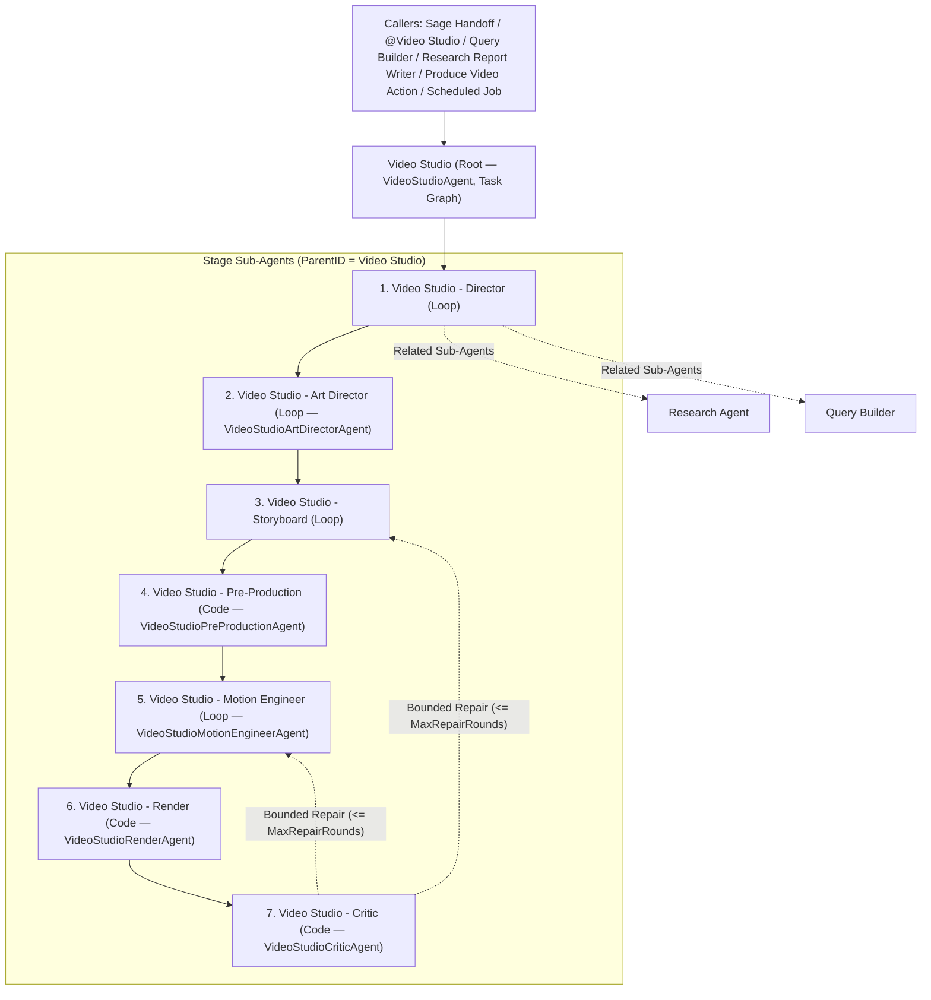

# Video Studio Guide

## What it is

Video Studio is MemberJunction's governed video production system. It turns plain-language creative briefs, organization brand kits, and live MemberJunction data (Saved Queries, User Views, Artifacts, and inline caller tables) into deterministic, multi-format MP4 films (`16:9`, `9:16`, `1:1`) and reusable `Video Production` artifacts. Every production flows through an explicit contract — the `VideoGenerationSpec` — enforced by a root `Video Studio` task-graph agent, seven stage sub-agents, deterministic static and DOM checks, a rubric-scored critic loop, and isolated render workers.

Video Studio separates **code-rendered motion** from **generated footage** so that facts stay deterministic while visuals stay expressive:

| Approach | Engine | Best for | Never use for |
|---|---|---|---|
| **Code-rendered motion** | [HyperFrames](https://github.com/heygen-com/hyperframes) `0.8.134` (HTML/CSS/SVG/Canvas + GSAP + `MJChartKit` rendered frame-by-frame in headless Chromium and muxed by `ffmpeg`) | Typography and kinetic titles, brand palettes and logos, `MJChartKit` data visualizations, KPI callouts, product UI walkthroughs, step-by-step diagrams, and frame-accurate audio/caption sync | Photorealistic B-roll scenes that cannot be expressed as DOM/SVG/Canvas compositions |
| **Generated footage** | `AIVideoRunner` (`FLUX 3 Video` via `@memberjunction/ai-blackforestlabs`) and `AIImageGenerator` (`FLUX 3 Image`) | Illustrative B-roll, atmospheric/abstract backdrops, conceptual transitions, and visual metaphors where no factual claim depends on pixel accuracy | Numbers, charts, KPIs, customer names, quotes, product UI screenshots, brand logos, or real people |

Every generated asset is governed by the active Brand Kit's `GenerationPolicy` (`AllowGeneratedImages`, `AllowGeneratedVideo`, `AllowSyntheticPeople`, `AvoidSubjects`, `MaxGenerationCostPerRun`), tagged with `Provenance: 'Generated'`, inspected for C2PA content credentials (`d8fec3d6-1b0e-483c-9297-5828877ec481`), capped by the active power level's `VideoStudio.MaxGeneratedVideoSeconds` budget, and audited against the **Video Production Quality** rubric (`generated-assets-are-honest-and-disclosed`).

---

## Architecture

Video Studio spans five workspace layers:

1. **`@memberjunction/video-studio-core`** (`packages/AI/VideoStudio/Core`) — Zero-DB, browser-safe TypeScript types and pure validators: `VideoGenerationSpec` (`VIDEO_STUDIO_SPEC_VERSION = '1.0'`), `ValidateVideoGenerationSpec`, `ExtractNumericLiteralTokens`, `BrandKitEngine` (`BaseEngine` metadata cache for `MJ: Brand Kits`, `MJ: Brand Kit Assets`, and `MJ: Video Archetypes`), `IBrandGenerationPolicy`, and `MJChartKit` source (`packages/AI/VideoStudio/Core/src/chart-kit.ts`).
2. **`@memberjunction/video-studio-render-worker`** (`packages/AI/VideoStudio/RenderWorker`) — Isolated Node >= 22 CLI and HTTP worker (`mj-video-render-worker`) wrapping `@hyperframes/producer`, `@hyperframes/engine`, `@hyperframes/lint`, headless Chromium, and system `ffmpeg`/`ffprobe`. Enforces the bundle security model, runs static + HyperFrames + DOM checks, and produces deterministic MP4 and PNG poster files.
3. **`@memberjunction/video-studio`** (`packages/AI/VideoStudio/Engine`) — Server-side engine, drivers, and agents: `VideoStudioEngine`, `ValidateVideoGenerationSpecAsync`, `VideoRenderEngine` and its three render drivers (`LocalWorkerRenderDriver`, `RemoteRenderDriver`, `DockerRenderDriver`), `CaptureDataSnapshot`, `VerifyDataBindingDom`, `ExtractAudioTrack` / `ExtractTranscript`, `StoreFile` / `ReadFile`, the `Video Studio` agent hierarchy (`VideoStudioAgent` and stage drivers), and the `Produce Video` action (`ProduceVideoAction`).
4. **Core entities & server hooks** (`@memberjunction/core-entities`, `@memberjunction/core-entities-server`) — Generated entity classes for `MJ: Brand Kits`, `MJ: Brand Kit Assets`, and `MJ: Video Archetypes`, plus `MJBrandKitEntityServer` (`packages/MJCoreEntitiesServer/src/custom/MJBrandKitEntity.server.ts`) which enforces at most one default brand kit per `CompanyID` scope on save.
5. **Angular UI** (`packages/Angular/Explorer/dashboards` and `packages/Angular/Generic/*`) — The `Video Studio` application (`Productions`, `Brand Kits`, and `Archetypes` nav items in `@memberjunction/ng-dashboards`), reusable Brand Kit form panels (`@memberjunction/ng-brand-kits`), artifact viewer plugins (`VideoProductionViewerPlugin`, `VideoArtifactViewerPlugin`, `AudioArtifactViewerPlugin` in `@memberjunction/ng-artifacts`), and `<mj-media-player>` (`@memberjunction/ng-media-player`).

### Agent hierarchy

The root `Video Studio` agent (`DriverClass: VideoStudioAgent`, `TypeID: Task Graph`) orchestrates seven direct child sub-agents (`ParentID` relationships ordered by `ExecutionOrder` 1–7). Only the `VideoStudio - Director` stage invokes external research sub-agents (`Research Agent` and `Query Builder` via `MJ: AI Agent Relationships`).



---

## The `VideoGenerationSpec`

Every stage reads and writes slices of a single typed payload: `VideoGenerationSpec` (`SpecVersion: '1.0'`, exported from [`packages/AI/VideoStudio/Core/src/video-generation-spec.ts`](../packages/AI/VideoStudio/Core/src/video-generation-spec.ts); see also [`packages/AI/VideoStudio/Core/README.md`](../packages/AI/VideoStudio/Core/README.md) and the prompt schema projection at [`packages/AI/VideoStudio/Core/generated-for-prompt/video-generation-spec.ts.generated-for-prompt.md`](../packages/AI/VideoStudio/Core/generated-for-prompt/video-generation-spec.ts.generated-for-prompt.md)).

### Facts vs. creative choices

The spec separates caller-supplied or database-resolved **facts** from agent-authored **creative choices**:

- **Facts (`Brief`, `Brand`, `Assets.Required`, `Assets.NeverInvent`, `DataBindings`, `DataSnapshot`):**
  - `Assets.Required` lists caller- or brand-provided assets with `Usage: 'MustUse' | 'Reference' | 'Optional'` and `AllowGenerated?: boolean` (default `false`). When `AllowGenerated` is `false` or omitted, the asset must resolve to a real `FileID` or `BrandKitAssetID` — the agent may not substitute a generated image or clip.
  - `Assets.NeverInvent` merges the Brand Kit's `NeverInvent` list with brief-specific exclusions (for example, `["customer logos", "revenue projections", "product screenshots", "real people"]`).
  - `DataBindings` and `DataSnapshot` hold governed data values and their pre-formatted display strings (`FormattedValue`, `FormattedPoints`, `FormattedRows`).
- **Creative choices (`Style`, `Storyboard`, `Audio`, `Assets.Generate`, `Composition`):**
  - `Style` (`Palette`, `Typography`, `Motion`, `Mood`, `VisualDirection`) is authored by `Video Studio - Art Director` within the Brand Kit's tokens.
  - `Storyboard` (`Hook`, `Beats`, `Pacing`, `CallToAction`, `AsOfCaption`) is authored by `Video Studio - Storyboard`. Every numeric claim in `Storyboard.Beats[].OnScreenText` must bind to a `{{BindingKey}}` placeholder listed in `Beat.DataBindingKeys`.
  - `Assets.Generate` holds approved image/video generation requests with explicit `Provenance: 'Generated'` and `Purpose` (`'b-roll' | 'background' | 'illustration' | 'transition'`).

### Production stages (`VideoProductionStatus`)

`Spec.Status` progresses monotonically through six values:

1. `'Briefing'` — Initial brief, brand kit resolution, and `Style` lock.
2. `'Storyboarded'` — Beat timeline (`StartSeconds` / `EndSeconds`), `OnScreenText`, placeholder bindings, and asset plans complete.
3. `'PreProduced'` — Live `DataSnapshot` captured, audio/transcript prepared (`Audio.DurationSeconds`), and `Assets.Generate` resolved to `FileID`s.
4. `'Rendered'` — Composition bundle rendered across requested `Formats` (`16:9`, `9:16`, `1:1`) and deterministic checks recorded under `Gates.DeterministicChecks`.
5. `'Delivered'` — Critic rubric (`Gates.Critic`) passed and final deliverables (`Deliverables.Videos`, `Deliverables.PosterFileID`) ready.
6. `'Blocked'` — Halted by a failed gate, policy refusal, or exhausted repair budget (`HumanReviewNotes` explains why).

### Pure and async validators

Validation is split into two layers so browser UI and unit tests never pull in server dependencies:

- **Pure validator (`ValidateVideoGenerationSpec(spec, stage, options?)` in [`packages/AI/VideoStudio/Core/src/validate-spec.ts`](../packages/AI/VideoStudio/Core/src/validate-spec.ts)):**
  - Checks `SpecVersion === '1.0'`, required fields per stage, contiguous beat timelines within `BEAT_TIMELINE_TOLERANCE_SECONDS = 0.05` (starting at `0` and ending within `±0.05s` of `Brief.TargetDurationSeconds`), and audio alignment (`|Audio.DurationSeconds - lastBeat.EndSeconds| <= 0.05`).
  - Enforces data-story honesty on `Storyboard.Beats[].OnScreenText`: every `{{Key}}` placeholder must appear in `Beat.DataBindingKeys` and `DataBindings` (`UnknownOnScreenPlaceholder`), and when `DataBindings` is non-empty, `ExtractNumericLiteralTokens` flags any raw numeric token in `OnScreenText` (after stripping `{{...}}` placeholders) as `UnboundNumericOnScreenText`. (`IsNumericLiteralToken` exempts structural identifiers like `v2`, `Q1`–`Q4`, `FY25`, `16:9`, `1080p`, `4K`, `2D`/`3D`, `B2B`/`B2C`, `S3`, `H1`/`H2`, and `MP4`.)
  - Enforces generation rules at `'Storyboarded'`+: every `Assets.Generate[]` item must set `Provenance: 'Generated'` (`MissingGeneratedAssetProvenance`), every `Usage: 'MustUse'` asset in `Assets.Required` must be referenced by at least one beat or `Composition.Files`, and total generated video seconds across `Assets.Generate` cannot exceed `options.maxGeneratedVideoSeconds` (`GenerationDurationExceedsLimit`).
- **Server-side async validator (`ValidateVideoGenerationSpecAsync(spec, stage, contextUser, options?)` in [`packages/AI/VideoStudio/Engine/src/validate-spec-async.ts`](../packages/AI/VideoStudio/Engine/src/validate-spec-async.ts)):**
  - Runs `ValidateVideoGenerationSpec` first, then checks live metadata via `BrandKitEngine.Instance`: `Brand.BrandKitID` exists (`BrandKitNotFound`) and its `CompanyID` is either `NULL` or matches `Brief.CompanyID` (`BrandKitNotInScope`), and `Brief.Archetype` matches an active `MJ: Video Archetypes` row (`ArchetypeNotFound`).
  - Collects every referenced `FileID` across `Assets.Required`, `Assets.Generate`, `Audio.TrackFileID`, `DataSnapshot.SnapshotFileID`, `Deliverables.PosterFileID`, and `Deliverables.Videos[].FileID`, verifies UUID syntax (`InvalidFileID`), and batch-queries `MJ: Files` as `contextUser` in chunks of `FILE_VALIDATION_BATCH_SIZE = 500` (`ID IN (...) AND Status <> 'Deleted'`, flagging missing or deleted rows as `FileNotReadable` and failed queries as `AsyncValidationFailed`).

---

## Power levels

`Video Studio` ships with three `MJ: AI Agent Configuration Presets` (`metadata/agent-configuration-presets/.video-studio-presets.json`), each mapped to a dedicated `MJ: AI Configurations` chain (`metadata/ai-configurations/.video-studio-configurations.json`) and `MJ: AI Configuration Params` rows:

| Preset (`Name`) | Priority | Default? | `AIConfigurationID` | Parent Configuration | Primary Models (by Priority) |
|---|---:|---|---|---|---|
| `Draft` | `1` | `false` | `Video Studio Draft` | `Fast` | `Gemini 3.8 Flash` (`Google` Priority 2, `Vertex AI` Priority 1; both `EffortLevel: 25`) |
| `Standard` | `2` | `true` | `Video Studio Standard` | `Standard` | Inherits default prompt-model rows: `Gemini 3.8 Flash` (`Google` Priority 3, `Vertex AI` Priority 2), `Claude Sonnet 5.5` (`Anthropic` Priority 1) |
| `High` | `3` | `false` | `Video Studio High` | `High Power` | `Claude Opus 5.5` (`Anthropic` Priority 3), `Claude Fable 5.1` (`Anthropic` Priority 2), `Gemini 3.1 Pro` (`Google` Priority 1) |

### `VideoStudio.*` configuration parameters

Each configuration defines seven typed `MJ: AI Configuration Params` rows read by `VideoStudioAgent` and its stage drivers via `AIEngine.Instance.GetConfigurationParamsWithInheritance(configurationId)`:

| Parameter Name | Type | `Draft` | `Standard` | `High` | Effect |
|---|---|---:|---:|---:|---|
| `VideoStudio.MaxRepairRounds` | `integer` | `0` | `2` | `3` | Maximum Critic → Motion Engineer / Storyboard repair iterations before stopping |
| `VideoStudio.RenderQuality` | `string` | `'draft'` | `'standard'` | `'high'` | Passed to the render worker (`hyperframes render --quality`) |
| `VideoStudio.Fps` | `integer` | `24` | `30` | `30` | Composition frame rate and DOM settle-frame calculation |
| `VideoStudio.Formats` | `string` | `'First'` | `'All'` | `'All'` | `'First'` renders only `Brief.Formats[0]`; `'All'` renders every requested format (`16:9`, `9:16`, `1:1`) |
| `VideoStudio.GenerationQuality` | `string` | `'draft'` | `'standard'` | `'high'` | Quality tier forwarded to image/video generators |
| `VideoStudio.MaxGeneratedVideoSeconds` | `integer` | `20` | `40` | `60` | Per-production ceiling on total generated video seconds across `Assets.Generate` |
| `VideoStudio.MaxRegenerations` | `integer` | `1` | `1` | `1` | Maximum re-generation attempts per asset in `VideoStudioPreProductionAgent` |

### How callers pick a power level

1. **In Conversations (`@Video Studio` or Sage transfer):** Select `Draft`, `Standard`, or `High` in the conversation preset picker (stored per user in `mj.agentMode.<agentId>`) or pass an explicit `@Video Studio` mention preset pin. `ResolveConversationAgentPreset` resolves the preset in order: `@mention` pin → user setting `mj.agentMode.<agentId>` → agent's `IsDefault: true` preset (`Standard`).
2. **From parent agents (`Query Builder`, `Research Report Writer`):** The `MJ: AI Agent Relationships` row defaults to `ConfigurationPresetID = Standard`; the parent LLM can override per call via the `presetName` argument (`"Draft" | "Standard" | "High"`).
3. **From the `Produce Video` action:** Pass `PowerLevel: 'Draft' | 'Standard' | 'High'` (matched case-insensitively via `AIEngine.Instance.FindActiveAgentConfigurationPreset`).
4. **From Scheduled Jobs:** Set `ConfigurationID` in `ScheduledJob.Configuration` to the `Video Studio Draft`, `Video Studio Standard`, or `Video Studio High` configuration UUID.

---

## Gates G1–G6 and approval

### Payload write ownership (`Status` and `Gates`)

To prevent LLM sub-agents from hallucinating a passed gate or prematurely marking a production `'Delivered'`, `Video Studio` locks payload write paths in metadata (`metadata/agents/.video-studio-agents.json`):

- The root `Video Studio` agent sets `PayloadSelfWritePaths: []`.
- Each child agent's `PayloadDownstreamPaths` and `PayloadSelfWritePaths` are scoped strictly to its stage slice (for example, `Art Director` writes only `Style` and `Brand`; `Motion Engineer` writes only `Composition`).
- **No LLM prompt or sub-agent can write `Status` or `Gates.*`.** Only deterministic TypeScript code in `VideoStudioAgent` and `VideoStudioRenderAgent` updates `Spec.Gates` and derives `Spec.Status`.

### The six gates

| Gate | Stage boundary | What it checks |
|---|---|---|
| **G1 — Brief & Brand** | After `Director` + `Art Director` | `ValidateVideoGenerationSpecAsync(spec, 'Briefing')`: valid `Brief` (`Topic`, `Archetype`, `TargetDurationSeconds`, `Formats`), resolved `BrandKit` in company scope, `Style` tokens populated, and `Assets.NeverInvent` merged. |
| **G2 — Storyboard** | After `Storyboard` | `ValidateVideoGenerationSpecAsync(spec, 'Storyboarded')`: contiguous beat timeline (`±0.05s`), every `OnScreenText` numeric claim bound to a `{{Key}}` in `DataBindings`, `Assets.Required` (`Usage: 'MustUse'`) referenced, `Assets.Generate` within `MaxGeneratedVideoSeconds` and allowed by `BrandKit.GenerationPolicy`. |
| **G3 — Deterministic Render Checks** | After `Pre-Production` + `Motion Engineer` + `Render` | Static bundle checks (`MJ_NON_BUNDLE_URL`, `MJ_NETWORK_API`, `MJ_MISSING_ASSET`, `MJ_NONDETERMINISTIC_API`, `MJ_UNBOUND_LITERAL_SOURCE`), `hyperframes check`, and headless Chromium DOM checks across all rendered formats (`MJ_SAFE_AREA`, `MJ_MIN_TEXT_SIZE`, `MJ_UNBOUND_LITERAL_RENDERED`, `MJ_UNBUNDLED_FONT`, `MJ_BOUND_KEY_UNKNOWN`, `MJ_BOUND_VALUE_MISMATCH`, `MJ_ASOF_CARD_MISSING`). Recorded in `Spec.Gates.DeterministicChecks`. |
| **G4 — Critic Rubric & Bounded Repair** | After `Critic` | Evaluates the **Video Production Quality** rubric (`MJ: Rubrics` ID `6B935E33-F7C5-49C8-B867-8F59C88B2B63`). Overall score must be `>= 0.72` and both hard gates (`shown-values-match-the-data-snapshot` and `generated-assets-are-honest-and-disclosed`) must score `>= 0.6`. If G3 or G4 fails and `RepairRound < VideoStudio.MaxRepairRounds`, routes targeted findings back to `Motion Engineer` (or `Storyboard`). |
| **G5 — Deliverables & Provenance** | Before delivery | Verifies every requested format (`'First'` or `'All'`) produced a stored MP4 (`FileID` or inline fallback), `PosterFileID` is present, and all generated assets retain `Provenance: 'Generated'` disclosure metadata. |
| **G6 — Final Delivery** | Completion | Sets `Spec.Status = 'Delivered'` (or `'Blocked'` with `HumanReviewNotes` when repair rounds are exhausted) and emits the `Video Production` artifact version. |

> [!NOTE]
> Stage-by-stage driver internals for `VideoStudioAgent` (`VS-AGT-2`), `Director`/`Art Director`/`Storyboard` (`VS-AGT-3`), `Pre-Production`/`Motion Engineer`/`Render` (`VS-AGT-4`/`5`), and `Critic` (`VS-AGT-6`) are being finalized in Part 2 of this guide as those Wave 6 tasks land.

### Approval modes (`Interaction.Mode`)

`Spec.Interaction.Mode` controls human checkpoints during a run:

- `'Autonomous'` — Runs end-to-end without pausing unless a hard block occurs (used by `Produce Video` action and scheduled jobs).
- `'ApproveStoryboard'` — Pauses after G2 so the caller or user can review and edit the storyboard before spending render or video-generation budget.
- `'ApproveAll'` — Pauses after G1 (Brief/Style), G2 (Storyboard), and G5 (before final sign-off).

For the underlying conversation approval and escalation mechanics, see:
- [Agent Skills and Plan Mode Guide](AGENT_SKILLS_AND_PLAN_MODE_GUIDE.md)
- [Sub-Agent `ChatHandlingOption` (`Consult`)](../packages/AI/Agents/docs/sub-agents-guide.md#sub-agent-chathandlingoption-resolution--values)
- [Human-in-the-Loop (HITL) Guide](../packages/AI/Agents/docs/HUMAN_IN_THE_LOOP.md)

---

## Rendering and deployment

### Render drivers (`VideoRenderDriverBase`)

`VideoRenderEngine.Instance` (`packages/AI/VideoStudio/Engine/src/render/video-render-engine.ts`) resolves a `VideoRenderDriverBase` implementation via `MJGlobal.Instance.ClassFactory.CreateInstance<VideoRenderDriverBase>(VideoRenderDriverBase, driverKey)` (`@RequiresSubclass()` on `VideoRenderDriverBase`). Three drivers are registered:

| Driver Key (`videoStudio.render.driver`) | Class | When to use | Isolation model |
|---|---|---|---|
| `'LocalWorker'` (default) | `LocalWorkerRenderDriver` | Local development and single-tenant trusted dev hosts | Spawns `mj-video-render-worker` child process with a stripped 11-key environment (`BuildWorkerEnv`), per-spawn 32-byte hex bearer token, and per-job temp directory. Refuses to run as `uid 0` unless `VIDEO_STUDIO_RENDER_ALLOW_ROOT=1`. |
| `'Remote'` | `RemoteRenderDriver` | Dedicated render service / Kubernetes worker pool over HTTP(S) | Sends JSON requests (`POST /v1/check`, `/v1/render`, `/v1/poster`, `GET /v1/health`) with `Authorization: Bearer <token>`. Enforces TLS for non-loopback URLs unless `allowInsecureHttp: true` and caps response streams at `maxOutputBytes`. |
| `'Docker'` (**recommended for production**) | `DockerRenderDriver` | Production MJAPI deployments where untrusted LLM-authored HTML/JS compositions are rendered | Runs a fresh ephemeral container per call (`docker run --rm --network none --read-only --cap-drop ALL --security-opt no-new-privileges`) with strict CPU, memory, PID, tmpfs, concurrency, and output-byte caps. |

### `mj.config.cjs` configuration

Configure `videoStudio.render` in `mj.config.cjs` (parsed via [`packages/AI/VideoStudio/Engine/src/render/render-settings.ts`](../packages/AI/VideoStudio/Engine/src/render/render-settings.ts)):

```javascript
// mj.config.cjs
module.exports = {
  // ...existing MJ configuration...
  videoStudio: {
    render: {
      // 'LocalWorker' | 'Remote' | 'Docker'
      driver: process.env.VIDEO_STUDIO_RENDER_DRIVER || 'LocalWorker',

      timeouts: {
        startupMs: 60000,    // Worker startup / health check timeout (default: 60s)
        renderMs: 2100000,   // Full render timeout across formats (default: 35 min)
        requestMs: 600000,   // Single check/poster HTTP or CLI call timeout (default: 10 min)
      },

      local: {
        workerBin: undefined, // Optional path to mj-video-render-worker CLI
        port: 0,              // 0 = ephemeral port
        maxConcurrentJobs: 2,
      },

      remote: {
        url: process.env.VIDEO_STUDIO_RENDER_URL,        // e.g. 'https://render-worker.internal:8787'
        token: process.env.VIDEO_STUDIO_RENDER_TOKEN,    // Falls back to VIDEO_STUDIO_RENDER_TOKEN env var
        allowInsecureHttp: false,                        // Required true only for non-loopback http://
        maxOutputBytes: 536870912,                       // 512 MiB cap on response bodies (default)
      },

      docker: {
        image: 'mj-video-render-worker:local',
        dockerBin: 'docker',
        memoryMb: 2048,
        cpus: 2,
        pidsLimit: 256,
        tmpfsMb: 1024,
        user: '65532:65532',
        maxConcurrentContainers: 2,
        hostTempRoot: undefined,   // Set when MJAPI runs in a sibling container (see below)
        maxOutputBytes: 536870912, // 512 MiB cap on response.json and output.mp4 (default)
      },
    },
  },
};
```

### Building and running the worker image

The worker requires **Node >= 22** (because `@hyperframes/producer@0.8.134` uses Node's built-in glob and modern ESM internals), headless Chromium, and system `ffmpeg`/`ffprobe`. Build the production container from the repo root using [`packages/AI/VideoStudio/RenderWorker/Dockerfile`](../packages/AI/VideoStudio/RenderWorker/Dockerfile) (based on `node:24-bookworm-slim`, running as non-root `65532:65532` with `DO_NOT_TRACK=1` and `HYPERFRAMES_NO_TELEMETRY=1`):

```bash
docker build -f packages/AI/VideoStudio/RenderWorker/Dockerfile -t mj-video-render-worker:local .
```

To run the worker as a standalone HTTP service for `RemoteRenderDriver`:

```bash
docker run --rm -p 8787:8787 \
  -e VIDEO_STUDIO_RENDER_TOKEN="$(openssl rand -hex 32)" \
  mj-video-render-worker:local \
  --serve --host 0.0.0.0 --port 8787
```

### `DockerRenderDriver` host rules and security controls

When `videoStudio.render.driver` is `'Docker'`, `DockerRenderDriver` ([`packages/AI/VideoStudio/Engine/src/render/docker-render-driver.ts`](../packages/AI/VideoStudio/Engine/src/render/docker-render-driver.ts)) invokes:

```text
docker run --rm -i --init --name mj-vs-render-<uuid> \
  --network none --read-only \
  --cap-drop ALL --security-opt no-new-privileges \
  --pids-limit <PidsLimit> --memory <MemoryMb>m --cpus <Cpus> \
  --user <User> \
  --tmpfs /tmp:rw,noexec,nosuid,size=<TmpfsMb>m -e TMPDIR=/tmp \
  -v <hostJobDir>:/job:rw \
  --entrypoint node <Image> \
  /app/dist/cli.js <check|render|poster> /job/request.json /job/response.json [/job/output.mp4]
```

Follow these operational rules when deploying `DockerRenderDriver` or `RemoteRenderDriver`:

1. **Non-root container UID vs. host bind-mount permissions:** The container runs as `--user 65532:65532` (`nonroot`). Before launching `docker run`, `DockerRenderDriver` creates the per-job host directory with mode `0o755` (`fs.chmod(jobDir, 0o755)`) and pre-creates an empty `/job/output.mp4` placeholder with mode `0o777` so `uid 65532` inside the container can write the output file without world-writable directory permissions on the host.
2. **Docker-in-Docker / sibling-container deployments (`hostTempRoot`):** When MJAPI itself runs inside a container and talks to the host's `/var/run/docker.sock`, the `-v <hostJobDir>:/job:rw` path is resolved by the **Docker daemon on the host**, not inside MJAPI's container filesystem. Mount a shared volume at the **exact same absolute path** in both MJAPI and the Docker host (for example, `/var/lib/mj-render-jobs`) and set `videoStudio.render.docker.hostTempRoot: '/var/lib/mj-render-jobs'`. If `hostTempRoot` is not shared with the daemon host, `/job/request.json` will appear missing or empty inside the worker container.
3. **Output size caps (`maxOutputBytes`):** Both `DockerRenderDriver` and `RemoteRenderDriver` stream-read worker outputs and enforce `maxOutputBytes` (default `536870912` = 512 MiB; must be a positive integer) **before** `Buffer.concat` or `JSON.parse`. In `DockerRenderDriver`, `readFileCapped` verifies `stat.isFile()` (rejecting symlinks/FIFOs a compromised worker might plant in `/job`), checks `stat.size`, and counts bytes while streaming. In `RemoteRenderDriver`, `fetchJsonWithTimeout` checks both the `Content-Length` header and the streaming body reader chunk-by-chunk, aborting immediately if a response exceeds `Remote.MaxOutputBytes`.
4. **Timeout and cancellation cleanup:** On timeout or `AbortSignal`, `DockerRenderDriver` sends `SIGTERM` to the `docker run` client and executes `docker kill <containerName>` (`--rm` removes the container once stopped), then removes `<hostJobDir>` in `finally`.
5. **Remote transport security (`RemoteRenderDriver`):** Loopback URLs (`127.0.0.1`, `localhost`, `[::1]`) may use `http:` without a token for local testing. Any non-loopback URL requires a non-empty bearer token (`Remote.Token` or `VIDEO_STUDIO_RENDER_TOKEN`) and `https:`, unless `Remote.AllowInsecureHttp: true` is explicitly set (which logs a one-time `LogStatus` warning per driver instance). See also the [Remote Operations Guide](REMOTE_OPERATIONS_GUIDE.md).

### Four-layer bundle security model

Because `Composition.Files` contains agent-authored HTML, CSS, SVG, and JavaScript, the render worker enforces four defense-in-depth layers:

1. **Static bundle lint gate ([`packages/AI/VideoStudio/RenderWorker/src/lint-gate.ts`](../packages/AI/VideoStudio/RenderWorker/src/lint-gate.ts)):** Rejects path traversal (`..`, leading `/`, drive letters), symlinks, external URLs (`http:`, `https:`, `//`, `ws:`, `wss:`, `ftp:` → `MJ_NON_BUNDLE_URL`), and network APIs in scripts/inline handlers (`fetch`, `XMLHttpRequest`, `WebSocket`, `EventSource`, `navigator.sendBeacon`, `importScripts`, dynamic `import()` of URLs → `MJ_NETWORK_API`).
2. **Content Security Policy injection:** Injects `<meta http-equiv="Content-Security-Policy" content="default-src 'self' data: blob:; connect-src 'none'; img-src 'self' data: blob:; media-src 'self' data: blob:; font-src 'self' data:; style-src 'self' 'unsafe-inline'; script-src 'self' 'unsafe-inline'; frame-src 'none'; object-src 'none'">` as the first child of `<head>` in every HTML file.
3. **Per-job isolated workspace:** Materializes each job into a fresh `os.tmpdir()/mj-vs-job-<uuid>` directory, sets `DO_NOT_TRACK=1` and `HYPERFRAMES_NO_TELEMETRY=1`, passes `--no-proxy --no-browser-gpu` to HyperFrames, and deletes the directory in `finally`.
4. **OS / container network isolation:** `DockerRenderDriver` runs with `--network none`, `--read-only`, `--cap-drop ALL`, and `--security-opt no-new-privileges` so Chromium cannot open sockets even if CSP were bypassed (while `OUT-2` tracks upstream HyperFrames page-creation hooks for `page.route` interception).

### Deterministic checks (`VS-RND-5` & `VS-DAT-3`)

Every `CheckComposition` and `RenderComposition` call runs three deterministic check stages and returns a `DeterministicCheckReport`:

1. **Static bundle checks (`runStaticBundleChecks`):**
   - `MJ_NON_BUNDLE_URL` / `MJ_NETWORK_API` — Security violations (see above).
   - `MJ_MISSING_ASSET` — Every relative `src`, `href`, `poster`, and CSS `url(...)` must exist in the materialized bundle.
   - `MJ_NONDETERMINISTIC_API` — Flags `Math.random()`, `crypto.getRandomValues()`, `crypto.randomUUID()`, `Date.now()`, `new Date()` (with 0 arguments), and `performance.now()` in user composition files (excluding vendor runtime libraries `gsap*`, `lottie*`, `three*`, `chart-kit.js`, and `mj/chart-kit.js`).
   - `MJ_UNBOUND_LITERAL_SOURCE` — When `DataBindings` is non-empty, scans visible HTML/SVG text nodes and fails if a numeric literal appears inside an element that lacks `data-mj-bound` on itself or an ancestor.
2. **HyperFrames CLI lint (`hyperframes check --json --no-proxy --no-browser-gpu`):** Mapped via `MapHyperFramesCheckOutput` into `DeterministicCheckFinding[]`.
3. **Headless Chromium DOM checks (`runDomChecks`):** Serves the bundle from an ephemeral loopback server (`127.0.0.1`), seeks the timeline via `window.__hf.seek(t)` across sampled timestamps (including beat midpoints and beat settle frames `beat.EndSeconds - 1 / Fps`), and checks:
   - `MJ_SAFE_AREA` — Visible text and `[data-mj-important]` elements must stay inside safe-area insets: **5%** on all sides for `16:9` and `1:1`; **10% top, 20% bottom, 6% left, 12% right** for `9:16`.
   - `MJ_MIN_TEXT_SIZE` — Computed `fontSize` on visible text must be `>= 0.025 * min(width, height)` (`27px` at `1920x1080` and `1080x1920`).
   - `MJ_UNBOUND_LITERAL_RENDERED` — Visible rendered text nodes containing numeric tokens when `DataBindings` is non-empty must have an ancestor `[data-mj-bound]`.
   - `MJ_UNBUNDLED_FONT` — Computed `fontFamily` primary family must be bundled (`MJ Sans`, `MJ Mono`, a `@font-face` declared in the bundle, or a generic CSS family).
   - `MJ_BOUND_KEY_UNKNOWN` / `MJ_BOUND_VALUE_MISMATCH` (`VerifyDataBindingDom` in `packages/AI/VideoStudio/RenderWorker/src/checks/dom-checks.ts`) — Every `[data-mj-bound="<Key>"]` must reference a valid key in `DataBindings` (or `__asOf`), and at each beat settle frame its normalized rendered text must contain the snapshot's `FormattedValue`, `FormattedPoints[].FormattedValue`, or `FormattedRows` cell string.
   - `MJ_ASOF_CARD_MISSING` — When `DataBindings` is non-empty, the final settle frame must display a visible `[data-mj-bound="__asOf"]` element containing `Storyboard.AsOfCaption` (`Data as of YYYY-MM-DD`).

The render worker bundles two SIL Open Font License 1.1 fonts under `packages/AI/VideoStudio/RenderWorker/assets/fonts/` and auto-injects `/mj-bundled-fonts.css`: **`MJ Sans`** (Inter 400/600/700) and **`MJ Mono`** (JetBrains Mono 400/700).

---

## Storage setup

Video Studio stores large binary outputs (rendered MP4s, poster PNGs, audio narration tracks, generated video clips, and >64 KB data snapshots) in `MJ: Files` backed by `@memberjunction/storage` rather than bloating `MJ: AI Agent Run Steps` or `MJ: Conversation Detail` rows with multi-megabyte base64 strings.

### Configuring `DefaultStorageAccountID` on `Content Creation`

1. Provision an `MJ: File Storage Accounts` row pointing at an active `MJ: File Storage Providers` driver (Amazon S3, Azure Blob Storage, Google Cloud Storage, Box, Dropbox, SharePoint, or Google Drive).
2. Set `DefaultStorageAccountID` on the **`Content Creation`** row in `MJ: AI Agent Categories` (or on a parent category — `AIEngine.Instance.ResolveAgentStorageAccountID(agentId)` walks the `ParentID` chain up to 20 hops).

`StoreFile` and `ReadFile` in [`packages/AI/VideoStudio/Engine/src/storage.ts`](../packages/AI/VideoStudio/Engine/src/storage.ts) resolve this storage account automatically:

- When a storage account is configured, `StoreFile` uploads the buffer via `UploadBufferToStorageAccount`, creates an `MJ: Files` row (`Status = 'Uploaded'`, object key `video-studio/<YYYY-MM-DD>/<UUID>-<SanitizedFileName>`), and returns `{ FileID, InlineBase64: undefined, UsedInlineFallback: false }`.
- Similarly, `AgentRunner.SaveAgentRunMedia` (`packages/AI/Agents/src/AgentRunner.ts`) uploads agent media outputs once to MJStorage, populates `FileID`, `FileName`, and `FileSizeBytes` on `MJ: AI Agent Run Medias` while leaving `InlineData` empty, and attaches `mediaOutput.fileId` so `CreateMediaArtifacts` reuses the same `FileID` without uploading twice.
- Standalone `Video` (`VideoArtifactViewerPlugin`) and `Audio` (`AudioArtifactViewerPlugin`) artifacts render directly from `{ "fileId": "<MJ: Files ID>", "mimeType": "video/mp4" }` envelopes using short-lived `GraphQLFileStorageClient.CreateMediaAccessToken` URLs.

### Inline fallback when no storage account is configured

If `ResolveAgentStorageAccountID` returns `null` (for example, in a minimal local environment without cloud storage credentials), `StoreFile` logs a `LogStatus` warning and returns `{ FileID: undefined, InlineBase64: bytes.toString('base64'), UsedInlineFallback: true }` so renders still succeed. When viewing an inline-fallback production in `VideoProductionViewerPlugin`, an `<mj-alert variant="warning">` banner is shown: `"Stored inline: no file storage account was set up."`

> [!NOTE]
> Automatic orphan cleanup (`VS-ART-2`) and the in-app storage/worker setup health banner (`VS-UX-3`) will be documented in Part 2 once those tasks are merged.

---

## Data stories

When a video presents metrics, trends, rankings, or tabular results, Video Studio guarantees that every number on screen comes from a governed MemberJunction data source captured as `ContextUser`.

### Data bindings (`VideoDataBinding`)

Each entry in `Spec.DataBindings` specifies:

- **`Key`** — Identifier referenced in `Storyboard.Beats[].DataBindingKeys`, `OnScreenText` (`{{Key}}`), and DOM elements (`data-mj-bound="Key"`).
- **`Source`:**
  - `'Query'` — Runs a Saved Query by `QueryID` or `QueryName` + optional `CategoryPath` and `Parameters` via `RunQuery.RunQueries`.
  - `'View'` — Runs a User View by `ViewID` or `EntityName` + `ViewName` (`ExtraFilter` is deliberately not exposed on the spec to prevent filter injection) via `RunView.RunViews`.
  - `'Artifact'` — Loads a specific `ArtifactVersionID` (checking user read permissions via `MJ: Artifact Permissions` and owner match) and extracts JSON rows via `JsonPath`.
  - `'Inline'` — Uses caller-supplied rows pre-populated in `Spec.DataSnapshot.Inline[Key]` (used when `Query Builder` invokes `Video Studio` with rows already in memory).
- **`Shape`:** `'Scalar'` (`ValueField`), `'Series'` (`LabelField`, `ValueField`), `'Table'` (`Columns`), or `'Delta'` (`CurrentField`, `PriorField`).
- **`Format`:** `'Currency'` (`CurrencyCode`, `Precision`, `Compact`), `'Percent'`, `'Number'`, or `'Date'`.

### `CaptureDataSnapshot` (`VS-DAT-1`)

`CaptureDataSnapshot(spec, contextUser)` ([`packages/AI/VideoStudio/Engine/src/data/data-snapshot.ts`](../packages/AI/VideoStudio/Engine/src/data/data-snapshot.ts)) executes during Pre-Production:

1. **Single-batch execution as `ContextUser`:** Collects all `'View'` and `'Artifact'` bindings into a single `rv.RunViews([...], contextUser)` batch and all `'Query'` bindings into a single `rq.RunQueries([...], contextUser)` batch (`MAX_ROWS_PER_BINDING = 500`, emitting a `RowsTruncated` warning if capped). Raw SQL is never accepted, and queries never run as the system user.
2. **Deterministic formatting:** Pre-computes `FormattedValue` (plus `FormattedPriorValue` and `FormattedDeltaPercent` for `'Delta'`), `FormattedPoints` for `'Series'`, and `FormattedRows` for `'Table'` via `FormatBoundValue` (`Intl.NumberFormat('en-US', ...)`).
3. **Inline vs. `MJ: Files` threshold:** If the serialized JSON of `Values` is `<= 65536` bytes (`SNAPSHOT_INLINE_MAX_BYTES = 64 KB`), it stays inline on `Spec.DataSnapshot.Values`. If it exceeds 64 KB, `CaptureDataSnapshot` stores the full JSON in `MJ: Files` (`SnapshotFileID`) while keeping the pre-formatted display strings (`FormattedValue`, `FormattedPoints`, `FormattedRows`) inline on `Spec.DataSnapshot.Values` so the Motion Engineer and DOM verifier always have immediate access.
4. **Auto-populated `AsOfCaption`:** Sets `Spec.Storyboard.AsOfCaption` (if blank) to `'Data as of YYYY-MM-DD'` from `CapturedAt` (UTC date).

### `MJChartKit` (`VS-DAT-2`)

The render worker automatically injects `mj/chart-kit.js` into every composition bundle when `DataBindings` is non-empty (`window.MJChartKit`). `MJChartKit` ([`packages/AI/VideoStudio/Core/src/chart-kit.ts`](../packages/AI/VideoStudio/Core/src/chart-kit.ts)) renders deterministic SVG/HTML primitives with zero `Math.random()` or `Date.now()` calls and automatically attaches `data-mj-bound="<BindingKey>"`:

- `StatCallout(container, { bindingKey, snapshot, style, progress, label })`
- `BigNumberComparison(container, { bindingKey, snapshot, style, progress, currentLabel, priorLabel })`
- `AnimatedCounter(container, { bindingKey, snapshot, style, progress, label })` — Uses snapshot `FormattedValue` at `progress >= 0.999` so settle-frame DOM verification matches character-for-character.
- `BarRace(container, { bindingKey, snapshot, style, progress, maxBars })`
- `LineTrend(container, { bindingKey, snapshot, style, progress, showArea, showDots })`
- `StackedBar(container, { bindingKey, snapshot, style, progress })`
- `DonutKpi(container, { bindingKey, snapshot, style, progress, centerLabel })`
- `DataTableCard(container, { bindingKey, snapshot, style, progress, maxRows })`
- `AsOfCard(container, { asOfCaption, style, bindingKey })` — Renders `data-mj-bound="__asOf"` displaying `Data as of YYYY-MM-DD`.
- Helpers: `FormatValue(raw, formatSpec)` and `FormatTableCell(raw, columnKey, formatSpec)`.

### Sharing and data governance (D10)

Because `CaptureDataSnapshot` runs as `ContextUser`, the rendered MP4 frames and `Spec.DataSnapshot` embed the values visible to the user who produced the video. Sharing a `Video Production` artifact (via `MJ: Artifact Permissions`) shares those rendered values with the recipient — just like exporting and sharing a PDF report or chart image. Callers and users sharing a production are responsible for ensuring recipients are authorized to view the summarized figures.

---

## Brand kits

Brand Kits are general-purpose MemberJunction entities (`MJ: Brand Kits` and `MJ: Brand Kit Assets`) cached client- and server-side by `BrandKitEngine.Instance` (`@memberjunction/video-studio-core`) and reusable across Video Studio, slides, documents, emails, and reports.

### Shipped sample kit and company scoping

MemberJunction ships one sample row in `metadata/brand-kits/.memberjunction-brand-kit.json`: **`MemberJunction`** (`ID: 465DC262-89B7-4B8F-9A7D-22D2D0A93E96`, `CompanyID: NULL`, `IsDefault: false`, primary font `MJ Sans`, mono font `MJ Mono`).

Default kit resolution follows two rules:

1. **At most one default kit per `CompanyID` scope:** `MJBrandKitEntityServer.ValidateAsync` (`packages/MJCoreEntitiesServer/src/custom/MJBrandKitEntity.server.ts`) verifies on save that when `IsDefault === true` and `Status === 'Active'`, no other active kit has `IsDefault = 1` in the same `CompanyID` scope (where `CompanyID IS NULL` is the organization-wide scope).
2. **Company default overrides org-wide default:** `BrandKitEngine.Instance.GetDefaultKit(companyId)` returns the active default kit for `companyId` if one exists, otherwise falls back to the active org-wide default kit (`CompanyID === null`).

### `IsGenerationReference`, `GenerationPolicy`, and `NeverInvent`

- **`IsGenerationReference` on `MJ: Brand Kit Assets`:** Only visual reference asset types (`'Image' | 'Screenshot' | 'Logo' | 'LogoMark' | 'Video'`, enforced by DB `CHECK` constraint `CK_BrandKitAsset_IsGenerationReference_AssetType`) can be flagged `IsGenerationReference = 1`. `BrandKitEngine.Instance.GetGenerationReferenceAssets(brandKitId)` returns only active visual assets explicitly opted in as style/subject references for image/video generation models.
- **`GenerationPolicy` (`IBrandGenerationPolicy`):** JSON policy on `MJ: Brand Kits` parsed by `BrandKitEngine.Instance.GetEffectiveGenerationPolicy(brandKitId)` (`packages/AI/VideoStudio/Core/src/brand-kit-engine.ts`):
  - Default when `GenerationPolicy` is `NULL` or empty (`DEFAULT_BRAND_GENERATION_POLICY`):
    ```json
    {
      "AllowGeneratedImages": true,
      "AllowGeneratedVideo": true,
      "AllowSyntheticPeople": false,
      "AvoidSubjects": []
    }
    ```
    (Optional fields: `StylePrompt?: string`, `MaxGenerationCostPerRun?: number`.)
  - **Fail-closed on malformed JSON:** If `GenerationPolicy` contains invalid JSON or fails schema validation, `GetEffectiveGenerationPolicy` logs a warning and returns `AllowGeneratedImages: false`, `AllowGeneratedVideo: false`, `AllowSyntheticPeople: false` so generation is blocked until the policy is fixed.
- **`NeverInvent`:** String array on `MJ: Brand Kits` (for example, `["customer logos", "product UI screenshots", "financial metrics"]`) merged into `Spec.Assets.NeverInvent` at G1.

### Form panels (`@memberjunction/ng-brand-kits`)

`@memberjunction/ng-brand-kits` (`packages/Angular/Generic/brand-kits`) provides two standalone editors that mount via `BaseFormPanel` slots (`packages/Angular/Explorer/core-entity-forms/src/lib/panels/brand-kits/`) on the generated `MJ: Brand Kits` entity form in **any** MemberJunction application:

- `<mj-brand-kit-assets-editor>` (`brandKitAssetsSlot`) — Grouped asset cards with upload via `GraphQLFileStorageClient`, thumbnail previews, and the `IsGenerationReference` toggle (enabled only for `Image`, `Screenshot`, `Logo`, `LogoMark`, and `Video` rows).
- `<mj-brand-kit-generation-policy-editor>` (`brandKitGenerationPolicySlot`) — Form controls for `AllowGeneratedImages`, `AllowGeneratedVideo`, `AllowSyntheticPeople`, `StylePrompt`, `AvoidSubjects` chips, `MaxGenerationCostPerRun`, and `NeverInvent` chips.

---

## Generated assets

### Standalone clip vs. full Video Studio production

MemberJunction offers two distinct tools depending on whether a caller needs a single raw AI video clip or a complete multi-scene film:

| Capability | Entry point | Output |
|---|---|---|
| **Single raw AI video clip** (5–15 seconds, B-roll or concept shot) | **`Generate Video` action** (`DriverClass: 'Generate Video'` in `@memberjunction/core-actions`, backed by `AIVideoRunner.RunGenerateVideo`) | One MP4 stored in `MJ: Files` (`FileID`, `DurationSeconds`, `Width`, `Height`, `Fps`, `HasAudio`, `HasC2paManifest`, `PromptRunID`, `TotalCost`) |
| **Multi-scene branded film with typography, data charts, narration, and multi-format deliverables** | **`Video Studio` agent** or **`Produce Video` action** (`DriverClass: 'Produce Video'`) | `Video Production` artifact version (`VideoGenerationSpec` JSON + `16:9`/`9:16`/`1:1` MP4s + poster PNG + data snapshot + rubric audit) |

### `AIVideoRunner` and `FLUX 3 Video` (`VS-GEN-1..5`)

`AIVideoRunner.RunGenerateVideo(params)` (`packages/AI/Prompts/src/AIVideoRunner.ts`) executes video-generation models through the standard `MJ: AI Prompt Runs` audit and cost pipeline using the carrier prompt `Default Generative Video` (`ID: 6DA3453E-F36B-1410-8DB6-00021F8B792E`):

- **Submit + bounded poll loop:** Calls `BaseVideoGenerator.SubmitVideoGeneration`, then polls `GetVideoGenerationStatus` every `DEFAULT_POLL_INTERVAL_MS = 5000` ms up to `MAX_POLL_ATTEMPTS = 360` (30 minutes) with `MAX_CONSECUTIVE_POLL_ERRORS = 5`.
- **No post-submit failover:** Failover to the next model/vendor candidate occurs only if **submit** throws before a `ProviderJobId` is created. Once a job is accepted by the provider, `AIVideoRunner` never re-submits to another candidate (avoiding double charges).
- **Cost recording (`ComputeVideoPromptRunCost`):** Prefers vendor-reported `CostCredits * CreditUnitPriceUSD`; otherwise computes `DurationSeconds * InputPricePerUnit` when `PromptRun.ModelID` has a `Per Second` (`UnitTypeID: 87E0482A-69B3-4A72-9576-E4C3A3908B64`) price row (`FLUX 3 Video` is seeded at **`$0.45 / second`**; `FLUX 3 Image` is seeded at **`$0.607 / image`** `Per 1K Images` = `$607.00`).
- **`FLUX3VideoGenerator` (`@memberjunction/ai-blackforestlabs`):** Supports text-to-video (`t2v`), image-referenced video (`i2v` with 1–10 reference images), and video continuation (`v2v` with an input video `5–15s`). Editing an existing video (`Mode === 'VideoToVideo'`) is refused before spend (`FLUX 3 Video supports video continuation (Mode="Continue") and image-referenced generation, not editing an existing video`). Inspects downloaded MP4 bytes for the C2PA JUMBF ISO-BMFF `uuid` box (`d8fec3d6-1b0e-483c-9297-5828877ec481`) and sets `HasC2paManifest`.

### Provenance, footage caps, and the vendor data boundary

1. **Footage caps:** Total generated video duration across `Spec.Assets.Generate` is capped by `VideoStudio.MaxGeneratedVideoSeconds` (`20s` in `Draft`, `40s` in `Standard`, `60s` in `High`) and checked by `ValidateVideoGenerationSpec` (`GenerationDurationExceedsLimit`).
2. **Honesty and provenance disclosure:** Every entry in `Spec.Assets.Generate` must carry `Provenance: 'Generated'`. The **Video Production Quality** rubric (`generated-assets-are-honest-and-disclosed`, `GateMinimumScore: 0.6`) fails any production where generated imagery depicts something listed in `Assets.NeverInvent`, violates `BrandKit.GenerationPolicy` (such as synthetic people when `AllowSyntheticPeople === false`), or substitutes for a `Usage: 'MustUse'` asset where `AllowGenerated !== true`.
3. **Vendor data boundary:** Only the visual generation prompt (`Prompt` / `NegativePrompt`) and Brand Kit assets explicitly flagged `IsGenerationReference = 1` are sent to external image/video generation vendors (Black Forest Labs). Raw `DataSnapshot` rows, Saved Query SQL, internal customer names, and unflagged brand files never leave MemberJunction for generation vendors.

> [!NOTE]
> Pre-Production asset generation orchestration (`VS-GEN-6`) and the artifact viewer's generated-asset disclosure badges/table (`VS-GEN-7`) will be documented in Part 2 once those tasks land.

---

## Ways to call it

Video Studio can be invoked through six surfaces:

### 1. Conversation hand-off from Sage (`VS-SAGE-1..6`, `VS-INV-1`)

In any Sage conversation, asking to produce a video (for example, *"Make a 30-second product launch video for MJ 3.0"* or *"Turn these Q3 KPIs into an executive briefing video"*) triggers Sage's **Hand-Off vs. Delegate** decision rule:

- Sage calls `Find Candidate Agents` (backed by the `AI Agents Search` entity document and `AgentEmbeddingService`) and sees `Video Studio` (`ParentID = NULL`, `AllowHandoff = true`, `Status = 'Active'`, `InvocationMode = 'Any'`).
- Sage emits `NextStep.Type = "Handoff"` with `HandoffTargetAgentName: "Video Studio"`.
- The server hand-off loop in `packages/MJServer/src/resolvers/RunAIAgentResolver.ts` starts a **top-level** `Video Studio` run on the same conversation, resolves its configuration preset via `ResolveConversationAgentPreset` (`Draft` / `Standard` / `High`), passes prior conversation messages and artifact context, and sets `FindContinuityAgentMessage` sticky routing so follow-up user turns (*"Swap beat 2 to a bar race"*, *"Switch to the Acme brand kit"*) go directly to `Video Studio` until the user `@mentions` another agent or asks to switch topics.

For details on conversation hand-off mechanics and when to use Hand-off vs. Sub-agent vs. Action, see:
- [Conversations UX Stack Guide](CONVERSATIONS_UX_STACK_GUIDE.md)
- [Workflow and Task Graph Guide — Which tool for which job](WORKFLOW_AND_TASK_GRAPH_GUIDE.md#which-tool-for-which-job)

### 2. Direct `@Video Studio` mention in Conversations

Users can mention `@Video Studio` directly in the conversation composer and choose `Draft`, `Standard`, or `High` from the preset picker in the message input bar.

### 3. Consult-enabled sub-agent from `Query Builder` or `Research Report Writer` (`VS-INV-2`, `VS-INV-2b`, `VS-CON-1..8`)

Two specialist agents have `MJ: AI Agent Relationships` rows pointing to `Video Studio` (`SubAgentID = E453184C-8C5D-4073-B837-5F5A456171C3`, `ChatHandlingOption = 'Consult'`, `ConfigurationPresetID = Standard`):

- **`Query Builder` → `Video Studio`:**
  - `SubAgentInputMapping`: `{"data.rows": "DataSnapshot.Inline.caller.rows", "data.columns": "DataSnapshot.Inline.caller.columns"}`
  - `SubAgentContextPaths`: `["title", "interpretation", "savedQueryId", "savedQueryName", "metadata.sql"]`
  - `SubAgentOutputMapping`: `{"Deliverables.PosterFileID": "video.PosterFileID", "Deliverables.Videos": "video.Videos", "HumanReviewNotes": "video.HumanReviewNotes", "Status": "video.Status", "Storyboard.Hook.OneSentence": "video.OneSentence"}`
- **`Research Report Writer` → `Video Studio`:**
  - `SubAgentContextPaths`: `["synthesis", "report", "sources"]`
  - `SubAgentOutputMapping`: same `video.*` slice (`PayloadUpstreamPaths` on `Research Report Writer` includes `"video.*"`).

Because `ChatHandlingOption` is `'Consult'` (`packages/AI/Agents/docs/sub-agents-guide.md#sub-agent-chathandlingoption-resolution--values`), if `Video Studio` returns `Chat` (for example, to clarify a brief or approve a storyboard), `BaseAgent` suspends the parent run or surfaces the question to the user and resumes with the user's answer via `StartingPayload`.

**Cycle prevention (`VS-INV-2b`):** Because `Video Studio - Director` can call `Query Builder` and `Query Builder` can call `Video Studio`, two cycle guards prevent infinite recursion:
1. `VideoStudioAgent.validateAgent` checks `context.parentRunId` and walks up to 25 `ParentRunID` hops in `MJ: AI Agent Runs`; if `Video Studio` (`E453184C-8C5D-4073-B837-5F5A456171C3`) already appears in the ancestor chain, it fails immediately before executing any stage.
2. `TaskGraphAgentRunner.executeAgentNode` performs a general 25-hop `ParentRunID` ancestor check for any task-graph agent node.

### 4. `Produce Video` action (`VS-INV-3`)

Workflows, custom code, and other actions can call the **`Produce Video`** action (`DriverClass: 'Produce Video'`, category `Video Studio`, implemented by `ProduceVideoAction` in `packages/AI/VideoStudio/Engine/src/actions/produce-video.action.ts`):

| Parameter | Type | Required | Description |
|---|---|---|---|
| `Topic` | `string` | Yes | Plain-language topic or creative brief |
| `Archetype` | `string` | No | Archetype `Name` or `ID` (matched via `BrandKitEngine.Instance.FindArchetype`; defaults to `'Topic Explainer'`) |
| `BrandKit` | `string` | No | Brand Kit `Name` or `ID` (matched via `BrandKitEngine.Instance.FindBrandKit`, or resolved via `GetDefaultKit(CompanyID)`) |
| `Formats` | `'16:9' \| '9:16' \| '1:1'` CSV or JSON array | No | Target aspect ratios (default `['16:9']`) |
| `DurationSeconds` | `number` | No | Target duration in `(0, 600]` seconds (default `30`, or archetype `DurationDefaultSeconds`) |
| `CompanyID` | `string` (UUID) | No | Company scope for Brand Kit resolution and governance |
| `PowerLevel` | `'Draft' \| 'Standard' \| 'High'` | No | Selects the corresponding preset on `Video Studio` (default `'Standard'`) |
| `DataRefs` | `JSONArray` | No | Array of `{ Key?, Kind: 'Query' \| 'View' \| 'Artifact', ID?, Name?, CategoryPath?, EntityName?, Parameters?, JsonPath?, Shape?, Format?, ValueField?, LabelField?, CurrentField?, PriorField?, Columns? }` (`'Inline'` is rejected on the action boundary) |
| `AgentRunID` | `string` (Output) | — | Created `MJ: AI Agent Runs` ID |
| `ArtifactID` | `string` (Output) | — | Created `MJ: Artifacts` ID (via `AgentRunner.ProcessAgentArtifacts` standalone branch) |
| `ArtifactVersionID` | `string` (Output) | — | Created `MJ: Artifact Versions` ID |
| `Status` | `string` (Output) | — | Final `VideoProductionStatus` (`'Delivered'`, `'Blocked'`, etc.) |
| `VideoFileIDs` | `object` (Output) | — | Map of `{ [format]: FileID }` for each rendered video |
| `PosterFileID` | `string` (Output) | — | `MJ: Files` ID of the poster PNG |
| `HumanReviewNotes` | `string` (Output) | — | Escalation or block notes when `Status !== 'Delivered'` |

`ProduceVideoAction` runs with `Interaction.Mode: 'Autonomous'` and returns result codes `SUCCESS` (when `Status === 'Delivered'`), `NEEDS_INPUT` (when `Status === 'Blocked'` or the agent requests clarification), `INVALID_PARAMS`, `NOT_FOUND`, `RUN_FAILED`, or `UNEXPECTED_ERROR`.

### 5. `Execute Agent` & MCP

`Video Studio` sets `ExposeAsAction: true` in `MJ: AI Agents`, making it callable via the generic `Execute Agent` action and over MCP (`packages/AI/MCPServer`) as both `Execute_Produce_Video_Action` and `Run_Agent`.

### 6. Scheduled jobs (`VS-INV-4`)

`AgentScheduledJobDriver` (`packages/Scheduling/engine/src/drivers/AgentScheduledJobDriver.ts`) forwards `ConfigurationID` → `configurationId`, `CompanyID` → `companyId`, `ConversationID` → `conversationId`, and `OverrideModelID` → `override.modelId` into `AgentRunner.RunAgent` (and runs `ProcessAgentArtifacts` when `ConversationDetailID` is omitted so standalone scheduled runs still emit `Video Production` artifacts).

Example `ScheduledJob.Configuration` JSON for a recurring **Monthly KPI Briefing** video:

```json
{
  "AgentID": "E453184C-8C5D-4073-B837-5F5A456171C3",
  "ConfigurationID": "B8B1A197-7363-4176-9F20-3F7E0975303B",
  "CompanyID": "00000000-0000-0000-0000-000000000000",
  "StartingPayload": {
    "SpecVersion": "1.0",
    "Status": "Briefing",
    "Brief": {
      "Topic": "Monthly KPI Briefing: revenue, pipeline velocity, and net retention highlights",
      "Archetype": "KPI Briefing",
      "TargetDurationSeconds": 45,
      "Formats": ["16:9", "9:16"],
      "CompanyID": "00000000-0000-0000-0000-000000000000"
    },
    "Interaction": {
      "Mode": "Autonomous"
    },
    "DataBindings": [
      {
        "Key": "MonthlyRevenue",
        "Source": "Query",
        "QueryName": "Monthly Revenue Summary",
        "Shape": "Delta",
        "Format": "Currency",
        "CurrentField": "CurrentMonthRevenue",
        "PriorField": "PriorMonthRevenue"
      }
    ]
  }
}
```

---

## The Video Studio application

The **Video Studio** application (`metadata/applications/.video-studio-application.json`, icon `fa-solid fa-clapperboard`, `DefaultSequence: 1030`, `DefaultForNewUser: false`) is implemented in `@memberjunction/ng-dashboards` (`packages/Angular/Explorer/dashboards/src/VideoStudio/`):

- **Productions (`VideoStudioProductionsResource`):**
  - Displays a responsive poster grid of readable `Video Production` artifacts filtered via `ArtifactPermissionService.GetReadableArtifactsFilter` and enriched from the latest `MJ: Artifact Versions` and `MJ: Artifact Version Attributes` rows (`Status`, `Archetype`, `BrandKitName`, `CompanyID`, `DurationSeconds`, `Formats`, `PosterFileID`, `OneSentence`, `AsOfCaption`, `OverallScore`, `HasGeneratedAssets`).
  - Filter popover supports filtering by Archetype, Brand Kit, Company, Date Range (`7d`, `30d`, `90d`, `all`), and Status (`All`, `Delivered`, `InProgress`, `Blocked`).
  - Selecting a card opens the side-by-side `<mj-artifact-viewer-panel>` (`VideoProductionViewerPlugin` in `@memberjunction/ng-artifacts`) with format switching (`16:9`, `9:16`, `1:1`), `<mj-media-player>`, the `Data as of YYYY-MM-DD` badge, tabs for **Brief**, **Storyboard**, **Style**, **Data**, **Review**, and **Source `<fmt>`**, and the `<mj-artifact-share-modal>` (`MJ: Artifact Permissions`), while syncing the `production` URL query parameter.
- **Brand Kits (`VideoStudioBrandKitsResource`):**
  - Lists brand kits with color palette swatches, primary logo thumbnail (via `GraphQLFileStorageClient.CreateMediaAccessToken`), default badge, and asset count. Clicking a kit or **New Brand Kit** opens the standard `MJ: Brand Kits` entity record form containing `<mj-brand-kit-assets-editor>` and `<mj-brand-kit-generation-policy-editor>`.
- **Archetypes (`VideoStudioArchetypesResource`):**
  - Displays the eight shipped archetypes (`Topic Explainer`, `Product Launch`, `KPI Briefing`, `Data Story`, `Social Short`, `How-To Tutorial`, `Announcement`, `Executive Briefing`) and any custom company archetypes grouped by `Category`. Shipped rows (`CompanyID: NULL`) open in a read-only drawer with a **Clone to Company** action that creates an editable company-scoped copy.
- **Read-only client tools & application context:**
  - All three resources publish live `SetAgentContext` state (`activeView`, filter state, counts, and selected entity/artifact summary) and register strictly read-only client tools (`search_*`, `filter_*`, `select_*` / `open_*`, `refresh_*`). Mutating operations always go through governed server-side agents or entity forms.

> [!NOTE]
> The in-app `Studio` creation workspace (`VS-UX-2`) and setup health banner (`VS-UX-3`) will be added to this section in Part 2 once those tasks are accepted and merged.

---

## Testing

### Unit and DOM tests

Run the package unit test suites with `pnpm --filter <pkg> test`:

```bash
# Core spec validator, numeric literal scanner, BrandKitEngine, and MJChartKit unit tests
pnpm --filter @memberjunction/video-studio-core test

# Render worker static security/determinism checks, HyperFrames mapper, and DOM checks
pnpm --filter @memberjunction/video-studio-render-worker test

# Opt-in full Chromium + ffmpeg render test in RenderWorker
DO_NOT_TRACK=1 HYPERFRAMES_NO_TELEMETRY=1 VIDEO_STUDIO_RENDER_TESTS=1 \
  pnpm --filter @memberjunction/video-studio-render-worker test

# Engine drivers (LocalWorker, Remote, Docker), async spec validator, data snapshot, audio/transcript, and Produce Video action
pnpm --filter @memberjunction/video-studio test

# Angular UI packages
pnpm --filter @memberjunction/ng-brand-kits test
pnpm --filter @memberjunction/ng-media-player test
pnpm --filter @memberjunction/ng-artifacts test
pnpm --filter @memberjunction/ng-dashboards test
```

**Environment skip rules (`describe.skipIf`):**
- Full headless Chromium + `ffmpeg` render tests in `@memberjunction/video-studio-render-worker` and `@memberjunction/video-studio` (`local-worker-render-driver.test.ts`) automatically skip when `VIDEO_STUDIO_RENDER_TESTS=1` is not set or when system `ffmpeg` / Chromium is unavailable.
- Real Docker container tests in `docker-render-driver.test.ts` run unit tests with an injected spawn runner by default and skip live container invocation when the `docker` daemon or `mj-video-render-worker:local` image is absent.

### Deterministic integration bundles (`packages/IntegrationTests`)

Video Studio ships deterministic integration test bundles registered in `packages/IntegrationTests/bundles/`:

- **`IT124 - Agent Consult` (`agent-consult`)** — Sub-agent `ChatHandlingOption = 'Consult'` pause and resume flow.
- **`IT125 - Agent Handoff` (`agent-handoff`)** — Peer-to-peer conversation hand-off and sticky continuity routing.
- **`IT135 - Video Data Snapshot` (`video-data-snapshot`)** — `CaptureDataSnapshot` batching as `ContextUser` and `VerifyDataBindingDom` mismatch detection.
- **`IT136 - Video Generation Cost` (`video-generation-cost`)** — `AIVideoRunner` `Per Second` pricing (`$0.45/s` on `FLUX 3 Video`) and C2PA manifest detection.
- **`IT150 - Video Studio Handoff` (`video-studio-handoff`)** — Checks `VSH1`–`VSH3`: `AI Agents Search` entity document active, `Video Studio` hand-off metadata flags (`ParentID = NULL`, `AllowHandoff = true`), and Sage prompt hand-off instructions.

> [!NOTE]
> **Placeholder for `VS-QA-1`:** End-to-end production bundle `IT151 - Video Studio Production` (`video-studio-production`) and opt-in live model smoke bundle `IT152 - Video Studio Live Smoke` (`video-studio-live-smoke`) will be documented here in Part 2 once `VS-QA-1` lands.

---

## Troubleshooting

| Symptom / Message | Cause | Fix |
|---|---|---|
| **`"Stored inline: no file storage account was set up."`** (`UsedInlineFallback: true`) | The `Content Creation` row in `MJ: AI Agent Categories` has `DefaultStorageAccountID = NULL` (and no ancestor category has one). | Create or pick an `MJ: File Storage Accounts` row and set `DefaultStorageAccountID` on the `Content Creation` agent category. |
| **`WorkerUnavailable` / `"Worker won't start"`** | `LocalWorkerRenderDriver` could not find `@memberjunction/video-studio-render-worker/dist/cli.js`, system `ffmpeg`/`ffprobe` is missing, Chromium is not installed, or MJAPI is running as `root` (`uid 0`). | Build `@memberjunction/video-studio-render-worker`, verify `ffmpeg -version`, or switch `videoStudio.render.driver` to `'Docker'` with `mj-video-render-worker:local`. If running `LocalWorker` in a root container during dev, run as a non-root user or set `VIDEO_STUDIO_RENDER_ALLOW_ROOT=1`. |
| **`RenderTimedOut` / `"Render timed out"`** | Multi-format render exceeded `videoStudio.render.timeouts.renderMs` (default `2100000` ms = 35 minutes) or single request exceeded `requestMs` (`600000` ms). | Increase `videoStudio.render.timeouts.renderMs` in `mj.config.cjs`, increase Docker `--cpus` / `--memory`, or use the `Draft` preset (`24 fps`, `Formats: 'First'`) for rapid iteration. |
| **`"Render output exceeded MaxOutputBytes"`** (`OutputTooLarge`) | Worker `response.json` or `output.mp4` exceeded `maxOutputBytes` (default `536870912` = 512 MiB). | Raise `videoStudio.render.docker.maxOutputBytes` or `videoStudio.render.remote.maxOutputBytes` in `mj.config.cjs`, or shorten the video / lower `RenderQuality`. |
| **Docker worker fails with missing `/job/request.json`** | MJAPI runs inside a Docker container and mounts `/tmp/...` from its own filesystem, which does not exist on the Docker daemon host. | Mount a shared volume at the identical path on both MJAPI and the Docker host and set `videoStudio.render.docker.hostTempRoot` to that path. |
| **`GenerationBlocked` / Policy or cap refusal** | `Assets.Generate` requested an image/video disallowed by `BrandKit.GenerationPolicy` (`AllowGeneratedVideo: false`, `AllowSyntheticPeople: false`, `AvoidSubjects`, or malformed policy JSON failing closed), or total duration exceeded `VideoStudio.MaxGeneratedVideoSeconds`. | Inspect the active Brand Kit's **Generation Policy** panel, remove synthetic people / avoided subjects from the prompt, or switch from `Draft` (`20s`) to `Standard` (`40s`) / `High` (`60s`). |
| **`MJ_UNBOUND_LITERAL_SOURCE` / `MJ_UNBOUND_LITERAL_RENDERED` / `MJ_BOUND_VALUE_MISMATCH`** | A composition rendered a number without `data-mj-bound="<Key>"` or displayed a formatted string that does not match `DataSnapshot.Values[Key]`. | Render data values through `MJChartKit` or bind the DOM element with `data-mj-bound="<Key>"` using `DataSnapshot.Values[Key].FormattedValue`. |
| **`MJ_ASOF_CARD_MISSING`** | `DataBindings` is non-empty, but the final frame lacks a visible `[data-mj-bound="__asOf"]` caption matching `Storyboard.AsOfCaption`. | Include `MJChartKit.AsOfCard(container, { asOfCaption: spec.Storyboard.AsOfCaption, style: spec.Style })` on the closing beat. |

---

## NOTICE

Video Studio includes or depends on the following third-party open-source components:

- **HyperFrames** (`@hyperframes/producer`, `@hyperframes/engine`, `@hyperframes/lint`, and `hyperframes` CLI, pinned at `0.8.134`) — Copyright HeyGen, licensed under the **Apache License, Version 2.0** ([https://github.com/heygen-com/hyperframes](https://github.com/heygen-com/hyperframes)).
- **Inter** (bundled as `MJ Sans` in `packages/AI/VideoStudio/RenderWorker/assets/fonts/`) — Copyright The Inter Project Authors (Rasmus Andersson), licensed under the **SIL Open Font License, Version 1.1**.
- **JetBrains Mono** (bundled as `MJ Mono` in `packages/AI/VideoStudio/RenderWorker/assets/fonts/`) — Copyright JetBrains s.r.o., licensed under the **SIL Open Font License, Version 1.1**.
- All eight shipped archetype `Guidance` markdown documents in `metadata/video-archetypes/guidance/*.md` are original MemberJunction works; no HyperFrames skill text was copied or adapted.
