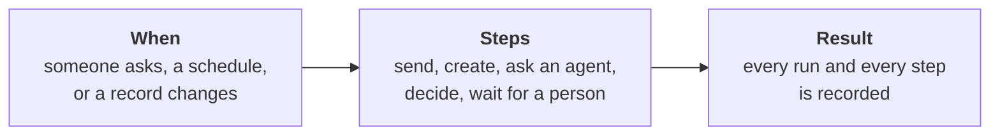

# Workflows for Business Users

**Who this is for:** people who run a business process on MemberJunction (operations, finance, sales,
membership, customer success) and the administrators who set automations up for them. It needs no
code. Developers want the [Workflows and Task Graphs Guide](WORKFLOW_AND_TASK_GRAPH_GUIDE.md), which
covers the same ideas with the internals.

**What you will learn:** what a workflow is, the ways one can start, what its steps can do, how to
create one and see what it did, and how to ask an administrator to make one run automatically.

---

## What a workflow is

A workflow is a set of steps that runs the same way every time. Every workflow has three parts:

Examples of what organizations automate with workflows:

- When an invoice is approved, email the customer and notify the account manager.
- Every Monday at 8:00, summarize last week's support tickets and send the themes to the team lead.
- When a new member joins, send a welcome message, create an onboarding task for staff, and check in
  after two weeks.
- When an application is submitted, have an AI agent screen it, then route it to a reviewer.

---

## When a workflow can start

| Start | Example | Who sets it up |
|---|---|---|
| **On demand** | Someone clicks **Run**, or asks an agent in a conversation | Anyone who can see the workflow |
| **On a schedule** | Every weekday at 7:00 in your time zone | An administrator |
| **When a record changes** | When an order becomes *Confirmed*; when a deal is won | An administrator |

### "Becomes" versus "is"

The most important idea about record-change automations: describe **the change**, not **the state**.

| You write | What happens |
|---|---|
| "when the status **becomes** Approved" | Runs **once**, on the save that approved it |
| "when the status **is** Approved" | Runs on **every** later save of that record too: an edited note, a new attachment, a payment applied |

The second is the most common cause of an automation that emails a customer five times. Always ask
for the first.

Two more rules of thumb:

- **A newly created record has no "before".** A condition about a new record talks about its values
  ("a new order whose type is Sale"), not about a change.
- **Point at what does not get renamed.** If a list of stages or statuses can be renamed by your
  team, a condition should name the specific stage or status record, or a yes/no flag on it (such as
  *is a won status*), rather than its label. Then renaming "Closed Won" to "Signed" breaks nothing.

---

## What a step can do

| Step | In plain words |
|---|---|
| **Action** | Do one thing: send an email or message, create or update a record, call another system. MemberJunction ships many actions, and each app adds its own |
| **Agent** | Ask an AI agent to do a task: research, summarize, draft, classify |
| **Prompt** | Run one AI instruction, such as "summarize this in three bullets" |
| **Decision** | Have AI answer a question, such as "how likely is this to churn?" or "which team should handle this?", and branch on the answer |
| **Person** | Wait for someone to review, approve or complete something; the workflow continues when they do |
| **For each** | Repeat steps for every item in a list (every overdue invoice, every attendee) |
| **While** | Repeat steps until a condition is met |

**Branches.** Where a workflow splits into paths, exactly one path runs: the highest-priority path
whose condition is true. Steps on the paths not taken show as *Skipped*. That is normal, and is shown
in grey, not red.

---

## Is a workflow the right tool?

| You want | Use | Who sets it up |
|---|---|---|
| One thing to happen when a record changes ("email the customer when their order is confirmed") | A **one-step automation**: a single action attached to that kind of record | An administrator |
| The same change made to many records (update, enrich, re-score), now, on a schedule or on change | A **Record Process**, in the Bulk Operations studio | An administrator or power user |
| Several steps, a decision, a person in the loop, or work that takes minutes | A **workflow** | You draft it; an administrator adds automatic triggers |

All three use the same kind of condition, so what you learn in one carries to the others.

---

## Creating a workflow

1. Open the **Workflows** app and choose **Create**.
2. Pick how to start:
   - **Blank canvas**: add steps and connect them yourself.
   - **Describe it**: say what you want done in a sentence or two. MemberJunction drafts the steps and
     you refine them on the canvas.
   - **From a past run**: turn something an AI agent already worked out into a reusable workflow.
3. Review every step on the canvas. **Nothing is saved until you approve it.**
4. Save. A new workflow runs **on demand**: it does nothing until someone runs it or an administrator
   gives it a schedule or a record-change trigger.

You can also start from a conversation. When an agent breaks your request into steps, its plan card
offers **Save as workflow**, so a plan that worked once becomes something anyone can rerun.

---

## Making a workflow run automatically

### On a schedule

Ask your administrator for the schedule ("weekdays at 7:00, Eastern time"). Once set, the **Scheduling**
app shows the job and its runs. A workflow that is paused or still a draft keeps its schedule but does
not run on it.

### When a record changes

Send your administrator a request in this shape:

> **Record:** Invoices
> **Event:** updated
> **Condition:** the status *becomes* Approved
> **Do:** run the "Invoice approved" workflow
> **Only for:** all invoices (or: invoices of one company, or one specific record)

What you can count on once it is set up:

- **It runs after the change is saved, never in the middle of it.** An automation cannot slow down or
  block the person saving the record.
- **A condition that cannot be checked stops the run.** If a condition is broken, the automation does
  not run, rather than running for everything.
- **Important automations can be made durable.** Your administrator can mark an automation that sends
  messages or talks to another system so that it survives a server restart and never runs for a change
  that was undone.
- **Every run is recorded**, including a run a condition stopped, so you can always find out what
  happened.

---

## Seeing what happened

- **Workflows** app → **Runs** lists every run. Open one to see each step, what it received, what it
  produced, and where it stopped.
- A step waiting on a person shows as waiting. That is the workflow working as drawn.
- Your administrator can also see every automation's attempts, including the ones a condition stopped.

---

## Troubleshooting

| What you see | Likely cause | What to do |
|---|---|---|
| It never runs on its own | It has no trigger yet. Workflows are on demand until an administrator adds one | Ask for a schedule or a record-change trigger |
| It never runs when a record changes | The condition is never true, or a newly created record is being tested for a "change" | Check the condition's wording with your administrator |
| It runs too often | The condition describes a state ("is Approved"), not a change ("becomes Approved") | Ask for the condition to be rewritten as a change |
| It finished but did nothing | Every branch was skipped, usually because an earlier step produced nothing for the decision to read | Open the run and look at the step before the branch |
| It is stuck | A step is waiting for a person, or a step failed and the steps after it are blocked | Open the run; complete the waiting step or fix the failed one |
| It ran while it was still a draft | A record-change trigger is switched on as soon as it is saved, even on a draft | Ask your administrator to switch the trigger off until the workflow is ready |

---

## Glossary

| Term | Meaning |
|---|---|
| **Workflow** | A saved set of steps that runs the same way every time |
| **Trigger** | What starts a workflow: on demand, a schedule, or a record change |
| **Condition** | The rule a record change must meet for its trigger to fire |
| **Step** | One unit of work in a workflow |
| **Run** | One execution of a workflow, with a record of every step |
| **Action** | A single operation (send, create, update, call) that steps and automations use |
| **Agent** | An AI assistant that can carry out a task |
| **One-step automation** | A single action attached to a kind of record, firing on its changes (technically an *Entity Action*) |
| **Record Process** | The same operation applied to a set of records |
| **Durable** | Survives a server restart, and never runs for a change that was undone |

---

## Learn more

**Developers and administrators:**

- [Workflows and Task Graphs Guide](WORKFLOW_AND_TASK_GRAPH_GUIDE.md), especially its "Triggers: when
  a workflow runs" section
- [Workflow Debugger Guide](WORKFLOW_DEBUGGER_GUIDE.md): stepping through a live run
- [Record Set Processing Guide](RECORD_SET_PROCESSING_GUIDE.md): Record Processes and their triggers
- [Actions Engine README](../packages/Actions/Engine/README.md): one-step automations, conditions,
  and durable runs

**Workflow guides for MemberJunction business apps**, with the moments in each app worth automating:

- [Orders](https://github.com/MemberJunction/bizapps-orders/blob/next/docs/workflows.md): orders,
  payments, subscriptions and access
- [Sales](https://github.com/MemberJunction/bizapps-sales/blob/next/docs/WORKFLOWS.md): deals, stages,
  wins and losses
- [MemberJunction BizApps](BIZAPPS_GUIDE.md): the catalog of business apps
