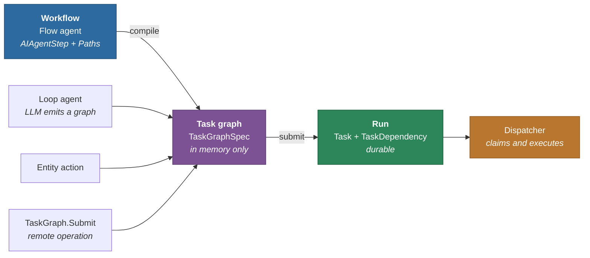
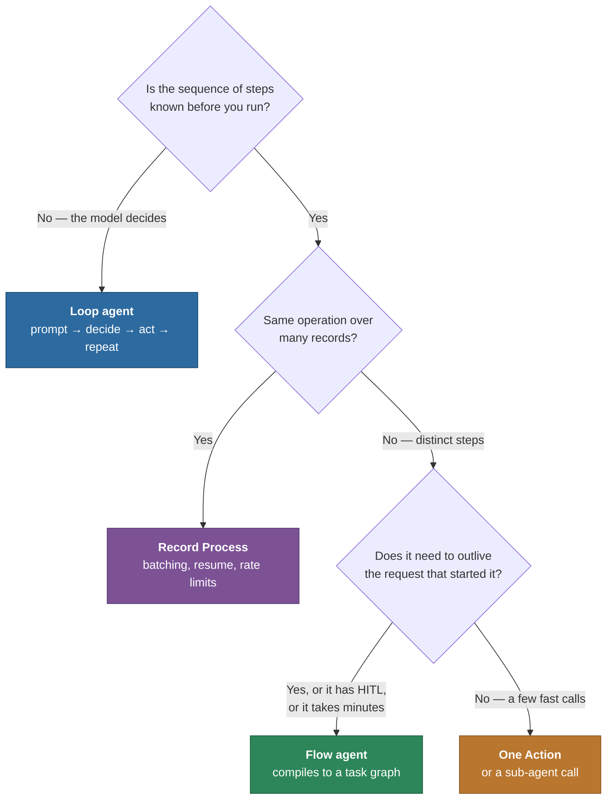
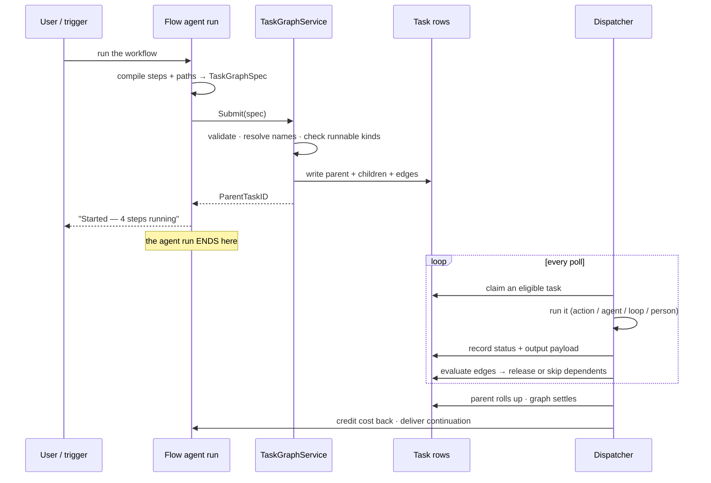
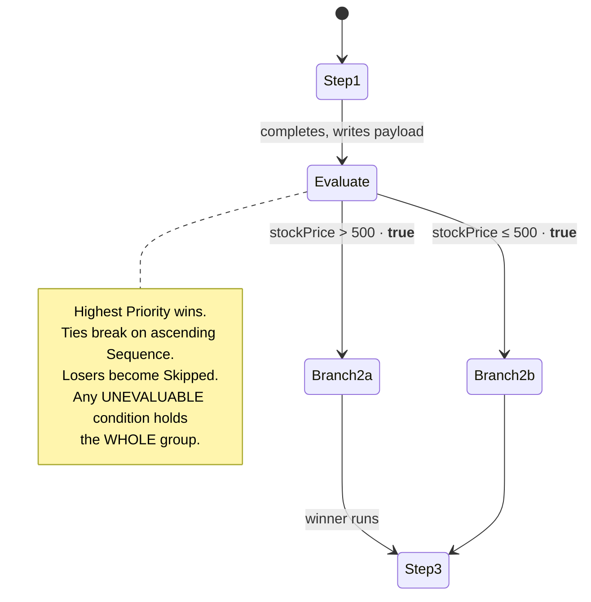
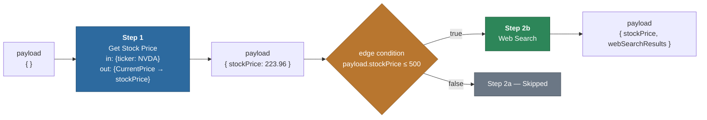
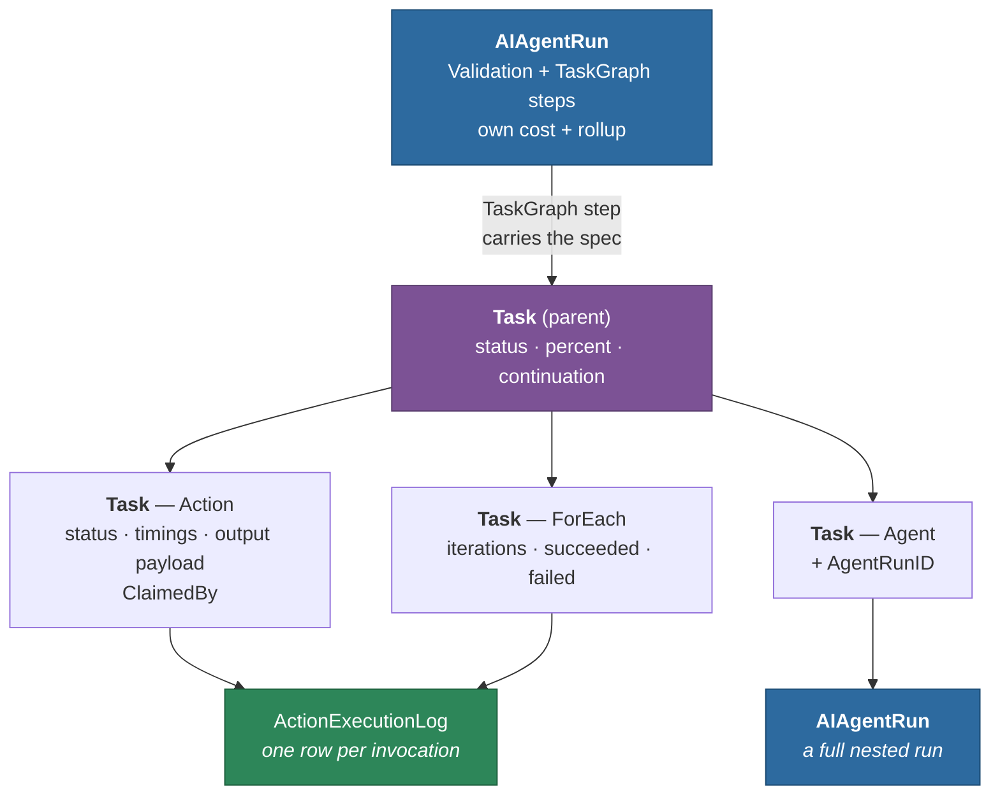

# Workflows and Task Graphs

**Read this before building anything that runs more than one step.** It covers what a workflow *is*
in MemberJunction, when to reach for one instead of an agent or a Record Process, how a workflow
becomes running work, and every rule that decides what happens next — conditions, branches, loops,
payload, failure, cost.

---

## Three words, and how they relate

Almost every misunderstanding in this area comes from using one word for three things.

| Term | What it is | Where it lives |
|---|---|---|
| **Workflow** | A *definition*. Steps and the paths between them, drawn by a person. | A **Flow agent** — `AIAgentStep` + `AIAgentStepPath` rows |
| **Task graph** | A *contract*. The executable form of a graph: nodes, typed configuration, dependency edges. | `TaskGraphSpec`, in memory. **Nothing persists it.** |
| **Run** | What actually happened. | `Task` + `TaskDependency` rows — **always**, for every producer |

The relationship is a one-way pipeline. A workflow *compiles into* a task graph; a task graph is
*submitted* and becomes a run.



Two consequences worth internalising immediately:

- **A graph can be built in memory by anything.** Only a Flow agent gives you a graph you can reopen
  and edit; but a Loop agent's model output, an entity action, or an outside caller of the
  `TaskGraph.Submit` remote operation can all hand the engine a graph that was never drawn.
- **Three of those producers have no agent run at all.** Their runs are just as real. Anything that
  reports on workflow execution has to work from `Task` rows, not from an agent run.

---

## Which tool for which job



- **Loop agent** — the path is discovered, not designed. See
  [`packages/AI/Agents/README.md`](../packages/AI/Agents/README.md).
- **Record Process** — "do X to a set of records" is a *different* problem with its own hardened
  substrate (batching, resume, circuit breakers, audit). Do not rebuild it as a workflow. See the
  [Record Set Processing Guide](RECORD_SET_PROCESSING_GUIDE.md).
- **Flow agent** — you can draw the steps, and the work deserves to be durable.
- **A single Action** — if it is one call, it is one call. See
  [`packages/Actions/CLAUDE.md`](../packages/Actions/CLAUDE.md).

### Durable work beyond graphs: pick the substrate before writing one

The tree above chooses between workflows and their neighbours. Apps reach one step further, and
rebuild durable-execution plumbing they already have: status columns, attempt counts,
next-attempt times, leases, stale-`Running` thresholds and dead-letter states. Before adding any of
those, choose the substrate that already owns them:

| The work | Use | Not |
|---|---|---|
| Several distinct steps, a branch, a person in the loop, a wait for time or an outside event, minutes to weeks | **Task graph** — a Flow agent with triggers, or a graph submitted from code | A status column advanced by cron sweeps; cron jobs offset by fifteen minutes to imply an order |
| One step delivered durably: at-least-once, retries with backoff, leases, dead-letter, partitions | **WorkQueue** (`@memberjunction/work-queue-*`) | A hand-rolled outbox table with its own lease arithmetic |
| One operation over a set of records, on demand, on a schedule or on change | **Record Process** | A scheduled job that pages through rows itself |
| Which state moves are *allowed* | **The entity subclass** (`Validate` / `ValidateAsync`) | The workflow — it decides *when* a move happens, never *whether* it is legal |
| One call | **An Action** (at a boundary) or a direct method call | Any of the above |

The last two rows matter as much as the first three. A workflow drives sequencing, waiting and
retries; an entity's transition table stays in the entity, and the status column becomes a
projection of where the workflow is. Writing the workflow so it is the only thing allowed to change
the status gives you both.

**When the engine cannot express what you need, fix the engine.** A missing node kind, a missing
trigger, a limit that does not fit: raise it in core (MJ `next`) and build on the fix. A local
workaround — a fake Human step completed from code, a `LIKE` over `Task.Configuration`, a sweep that
exists only because an event hook is missing — is invisible to the next team and becomes the thing
that has to be unwound later.

**A Loop agent can also emit a task graph** when it decides work should be parallel and durable —
the two are not mutually exclusive. What makes a Flow agent different is that its graph is *drawn*
rather than *inferred*, so it is reviewable, diffable and rerunnable.

When a Loop agent needs another agent's help, pick the mechanism that matches who owns the rest of the turn:

| Mechanism | When to use it | What happens to the caller's run |
|---|---|---|
| **Sub-Agent** (`nextStep.type = "Sub-Agent"`) | You need a child or related sub-agent to compute a result and hand it back inside your run. | Stays alive; the sub-agent's output merges into your payload/messages and your loop continues. |
| **Consult** (`ChatHandlingOption = "Consult"` on a Sub-Agent) | A sub-agent pauses mid-run to ask a clarifying question and you want the parent agent to answer (or escalate) without losing the sub-agent's run. See [Sub-Agent `ChatHandlingOption` Resolution & Values](../packages/AI/Agents/docs/sub-agents-guide.md#sub-agent-chathandlingoption-resolution--values). | Both runs stay coordinated; the parent answers via `resumeRunId` up to `MaxSubAgentConsultRounds`. |
| **Tasks** (`nextStep.type = "Tasks"`) | The work is a multi-step or long-running DAG that should outlive the request and execute durably on the task-graph dispatcher. | Submission ends the current run immediately; the dispatcher claims and runs the `Task` rows asynchronously. |
| **Handoff** (`nextStep.type = "Handoff"`) | Another top-level peer agent should take over the conversation and speak directly to the user as itself (and stay sticky for follow-up turns). | The source agent's run completes cleanly (`FinalStep = "Success"`), and the host starts a fresh top-level run of the target agent on the same conversation. |

---

## What happens when a workflow runs

The single most important property: **submission and execution are separate.** An agent run that
submits a graph *ends immediately*. The graph outlives it.



This is why a page reload, a server restart, or the submitting run ending no longer lose the work —
and it is also why **cost cannot be totalled during the run** (see [Cost and
tokens](#cost-and-tokens-the-seam)).

### When a Flow agent runs in-process instead

Dispatch is the default for a **top-level** Flow agent run. It is wrong for a caller that needs
the workflow's result as part of its own work, because a dispatched run returns before any step has
run. Those runs walk the flow in-process and return the final payload, as Flow agents did in 5.x:

| The run | Where it executes | Why |
|---|---|---|
| Top-level, no option set | Dispatcher | Survives reloads and restarts; nobody is waiting on the payload |
| Has a `parentRun` (a sub-agent step, including a Sub-Agent task inside a dispatched graph) | In-process | The calling run consumes the result |
| `agentTypeParams.executionMode: 'inRun'` | In-process | The caller, such as an API handler, must answer with the payload |
| Has a `parentRun` **and** `executionMode: 'dispatch'` | Refused | The parent would continue before any work had happened |

```typescript
const params: ExecuteAgentParams<MyContext, MyPayload, FlowAgentExecuteParams> = {
    agent: flowAgent,
    conversationMessages,
    contextUser,
    agentTypeParams: { executionMode: 'inRun' },
};
const result = await new AgentRunner().RunAgent(params);   // result.payload is the flow's final payload
```

The choice is recorded on the run as a completed `Decision` step named **"Workflow runs in this
run"** or **"Workflow runs on the task-graph dispatcher"**, with the reason in its output data.

What in-process execution gives up is exactly what dispatch adds: the steps live only as long as
the run, they appear as ordinary `AIAgentRunStep` rows rather than `Task` rows, and a `Human` step
is not supported. `startAtStep` works in-process and is refused under dispatch.

Both modes choose outgoing paths with the same function (`SelectOutgoingEdges`), so a flow takes the
same branches either way. Workflows with multiple `StartingStep: true` entry points compile all
active starting steps as parallel wave-1 root tasks (`dependsOn: []`) on the dispatcher, while the
in-process walker executes all starting branches sequentially before entering any downstream join
step. One consequence differs from 5.x in both modes: a path whose destination
step is not `Active` is not followed, so a flow whose only satisfied path leads to a disabled step
now finishes with **Success** where 5.x reported *"No active steps found"*.

---

## The node kinds

A node carries a `kind` and a typed `configuration` bag for that kind. The kind is the discriminator
everything routes on.

| Kind | What runs it | Where its target lives | Runnable today |
|---|---|---|---|
| `Agent` | `TaskAgentRunner` → a **new** `AIAgentRun` | `Task.AgentID` | ✅ |
| `Action` | `TaskActionRunner` → `ActionExecutionLog` | `Task.ActionID` | ✅ |
| `Human` | nobody — waits for a person | `Task.UserID` | ✅ |
| `Prompt` | `TaskPromptRunner` → `AIPromptRun` | `Task.PromptID` | ✅ |
| `ForEach` | `TaskLoopExecutor`, single body or multi-step `steps[]` per iteration | `Task.ActionID` / `AgentID` / `PromptID` (`Configuration.stepActionIds` for `steps[]`) | ✅ |
| `While` | `TaskLoopExecutor`, single body or multi-step `steps[]` per iteration | same | ✅ |
| `Decision` | `AIDecisionTaskRunner` → typed answers under `decisions.<step>.<question>` | `Task.PromptID` (optional; defaults to `Default Decision`) | ✅ |
| `External` | waits for a signal — `TaskGraph.CompleteWaitingStep`, by task ID or correlation key | — (`Task.CorrelationKey`) | ✅ |
| `Wait` | waits for a moment in time — `until` or `durationSeconds` | — (`Task.DueAt`) | ✅ |

`External`, `Wait`, and a `Human` step handed to a plugged-in provider are **waiting steps**: nothing
claims them, and they finish when something outside the runner says so. They have their own section,
[Waiting steps](#waiting-steps-external-wait-and-human-providers).

Unrunnable kinds are **refused at submission by name**, not persisted. A task nobody can run would
sit in `Pending` forever and read as a workflow politely in progress — the worst available failure.

> **A loop's key points at what it repeats, not at the loop.** A `ForEach` row carries the
> `ActionID` of its body. That is why execution routes on `StepType` and not on "which key is set" —
> the older test would have run a loop exactly once.

---

## Edges: how the next step is chosen

An edge is a **prerequisite** (`dependsOn`), optionally carrying a condition. A flow's paths point
forward (`Origin → Destination`); a graph's edges point backward ("I wait for X"). Same edge,
opposite authoring convention.

### Exclusive groups — the rule that makes a flow a flow

A flow's default traversal is an **exclusive choice**, not a chain: the walker takes the
highest-priority *satisfied* path and discards the rest. Compiling a fan-out as plain parallel edges
would run branches the author's flow has never executed.

So sibling edges leaving one origin share an `ExclusiveGroup`, and exactly one wins.



Three rules, each earned:

1. **Highest `Priority` wins; ties break on ascending `Sequence`.** Compiled edges get fresh UUIDs
   and `Priority` defaults to `0`, so ties are the common case. Without a stored ordinal the same
   workflow could take a different branch on a different machine.
2. **Losers become `Skipped`, never `Blocked`.** A branch not taken is a normal outcome.
3. **One unevaluable condition holds the entire group.** A typo stalls the workflow *visibly* rather
   than firing every branch of a fork.

### Statuses

| Status | Meaning | Terminal? | Satisfies dependents? |
|---|---|---|---|
| `Pending` | waiting on prerequisites | no | no |
| `In Progress` | claimed and running | no | no |
| `Complete` | succeeded | yes | yes |
| `Failed` | ran and did not work | yes | only under `failureSemantics: 'edges'` |
| `Skipped` | **branch not taken** — a normal outcome | yes | **yes** |
| `Blocked` | can never run; a prerequisite is unsatisfiable | yes | no |
| `Cancelled` | stopped deliberately | yes | no |

`Skipped` satisfies dependents on purpose: a join downstream of a fork must still run once the fork
resolves. It is also invisible to failure precedence when the parent rolls up.

> **In any UI: `Skipped` is grey, never red.** Skipped means the workflow chose another route;
> Blocked means something broke. Rendering them alike sends people hunting for bugs that do not
> exist.

---

## Payload: how data moves between steps

**This is where most real workflow bugs live**, because the failure is silent: an undefined value is
*falsy*, not erroneous, so a workflow that lost its data still completes and reports success — it
just takes the wrong branch.

Every step can declare two mappings:

- **`inputMapping`** — builds the step's parameters. A string is a **literal** unless it carries a
  recognized prefix.
- **`outputMapping`** — writes the step's results back into the payload. This is what makes a branch
  condition possible at all.



### The mapping dialect

The dispatcher and BaseAgent's loop helpers call **one shared implementation**
(`@memberjunction/ai-core-plus` → `payload-mapping.ts`). Two implementations would diverge exactly
where the compile is supposed to be lossless.

The in-run walker's Action step mappings are still the 5.x code in `FlowAgentType`
(`PreProcessActionStep`, `applyActionOutputMapping`). They accept the same forms below, but they are
a separate implementation, so a mapping bug fixed in one is not automatically fixed in the other.

**Input values** — a literal unless prefixed (prefix matching is case-insensitive):

| Form | Resolves to |
|---|---|
| `"NVDA"` | the literal string |
| `"payload.stockPrice"` | a value from the payload |
| `"static:[1,2,3]"` | the literal after the prefix |
| `"data.region"` | template data |
| `"context.apiKey"` | runtime context |
| `conversation[0].content` | a conversation message (where a conversation exists) |

**Output keys** — read from the step's result:

| Form | Meaning |
|---|---|
| `"CurrentPrice"` | one field, matched **case-insensitively** |
| `"Nested.Inner"` | dotted path, case-insensitive at each level |
| `"*"` | the whole result |

**Output targets** — where it lands in the payload:

| Form | Meaning |
|---|---|
| `"stockPrice"` | assign |
| `"a.b.c"` | nested assign |
| `"results[]"` | **append**, auto-creating the list |
| `"$message"` / `"$reasoning"` / `"$confidence"` | routed away from the payload to the run's own fields |

### Payload accumulates

Each step hands on `{...everything it received, ...its own updates}`. A condition three steps
downstream can still read a value written at the start. Handing each task only its immediate
predecessor's output would silently narrow that — and the workflow would quietly take a different
route than the flow it was compiled from.

---

## Loops

A loop is the one step whose size is unknowable until the steps before it have run — so it stays
**one Task row** and iterates inside its own execution. Expanding it into N rows at submission would
mean guessing N, and guessing wrong in the direction that silently drops work.

```json
{
  "type": "ForEach",
  "collectionPath": "static:[1,2,3,4,5]",
  "itemVariable": "number",
  "indexVariable": "i",
  "maxIterations": 5,
  "continueOnError": true,
  "executionMode": "sequential"
}
```

| Setting | Behaviour |
|---|---|
| `collectionPath` | resolved through the same mapping dialect — `payload.x`, `static:[…]`, a literal |
| `maxIterations` | **`0` means unlimited**; omitted takes the default (1000 ForEach / 100 While) |
| `continueOnError` | the loop succeeds despite failed iterations — counts still ride in the output |
| `executionMode` | `sequential` (default) or `parallel` with `maxConcurrency` |
| `delayBetweenIterationsMs` | for rate-limited work |

The per-iteration bindings are merged **into the payload**, so a body mapping reaches the current
item the same way it reaches anything else: `payload.number`.

> **Parallel loops keep results in *iteration* order**, not completion order — an output mapping
> writing `results[index]` and a downstream step reading it both assume position means iteration
> number.

A `While` loop is always sequential and always bounded; an **unevaluable condition fails the loop**
rather than ending it quietly, because "the condition broke" and "the loop finished" must not look
alike.

### Multi-step action loop bodies (`steps[]`)

Both `ForEach` and `While` accept an ordered `steps?: LoopBodyActionStep[]` sequence instead of a
single `action` / `subAgent` / `prompt` body when each iteration needs to chain multiple Actions in
memory without expanding into N graph nodes or paying per-item LLM turns:

```json
{
  "collectionPath": "payload.items",
  "itemVariable": "item",
  "indexVariable": "idx",
  "executionMode": "sequential",
  "steps": [
    {
      "id": "fetch",
      "name": "Get Stock Price",
      "params": { "ticker": "{{item.symbol}}" }
    },
    {
      "id": "enrich",
      "name": "Calculate Expression",
      "condition": "steps.fetch.CurrentPrice > 100",
      "params": { "Expression": "{{steps.fetch.CurrentPrice}} * {{item.shares}}" },
      "outputMapping": "{\"details.result\": \"positions[]\"}"
    }
  ]
}
```

- **In-memory step output chaining (`steps.<id>.*`)**: Every completed step stores its structured
  output under `steps[step.id ?? "step_" + stepIndex]`. Later steps in the same iteration can read
  earlier outputs in both `params` (`{{steps.fetch.CurrentPrice}}` or `"steps.fetch.CurrentPrice"`)
  and `condition` (`steps.fetch.CurrentPrice > 100`).
- **Per-step `condition` and `outputMapping`**: A step whose `condition` evaluates to `false` is
  skipped cleanly for that iteration. Each executed step's `outputMapping` folds into the loop's
  running payload (`positions[]` appends safely even under `executionMode: "parallel"`).
- **Pre-resolved `ActionID`s & sanitized tool names**: `TaskGraphService.Submit` resolves every
  distinct step's `ActionID` into `Task.Configuration.stepActionIds` (setting `Task.ActionID` to
  `steps[0]`'s action for FK/UI compatibility) and accepts both canonical MJ Action names
  (`"Calculate Expression"`) and sanitized native tool names (`"calculate_expression"`).
- **Lossless Flow graduation**: `ConvertTaskGraphToAgentSpec` and `CompileFlowToTaskGraph` preserve
  `steps[]` across runtime-to-Flow graduation and compilation.

---

## Failure

Two levels, and they answer different questions.

**Per-node `onError` policy** — `fail` (default), `continue`, or `retry` with `retryCount`.
`continue` is what lets a workflow draw a recovery path instead of stopping dead.

### Retries are durable

A step with `policy.retryCount` that fails is **not** retried inside the run that failed. It goes
back to `Pending` with the attempt counted (`Task.AttemptCount`), the error kept, and the earliest
moment it may run again (`Task.NextAttemptAt`, on the database clock). Claiming waits for that
moment, so the retry survives a restart or a deploy and runs on whichever instance is free. Nothing
downstream reacts to a failure that is still going to be retried; viewers get a `ClaimChanged` frame
with `ClaimEvent: 'retry-scheduled'`. Backoff doubles from `RetryBackoffBaseMs` (default 1s), capped
at 30×. When the retries are spent, the failure is final.

Which steps may be retried — the step's policy asks, **and** running it again is safe:

| Step | Retried? | Why |
|---|---|---|
| Action | only when the action's `IsIdempotent` is true | a payment that failed after charging must not charge again; a node may switch retries off (`compensation.isIdempotent: false`) but never on |
| Prompt, Decision | yes | a model call changes nothing it would repeat |
| Agent (and a loop over an agent) | **never** | the agent may have called actions that must not run twice, and an agent has no idempotency flag to say otherwise — model its retry as an explicit failure path |

A person retrying a step (`TaskGraph.RetryTask`) resets its attempt count.

This is what makes an app-side outbox — status, attempt count, next-attempt time, lease,
dead-letter — unnecessary for multi-step work: put the steps in the graph and give them a policy.

**Per-graph `failureSemantics`:**

| Value | Meaning | Used by |
|---|---|---|
| `'block'` | a failed node is terminal for its dependents | agent-emitted graphs |
| `'edges'` | dependents are released along their edges, so a failure path can be *drawn* | **compiled flows** |

---

## Waiting steps: External, Wait, and Human providers

Three step kinds finish without a runner. When the dispatcher **reaches** one (its prerequisites are
satisfied) it marks the step waiting — once, across instances — and records three things on the
row: its deadline (`Task.DueAt`), its correlation key (`Task.CorrelationKey`, External only) and the
payload it was reached with (`Configuration.runtime.payloadAtStart`). Something else then completes
it:

| Step | Completed by | Fails when |
|---|---|---|
| `Wait` | the dispatcher, once `DueAt` has passed (judged on the **database** clock) | its `until` cannot be resolved |
| `External` | `TaskGraph.CompleteWaitingStep` — by task ID, or by correlation key | `expiresInHours` passes with no signal |
| `Human` with `provider` | the provider, through the same completion call | `expiresInHours` passes; the provider is not registered; the provider refuses to raise it |

### What a waiting step hands on

The payload it was reached with, with the signal's payload (or a Wait's `waitedUntil`) merged over
it. A runner's output already carries everything it received; a waiting step has no runner, so the
dispatcher does the accumulating. Emitting only the signal's payload would drop everything upstream
from every step after it — and a condition reading `payload.customer` three steps later would quietly
read `undefined`.

### Wait

```json
{ "kind": "Wait", "configuration": { "durationSeconds": 86400 } }
{ "kind": "Wait", "configuration": { "until": "payload.renewal.chargeOn" } }
```

Exactly one of the two. `until` is an ISO-8601 timestamp or a `payload.<path>` holding a timestamp,
a `Date` or epoch milliseconds; a moment already past continues at once. A path that holds nothing
**fails** the step rather than continuing now — "charge immediately because the date was missing" is
the silent wrong turn a workflow cannot recover from.

This is what replaces cron chains (`spawn at 03:00, charge at 03:15, suspend at 03:30`) and sweeps
that check whether a cooling-off period has passed.

### External, and signalling

```json
{ "kind": "External", "configuration": { "domain": "stripe", "correlationKey": "payload.invoiceID", "expiresInHours": 72 } }
```

Complete it from a browser, MCP client or Action with the remote operation:

```typescript
await new TaskGraphCompleteWaitingStepOperation().Execute(
    { correlationKey: invoiceID, payload: { paid: true, amount } },
    { provider: this.ProviderToUse, user: this.CurrentUser },
);
```

…or from server code (a webhook handler, another app's save hook) directly:

```typescript
import { TaskGraphWaitingSteps } from '@memberjunction/task-graph';

const result = await TaskGraphWaitingSteps.CompleteWaitingStep(
    { CorrelationKey: invoiceID, Payload: { paid: true, amount } },
    provider, contextUser,
);
// result.Completed / result.Buffered / result.Refused — each with the task IDs, and Refused with reasons
```

- **A key is not unique.** One signal completes every reached External step waiting on it, so a
  single event — a sprint closing — releases every workflow waiting on it.
- **Early signals are held, not lost.** A signal for a step not reached yet is stored on the step and
  applied the moment it is reached. A *literal* key is stamped at submit so this works by key too; a
  `payload.<path>` key is only known once the step is reached, so an early signal for one must name
  the task ID.
- **`Status: 'Failed'`** completes the step as failed, so a failure edge (`failureSemantics: 'edges'`)
  can route around it.
- **Who may signal.** The remote operation requires the workflow run's owner or an Owner-type user,
  per matched step; steps the caller may not complete are reported in `refused`, never skipped
  silently. In-process callers are trusted code and pass no authorizer.
- A `Wait` step and an inbox-`Human` step are refused: each already has one way to finish.

### Human-step providers

A Human step uses MJ's built-in inbox (an `MJ: AI Agent Requests` row) unless it names a provider.
Any package can supply one — an approval system, a ticketing integration — without core knowing it
exists:

```typescript
import { RegisterClass } from '@memberjunction/global';
import { BaseHumanTaskProvider, type HumanTaskRaiseContext, type HumanTaskRaiseResult } from '@memberjunction/task-graph';

@RegisterClass(BaseHumanTaskProvider, 'BizAppsTasks')
export class BizAppsTasksHumanTaskProvider extends BaseHumanTaskProvider {
    public async RaiseTask(ctx: HumanTaskRaiseContext): Promise<HumanTaskRaiseResult> {
        // Create the app's own task. Remember ctx.TaskID: when that task is decided, call
        // TaskGraphWaitingSteps.CompleteWaitingStep({ TaskID: ctx.TaskID, Payload: { decision } }, ...)
        return { Outcome: 'raised', ExternalReference: appTask.ID };
    }
}
```

```json
{ "kind": "Human", "configuration": { "instructions": "Approve the refund", "provider": "BizAppsTasks",
  "providerConfiguration": { "taskTypeCode": "REFUND_APPROVAL", "assigneeRole": "Finance" }, "expiresInHours": 48 } }
```

- `RaiseTask` is called **exactly once** per reached step. A `transient-failure` is retried a few
  times inline; after that, or on `permanent-failure`, the step fails with the provider's message and
  `TaskGraph.RetryTask` raises it again.
- The provider receives the step's instructions, its `providerConfiguration` untouched, the assigned
  and owning users, the deadline, and the payload the step was reached with.
- `WithdrawTask` is called when the step expires. The default does nothing.
- An unregistered provider is **refused at submit**, by name; the dispatcher re-checks when it
  reaches the step, so a host that differs fails the step with the name rather than waiting forever.
- Omitted, or `'AgentRequest'`, is the built-in inbox, unchanged.

Drawn workflows (`AIAgentStep`) accept `External` and `Wait` step types, and a Human step's
`provider` / `providerConfiguration` ride in its `Configuration`, exactly as they do on a graph node.

---

## Configuring a workflow, end to end

The shipped **Demo Flow Agent** is the reference. Four steps: fetch a price, branch on it, then loop.

**1. Create the agent** as a Flow type, then add steps. Each step is an `AIAgentStep`:

| Field | Step 1 |
|---|---|
| `Name` | `Step 1: Get NVIDIA Stock Price` |
| `StepType` | `Action` |
| `StartingStep` | `1` |
| `ActionID` | → `Get Stock Price` |
| `ActionInputMapping` | `{"ticker": "NVDA"}` |
| `ActionOutputMapping` | `{"CurrentPrice": "stockPrice"}` |
| `TimeoutSeconds` | `600` |
| `OnErrorBehavior` | `fail` |

**2. Draw the paths.** Each `AIAgentStepPath` carries `OriginStepID`, `DestinationStepID`, an
optional `Condition`, and a `Priority`:

| Origin | Destination | Condition | Priority |
|---|---|---|---|
| Step 1 | Step 2(a) Get Weather | `payload.stockPrice > 500` | 0 |
| Step 1 | Step 2(b) Web Search | `payload.stockPrice <= 500` | 0 |
| Step 2(a) | Step 3 | *(none)* | 100 |
| Step 2(b) | Step 3 | *(none)* | 100 |

Because both paths leave Step 1, the compiler puts them in one exclusive group — exactly one runs.

**3. A loop step** sets `StepType = ForEach`, `LoopBodyType = Action`, its `ActionID` to the body,
and its loop settings in `Configuration` (the JSON above).

**4. Run it.** The compile is automatic — `DetermineInitialStep` compiles and submits, and the run
returns a handle immediately.

### Prefer metadata over hand-editing

Author workflows as declarative metadata under `metadata/` and push with `mj sync push`, so they are
reviewable and travel between environments. See [`metadata/CLAUDE.md`](../metadata/CLAUDE.md).

---

## Triggers: when a workflow runs

Everything above defines *what* a workflow does. *When* it runs is declared beside it, in a
`WorkflowSpec` (`packages/AI/CorePlus/src/task-graph/workflow-spec.ts`):

| Field | Meaning |
|---|---|
| `name`, `description` | The workflow as people see it |
| `status` | `Draft` (the default), `Active` or `Paused` |
| `graph` | A `TaskGraphSpec`, verbatim: the same shape the canvas, a Loop agent and a past run produce |
| `triggers` | When it runs. Empty means on demand |
| `notifications` | Who hears about a run: `Always`, `OnFailure` or `OnChange`, to a list of user IDs |

**There is no `Workflow` table.** Saving a spec *reconciles* rows that already exist: the Flow agent
behind the graph, a Scheduled Job for a schedule, an Entity Action binding for a record change. Each
owned row is matched by a marker in its own configuration, so ownership survives a rename, and
re-saving updates rows in place rather than deleting and recreating them, so a live trigger is never
detached for a moment.

### The three trigger kinds

| `type` | Fires | What saving creates or updates |
|---|---|---|
| `OnDemand` | Only when something asks: **Run** in the Workflows app, an agent, the `TaskGraph.Submit` operation | Nothing |
| `Schedule` | On `cron`, in `timezone` (an IANA zone; absent means the job's own default) | One `MJ: Scheduled Jobs` row of the existing `Agent` job type, pointing at the workflow's agent |
| `EntityEvent` | After a record of `entityName` is created, updated or deleted, when `filter` allows | An `MJ: Entity Actions` binding on that entity dispatching to the existing `Execute Agent` action: an `MJ: Entity Action Invocations` row for the event, `MJ: Entity Action Params` carrying the agent and the changed record, and, when `filter` is set, an `MJ: Action Filters` row bound through `MJ: Entity Action Filters` |

### Record-change (`EntityEvent`) triggers

```jsonc
"triggers": [{
  "type": "EntityEvent",
  "entityName": "Invoices",
  "invocationType": "Update",
  "filter": "DidFieldChangeToValue('Status', 'Approved')"
}]
```

- **`invocationType`** is `AfterCreate`, `AfterUpdate` or `AfterDelete`, or the shorthand `Create`,
  `Update`, `Delete`, which resolves to the *After* form. `Validate` and the `Before*` types are
  refused: they run inside the save, holding its transaction open with the power to abort it, and a
  workflow bound there would put an agent run in the middle of a user's save.
- **`filter`** is a JavaScript boolean expression about the change. In scope:
  `DidFieldChange('Field')`, `DidFieldChangeToValue('Field', value)`, `OldValues`, `NewValues`, and
  `ActionFilterContext`. **Write the transition, not the state**: `NewValues.Status === 'Approved'` is
  true on every later save too, while `DidFieldChangeToValue('Status', 'Approved')` is true once, on
  the save that made it so. **A create reports no changed fields**, so a `Create` trigger tests
  `NewValues` instead. The expression is syntax-checked when the workflow is validated, and at run time
  it **fails closed**: one that throws prevents the run. It is the same language a plain entity action
  filter and a Record Process `OnChangeFilter` use; the full vocabulary is in
  [`packages/Actions/Engine/README.md`](../packages/Actions/Engine/README.md#transition-filters--deciding-on-the-change-not-the-end-state).
- **`scopeEntityName` / `scopeRecordID`** narrow the trigger from the whole entity to one record.

### Saving: `Workflow.Draft`, `Workflow.Validate`, `Workflow.Save`

Three remote operations, implemented in `packages/TaskGraph/src/operations/WorkflowOperations.ts`:

| Operation | Does |
|---|---|
| `Workflow.Draft` | Turns a plain-English description into a `TaskGraphSpec`, constrained to agents that exist. **Persists nothing**; the Workflows app's *Describe it* path uses it, and the author reviews the draft on the canvas |
| `Workflow.Validate` | Runs exactly the validation `Workflow.Save` runs and returns every problem, each with a code, so an agent can iterate before committing |
| `Workflow.Save` | Validates, persists the Flow agent, then reconciles the triggers (`packages/TaskGraph/src/WorkflowSpecSync.ts`). Returns the `agentID`, the Scheduled Jobs it touched, and `unreconciled`: any trigger it could not wire is reported, never silently dropped |

`Workflow.Save` needs the agent-authoring package loaded on the host; without it the save is refused
with that reason rather than half-persisting a workflow.

Removing a trigger **disables** what it owned rather than deleting it: a Scheduled Job keeps its
counts and run history, and a removed filter's row keeps the expression someone wrote.

### Status

A trigger follows the workflow's status. A schedule's job, and a record-change trigger's
`MJ: Entity Actions` binding, are `Active` only while the spec is `Active`; a `Draft` or `Paused`
workflow keeps them, `Disabled`, without running on them.

Removing a trigger from the spec **disables** what it owned: the Scheduled Job, or the binding.
Re-adding it reactivates the same row, with its history.

Record-change triggers on one entity and scope share one binding, and a filter belongs to the
binding. Two such triggers with **different** filters cannot both be honoured, so the second is
reported in `unreconciled` rather than silently overwriting the first. Give them identical filters,
or split them into two workflows.

### Where people work with triggers

| Surface | What it does with triggers |
|---|---|
| **Workflows** app → **Create** (*Blank canvas*, *Describe it*, *From a past run*) | Saves the workflow **on demand**. It asks for no trigger, on purpose: creating a workflow captures *what* worked, and *when* is a separate decision |
| **Workflows** app → list | Does not read triggers back yet, so every workflow shows as *On demand* |
| A conversation's plan card → **Save as workflow** | Saves an agent's plan as an on-demand workflow |
| **Scheduling** app | Shows the job a `Schedule` trigger owns, and its runs |
| `Workflow.Save`, from code, an agent or an MCP client | The way to add or change a `Schedule` or `EntityEvent` trigger today |

### Which record-change mechanism to use

All three below share the same filter language and end up as the same Entity Action rows, so a person
who learns one has learned the others.

| You need | Use |
|---|---|
| One action when a record changes ("send the customer a confirmation") | A plain Entity Action with an Action Filter: [`packages/Actions/Engine/README.md`](../packages/Actions/Engine/README.md) |
| One operation over a set of records, on demand, on a schedule or on change | A Record Process: [Record Set Processing Guide](RECORD_SET_PROCESSING_GUIDE.md), §7 |
| Several steps, a branch, a person in the loop, or work that takes minutes | A workflow with an `EntityEvent` trigger |

**Durability.** A record-change dispatch is an `After*` entity action, which runs fire-and-forget in
the saving process unless its binding's `RunMode` is `Durable`. For a workflow that matters less
than it sounds: `Execute Agent` submits the workflow as a durable task graph, so only the hand-off
runs in that process. For a plain Entity Action whose work has an outside effect (an email, a call to
another system), set `RunMode = 'Durable'`. The work then survives a restart and is tied to the
transaction that caused it, so a save that rolled back never fires it. See "Durable dispatch" in
[`packages/Actions/Engine/README.md`](../packages/Actions/Engine/README.md).

For people who configure workflows rather than write code, the companion
[Workflows for Business Users](WORKFLOWS_FOR_BUSINESS_USERS.md) guide explains the same ideas without
the internals.

---

## Graph size

A graph a **model** authored — a Loop agent's `nextStep.tasks`, a `Workflow.Draft` — is capped at
`MAX_TASKS_PER_AGENT_GRAPH` (50), matching what a model can hold in its scratchpad. Graphs a person
drew or code built are bounded only by `MAX_TASKS_PER_GRAPH` (10,000), a blast-radius ceiling for
the `TaskGraph.Submit` remote operation. Work that fans out wider is one step repeated over a
collection: a `ForEach`, or a Record Process.

## Submitting a graph from code

Everything goes through one seam, so a graph cannot be validated differently depending on who
produced it:

```typescript
import { GetTaskGraphSubmitter, TaskNode, type TaskGraphSpec } from '@memberjunction/ai-core-plus';

const spec: TaskGraphSpec = {
    workflowName: 'Enrich and notify',
    reasoning: 'Requested by the nightly job',
    failureSemantics: 'edges',
    tasks: [
        TaskNode.Action(
            { tempId: 'fetch', name: 'Fetch accounts', description: '', dependsOn: [] },
            { actionName: 'Run View', outputMapping: '{"Results":"accounts"}' },
        ),
        TaskNode.Agent(
            { tempId: 'summarize', name: 'Summarize', description: '', dependsOn: ['fetch'] },
            { agentName: 'Account Summarizer' },
        ),
    ],
};

const submitter = GetTaskGraphSubmitter();
if (!submitter) {
    // A host with no dispatcher is a legitimate configuration — a CLI, a test, a browser bundle.
    // Report it; never let the graph vanish quietly.
    throw new Error('No dispatcher on this host, so the workflow cannot be made durable.');
}

const outcome = await submitter.Submit({
    Spec: spec,
    EnvironmentID: environmentID,
    ContextUser: contextUser,
    Provider: provider,
});
```

`Submit` returns as soon as the graph is **durable**, not when it has run. `ParentTaskID` is the
handle for status, cancel and retry.

---

## Observability: where everything is recorded

A dispatched workflow does not write one run step per workflow step. The detail moved, and gained
things a run step never had.



| Question | Where to look |
|---|---|
| What did the workflow do? | `Task` rows — `StepType`, `Status`, `StartedAt`, `OutputPayload`, `ErrorMessage` |
| What did an action do? | `ActionExecutionLog` — **including one row per loop iteration** |
| What did a sub-agent do? | `Task.AgentRunID` → a full `AIAgentRun` with its own steps |
| Which instance ran it? | `Task.ClaimedBy` |
| What did the whole thing cost? | the submitting run's `TotalCostRollup` |

> A five-iteration loop over a web-search action produces **five** `ActionExecutionLog` rows, plus one
> for any non-loop use. That is the cheapest available proof that a loop actually iterated.

### Cost and tokens: the seam

`BaseAgent` totals a run by walking its steps in memory **at finalization** — but a submitting run
*ends at submission*. At the moment it computes its totals, the graph has not spent anything yet.
That is a **lifetime** problem, not a data-location one.

So a graph credits itself back when it settles, into columns that already existed for exactly this
distinction:

| Column | Meaning |
|---|---|
| `TotalCost`, `TotalTokensUsed`, … | what **this run itself** spent. Final at finalization; never rewritten. |
| `TotalCostRollup`, `TotalTokensUsedRollup`, … | this run **plus everything it caused**. Provisional until the graph settles. |

A Flow agent's own cost is genuinely near zero — it compiled a graph and handed it off. **Show the
rollup wherever one number is shown.** A nested run's own rollup is preferred over its `TotalCost`,
so an agent that dispatched a graph of its own does not lose a subtree.

> **Known gap:** `MaxCostPerRun` cannot police a dispatched graph, because the ceiling is checked
> during a run that ends before the spending starts. Budget enforcement belongs on the graph.

---

## Layout

A `TaskGraphSpec` has no geometry field and a `Task` row has **no position columns**. Anything
rendering a graph that was not drawn by hand has nothing to position with.

The rule:

- **Authored geometry persists** — a flow step's `PositionX/Y/Width/Height` rides in
  `Task.Configuration.layout`, so a hand-arranged workflow runs and appears in history in the shape
  its author drew.
- **Everything else is computed** — `LayoutTaskGraph` / `LayoutGraphNodes` in
  `@memberjunction/ai-core-plus`. A derived layout is *never* stored: it would freeze one rendering
  of a graph that can still change.

```typescript
import { LayoutGraphNodes, GraphLayoutBounds } from '@memberjunction/ai-core-plus';

// The run-view form: bare ids and edges, because a running graph is Task rows with no spec anywhere.
const positions = LayoutGraphNodes(
    tasks.map((t) => t.ID),
    dependencies.map((d) => ({ From: d.DependsOnTaskID, To: d.TaskID })),
    { Direction: 'LR', NodeWidth: 200, LayerGap: 90 },
);
const box = GraphLayoutBounds(positions); // for fit-to-view
```

Layered by **longest** path (so a dependent always clears every prerequisite), barycenter-ordered to
keep edges short, and deterministic — a run view re-projects on every status change, and a layout
that shifted each poll would be unusable.

---

## Debugging a run

**Agent form → Run → Debug** starts the graph paused (`$.debug.paused` on the parent row at Submit) so the first step cannot be claimed before you arrive. **Workflows → Runs** is the same chrome on a graph that is already going or already finished — you cannot re-run a Flow agent from there.

Both surfaces embed `<mj-task-graph-debugger>` (a drop-in in `@memberjunction/ng-task-graph-editor`). The wrap owns frames and every `TaskGraph.*` Remote Operation; hosts pass a parent task id.

Continue from a breakpoint stamps `skipBreakpointTaskID` so the stopped step is claimed instead of immediately re-hitting the same Pending breakpoint. `ForEach` is one task row — one Continue runs the whole loop. Submit kicks every running dispatcher so the first claim is immediate, not one poll interval later.

See the **[Workflow Debugger Guide](WORKFLOW_DEBUGGER_GUIDE.md)** for the walkthrough, the visual vocabulary (queued / running / waiting-on-you; a forced path must never look like a real verdict; conditionals stay dashed until the dest actually starts), and the verb gates.

---

## Troubleshooting

### The workflow never fires on its trigger

| Check | Why |
|---|---|
| Does the workflow have a trigger at all? | Workflows created in the Workflows app are on demand until a trigger is saved through `Workflow.Save` |
| Was `unreconciled` empty when it was saved? | A trigger that could not be wired is reported there, not dropped |
| Is a schedule's workflow `Active`? | A `Draft` or `Paused` workflow's Scheduled Job is `Disabled` |
| Is the filter about a change? | `DidFieldChange` is false on every field of a create; a `Create` trigger must test `NewValues` |
| Is there an `ActionExecutionLog` row whose message says a filter prevented it? | The filter ran and said no, or threw: filters fail closed |
| Did the change go through `BaseEntity.Save()`? | Direct SQL fires no entity action |

### The workflow fires too often

The filter describes a state, not a transition. `NewValues.Status === 'Approved'` is true on every
save after approval; use `DidFieldChangeToValue('Status', 'Approved')`.

### The workflow finished but did nothing

Look for **every branch `Skipped`**. That means no condition at a fork evaluated true — and the
usual cause is that an upstream `outputMapping` wrote nothing, so the condition read `undefined`,
which is falsy rather than erroneous.

```sql
SELECT Name, StepType, Status, OutputPayload
FROM __mj.Task WHERE ParentID = '<parent>' ORDER BY __mj_CreatedAt;
```

An `OutputPayload` of `{}` on the step *before* the fork is the tell.

### The workflow is stuck

| Symptom | Cause | Fix |
|---|---|---|
| A `Human` task `Pending` | waiting on a person | it is working as drawn |
| Tasks neither running nor skipped | **held** — a condition in an exclusive group could not be evaluated | fix the expression |
| `Blocked` dependents | an upstream step failed under `failureSemantics: 'block'` | fix the step, or draw a recovery path with `onError: continue` |
| Everything `Pending`, nothing claimed | no dispatcher on any host, claims expired, or the worker is only waiting on its poll timer | check that MJAPI started `TaskGraphDispatcher`. Submit calls `KickTaskGraphDispatchers()` so the first pass is immediate; a multi-second sit on "Next — waiting for the engine" after Debug usually means no dispatcher registered a kick |

### The workflow refused to start

Read the message — it names the step. Common cases: a loop with nothing to repeat, a step referencing
an agent or action that no longer exists, a cycle, a Human step naming a provider no package on the
server registers, or a step kind this server is too old to know.

### A waiting step never finishes

| Symptom | Cause | Fix |
|---|---|---|
| An External step `Pending` with `ClaimedBy = '__waiting__'` | it is reached and waiting for its signal | signal it: `CompleteWaitingStep` by task ID, or by the `CorrelationKey` on the row |
| A signal returned `buffered` and nothing happened | the step has not been reached yet — an upstream step is still running or failed | the signal is held; it applies when the step is reached |
| A signal by key matched nothing | the key is a `payload.<path>` and the step is not reached yet, so `CorrelationKey` is still empty | signal by task ID, or use a literal key |
| A Wait step is still `Pending` past its time | the graph is not being polled (no dispatcher), or `DueAt` was resolved later than expected | check the dispatcher is running; read `DueAt` on the row |
| A provider-Human step failed at once | the provider is not registered on the dispatching server, or refused to raise | the step's `ErrorMessage` names which; fix and `TaskGraph.RetryTask` |

### Nothing is ever claimed — every task sits Pending

The dispatcher is running, the graph is `Pending`, and the log says nothing interesting. Look for
`[TaskGraphDispatcher] Cannot claim tasks` or `[TaskGraph] guarded write … FAILED`.

The claim protocol runs through `spTaskGraph*` stored procedures, which are granted to
`cdp_Developer` and `cdp_Integration`. A database principal in neither role cannot execute any of
them, so no task is ever claimed. Grant one of those roles to the principal the server connects as
and restart; the dispatcher also checks this at startup and names the missing grant.

Before #4575 these were raw statements against the `Task` table, which no runtime role may write —
so on a least-privilege install nothing was ever claimed, and the refusal was reported as though
another instance had won the race.

### A submission reported no dispatcher

`GetTaskGraphSubmitter()` returns `null` on a host with no durable-execution package loaded. That is
a legitimate configuration; the honest response is to report it, never to swallow it.

---

## Extending: adding a node kind

The type system makes most of this a compile error rather than a runtime surprise. In order:

1. **`TaskGraphNodeKind` + `TaskGraphNodeConfigMap`** — add the kind and its typed configuration
   (`packages/AI/CorePlus/src/task-graph/task-graph-spec.ts`). Add a `TaskNode.<Kind>` constructor.
2. **Validator** — declare its required configuration fields.
3. **Compiler** — map the design-time `StepType` onto it, if it is authorable in a flow.
4. **Persistence** — extend the `switch` in `persistTasks`, and carry its settings in
   `BuildStepConfiguration`.
5. **`DISPATCHABLE_KINDS`** — add it **only once a runner exists**. Until then it is refused by name,
   which is the correct behaviour.
6. **Runner** — execute it in `TaskGraphDispatcher.runTaskBody`.
7. **D17 converter** — `stepShapeFor`, so a runtime graph can still be saved as a workflow.

> Steps 4 and 5 are the ones that bite. A kind added to the spec but not to the persistence switch
> throws loudly (by design); a kind added to `DISPATCHABLE_KINDS` without a runner produces a task
> that waits forever.

---

## Related reading

- [Workflows for Business Users](WORKFLOWS_FOR_BUSINESS_USERS.md) — the same concepts for people who
  configure workflows rather than write code
- [`packages/AI/Agents/README.md`](../packages/AI/Agents/README.md) — the agent framework, agent
  types, and where `FlowAgentType` fits
- [`packages/TaskGraph/README.md`](../packages/TaskGraph/README.md) — the durable execution package:
  dispatcher, claim protocol, kick, runners
- [Workflow Debugger Guide](WORKFLOW_DEBUGGER_GUIDE.md) — step a live graph; drop-in wrap
- [`@memberjunction/ng-task-graph-editor`](../packages/Angular/Generic/task-graph-editor/README.md) —
  canvas, run view, `<mj-task-graph-debugger>`
- [Record Set Processing Guide](RECORD_SET_PROCESSING_GUIDE.md) — for "do X to many records", which
  is a different problem
- [`packages/Actions/CLAUDE.md`](../packages/Actions/CLAUDE.md) — Actions are boundaries; when to
  create one
- [Transport Layer Architecture Guide](TRANSPORT_LAYER_ARCHITECTURE_GUIDE.md) — where a
  workflow-invoking capability belongs in the stack
- [UI Layering Guide](UI_LAYERING_GUIDE.md) — before building any workflow UI
- [`metadata/CLAUDE.md`](../metadata/CLAUDE.md) — authoring workflows as declarative metadata
- [Agent Memory Guide](AGENT_MEMORY_GUIDE.md) · [Agent Skills & Plan Mode
  Guide](AGENT_SKILLS_AND_PLAN_MODE_GUIDE.md) — adjacent agent capabilities
