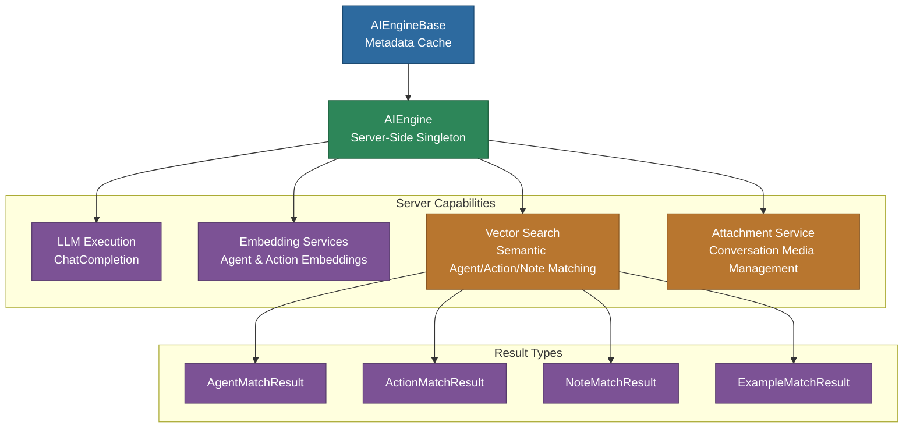

# @memberjunction/aiengine

Server-side AI Engine for MemberJunction. Wraps `AIEngineBase` and adds server-only capabilities including LLM execution, embedding generation, vector-based semantic search for agents and actions, and conversation attachment management. This package is the main orchestration layer for AI operations on the server.

## Architecture



## Installation

```bash
npm install @memberjunction/aiengine
```

**Note:** This package is server-side only. For metadata access on the client, use `@memberjunction/ai-engine-base` directly.

## Key Exports

### AIEngine (Singleton)

The main server-side engine. Uses composition (not inheritance) to delegate metadata operations to `AIEngineBase.Instance` while adding server-specific features.

```typescript
import { AIEngine } from '@memberjunction/aiengine';

// Initialize
await AIEngine.Instance.Config(false, contextUser);

// All AIEngineBase properties are delegated:
const models = AIEngine.Instance.Models;
const agents = AIEngine.Instance.Agents;
```

#### LLM Execution

```typescript
// Direct chat completion
const result = await AIEngine.Instance.ChatCompletion({
    model: 'gpt-4',
    messages: [{ role: 'user', content: 'Explain quantum computing' }]
});
```

Classification and summarization run as AI Prompts through `AIPromptRunner` (`@memberjunction/ai-prompts`).

#### Semantic Search

Find agents, actions, notes, and examples using vector similarity:

```typescript
// Find agents matching a user query
const agentMatches: AgentMatchResult[] = await AIEngine.Instance.FindSimilarAgents(
    'Help me analyze sales data',
    5,           // topK
    contextUser
);

// Find relevant actions
const actionMatches: ActionMatchResult[] = await AIEngine.Instance.FindSimilarActions(
    'Send an email notification',
    5,
    contextUser
);

// Find relevant notes for an agent
const noteMatches: NoteMatchResult[] = await AIEngine.Instance.FindSimilarNotes(
    agentId,
    'Customer wants a refund',
    10,
    contextUser
);

// Find relevant examples for an agent
const exampleMatches: ExampleMatchResult[] = await AIEngine.Instance.FindSimilarExamples(
    agentId,
    'How do I reset my password?',
    5,
    contextUser
);
```

### Embedding Services

| Class | Purpose |
|---|---|
| `AgentEmbeddingService` | Generates and manages embeddings for AI agents, enabling semantic agent discovery |
| `ActionEmbeddingService` | Generates and manages embeddings for actions, enabling semantic action matching |

### Match Result Types

| Type | Fields | Description |
|---|---|---|
| `AgentMatchResult` | `agent`, `score`, `metadata` | Agent found via semantic similarity |
| `ActionMatchResult` | `action`, `score`, `metadata` | Action found via semantic similarity |
| `NoteMatchResult` | `note`, `score`, `metadata` | Agent note found via semantic similarity |
| `ExampleMatchResult` | `example`, `score`, `metadata` | Agent example found via semantic similarity |

### Vector Store Invariant Preservation

`AIEngine` exposes `FindSimilarAgentNotes` over the in-process `_noteVectorService`. Since v5.30.x the vector store is kept strictly in sync with the persisted note state:

- **Invariant.** `_noteVectorService` contains an entry for an `AIAgentNote` if and only if its persisted `Status='Active'` AND it has a stored vector (`EmbeddingVectorBinary` or `EmbeddingVector`).
- **Loading.** Notes and examples are hydrated with `ReadStoredVector(EmbeddingVectorBinary, EmbeddingVector)` from `@memberjunction/ai-vectors-memory` — the binary float32 column when valid, the JSON column as fallback. See the [Binary Fields Guide](../../../guides/BINARY_FIELDS_GUIDE.md).
- **Write-side enforcement.** `MJAIAgentNoteEntityServer.Save()` and `.Delete()` (in [`@memberjunction/core-entities-server`](../../MJCoreEntitiesServer/README.md)) update the in-process vector store inline with each note write — adding entries when a note becomes Active with a non-null embedding, removing them when Status flips away from Active or when the note is deleted.
- **What this fixes.** Before this change, revoking a note (e.g. during MemoryManagerAgent consolidation, or when a contradiction was resolved) would leave a stale entry in `_noteVectorService` until MJAPI was restarted. Subsequent calls to `FindSimilarAgentNotes` would surface revoked notes back to retrieval. The invariant now holds without a restart.

The relevant code paths live in [`src/AIEngine.ts`](./src/AIEngine.ts) and [`packages/MJCoreEntitiesServer/src/custom/MJAIAgentNoteEntityServer.server.ts`](../../MJCoreEntitiesServer/src/custom/MJAIAgentNoteEntityServer.server.ts).

### EmbeddingBackfill (records saved without a vector)

`mj sync push` saves with `BaseEntity.SkipEmbeddings`, so a short-lived CLI never loads the local embedding model;
the record's save clears a now-stale vector instead of computing it. `EmbeddingBackfill<T>` is the one later path
that gives such records their vector: `AIEngine` (agent notes and examples), `TagEngine`, `QueryEngineServer` and
`ComponentMetadataEngineServer` each own one and start it when they load and when such records change.

- **One pass at a time**: `Run()` during a pass joins it and schedules exactly one more pass; `Trigger()` starts a run
  without waiting (engines use it, so a similarity search never waits for a backfill). `RunUntilDone()` is the awaited
  mode — the same bounded passes back to back until every record needing a vector has been tried once; TagEngine's
  load uses it. A run during a pass is never dropped: it runs right after the pass or in the scheduled later pass.
- **Bounded per pass**: at most `EmbeddingBackfillSettings.BatchSize` records per pass (default 100); the rest continue
  in later passes `PassDelayMs` apart (default 10 s) on their own. MJServer installs both from the `embeddingBackfill`
  section of `mj.config.cjs` (`BatchSize`, `PassDelaySeconds`).
- **Embed → index → write → save → put back on failure**: `OnEmbedded` hands the computed vectors to the owner's
  in-memory index before the save, whatever the save does (de-duplication must not depend on persistence); each
  record's vector columns are written (JSON, float32 binary, model ID) and saved through the entity; a failed
  embedding or save restores the columns, so the next run retries.
- **Failures never starve the rest**: a record that fails is skipped for the rest of the run (the chain of passes
  until none is left), and so is a row a full database read returns with nothing to embed (e.g. whitespace-only text,
  which `<> ''` lets through on PostgreSQL); the next read asks for that many more rows. Every continuing pass saves
  or skips at least one record, so a run always ends; it ends with one error line counting its failures (each
  failure is also logged as it happens).
- **Stops when embedding is unavailable**: an `EmbeddingUnavailableError` from the embedder (AIEngine throws it when
  no local model is configured), or a batch embedder that throws or returns a result list not matching the texts, ends the run with one
  error line and no later pass. Only these exact signals count: a text the model rejects is that record's failure
  (skipped for the rest of the run) and the pass goes on.
- **Hook failures are their own signal**: a throw from `OnEmbedded` is logged as an index failure (counted at the end
  of the run) and does not stop the save.
- **Index rebuilds keep unsaved vectors**: `ReplayUnsavedVectors(records)` hands `OnEmbedded` again the vectors of
  records whose save failed, for an owner that rebuilt its index from persisted vectors (QueryEngineServer on every
  `MJ: Queries` change, TagEngine on every load).
- **Honours `SaveTimeAISettings`**: nothing is computed while `embeddings` is off.
- `EmbeddingBackfill.RequireLocalVector` is the shared "a local embedding must have a vector and a model" check
  (`AIEngine.EmbedTextLocalForEntity`, which the entity saves use, applies it).

```typescript
const backfill = new EmbeddingBackfill<MJQueryEntity>({
    Name: 'QueryEngineServer',
    Slots: [EmbeddingBackfill.StandardSlot<MJQueryEntity>(q => MJQueryEntityServer.CompositeEmbeddingText(q))],
    LoadCandidates: async () => QueryEngine.Instance.Queries,
    EmbedText: (text, query) => AIEngine.EmbedTextLocalForEntity(query, text),
    OnEmbedded: (query, vectors) => queryIndex.AddVector(query.ID, vectors[0].vector, { Name: query.Name }),
});
backfill.Trigger();
```

### ConversationAttachmentService

Manages media attachments (images, audio, video, files) in agent conversations:

```typescript
import { ConversationAttachmentService } from '@memberjunction/aiengine';

const service = new ConversationAttachmentService();

// Process uploaded attachments for a conversation
await service.ProcessAttachments(conversationId, attachments, contextUser);
```

## Usage Pattern

```typescript
import { AIEngine } from '@memberjunction/aiengine';

// 1. Initialize at server startup
await AIEngine.Instance.Config(false, contextUser);

// 2. Access metadata (delegated to AIEngineBase)
const model = AIEngine.Instance.Models.find(m => m.Name === 'GPT-4');
const agent = AIEngine.Instance.GetAgentByName('Sales Assistant');

// 3. Use server-side capabilities
const similar = await AIEngine.Instance.FindSimilarAgents(userQuery, 5, contextUser);
```

## Dependencies

- `@memberjunction/ai-engine-base` -- Base metadata cache (AIEngineBase)
- `@memberjunction/ai` -- Core AI abstractions (BaseLLM, BaseEmbeddings)
- `@memberjunction/ai-core-plus` -- Extended entity classes
- `@memberjunction/ai-vectors-memory` -- In-memory vector service for semantic search
- `@memberjunction/core` -- MJ framework core
- `@memberjunction/core-entities` -- Generated entity classes
- `@memberjunction/actions-base` -- Action framework integration
