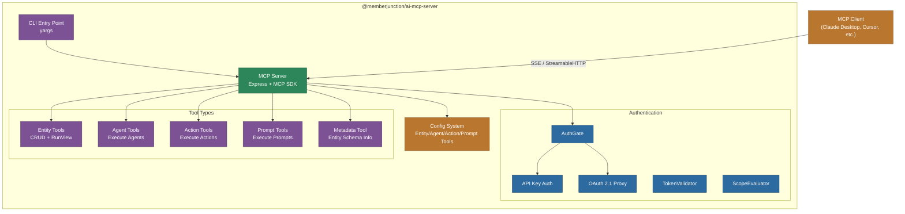

# @memberjunction/ai-mcp-server

MemberJunction's Model Context Protocol (MCP) server implementation. Exposes MemberJunction entities, AI agents, actions, and prompts as MCP tools that can be consumed by any MCP-compatible AI client (Claude Desktop, Cursor, custom integrations). Supports both SSE and StreamableHTTP transports, API key and OAuth 2.1 authentication, configurable tool filtering, and dynamic tool generation from entity metadata.

## Architecture



## Installation

```bash
npm install @memberjunction/ai-mcp-server
```

## Quick Start

```bash
# Start with all configured tools
npx @memberjunction/ai-mcp-server

# Start with tool filtering
npx @memberjunction/ai-mcp-server --include "Get_*,Run_Agent"

# Start excluding certain tools
npx @memberjunction/ai-mcp-server --include "Get_*" --exclude "Get_AuditLogs_*"

# List available tools without starting
npx @memberjunction/ai-mcp-server --list-tools

# Load filter config from file
npx @memberjunction/ai-mcp-server --tools-file ./my-tools.json
```

## Running inside MJAPI

The MCP server can run as part of MJAPI instead of as its own process. It then uses MJAPI's database connection and caches, and is served under MJAPI's base path: at `/mcp` by default, or `/api/mcp` when `MJAPI_BASE_PATH=/api` (MJExplorer at `/`, MJAPI at `/api`).

1. Add `@memberjunction/ai-mcp-server` to your MJAPI's dependencies.
2. List it in `mj.config.cjs`:

```javascript
dynamicPackages: {
  server: [
    // Processes keeps the standalone MCP server (process 'mcp') from loading it as well
    { PackageName: '@memberjunction/ai-mcp-server', Processes: ['mjapi'] },
  ],
},
```

MJAPI then mounts the `MCPServerExtension` server extension before its own authentication. MCP authenticates every request itself, with the same `mcpServerSettings.auth` settings as the standalone server. Every route moves under the mount: `/mcp` (Streamable HTTP), `/mcp/sse` and `/mcp/messages` (legacy SSE), `/mcp/.well-known/*`, `/mcp/oauth/*` (the OAuth proxy) and `/mcp/health`.

To change the defaults, add a `serverExtensions[]` entry with the same `DriverClass`; it overrides the published one field by field:

```javascript
serverExtensions: [
  {
    Enabled: true,
    DriverClass: 'MCPServerExtension',
    RootPath: '/mcp',          // relative to MJAPI_BASE_PATH
    OwnsCORS: true,            // keep: the MCP routes answer their own CORS preflights
    Settings: {
      IncludeTools: ['Get_*', 'Run_Agent'],    // same patterns as --include / --exclude
      ExcludeTools: ['Get_AuditLogs_*'],
    },
  },
],
```

**Settings that work differently inside MJAPI:**

- `enableMCPServer` and `port` apply only to the standalone server. Inside MJAPI, the extension entry turns MCP on or off.
- `trustProxy` has no effect, because Express reads `trust proxy` from MJAPI's app. MJAPI logs a warning when it is set.
- `auth.resourceIdentifier` should normally be left unset. The extension builds it from MJAPI's public URL (`MJAPI_PUBLIC_URL`, e.g. `https://app.example.com/api` gives `https://app.example.com/api/mcp`). A leftover value such as `http://localhost:3100` sends OAuth clients to the wrong place, and MJAPI logs a warning.
- With the OAuth proxy, register the upstream redirect URI under the mount: `https://app.example.com/api/mcp/oauth/callback`.

**OAuth proxy with another app at the host root: add one rewrite.** MCP clients read the resource metadata URL from the `WWW-Authenticate` header of a 401, so that step works under any prefix. Finding the login server is different. Without the OAuth proxy, the login server is your identity provider on its own host, and nothing more is needed. With the proxy, the login server is `https://host/api/mcp`, and clients first ask for `https://host/.well-known/oauth-authorization-server/api/mcp` (RFC 8414). That URL is at the host root, which MJExplorer's web server owns, and a single-page-app host answers it with `index.html`: the MCP SDK client then stops with a parse error. Rewrite it to the route the proxy serves. In nginx, alongside the rule that sends `/api/` to MJAPI:

```nginx
rewrite ^/\.well-known/oauth-authorization-server(/api/mcp)$ $1/.well-known/oauth-authorization-server last;
```

The proxy does not serve `/.well-known/openid-configuration`: it is not an OpenID provider (it signs tokens with a shared secret and issues no ID tokens), and MCP clients validate that document as one.

**Sessions are kept in memory.** Behind a load balancer with several MJAPI instances, enable sticky sessions keyed on the `mcp-session-id` header, as you would for the standalone server.

## Tool Types

### Entity Tools

Dynamically generated from MemberJunction entity metadata. For each configured entity, the server creates:

| Tool Pattern | Description |
|---|---|
| `Get_<Entity>_Record` | Retrieve a single record by primary key |
| `Get_<Entity>_Records` | Query records with filtering, sorting, field selection |
| `Create_<Entity>_Record` | Create a new entity record |
| `Update_<Entity>_Record` | Update an existing record |
| `Delete_<Entity>_Record` | Delete a record by primary key |
| `RunView_<Entity>` | Execute a view with ExtraFilter, OrderBy, Fields, MaxRows |

### Agent Tools

| Tool | Description |
|---|---|
| `Run_Agent` | Execute any configured MemberJunction AI agent with conversation history and template data |

### Agent Management Tools

These tools expose the high-level **AgentSpec** object model (from
`@memberjunction/ai-agent-manager`) so MCP clients such as Claude Code can
browse, introspect, create, and edit complete agent definitions — hierarchy,
actions, prompts, sub-agents, flow steps — as one JSON document, without
knowing the underlying entity schema. The group is enabled by default when the
MCP server is enabled and can be turned off via
`mcpServerSettings.agentManagementTools.enabled = false`.

| Tool | Description |
|---|---|
| `Get_Agent_Catalog` | List agents with summary metadata (id, name, description, type, status, invocation mode) |
| `Get_Agent_Spec` | Retrieve the complete AgentSpec for one agent as a single JSON document (recursive over sub-agents) |
| `Create_Agent` | Create a new agent (including nested sub-agents, actions, prompts) from an AgentSpec document |
| `Update_Agent` | Full-replace update of an existing agent from an AgentSpec document, with orphan cleanup |
| `Get_Agent_Type_List` | List agent types (Loop, Flow, Realtime, …) for use as `TypeID` values |
| `Get_Action_Catalog` | List available actions for use as `ActionID` values when wiring agent capabilities |
| `Execute_ActionSmith_Agent` | Always-on execute tool for the ActionSmith builder agent (builds new actions conversationally) |
| `Execute_Codesmith_Agent` | Always-on execute tool for the Codesmith builder agent (writes and refactors code) |

The builder-agent list is configurable via
`mcpServerSettings.agentManagementTools.builderAgents` (defaults to
`['ActionSmith', 'Codesmith Agent']`; pass `[]` to expose none). Create/update
tools are authorized under the `agent:manage` scope; catalog/spec reads under
`agent:read`; the action catalog under `action:read`.

### Action Tools

| Tool Pattern | Description |
|---|---|
| `Run_<Action>_Action` | Execute a configured MemberJunction action with parameters |

### Prompt Tools

| Tool Pattern | Description |
|---|---|
| `Run_<Prompt>_Prompt` | Execute a configured AI prompt with template data |

### Metadata Tool

| Tool | Description |
|---|---|
| `Get_All_Entity_Metadata` | Retrieve all entity metadata including fields, relationships, and field types |

## Configuration

Configuration is loaded from `mj.config.cjs` or environment variables. Key settings:

```javascript
module.exports = {
    mcpServerSettings: {
        port: 3100,
        entities: [
            { entityName: 'Users', operations: ['get', 'list', 'create', 'update', 'delete', 'runview'] },
            { entityName: 'Companies', operations: ['get', 'list', 'runview'] }
        ],
        agents: [
            { agentId: 'agent-uuid', name: 'Sales Assistant' }
        ],
        actions: [
            { actionId: 'action-uuid', name: 'Send Email' }
        ],
        prompts: [
            { promptId: 'prompt-uuid', name: 'Summarize Content' }
        ]
    }
};
```

## Authentication

### API Key Authentication

The server authenticates requests using MemberJunction API keys. The API key is passed via the `x-api-key` header and maps to a MemberJunction user context.

### OAuth 2.1 (Optional)

When configured, the server acts as both an OAuth resource server and an OAuth proxy:

- **RFC 9728**: Protected Resource Metadata at `/.well-known/oauth-protected-resource`
- **RFC 8414**: Authorization Server Metadata discovery
- **RFC 7591**: Dynamic Client Registration
- **PKCE**: Required for all authorization code flows
- **Scope Evaluation**: Tool-level access control via OAuth scopes

The OAuth proxy handles the authorization flow for MCP clients that don't natively support OAuth, proxying between the client and your identity provider.

#### Rate limit and reverse proxies

The OAuth proxy router limits requests per client IP: 60 per minute by default. It covers the OAuth routes, the `.well-known` documents and `/health`. The MCP transport routes (`/mcp`, `/mcp/sse`, `/mcp/messages`) are mounted ahead of it and are not counted. Size the limit with `auth.proxy.rateLimit`.

Behind CloudFront, a load balancer or another reverse proxy, also set `trustProxy`. It is passed to Express's [`trust proxy`](https://expressjs.com/en/guide/behind-proxies.html) setting. Without it, Express sees the proxy as every request's client, so all users share one limit.

```javascript
mcpServerSettings: {
  trustProxy: 1,                // proxy hops to trust; or true, or 'loopback, 10.0.0.0/8'
  auth: {
    mode: 'oauth',
    proxy: {
      enabled: true,
      rateLimit: { windowMs: 60_000, limit: 300 },   // per client IP; omitted fields keep the defaults
    },
  },
},
```

Only set `trustProxy: true` when nothing can reach the server except through the proxy, because a client could otherwise choose its own `X-Forwarded-For`.

## Tool Filtering

Filter which tools are exposed using glob-style patterns:

```json
{
    "include": ["Get_*", "Run_Agent", "RunView_Users"],
    "exclude": ["*_AuditLogs_*", "Delete_*"]
}
```

Patterns support:
- `*` -- Match any characters
- `prefix*` -- Match tools starting with prefix
- `*suffix` -- Match tools ending with suffix
- `*contains*` -- Match tools containing text

## Compiled Tool & Schema Caching

To avoid rebuilding entity/agent/action/prompt tool definitions and Zod parameter schemas on every SSE or StreamableHTTP session initialization, the MCP server compiles and caches `ToolConfig` entries in memory on first access (`GetOrBuildCompiledToolConfigs`). Each session registers lightweight handler wrappers against the pre-compiled schemas while routing execution to the active request's authenticated `SessionContext`. Use `ClearCompiledToolCache()` when tool configuration or metadata changes at runtime and needs to be recompiled.

## CLI Options

| Option | Alias | Description |
|---|---|---|
| `--include` | `-i` | Comma-separated include patterns |
| `--exclude` | `-e` | Comma-separated exclude patterns |
| `--tools-file` | `-f` | Path to JSON filter config file |
| `--list-tools` | `-l` | List tools and exit |
| `--help` | `-h` | Show help |
| `--version` | `-v` | Show version |

## Dependencies

- `@modelcontextprotocol/sdk` -- Official MCP SDK (server, transports)
- `@memberjunction/ai-agents` -- AgentRunner for agent execution
- `@memberjunction/ai-prompts` -- AIPromptRunner for prompt execution
- `@memberjunction/ai-core-plus` -- Extended entity classes
- `@memberjunction/aiengine` -- AIEngine for metadata
- `@memberjunction/actions` / `@memberjunction/actions-base` -- Action execution
- `@memberjunction/server` -- MJ server authentication
- `@memberjunction/server-bootstrap-lite` -- Class registration manifest
- `@memberjunction/sqlserver-dataprovider` -- SQL Server data access
- `@memberjunction/api-keys` -- API key validation
- `@memberjunction/credentials` -- Credential management
- `@memberjunction/config` -- Configuration loading
- `express` -- HTTP server framework
- `jsonwebtoken` / `jwks-rsa` -- JWT validation for OAuth
- `yargs` -- CLI argument parsing
- `zod` -- Schema validation
