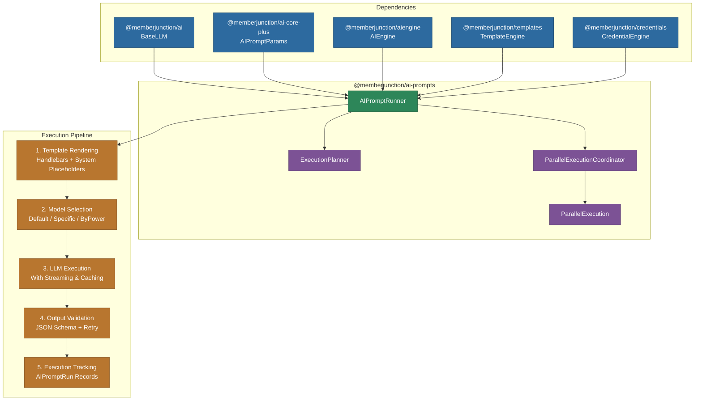

# @memberjunction/ai-prompts

Advanced AI prompt execution engine for MemberJunction. Provides hierarchical template composition, intelligent model selection with failover, parallel execution with judge-based result selection, structured output validation with retry, comprehensive execution tracking, and streaming support. This is the primary interface for executing AI prompts in the MemberJunction framework.

## Guides

- **[Assistant Prefill & Stop Sequences](PREFILL_AND_STOP_SEQUENCES.md)** — How to use `assistantPrefill` and `stopSequences` to control output format, reduce token usage, and eliminate verbose format instructions from prompts.

## Architecture



## Installation

```bash
npm install @memberjunction/ai-prompts
```

## Key Features

### Hierarchical Template Composition

Build complex prompts from reusable sub-templates with unlimited nesting depth:

```typescript
import { AIPromptRunner } from '@memberjunction/ai-prompts';
import { AIPromptParams, ChildPromptParam } from '@memberjunction/ai-core-plus';

const runner = new AIPromptRunner();

// Parent template uses {{ analysis }} and {{ summary }} placeholders
const params = new AIPromptParams();
params.prompt = parentPrompt;
params.childPrompts = [
    new ChildPromptParam(analysisParams, 'analysis'),
    new ChildPromptParam(summaryParams, 'summary')
];
params.data = { userInput: 'complex data to process' };

const result = await runner.ExecutePrompt(params);
```

Execution order:
1. Child prompts render depth-first (children before parents)
2. Sibling prompts at each level execute in parallel
3. Child results replace placeholders in parent template
4. Final composed prompt executes as a single LLM call

**Rendering children without executing.** `AIPromptRunner.RenderChildPromptTemplates(childPrompts, params)` renders the child templates and returns `{ renderedTemplates }` keyed by each child's `parentPlaceholder`, with no model call. A caller that needs the rendered text before execution — the loop agent uses it to relocate a volatile specialization into its trailing runtime-state message — passes the map back as `AIPromptParams.PreRenderedChildTemplates`, and `ExecutePrompt` embeds those strings instead of rendering the children a second time. Rendering is deterministic for the same inputs, so both paths produce the same text.

### Model Selection Strategies

Three strategies for selecting which AI model executes a prompt:

| Strategy | Description |
|---|---|
| `Default` | Uses the AI configuration to determine the model based on priority and availability |
| `Specific` | Uses explicitly associated models from the AIPromptModels table |
| `ByPower` | Selects the highest PowerRank model matching the prompt's model type |

Model selection precedence (highest to lowest):
1. `AIPromptParams.override` -- Runtime model/vendor override
2. `AIPromptParams.modelSelectionPrompt` -- Alternate prompt for model config
3. Prompt's own model configuration (strategy + associations)

**Credential-evaluation short-circuit (performance):** Candidates are ordered by priority, so once the runner finds the highest-priority candidate that has working credentials it **stops probing the remaining candidates** and records them as `"not-evaluated"` in the `ModelSelection` telemetry. This avoids running a credential/env-var check for every configured model on every prompt run. The full ordered candidate list is still used for failover, so this only trims per-candidate availability *telemetry* for the tail. To force a complete availability report for every candidate (e.g. an admin diagnostic), set `AIPromptParams.forceFullModelEvaluation = true`.

### Parallel Execution with Judging

Execute prompts across multiple models simultaneously and select the best result:

- Configurable execution groups with different models
- AI judge prompt evaluates and ranks results
- Automatic selection of best result based on judge scoring
- Full tracking of all parallel results

### Output Validation and Retry

Automatic validation of AI outputs with configurable retry:

- JSON schema validation against `OutputExample` definitions
- Automatic JSON repair via JSON5 parsing and LLM-based repair
- Configurable retry count with the original or repaired prompts
- Validation syntax cleaning (removes `?`, `*`, `:type` markers from JSON keys)
- Detailed validation attempt tracking

**Output type coercion** (`AIPrompt.OutputType`): the raw model text is coerced before validation —
`string` (verbatim), `number` (`parseFloat`, errors on `NaN`), `boolean` (`true/yes/1` ↔ `false/no/0`,
case-insensitive + trimmed), `date` (`new Date`, errors on invalid), and `object` (JSON). For `object`,
the text is first run through `CleanJSON` (strips markdown fences etc.); if that fails and
`attemptJSONRepair` is set, it retries via JSON5 and then LLM-based repair. When an `OutputExample` is
defined, validation-syntax markers are stripped from result keys automatically. With `skipValidation`,
coercion failures return the raw output instead of throwing.

**Validation behavior** (`AIPrompt.ValidationBehavior`): `Strict` retries up to `MaxRetries` on
validation failure; `Warn` logs and returns the (invalid) output; `None` accepts as-is. The parsed
`OutputExample` is cached by content so it isn't re-parsed on every run/retry.

### Streaming Support

Real-time streaming of LLM responses:

```typescript
const params = new AIPromptParams();
params.prompt = myPrompt;
params.onStreaming = (chunk) => {
    process.stdout.write(chunk.content);
};

const result = await runner.ExecutePrompt(params);
```

### Execution Tracking

Every prompt execution creates an `AIPromptRun` record with:
- Model and vendor used
- Template rendering results
- Token usage (prompt + completion)
- Cost tracking
- Execution time
- Parent/child relationships for hierarchical prompts
- Agent run linkage via `agentRunId`

**Persistence is fire-and-forget.** The initial `Running` INSERT and the final `Completed`/`Failed` UPDATE are queued, not awaited, so the model call is never blocked on a DB round-trip. Saves for the same run are chained (the INSERT always completes before the UPDATE, so a slow INSERT can't clobber the finalized row), and the record's ID is available immediately because `NewRecord()` client-generates the UUID. Save failures are logged but never fail the prompt (the record is observability, not part of the success contract). Callers that need the rows durably written before continuing can `await runner.WaitForPendingPromptRunSaves()`.

### Template data capture

`AIPromptRun.Messages` stores the messages the model received. The template inputs (`data` and `templateData`) can be large, so a capture mode sets how much of them the run stores:

| Mode | What `Messages` stores for `data` and `templateData` |
|---|---|
| `None` (default) | A `dataShape` record. For each input: the key count, the total byte size of the values, and the UTF-8 byte length of each top-level value's JSON. It lists at most 25 keys per input (the largest; `keysElided: true` when there are more). It never stores values. |
| `Referenced` | Only the top-level keys that the run's templates read: the prompt's template, every child prompt template, and the templates they pull in by literal name. If the analysis cannot finish (for example, a template name is an expression or a template is not found), the run stores all keys, with `dataCapture: 'Full'` and a `dataCaptureNote` that gives the reason. |
| `Full` | All keys. |

The run uses the first setting that is present:

1. `AIPromptParams.TemplateDataCapture` (the call)
2. `AIPrompt.TemplateDataCapture` on the run's child prompts (`AIPromptParams.childPrompts`), depth first: each child prompt, then its own child prompts. The first value that is not `NULL` applies.
3. `AIPrompt.TemplateDataCapture` on the main prompt (`NULL` uses the next setting)
4. `aiPromptRuns.templateDataCapture` in `mj.config.cjs` (the server default)
5. `'None'`

So the most specific prompt wins. For a Loop or Harness agent, the main prompt is the agent-type system prompt, which all agents of that type share, and the agent's own prompt is a child prompt. A value on the agent's prompt applies to that agent only. A value on the agent-type prompt applies to every agent of that type that has no value on its own prompt. A Flow agent has no agent-type prompt, so its own prompt is the main prompt.

```js
// mj.config.cjs
module.exports = {
  aiPromptRuns: { templateDataCapture: 'None' }, // 'None' | 'Referenced' | 'Full'
};
```

The runner reads the server default once per process, from the `mj.config.cjs` it finds from the working directory. If the value is not valid, the runner logs a warning and uses `'None'`. MJServer also checks the value when it starts, so a typo stops MJAPI.

No mode stores `_CURRENT_PAYLOAD` (the agent payload). The agent run steps already store it.

`data` and `templateData` are normally objects. An input that is not a key/value object (a string, number, boolean, `null` or array) has no keys: `None` records only its size (`keyCount: 0` and the byte length of its JSON), and `Referenced` and `Full` store it as passed. A `Referenced` run with no key/value input does not run the template analysis.

The capture step never fails a run. If it throws, the runner logs the error and the run stores `dataCapture: 'None'` with the note `Template data was not stored: the capture step failed. See the server log.`, the messages and (on a consolidated parallel run) the `parallelExecution` summary, and no template data.

Example (`None`):

```json
{
  "dataCapture": "None",
  "dataShape": {
    "data": { "keyCount": 2, "totalBytes": 419840, "keys": { "compositionContext": 266240, "componentCatalog": 153600 } }
  },
  "messages": [ { "role": "system", "content": "…" } ]
}
```

A consolidated parallel run (`RunType = 'ParallelParent'`) also stores a `parallelExecution` summary. `StoredPromptRunMessages` in `@memberjunction/ai-core-plus` is the type of the stored object. Rows written before this setting existed have no `dataCapture` key and store `data` and `templateData` in full.

### Credential Resolution

Hierarchical credential resolution for API keys:

1. `AIPromptParams.credentialId` (per-request override)
2. `AIPromptModel.CredentialID` (prompt-model specific)
3. `AIModelVendor.CredentialID` (model-vendor specific)
4. `AIVendor.CredentialID` (vendor default)
5. `AIPromptParams.apiKeys[]` (legacy runtime keys)
6. `AI_VENDOR_API_KEY__<DRIVER>` environment variables (legacy)

**Credential scope.** `AIPromptParams.CredentialScope` (`'Any' | 'RuntimeOnly'`, default `'Any'`)
decides which of these tiers a run may use. Under `'RuntimeOnly'` only 1 and 5 count — the caller's
own `credentialId` and `apiKeys`. Credential bindings, the vendor default and environment keys are
skipped, a candidate the run has no key for is unavailable, so failover stays on the caller's
vendors, and a run the keys do not cover fails with *"… The credential scope is RuntimeOnly …"*
instead of running on the platform's account. Prompts the runner starts on a caller's behalf (JSON
repair, the result-selector judge, decisions' chat prompts) run under the caller's scope.

### Failover

When a model fails due to rate limiting, authentication errors, or other transient issues, the runner can automatically retry with alternate models from the selection candidates.

### Media Runners

Non-chat models run through runners built on the same `BaseModelRunner`, so they get the same model selection, credential resolution, failover and `MJ: AI Prompt Runs` row as a chat prompt. Each requires one model type, and uses a default carrier prompt, found by name, unless the caller passes a `PromptID`. A `ModelID` pins the model, and failover then stays within its vendors. The run row never holds media bytes.

| Runner | Model type | Method | Default prompt | Usage recorded |
|---|---|---|---|---|
| `AIImageGenerationRunner` | `Image Generator` | `RunImageGeneration`, `RunImageEdit` | `Default Image Generation` | the driver's, else images returned (`Images`) |
| `AITextToSpeechRunner` | `TTS` | `RunTextToSpeech` | `Default Text To Speech` | the driver's, else characters sent (`Characters`) |
| `AISpeechToTextRunner` | `Speech to Text` | `RunSpeechToText` | `Default Speech To Text` | the driver's: audio seconds (`Seconds`) when reported, otherwise nothing |
| `AIVideoRunner` | `Video` | `RunAvatarVideo` | `Default Video Generation` | the driver's: video seconds (`Seconds`) when reported, otherwise nothing |

The text-to-speech, speech-to-text and video runners share their lifecycle through `BaseMediaRunner`. It follows the carrier prompt's `FailoverStrategy`, narrowing `SameModelDifferentVendor` to the selected model's vendors.

Whether a failed call fails over is `ErrorAnalyzer`'s decision, as it is for chat prompts. The shipped audio and video drivers report it on `SpeechResult.errorInfo` / `VideoResult.errorInfo`, from the error their SDK threw, so it keeps the HTTP status:

- a rate limit, an outage, a server error or a timeout fails over;
- a request the vendor rejected as invalid (a 400 or 422, such as an unknown voice or an unsupported audio format) does not, since every other candidate would reject it too;
- a 400 whose message reads as vendor-specific validation (`required`, `must be`, …) fails over to another vendor, as it does for chat;
- a 401 stops failover, as it does for chat.

A driver that reports only `errorMessage` is classified from the message, which recognizes rate limits, outages and a few malformed requests; any other message reads as `Unknown`, which fails over. A driver should set `errorInfo` with `ErrorAnalyzer.AnalyzeError(error)` on the error it caught.

`TimeoutMS` and `CancellationToken` bound each driver call as `timeoutMS` and `cancellationToken` bound a chat call. A call that exceeds `TimeoutMS` fails with an `AIPromptTimeoutError` and fails over. A cancelled call ends at once, never fails over, and its run row is recorded as `Cancelled`. Each driver call is handed the bound's signal (the caller's token composed with the timeout) as its params' `CancellationToken`. The shipped drivers pass it to their request (OpenAI and Groq transcription, which also send no further piece once it aborts; OpenAI and ElevenLabs speech; HeyGen avatar video), so the request already sent is torn down. A driver that ignores the signal is abandoned instead: the runner stops waiting and ignores its result.

Video generation is asynchronous at the provider, and the primitive offers no status call, so `AIVideoRunner` does not wait for a render. A successful run means the provider accepted the request; the row records the video ID (for HeyGen, the render job's ID) and records the video's length only if a driver reports it.

Usage is recorded with `BaseModelRunner.ApplyUsageToRunRecord`, which writes non-token quantities as `InputUnitsUsed` / `OutputUnitsUsed` with the `MJ: AI Usage Types` row that names their measure. The runners never set a cost. The row's save prices it from the model's cost rows, and declines when no price unit type claims the measure, as none yet does for `Characters`.

```typescript
import { AITextToSpeechRunner } from '@memberjunction/ai-prompts';

const result = await new AITextToSpeechRunner().RunTextToSpeech({
  text: 'Your report is ready.',
  voice: 'alloy',
  ContextUser: contextUser,
});
if (result.Success) {
  const audio = result.SpeechResult?.data; // the run row describes the audio but never stores it
}
```

## Usage

### Basic Prompt Execution

```typescript
import { AIPromptRunner } from '@memberjunction/ai-prompts';
import { AIPromptParams } from '@memberjunction/ai-core-plus';
import { AIEngine } from '@memberjunction/aiengine';

// Get prompt from metadata
await AIEngine.Instance.Config(false, contextUser);
const prompt = AIEngine.Instance.Prompts.find(p => p.Name === 'Summarize Content');

const runner = new AIPromptRunner();
const params = new AIPromptParams();
params.prompt = prompt;
params.data = { content: documentText, maxLength: 500 };
params.contextUser = contextUser;

const result = await runner.ExecutePrompt(params);

if (result.success) {
    console.log(result.result);             // Parsed/validated result
    console.log(result.promptTokens);       // Input tokens used
    console.log(result.completionTokens);   // Output tokens generated
    console.log(result.executionTimeMS);    // Execution duration
}
```

### With Progress Tracking

```typescript
params.onProgress = (progress) => {
    console.log(`[${progress.step}] ${progress.percentage}% - ${progress.message}`);
};
```

### With Effort Level

```typescript
params.effortLevel = 85; // High effort for thorough analysis (1-100 scale)
```

### With Runtime Model Override

```typescript
params.override = {
    modelId: 'specific-model-id',
    vendorId: 'specific-vendor-id'
};
```

## Dependencies

- `@memberjunction/ai` -- Core AI abstractions (BaseLLM, ChatParams)
- `@memberjunction/ai-core-plus` -- AIPromptParams, AIPromptRunResult, extended entities
- `@memberjunction/ai-engine-base` -- AIEngineBase metadata cache
- `@memberjunction/aiengine` -- AIEngine server-side operations
- `@memberjunction/core` -- MJ framework core
- `@memberjunction/core-entities` -- Generated entity classes
- `@memberjunction/credentials` -- Credential resolution
- `@memberjunction/templates` -- Template rendering engine
- `@memberjunction/templates-base-types` -- Template base types
- `json5` -- Lenient JSON parsing for repair
