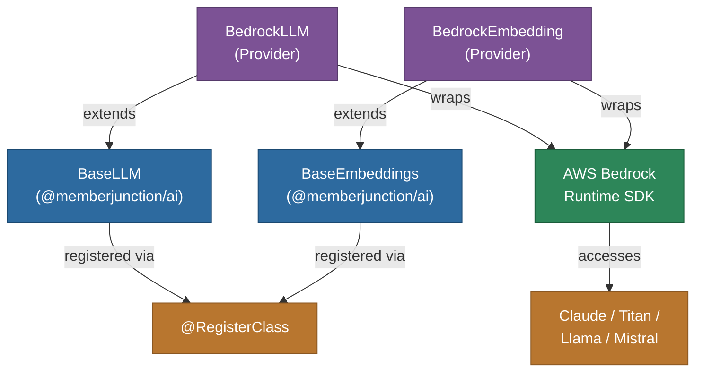

# @memberjunction/ai-bedrock

MemberJunction AI provider for Amazon Bedrock. This package provides both LLM and embedding capabilities through AWS Bedrock's multi-model platform, supporting Claude, Titan, Llama, and other model families available on Bedrock.

## Architecture



## Features

- **Multi-Model Access**: Use Claude, Titan, Llama, Mistral, and other models via a single provider
- **Chat Completions**: Conversational AI through Bedrock's unified API
- **Embeddings**: Text embeddings via Amazon Titan and other embedding models
- **Streaming**: Real-time response streaming support
- **AWS Integration**: Native AWS authentication (IAM roles, access keys, SSO)
- **Private Deployments**: Support for custom and fine-tuned models on Bedrock

## Installation

```bash
npm install @memberjunction/ai-bedrock
```

## Usage

### Chat Completion

```typescript
import { BedrockLLM } from '@memberjunction/ai-bedrock';

const llm = new BedrockLLM('aws-credentials-json');

const result = await llm.ChatCompletion({
    model: 'us.anthropic.claude-opus-4-6-v1',
    messages: [
        { role: 'user', content: 'Explain machine learning.' }
    ]
});
```

### Embeddings

```typescript
import { BedrockEmbedding } from '@memberjunction/ai-bedrock';

const embeddings = new BedrockEmbedding('aws-credentials-json');

const result = await embeddings.EmbedText({
    text: 'Text to embed',
    model: 'amazon.titan-embed-text-v1'
});
```

### Model IDs and inference profiles

`model` is sent to Bedrock exactly as given. It can be a foundation-model ID (`anthropic.claude-...`) or a
cross-region inference-profile ID, which puts a geography in front of it (`us.`, `eu.`, `apac.`, `global.`, ...).
Claude 4.x and later on Bedrock are served **only** through inference profiles: their bare foundation-model IDs are
refused with "on-demand throughput isn't supported". The driver reads the model family (Anthropic, AI21, Amazon
Titan, Meta) past the geography segment to choose the request body. `BedrockLLM.ResolveModelFamily(id)` exposes that
rule. Other families (OpenAI, Mistral, xAI, Amazon Nova on Bedrock) are refused before anything is sent, and so are
ARNs (`arn:aws:bedrock:...` application inference profiles and prompt routers), which carry no family to read.

MJ's AI Model Vendor rows for Claude on Bedrock use the `us.` profiles. `BedrockLLM` is created with only the
credential, so it always runs in `us-east-1`, and `us.` is the one geography that serves every listed Claude model.

## Configuration

AWS credentials are passed as a JSON string containing:

| Field | Description |
|-------|-------------|
| `region` | AWS region (e.g., `us-east-1`) |
| `accessKeyId` | AWS access key ID |
| `secretAccessKey` | AWS secret access key |
| `sessionToken` | Optional session token for temporary credentials |

## Supported Features

| Feature | Supported | Notes |
|---------|-----------|-------|
| stopSequences | Yes | Supported for Anthropic Claude, AI21, and Amazon Titan models |
| system messages | Yes | Claude: sent in the top-level `system` field (Claude's `messages` take only user and assistant turns). Other families: a `System:` line in the prompt text |
| topP | Yes | Claude: sent only when configured. Claude 4.x rejects `temperature` and `top_p` together, so with a configured topP the 0.7 default temperature is not sent (a configured temperature still is, and the call's parameter fidelity reports the omission). Other families: configured value or 0.9, beside the 0.7 default temperature |
| assistantPrefill | Yes (Claude only) | Pre-seed the assistant's response for Claude model and inference-profile IDs ([guide](../../Prompts/PREFILL_AND_STOP_SEQUENCES.md)) |
| streaming | Yes | Real-time streaming via `InvokeModelWithResponseStream` |

## Class Registration

- `BedrockLLM` -- Registered via `@RegisterClass(BaseLLM, 'BedrockLLM')`
- `BedrockEmbedding` -- Registered via `@RegisterClass(BaseEmbeddings, 'BedrockEmbedding')`

## Dependencies

- `@memberjunction/ai` - Core AI abstractions
- `@memberjunction/global` - Class registration
- `@aws-sdk/client-bedrock-runtime` - AWS Bedrock Runtime SDK
