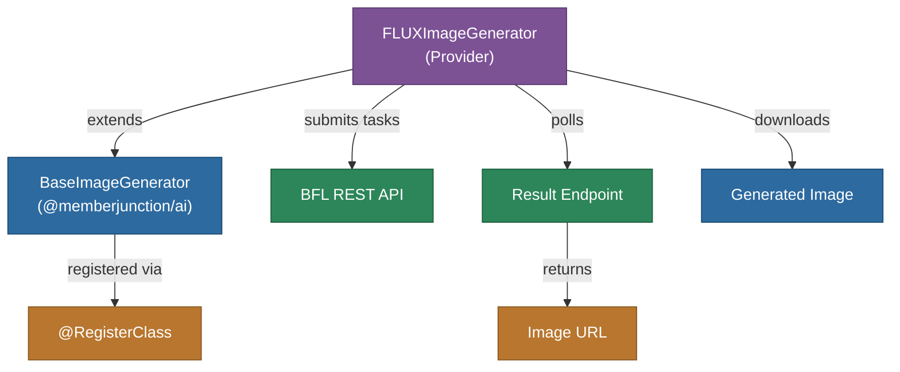
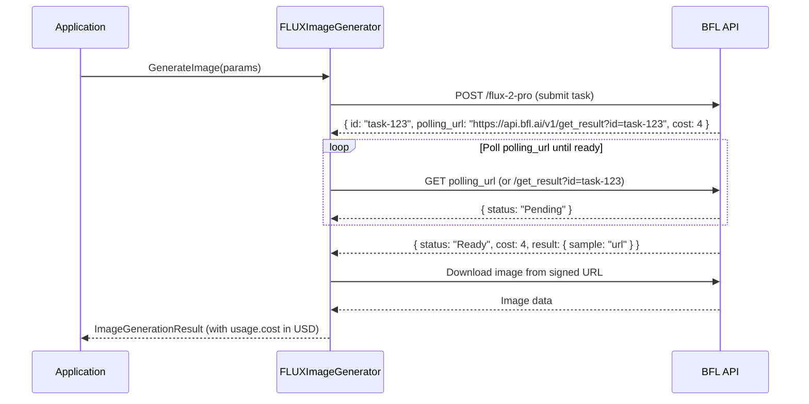

# @memberjunction/ai-blackforestlabs

MemberJunction AI provider for Black Forest Labs' FLUX image generation models. This package implements the `BaseImageGenerator` interface to provide text-to-image generation, image editing (inpainting/outpainting), and image variations through BFL's async task-based API.

## Architecture



## Async Task Flow



## Features

- **Text-to-Image Generation**: Generate photorealistic images using FLUX.2 Pro, FLUX 1.1 Pro, and other FLUX models
- **Image Editing**: Inpainting and outpainting via FLUX Fill model with mask support
- **Image Variations**: Create variations using FLUX Kontext Pro for image-to-image generation
- **Async Task Polling**: Configurable polling with adjustable interval and timeout
- **Multiple Models**: Support for FLUX.2 Pro (32B), FLUX 1.1 Pro, FLUX Dev, and FLUX Ultra
- **Seed Reproducibility**: Deterministic generation with seed parameter support
- **Resolution Control**: Custom width/height and aspect ratio settings up to 4MP

## Installation

```bash
npm install @memberjunction/ai-blackforestlabs
```

## Usage

```typescript
import { FLUXImageGenerator } from '@memberjunction/ai-blackforestlabs';

const generator = new FLUXImageGenerator('your-bfl-api-key');

const result = await generator.GenerateImage({
    prompt: 'A serene mountain landscape at sunset',
    model: 'flux-2-pro',
    size: '1536x1024'
});

if (result.success) {
    const image = result.images[0];
    console.log('Image generated, base64 length:', image.base64.length);
}
```

### Configure Polling

```typescript
generator.setPollingConfig({
    maxWaitTime: 180000,  // 3 minutes
    pollInterval: 3000     // 3 seconds
});
```

## Supported Models

| Model | ID | Modality | Description |
|-------|-----|----------|-------------|
| FLUX 3 Image | `flux-3-image` | Image | Up to 4K resolution, 16 aspect ratios, and up to 10 reference images |
| FLUX 3 Video | `flux-3-video` | Video | Text-to-video, image-to-video, and video-to-video up to 1080p, 15s, with native audio and C2PA provenance |
| FLUX.2 Pro | `flux-2-pro` | Image | 32B parameter, photorealistic 4MP images |
| FLUX 1.1 Pro | `flux-1.1-pro` | Image | Production-ready, high-volume workloads |
| FLUX.1 Dev | `flux-dev` | Image | Open-weights 12B for development |
| FLUX Ultra | `flux-ultra` | Image | Ultra-high quality |

## Class Registration

- Image generator: registered as `FLUXImageGenerator` via `@RegisterClass(BaseImageGenerator, 'FLUXImageGenerator')`.
- Video generator: registered as `FLUX3VideoGenerator` via `@RegisterClass(BaseVideoGenerator, 'FLUX3VideoGenerator')`.

## Verified against BFL docs

- **Verification date**: `2026-10-16`
- **Documentation URLs read**:
  - `https://docs.bfl.ai/flux_3/flux3_video` (`flux3_video.md`)
  - `https://docs.bfl.ai/flux_3/flux3_image` (`flux3_image.md`)
  - `https://docs.bfl.ai/api-reference/utility/generate-a-video-with-flux-3` (`generate-a-video-with-flux-3.md`)
  - `https://docs.bfl.ai/api-reference/utility/generate-an-image-with-flux-3` (`generate-an-image-with-flux-3.md`)
  - `https://docs.bfl.ai/api-reference/models/generate-an-image-with-flux-2-pro` (`generate-an-image-with-flux-2-pro.md`)
  - `https://docs.bfl.ai/api-reference/tasks/get-result` (`get-result.md`)
  - `https://docs.bfl.ai/flux_2/flux2_text_to_image` (`flux2_text_to_image.md`)
  - `https://bfl.ai/pricing` (`1 credit = $0.01 USD`)
- **Endpoints & Authentication**:
  - Base URLs: `https://api.bfl.ai/v1` (global), `https://api.eu.bfl.ai/v1`, `https://api.us.bfl.ai/v1`
  - Auth header on submit and poll: `x-key: <BFL_API_KEY>` (never sent when downloading signed delivery URLs on `delivery.*.bfl.ai`)
  - FLUX 3 Video submit: `POST /v1/flux-3-video`
  - FLUX 3 Image submit: `POST /v1/flux-3-image`
  - FLUX.2 Pro submit: `POST /v1/flux-2-pro`
  - Result polling: `GET <polling_url>` from submit response (validated to be `https:` and hostname ending in `.bfl.ai`), or fallback `GET /v1/get_result?id=<id>`
- **FLUX 3 Video (`Flux3VideoInputsBody`, `additionalProperties: false`) parameters & limits**:
  - `mode`: `'t2v' | 'i2v' | 'v2v'` (required; `'v2v'` on `/v1/flux-3-video` is video continuation via `start_video`, whereas video editing is a separate endpoint `/v1/flux-tools/video-edit-v1`)
  - `prompt`: string (required)
  - `resolution`: `'hd' | 'fhd' | 'qhd' | 'uhd'` (default `'fhd'`; mapped from `Quality`: `'draft' -> 'hd' + draft: true`, `'standard' -> 'fhd'`, `'high' -> 'qhd'`)
  - `aspect_ratio`: `'21:9' | '2:1' | '16:9' | '4:3' | '1:1' | '3:4' | '9:16' | '9:21'` (default `'16:9'`; `'4:5'` is not supported)
  - `duration`: integer `5..20` seconds for `'t2v'` and `'i2v'`; `5..15` seconds for `'v2v'` (default `5`)
  - `generate_audio`: boolean (BFL API defaults to `true`; `FLUX3VideoGenerator` always sends `generate_audio: params.WantAudio === true` so omitted `WantAudio` never bills for audio)
  - `draft`: boolean (optional; set to `true` for `'draft'` quality tier)
  - `keyframes`: `Array<[number, string]> | string[]` (`1..10` items; required in `'i2v'` mode; timestamped `[seconds, image]` pairs with `0 <= seconds <= duration` or plain base64/HTTPS URL strings; each image ≤20 MB)
  - `start_video`: string (`'v2v'` continuation mode only; base64 or HTTPS URL; MP4/MOV/WebM; ≤20 MB; ≤15s)
  - `safety_tolerance`: integer `0..7` (default `2`)
  - `webhook_url`, `webhook_secret`: optional strings
  - Does not accept `seed`, `fps`, `width`, or `height`.
- **FLUX 3 Video 8×4 Dimension Lookup Table (`FLUX3_VIDEO_DIMENSIONS`, `width × height`)**:

| Aspect Ratio | `hd` (720p) | `fhd` (1080p) | `qhd` (1440p) | `uhd` (4K) |
|---|---|---|---|---|
| `21:9` | `1440×608` | `2176×928` | `2912×1248` | `4352×1856` |
| `2:1` | `1344×672` | `2016×1024` | `2720×1376` | `4032×2048` |
| `16:9` | `1280×704` | `1920×1088` | `2560×1440` | `3840×2176` |
| `4:3` | `1088×800` | `1632×1216` | `2176×1632` | `3264×2432` |
| `1:1` | `960×960` | `1440×1440` | `1920×1920` | `2880×2880` |
| `3:4` | `800×1088` | `1216×1632` | `1632×2176` | `2432×3264` |
| `9:16` | `704×1280` | `1088×1920` | `1440×2560` | `2176×3840` |
| `9:21` | `608×1440` | `928×2176` | `1248×2912` | `1856×4352` |

- **FLUX 3 Image (`Flux3ImageInputs`, `additionalProperties: false`) parameters & limits**:
  - `prompt`: string (required)
  - `images`: string[] | null (optional; up to `10` reference images)
  - `aspect_ratio`: `'auto' | '21:9' | '2:1' | '16:9' | '3:2' | '7:5' | '4:3' | '5:4' | '1:1' | '4:5' | '3:4' | '5:7' | '2:3' | '9:16' | '1:2' | '9:21'` (default `'1:1'`)
  - `resolution`: `'768sq' | '1k' | '1.5k' | '2k' | '4k'` (default `'1k'`)
  - `grounding`: boolean (BFL API defaults to `true`; `FLUXImageGenerator` always sets `grounding: false` so image generation never makes unsolicited web searches)
  - `safety_tolerance`: integer `0..7` (default `2`)
  - Does not accept `width`, `height`, `seed`, or `output_format`.
- **Polling Statuses (`StatusResponse`)**:
  - Active: `'Pending'`, `'Reasoning'`, `'Generating'` (plus legacy `'Queued'`, `'Processing'` on image endpoints)
  - Success: `'Ready'` (`result.sample` contains the signed delivery URL)
  - Terminal failures: `'Error'`, `'Failed'`, `'Request Moderated'`, `'Content Moderated'`, `'No Card Generated'` (surfaces `details['Moderation Reasons']` when present), `'Task not found'`
- **Pricing Status**:
  - BFL bills in credits (`1 credit = $0.01 USD`). Submit responses include initial `cost` (credits) and `/v1/get_result` includes settled `cost` (credits) on `'Ready'` (which may differ for variable-billing endpoints like FLUX 3 Video). Both drivers convert `(pollResult.cost ?? submitResult.cost) / 100` to USD on `ModelUsage`. Per-second/per-resolution FLUX 3 credit rate tables are not yet published on `bfl.ai/pricing`, so exact settled cost comes directly from the BFL response `cost` field.
- **Delivery URL Expiry Conflict**:
  - `docs.bfl.ai/flux_3/flux3_video` states signed `result.sample` URLs expire after **10 minutes**, whereas `docs.bfl.ai/api-reference/tasks/get-result` states signed delivery URLs are valid for **~2 hours**. Both drivers download bytes immediately upon `'Ready'` and never persist `result.sample`.
- **C2PA Provenance**:
  - BFL embeds a C2PA JUMBF manifest box (`uuid` box with UUID `d8fec3d6-1b0e-483c-9297-5828877ec481`) into generated media. `FLUX3VideoGenerator` inspects downloaded MP4 bytes with `HasC2PAManifest(bytes)` and sets `result.Provenance = { C2PA: HasC2PAManifest(bytes) }`.

## Opt-in Live Smoke Test (Manual Verification Only)

Automated test suites in CI and local builds never make live network calls to BFL. To manually verify against the live BFL API when credentials and budget are explicitly provided:

```bash
BFL_LIVE_SMOKE=1 BFL_API_KEY="<your-bfl-api-key>" pnpm --filter @memberjunction/ai-blackforestlabs test
```

## Dependencies

- `@memberjunction/ai` - Core AI abstractions (BaseImageGenerator, BaseVideoGenerator, GeneratedImage)
- `@memberjunction/global` - Class registration
