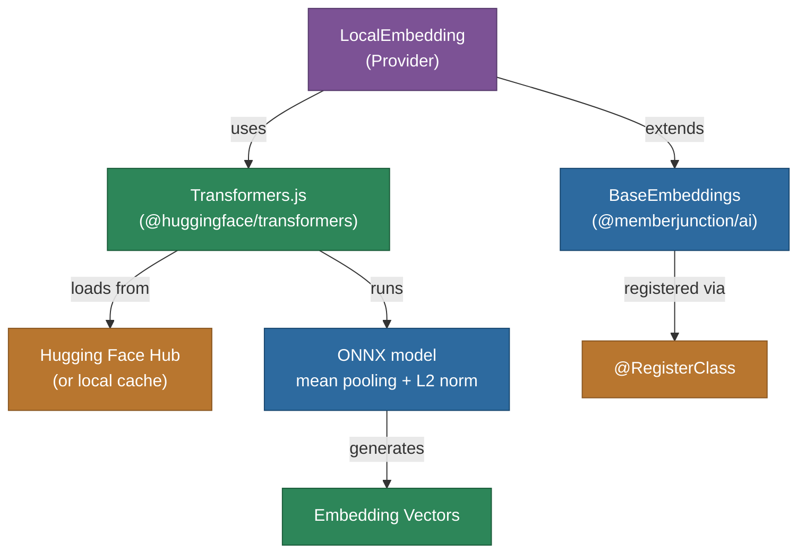

# @memberjunction/ai-local-embeddings

MemberJunction AI provider for local text embeddings using Transformers.js. This package runs embedding models directly on your machine, eliminating the need for external API calls, API keys, or per-token charges.

## Architecture



## Features

- **Offline Operation**: Run embedding models locally without internet (after initial download)
- **No API Keys Required**: Eliminate dependency on external services
- **Cost-Effective**: No per-token charges for embeddings
- **Privacy-Focused**: Data never leaves your infrastructure
- **Multiple Models**: Support for various sentence-transformer models from Hugging Face
- **Automatic Caching**: Models are downloaded once and cached locally
- **Batch Processing**: `EmbedTexts` runs one ONNX call per 32 texts or 8,192 padded tokens, so long documents go one at a time
- **Model Preloading**: Warm up models before first inference
- **Quantized Models**: Loads the 8-bit (`q8`) ONNX weights
- **Container-aware threads**: ONNX Runtime uses one thread per CPU the process may use (`os.availableParallelism()`), so a container's CPU limit is respected
- **Matryoshka truncation**: `dimensions` keeps the leading values and re-normalizes
- **Input cap**: `maxInputTokens` truncates each text in the tokenizer
- **Text-only multimodal models**: the vision and audio encoders of a multimodal model (e.g. EmbeddingGemma 2) are not loaded

## Supported Models

| Model | Dimensions | Description |
|-------|------------|-------------|
| `all-MiniLM-L6-v2` | 384 | Lightweight general-purpose embeddings |
| `all-MiniLM-L12-v2` | 384 | Higher quality with more layers |
| `all-mpnet-base-v2` | 768 | Best quality general-purpose embeddings |
| `paraphrase-multilingual-MiniLM-L12-v2` | 384 | Multilingual support (50+ languages) |
| `gte-small` | 384 | General Text Embeddings (efficient) |
| `bge-small-en-v1.5` | 384 | BAAI General Embeddings (English) |

Any Hugging Face repo with transformers.js ONNX weights works the same way, for example
`onnx-community/embeddinggemma-2-ONNX` (768 dimensions, truncatable to 512/256/128, 8,192-token
window). Its catalog row is `EmbeddingGemma 2 (Local)`; it is opt-in through
`MJ_DEFAULT_LOCAL_EMBEDDING_MODEL` (see `plans/embeddinggemma-2-local-embeddings.md`).

## Installation

```bash
npm install @memberjunction/ai-local-embeddings
```

## Usage

### Single Text Embedding

```typescript
import { LocalEmbedding } from '@memberjunction/ai-local-embeddings';

const embedder = new LocalEmbedding();

const result = await embedder.EmbedText({
    text: 'Your text to embed',
    model: 'Xenova/all-MiniLM-L6-v2'
});

console.log(result.vector); // Float32Array of embedding values
```

### Batch Embedding

```typescript
const results = await embedder.EmbedTexts({
    texts: ['First text', 'Second text', 'Third text'],
    model: 'Xenova/all-MiniLM-L6-v2'
});

console.log(results.vectors.length); // 3 embedding vectors
```

### Dimensions and input length

```typescript
const result = await embedder.EmbedText({
    text: 'Your text to embed',
    model: 'onnx-community/embeddinggemma-2-ONNX',
    dimensions: 256,       // Matryoshka: keep the first 256 values, then re-normalize
    maxInputTokens: 8192   // truncate longer inputs; this model's tokenizer declares no limit
});
```

`dimensions` larger than the model's output fails the call. Callers normally pass
`MJ: Vector Indexes.Dimensions` and `MJ: AI Model Vendors.MaxInputTokens`.

### Failures

Following the `BaseEmbeddings` convention, a failed `EmbedText` returns `vector: []` and a failed
`EmbedTexts` returns `vectors: []`. The error is logged. Check the length before using the result.

### Configuration

```typescript
embedder.SetAdditionalSettings({
    cacheDir: '/path/to/model/cache'
});
```

`cacheDir` applies when the runtime first loads, so set it before the first embed.

### Model Management

```typescript
// Preload a model for faster first inference
await embedder.preloadModel('Xenova/all-mpnet-base-v2');

// Clear model cache to free memory
embedder.clearCache();
LocalEmbedding.clearSharedCache(); // Static method
```

## Environment Variables

| Variable | Default | Description |
|----------|---------|-------------|
| `TRANSFORMERS_CACHE_DIR` | `./.cache/transformers` | Directory for storing downloaded models |

## Runtime loading

`@huggingface/transformers` (4.3.1 or later) is imported on the first embed, not when this package
loads. Importing it costs about 80–150 ms and 50 MB of memory (native onnxruntime and sharp), and
every process that loads the server class manifest loads this package.

Only one transformers.js runtime can live in a process: loading `@xenova/transformers` alongside it
aborts on duplicate native libraries. `@memberjunction/search-engine`'s `BGEReRanker` uses the same
runtime for that reason.

## Class Registration

Registered as `LocalEmbedding` via `@RegisterClass(BaseEmbeddings, 'LocalEmbedding')`.

## Dependencies

- `@memberjunction/ai` - Core AI abstractions
- `@memberjunction/global` - Class registration
- `@huggingface/transformers` - Hugging Face Transformers.js runtime
