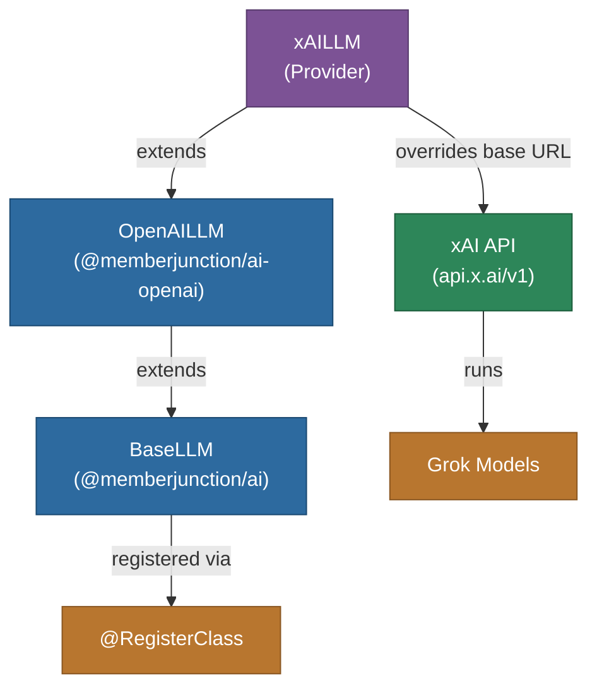

# @memberjunction/ai-xai

MemberJunction AI provider for xAI's Grok models. This package extends the OpenAI provider to work with xAI's OpenAI-compatible API, providing access to Grok models for chat completions and reasoning tasks.

## Architecture



## Features

- **Grok Access**: Access to xAI's Grok language models
- **OpenAI Compatible**: Inherits all features from the OpenAI provider
- **Streaming**: Full streaming support for real-time responses
- **Thinking/Reasoning**: Thinking block extraction for reasoning models
- **All OpenAI Parameters**: Full parameter support inherited from the OpenAI provider

## Installation

```bash
npm install @memberjunction/ai-xai
```

## Usage

```typescript
import { xAILLM } from '@memberjunction/ai-xai';

const llm = new xAILLM('your-xai-api-key');

const result = await llm.ChatCompletion({
    model: 'grok-2',
    messages: [
        { role: 'system', content: 'You are a helpful assistant.' },
        { role: 'user', content: 'What is the meaning of life?' }
    ],
    temperature: 0.7
});

if (result.success) {
    console.log(result.data.choices[0].message.content);
}
```

### Streaming

```typescript
const result = await llm.ChatCompletion({
    model: 'grok-2',
    messages: [{ role: 'user', content: 'Explain deep learning.' }],
    streaming: true,
    streamingCallbacks: {
        OnContent: (content) => process.stdout.write(content),
        OnComplete: () => console.log('\nDone!')
    }
});
```

## How It Works

`xAILLM` is a thin subclass of `OpenAILLM` that redirects API calls to xAI's endpoint at `https://api.x.ai/v1`. Since xAI implements an OpenAI-compatible API, all chat, streaming, and parameter handling logic is inherited from the OpenAI provider.

## Grok Voice Realtime Driver (`xAIRealtime`)

In addition to the chat LLM, this package ships `xAIRealtime` — a `BaseRealtimeModel` driver for xAI's **Grok Voice Agent API**, the streaming, interruptible, tool-calling speech-to-speech path that powers MemberJunction's `Realtime` agent type and Voice Co-Agent. Every Grok Voice generation runs on it — `grok-voice`, `grok-voice-think-fast-2.0` and `grok-voice-3.0` — chosen by the catalog's API name.

### Why it reuses the OpenAI SDK

Grok Voice is **OpenAI-Realtime-API compatible** — same WebSocket event protocol, Base64-encoded PCM16 @ 24 kHz audio, and tool-calling shape, with the endpoint at `wss://api.x.ai/v1/realtime`. (The differences are listed under [Grok Voice settings](#grok-voice-settings) below.) The driver therefore constructs the `openai` SDK client pointed at xAI's base URL:

```typescript
new OpenAI({ apiKey, baseURL: 'https://api.x.ai/v1' });
```

The SDK's `buildRealtimeURL()` derives the realtime socket directly from `client.baseURL` (converting `https://…` to `wss://…/realtime?model=…`), so the driver inherits OpenAI's hardened realtime event handling and authentication for free rather than re-implementing the wire protocol against a bare `ws` socket.

### Topology and capabilities

- **Both topologies** — server-bridged (`StartSession`, the provider socket lives on the server) and client-direct (`CreateClientSession` mints a one-time xAI client secret and the server-authored session config; the browser's `xAIRealtimeClient` in `@memberjunction/ai-realtime-client` opens the socket).
- **Both-role transcripts** — user-side ASR is opted in via `audio.input.transcription` (`grok-transcribe` by default) so user and assistant transcripts both flow. Grok streams the user caption as it grows (cumulative `.updated` snapshots and repeated `.completed` frames); the driver collapses them into one caption per turn. Override the transcription model (or any session field) through the per-session `Config` bag.
- **Turn-based, not full-duplex** — Grok takes turns on server VAD with barge-in; it does not listen while it speaks or backchannel, so the catalog leaves `ModelConfiguration.Realtime.FullDuplex` off and multi-party rooms keep their turn-taking tools and floor gate.
- **Full tool-call loop** — tool requests surface via `OnToolCall`; results are fed back with `SendToolResult` (`function_call_output` + `response.create`) and are always voiced, never dropped.
- **True barge-in** — `OnInterruption` fires only when user speech cuts off an *active* model response (gated on response-in-flight state), never on a normal user turn.
- **Background narration** — `SendContextNote` (silent system-role item) and `RequestSpokenUpdate` (one brief spoken interim, skipped if a response is already active) support delegated-run progress narration.
- **Fatal vs. recoverable errors** — transport failures and credential/token death surface through `OnError` with `Fatal: true` (plus `OnClose` on unexpected socket close); provider error frames stay `Fatal: false`.

### Usage

```typescript
import { xAIRealtime } from '@memberjunction/ai-xai';

const driver = new xAIRealtime('your-xai-api-key');
const session = await driver.StartSession({
    Model: 'grok-voice',
    SystemPrompt: 'You are a concise, friendly voice assistant.',
    Tools: [{ Name: 'GetWeather', Description: 'Get current weather', ParametersSchema: { type: 'object' } }],
});

session.OnTranscript((t) => console.log(t.Role, t.Text, t.IsFinal));
session.OnToolCall(async (call) => {
    const result = await runTool(call.ToolName, call.Arguments);
    await session.SendToolResult(call.CallID, JSON.stringify(result));
});
session.OnOutput((pcm16) => playAudio(pcm16));
```

### Grok Voice settings

Each setting is a key in the session `Config` bag, so it can come from the agent/app config cascade
(`realtime.session.*`), a co-agent's `realtime.voice.providers.grok` bag, or a runtime override. The
driver translates the MJ key to xAI's wire field; nothing is sent raw.

| MJ key | Grok Voice wire field | Notes |
|---|---|---|
| `voice` | `session.voice` | 26 built-in voices (`XAI_REALTIME_VOICES`; xAI's default is `eve`) or a custom voice ID. Top level, not under `audio.output`. |
| `voiceSpeed` | `audio.output.speed` | Clamped to 0.7–1.5. |
| `effortLevel` / `reasoningEffort` | `reasoning.effort` | Grok has two levels: `none`, `minimal` and 1–20 turn reasoning **off** (faster turns); anything else turns it **on** (`high`, the model default). See `MapEffortLevelToGrokRealtime`. |
| `turnDetection` (`Mode`, `Threshold`, `SilenceDurationMs`, `IdleTimeoutMs`) | `session.turn_detection` | Server VAD only. `IdleTimeoutMs` becomes `idle_timeout_ms`: after the assistant speaks, that much user silence makes Grok re-engage on its own. Top level, not under `audio.input`. |
| `transcriptionLanguages` | `audio.input.transcription.language_hint` | The first BCP-47 code. |
| `transcriptionKeyterms` | `audio.input.transcription.keyterms` | Recognition-bias terms; at most 100, each at most 50 characters (the rest are dropped). |
| `providerTools` | `tools` | xAI-hosted tools in xAI's shape: `{ "type": "web_search" }`, `{ "type": "x_search", "allowed_x_handles": [...] }`, `{ "type": "file_search", "vector_store_ids": [...] }`. Other types are dropped, and so is a hosted tool whose function names an MJ tool already uses (xAI fails the turn on that collision). |
| `mcpTools` | `tools` | Remote MCP servers (`type: "mcp"`). Declare `require_approval: "never"`: approval requests are auto-denied. |

Hosted and MCP tools are re-sent whenever `RegisterTools` replaces the function tools. xAI-native
fields with no MJ key (for example `resumption` or the `replace` pronunciation map) pass through the
bag unchanged. `parallelToolCalls` is scrubbed: no xAI integration documents it for Grok Voice.

### Registration & metadata

Registered as `GrokRealtime` via `@RegisterClass(BaseRealtimeModel, 'GrokRealtime')`. The driver is resolved by `AIModelType = 'Realtime'` + `DriverClass = 'GrokRealtime'`. Three `Realtime` models are seeded via metadata sync in `metadata/ai-models/.ai-models.json`, each with an x.ai Inference Provider row on `DriverClass = GrokRealtime`: **Grok Voice** (`grok-voice`), **Grok Voice Think Fast 2.0** (`grok-voice-think-fast-2.0`, deprecated by xAI) and **Grok Voice 3.0** (`grok-voice-3.0`, released October 14, 2026, which `grok-voice-latest` now resolves to).

## Class Registration

Registered as `xAILLM` via `@RegisterClass(BaseLLM, 'xAILLM')`.

## Dependencies

- `@memberjunction/ai` - Core AI abstractions
- `@memberjunction/ai-openai` - OpenAI provider (parent class)
- `@memberjunction/global` - Class registration

## Grok Voice realtime driver (`GrokRealtime`)

`xAIRealtime` **subclasses** the shared `OpenAIRealtime` protocol implementation (`@memberjunction/ai-openai`) — Grok Voice is OpenAI-Realtime-API compatible, so the driver is `XAI_REALTIME_PROFILE` (api.x.ai base URL, `grok-transcribe` input transcription, top-level `voice` and always-explicit `server_vad` + `create_response` turn detection, immediate config send, and the feature gates behind the [Grok Voice settings](#grok-voice-settings) table) on top of the shared session/tool/error machinery. `xAIRealtimeSession` adds only the `.updated` caption snapshot handling.

The wire details were cross-checked against three independent xAI integrations — LiveKit's `livekit-plugins-xai`, Pipecat's `pipecat.services.xai.realtime` and Pydantic AI's `pydantic_ai.realtime.xai` — which agree on every field above.
