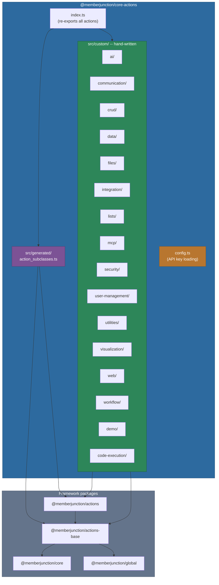
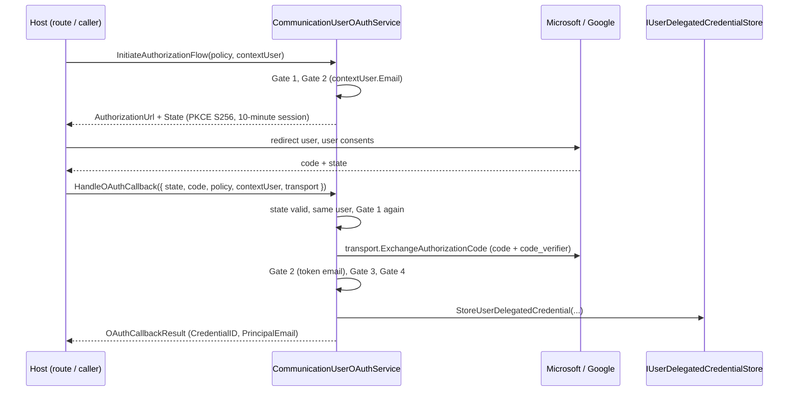
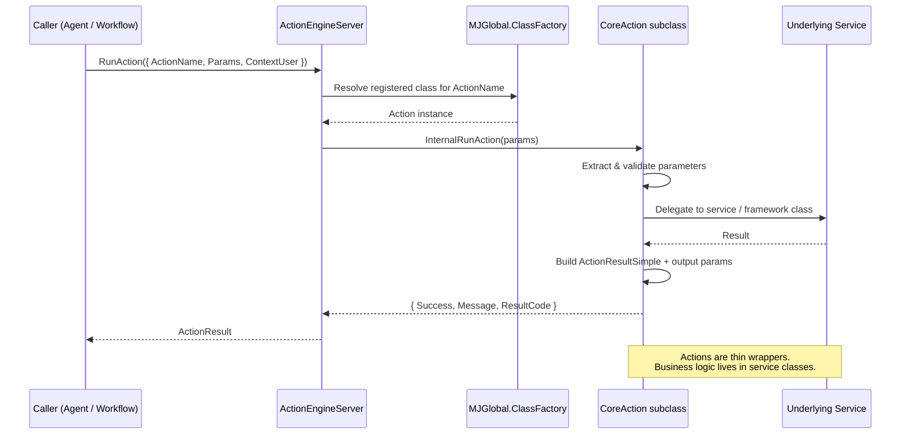

# @memberjunction/core-actions

The `@memberjunction/core-actions` package provides a comprehensive library of 100+ pre-built actions for the MemberJunction Actions framework. These actions cover AI integration, CRUD operations, communication, data transformation, file handling, visualization, workflow control, web interaction, and more. Each action is registered via `@RegisterClass(BaseAction, ...)` so it can be discovered and invoked by AI agents, workflow engines, and automation systems at runtime.

For background on when and how to use Actions vs. direct class imports, and the "thin wrapper" design philosophy, see the [parent Actions CLAUDE.md](../CLAUDE.md).

**Server-side only** -- this package depends on Node.js APIs, database access, and server-side MJ infrastructure. Do not import it from Angular or other client-side code.

## Installation

```bash
npm install @memberjunction/core-actions
```

This package is part of the MemberJunction monorepo. When working inside the monorepo, add the dependency to your package's `package.json` and run `npm install` at the repository root.

## Architecture

The package is organized into two layers: hand-written **custom actions** grouped by domain, and **generated actions** produced by the MJ CodeGen system. Both extend `BaseAction` from `@memberjunction/actions` and register themselves with the MJ class factory.



### Base Classes

Several abstract base classes reduce duplication across related actions:

| Base Class | Location | Purpose |
|---|---|---|
| `BaseRecordMutationAction` | `crud/base-record-mutation.action.ts` | Shared parameter extraction, entity loading, error analysis for Create/Update/Delete |
| `BaseFileStorageAction` | `files/base-file-storage.action.ts` | Common storage-provider resolution for all `File Storage: *` actions |
| `BaseFileHandlerAction` | `utilities/base-file-handler.ts` | Multi-source file loading (Storage, URL, direct data) |
| `BaseUserScopedCommunicationAction` | `ai/chief-of-staff-calendar-email.action.ts` | Mailbox security gate and provider resolution for the Chief of Staff `* My *` email/calendar actions; pins every mailbox operation to `ContextUser.Email` |

### Generated Actions

The file `src/generated/action_subclasses.ts` contains actions produced by the MJ CodeGen system from natural-language `UserPrompt` descriptions stored in the database. Generated actions use a **composition pattern** -- they always extend `BaseAction` (never their parent action class) and invoke the parent action via `ActionEngineServer.Instance.RunAction()` at runtime. See the [parent README](../README.md) for details on the generated/child action architecture.

### Scheduled Geocoding (`Scheduled Geocoding` action)

`src/custom/geo/scheduled-geocoding.action.ts` is a safety-net maintenance action that finds records in geo-enabled entities (`Entity.SupportsGeoCoding = 1`) missing a `RecordGeoCode` row, retries failed geocoding attempts, and cleans up orphaned `RecordGeoCode` rows. **Live geocoding-on-save runs inline via `BaseEntity.OnSaveCompleted`** — this scheduled action is only needed to catch records inserted via bulk SQL imports or direct DB writes that bypass `BaseEntity.Save()`.

The "find missing records" phase uses **keyset (seek) pagination** when the target entity has a single-column orderable PK (the common case for MJ entities). This keeps each page O(log N) regardless of how deep the iteration goes — important on multi-million-row entities like `Tax Returns`. Composite-PK entities fall back to `StartRow`-based OFFSET pagination automatically. See **[KEYSET_PAGINATION_GUIDE.md](../../../guides/KEYSET_PAGINATION_GUIDE.md)** for the pattern.

Default cadence is **Saturday 2 AM UTC** (configured in `metadata/scheduled-jobs/.geocoding-maintenance-job.json`). Administrators can adjust the `CronExpression` per environment.

### Configuration

External API keys used by certain actions (Perplexity, Google Custom Search, Gamma, Tavily) are loaded from `mj.config.cjs` or environment variables via the `config.ts` module:

```javascript
// mj.config.cjs
module.exports = {
  perplexityApiKey: 'pk-...',          // or PERPLEXITY_API_KEY env var
  gammaApiKey: 'sk-gamma-...',         // or GAMMA_API_KEY env var
  tavilyApiKey: 'tvly-...',            // or TAVILY_API_KEY env var
  google: {
    customSearch: {
      apiKey: 'AIza...',               // or GOOGLE_CUSTOM_SEARCH_API_KEY
      cx: '017...',                    // or GOOGLE_CUSTOM_SEARCH_CX
    }
  }
};
```

#### Choosing a web-search provider

Agents that do web research (Research Agent, Sage, the Web Research skill) are granted **both** the
`Perplexity Search` and `Google Custom Search` actions, and are instructed to prefer Perplexity and
fall back if one returns a missing-API-key error. Credential whichever you have:

| | Credentials | Availability |
|---|---|---|
| **Perplexity Search** *(recommended)* | `perplexityApiKey` — one key, no engine ID | Open to new customers |
| **Google Custom Search** | `google.customSearch.apiKey` **and** `.cx` | **Closed to new customers**; existing customers are served until **2027-01-01**, after which the Custom Search JSON API is discontinued |

New deployments should configure `perplexityApiKey`. Google's stated successor, Vertex AI Search, is
not a drop-in: it uses service-account auth against a data store over *your own* content and does not
return public web results, so it produces neither of the two values this config expects and there is
no MJ action for it. Deployments that already have Custom Search access can keep using it through
2026 and add `perplexityApiKey` whenever convenient — configuring both is supported.

## Action Catalog

All 100+ actions organized by category. Each action is registered with `@RegisterClass(BaseAction, "<name>")`.

### AI (8 actions)

Actions for prompt execution, agent discovery, image generation, and content summarization.

| Registration Name | Class | Description |
|---|---|---|
| `Execute AI Prompt` | `ExecuteAIPromptAction` | Run a named MJ AI prompt with variable substitution and optional model/temperature overrides |
| `SummarizeContentAction` | `SummarizeContentAction` | Summarize text content using AI |
| `Find Candidate Agents` | `FindCandidateAgentsAction` | Discover AI agents suitable for a task |
| `Find Candidate Actions` | `FindCandidateActionsAction` | Discover actions suitable for a task |
| `Find Best Agent` | `FindBestAgentAction` | Select the single best agent for a task |
| `Find Best Action` | `FindBestActionAction` | Select the single best action for a task |
| `Load Agent Spec` | `LoadAgentSpecAction` | Load full specification for an AI agent |
| `Generate Image` | `GenerateImageAction` | Generate images using AI models |

### Chief of Staff / agent governance (8 actions)

Actions used by the Chief of Staff agent (and other autonomous agents) to manage their own policy, schedule, coordination and user-scoped communication. All of them bind to `ContextUser` -- an agent can only act on, and read for, the calling user. The four `* My *` actions extend `BaseUserScopedCommunicationAction` and are also registered under a `__`-prefixed alias (for example `__ManageMyEmailInbox`).

| Registration Name | Class | Description |
|---|---|---|
| `Configure Agent User Policy` | `ConfigureAgentUserPolicyAction` | Create or update the caller's `MJ: AI Agent User Policies` row for an agent (channel modes, coordination mode, action and entity rules); always bound to `ContextUser.ID` |
| `Schedule Next Agent Wake` | `ScheduleNextAgentWakeAction` | Upsert the agent's next `AgentWake` row in `MJ: User Routines`, keyed by `(UserID, TargetID, WorkstreamKey)`; one-shot or cron schedule |
| `Send Chief of Staff Inter-Agent Request` | `ChiefOfStaffInterAgentRequestAction` | Send a structured follow-up to another user, or that user's Chief of Staff, as an `MJ: AI Agent Requests` row; checks both users' coordination policy |
| `Prepare Chief of Staff Outbound Call` | `PrepareChiefOfStaffOutboundCallAction` | Validate `PhoneChannelMode` and approval rules, then build a locked outbound-call brief with mandatory upfront AI disclosure |
| `Verify My Communication Capabilities` | `VerifyMyCommunicationCapabilitiesAction` | Preflight: reports the enterprise communication posture, active providers, the caller's channel permissions, utility mailboxes and external scheduling connectors |
| `Get My Calendar Events and Availability` | `GetMyCalendarAndAvailabilityAction` | Read the caller's events, free/busy, meeting-time suggestions, or HubSpot/Calendly availability |
| `Manage My Calendar Event` | `ManageMyCalendarEventAction` | Create, update, respond to or cancel an event on the caller's calendar, or create a Calendly single-use link; enforces `CalendarChannelMode` |
| `Manage My Email Inbox and Drafts` | `ManageMyEmailInboxAction` | Read, search and draft/reply/forward in the caller's own mailbox or dedicated utility mailbox; enforces `EmailChannelMode`; never accepts a `From` or `Mailbox` parameter |

The mailbox actions run through the enterprise provider's app-level credential (Microsoft Graph or Gmail) and the gate in `BaseUserScopedCommunicationAction`: the caller's email domain must match the provider's `AllowedEmailDomains`, the provider's `EnterpriseScopeMode` must allow personal mailboxes (otherwise the action falls back to the user's `MJ: AI Bridge Agent Identities` utility inbox), and the provider's mailbox-access preflight must succeed. The per-user OAuth service described below is a separate, not-yet-wired path to the same mailboxes.

### Communication (3 actions)

Send messages via the MJ Communication Framework or webhook integrations.

| Registration Name | Class | Description |
|---|---|---|
| `__SendSingleMessage` | `SendSingleMessageAction` | Send a single message through any configured provider (email, SMS, etc.) |
| `Slack Webhook` | `SlackWebhookAction` | Post messages to Slack via incoming webhooks |
| `Teams Webhook` | `TeamsWebhookAction` | Post messages to Microsoft Teams via incoming webhooks |

### CRUD (5 actions)

Entity record create, read, update, and delete operations. The mutation actions share logic through `BaseRecordMutationAction`.

| Registration Name | Class | Description |
|---|---|---|
| `CreateRecordAction` | `CreateRecordAction` | Create a new entity record |
| `GetRecordAction` | `GetRecordAction` | Retrieve a single entity record by primary key |
| `GetRecordsAction` | `GetRecordsAction` | Retrieve multiple entity records with filtering |
| `UpdateRecordAction` | `UpdateRecordAction` | Update an existing entity record |
| `DeleteRecordAction` | `DeleteRecordAction` | Delete an entity record by primary key |

### Data Transformation (7 actions)

Parse, transform, aggregate, and explore structured data.

| Registration Name | Class | Description |
|---|---|---|
| `CSV Parser` | `CSVParserAction` | Parse CSV with configurable delimiters, headers, and type coercion |
| `JSON Transform` | `JSONTransformAction` | Transform JSON using JSONPath queries |
| `XML Parser` | `XMLParserAction` | Parse XML to JSON with namespace and attribute control |
| `Aggregate Data` | `AggregateDataAction` | Group-by aggregation (sum, avg, count, min, max) with having clauses |
| `Data Mapper` | `DataMapperAction` | Map fields between data structures using template expressions |
| `Explore Database Schema` | `ExploreDatabaseSchemaAction` | Retrieve entity metadata and schema information |
| `Run Ad-hoc Query` | `RunAdhocQueryAction` | Execute ad-hoc SQL queries against entity data |

### File Operations (8 actions)

Document generation, parsing, compression, and spreadsheet I/O.

| Registration Name | Class | Description |
|---|---|---|
| `PDF Generator` | `PDFGeneratorAction` | Generate PDFs from HTML or Markdown content |
| `PDF Extractor` | `PDFExtractorAction` | Extract text and metadata from PDF files |
| `Excel Reader` | `ExcelReaderAction` | Read data from Excel files with multi-sheet support |
| `Excel Writer` | `ExcelWriterAction` | Create formatted Excel files from structured data |
| `File Compress` | `FileCompressAction` | Compress files into ZIP archives |
| `File Storage: Get File Content` | `GetFileContentAction` | Read file content from MJ storage |
| `List Storage Accounts` | `ListStorageAccountsAction` | List available storage provider accounts |
| `Search Storage Files` | `SearchStorageFilesAction` | Search across storage providers by name or metadata |

### File Storage (12 actions)

Granular cloud storage operations for Azure Blob, AWS S3, Google Cloud Storage, Google Drive, Dropbox, Box.com, and SharePoint. All extend `BaseFileStorageAction`.

| Registration Name | Class | Description |
|---|---|---|
| `File Storage: List Objects` | `ListObjectsAction` | List objects in a container/bucket |
| `File Storage: Get Object` | `GetObjectAction` | Download an object from storage |
| `File Storage: Get Object Metadata` | `GetMetadataAction` | Retrieve object metadata |
| `File Storage: Get Download URL` | `GetDownloadUrlAction` | Generate a download URL (SAS/presigned) |
| `File Storage: Get Upload URL` | `GetUploadUrlAction` | Generate an upload URL |
| `File Storage: Check Object Exists` | `ObjectExistsAction` | Check if an object exists |
| `File Storage: Check Directory Exists` | `DirectoryExistsAction` | Check if a directory/prefix exists |
| `File Storage: Copy Object` | `CopyObjectAction` | Copy an object within or across containers |
| `File Storage: Move Object` | `MoveObjectAction` | Move an object (copy + delete) |
| `File Storage: Delete Object` | `DeleteObjectAction` | Delete an object from storage |
| `File Storage: Create Directory` | `CreateDirectoryAction` | Create a directory/prefix |
| `File Storage: Delete Directory` | `DeleteDirectoryAction` | Delete a directory/prefix |

### Integration (5 actions)

HTTP, GraphQL, OAuth, rate limiting, and third-party service integrations.

| Registration Name | Class | Description |
|---|---|---|
| `HTTP Request` | `HTTPRequestAction` | Make HTTP requests with auth, headers, and body support |
| `GraphQL Query` | `GraphQLQueryAction` | Execute GraphQL queries and mutations |
| `OAuth Flow` | `OAuthFlowAction` | Handle OAuth 2.0 authorization flows |
| `API Rate Limiter` | `APIRateLimiterAction` | Rate-limit outbound API calls |
| `Gamma Generate Presentation` | `GammaGeneratePresentationAction` | Generate presentations via the Gamma API |

### List Management (6 actions)

Manage MJ lists and list membership for entities.

| Registration Name | Class | Description |
|---|---|---|
| `Add Records to List` | `AddRecordsToListAction` | Add one or more records to a list |
| `Remove Records from List` | `RemoveRecordsFromListAction` | Remove records from a list |
| `Create List` | `CreateListAction` | Create a new list with optional initial records |
| `Get List Records` | `GetListRecordsAction` | Retrieve records from a list with filtering |
| `Get Record List Membership` | `GetRecordListMembershipAction` | Find which lists contain a specific record |
| `Update List Item Status` | `UpdateListItemStatusAction` | Bulk-update status on list items |

### MCP (5 actions)

Interact with external Model Context Protocol (MCP) servers.

| Registration Name | Class | Description |
|---|---|---|
| `Execute MCP Tool` | `ExecuteMCPToolAction` | Execute a tool on a connected MCP server |
| `List MCP Tools` | `ListMCPToolsAction` | List available tools from MCP servers |
| `Sync MCP Tools` | `SyncMCPToolsAction` | Synchronize MCP tool definitions to MJ metadata |
| `Test MCP Connection` | `TestMCPConnectionAction` | Test connectivity to an MCP server |
| `MCPToolAction` | `MCPToolAction` | Generic MCP tool invocation wrapper |

### Security (1 action)

| Registration Name | Class | Description |
|---|---|---|
| `Password Strength` | `PasswordStrengthAction` | Evaluate password strength using zxcvbn |

### User Management (5 actions)

| Registration Name | Class | Description |
|---|---|---|
| `CreateUserAction` | `CreateUserAction` | Create a new MJ user |
| `CreateEmployeeAction` | `CreateEmployeeAction` | Create a new employee record |
| `AssignUserRolesAction` | `AssignUserRolesAction` | Assign roles to a user |
| `CheckUserPermissionAction` | `CheckUserPermissionAction` | Check if a user has a specific permission |
| `ValidateEmailUniqueAction` | `ValidateEmailUniqueAction` | Validate that an email address is unique |

### Utilities (6 actions)

Miscellaneous server-side utilities.

| Registration Name | Class | Description |
|---|---|---|
| `__VectorizeEntity` | `VectorizeEntityAction` | Create AI vector embeddings for entity records |
| `__RunExternalChangeDetection` | `ExternalChangeDetectionAction` | Detect changes in external data sources |
| `__BusinessDaysCalculator` | `BusinessDaysCalculatorAction` | Calculate business days between dates |
| `__IPGeolocation` | `IPGeolocationAction` | Look up geographic location by IP address |
| `__CensusDataLookup` | `CensusDataLookupAction` | Query US Census Bureau data |
| `__QRCode` | `QRCodeAction` | Generate QR code images |

### Visualization (7 actions)

Generate SVG charts, diagrams, and infographics using D3 and Rough.js. All produce self-contained SVG markup suitable for embedding in HTML or saving as files.

| Registration Name | Class | Description |
|---|---|---|
| `__CreateSVGChart` | `CreateSVGChartAction` | Bar, line, pie, scatter, and area charts via D3 |
| `__CreateSVGDiagram` | `CreateSVGDiagramAction` | Flowcharts and process diagrams |
| `__CreateSVGWordCloud` | `CreateSVGWordCloudAction` | Word cloud visualizations via d3-cloud |
| `__CreateSVGNetwork` | `CreateSVGNetworkAction` | Force-directed network graphs via d3-force |
| `__CreateSVGInfographic` | `CreateSVGInfographicAction` | Multi-section infographics with icons and data |
| `__CreateSVGSketchDiagram` | `CreateSVGSketchDiagramAction` | Hand-drawn style diagrams via Rough.js |
| `__CreateMermaidDiagram` | `CreateMermaidDiagramAction` | Render Mermaid diagram definitions to SVG |

`Create Mermaid Diagram` renders in headless Chromium, which the `playwright` dependency does not install. Install one on the host with `npx playwright install chromium`, or set `MJ_CHROMIUM_EXECUTABLE_PATH` to an existing binary. Without one the action returns `BROWSER_UNAVAILABLE`.

### Web (6 actions)

Search the web, extract page content, and validate URLs.

| Registration Name | Class | Description |
|---|---|---|
| `__WebSearch` | `WebSearchAction` | Search the web via DuckDuckGo with rate limiting |
| `__WebPageContent` | `WebPageContentAction` | Extract content from a web page |
| `__URLLinkValidator` | `URLLinkValidatorAction` | Validate that a URL is reachable |
| `__URLMetadataExtractor` | `URLMetadataExtractorAction` | Extract OpenGraph/meta tags from a URL |
| `Perplexity Search` | `PerplexitySearchAction` | AI-powered search via Perplexity API |
| `Google Custom Search` | `GoogleCustomSearchAction` | Search via Google Custom Search API |
| `Tavily Search` | `TavilySearchAction` | Web search built for AI consumption — cleaned page content and an optional synthesised answer |
| `Read RSS Feed` | `ReadRSSFeedAction` | Read one or more RSS/Atom feeds, filtered by age and keywords |

### Workflow Control (5 actions)

Orchestrate action execution with branching, iteration, parallelism, and retry logic.

| Registration Name | Class | Description |
|---|---|---|
| `Conditional` | `ConditionalAction` | Branch execution based on a JavaScript condition |
| `Loop` | `LoopAction` | Iterate over collections or numeric ranges |
| `Parallel Execute` | `ParallelExecuteAction` | Run multiple actions concurrently |
| `Retry` | `RetryAction` | Retry a failed action with configurable attempts and backoff |
| `Delay` | `DelayAction` | Pause execution for a specified duration |

### Code Execution (1 action)

| Registration Name | Class | Description |
|---|---|---|
| `__ExecuteCode` | `ExecuteCodeAction` | Execute sandboxed code snippets |

### Interactive Forms (6 actions)

The lifecycle for runtime-author entity forms (form-role
`ComponentSpec` + `EntityFormOverride`). See
[/plans/interactive-forms/phase-2-runtime-loop.md](../../../plans/interactive-forms/phase-2-runtime-loop.md)
for the full architecture and security model. Mutation actions enforce
ownership checks (User → caller, Role → membership, Global → admin).

| Registration Name | Class | Description |
|---|---|---|
| `__GetEntitySchemaForForm` | `GetEntitySchemaForFormAction` | Read-only: returns the curated form-relevant schema for an entity (FKs resolved, value lists annotated, audit fields stripped). |
| `__GetDefaultFormScaffoldForEntity` | `GetDefaultFormScaffoldForEntityAction` | Read-only: produces a working form-role `ComponentSpec` mirroring the CodeGen Angular default layout. The agent's baseline. |
| `__GetActiveFormForEntity` | `GetActiveFormForEntityAction` | Read-only: returns the resolved Active override + full applicable-variants list for the (entity, calling-user) pair. |
| `__CreateInteractiveForm` | `CreateInteractiveFormAction` | Net-new only. Inserts Component v1.0.0 + Active User-scope Override. Fails `ALREADY_EXISTS` if the user already has an Active override for the entity. |
| `__ModifyInteractiveForm` | `ModifyInteractiveFormAction` | Branches on the pointed-to Component status: Pending → modify in place; Active → new Pending Component v(N+1) + sibling Pending Override. Always User-scope-clamped. |
| `__ActivateInteractiveFormVersion` | `ActivateInteractiveFormVersionAction` | Promotes a Pending override to Active; atomically demotes the prior sibling Active. |
| `__RevertInteractiveForm` | `RevertInteractiveFormAction` | Re-points an Active override at an older Component row in the same Name lineage. Pure UPDATE; no new rows. |

### Demo (6 actions)

Reference implementations useful for testing and learning.

| Registration Name | Class | Description |
|---|---|---|
| `__GetWeather` | `GetWeatherAction` | Retrieve weather data for a location |
| `__GetStockPrice` | `GetStockPriceAction` | Look up stock price information |
| `__CalculateExpression` | `CalculateExpressionAction` | Evaluate mathematical expressions |
| `__ColorConverter` | `ColorConverterAction` | Convert between color formats (hex, RGB, HSL) |
| `__TextAnalyzer` | `TextAnalyzerAction` | Analyze text for word count, readability, etc. |
| `__UnitConverter` | `UnitConverterAction` | Convert between measurement units |

### Generated (2 actions)

AI-generated entity-specific child actions. These are maintained by CodeGen and should not be manually edited.

| Registration Name | Class | Description |
|---|---|---|
| `Create Conversation Record` | `Create_Conversation_Record_Action` | Create a Conversations entity record (child of Create Record) |
| `Get AI Model Cost` | `Get_AI_Model_Cost_Action` | Look up cost information for an AI model (child of Get Record) |

## Per-user OAuth 2.0 (3LO) service -- prototype

`CommunicationUserOAuthService` (`src/custom/ai/communication-oauth-service.ts`) is a `BaseSingleton` that lets an individual user connect their own Microsoft Graph or Google Workspace mailbox to MJ through three-legged OAuth, instead of the app-level credential the mailbox actions above use today. It is not an action; it is a service a host (MJServer route, test harness) drives directly.

**Status: prototype, off by default.** The service is fully gated behind an in-memory policy object. There is no `AllowUserDelegatedOAuth` column on `MJ: Communication Providers` or anywhere else in the schema or metadata, and no admin UI. Posture 3 is disabled unless a caller explicitly constructs a `ProviderUserOAuthPolicyConfig` with `AllowUserDelegatedOAuth: true`. See "Current limitations" below before relying on it.

### Flow



1. **Initiate** -- `InitiateAuthorizationFlow(policy, contextUser)` checks Gates 1 and 2, generates a PKCE `S256` verifier/challenge pair (`GeneratePkcePair`) and a random `state`, keeps them in an in-memory session for 10 minutes, and returns an `OAuthInitiateResult` whose `AuthorizationUrl` includes `code_challenge`, `code_challenge_method=S256` and `login_hint`.
2. **Consent** -- the host redirects the browser to `AuthorizationUrl`; the identity provider redirects back with `code` and `state`.
3. **Callback** -- `HandleOAuthCallback(params)` consumes the session (one use), rejects an expired or unknown `state` (`INVALID_OR_EXPIRED_STATE`) or a different calling user (`STATE_USER_MISMATCH`), exchanges the code through the injected `IOAuthTokenTransport`, runs Gates 2 through 4 against the verified token identity, and stores the result.
4. **Store** -- the credential is written through `IUserDelegatedCredentialStore.StoreUserDelegatedCredential` under the name `UserOAuth3LO:<provider>:<ownerUserId>` with `ownerUserId` inside the encrypted values. See `@memberjunction/credentials` for the owner-binding rules.
5. **Disconnect** -- `DisconnectAndRevokeUserOAuth(params)` revokes the refresh (or access) token at the provider when the transport implements `RevokeToken`, then deactivates the stored credential and wipes its token values. Revocation failure at the provider is reported in `RevokedAtProvider` but does not stop the local deactivation.

### The four gates

| Gate | Checked at | Rule | Result code on failure |
|---|---|---|---|
| 1 | initiate and callback | `policy.AllowUserDelegatedOAuth === true` | `GATE_1_USER_OAUTH_DISABLED` |
| 2 | initiate (on `contextUser.Email`) and callback (on the token's verified email) | domain is in `policy.AllowedEmailDomains` (comma-separated; empty means any) | `GATE_2_DOMAIN_MISMATCH` |
| 3 | callback | token's tenant (`tid` for Azure AD, `hd` for Google Workspace) is in `policy.AllowedOAuthTenantIDs` (empty means any) | `GATE_3_TENANT_MISMATCH` |
| 4 | callback | the authenticated principal's email equals `contextUser.Email`, case-insensitive -- a user cannot link a personal or someone else's mailbox to their MJ identity | `GATE_4_PRINCIPAL_EMAIL_MISMATCH` |

Gates 2 and 3 are opt-in narrowing; Gates 1 and 4 always apply. All result codes are the `CommunicationOAuthResultCode` union.

### Injection points

- **`ProviderUserOAuthPolicyConfig`** -- the caller builds this: `ProviderName`, the four gate fields, `ClientId`/`ClientSecret`, `AuthorizationEndpoint`, `TokenEndpoint`, optional `RevocationEndpoint`, `RedirectUri`, `Scopes`.
- **`IOAuthTokenTransport`** (required on callback) -- `ExchangeAuthorizationCode` must return a `VerifiedOAuthTokenExchangeResult` whose `PrincipalEmail` and `TenantID` come from a verified source (`id_token` claims or the provider's userinfo endpoint), because Gates 2 to 4 trust them. `RevokeToken` is optional.
- **`IUserDelegatedCredentialStore`** (optional) -- `CredentialEngine.Instance` from `@memberjunction/credentials` satisfies this interface structurally and is the intended store. When omitted the service uses a built-in default that writes `MJ: Credentials` rows through `RunView`/`GetEntityObject` using `metadataProvider` (or the global provider).

### Current limitations

- **No schema or metadata flag.** `AllowUserDelegatedOAuth`, `AllowedOAuthTenantIDs` and the endpoint settings exist only on the in-memory policy object. Nothing in `MJ: Communication Providers` turns this on, and there is no admin UI.
- **No built-in transport and no routes.** `IOAuthTokenTransport` has no shipped implementation. The file header mentions `/api/v1/communication-oauth/initiate` and `/callback`, but no MJServer routes exist yet; a host must build them with `ApiRoute()` and call the service.
- **No consumer of the stored token.** The Microsoft Graph and Gmail communication providers still authenticate with app-level credentials; a connected 3LO credential is stored but not yet used by any mailbox action.
- **Pending sessions are process-local.** The initiate/callback session map lives in memory, so both calls must reach the same process, and a restart drops in-flight authorizations.
- **Default store is transitional.** The built-in store duplicates `CredentialEngine` logic and is slated to be replaced by delegation to the engine. Prefer injecting `credentialStore: CredentialEngine.Instance`, or call the engine directly, so audit logging and the engine's owner checks apply.

## Usage Examples

### Executing an Action via the Engine

```typescript
import { ActionEngineServer } from '@memberjunction/actions';

const engine = ActionEngineServer.Instance;

// Send an email
const result = await engine.RunAction({
    ActionName: '__SendSingleMessage',
    Params: [
        { Name: 'Provider', Value: 'SendGrid' },
        { Name: 'MessageType', Value: 'Email' },
        { Name: 'From', Value: 'noreply@example.com' },
        { Name: 'To', Value: 'user@example.com' },
        { Name: 'Subject', Value: 'Hello' },
        { Name: 'Body', Value: '<p>Hello from MJ</p>' }
    ],
    ContextUser: currentUser
});
```

### CRUD Operations

```typescript
// Create a record
const createResult = await engine.RunAction({
    ActionName: 'CreateRecordAction',
    Params: [
        { Name: 'EntityName', Value: 'Contacts' },
        { Name: 'Fields', Value: { FirstName: 'Jane', LastName: 'Doe', Email: 'jane@example.com' } }
    ],
    ContextUser: currentUser
});

// Get a record
const getResult = await engine.RunAction({
    ActionName: 'GetRecordAction',
    Params: [
        { Name: 'EntityName', Value: 'Contacts' },
        { Name: 'PrimaryKey', Value: { ID: 'abc-123' } }
    ],
    ContextUser: currentUser
});
```

### AI Prompt Execution

```typescript
const aiResult = await engine.RunAction({
    ActionName: 'Execute AI Prompt',
    Params: [
        { Name: 'PromptName', Value: 'Summarize Text' },
        { Name: 'Variables', Value: { text: 'Long article content...' } },
        { Name: 'TemperatureOverride', Value: 0.3 }
    ],
    ContextUser: currentUser
});
```

### Workflow Control

```typescript
// Conditional branching
const condResult = await engine.RunAction({
    ActionName: 'Conditional',
    Params: [
        { Name: 'Condition', Value: 'amount > 1000' },
        { Name: 'Context', Value: { amount: 1500 } },
        { Name: 'TrueAction', Value: { ActionName: 'Slack Webhook', Params: { /* ... */ } } },
        { Name: 'FalseAction', Value: { ActionName: 'Delay', Params: { Duration: 5000 } } }
    ],
    ContextUser: currentUser
});

// Parallel execution
const parallelResult = await engine.RunAction({
    ActionName: 'Parallel Execute',
    Params: [
        { Name: 'Actions', Value: ['Action1', 'Action2', 'Action3'] }
    ],
    ContextUser: currentUser
});
```

### Data Transformation

```typescript
// Parse CSV
const csvResult = await engine.RunAction({
    ActionName: 'CSV Parser',
    Params: [
        { Name: 'CSVData', Value: 'Name,Age\nAlice,30\nBob,25' },
        { Name: 'HasHeaders', Value: true }
    ],
    ContextUser: currentUser
});

// Aggregate data
const aggResult = await engine.RunAction({
    ActionName: 'Aggregate Data',
    Params: [
        { Name: 'Data', Value: [{ dept: 'Eng', salary: 100000 }, { dept: 'Eng', salary: 120000 }] },
        { Name: 'GroupBy', Value: 'dept' },
        { Name: 'Aggregations', Value: { avgSalary: 'avg:salary', count: 'count:*' } }
    ],
    ContextUser: currentUser
});
```

## Action Execution Flow

The following diagram illustrates how an action invocation flows from caller through the engine to this package's registered classes.



## Dependencies

### MemberJunction Packages

| Package | Purpose |
|---|---|
| `@memberjunction/actions` | `BaseAction` class and `ActionEngineServer` |
| `@memberjunction/actions-base` | `ActionResultSimple`, `RunActionParams`, `ActionParam` types |
| `@memberjunction/core` | `Metadata`, `RunView`, `BaseEntity`, logging utilities |
| `@memberjunction/global` | `RegisterClass` decorator |
| `@memberjunction/ai` | AI model abstraction layer |
| `@memberjunction/ai-prompts` | `AIPromptRunner` for prompt execution |
| `@memberjunction/ai-core-plus` | `AIPromptParams`, `AIPromptEntityExtended` |
| `@memberjunction/aiengine` | `AIEngine` singleton for model/prompt discovery |
| `@memberjunction/communication-engine` | Message sending infrastructure |
| `@memberjunction/communication-types` | `Message` type definitions |
| `@memberjunction/storage` | Cloud storage provider abstraction |
| `@memberjunction/export-engine` | Data export utilities |
| `@memberjunction/ai-vector-sync` | Vector embedding synchronization |
| `@memberjunction/ai-mcp-client` | MCP server communication |
| `@memberjunction/code-execution` | Sandboxed code execution |
| `@memberjunction/external-change-detection` | External change tracking |
| `@memberjunction/content-autotagging` | Content categorization |

### Third-Party Libraries

| Library | Used By |
|---|---|
| `d3-scale`, `d3-shape`, `d3-cloud`, `d3-force`, `d3-hierarchy` | Visualization actions (SVG charts, word clouds, networks) |
| `roughjs` | Sketch-style diagram rendering |
| `mermaid`, `playwright` | Mermaid diagram rendering (in headless Chromium) |
| `pdfkit` | PDF generation |
| `pdf-parse` | PDF text extraction |
| `exceljs` | Excel read/write |
| `papaparse` | CSV parsing |
| `xml2js`, `xpath`, `@xmldom/xmldom` | XML parsing |
| `marked`, `turndown` | Markdown/HTML conversion |
| `jsdom` | Server-side DOM for web content extraction |
| `mammoth` | Word document conversion |
| `archiver`, `unzipper` | File compression |
| `axios` | HTTP requests |
| `jsonpath-plus`, `jmespath` | JSON querying |
| `nunjucks` | Template rendering |
| `zxcvbn` | Password strength analysis |
| `zod` | Configuration schema validation |
| `cosmiconfig` | Config file loading |

## Related Packages

- **[@memberjunction/actions-base](../Base/README.md)** -- Base classes, interfaces, and metadata engines
- **[@memberjunction/actions](../Engine/README.md)** -- Server-side action execution engine
- **[Parent Actions README](../README.md)** -- Framework overview, generated actions guide, and best practices
- **[Parent Actions CLAUDE.md](../CLAUDE.md)** -- Design philosophy and development guidelines
