# @memberjunction/ng-artifacts

Angular artifact viewer, real-time Yjs collaboration, and Git-style visual version comparison library for MemberJunction — powering **MJ Docs** (`Markdown Document`), **MJ Slides** (`Presentation`), **MJ Sheets** (`Excel Spreadsheet`), interactive React/Angular `ComponentSpec` forms, PDF/Office file previews, audio/video playback, and inline **MS OLE-style** embedded artifacts.

> **Architectural Deep Dive:** See [`guides/DOCS_SLIDES_SHEETS_ARCHITECTURE.md`](../../../../guides/DOCS_SLIDES_SHEETS_ARCHITECTURE.md) for the end-to-end architecture covering Yjs CRDT synchronization, viewer-scoped Live MJ Blocks (`RLS`/`FLS` + `O5` freeze confirmation), delegated permissions (`O4`), word-level Suggesting redlines, and Visual Version Compare.

## Overview

```mermaid
graph TD
    A[ArtifactsModule] --> B[Workspace & Diff Shells]
    A --> C[Viewer & Collaborative Plugins]
    A --> D[Services]

    B --> B1[ArtifactViewerPanelComponent]
    B --> B2[ArtifactVersionHistoryComponent]
    B --> B3[ArtifactVersionCompareComponent]
    B --> B4[ArtifactMessageCardComponent]
    B --> B5[ArtifactTypePluginViewerComponent]

    C --> C0[BaseArtifactViewerPluginComponent]
    C --> C1[MarkdownArtifactViewerComponent — MJ Docs]
    C --> C2[SlideDeckArtifactViewerComponent — MJ Slides]
    C --> C3[SpreadsheetArtifactViewerComponent — MJ Sheets]
    C --> C4[ComponentArtifactViewerComponent — React / Interactive Forms]
    C --> C5[Json / Code / Html / Svg / Data Viewers]
    C --> C6[Pdf / Docx / Xlsx / Image / Audio / Video Viewers]

    D --> D1[DocumentCollaborationService — Yjs CRDT + Awareness]
    D --> D2[ArtifactVersionDiffService — Visual & Structural Diffs]
    D --> D3[DocumentImportExportService — .md / .docx / .pdf]
    D --> D4[SlideDeckExportService — OpenXML .pptx / .pdf]
    D --> D5[ArtifactIconService & ArtifactFileService]

    style A fill:#2d6a9f,stroke:#1a4971,color:#fff
    style B fill:#7c5295,stroke:#563a6b,color:#fff
    style C fill:#2d8659,stroke:#1a5c3a,color:#fff
    style D fill:#b8762f,stroke:#8a5722,color:#fff
```

`@memberjunction/ng-artifacts` provides a ClassFactory-driven plugin system (`@RegisterClass(BaseArtifactViewerPluginComponent, '<DriverClass>')`) that dynamically resolves the optimal viewer/editor for any `MJ: Artifact Types` record, paired with version history, side-by-side/visual version diffing, and conversation message cards.



## Installation

```bash
npm install @memberjunction/ng-artifacts
```

## Usage

### Module Import

```typescript
import { ArtifactsModule } from '@memberjunction/ng-artifacts';

@NgModule({
  imports: [ArtifactsModule]
})
export class YourModule {}
```

### Artifact Viewer Panel (Toolbar, Collaboration, Save to Collection & Version Compare)

Full-featured host panel with mode switching, version selector, **Compare** toggle, **Save to Collection**, share actions, and plugin rendering:

```html
<mj-artifact-viewer-panel
  [artifactId]="selectedArtifactId"
  [versionNumber]="selectedVersionNumber"
  [canEdit]="userCanEdit"
  [canShare]="userCanShare"
  (closed)="onPanelClosed()"
  (saveToCollectionRequested)="onSaveToCollection($event)">
</mj-artifact-viewer-panel>
```

### Git-Style Visual Version Compare (`<mj-artifact-version-compare>`)

Standalone component (also embedded inside `<mj-artifact-viewer-panel>`) providing **Base (`vA`) <-> Target (`vB`)** selectors, one-click swap (`⇄`), collapsible commit history rail, change counters (`+N / -M / ~K`), and 4 compare modes (`visual`, `json-tree`, `unified`, `split`):

```html
<mj-artifact-version-compare
  [ArtifactTypeName]="artifactTypeName"
  [ContentType]="contentType"
  [Versions]="artifactVersions"
  [BaseVersionNumber]="1"
  [TargetVersionNumber]="2"
  (ExitRequested)="isComparing = false">
</mj-artifact-version-compare>
```

| Artifact Type | Specialized Visual Compare Renderer |
|---|---|
| `Markdown Document` (`MJ Docs`) | `DocsVersionDiffComponent` — rendered document view with word-level Myers inline `<del>` strikethrough & `<ins>` insertion highlights, plus raw Markdown diff toggle |
| `Excel Spreadsheet` (`MJ Sheets`) | `SpreadsheetVersionDiffComponent` — per-worksheet change badges + coordinate diff grid highlighting **Added**, **Removed**, **Formula Changed** (`oldFormula -> newFormula` + evaluated delta), and **Value Changed** cells |
| `Presentation` (`MJ Slides`) | `SlidesVersionDiffComponent` — side-by-side 16:9 slide cards classifying slides as `Added`, `Removed`, `Modified`, `Moved`, or `Unchanged` across titles, layouts, regions, and speaker notes |
| `Component` (`ComponentSpec`) | `ComponentVersionDiffComponent` — structured diff across root metadata, `dataRequirements`, child components, libraries, and unified component code |
| `SQL` / `Query` | `QueryVersionDiffComponent` — line-numbered SQL diff with intra-line token highlights |
| Any JSON / Code / Text | `GitDiffLinesViewComponent` + semantic JSON key-path tree diff (`added`, `removed`, `changed`) |

### Artifact Type Plugin Viewer (Dynamic Plugin & MS OLE Host)

Automatically resolves and mounts the registered plugin for an artifact type — used both top-level and recursively for inline **MS OLE** embedded artifacts inside Docs, Slides, and Sheets:

```html
<mj-artifact-type-plugin-viewer
  [artifactVersion]="currentVersion"
  [artifactTypeName]="'Markdown Document'"
  [readonly]="!canEdit"
  [CollaborationWsUrl]="collaborationWsUrl"
  (ContentCommitted)="onInlineArtifactCommitted($event)">
</mj-artifact-type-plugin-viewer>
```

### Artifact Version History & Message Card

```html
<mj-artifact-version-history
  [artifactId]="selectedArtifactId"
  (versionSelected)="onVersionSelected($event)">
</mj-artifact-version-history>

<mj-artifact-message-card
  [artifact]="artifactRef"
  (clicked)="onArtifactCardClicked($event)">
</mj-artifact-message-card>
```

## Plugin Architecture & MS OLE Inline Editing

All viewer plugins extend `BaseArtifactViewerPluginComponent` and register via `@RegisterClass(BaseArtifactViewerPluginComponent, '<DriverClass>')`:

```typescript
import { Component } from '@angular/core';
import { RegisterClass } from '@memberjunction/global';
import { BaseArtifactViewerPluginComponent } from '@memberjunction/ng-artifacts';

@RegisterClass(BaseArtifactViewerPluginComponent, 'MyCustomViewerPlugin')
@Component({
  selector: 'my-custom-viewer',
  template: `<div>{{ artifactVersion?.Content }}</div>`
})
export class MyCustomViewerComponent extends BaseArtifactViewerPluginComponent {
  public override get SupportsInlineEdit(): boolean {
    return true; // Enables inline MS OLE editing inside MJ Docs, Slides, and Sheets
  }
}
```

### Built-in Viewer Plugins

| Component | Registered `DriverClass` | Capabilities |
|---|---|---|
| `MarkdownArtifactViewerComponent` | `MarkdownArtifactViewerPlugin` | Collaborative **MJ Docs** editor & viewer with progressive-disclosure toolbar, TOC outline rail, `/` slash menu, viewer-scoped Live MJ Blocks (`EntityView`, `SavedQuery`, `DashboardPart`, `InteractiveComponent`), inline OLE `Artifact` / `Whiteboard` blocks, **Word-Level Suggesting Redlines** (Myers sub-paragraph word/punctuation diff + per-hunk Accept/Reject), anchored `DocBlock` comments with `@mention`, *"Make a Deck from This Doc"*, and `.md`/`.docx`/`.pdf` import/export |
| `SlideDeckArtifactViewerComponent` | `SlideDeckArtifactViewerPlugin` | Collaborative **MJ Slides** 16:9 studio with 11 canonical layouts, filmstrip sorter rail, per-slide Yjs CRDT co-editing (`slidesById` + `slideOrder`), Organization Brand Color Seeds contrast theme derivation, Live MJ Blocks + inline OLE `Whiteboard` regions, `O6` Presenter View automatic live-block freeze, anchored `SlideRegion` comments with `@SlidesAgent` single-slide isolation, and OpenXML `.pptx` / `.pdf` export |
| `SpreadsheetArtifactViewerComponent` | `SpreadsheetArtifactViewerPlugin` | Collaborative **MJ Sheets** multi-tab workbook editor with stable `RowID`/`ColumnID` Yjs CRDT co-editing (`worksheetsById` + `sheetCellsByCoord`), formula bar (35+ functions, cross-sheet refs, named ranges), viewer-scoped `=MJ.QUERY`/`=MJ.VIEW` & bound Live Tables with calculated column fill-down, `O5` freeze security confirmation modal, anchored `SheetRange` comments, `.xlsx`/`.csv` round-trip, live Range Charts, and inline OLE `Whiteboard` hosting |
| `ComponentArtifactViewerComponent` | `ComponentArtifactViewerPlugin` | Dynamic React/Angular `ComponentSpec` viewer + form-aware interactive entity preview (`applyFormRequested`) |
| `JsonArtifactViewerComponent` | `JsonArtifactViewerPlugin` | Formatted JSON tree & syntax-highlighted viewer |
| `CodeArtifactViewerComponent` | `CodeArtifactViewerPlugin` | Syntax-highlighted code viewer & editor with language detection |
| `HtmlArtifactViewerComponent` | `HtmlArtifactViewerPlugin` | Sandboxed HTML preview |
| `SvgArtifactViewerComponent` | `SvgArtifactViewerPlugin` | Interactive SVG preview |
| `PdfArtifactViewerComponent` | `PdfArtifactViewerPlugin` | Native binary PDF document viewer |
| `DocxArtifactViewerComponent` | `DocxArtifactViewerPlugin` | Binary Word (`.docx`) preview via shared `<mj-docx-preview>` |
| `XlsxArtifactViewerComponent` | `XlsxArtifactViewerPlugin` | Read-only binary Excel (`.xlsx`) preview via shared `<mj-xlsx-preview>` |
| `ImageArtifactViewerComponent` | `ImageArtifactViewerPlugin` | Image viewer with zoom/pan controls |
| `AudioArtifactViewerComponent` | `AudioArtifactViewerPlugin` | Audio playback via `@memberjunction/ng-media-player` |
| `VideoArtifactViewerComponent` | `VideoArtifactViewerPlugin` | Video playback via `@memberjunction/ng-media-player` |
| `VideoProductionViewerComponent` | `VideoProductionViewerPlugin` | Multi-tab storyboard & review studio for AI Video Studio artifacts |

## Key Services

| Service | Responsibility |
|---|---|
| `DocumentCollaborationService` | Manages Yjs `Y.Doc` rooms, binary `y-protocols/sync` + `awareness` WebSocket framing (`/collaboration/yjs`), live collaborator cursors/selections, per-slide (`slidesById`/`slideOrder`) and per-cell (`worksheetsById`/`sheetCellsByCoord`) CRDT state, and server checkpoint compaction |
| `ArtifactVersionDiffService` | Computes Myers word/line diffs, structural JSON key-path diffs, `SpreadsheetEngine` cell/formula diffs, `SlideDeckSpec` slide diffs, and `ComponentSpec` semantic diffs |
| `DocumentImportExportService` | Lossless Markdown, OpenXML `.docx` import/export, and print-ready `.pdf` generation for MJ Docs |
| `SlideDeckExportService` | Generates standards-compliant OpenXML `.pptx` PKZIP packages (editable shapes, DrawingML `<a:tbl>` tables, speaker notes) and 16:9 widescreen `.pdf` HTML |
| `ArtifactIconService` | Resolves Font Awesome icon classes by `MJ: Artifact Types` metadata and MIME type |
| `ArtifactFileService` | Authenticated binary download/preview streaming for `ContentMode = 'File'` artifacts |
| `InteractiveFormApplyService` | End-to-end confirmation & action execution for applying `componentRole: 'form'` specs to entity forms |

## Form-Aware Artifact Viewer (Interactive Forms)

When an artifact's spec declares `componentRole: 'form'`, `ComponentArtifactViewerComponent` resolves the target entity, binds `TOP 1` real record (or `NewRecord()` fallback) into `<mj-interactive-form>` with a live record switcher, and emits `(applyFormRequested)` on `<mj-artifact-viewer-panel>` for `InteractiveFormApplyService` to persist via `Create Interactive Form` / `Modify Interactive Form`.

## Build & Test

```bash
cd packages/Angular/Generic/artifacts
npm run build
npm run test
```

## License

Business Source License 1.1 — see [LICENSE](../../../../LICENSE) for details.
