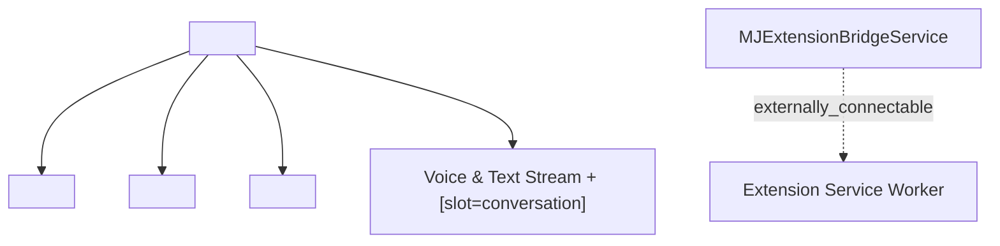

# `@memberjunction/ng-browser-extension`

Standalone Angular 21 Side Panel UI components and `MJExtensionBridgeService` for the MemberJunction Browser Extension architecture.

Designed for the L1/L2 `"widgets"` UI layer (`"mjUILayer": "widgets"`):
- **Zero Router dependencies** (`@angular/router` is never imported; record navigation uses the cancelable `BeforeOpenRecord` / `AfterOpenRecord` event contract).
- **Multi-Provider ready**: Every component extends `BaseAngularComponent` (`@Input() Provider: IMetadataProvider | null = null`) and threads `[Provider]="Provider"` to child components.
- **100% `--mj-*` Design Tokens**: Automatically adapts to `"MJ Co-Pilot"`, `"Betty"`, `"Sidecar"`, and runtime `MJ: Brand Kits` overlays with zero hardcoded hex colors.

---

## Architecture Overview



---

## Components & Services

| Export | Selector / Type | Responsibility |
| --- | --- | --- |
| `MJExtensionSidePanelComponent` | `<mj-extension-side-panel>` | Complete MV3 Side Panel shell composing header, trust bar, braided context drawer, playbook stepper, and conversation stream |
| `MJExtensionTrustBarComponent` | `<mj-extension-trust-bar>` | Active domain pause/unblock pill, 3-state exposure selector (`Off \| DOM \| Vision`), and control mode selector (`Zero-Banner \| Auto \| CDP Power`) |
| `MJBraidedContextDrawerComponent` | `<mj-braided-context-drawer>` | Displays Anchor Entity matches, cross-Open-App facet cards, and Page-to-Entity field diff preview with 1-click capture/enrichment |
| `MJExtensionPlaybookStepperComponent` | `<mj-extension-playbook-stepper>` | Interactive Guided Cross-Site Playbook stepper with Pre-Execution Confirmation Gate and Model-Blind Secret Vault Pipe |
| `MJExtensionBridgeService` | `@Injectable({ providedIn: 'root' })` | Connects MJ Central / MJ Explorer to the Extension Service Worker via `externally_connectable` for Topology A (0ms daemon) & Topology B (`LastSessionID`) handoff |

---

## Usage Example

```typescript
import { Component, inject } from '@angular/core';
import {
    MJExtensionSidePanelComponent,
    MJExtensionBridgeService,
    BeforeOpenExtensionRecordEvent,
    ApplyPageEntityDiffsEvent,
} from '@memberjunction/ng-browser-extension';
import {
    BraidedPageContext,
    BrowserContextEngine,
} from '@memberjunction/browser-extension-core';

@Component({
    selector: 'app-sidepanel-host',
    standalone: true,
    imports: [MJExtensionSidePanelComponent],
    template: `
        <mj-extension-side-panel
            [AssistantDisplayName]="'Betty'"
            [Tagline]="'Association & Community Intelligence'"
            [CurrentHostname]="CurrentHostname"
            [BraidedContext]="BraidedContext"
            (BeforeOpenRecord)="OnBeforeOpenRecord($event)"
            (ApplyEntityDiffs)="OnApplyDiffs($event)"
        ></mj-extension-side-panel>
    `,
})
export class SidePanelHostComponent {
    public readonly Bridge = inject(MJExtensionBridgeService);
    public CurrentHostname = 'www.linkedin.com';
    public BraidedContext: BraidedPageContext | null = null;

    public OnBeforeOpenRecord(event: BeforeOpenExtensionRecordEvent): void {
        console.log('Opening MJ Record:', event.EntityName, event.RecordID);
    }

    public async OnApplyDiffs(event: ApplyPageEntityDiffsEvent): Promise<void> {
        await BrowserContextEngine.Instance.ApplyCaptureOrEnrichment(event);
    }
}
```
