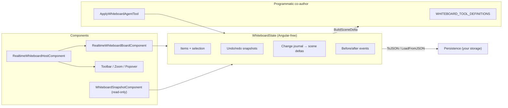

# @memberjunction/ng-whiteboard

A generic, reusable collaborative whiteboard for any Angular application — built for **dual authorship**: a human drawing with direct-manipulation tools, and a programmatic co-author (typically an AI agent) mutating the *same* board through a JSON-described tool API. One state engine, one undo history, one perception feed.

## Installation

```bash
npm install @memberjunction/ng-whiteboard
```

Peer dependencies: `@angular/common`, `@angular/core`, `@angular/platform-browser`. The package has **no Router dependency**, no MJ metadata/entity dependency, and no AI-framework dependency — it is a pure Generic-component package.

## Overview



The package is organized in layers, each usable on its own:

| Layer | File(s) | What it is |
|---|---|---|
| **State engine** | `whiteboard-state.ts` | `WhiteboardState` — the Angular-free typed board model. The *single* mutation API for both human tools and agent tools. |
| **Tool API** | `whiteboard-tools.ts` | The `Whiteboard_*` JSON tool definitions + `ApplyWhiteboardAgentTool`, the pure execute-one-call round-trip. |
| **Components** | `whiteboard-*.component.ts` | Host (full surface), board (canvas), toolbar, zoom cluster, "What the agent sees" popover, read-only snapshot. All standalone. |
| **Export** | `whiteboard-export.ts` | Pure builders for a self-contained HTML document and a standalone SVG. |
| **Widget bridge** | `whiteboard-widget-bridge.ts` | The in-frame helper injected into every sandboxed HTML widget: `MJWhiteboard.submit`, the ambient recorder, and the frame's half of the two-way protocol (inspect / operate / call / state). |
| **Widget protocol + broker** | `whiteboard-widget-protocol.ts`, `whiteboard-widget-broker.ts` | The host half of the two-way protocol: wire markers, validators, caps, deadlines, error codes, and `WhiteboardWidgetBroker` (per-widget request/reply queue). Angular-free. |
| **Context menu** | `whiteboard-context-menu.ts` | The pure right-click menu model (what is offered per item kind). |

## Core Concepts

### Items

Everything on the board is a `WhiteboardItem` — a discriminated union over `Kind`:

`sticky` · `shape` (rect/ellipse/diamond) · `text` · `image` · `ink` (freehand stroke) · `connector` (item↔item or point↔point arrows) · `highlight` (transient "pointing" region) · `markdown` (rendered rich panel) · `html` (interactive sandboxed widget)

Every item carries an `Author` of `'user'` or `'agent'`. Authorship drives the ownership chrome — agent items render in a **reserved violet treatment** the user palette never offers, so provenance is always visible.

### Pages (OneNote-style)

A board is an **ordered list of named pages**, each with its own items; exactly one page is ACTIVE and *every* item operation (add/update/move/remove/connectors/clear/perception/export) targets the active page. A fresh board starts with one page named **"Page 1"**.

- `AddPage(name?, author?)` — creates **and switches to** a new page; omit the name and it auto-names "Page N" from a monotonic counter (auto-names never repeat after removals).
- `SwitchPage(idOrName, author?)` — tolerant lookup: exact page ID first, then case-insensitive trimmed name. Switching journals a `'replace'` (the agent's visible scene swaps wholesale) but is **not** an undo step — it's navigation.
- `RenamePage(idOrName, newName, author?)` / `RemovePage(idOrName, author?)` — the **last remaining page can never be removed**; removing the *active* page activates a neighbor (the next page, else the previous).
- Reads: `Pages` (snapshots: `{ ID, Name, ItemCount, Active }`), `ActivePageID`, `ActivePageName`, `TotalItemCount` (across pages), `FindPage(idOrName)`.

Each page operation raises the package's standard **cancelable before / after event pair**: `PageAdding$`/`PageAdded$`, `PageSwitching$`/`PageSwitched$`, `PageRenaming$`/`PageRenamed$`, `PageRemoving$`/`PageRemoved$`. The board surface renders a compact bottom-left **page strip** (`RealtimeWhiteboardPagesComponent`): click switches, double-click renames inline (Enter commits, Esc cancels), hover "×" deletes, "+" adds. In `ReadOnly` mode the chips still switch pages (navigation) but add/rename/delete disappear.

### The engine

`WhiteboardState` owns items, single selection, and Z-order. Callers never stamp identity — `AddItem` assigns `ID`/`Z`/`Author`. Undo/redo is snapshot-based: one entry per user gesture, or one per agent tool call via `RunBatch` (so one toast-Undo reverts a whole tool effect).

### Journal & perception deltas

Every mutation appends to a compact change journal and emits on `Changed$`. A programmatic co-author "sees" the board through:

- **`BuildSceneDelta(sinceToken)`** — coalesces everything since a previously observed `CurrentSeq` into ONE delta with *replace-current-state* semantics: N moves of one item → one `moved` entry at the current position; add+remove → nothing; undo/redo/load/page-switch (or a too-old token) → `reset: true` plus the full compact scene. Never an append-only log.
- **`BuildSceneSummary()`** — the full compact scene + per-kind counts (what the "What the agent sees" popover renders).

Both payloads describe the **active page's** items and carry a `pages` array (`{ id, name, active, items }`) plus a summary line naming the active page — so the agent always knows pages exist and which one it is looking at.

### Persistence

`ToJSON()` serializes the state of record; `WhiteboardState.FromJSON(json)` rehydrates a new engine (throws on malformed input); `LoadFromJSON(json)` rehydrates **in place** — tolerant (returns `false`, never throws), preserves existing subscriptions, clears undo/journal, and emits one `'replace'` change. `ParseBoardStateJson` (from the snapshot component file) is the tolerant parse-or-null helper for viewers.

The serialized shape is **version 2 (paged)**:

```jsonc
{
  "version": 2,
  "seq": 12, "idCounter": 5, "zCounter": 5,
  "pageCounter": 2,            // monotonic — mints page ids / "Page N" auto-names
  "activePageId": "page-2",
  "pages": [
    { "id": "page-1", "name": "Page 1", "items": [ /* WhiteboardItem[] */ ] },
    { "id": "page-2", "name": "Drafts", "items": [ /* … */ ] }
  ]
}
```

**Backward compatibility:** the legacy flat shape (`version: 1` — `items` at the root, no pages) is still accepted by `FromJSON` / `LoadFromJSON` / `ParseBoardStateJson` and migrates to a single page named "Page 1". Serialization always emits the paged shape.

## Quickstart

### Full surface — the host component

The host renders the complete experience: header (title, saved chip, ownership legend, "What [Agent] sees" popover, Focus toggle, export menu), the canvas with floating toolbar, page strip + zoom cluster, the agent-action toast with Undo, and the status footer.

**Narrowing the tools.** Pass `[ToolRoster]="['select','pan','pen','sticky','text','eraser']"` to offer a subset; `null` (the default) is all eleven. The roster governs **which tools are available**, and it closes every door to a tool it leaves out: the toolbar button, the single-letter keyboard shortcut, and the canvas right-click "add … here" action. Gating only the toolbar would be the CSS hack with a nicer API — the keyboard and the context menu were exactly how a hidden tool stayed reachable. If the active tool leaves the roster the host moves to `select`, or to the roster's first entry when `select` is not on it, and a request to switch to a tool that is not on the roster is ignored rather than redirected. An empty roster (or one naming no real tool) narrows the palette to nothing and lands the active tool on `select` — the board always holds a tool, and `select` is the one that can create nothing. It still does **not** make the board read-only; that is `[ReadOnly]="true"`, a separate input on the same host.

The roster is the **user's** palette only. How far the **agent** may reach into live HTML widgets is a separate input, `[AgentWidgetAccess]` (`'full'` | `'inspect-only'` | `'off'`, see [Agent widget access](#agent-widget-access)); neither one affects the other.

What the roster does **not** do: it is not a content policy. It does not restrict what already exists on the board or what an agent places, and it does not gate authoring on existing items — Duplicate, z-order, Delete and pasting an image all keep working regardless of the roster. The one exception is **Restyle…**, which is hidden when the roster omits `text`: Restyle opens the text tool's style flyout, so without that tool the entry would be present and do nothing. That is the other axis: `[ReadOnly]="true"` renders the board with no toolbar and no keyboard, guards every mutation, and hides the agent toast's Undo — pan and zoom stay live, because reading a board you cannot change still means moving around it. The roster narrows *which tools*; ReadOnly decides *whether anything mutates*.

**Setting the pen palette.** The default five pen colors (`WHITEBOARD_PEN_COLORS`) are tuned for MJ's dark canvas and open with a pale slate that is close to invisible on a light host theme. Pass `[PenPalette]="['#1d4ed8', '#b91c1c', '#15803d']"` to replace them; `null` (the default) keeps MJ's five. The palette is an input rather than CSS custom properties on purpose: ink and text items persist the chosen hex, so a `var()` palette would make a saved board theme-dependent. When a palette arrives that excludes the current pen color, the pen moves to the palette's first entry, so the selected swatch is always one the user can see; a color that is still in the new palette is kept, compared case-insensitively. Entries must be `#rgb` or `#rrggbb` (`IsWhiteboardHexColor`, the same rule the agent tools apply to a text color): blank, non-string and non-hex entries are dropped, and a palette with nothing usable reads as `null`. Named colors, `rgb()` and `url()` are rejected on purpose, since a swatch paints its entry straight into `style.background`, which Angular does not sanitize. Violet stays off the user palette either way: it is the agent's ownership hue.

**Hiding the Focus toggle.** The header's "Move to stage" / "Back to tab" button only emits `FocusModeChange`; it is MJ's realtime overlay that collapses the call column in response. A host that composes the board into its own chrome (a lesson's content seat, a full-surface room) has nothing to collapse, so pass `[ShowFocusToggle]="false"` and the button is not rendered. `SetOnStage` and `FocusMode` keep working with it hidden, and the rest of the header is unchanged.

The zoom cluster supports **hold-to-zoom**: a plain click on + / − steps through the usual presets, while holding the button down zooms continuously in small smooth increments (~3.5% every 50 ms) until release — same 25%–200% clamp.

```typescript
import { Component } from '@angular/core';
import { RealtimeWhiteboardHostComponent, WhiteboardState } from '@memberjunction/ng-whiteboard';

@Component({
  standalone: true,
  imports: [RealtimeWhiteboardHostComponent],
  template: `
    <mj-realtime-whiteboard-host
      [State]="Board"
      [AgentName]="'Sage'"
      [BoardTitle]="'Planning board'"
      [ToolRoster]="['select', 'pan', 'pen', 'sticky', 'text', 'eraser']"
      [PenPalette]="['#1d4ed8', '#b91c1c', '#15803d']"
      [ReadOnly]="false"
      (SceneDelta)="onSceneDelta($event)"
      (WidgetSubmitted)="onWidgetInput($event)"
      (SaveToArtifactsRequested)="saveBoard()" />
  `
})
export class MyPageComponent {
  /** You own the engine — create it, persist it, hand it to the surface. */
  public readonly Board = new WhiteboardState();

  onSceneDelta(deltaJson: string): void {
    // debounced (750 ms), coalesced — feed it to your agent's live context
  }
  onWidgetInput(e: { ItemID: string; Title: string; DataJson: string }): void {
    // a sandboxed widget called MJWhiteboard.submit(data)
  }
  saveBoard(): void {
    const json = this.Board.ToJSON(); // persist wherever you like
  }
}
```

### Standalone board — just the canvas

`RealtimeWhiteboardBoardComponent` (`<mj-realtime-whiteboard>`) is the canvas alone — pan/zoom, per-tool pointer interactions, inline editing, context menu. You supply the tool state (the host normally does this):

```html
<mj-realtime-whiteboard
  [State]="Board"
  [Tool]="'select'"
  [AgentName]="'Sage'"
  [ReadOnly]="false" />
```

### Read-only snapshot

`WhiteboardSnapshotComponent` (`<mj-whiteboard-snapshot>`) renders a persisted payload through the real board in `ReadOnly` mode — identical visuals, pan/zoom for navigation, every mutation disabled:

```html
<mj-whiteboard-snapshot [StateJson]="savedBoardJson" [AgentName]="'Sage'" />
```

### NgModule apps

`WhiteboardModule` re-exports all the standalone components for module-organized apps. There is also a `LoadWhiteboardComponents()` no-op for the rare all-dynamic-resolution bundling case.

## The Programmatic Tool API (agent integration recipe)

The agent-facing surface is intentionally transport-agnostic — it is just *names, JSON schemas, and one pure function*:

1. **Register the tools.** `WHITEBOARD_TOOL_DEFINITIONS` is an array of `{ Name, Description, ParametersSchema }` (structurally identical to `RealtimeToolDefinition` from `@memberjunction/ai`, so it drops straight into MJ realtime sessions — but any function-calling runtime works). All names share the `WHITEBOARD_TOOL_PREFIX` (`Whiteboard_`), so a single prefix route covers the set.
2. **Route tool calls back.** When your runtime receives a `Whiteboard_*` call, execute it locally:

   ```typescript
   import { ApplyWhiteboardAgentTool } from '@memberjunction/ng-whiteboard';

   const resultJson = ApplyWhiteboardAgentTool(state, toolName, argsJson);
   // → feed resultJson back to the model as the tool response
   ```

   `ApplyWhiteboardAgentTool` never throws — malformed args, unknown tools, unknown item IDs, and host-canceled operations all return `{ success: false, error }` so the model can self-correct conversationally. Each call runs as ONE undo batch (author `'agent'`).

   Prefer the host's `ApplyAgentTool(toolName, argsJson)` when a surface is bound — same round-trip plus the UI garnish (violet pop-in, action toast with Undo, gliding presence cursor).

   The three **widget tools** talk to a live widget frame, so they need a rendered board and resolve asynchronously: route them to the host's `ApplyAgentToolAsync(toolName, argsJson): Promise<string>` (it accepts every tool, never rejects). The synchronous paths stay as they were and answer a widget tool with a structured failure instead: `ApplyWhiteboardAgentTool` returns `errorCode: 'surface_unavailable'`, the host's `ApplyAgentTool` returns a failed result with `errorCode: 'async_required'`. `IsWhiteboardWidgetToolName(name)` tells the two kinds apart.
3. **Feed perception.** Subscribe the host's `SceneDelta` output (debounced 750 ms, coalesced) and pipe each JSON delta into the agent's context as background information. Use `CurrentSeq` / `BuildSceneDelta(sinceToken)` directly if you manage your own cadence.

The tool set (18): `AddNote`, `AddShape`, `AddText`, `AddMarkdown`, `AddHtml`, `UpdateContent`, `DrawConnector`, `Highlight`, `MoveItem`, `RemoveItem`, `StyleItem`, `SetTag` (`{ itemId, tag? }` — set or clear an item's role tag; empty clears), the page tools `AddPage` (`{ name? }` — create + switch), `SwitchPage` (`{ name }` — page name, case-insensitive, or id) and `RenamePage` (`{ name, newName }`), and the widget tools `InspectWidget`, `OperateWidget` and `CallWidget` (`WHITEBOARD_WIDGET_TOOL_NAMES`, see [Agents and live widgets](#agents-and-live-widgets)) — see `WHITEBOARD_TOOL_NAMES` and the per-tool schemas in `whiteboard-tools.ts`. Item and widget tools always target the **active page**; page-tool results carry `pageId` instead of `itemId`. Content sizes are capped (`WHITEBOARD_MARKDOWN_MAX_CHARS` = 32 000, `WHITEBOARD_HTML_MAX_CHARS` = 64 000).

> **Reference integration:** `@memberjunction/ng-conversations` wires this package into MJ realtime voice sessions as a pluggable channel (`RealtimeWhiteboardChannel`) and ships a saved-board artifact viewer — both are thin consumers of the APIs above.

## Before / After Events

Every major mutation raises a **cancelable BEFORE** event and a matching **AFTER** event. Handlers run synchronously during the emit; setting `Cancel = true` on the args aborts the operation cleanly — no undo snapshot, no journal entry, no `Changed$` emission, and the AFTER event never fires. These events layer *alongside* the existing `Changed$`/journal/perception machinery.

### Engine level (`WhiteboardState` observables)

| Before (cancelable) | After | Raised by | Args highlights |
|---|---|---|---|
| `ItemAdding$` | `ItemAdded$` | `AddItem` (incl. `Highlight`, `DuplicateItem`) | `Input` (mutable pre-stamp item), `Author` |
| `ItemUpdating$` | `ItemUpdated$` | `UpdateItem` (`Operation: 'update'`, mutable `Patch`), `MoveItem` (`'move'`, `Position`), `BringToFront`/`SendToBack` (`'reorder'`) | `Item` (live), `Operation`, `Author` |
| `ItemRemoving$` | `ItemRemoved$` | `RemoveItem` | `Item`, `Author` |
| `PageAdding$` | `PageAdded$` | `AddPage` | mutable `Name`, `Author` |
| `PageSwitching$` | `PageSwitched$` | `SwitchPage` | `FromPage`, `ToPage`, `Author` |
| `PageRenaming$` | `PageRenamed$` | `RenamePage` | `Page`, mutable `NewName`, `Author` |
| `PageRemoving$` | `PageRemoved$` | `RemovePage` | `Page` (+ `ActivatedPage` on the after event), `Author` |

Cancellation surfaces to callers: `AddItem` returns `null`; `UpdateItem`/`MoveItem`/`RemoveItem`/reorders return `false`; agent tools return a `{ success: false, error: '… canceled …' }` payload. BEFORE handlers may also *rewrite* the operation (`Input` on adds, `Patch` on updates) — moderation and clamping without cancel-and-replay.

```typescript
// Example: block the agent from removing the user's items
board.ItemRemoving$.subscribe((e) => {
  if (e.Author === 'agent' && e.Item.Author === 'user') {
    e.Cancel = true;
  }
});
```

### Component level

`RealtimeWhiteboardBoardComponent` adds two pairs of `@Output`s of its own:

| Before (cancelable) | After | Fired when |
|---|---|---|
| `ContentApplying` | `ContentApplied` | An in-board editor commit — inline sticky/text/shape edit, or the markdown/HTML rich editor's Apply/Done — is about to write to the engine. Args: `ItemID`, `Kind`, mutable `Content` (+ `Title` for HTML widgets). |
| `WidgetSubmitting` | `WidgetSubmitted` | A sandboxed widget's `MJWhiteboard.submit(data)` passed validation. Cancel to drop the submission. The event's optional `Author` is `'agent'` when an agent's widget command caused the submit (absent means the user). **Consumers that record or grade user answers should check it**: an agent operating a widget now produces real submits too. |

`RealtimeWhiteboardHostComponent` **mirrors** all engine pairs as outputs (`ItemAdding`/`ItemAdded`, `ItemUpdating`/`ItemUpdated`, `ItemRemoving`/`ItemRemoved`) and **forwards** the board pairs — so template-driven consumers get the entire surface in one place. Mirrors re-emit synchronously, so `Cancel = true` set in a template handler still vetoes the engine mutation.

```html
<mj-realtime-whiteboard-host
  [State]="Board"
  (ItemAdding)="$event.Cancel = !allowAdds"
  (ItemAdded)="audit('add', $event.Item)"
  (ContentApplying)="moderate($event)"
  (WidgetSubmitted)="forwardToAgent($event)" />
```

## Sandboxed HTML Widgets & the Two-Way Bridge

HTML widgets are self-contained documents (inline CSS/JS) rendered inside an iframe whose `sandbox` attribute is **`allow-scripts` only**:

- The frame runs in a unique **opaque origin** — its scripts cannot reach the parent document, the app session, cookies, or any storage. `allow-same-origin` is deliberately ruled out (it would let the frame script remove its own sandbox). By design there is **no DOM sanitization inside the sandbox** — the sandbox is the boundary, so SVG/script-heavy widget documents pass through byte-for-byte.
- Angular's sanitizer is bypassed *only* for the iframe `srcdoc` (the payload never touches the app's DOM). The trusted value is produced by the view-scoped `wbWidgetSrcdoc` pure pipe (`WhiteboardWidgetSrcdocPipe`), which fixes the lifecycle contract:
  - **Widget documents are rebuilt per mount.** Every time a frame is (re)created — switching whiteboard pages away and back, the viewport-lazy toggle, panel collapse/expand, whole-board re-creation — the new view gets a new pipe instance and a freshly built document, so a re-mounted widget always renders exactly what the first mount rendered. (Do not reintroduce a component-level per-item `SafeHtml` cache: a stale instance handed to a re-created frame means no `srcdoc` write and a blank widget.)
  - **Still-mounted widgets never reload on unrelated board activity.** For an unchanged `Html` source the pipe returns the identical `SafeHtml` instance, so whole-scene `'replace'` ops (page rename, undo/redo of other items, `LoadFromJSON` restores) cause no `srcdoc` rewrite and no iframe reload — widget runtime state survives. Only an actual content edit reloads the frame.
- Off-screen widgets render as placeholders — live frames are only instantiated near the viewport (`ShouldMountWidget`: near the viewport, or pinned mounted by an agent command). Re-entering the viewport re-creates the frame from a freshly built document, and the frame gets its **saved widget state** back on ready (see [Widget state](#widget-state-what-persists-and-where)), so a widget that keeps state, or relies on automatic form state, comes back where it was.

The only way data flows between widget and host is `postMessage`, in both directions:

1. `InjectWhiteboardSubmitHelper` prepends (idempotently) ONE helper script to every widget's srcdoc. It defines the `MJWhiteboard` API below, the ambient interaction recorder, and the frame's half of the command channel.
2. The board owns a single `window` `'message'` listener. Submissions are validated with `EvaluateWidgetSubmitMessage` (bridge marker present, `event.source` resolves to a *tracked* widget iframe, payload capped at `WHITEBOARD_WIDGET_SUBMIT_MAX_CHARS` = 8 000 chars); ready / actions / state / reply messages with `EvaluateWidgetChannelMessage` (same source rule, shape-checked and size-capped). Anything else is dropped.
3. Accepted submissions flow through `WidgetSubmitting` (cancelable) → `WidgetSubmitted`; protocol messages go to the board's `WhiteboardWidgetBroker`.
4. Host → widget commands (`inspect` / `operate` / `call` / `restoreState` / `hello`) carry `__mjWhiteboardCommand`; the helper accepts them only from `parent`. They are posted with target origin `'*'` on purpose: a `srcdoc` frame runs at the opaque origin `null`, so no concrete origin can be named. Safety comes from addressing the frame's own window object and from the helper's parent-only check, not from the origin argument. The full wire contract is the table at the top of `whiteboard-widget-protocol.ts`.

### The widget-author API (`MJWhiteboard`)

Everything is optional. A widget that never calls the API still works: the agent can inspect and operate its controls, and its form state is kept automatically.

| API | What it does |
|---|---|
| `MJWhiteboard.submit(data)` | Send an explicit submission to the host (`WidgetSubmitted`; MJ's channel forwards it to the agent). JSON-serialized, ≤ 8 000 chars. |
| `MJWhiteboard.onAction(name, handler, description?)` / `offAction(name)` | Register (or remove) a named action the agent can call with `Whiteboard_CallWidget` — "drive it by meaning" (`next`, `reset`, `expand`). The handler gets the call's payload and may return a JSON value or a Promise of one; that is the tool result. Names match `^[A-Za-z][\w-]{0,39}$`, ≤ 30 actions, descriptions ≤ 200 chars. Changes are announced to the host (debounced 100 ms). |
| `MJWhiteboard.setState(obj)` / `onRestore(fn)` | Declared state: save any JSON-serializable progress; `fn` gets it back (or `null`) **once per document** after a re-mount, page switch or session resume. A widget that registers `onRestore` owns its state fully: automatic form state is off for it. |
| `MJWhiteboard.configure({ agentOperable, autoState })` | `agentOperable: false` refuses operate and call (`not_operable`); inspect still works. `autoState: false` turns off automatic form state. |
| `data-mj-agent="off"` | On a control or any ancestor: the agent cannot operate it (`not_operable`); the outline marks it `[not operable]`. Use it for graded answers. |
| `data-mj-keep-live` | On `<html>` or `<body>`: no automatic form state (form values are not kept across re-mounts). |

```html
<button aria-label="Next question" onclick="next()">Next</button>
<script>
  let q = 0;
  function next() { q++; render(); MJWhiteboard.setState({ q }); }
  MJWhiteboard.onAction('next', () => { next(); return { question: q }; }, 'Go to the next question');
  MJWhiteboard.onRestore((saved) => { if (saved) { q = saved.q; render(); } });
</script>
```

Give every control an `aria-label` or `name`: labels are how the agent targets controls and how the outline reads.

**Automatic form state.** For a widget with no `onRestore` handler (most agent-written widgets), the helper captures form values itself — the same field identity as auto-submit (label or name; checkbox groups as arrays) — plus the **last submit** (`{ data, at }`). On re-mount it restores the fields that still exist and dispatches `input` + `change` so the widget's own code re-syncs. The restore is silent: no ambient notes, no auto-submit, no submissions, no state echo. Opt out with `data-mj-keep-live` or `configure({ autoState: false })`.

### Agents and live widgets

Three tools let an agent use a widget the way a person would, without rewriting its HTML (which would reload it and wipe the user's answers):

| Tool | Args | Result (besides `success`, `itemId`, `summary`, `error`, `errorCode`) | Deadline |
|---|---|---|---|
| `Whiteboard_InspectWidget` | `itemId` | `outline` (controls with refs `f1`/`a1`, labels, current values), `actions` (`[{ name, description? }]`), `state?` (declared state, clipped), `answered?` (`{ at, data }`, the last submit) | 6 s |
| `Whiteboard_OperateWidget` | `itemId`, `steps: [{ target, op, value? }]` (1–5) | `steps: [{ ok, errorCode?, error? }]`, the new `outline`, `submitted?` (data a submit triggered by the steps carried) | 9 s |
| `Whiteboard_CallWidget` | `itemId`, `action`, `payload?` (JSON text or plain text) | `result` (the handler's return value) | 12 s |

```text
widget "Planet quiz"
h2 "Question 1 of 3"
f1 radio "Mercury" (group "answer") = unchecked
f2 radio "Venus" (group "answer") = checked
f3 range "Confidence" = 40 (0–100)
f4 text "Card number" = [REDACTED, not writable]
a1 button "Submit"
a2 button "Hint" [disabled]
```

- **Targets** are a ref from the latest inspect, an exact label, a unique partial label, or a CSS selector; each step re-resolves its target when it runs. Ops: `click`, `set` (text / number / date), `select` (option label or value), `check`, `uncheck`, `focus`. Steps run in order and stop at the first failure. Values go through the prototype setter plus bubbling `input` + `change`, so framework-built widgets see a real change.
- **What the user sees.** Inspect never moves the viewport: an off-screen widget is pinned mounted (`PinMount`) for the read, and the presence cursor reads "… is looking at …". Operate and call pan to the widget only if it is off-screen and the user isn't mid-gesture (`RevealItem`), ring each control they touch, and show a separate widget toast (`Ava clicked "Submit" in Planet quiz`) with **no Undo** — they are not board edits, so they never enter the undo history.
- **Deadlines** run end to end from when the command is queued (queue wait, mount, ready handshake, the op itself): `WHITEBOARD_WIDGET_DEADLINES_MS`, all under the 15 s point where realtime models move on without a tool result. Commands to one widget run one at a time; different widgets run in parallel.
- **Untrusted data.** Widget code shares its frame with the helper and can forge replies, so every outline, state and result is data for the model, never instructions (the tool descriptions say so).

Error codes (`errorCode`, `WhiteboardWidgetErrorCode`):

| Code | Meaning |
|---|---|
| `widget_not_found` | No such widget on the active page; when it is on another page the message says so and names `Whiteboard_SwitchPage`. |
| `not_html` | The item is not an HTML widget. |
| `surface_unavailable` | No rendered board (the pure `ApplyWhiteboardAgentTool`, or no surface bound). |
| `async_required` | A widget tool was sent through the sync `ApplyAgentTool`. |
| `widget_not_ready` / `widget_timeout` | The widget never reported ready / did not answer within the deadline. |
| `widget_busy` | The widget was ready but still handling an earlier command until the deadline (commands to one widget run one at a time); retry. |
| `widget_reloaded` / `widget_unmounted` | The widget's document reloaded, or its frame unmounted, while the command was in flight. |
| `stale_ref` / `ambiguous_target` / `target_not_found` | The ref is from an older outline / a label matched several controls (the candidates are listed) / nothing matched. |
| `disabled` / `not_operable` | The control is disabled or read-only / the widget or control opted out, or the field is protected. |
| `unknown_action` / `action_failed` | No action by that name (registered names are listed) / the handler threw or returned something not JSON-serializable. |
| `access_denied` / `vetoed` | The access policy does not allow this tool / the integration vetoed this one command. |
| `invalid_args` | Missing or malformed arguments. |

### Authorship: who submitted?

`WhiteboardWidgetSubmitEvent` and `WhiteboardWidgetInteractionEvent` carry an optional `Author?: WhiteboardAuthor` — absent means `'user'`. It is `'agent'` only when all three checks agree:

1. **In the frame, `isTrusted` first.** A real user event is trusted and tagged user. Events the agent's steps cause (including the trusted `input` / `change` / `submit` a scripted click fires synchronously) are tagged agent. An explicit `MJWhiteboard.submit` is agent only inside the agent's window and when the last input before it was the agent's.
2. **The agent window.** The tag is only possible while an agent command runs and shortly after.
3. **The host gate.** The board keeps `'agent'` only if its broker's window for that widget is open (`WHITEBOARD_WIDGET_AGENT_WINDOW_MS` = 1 750 ms after the command); otherwise it rewrites it to `'user'`.

So widget code cannot make a learner's real click look like the agent's. Integrations use `Author` to avoid echo: MJ's channel sends no note for agent interactions or agent submits (the operate result already carries `submitted`).

### Agent widget access

`[AgentWidgetAccess]` on the host — `'full'` (default) | `'inspect-only'` | `'off'` — limits the widget tools; a refused call returns `access_denied` with a sentence saying what is still allowed. It is a normalizing setter (anything unrecognized reads as `'full'`), so an integration can assign it directly on a dynamically created host. Helpers: `NormalizeWhiteboardWidgetAccess`, `MinWhiteboardWidgetAccess` (`off < inspect-only < full`), `IsWhiteboardWidgetToolAllowed`. Widgets narrow it further per control with `data-mj-agent="off"` / `configure({ agentOperable: false })`.

This is **not** `[ToolRoster]`: the roster narrows the **user's** drawing palette; `AgentWidgetAccess` governs what the **agent** may do inside widgets. MJ's realtime channel adds per-session config and subclass hooks on top (see the [Realtime Channels Guide](../../../../guides/REALTIME_CHANNELS_GUIDE.md#example-the-whiteboards-widget-keys)).

### Widget state: what persists and where

Widget state is **runtime data, not board content**. `WhiteboardState` keeps one opaque JSON string per widget (the helper's envelope of declared state, automatic fields and last submit, ≤ `WHITEBOARD_WIDGET_STATE_MAX_CHARS` = 4 000 chars) in a side map:

| API | Purpose |
|---|---|
| `GetWidgetState(id)` / `SetWidgetState(id, json \| null)` | Read / set / clear one widget's state. Oversize values are refused, never clipped. |
| `WidgetStatesToJSON()` | `Record<itemId, json>` for items that still exist on any page — what a host persists. |
| `LoadWidgetStates(record)` | Replace (never merge) the whole map, typically right after `LoadFromJSON` on resume. |
| `WidgetStateChanged$` | One `WhiteboardWidgetStateChangedEventArgs` (`ItemID`) per change; the host re-emits it as the `WidgetStateChanged` output. |
| `FindItemPage(id)` | The page (`{ ID, Name }`) holding an item, searching every page. |

What that means:

- **Kept** across scrolling a widget away, page switches, panel collapse, and `UpdateContent` (new code reading the same keys continues). Undo of a single remove brings the state back.
- **Not** in `ToJSON` / `LoadFromJSON`, undo snapshots, `Changed$` / the journal, LiveKit sync, or Save-to-artifact. Undo/redo of other edits never rewinds a widget, and peers and artifacts never see learner answers. `Clear` and page removal prune the removed items' entries; a newly minted item ID drops any stale entry.
- **Across sessions** only if the host saves `WidgetStatesToJSON()` next to the board and calls `LoadWidgetStates` on restore. MJ's channel does this as a sibling `widgetStates` key in its session save (unless configured off).

The host also forwards `WidgetActionsChanged` (`WhiteboardWidgetActionsChangedEventArgs`: item ID, title, actions) whenever a widget reports the actions it offers.

**Privacy.** `type="password"` and `type="hidden"` fields are never in outlines, ambient notes, auto-submits or saved state. **Protected** fields (credit card, CVV, one-time code, SSN, password-like labels, `autocomplete="cc-*"` / `one-time-code`) show as `[REDACTED, not writable]` in outlines, can't be operated, and are never captured. Values are clipped; outlines are capped at 3 000 chars.

Markdown panels are the *non-executing* sibling: rendered through the shared `mj-markdown` component on the live board (sanitized, no raw-HTML passthrough) and through an inert escape-first renderer in exports.

## Export & Print

`whiteboard-export.ts` provides pure, deterministic builders (all user/agent text HTML-escaped). Exports render the **active page** — switch pages first to export another one:

- **`BuildWhiteboardExportHtml(state, { Title, AgentName, GeneratedAt })`** — ONE fully self-contained HTML document: inline CSS only, light paper palette, ownership chips, print-friendly `@media print` rules. HTML widgets export as placeholder cards with their escaped source in a `<details>` — live widget HTML is **never** inlined (no iframe sandbox exists in the export, so it would be XSS).
- **`BuildWhiteboardExportSvg(state)`** — a standalone SVG document of the same snapshot.

The host's export menu wires these to **Download HTML / Download SVG / Print** (print opens a blank window, writes the document, and invokes the dialog), plus a `SaveToArtifactsRequested` output for integrations that persist boards as first-class artifacts.

> The export palette is intentionally literal (not design tokens): self-contained documents must stand alone. This is the documented exception to the token rule.

## Theming

The live components style exclusively with MJ design tokens (`--mj-text-*`, `--mj-bg-surface-*`, `--mj-border-*`, …), so the board adapts to light/dark themes and white-labeling automatically. Two deliberate accents ride on top of the tokens:

- **Violet is the agent's** — agent stickies/ink/connectors/chips use the reserved violet treatment; the user palette (`WHITEBOARD_PEN_COLORS`) never offers it.
- **Amber is the user's sticky default** (two alternating tints).

Icons are Font Awesome throughout.

## Extension Points

- **Before/after events** — veto or rewrite any mutation, audit changes, forward submissions (see above). This is the primary extensibility seam.
- **Your own surface** — the engine is Angular-free; build alternate renderers or headless automations against `WhiteboardState` directly and they share undo/journal/perception with everything else.
- **Custom tool routing** — `ApplyWhiteboardAgentTool` is pure; wrap it to pre-process args, post-process results, or expose a different tool vocabulary that lowers onto the same engine calls.
- **Context menu model** — `BuildWhiteboardContextMenu(item)` is a pure model builder; reuse it in your own chrome if you replace the board's menu rendering.
- **Snapshot/viewer reuse** — `ParseBoardStateJson` + `WhiteboardSnapshotComponent` make read-only board rendering a two-liner in any review/preview surface.

## Public API Surface (selected)

```typescript
// Engine
WhiteboardState, WhiteboardItem (union), WhiteboardItemInput, WhiteboardItemPatch,
WhiteboardChange, WhiteboardSceneDelta, WhiteboardSceneSummary, WHITEBOARD_DEFAULTS,
WhiteboardItemAddingEventArgs / Added / Updating / Updated / Removing / Removed,
WhiteboardPageInfo, WhiteboardScenePage,
WhiteboardPageAddingEventArgs / Added / Switching / Switched / Renaming / Renamed / Removing / Removed,
WhiteboardWidgetStateChangedEventArgs

// Tools
WHITEBOARD_TOOL_DEFINITIONS, WHITEBOARD_TOOL_NAMES, WHITEBOARD_TOOL_PREFIX,
WhiteboardToolDefinition, WhiteboardToolResult, ApplyWhiteboardAgentTool,
WHITEBOARD_WIDGET_TOOL_NAMES, IsWhiteboardWidgetToolName, WhiteboardWidgetAccess,
NormalizeWhiteboardWidgetAccess, MinWhiteboardWidgetAccess, IsWhiteboardWidgetToolAllowed,
WhiteboardWidgetActionsChangedEventArgs

// Two-way widget protocol
WhiteboardWidgetBroker, WhiteboardWidgetErrorCode, EvaluateWidgetChannelMessage,
WHITEBOARD_WIDGET_DEADLINES_MS, WHITEBOARD_WIDGET_AGENT_WINDOW_MS, WHITEBOARD_WIDGET_STATE_MAX_CHARS

// Components
RealtimeWhiteboardHostComponent, RealtimeWhiteboardBoardComponent,
RealtimeWhiteboardToolbarComponent, RealtimeWhiteboardZoomComponent,
RealtimeWhiteboardPagesComponent, RealtimeWhiteboardAgentSeesPopoverComponent,
WhiteboardSnapshotComponent, WhiteboardModule

// Export / bridge / menu
BuildWhiteboardExportHtml, BuildWhiteboardExportSvg, RenderMarkdownInert,
InjectWhiteboardSubmitHelper, EvaluateWidgetSubmitMessage, ParseBoardStateJson,
BuildWhiteboardContextMenu
```

Everything exported carries full JSDoc — IDE hover docs are the authoritative per-member reference.

## Conventions

This package follows the MemberJunction Generic-component rules: PascalCase public members (inputs/outputs/methods), camelCase private members, standalone components with modern `@if`/`@for` templates, `inject()` DI, no Router imports, and design-token-only styling.
