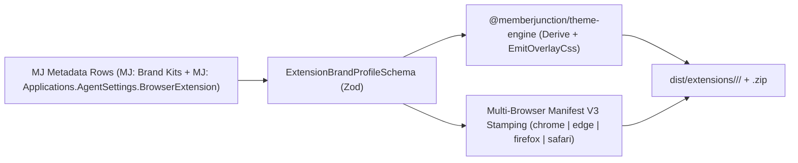

# `@memberjunction/browser-extension-builder`

White-Label Brand Stamping Factory (`mj-ext-build` CLI and `ExtensionBrandBuilder` API) for building MemberJunction Browser Extensions across **Chrome**, **Microsoft Edge**, **Firefox**, and **Safari** directly from `mj-sync` metadata rows (`MJ: Brand Kits` + `MJ: Applications.AgentSettings.BrowserExtension`) or brand profile JSON files.

Produces ready-to-load unpacked Manifest V3 directories and store-ready `.zip` packages for:
1. **`mj-copilot`** — *MemberJunction Co-Pilot* (canonical brand defined in MJ Core's `metadata/app-agent-settings/.data-explorer-agent-settings.json` + `metadata/brand-kits/.brand-kits.json`)
2. **Downstream Open App Brands** — *Betty*, *Sidecar*, and custom enterprise brands defined in each downstream repository's own `metadata/` folder (`MJ: Brand Kits` + `MJ: Applications`)

---

## Architecture Pipeline



---

## CLI Usage

```bash
# Build MemberJunction Co-Pilot across Chrome, Edge, Firefox, and Safari from MJ Core metadata/
npx mj-ext-build \
  --metadata-dir ./metadata \
  --app-name "Data Explorer" \
  --browser all \
  --out dist/extensions
```

---

## Programmatic Usage

```typescript
import { ExtensionBrandBuilder } from '@memberjunction/browser-extension-builder';

const builder = new ExtensionBrandBuilder();
const result = builder.BuildFromMetadata({
    MetadataDir: './metadata',
    ApplicationName: 'Data Explorer',
    TargetBrowsers: ['chrome', 'edge', 'firefox', 'safari'],
    OutputRootDir: './dist/extensions',
});

console.log('Primary Unpacked MV3 Extension:', result.PrimaryResult.UnpackedDir);
console.log('Safari Metadata:', result.BrowserResults.safari?.SafariMetadataPath);
```
