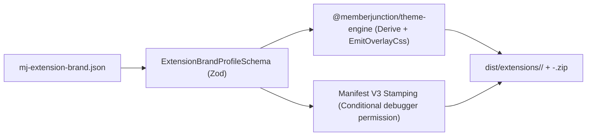

# `@memberjunction/browser-extension-builder`

White-Label Brand Stamping Factory (`mj-ext-build` CLI and `ExtensionBrandBuilder` API) for building MemberJunction Browser Extensions from a single shared codebase.

Produces ready-to-load unpacked Manifest V3 Chrome Extension directories and Chrome Web Store `.zip` packages for:
1. **`mj-copilot`** — *MemberJunction Co-Pilot* (`packages/BrowserExtension/Brands/mj-copilot/mj-extension-brand.json`)
2. **`betty`** — *Betty — Association & Community Intelligence Sidekick* (`packages/BrowserExtension/Brands/betty/mj-extension-brand.json`)
3. **`sidecar`** — *Sidecar — Continuous Learning & Workflow Companion* (`packages/BrowserExtension/Brands/sidecar/mj-extension-brand.json`)
4. Any custom tenant brand profile (`mj-extension-brand.json`)

---

## Architecture Pipeline



---

## CLI Usage

```bash
npx mj-ext-build \
  --brand packages/BrowserExtension/Brands/mj-copilot/mj-extension-brand.json \
  --brand packages/BrowserExtension/Brands/betty/mj-extension-brand.json \
  --brand packages/BrowserExtension/Brands/sidecar/mj-extension-brand.json \
  --out dist/extensions
```

---

## Programmatic Usage

```typescript
import { ExtensionBrandBuilder } from '@memberjunction/browser-extension-builder';

const builder = new ExtensionBrandBuilder();
const result = builder.BuildBrandedExtension({
    BrandSource: 'packages/BrowserExtension/Brands/betty/mj-extension-brand.json',
    OutputRootDir: './dist/extensions',
});

console.log('Unpacked MV3 Extension:', result.UnpackedDir);
console.log('Chrome Web Store ZIP:', result.ZipPath);
```
