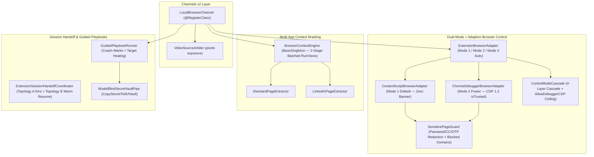

# `@memberjunction/browser-extension-core`

Framework-agnostic core engine for the **MemberJunction Browser Extension** architecture (`LocalBrowserChannel`, Dual-Mode + Adaptive Browser Control Adapters, Multi-App Context Braiding Engine, `SensitivePageGuard`, Seamless Session Handoff Coordinator, Guided Admin Playbooks, and Runtime Brand Kit Hydrator).

---

## Architecture Overview



---

## Key Capabilities

| Module | Class | Description |
| :--- | :--- | :--- |
| **Browser Control** | `ContentScriptBrowserAdapter` | **Mode 1 (`'content-script'`, Recommended Default):** Banner-free DOM grounding via `@memberjunction/computer-use/browser-probe`, synthetic clicks/fills, `captureVisibleTab`, and Shadow-DOM Coach-Mark Spotlight overlays. |
| **Browser Control** | `ChromeDebuggerBrowserAdapter` | **Mode 2 (`'debugger-cdp'`, Power Mode):** On-demand `chrome.debugger` (CDP 1.3) attachment for `isTrusted: true` mouse/key dispatch, closed Shadow DOM & cross-origin iframe piercing, and 15s idle auto-detach. |
| **Browser Control** | `ExtensionBrowserAdapter` | **Mode 3 (`'auto'`):** Starts in Mode 1 and escalates to Mode 2 for a single step when `RequireTrustedInput` is set or synthetic dispatch fails, detaching immediately after the step. |
| **Security & Privacy** | `SensitivePageGuard` | Masks `input[type="password"]`, credit-card (`cc-*`), and OTP (`one-time-code`) values before leaving the content script; enforces wildcard blocked domains (`*.bank.*`, `*://1password.com/*`); detects login/MFA screens to pause autonomous clicks. |
| **Channels v2** | `LocalBrowserChannel` | Extends `BaseRealtimeChannelClient` with 10 verbs (`Navigate`, `GetPageContext`, `GetPageText`, `DescribePage`, `ClickElement`, `FillInput`, `HighlightElement`, `ClearHighlights`, `WaitForUserAction`, `RunPlaybookStep`) and `EnableVisualPerception`. |
| **Context Braiding** | `BrowserContextEngine` | Two-stage batched `RunViews()` engine resolving Anchor Entities (`Organizations`, `People`) and cross-app Entity Facets (Sales, ATS, Caliber, Tasks, Betty) plus 1-click Page-to-Entity field diffing. |
| **Session Handoff** | `ExtensionSessionHandoffCoordinator` | Coordinates Topology A (0ms zero-blip shared daemon) and Topology B (warm resume via `LastSessionID`) across tab navigations. |
| **Guided Playbooks** | `GuidedPlaybookRunner` & `ModelBlindSecretVaultPipe` | Runs step-by-step OAuth/admin playbooks with Coach-Mark spotlights, `ReresolveTarget` healing, and model-blind secret vaulting (`CopySecretToMJVault`). |

---

## Usage Example

```typescript
import {
    BrowserContextEngine,
    ContentScriptBrowserAdapter,
    ExtensionBrowserAdapter,
    LocalBrowserChannel,
    LoadLocalBrowserChannel,
    SensitivePageGuard,
} from '@memberjunction/browser-extension-core';

LoadLocalBrowserChannel();

const guard = new SensitivePageGuard({
    ExtraBlockedDomains: ['*.internal-payroll.company.com'],
});

const contentScriptAdapter = new ContentScriptBrowserAdapter({
    DomBridge: myContentScriptBridge,
    Guard: guard,
});

const adapter = new ExtensionBrowserAdapter({
    ContentScriptAdapter: contentScriptAdapter,
});

const channel = new LocalBrowserChannel();
channel.SetAdapter(adapter);

// Resolve braided multi-app context for the active tab
const pageState = await adapter.GetPageState();
if (pageState.Success && pageState.Data) {
    const braided = await BrowserContextEngine.Instance.ResolveBraidedContext(pageState.Data);
    channel.UpdateBraidedContext(braided);
}
```
