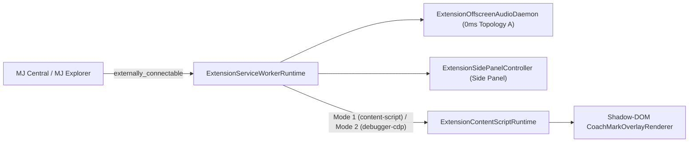

# `@memberjunction/browser-extension-host`

Manifest V3 Chrome Extension Host entry points (`service-worker.ts`, `content-script.ts`, `offscreen-audio.ts`, `sidepanel-bootstrap.ts`, and `manifest.template.json`) for the MemberJunction Browser Extension architecture.

---

## Architecture Overview



---

## Manifest V3 Zero-Banner Permission Model

By default, `"debugger"` is placed in `"optional_permissions"` inside `manifest.template.json`:

```json
{
  "permissions": ["sidePanel", "activeTab", "scripting", "storage", "offscreen", "tabs"],
  "optional_permissions": ["debugger"]
}
```

- **Mode 1 (`'content-script'`, Recommended Default)** runs 100% cleanly on install with **zero Chrome debugger banner**.
- **Mode 2 (`'debugger-cdp'`, Power Mode)** and **Mode 3 (`'auto'`)** request `"debugger"` permission on-demand via `ChromeDebuggerServiceWorkerTransport` only when trusted hardware input or closed Shadow DOM piercing is required.

---

## Entry Points

| Module | Class / Function | Responsibility |
| --- | --- | --- |
| `src/content-script.ts` | `ExtensionContentScriptRuntime`, `BootstrapContentScript` | Bootstraps `InPageContentScriptExecutor` + `CoachMarkOverlayRenderer` + `SensitivePageGuard` in active tabs and watches SPA URL transitions |
| `src/service-worker.ts` | `ExtensionServiceWorkerRuntime`, `ChromeDebuggerServiceWorkerTransport` | Handles `externally_connectable` handoffs, Side Panel opening, Offscreen Audio lifecycle, and CDP 1.3 attachment |
| `src/offscreen-audio.ts` | `ExtensionOffscreenAudioDaemon` | Persistent Offscreen Document daemon for Topology A 0ms zero-blip voice & text transitions across tab navigations |
| `src/sidepanel-bootstrap.ts` | `ExtensionSidePanelController` | Hydrates brand theme (`mj-copilot`, `betty`, `sidecar`) and connects `LocalBrowserChannel` & `BrowserContextEngine` |
