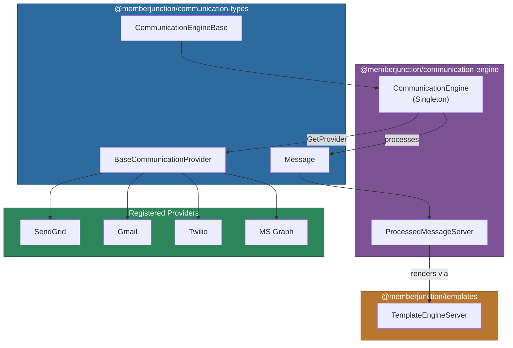
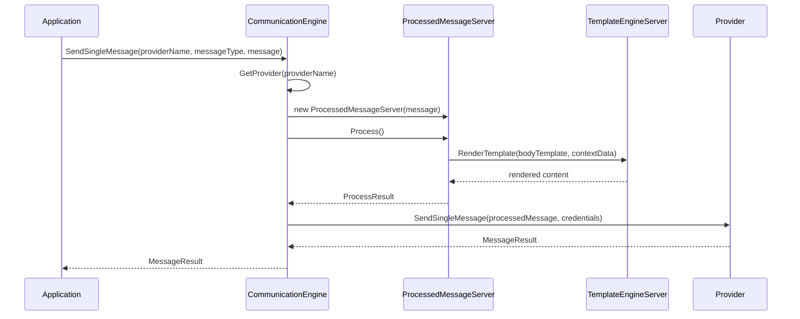

# @memberjunction/communication-engine

Server-side communication engine for MemberJunction. This package extends `CommunicationEngineBase` from `@memberjunction/communication-types` to provide the concrete implementation for sending messages, creating drafts, and managing communication runs through registered providers.

## Architecture



## Installation

```bash
npm install @memberjunction/communication-engine
```

## Key Classes

### CommunicationEngine

Singleton engine that orchestrates message sending across all registered providers. Handles provider lookup via the MJGlobal class factory, message processing (template rendering), communication run lifecycle, and logging.

```typescript
import { CommunicationEngine } from '@memberjunction/communication-engine';
import { Message, MessageRecipient } from '@memberjunction/communication-types';

const engine = CommunicationEngine.Instance;
await engine.Config(false, contextUser);
```

### Sending a Single Message

```typescript
const message = new Message();
message.From = 'sender@example.com';
message.To = 'recipient@example.com';
message.Subject = 'Welcome';
message.HTMLBody = '<h1>Hello</h1>';

const result = await engine.SendSingleMessage(
    'SendGrid',           // provider name
    'Email',              // provider message type name
    message,
    undefined,            // optional CommunicationRunEntity
    false                 // previewOnly
);

if (result.Success) {
    console.log('Message sent');
}
```

### Sending to Multiple Recipients

```typescript
const recipients: MessageRecipient[] = [
    { To: 'alice@example.com', FullName: 'Alice', ContextData: { role: 'admin' } },
    { To: 'bob@example.com', FullName: 'Bob', ContextData: { role: 'user' } }
];

const message = new Message();
message.From = 'noreply@example.com';
message.BodyTemplate = templateEntity; // uses template for personalization
message.Subject = 'Update';

const results = await engine.SendMessages(
    'SendGrid',
    'Email',
    message,
    recipients,
    false // previewOnly
);
// results is MessageResult[] - one per recipient
```

### Creating a Draft

```typescript
const message = new Message();
message.From = 'user@example.com';
message.To = 'recipient@example.com';
message.Subject = 'Draft Email';
message.HTMLBody = '<p>Content here</p>';

const result = await engine.CreateDraft(
    message,
    'Microsoft Graph', // only providers with SupportsDrafts
    contextUser
);

if (result.Success) {
    console.log(`Draft ID: ${result.DraftID}`);
}
```

### Per-Request Credentials

All send methods accept an optional `credentials` parameter for per-request credential overrides:

```typescript
import { SendGridCredentials } from '@memberjunction/communication-sendgrid';

const result = await engine.SendSingleMessage(
    'SendGrid',
    'Email',
    message,
    undefined,
    false,
    { apiKey: 'SG.customer-specific-key' } // per-request credentials
);
```

### ProcessedMessageServer

Server-side implementation of `ProcessedMessage` that renders templates using `TemplateEngineServer`. Automatically processes body, HTML body, and subject templates with the provided context data.



## API Reference

| Method | Description |
|--------|-------------|
| `Config(forceRefresh, contextUser, provider)` | Initialize the engine and load metadata |
| `GetProvider(providerName)` | Retrieve a provider instance from the class factory |
| `SendSingleMessage(provider, type, message, run?, preview?, credentials?)` | Send one message |
| `SendMessages(provider, type, message, recipients, preview?, credentials?)` | Send to multiple recipients |
| `CreateDraft(message, providerName, contextUser?, credentials?)` | Create a draft message |
| `Send(params, contextUser?)` | V2: compliance-gated send to principals and endpoints |
| `EvaluateEligibility(params, contextUser?)` | V2: run the compliance gate without sending |
| `ResolveEndpoints(records, channelID, contextUser?)` | V2: resolve (and register) the endpoints of principal records |
| `ConfigureV2Dispatch(config)` | V2: set chunking, tracking URL, HMAC secret, enforcement default and work-queue publisher |
| `StartScheduledDeferralSweep(intervalMs?)` / `StopScheduledDeferralSweep()` | V2: periodically send due deferred and scheduled messages |
| `ProcessDueScheduledLogs(contextUser?, batchSize?)` | V2: run one sweep pass |
| `CheckV1ComplianceGate(channelID, address, messageClass?, contextUser?)` / `CheckV1ComplianceGateBatch(...)` | Endpoint-status and suppression check used by the V1 send path |

## Communications V2

V2 sends are addressed to principals (records) and endpoints (addresses) under a sender, a channel and a message
class. Every recipient passes through a compliance gate before anything reaches the provider, and delivery
events flow back into suppressions and consent. Read the
[Communications V2 Guide](../../../guides/COMMUNICATIONS_V2_GUIDE.md) for the data flow, the entities, the
deployment requirements and the extension points; this section is the package's API.

### What this package adds

| Export | Purpose |
|--------|---------|
| `CommunicationEngine.Send()`, `EvaluateEligibility()`, `ResolveEndpoints()` | The V2 entry points (table above) |
| `V2SendService`, `V2DispatchConfig` | The pipeline behind those methods and its settings. Use it through the engine. |
| `ComplianceGate`, `ComplianceGateEvalOptions` | The gate. Synchronous, no I/O; usable directly in tests and simulators. |
| `JurisdictionResolver`, `ComplianceMetadataSource` | Jurisdiction expansion and regime/rule selection over the cached metadata |
| `ConsentModelRuleDriver`, `RequireDoubleOptInRuleDriver`, `ConsentEvidenceRuleDriver`, `ConsentExpiryRuleDriver`, `UnsubscribeMechanismRuleDriver`, `UnsubscribeHonorWindowRuleDriver`, `SenderIdentificationRuleDriver`, `QuietHoursRuleDriver`, `TrackingConsentRuleDriver` | The nine built-in rule drivers |
| `ReadParamValue`, `ReadBooleanParam`, `ReadNumberParam`, `ReadStringParam` | Helpers for reading rule parameters in camelCase or PascalCase |
| `DefaultCommunicationPrincipal` | Metadata-driven principal driver, used for any entity without its own |
| `PrincipalRecordKey`, `NormalizeEndpointAddress`, `ComputeEndpointHash` | Keys, address normalization and the endpoint hash |
| `CommsActivityWorker` | Applies `NormalizedActivityEvent`s: endpoint health, suppressions, opt-outs, audit log, activity rows; `EraseEndpointPII()` |
| `SoftBounceThresholdPolicy` | Built-in suppression policy |
| `ComputeTrackingSignature`, `VerifyTrackingSignature`, `RewriteLinksForTracking`, `InjectOpenPixel`, `ComputeProtectedElementsHash` | Tracking and integrity helpers |

### Sending

A new installation cannot send until a sender, a provider, a provider message type and an address mapping for
the recipient's entity are configured. See
[Minimum setup to send one email](../../../guides/COMMUNICATIONS_V2_GUIDE.md#minimum-setup-to-send-one-email)
in the guide.

```typescript
import { CommunicationEngine } from '@memberjunction/communication-engine';

await CommunicationEngine.Instance.Config(false, contextUser);

const result = await CommunicationEngine.Instance.Send(
    {
        Envelope: {
            ChannelID: emailChannelID,             // MJ: Communication Base Message Types ID
            MessageClass: 'Marketing',
            PreferenceID: newsletterPreferenceID,  // optional; enables the opt-in check
            // SenderID omitted: the active sender with IsDefault = 1
        },
        Payload: { Subject: 'October newsletter', HTMLBody: '<p>Hello</p>', Body: 'Hello' },
        Recipients: [{ Principal: { EntityID: contactsEntityID, RecordID: contactID } }],
    },
    contextUser,
);

if (!result.Success) {
    throw new Error(result.ErrorMessage);          // the send could not start
}
for (const outcome of result.Outcomes ?? []) {
    // Status: 'Sent' | 'Blocked' | 'Deferred' | 'Failed' | 'DryRun'
    console.log(outcome.Status, outcome.Reason, outcome.Detail);
}
```

`Send()` checks, in order: an active sender (the default one when `SenderID` is omitted), the caller's
permission on it (`MJ: Communication Sender Permissions`; a sender chain with no rows is unrestricted), the
provider, and a verified sending domain when the provider has `RequireVerifiedDomain`. Any of these failing
returns `Success: false`. After that, blocked or failed recipients are reported per recipient and do not change
`Success`.

The provider is the envelope's `ProviderID`, else the sender's `CommunicationProviderID`. When neither is set,
`Send()` uses the only active sending provider for the channel, and fails if there are several rather than
pick one.

With more recipients than `AsyncThreshold` and a configured `EnqueueWork`, the send is published as
`comms.dispatch` chunks and returns `IsAsyncRun: true` without `Outcomes`. Each chunk carries the caller's
`ActingUserID`, so the worker sends as that user.

**Runs.** A send with no `CommunicationRunID` starts a run and ends it. A send given a `CommunicationRunID`
(a `comms.dispatch` chunk, a templated batch) adds to that run and leaves it open. A chunked run stores its
`ChunkCount`; each chunk, on every exit including refusals and errors, records a `MJ: Communication Run
Chunks` row (unique per run and chunk index, so a redelivered chunk is not counted twice). The chunk that
brings the count to `ChunkCount` sets the run's `Status` to `Complete`, or `Failed` if any chunk was
refused, and sets `EndedAt`.

**Delivery guarantee.** A log is claimed with one conditional `UPDATE` before the provider call, so two
workers never send the same run and endpoint at once; the database provider must support `ExecuteSQL`, and
without it nothing is sent. What happens when a log is found stuck `In-Progress` with no
`ProviderMessageID` for over 15 minutes (its worker died, or saving the log failed after the provider call)
depends on the send's `DeliveryGuarantee`:

| Setting | Stuck log is... | Consequence |
|---|---|---|
| `At Most Once` (default) | reported `Failed` with reason `OutcomeUnknown`, never resent | The recipient may miss the message. Settle it from the provider's delivery events. |
| `At Least Once` | reclaimed and sent again | The recipient may get the message twice. |

The setting comes from the first of these that has one: `Envelope.DeliveryGuarantee`, the run's
`DeliveryGuarantee`, the sender's, its ancestor senders' (nearest first), then the provider's (which defaults
to `At Most Once`). If resolving it fails, `At Most Once` is used. The claim SQL is written for SQL Server.

**Dry runs.** With `Envelope.DryRun`, an accepted message is reported `DryRun` and counted in `DryRunCount`,
not `QueuedCount`. Its log is `Complete` with `IsDryRun` set.

**Deferred sends.** A deferred or scheduled recipient's rendered message is stored in the log's
`DeferredPayload` and cleared once the message is dispatched. `CorrelationData` holds only the caller's data.

**Preferences across senders.** A principal's choice for a preference is read for the sender, its ancestors
and sender-less rows. An opt-out at any of those levels blocks the send; otherwise the nearest row wins.

### Checking eligibility

```typescript
const { Sendable, Blocked } = await CommunicationEngine.Instance.EvaluateEligibility(
    { Envelope: envelope, Recipients: recipients },
    contextUser,
);
for (const b of Blocked) console.log(b.Reason, b.Detail);
for (const s of Sendable) console.log(s.Decision, s.DeferUntil, s.Obligations);
```

### Using the gate directly

```typescript
import { ComplianceGate, JurisdictionResolver } from '@memberjunction/communication-engine';

const gate = new ComplianceGate(new JurisdictionResolver());   // reads CommunicationEngineBase.Instance
const decision = gate.Evaluate(
    {
        Sender: sender,                     // MJCommunicationSenderEntity
        SenderAncestors: [],
        Endpoint: endpoint,                 // MJCommunicationEndpointEntity
        MessageClass: 'Marketing',
        ChannelID: emailChannelID,
        Now: new Date(),
    },
    { Suppressions: suppressions, RecipientJurisdiction: 'DE' },
);
// decision.Decision: 'Allowed' | 'Blocked' | 'Deferred'
```

`JurisdictionResolver` takes an optional `ComplianceMetadataSource`, so tests can supply plain arrays instead of
a configured engine.

### Processing activity

```typescript
import { CommsActivityWorker } from '@memberjunction/communication-engine';

const worker = new CommsActivityWorker();
const batch = await worker.ProcessActivityBatch(events, contextUser);   // NormalizedActivityEvent[]
// batch.ProcessedCount, batch.DuplicateCount, batch.ErrorCount

const erased = await worker.EraseEndpointPII('person@example.org', emailChannelID, contextUser);
```

MJAPI calls `ProcessActivityBatch` from its `comms.activity` work-queue handler; call it yourself only when you
ingest events another way.

### Configuration

```typescript
CommunicationEngine.Instance.ConfigureV2Dispatch({
    ChunkSize: 50,                     // recipients per comms.dispatch item
    AsyncThreshold: 100,               // above this, publish to the work queue
    BaseTrackingURL: 'https://api.example.org/comms',
    TrackingHMACSecret: secret,
    InstanceEnforcementMode: 'Enforce',
    EnqueueWork: async (topic, payload) => { /* publish to your queue */ },
});
```

| Setting | Default | Notes |
|---------|---------|-------|
| `ChunkSize` | 50 | |
| `AsyncThreshold` | 100 | |
| `BaseTrackingURL` | none | Base of unsubscribe, open and click links. MJAPI sets it to its public `/comms` URL. Unset, links are relative and do not work in mail. |
| `TrackingHMACSecret` | `MJ_COMMS_HMAC_SECRET` | Signs click-tracking links. With neither set, links are not rewritten. |
| `InstanceEnforcementMode` | `Enforce` | Used for senders with no `EnforcementMode`. |
| `EnqueueWork` | none | Without it every send runs inline. MJAPI supplies a work-queue publisher. |

Each call merges into the existing configuration and clears the 60-second caches of senders and preferences.

| Environment variable | Required | Purpose |
|----------------------|----------|---------|
| `MJ_COMMS_HMAC_SECRET` | For click tracking | Fallback for `TrackingHMACSecret`. A secret: long, random, the same on every instance. Unset, click links are left as written. |

MJAPI configures all of this at startup (`ConfigureCommsV2WorkQueue` in `@memberjunction/server`); a standalone
host must call `ConfigureV2Dispatch()` and, if it wants deferred sends, `StartScheduledDeferralSweep()` itself.

### V1 sends can opt in to the suppression check

V1 `SendSingleMessage()` and `SendMessages()` are unchanged by default. Set `Message.CheckComplianceGate = true`
on a message, or `MJ_COMMS_V1_COMPLIANCE_GATE=true` for the whole instance, to check the To, CC and BCC
addresses against endpoint status and active suppressions before the provider is called. The class is
`Message.MessageClass` (`Transactional` when absent), so a checked V1 send is blocked by hard bounces, invalid
addresses and erased endpoints, and additionally by complaints, unsubscribes, admin blocks and policy
suppressions when the caller marks it `Operational` or `Marketing`. Suppressions on a principal that has used
the address (through `MJ: Communication Endpoint Principals`) count as well as suppressions on the address
itself. A blocked send returns `Success: false` and marks its log `Failed`. Addresses with no endpoint row are
always allowed.

## Dependencies

| Package | Purpose |
|---------|---------|
| `@memberjunction/communication-types` | Base engine, provider, and message types |
| `@memberjunction/core` | UserInfo, logging, metadata access |
| `@memberjunction/core-entities` | CommunicationRunEntity and related entities |
| `@memberjunction/global` | MJGlobal class factory for provider instantiation |
| `@memberjunction/templates` | Server-side template rendering engine |

## Development

```bash
npm run build    # Compile TypeScript
npm start        # Watch mode
```
