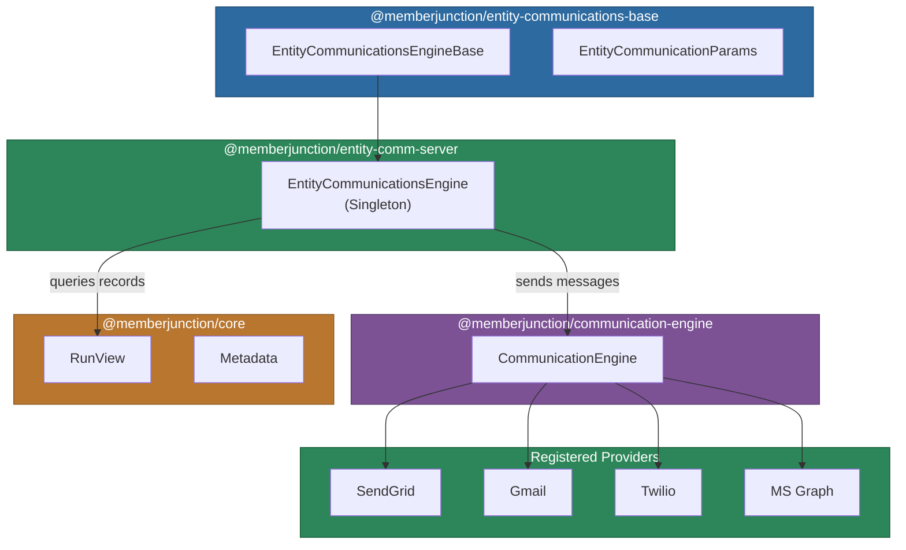
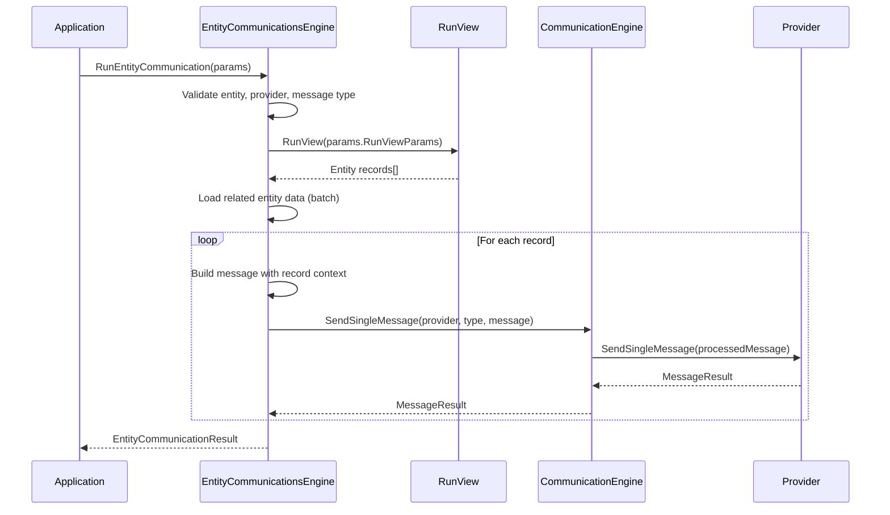

# @memberjunction/entity-communications-server

Server-side implementation of the MemberJunction Entity Communications Engine. Connects the entity/view system to the communication framework, enabling bulk messaging to records retrieved from entity views with full template rendering, related-entity data resolution, and multi-provider support.

## Architecture



## Installation

```bash
npm install @memberjunction/entity-communications-server
```

## Usage

### Basic Example

```typescript
import { EntityCommunicationsEngine } from '@memberjunction/entity-communications-server';
import { EntityCommunicationParams } from '@memberjunction/entity-communications-base';

const engine = EntityCommunicationsEngine.Instance;
await engine.Config(false, contextUser);

const params: EntityCommunicationParams = {
    EntityID: 'entity-uuid',
    RunViewParams: {
        EntityName: 'Contacts',
        ExtraFilter: 'Status = "Active"'
    },
    ProviderName: 'SendGrid',
    ProviderMessageTypeName: 'Email',
    Message: {
        Subject: 'Welcome',
        Body: 'Hello {{FirstName}}!',
        HTMLBodyTemplate: htmlTemplate
    },
    PreviewOnly: false
};

const result = await engine.RunEntityCommunication(params);
if (result.Success) {
    console.log(`Sent ${result.Results.length} messages`);
}
```

### Template Parameters with Related Entity Data

When templates reference related entities, the engine automatically fetches the related data in batch and populates each recipient's context:

```typescript
const params: EntityCommunicationParams = {
    EntityID: 'customer-entity-id',
    RunViewParams: { EntityName: 'Customers', ViewName: 'Premium Customers' },
    ProviderName: 'SendGrid',
    ProviderMessageTypeName: 'Email',
    Message: {
        BodyTemplate: templateWithRelatedEntities
    }
};
// Engine auto-fetches related orders for each customer
const result = await engine.RunEntityCommunication(params);
```

### Checking Entity Communication Support

```typescript
if (engine.EntitySupportsCommunication(entityID)) {
    const messageTypes = engine.GetEntityCommunicationMessageTypes(entityID);
    messageTypes.forEach(mt => {
        console.log(`Type: ${mt.BaseMessageType}`);
        mt.CommunicationFields.forEach(field => {
            console.log(`  Field: ${field.FieldName} (Priority: ${field.Priority})`);
        });
    });
}
```

## Processing Pipeline



## Key Features

- **Bulk Message Sending**: Send to all records from an entity view in a single call
- **Template Parameter Resolution**: Automatically fetches related entity data for template parameters
- **Multi-Provider Support**: Works with any registered communication provider (email, SMS, etc.)
- **Preview Mode**: Test communications without sending (`PreviewOnly: true`)
- **Context Data Population**: Per-recipient template context from entity record fields
- **Scheduled Sending**: Supports provider-level `SendAt` scheduling
- **Communication Logging**: All sends are tracked through `CommunicationRun` and `CommunicationLog` entities

## Configuration

### Entity Communication Setup

For an entity to support communications:

1. Configure `Entity Communication Message Types` in the MJ metadata
2. Set up `Entity Communication Fields` to define recipient address fields
3. Configure field priorities for automatic recipient resolution

### Template Parameters

Templates support multiple parameter types:

- **Record**: The current entity record being processed
- **Entity**: Related entity data fetched based on relationships
- **Array/Scalar/Object**: Direct programmatic use (not supported in messaging)

When using related entity parameters, the engine automatically:
1. Identifies unique relationships needed
2. Fetches all related data in batch queries
3. Filters related data per recipient record
4. Populates template context with filtered data

## Communications V2

This package adds two things for [Communications V2](../../../guides/COMMUNICATIONS_V2_GUIDE.md): a service for
templated V2 sends, and a bridge that lets `RunEntityCommunication()` use the V2 pipeline.

### TemplatedCommunicationService

`TemplatedCommunicationService` implements `ITemplatedCommunicationService` from
`@memberjunction/communication-types`. It evaluates compliance eligibility first, then renders MJ templates for
the recipients that may be sent to, and dispatches them with `CommunicationEngine.Instance.Send()`.

| Method | Purpose |
|--------|---------|
| `Instance` | The process-wide singleton |
| `Configure(config)` | Set `BatchSize`, `EnqueueWork`, `ResolveUser` |
| `RenderAndSend(params, contextUser?, provider?)` | Evaluate, render and send. Returns `SendV2Result`. |
| `RenderAndPreview(params, contextUser?, provider?)` | Evaluate and render without sending. Returns `{ TotalCount, Rendered, Blocked }`. |
| `HandleRenderBatch(payload, contextUser?, provider?)` | Render and send one `comms.render` batch. Called by the work-queue handler. |
| `ValidateTemplateContextParamAlignment(templates)` | Throws when the subject, body and HTML templates define the same parameter differently |

```typescript
import { TemplatedCommunicationService } from '@memberjunction/entity-communications-server';

const result = await TemplatedCommunicationService.Instance.RenderAndSend(
    {
        Envelope: { ChannelID: emailChannelID, MessageClass: 'Marketing', PreferenceID: newsletterPreferenceID },
        EntityID: contactsEntityID,
        Recipients: [
            { Principal: { EntityID: contactsEntityID, RecordID: contactID }, ContextData: { Offer: 'A' } },
        ],
        Templates: {
            SubjectTemplateID: subjectTemplateID,
            HTMLBodyTemplateID: htmlTemplateID,
            SharedContextData: { Season: 'Autumn' },
        },
        AutoAppendComplianceFooter: true,
        RenderMode: 'Inline',          // or 'WorkQueue' (the default)
    },
    contextUser,
);
```

Template data for each recipient is, in increasing precedence: `SharedContextData`, the recipient's
`ContextData`, the templates' own parameters (including related-entity data, loaded once per batch), and three
reserved keys:

| Key | Content |
|-----|---------|
| `Sender` | The sender's merged `TemplateContext` |
| `Recipient` | The principal's `RecordData`, its resolved attributes (`FullName`, `Timezone`, ...) and `Endpoint` |
| `Comms.Obligations` | The gate's obligations, such as `RequireFooterUnsubscribe`, `SenderPostalAddress` and `SenderName`. `UnsubscribeURL` is empty here: the recipient's unsubscribe link is created with the log, at dispatch. |

When no HTML template is given, the body template's HTML content is used for the HTML body.

Templates do not need to render an unsubscribe link or postal address. When the gate requires them, the
dispatcher appends the compliance footer (`<div data-mj-compliance-footer="true">`) to every message after
rendering. `AutoAppendComplianceFooter` additionally appends the required postal address at render time, which
is what a preview shows; the unsubscribe link cannot be part of it because it does not exist until dispatch.

**Render modes.** `'Inline'` renders and sends in the calling process and returns per-recipient outcomes.
`'WorkQueue'` publishes `comms.render` batches of `BatchSize` recipients when `EnqueueWork` is configured and
returns `IsAsyncRun: true`; without a publisher it processes the batches in-process. Async batches are rendered
as the acting user (`ActingUserID`, resolved through `ResolveUser`), so row- and field-level security apply to
template data in the worker exactly as they would inline; a batch whose user cannot be resolved fails.

#### Configuration

| Setting | Default | Notes |
|---------|---------|-------|
| `BatchSize` | 50 | Recipients per `comms.render` item |
| `EnqueueWork` | none | Publisher for `comms.render`. MJAPI supplies one when its work queue is enabled. |
| `ResolveUser` | none | Maps a user ID to a `UserInfo` for async batches. MJAPI supplies `UserCache`. |

The package reads no environment variables.

### The V1 bridge

`RunEntityCommunication()` behaves as before unless the caller opts in:

```typescript
const result = await EntityCommunicationsEngine.Instance.RunEntityCommunication({
    EntityID: contactsEntityID,
    RunViewParams: { EntityName: 'Contacts', ExtraFilter: "Status = 'Active'" },
    ProviderName: 'SendGrid',
    ProviderMessageTypeName: 'Email',
    Message: message,
    UseV2: true,
}, contextUser);
```

| | V1 path (default) | `UseV2: true` |
|---|---|---|
| Sender | `Message.From` | The default `MJ: Communication Senders` row |
| Message class | `Operational` (unless `Message.MessageClass` is set) | `Operational` |
| Checks | None by default. Endpoint status and suppressions when `Message.CheckComplianceGate` or `MJ_COMMS_V1_COMPLIANCE_GATE=true` is set | The full gate: suppressions, regimes, quiet hours |
| Added to the message | Nothing | Compliance footer, unsubscribe headers, tracking, as the regimes require |
| Rendering | Per recipient, in-process | `TemplatedCommunicationService` (`Inline` for `PreviewOnly` or `IncludeProcessedMessages`, else `WorkQueue`); untemplated messages go straight to `CommunicationEngine.Send()` |
| Result | `EntityCommunicationResult` | The same shape; blocked and deferred recipients are items with `Skipped: true` |

`UseV2` is ignored when the message sets `From`, CC or BCC recipients, or pairs a literal `Subject` with a body
template. Field-level security on the address field is enforced on both paths: a recipient whose address the
acting user may not read is skipped.

Both paths now stop a send to an address with a hard bounce, an invalid-address or erased status, a complaint,
an unsubscribe, an admin block or a policy suppression.

## Dependencies

| Package | Purpose |
|---------|---------|
| `@memberjunction/entity-communications-base` | Shared types and base engine class |
| `@memberjunction/communication-engine` | CommunicationEngine for message delivery |
| `@memberjunction/core` | RunView, Metadata, UserInfo, EntityInfo |
| `@memberjunction/core-entities` | Entity type definitions |
| `@memberjunction/global` | Class registration |

## Development

```bash
npm run build    # Compile TypeScript
npm start        # Watch mode
```
