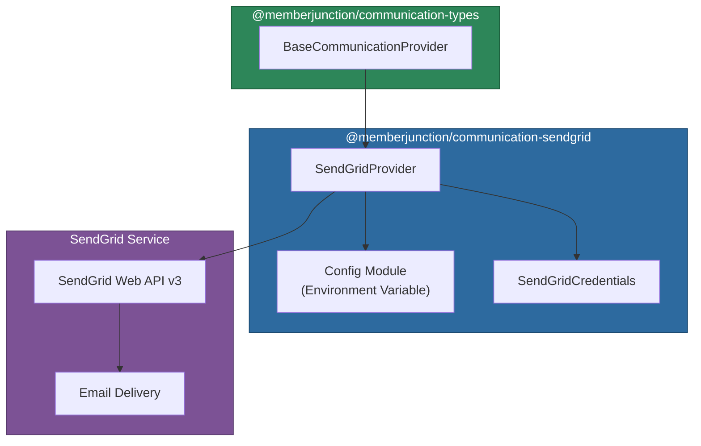

# @memberjunction/communication-sendgrid

SendGrid provider for the MemberJunction Communication Framework. This provider enables transactional email sending through the SendGrid API, with support for HTML and plain text content, CC/BCC recipients, scheduled delivery, and per-request credential overrides.

## Architecture



## Installation

```bash
npm install @memberjunction/communication-sendgrid
```

## Configuration

Set the following environment variable:

```env
COMMUNICATION_VENDOR_API_KEY__SENDGRID=SG.your-api-key-here
```

| Variable | Required | Purpose |
|----------|----------|---------|
| `COMMUNICATION_VENDOR_API_KEY__SENDGRID` | Unless every call passes credentials | SendGrid API key, used for sends and for sending-domain and suppression calls when no credentials are passed. A secret. Not used when the credentials set `disableEnvironmentFallback`, which Communications V2 does for any sender that has a linked credential. |
| `COMMUNICATION_VENDOR_WEBHOOK_KEY__SENDGRID` | For MJAPI's `POST /comms/webhooks/sendgrid` route | SendGrid Event Webhook public verification key. Read by `@memberjunction/server`, not by this package; see [Event Webhook](#event-webhook). |

## Supported Operations

SendGrid is a send-only transactional email service. It does not provide mailbox access.

| Operation | Supported | Notes |
|-----------|-----------|-------|
| `SendSingleMessage` | Yes | Full email sending with HTML, text, CC/BCC, scheduling |
| `GetMessages` | No | No inbox access (throws error) |
| `ForwardMessage` | No | No mailbox operations (throws error) |
| `ReplyToMessage` | No | No mailbox operations (throws error) |
| `CreateDraft` | No | No mailbox access (returns error result) |
| Extended operations | No | No folder, search, or attachment operations |
| `ParseNotification` | Yes | Event Webhook batches (`application/json`) and Inbound Parse posts (`multipart/form-data`) |
| `CreateDomainAuthentication` / `VerifyDomainAuthentication` / `DeleteDomainAuthentication` | Yes | SendGrid domain authentication (`/v3/whitelabel/domains`) |

## Usage

### Sending Email via CommunicationEngine

```typescript
import { CommunicationEngine } from '@memberjunction/communication-engine';
import { Message } from '@memberjunction/communication-types';

const engine = CommunicationEngine.Instance;
await engine.Config(false, contextUser);

const message = new Message();
message.From = 'noreply@example.com';
message.FromName = 'My Application';
message.To = 'recipient@example.com';
message.Subject = 'Order Confirmation';
message.HTMLBody = '<h1>Thank you for your order</h1>';
message.Body = 'Thank you for your order';
message.CCRecipients = ['accounting@example.com'];

const result = await engine.SendSingleMessage('SendGrid', 'Email', message);
if (result.Success) {
    console.log('Email sent successfully');
}
```

### Scheduled Sending

```typescript
const message = new Message();
message.From = 'noreply@example.com';
message.To = 'recipient@example.com';
message.Subject = 'Scheduled Report';
message.Body = 'Your weekly report is attached.';
message.SendAt = new Date('2025-12-01T09:00:00Z');

const result = await engine.SendSingleMessage('SendGrid', 'Email', message);
```

### Per-Request Credentials

Override the API key for multi-tenant or customer-specific sending:

```typescript
import { SendGridCredentials } from '@memberjunction/communication-sendgrid';

// Override API key
const result = await engine.SendSingleMessage(
    'SendGrid',
    'Email',
    message,
    undefined,
    false,
    { apiKey: 'SG.customer-specific-api-key' } as SendGridCredentials
);

// Disable environment fallback (require explicit key)
const result2 = await engine.SendSingleMessage(
    'SendGrid',
    'Email',
    message,
    undefined,
    false,
    {
        apiKey: 'SG.required-key',
        disableEnvironmentFallback: true
    } as SendGridCredentials
);
```

### Direct Provider Usage

```typescript
import { SendGridProvider } from '@memberjunction/communication-sendgrid';

const provider = new SendGridProvider();
const result = await provider.SendSingleMessage(processedMessage);
```

## Message Features

| Feature | Support |
|---------|---------|
| HTML body | Yes |
| Plain text body | Yes |
| CC recipients | Yes |
| BCC recipients | Yes |
| From name | Yes |
| Scheduled send (`SendAt`) | Yes (converted to Unix timestamp) |
| Subscription tracking | Disabled by default |

## SendGridCredentials

```typescript
interface SendGridCredentials extends ProviderCredentialsBase {
    /** SendGrid API key (typically starts with 'SG.') */
    apiKey?: string;
    /** If true, do not fall back to environment variables */
    disableEnvironmentFallback?: boolean;
    /** Event Webhook ECDSA public key (PEM, or base64 SPKI DER), used by ParseNotification */
    webhookVerificationKey?: string;
    /** Skip the 10-minute replay window; for queued workers re-verifying a body verified at ingress */
    skipReplayWindow?: boolean;
}
```

## Communications V2

The provider supports the three provider-side parts of
[Communications V2](../../../../guides/COMMUNICATIONS_V2_GUIDE.md): correlated sends, delivery events, and
sending-domain authentication.

### Sends

For a message sent through the V2 pipeline, the provider:

- passes `Message.Headers` to SendGrid unchanged, so `List-Unsubscribe` and `List-Unsubscribe-Post` arrive as set;
- sends the log ID as `customArgs.mj_log_id` when `Message.CorrelationLogID` is set, and nothing else: caller
  correlation data is never sent to SendGrid;
- turns SendGrid's open and click tracking off when `Message.DisableProviderTracking` is set, because MJ adds
  its own. Subscription tracking is always off;
- returns SendGrid's `X-Message-Id` as `MessageResult.ProviderMessageID`.

### Event Webhook

`ParseNotification` accepts an Event Webhook batch (`Content-Type: application/json`), verifies its ECDSA
signature against `credentials.webhookVerificationKey`, and returns one notification with `Kind: 'activity'`
whose `ActivityEvents` are `NormalizedActivityEvent`s. Without a verification key the batch is rejected
(`401`); an unverified batch is never parsed.

| SendGrid event | Normalized `EventType` |
|----------------|------------------------|
| `processed` | `Queued` |
| `delivered` | `Delivered` |
| `deferred` | `Deferred` |
| `bounce` | `Hard Bounce` or `Soft Bounce`, by bounce type and classification |
| `dropped` | `Dropped`, with `DropReason` normalized |
| `open` | `Opened` (`IsMachineEvent` from `sg_machine_open`) |
| `click` | `Clicked` |
| `spamreport` | `Spam Complaint` |
| `unsubscribe`, `group_unsubscribe` | `Unsubscribed` |

Other events are ignored. `sg_event_id` becomes `ProviderEventID` (the deduplication key), `sg_message_id`
becomes `ProviderMessageID`, and `mj_log_id` becomes `CommunicationLogID`. `CommunicationProviderID` is left
empty for the caller to fill in.

Two helpers are exported for hosts that verify at the HTTP edge:

```typescript
import {
    NormalizeSendGridWebhookEvents,
    VerifySendGridWebhookSignature,
} from '@memberjunction/communication-sendgrid';

const check = VerifySendGridWebhookSignature(
    publicKey,                                              // PEM, or the base64 key SendGrid shows
    rawBody,                                                // exact bytes received (Buffer or string)
    request.headers['x-twilio-email-event-webhook-signature'],
    request.headers['x-twilio-email-event-webhook-timestamp'],
);
if (!check.Valid) {
    return response.status(401).json({ error: check.Reason });
}
const events = NormalizeSendGridWebhookEvents(JSON.parse(rawBody.toString('utf8')));
```

The signature covers the timestamp followed by the raw body, so verify before any JSON parsing or re-encoding.
A timestamp more than 10 minutes from now is rejected.

**Setup.** In SendGrid, enable the Event Webhook with signature verification and post it to MJAPI's
`<public MJAPI URL>/comms/webhooks/sendgrid`. Give MJAPI the public verification key either as
`COMMUNICATION_VENDOR_WEBHOOK_KEY__SENDGRID`, or, for more than one SendGrid account, as the
`webhookVerificationKey` value of an `MJ: Credentials` row whose type or name contains "sendgrid", posting to
`/comms/webhooks/sendgrid/<credential ID>`. MJAPI handles the route, the queueing and the processing; see
[`@memberjunction/server`](../../../MJServer/README.md#communications-v2).

### Sending-domain authentication

```typescript
const provider = CommunicationEngine.Instance.GetProvider('SendGrid');

const created = await provider.CreateDomainAuthentication({ Domain: 'example.org' }, credentials);
// created.ProviderDomainID, created.DNSRecords (CNAME/TXT records for DKIM, SPF, Return-Path)

const verified = await provider.VerifyDomainAuthentication(
    { ProviderDomainID: created.ProviderDomainID!, Domain: 'example.org' },
    credentials,
);
// verified.Verified is true when SendGrid validates its records AND a _dmarc.example.org TXT record exists

await provider.DeleteDomainAuthentication({ ProviderDomainID: created.ProviderDomainID! }, credentials);
```

All three return `Success: false` with an `ErrorMessage` rather than throwing. Delete treats a domain SendGrid
no longer has as success. In MJAPI these are driven by the `Communications.*SendingDomain` Remote Operations and
the admin dashboard.

### Removing a SendGrid suppression

```typescript
import { SendGridProvider } from '@memberjunction/communication-sendgrid';

const sendgrid = CommunicationEngine.Instance.GetProvider('SendGrid') as SendGridProvider;
await sendgrid.RemoveSuppression('person@example.org', 'bounces', credentials);
// omit the type to clear bounces, blocks, invalid_emails, spam_reports and the global unsubscribe
```

MJAPI calls this when an admin revokes a suppression, so SendGrid does not keep dropping mail MJ has allowed
again.

## Dependencies

| Package | Purpose |
|---------|---------|
| `@memberjunction/communication-types` | Base provider class and type definitions |
| `@memberjunction/core` | Logging utilities (LogError, LogStatus) |
| `@memberjunction/global` | RegisterClass decorator |
| `@sendgrid/mail` | Official SendGrid Node.js client |
| `dotenv` | Environment variable loading |
| `env-var` | Environment variable validation |

## Development

```bash
npm run build    # Compile TypeScript
npm run clean    # Remove dist directory
```
